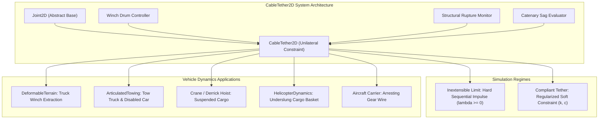
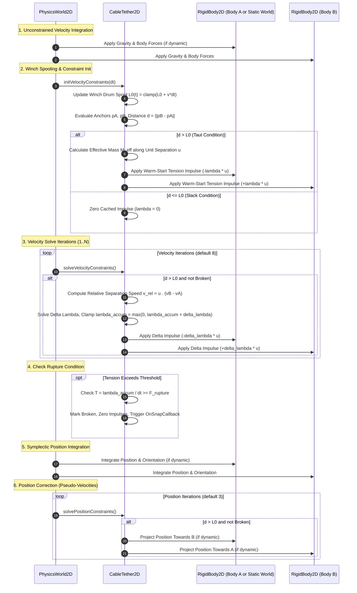
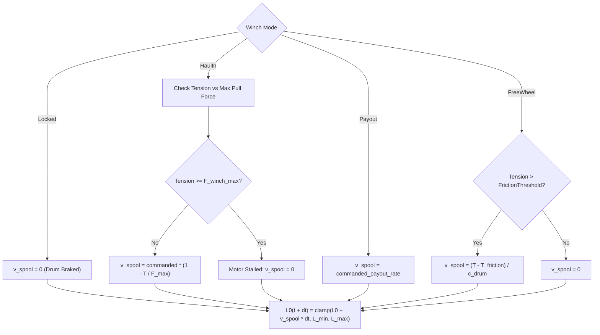
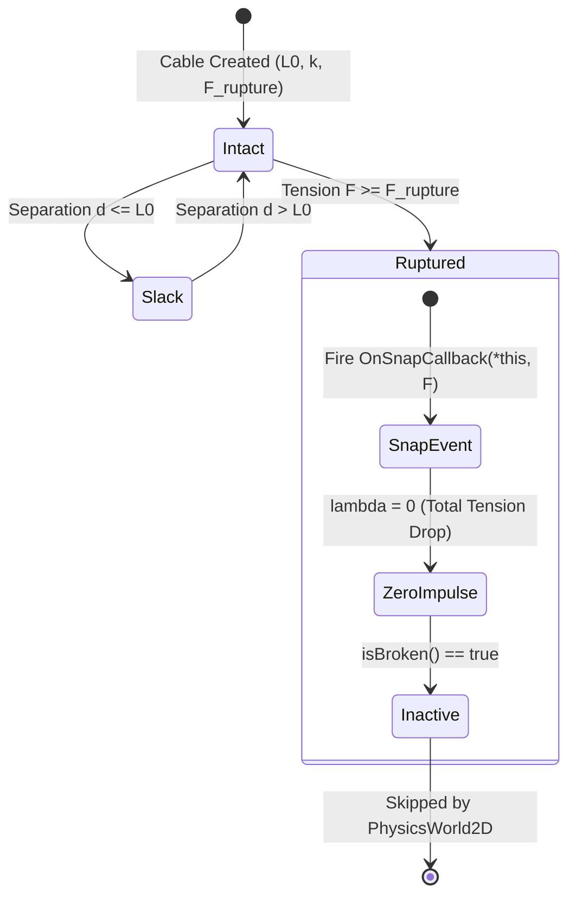
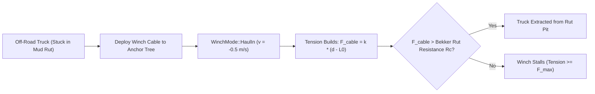
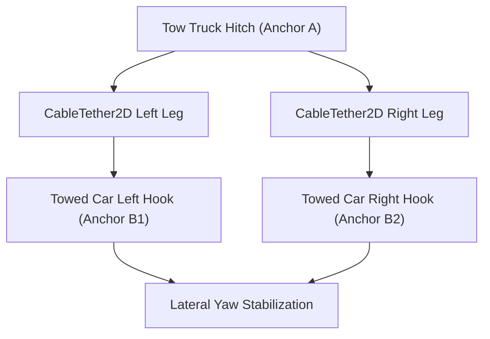

# Winch, Tow Cable and Elastic Tether Mechanics (`CableTether2D`): C++17 Implementation Plan

## 1. Executive Summary & Scope

### 1.1 Objective & Context
This specification details the mathematical models, algorithmic derivations, architectural design, C++17 class interfaces, and implementation roadmap for **Winch, Tow Cable and Elastic Tether Mechanics (`CableTether2D`)** as proposed in Section 7.1 of [docs/ProposedFeatures.md](ProposedFeatures.md).

In 2D vehicle simulations and games, mechanical linkages between vehicles and the environment extend beyond rigid rods and bilateral joints. Standard multi-body joints (such as [DistanceJoint2D](../libs/VehicleSimCore/physics/DistanceJoint2D.h) or [RevoluteJoint2D](../libs/VehicleSimCore/physics/RevoluteJoint2D.h)) enforce bilateral constraints that both push and pull. Real-world recovery cables, winch lines, tow ropes, crane slings, and mooring lines are **strictly unilateral**: they transmit tensile forces when stretched taut ($d > L_0$), but fold into slack loops without resisting compression when pushed ($d \le L_0$).

`CableTether2D` introduces a high-fidelity, deterministic physical cable and winch component integrated into the `VehicleSimCore` multi-body constraint solver:
1. **Unilateral Constraint Formulation**:
   - Enforces tensile forces exclusively ($T \ge 0$), with zero compressive resistance ($T = 0$ when $d \le L_0$).
   - Supports both **inextensible cable limits** (hard sequential impulse constraint with Baumgarte stabilization) and **viscoelastic compliance** (regularized soft constraint theory with stiffness $k$ and damping $c$, or natural frequency $f_0$ and damping ratio $\zeta$).
2. **Dynamic Winch Drum Spooling**:
   - Time-varying rest length $\frac{dL_0}{dt} = v_{\text{spool}}$ with powered haul-in ($v_{\text{spool}} < 0$), powered payout ($v_{\text{spool}} > 0$), locked drum brake, and freewheeling payout under tension.
   - Motor stall torque limits ($F_{\text{winch,max}}$) preventing haul-in when load exceeds motor capacity.
3. **Structural Rupture & Snap Failure**:
   - Configurable ultimate tensile strength threshold ($F_{\text{rupture}}$).
   - Instantaneous tension release upon snap failure, with synchronous notification callbacks (`OnSnapCallback`) and snapshot preservation.
4. **Static World Anchoring**:
   - Supports linkage between two dynamic bodies, or between a single dynamic body and a fixed world terrain coordinate (e.g., roadside tree, ground anchor, crane hook, dock cleat) with zero dummy body overhead.
5. **Catenary Sag Geometry**:
   - Deterministic 2D parabolic catenary sag profile evaluation when slack, supporting realistic debug rendering and visual telemetry in applications.

```
  ASCII Diagram: CableTether2D Recovery Winch & Tow Cable Topology

  Case A: Dynamic Recovery Winch Between Two Vehicles
  [ Recovery Tow Truck ]                             [ Immobilized Vehicle in Mud ]
  +----------------------+                           +----------------------------+
  | RigidBody A          |                           | RigidBody B                |
  | Winch Drum (L0, v)   *~~~~~~~~~~~~~~~~~~~~~~~~~~~* Tow Shackle Hook           |
  | Anchor pA            |       Tension Force       | Anchor pB                  |
  +----------------------+          F_cable          +----------------------------+
             \                                                    /
  ============*==================================================*================= Mud Surface

  Case B: World-Anchored Winch Recovery (Ground / Tree Anchor)
  [ Fixed World Anchor ]                             [ Off-Road 4x4 Truck ]
  +----------------------+                           +--------------------+
  | Fixed Tree / Pylon   |                           | RigidBody B        |
  | Anchor pA (Static)   *~~~~~~~~~~~~~~~~~~~~~~~~~~~* Front Bumper Winch |
  | (Body A = nullptr)   |       Spool In (v < 0)    | Drum L0(t), Motor  |
  +----------------------+                           +--------------------+

  Case C: Slack Cable Catenary Sag
                         Anchor pA *               * Anchor pB
                                    \             /
                                     \  Catenary /   Sag Amplitude h_sag
                                      '---.___.-'    (d < L0, Tension F = 0)
```



### 1.2 Core Architectural Requirements
1. **Zero Dynamic Allocation**:
   - All mass matrices, unit separation vectors, limit states, and warm-starting impulse caches reside directly inside class members.
   - Zero heap allocations (`malloc`, `new`) during `initVelocityConstraints`, `solveVelocityConstraints`, and `solvePositionConstraints`.
2. **Strict IEEE 754 Determinism**:
   - Fully deterministic across Linux (GCC, Clang) and Windows (MSVC, Clang).
   - Zero OS-specific headers (`windows.h`, `unistd.h`), zero indeterminate floating-point reassociations.
3. **Symplectic Integration & Sequential Impulse Compatibility**:
   - Directly executes within the 3-phase constraint solver loop in [PhysicsWorld2D](../libs/VehicleSimCore/physics/PhysicsWorld2D.h).
   - Unilateral impulse clamping ($\lambda \ge 0$) ensures stability without high-frequency stiffness chatter or energy explosion.
4. **Safety & Standards Compliance**:
   - Conforms strictly to **MISRA C++:2023** and **SEI CERT C++**.
   - All methods and member variables explicitly initialized with `{}`.
   - All query and calculation methods decorated with `[[nodiscard]]`.
   - All function identifiers strictly less than 30 characters.
   - Full Doxygen API documentation (`/// @brief`, `@details`, `@param`, `@return`).

---

## 2. High-Level Architecture & Component Decomposition

### 2.1 File Organization and Co-Location
All header and implementation files are co-located in `libs/VehicleSimCore/physics/`:

```
libs/VehicleSimCore/
└── physics/
    ├── Joint2D.h                  [MODIFIED] - Add JointType::Cable to enum
    ├── CableTether2D.h            [NEW]      - Unilateral cable, winch controller, and rupture interface
    ├── CableTether2D.cpp          [NEW]      - Unilateral sequential impulse solver and winch kinematics
    ├── PhysicsWorld2D.h           [EXISTING] - Manages multi-body joints and lifecycle
    └── PhysicsWorld2D.cpp         [EXISTING] - Executes 3-phase constraint loop (skips broken joints)
```

### 2.2 Class Hierarchy & Solver Lifecycle



---

## 3. Mathematical & Algorithmic Formulations

### 3.1 Kinematics and Anchor Frames
Let:
- Body $A$: Position $\mathbf{x}_A \in \mathbb{R}^2$, orientation angle $\theta_A$, linear velocity $\mathbf{v}_A$, angular velocity $\omega_A$, mass $m_A$, moment of inertia $I_A$. If Body $A$ is `nullptr` (or static), then $m_A^{-1} = 0$, $I_A^{-1} = 0$, $\mathbf{v}_A = \mathbf{0}$, $\omega_A = 0$.
- Body $B$: Position $\mathbf{x}_B \in \mathbb{R}^2$, orientation angle $\theta_B$, linear velocity $\mathbf{v}_B$, angular velocity $\omega_B$, mass $m_B$, moment of inertia $I_B$.
- Local anchor coordinates: $\mathbf{r}_A^{\text{local}}$, $\mathbf{r}_B^{\text{local}}$.
- World anchor positions:
  $$\mathbf{p}_A = \begin{cases} \mathbf{x}_A + \mathbf{R}(\theta_A)\mathbf{r}_A^{\text{local}} & \text{if Body } A \ne \text{nullptr} \\ \mathbf{r}_A^{\text{local}} & \text{if Body } A = \text{nullptr (World Anchor)} \end{cases}$$
  $$\mathbf{p}_B = \begin{cases} \mathbf{x}_B + \mathbf{R}(\theta_B)\mathbf{r}_B^{\text{local}} & \text{if Body } B \ne \text{nullptr} \\ \mathbf{r}_B^{\text{local}} & \text{if Body } B = \text{nullptr (World Anchor)} \end{cases}$$
- Separation displacement vector:
  $$\mathbf{d} = \mathbf{p}_B - \mathbf{p}_A$$
- Euclidean separation distance:
  $$d = \|\mathbf{d}\| = \sqrt{d_x^2 + d_y^2}$$
- Unit separation axis (pointing from $A$ to $B$):
  $$\mathbf{u} = \begin{cases} \frac{\mathbf{d}}{d} & \text{if } d > \epsilon_{\text{length}} \\ \begin{bmatrix} 1 \\ 0 \end{bmatrix} & \text{if } d \le \epsilon_{\text{length}} \end{cases}$$
  where $\epsilon_{\text{length}} = 10^{-6}\,\text{m}$.
- Moment arms in world frame:
  $$\mathbf{r}_A = \mathbf{p}_A - \mathbf{x}_A \quad (\mathbf{r}_A = \mathbf{0} \text{ if static world anchor})$$
  $$\mathbf{r}_B = \mathbf{p}_B - \mathbf{x}_B \quad (\mathbf{r}_B = \mathbf{0} \text{ if static world anchor})$$

---

### 3.2 Unilateral Constraint Equations

#### 3.2.1 Position Constraint
A cable constraint is an inequality constraint enforcing that distance cannot exceed current unstretched rest length $L_0(t)$:
$$C(\mathbf{x}, t) = d - L_0(t) \le 0$$

Two distinct kinematic states arise:
1. **Slack State ($d \le L_0(t)$)**:
   - The constraint is inactive.
   - Tension force is zero: $F_{\text{cable}} = 0$.
   - Constraint impulse is zero: $\lambda = 0$.
2. **Taut State ($d > L_0(t)$)**:
   - The constraint is active.
   - Constraint violation / strain:
     $$\Delta L = d - L_0(t) > 0, \quad \epsilon = \frac{d - L_0(t)}{L_0(t)}$$

#### 3.2.2 Velocity Constraint and Jacobian
Differentiating $C$ with respect to time $t$:
$$\dot{C} = \frac{d}{dt}\|\mathbf{p}_B - \mathbf{p}_A\| = \mathbf{u} \cdot (\dot{\mathbf{p}}_B - \dot{\mathbf{p}}_A)$$
Anchor velocities:
$$\dot{\mathbf{p}}_A = \mathbf{v}_A + \omega_A \times \mathbf{r}_A = \mathbf{v}_A + \omega_A \begin{bmatrix} -r_{A,y} \\ r_{A,x} \end{bmatrix}$$
$$\dot{\mathbf{p}}_B = \mathbf{v}_B + \omega_B \times \mathbf{r}_B = \mathbf{v}_B + \omega_B \begin{bmatrix} -r_{B,y} \\ r_{B,x} \end{bmatrix}$$
Relative separation rate:
$$\dot{C} = \mathbf{u} \cdot (\mathbf{v}_B - \mathbf{v}_A) + (\mathbf{r}_B \times \mathbf{u})\omega_B - (\mathbf{r}_A \times \mathbf{u})\omega_A$$
where $2\text{D}$ cross product scalar: $\mathbf{r} \times \mathbf{u} = r_x u_y - r_y u_x$.

In matrix form $\mathbf{J} \mathbf{v} \le 0$:
$$\mathbf{J} = \begin{bmatrix} -\mathbf{u}^T & -(\mathbf{r}_A \times \mathbf{u}) & \mathbf{u}^T & (\mathbf{r}_B \times \mathbf{u}) \end{bmatrix}$$

#### 3.2.3 Effective Mass
The scalar effective mass along unit axis $\mathbf{u}$ is:
$$K = \mathbf{J} \mathbf{M}^{-1} \mathbf{J}^T = m_A^{-1} + m_B^{-1} + I_A^{-1} (\mathbf{r}_A \times \mathbf{u})^2 + I_B^{-1} (\mathbf{r}_B \times \mathbf{u})^2$$
$$M_{\text{eff}} = \begin{cases} \frac{1}{K} & \text{if } K > 10^{-9} \\ 0.0 & \text{otherwise} \end{cases}$$

---

### 3.3 Regularized Soft Compliance and Inextensible Limit
To represent both **inextensible steel cables** and **elastic nylon/rubber tethers**, `CableTether2D` implements regularized constraint theory (matching the mathematical framework of `DistanceJoint2D` and `WheelJoint2D`).

Given user-specified spring stiffness $k_{\text{cable}}\,[\text{N/m}]$ and damping coefficient $c_{\text{cable}}\,[\text{N}\cdot\text{s/m}]$, OR natural oscillation frequency $f_0\,[\text{Hz}]$ and damping ratio $\zeta$:
$$\omega_n = 2\pi f_0, \quad k = M_{\text{eff}} \omega_n^2, \quad c = 2 M_{\text{eff}} \zeta \omega_n$$
Soft constraint regularization parameters:
$$\gamma = \frac{1}{\Delta t (c + \Delta t \cdot k)}, \quad \beta = \frac{\Delta t \cdot k}{c + \Delta t \cdot k}$$
Regularized effective mass:
$$\tilde{K} = K + \gamma, \quad \tilde{M}_{\text{eff}} = \frac{1}{\tilde{K}}$$
Velocity bias incorporating constraint error:
$$v_{\text{bias}} = \frac{\beta}{\Delta t} (d - L_0)$$

#### Inextensible Limit ($f_0 = 0$)
When configured as an inextensible rigid cable ($f_0 = 0$, $k_{\text{cable}} = 0$):
$$\gamma = 0.0, \quad \beta = \text{baumgarte} = 0.2$$
$$v_{\text{bias}} = \text{clamp}\left(\frac{\beta}{\Delta t}(d - L_0), -v_{\text{bias,max}}, v_{\text{bias,max}}\right)$$

---

### 3.4 Unilateral Impulse Solving and Warm-Starting

#### 3.4.1 Velocity Iteration Solve
During each velocity solver iteration:
1. Evaluate current relative separation speed:
   $$v_{\text{rel}} = \mathbf{u} \cdot (\mathbf{v}_B - \mathbf{v}_A) + (\mathbf{r}_B \times \mathbf{u})\omega_B - (\mathbf{r}_A \times \mathbf{u})\omega_A$$
2. Compute raw constraint impulse increment:
   $$\Delta \lambda = -\tilde{M}_{\text{eff}} (v_{\text{rel}} + v_{\text{bias}} + \gamma \lambda_{\text{accum}})$$
3. **Unilateral Clamping**:
   Because a cable cannot push, the accumulated tension impulse must remain non-negative ($\lambda_{\text{accum}} \ge 0$):
   $$\lambda_{\text{new}} = \max(0.0, \lambda_{\text{accum}} + \Delta \lambda)$$
   $$\Delta \lambda_{\text{clamped}} = \lambda_{\text{new}} - \lambda_{\text{accum}}$$
   $$\lambda_{\text{accum}} = \lambda_{\text{new}}$$
4. Apply equal and opposite impulse vector $\mathbf{P} = \Delta \lambda_{\text{clamped}} \mathbf{u}$:
   $$\mathbf{v}_A \mathrel{-}= m_A^{-1} \mathbf{P}, \quad \omega_A \mathrel{-}= I_A^{-1} (\mathbf{r}_A \times \mathbf{P})$$
   $$\mathbf{v}_B \mathrel{+}= m_B^{-1} \mathbf{P}, \quad \omega_B \mathrel{+}= I_B^{-1} (\mathbf{r}_B \times \mathbf{P})$$

#### 3.4.2 Warm-Starting
At the beginning of each simulation step (`initVelocityConstraints`):
- If $d > L_0$, the previous step's accumulated impulse $\lambda_{\text{accum}}$ is retained and reapplied:
  $$\mathbf{P}_{\text{warm}} = \lambda_{\text{accum}} \mathbf{u}$$
  $$\mathbf{v}_A \mathrel{-}= m_A^{-1} \mathbf{P}_{\text{warm}}, \quad \omega_A \mathrel{-}= I_A^{-1} (\mathbf{r}_A \times \mathbf{P}_{\text{warm}})$$
  $$\mathbf{v}_B \mathrel{+}= m_B^{-1} \mathbf{P}_{\text{warm}}, \quad \omega_B \mathrel{+}= I_B^{-1} (\mathbf{r}_B \times \mathbf{P}_{\text{warm}})$$
- If $d \le L_0$ (cable went slack), the cached impulse is zeroed: $\lambda_{\text{accum}} = 0$.

#### 3.4.3 Position Stabilization
During `solvePositionConstraints`:
- If $d \le L_0$, position error is zero; return `true`.
- If $d > L_0$ and joint is rigid ($f_0 = 0$):
  $$C = d - L_0$$
  $$\Delta \lambda_{\text{pos}} = -M_{\text{eff}} \cdot \text{clamp}(C - \text{slop}, 0.0, \Delta x_{\text{max}})$$
  $$\mathbf{P}_{\text{pos}} = \Delta \lambda_{\text{pos}} \mathbf{u}$$
  $$\mathbf{x}_A \mathrel{-}= m_A^{-1} \mathbf{P}_{\text{pos}}, \quad \theta_A \mathrel{-}= I_A^{-1} (\mathbf{r}_A \times \mathbf{P}_{\text{pos}})$$
  $$\mathbf{x}_B \mathrel{+}= m_B^{-1} \mathbf{P}_{\text{pos}}, \quad \theta_B \mathrel{+}= I_B^{-1} (\mathbf{r}_B \times \mathbf{P}_{\text{pos}})$$
  where $\text{slop} = 0.005\,\text{m}$ and $\Delta x_{\text{max}} = 0.2\,\text{m}$.

---

### 3.5 Winch Drum Spooling Kinematics & Motor Model

A winch drum dynamically alters the unstretched cable rest length $L_0(t)$ over time:
$$\frac{dL_0}{dt} = \dot{L}_0$$

```
  ASCII Diagram: Winch Drum States and Spooling Geometry

  Haul In (v < 0): Cable Spools Onto Drum (Rest Length Decreases)
  [ Winch Motor ] ===( Drum )===<<< [ Tension T ] <<<=== Anchor B
                            |
                     L0(t + dt) = L0(t) + v * dt

  Payout (v > 0): Cable Unspools Off Drum (Rest Length Increases)
  [ Winch Motor ] ===( Drum )===>>> [ Low / Zero T ] ===>>> Anchor B
                            |
                     L0(t + dt) = L0(t) + v * dt

  FreeWheel: Tension Pulls Cable Off Drum Against Drum Bearing Friction
  [ Free Drum ]   ===( Drum )===>>> [ High Tension T > T_fric ] ===>>> Anchor B
```



#### 3.5.1 Winch Operational Modes
1. **`Locked` / `Braked`**:
   $$\dot{L}_0 = 0$$
   The winch drum mechanical brake is clamped. Rest length remains constant.
2. **`HaulIn` (Powered Reeling)**:
   Commanded reel-in rate $v_{\text{command}} < 0$. Under heavy load, the winch electric/hydraulic motor decelerates according to its torque-speed curve:
   $$\dot{L}_0 = v_{\text{command}} \cdot \max\left(0.0, 1.0 - \frac{T}{F_{\text{winch,max}}}\right)$$
   where $T = \frac{\lambda_{\text{accum}}}{\Delta t}$ is current cable tension and $F_{\text{winch,max}}$ is peak motor stall pull force. If $T \ge F_{\text{winch,max}}$, the motor stalls ($\dot{L}_0 = 0$).
3. **`Payout` (Powered Unreeling)**:
   Commanded unreel rate $v_{\text{command}} > 0$:
   $$\dot{L}_0 = v_{\text{command}}$$
4. **`FreeWheel` (Disengaged Drum Clutch)**:
   Clutch disengaged for manual cable pulling. If tension exceeds bearing friction threshold $T_{\text{fric}}$:
   $$\dot{L}_0 = \min\left(v_{\text{freewheel,max}}, \frac{\max(0.0, T - T_{\text{fric}})}{c_{\text{drum}}}\right)$$
   where $c_{\text{drum}}$ is drum rotational viscous resistance.

#### 3.5.2 Rest Length Clamping
$$L_0(t + \Delta t) = \text{clamp}(L_0(t) + \dot{L}_0 \Delta t, L_{\min}, L_{\max})$$
where $L_{\min} \ge 0.05\,\text{m}$ prevents geometric singularities and $L_{\max}$ represents maximum drum cable capacity.

---

### 3.6 Structural Rupture & Snap Failure Mechanics

High-strength synthetic and steel cables fail catastrophically when tensile stress exceeds ultimate tensile strength ($F_{\text{cable}} \ge F_{\text{rupture}}$).

#### 3.6.1 Tension Measurement
Average tensile force exerted over simulation step $\Delta t$:
$$F_{\text{cable}} = \frac{\lambda_{\text{accum}}}{\Delta t}$$

#### 3.6.2 Failure Criterion & Snap Response
If $F_{\text{cable}} \ge F_{\text{rupture}}$ ($F_{\text{rupture}} > 0$):
1. State flag `mBroken` is set to `true`.
2. Accumulated constraint impulse is immediately zeroed: $\lambda_{\text{accum}} = 0.0$.
3. Synchronous callback `mOnSnapCallback(*this, F_cable)` is fired.
4. The joint enters dormant state: all subsequent calls to `initVelocityConstraints`, `solveVelocityConstraints`, and `solvePositionConstraints` return immediately without applying any force.
5. In [PhysicsWorld2D](../libs/VehicleSimCore/physics/PhysicsWorld2D.cpp), broken joints are skipped automatically.

```
  ASCII Diagram: Cable Rupture State Machine

  [ Intact Cable ] ------------ Tension >= F_rupture ------------> [ Ruptured / Snapped ]
  - lambda >= 0                                                    - lambda = 0
  - Winch active                                                   - Tension released
  - Reaction forces applied                                        - Fire OnSnapCallback
                                                                   - Skipped by solver
```



---

### 3.7 2D Catenary Sag Curve Formulation

When a flexible cable is slack ($d < L_0$), it sags under its own distributed weight $\mu_{\text{cable}} g$. For real-time visual representation in game viewports and telemetry tools (`apps/MotionLab`), an exact hyperbolic catenary is computationally heavy; an analytical parabolic approximation provides visually indistinguishable results with $O(1)$ evaluation:

```
  ASCII Diagram: 2D Parabolic Catenary Profile Between Anchors

         Anchor pA                                        Anchor pB
             *                                                *
              \                                              /
               \                  Centerline                /
                \                      |                   /
                 '-.                   |                 .-'
                    '--.               v              .--'
                        '---.__________________.---'
                                       |
                                       v Sag Depth h_sag
                                   Apex Point
```

#### Mathematical Formulation
Let:
- Anchor endpoints: $\mathbf{p}_A, \mathbf{p}_B$.
- Chord vector: $\mathbf{d} = \mathbf{p}_B - \mathbf{p}_A$, chord length $d = \|\mathbf{d}\|$.
- Unstretched cable length: $L_0$.
- Slack length: $\Delta s = \max(0.0, L_0 - d)$.
- Mid-span sag depth:
  $$h_{\text{sag}} \approx \begin{cases} \frac{1}{2}\sqrt{\frac{3}{2} L_0 (L_0 - d)} & \text{if } d < L_0 \\ 0.0 & \text{if } d \ge L_0 \end{cases}$$
- Sag direction unit vector:
  $$\hat{\mathbf{g}} = \begin{cases} \frac{\mathbf{g}}{\|\mathbf{g}\|} & \text{if } \|\mathbf{g}\| > 0 \\ \begin{bmatrix} 0 \\ -1 \end{bmatrix} & \text{otherwise} \end{cases}$$
- For normalized parameter $s \in [0, 1]$ along the span:
  $$\mathbf{p}(s) = (1 - s)\mathbf{p}_A + s \mathbf{p}_B + 4 h_{\text{sag}} s (1 - s) \hat{\mathbf{g}}$$
  Note that $\mathbf{p}(0) = \mathbf{p}_A$, $\mathbf{p}(1) = \mathbf{p}_B$, and mid-span $s = 0.5$ gives $\frac{\mathbf{p}_A + \mathbf{p}_B}{2} + h_{\text{sag}}\hat{\mathbf{g}}$.

---

## 4. Detailed C++17 Class & Interface Specifications

### 4.1 Update to `JointType` in `libs/VehicleSimCore/physics/Joint2D.h`

```cpp
/// @enum JointType
/// @brief Classification of physical 2D multi-body joint constraints.
enum class JointType {
    Distance,  ///< Distance constraint maintaining target anchor separation.
    Revolute,  ///< Pin/hinge joint constraining translational anchors with optional limits and motor.
    Prismatic, ///< Linear slider joint constraining relative rotation and lateral translation.
    Wheel,     ///< Suspension strut joint with soft compliance, limits, and rotating wheel hub.
    Weld,      ///< 3-DOF fixed structural bond with optional elasticity and rupture mechanics.
    Cable      ///< Unilateral tensile cable and winch tether constraint with spooling and rupture.
};
```

---

### 4.2 `libs/VehicleSimCore/physics/CableTether2D.h`

```cpp
#pragma once

#include <cstddef>
#include <functional>
#include <vector>

#include "Joint2D.h"
#include "libs/VehicleSimCore/math/Vec2.h"

namespace vehicle_sim::physics {

/// @enum WinchMode
/// @brief Operational state of the dynamic winch spool drum.
enum class WinchMode {
    Locked,    ///< Drum brake engaged; rest length remains fixed.
    HaulIn,    ///< Powered reeling in; decreases rest length up to motor pull limit.
    Payout,    ///< Powered unreeling; increases rest length at controlled speed.
    FreeWheel  ///< Drum clutch disengaged; cable unspools freely under external tension.
};

/// @struct CableTetherConfig
/// @brief Configuration initialization parameters for CableTether2D.
struct CableTetherConfig : public JointConfig {
    double restLength { -1.0 };     ///< Initial rest length in meters. If < 0, auto-computed from anchors.
    double minRestLength { 0.2 };   ///< Minimum allowable reeled-in length in meters.
    double maxRestLength { 50.0 };  ///< Maximum drum cable payout capacity in meters.
    double frequencyHz { 0.0 };     ///< Soft compliance frequency in Hz (0 = rigid inextensible cable).
    double dampingRatio { 0.0 };    ///< Soft compliance damping ratio [0 = undamped, 1 = critical].
    double breakTension { 0.0 };    ///< Ultimate tensile failure threshold in Newtons (0 = unbreakable).
    double maxPullForce { 20000.0 };///< Peak winch motor stall pull force in Newtons.
    double spoolSpeed { 1.0 };      ///< Commanded winch spool rate in m/s (positive = payout, negative = haul).
    WinchMode winchMode { WinchMode::Locked }; ///< Initial winch operating mode.
};

/// @class CableTether2D
/// @brief Unilateral tensile cable, winch line, and elastic tether constraint.
/// @details Enforces tensile forces exclusively (no compressive resistance), supports dynamic
/// motor spooling (haul-in / payout / freewheel), structural snap rupture, static world anchors,
/// and analytical catenary sag evaluation.
class CableTether2D final : public Joint2D {
public:
    /// @brief Parameterized constructor initializing cable tether.
    /// @param[in] config Cable and winch configuration parameters.
    explicit CableTether2D(const CableTetherConfig& config) noexcept;

    /// @brief Gets the current unstretched rest length.
    /// @return Rest length in meters.
    [[nodiscard]] double getRestLength() const noexcept;

    /// @brief Sets the unstretched rest length directly.
    /// @param[in] length New rest length in meters.
    void setRestLength(double length) noexcept;

    /// @brief Gets current separation distance between anchors.
    /// @return Current Euclidean distance in meters.
    [[nodiscard]] double getCurrentLength() const noexcept;

    /// @brief Gets minimum allowable rest length limit.
    /// @return Minimum length in meters.
    [[nodiscard]] double getMinRestLength() const noexcept;

    /// @brief Sets minimum allowable rest length limit.
    /// @param[in] length Minimum length in meters.
    void setMinRestLength(double length) noexcept;

    /// @brief Gets maximum allowable rest length capacity.
    /// @return Maximum length in meters.
    [[nodiscard]] double getMaxRestLength() const noexcept;

    /// @brief Sets maximum allowable rest length capacity.
    /// @param[in] length Maximum length in meters.
    void setMaxRestLength(double length) noexcept;

    /// @brief Queries whether the cable is currently slack (distance <= rest length).
    /// @return True if cable is slack with zero tension.
    [[nodiscard]] bool isSlack() const noexcept;

    /// @brief Queries whether the cable is currently taut (distance > rest length).
    /// @return True if cable is taut under tension.
    [[nodiscard]] bool isTaut() const noexcept;

    /// @brief Queries whether the cable has ruptured/snapped.
    /// @return True if broken.
    [[nodiscard]] bool isBroken() const noexcept override;

    /// @brief Gets ultimate break tension threshold.
    /// @return Break tension in Newtons (0 = unbreakable).
    [[nodiscard]] double getBreakTension() const noexcept;

    /// @brief Sets ultimate break tension threshold.
    /// @param[in] tension Break tension in Newtons (0 = unbreakable).
    void setBreakTension(double tension) noexcept;

    /// @brief Gets current tension force exerted by the cable.
    /// @return Tension force in Newtons.
    [[nodiscard]] double getTension() const noexcept;

    /// @brief Gets current cable strain ((d - L0) / L0).
    /// @return Engineering strain scalar (0 if slack).
    [[nodiscard]] double getStrain() const noexcept;

    /// @brief Gets stored elastic strain energy (0.5 * k * deltaL^2).
    /// @return Strain energy in Joules.
    [[nodiscard]] double getStrainEnergy() const noexcept;

    /// @brief Gets active winch spool mode.
    /// @return Current WinchMode enum.
    [[nodiscard]] WinchMode getWinchMode() const noexcept;

    /// @brief Sets active winch spool mode.
    /// @param[in] mode Desired WinchMode.
    void setWinchMode(WinchMode mode) noexcept;

    /// @brief Gets commanded winch spool speed.
    /// @return Spool speed in m/s.
    [[nodiscard]] double getSpoolSpeed() const noexcept;

    /// @brief Sets commanded winch spool speed.
    /// @param[in] speed Commanded spool speed in m/s.
    void setSpoolSpeed(double speed) noexcept;

    /// @brief Gets winch peak motor stall pull force.
    /// @return Max pull force in Newtons.
    [[nodiscard]] double getMaxPullForce() const noexcept;

    /// @brief Sets winch peak motor stall pull force.
    /// @param[in] force Max pull force in Newtons.
    void setMaxPullForce(double force) noexcept;

    /// @brief Gets soft compliance frequency in Hz.
    /// @return Frequency in Hz (0 = rigid inextensible).
    [[nodiscard]] double getFrequencyHz() const noexcept;

    /// @brief Sets soft compliance frequency in Hz.
    /// @param[in] hz Frequency in Hz.
    void setFrequencyHz(double hz) noexcept;

    /// @brief Gets soft compliance damping ratio.
    /// @return Damping ratio.
    [[nodiscard]] double getDampingRatio() const noexcept;

    /// @brief Sets soft compliance damping ratio.
    /// @param[in] ratio Damping ratio.
    void setDampingRatio(double ratio) noexcept;

    /// @brief Registers a callback invoked synchronously upon structural snap rupture.
    /// @param[in] callback Callable receiving reference to ruptured cable and failure tension.
    void setOnSnapCallback(std::function<void(CableTether2D&, double)> callback) noexcept;

    /// @brief Samples 2D parabolic catenary sag curve points between anchors.
    /// @param[in] numPoints Number of sample segments along span (minimum 2).
    /// @param[in] gravity Directional gravity vector in m/s^2.
    /// @param[out] outPoints Destination buffer receiving world coordinates.
    void sampleCatenary(std::size_t numPoints,
                        const math::Vec2& gravity,
                        std::vector<math::Vec2>& outPoints) const;

    /// @brief Pre-calculates effective mass, updates winch spooling, and warm-starts tension.
    /// @param[in] dt Simulation timestep in seconds.
    void initVelocityConstraints(double dt) noexcept override;

    /// @brief Solves unilateral velocity-level constraint equations using sequential impulses.
    void solveVelocityConstraints() noexcept override;

    /// @brief Solves position-level geometric drift to eliminate over-extension.
    /// @return True if position error is within tolerance or cable is slack.
    [[nodiscard]] bool solvePositionConstraints() noexcept override;

    /// @brief Gets reaction force vector exerted on body B in world coordinates.
    /// @param[in] invDt Inverse timestep (1.0 / dt).
    /// @return Reaction force in Newtons.
    [[nodiscard]] math::Vec2 getReactionForce(double invDt) const noexcept override;

    /// @brief Gets reaction torque scalar exerted on body B.
    /// @param[in] invDt Inverse timestep (1.0 / dt).
    /// @return Reaction torque in Newton-meters.
    [[nodiscard]] double getReactionTorque(double invDt) const noexcept override;

    /// @brief Captures warm-starting impulses, spool length, and rupture state for snapshots.
    /// @return JointSnapshotData with cached impulses.
    [[nodiscard]] JointSnapshotData captureState() const noexcept override;

    /// @brief Restores warm-starting impulses, spool length, and rupture state from snapshot.
    /// @param[in] state Cached impulses and rupture state.
    void restoreState(const JointSnapshotData& state) noexcept override;

private:
    void updateWinchSpool(double dt) noexcept;

    double mRestLength { 1.0 };
    double mMinRestLength { 0.2 };
    double mMaxRestLength { 50.0 };
    double mFrequencyHz { 0.0 };
    double mDampingRatio { 0.0 };
    double mBreakTension { 0.0 };
    double mMaxPullForce { 20000.0 };
    double mSpoolSpeed { 1.0 };
    WinchMode mWinchMode { WinchMode::Locked };
    bool mBroken { false };
    std::function<void(CableTether2D&, double)> mOnSnapCallback {};

    // Solver caches
    math::Vec2 mUnitSeparation { 1.0, 0.0 };
    math::Vec2 mArmA { 0.0, 0.0 };
    math::Vec2 mArmB { 0.0, 0.0 };
    double mEffectiveMass { 0.0 };
    double mImpulse { 0.0 };
    double mBias { 0.0 };
    double mGamma { 0.0 };
    double mCurrentTension { 0.0 };
};

} // namespace vehicle_sim::physics
```

---

### 4.3 `libs/VehicleSimCore/physics/CableTether2D.cpp`

```cpp
#include "CableTether2D.h"

#include <algorithm>
#include <cmath>

#include "RigidBody2D.h"

namespace vehicle_sim::physics {

namespace {
    inline constexpr double kPi { 3.14159265358979323846 };
    inline constexpr double kEpsilon { 1e-9 };
    inline constexpr double kLengthEpsilon { 1e-6 };
    inline constexpr double kSlop { 0.005 };
    inline constexpr double kMaxPositionCorrection { 0.2 };
} // namespace

CableTether2D::CableTether2D(const CableTetherConfig& config) noexcept
    : Joint2D(JointType::Cable, config)
    , mRestLength { config.restLength }
    , mMinRestLength { (config.minRestLength > 0.0) ? config.minRestLength : 0.05 }
    , mMaxRestLength { (config.maxRestLength > mMinRestLength) ? config.maxRestLength : mMinRestLength }
    , mFrequencyHz { (config.frequencyHz >= 0.0) ? config.frequencyHz : 0.0 }
    , mDampingRatio { (config.dampingRatio >= 0.0) ? config.dampingRatio : 0.0 }
    , mBreakTension { (config.breakTension >= 0.0) ? config.breakTension : 0.0 }
    , mMaxPullForce { (config.maxPullForce >= 0.0) ? config.maxPullForce : 0.0 }
    , mSpoolSpeed { config.spoolSpeed }
    , mWinchMode { config.winchMode }
{
    if (mRestLength <= 0.0) {
        const double d { getCurrentLength() };
        mRestLength = (d > mMinRestLength) ? d : mMinRestLength;
    }
    mRestLength = std::clamp(mRestLength, mMinRestLength, mMaxRestLength);
}

double CableTether2D::getRestLength() const noexcept
{
    return mRestLength;
}

void CableTether2D::setRestLength(double length) noexcept
{
    mRestLength = std::clamp(length, mMinRestLength, mMaxRestLength);
}

double CableTether2D::getCurrentLength() const noexcept
{
    const math::Vec2 pA { getWorldAnchorA() };
    const math::Vec2 pB { getWorldAnchorB() };
    return (pB - pA).length();
}

double CableTether2D::getMinRestLength() const noexcept
{
    return mMinRestLength;
}

void CableTether2D::setMinRestLength(double length) noexcept
{
    mMinRestLength = (length > 0.0) ? length : 0.05;
    if (mMaxRestLength < mMinRestLength) {
        mMaxRestLength = mMinRestLength;
    }
    mRestLength = std::clamp(mRestLength, mMinRestLength, mMaxRestLength);
}

double CableTether2D::getMaxRestLength() const noexcept
{
    return mMaxRestLength;
}

void CableTether2D::setMaxRestLength(double length) noexcept
{
    mMaxRestLength = (length >= mMinRestLength) ? length : mMinRestLength;
    mRestLength = std::clamp(mRestLength, mMinRestLength, mMaxRestLength);
}

bool CableTether2D::isSlack() const noexcept
{
    return getCurrentLength() <= mRestLength;
}

bool CableTether2D::isTaut() const noexcept
{
    return getCurrentLength() > mRestLength;
}

bool CableTether2D::isBroken() const noexcept
{
    return mBroken;
}

double CableTether2D::getBreakTension() const noexcept
{
    return mBreakTension;
}

void CableTether2D::setBreakTension(double tension) noexcept
{
    mBreakTension = (tension >= 0.0) ? tension : 0.0;
}

double CableTether2D::getTension() const noexcept
{
    return mCurrentTension;
}

double CableTether2D::getStrain() const noexcept
{
    const double d { getCurrentLength() };
    if (d <= mRestLength || mRestLength < kLengthEpsilon) {
        return 0.0;
    }
    return (d - mRestLength) / mRestLength;
}

double CableTether2D::getStrainEnergy() const noexcept
{
    if (isSlack() || mBroken) {
        return 0.0;
    }
    const double deltaL { getCurrentLength() - mRestLength };
    if (mFrequencyHz > 0.0 && mEffectiveMass > 0.0) {
        const double omega { 2.0 * kPi * mFrequencyHz };
        const double k { mEffectiveMass * omega * omega };
        return 0.5 * k * deltaL * deltaL;
    }
    return 0.5 * mCurrentTension * deltaL;
}

WinchMode CableTether2D::getWinchMode() const noexcept
{
    return mWinchMode;
}

void CableTether2D::setWinchMode(WinchMode mode) noexcept
{
    mWinchMode = mode;
}

double CableTether2D::getSpoolSpeed() const noexcept
{
    return mSpoolSpeed;
}

void CableTether2D::setSpoolSpeed(double speed) noexcept
{
    mSpoolSpeed = speed;
}

double CableTether2D::getMaxPullForce() const noexcept
{
    return mMaxPullForce;
}

void CableTether2D::setMaxPullForce(double force) noexcept
{
    mMaxPullForce = (force >= 0.0) ? force : 0.0;
}

double CableTether2D::getFrequencyHz() const noexcept
{
    return mFrequencyHz;
}

void CableTether2D::setFrequencyHz(double hz) noexcept
{
    mFrequencyHz = (hz >= 0.0) ? hz : 0.0;
}

double CableTether2D::getDampingRatio() const noexcept
{
    return mDampingRatio;
}

void CableTether2D::setDampingRatio(double ratio) noexcept
{
    mDampingRatio = (ratio >= 0.0) ? ratio : 0.0;
}

void CableTether2D::setOnSnapCallback(std::function<void(CableTether2D&, double)> callback) noexcept
{
    mOnSnapCallback = std::move(callback);
}

void CableTether2D::updateWinchSpool(double dt) noexcept
{
    if (dt <= 0.0 || mBroken) {
        return;
    }

    double spoolRate { 0.0 };
    switch (mWinchMode) {
    case WinchMode::Locked:
        spoolRate = 0.0;
        break;
    case WinchMode::HaulIn: {
        const double commandedRate { -std::abs(mSpoolSpeed) };
        double loadFactor { 1.0 };
        if (mMaxPullForce > 0.0 && mCurrentTension > 0.0) {
            loadFactor = std::clamp(1.0 - (mCurrentTension / mMaxPullForce), 0.0, 1.0);
        }
        spoolRate = commandedRate * loadFactor;
        break;
    }
    case WinchMode::Payout:
        spoolRate = std::abs(mSpoolSpeed);
        break;
    case WinchMode::FreeWheel: {
        constexpr double kFreeWheelFriction { 50.0 }; // N
        constexpr double kDrumDamping { 200.0 };      // N*s/m
        if (mCurrentTension > kFreeWheelFriction) {
            spoolRate = (mCurrentTension - kFreeWheelFriction) / kDrumDamping;
            spoolRate = std::clamp(spoolRate, 0.0, 10.0);
        } else {
            spoolRate = 0.0;
        }
        break;
    }
    }

    mRestLength = std::clamp(mRestLength + (spoolRate * dt), mMinRestLength, mMaxRestLength);
}

void CableTether2D::sampleCatenary(std::size_t numPoints,
                                  const math::Vec2& gravity,
                                  std::vector<math::Vec2>& outPoints) const
{
    if (numPoints < 2) {
        return;
    }

    outPoints.clear();
    outPoints.reserve(numPoints);

    const math::Vec2 pA { getWorldAnchorA() };
    const math::Vec2 pB { getWorldAnchorB() };
    const math::Vec2 delta { pB - pA };
    const double d { delta.length() };

    math::Vec2 sagUnit { 0.0, -1.0 };
    const double gLen { gravity.length() };
    if (gLen > kEpsilon) {
        sagUnit = gravity * (1.0 / gLen);
    }

    double hSag { 0.0 };
    if (d < mRestLength && mRestLength > kLengthEpsilon) {
        const double diff { mRestLength - d };
        hSag = 0.5 * std::sqrt(1.5 * mRestLength * diff);
    }

    const double invSeg { 1.0 / static_cast<double>(numPoints - 1) };
    for (std::size_t i { 0 }; i < numPoints; ++i) {
        const double s { static_cast<double>(i) * invSeg };
        const math::Vec2 straightPos { (pA * (1.0 - s)) + (pB * s) };
        const double sagCurve { 4.0 * hSag * s * (1.0 - s) };
        outPoints.push_back(straightPos + (sagUnit * sagCurve));
    }
}

void CableTether2D::initVelocityConstraints(double dt) noexcept
{
    if (dt <= 0.0 || mBroken) {
        return;
    }

    updateWinchSpool(dt);

    const math::Vec2 pA { getWorldAnchorA() };
    const math::Vec2 pB { getWorldAnchorB() };
    const math::Vec2 delta { pB - pA };
    const double length { delta.length() };

    if (length > kLengthEpsilon) {
        mUnitSeparation = delta * (1.0 / length);
    } else {
        mUnitSeparation = math::Vec2 { 1.0, 0.0 };
    }

    mArmA = (mBodyA != nullptr) ? (pA - mBodyA->getPosition()) : math::Vec2 { 0.0, 0.0 };
    mArmB = (mBodyB != nullptr) ? (pB - mBodyB->getPosition()) : math::Vec2 { 0.0, 0.0 };

    const double crA { (mBodyA != nullptr) ? math::cross(mArmA, mUnitSeparation) : 0.0 };
    const double crB { (mBodyB != nullptr) ? math::cross(mArmB, mUnitSeparation) : 0.0 };

    const double invMassA { (mBodyA != nullptr) ? mBodyA->getInverseMass() : 0.0 };
    const double invInertiaA { (mBodyA != nullptr) ? mBodyA->getInverseInertia() : 0.0 };
    const double invMassB { (mBodyB != nullptr) ? mBodyB->getInverseMass() : 0.0 };
    const double invInertiaB { (mBodyB != nullptr) ? mBodyB->getInverseInertia() : 0.0 };

    const double k { invMassA + invMassB + (invInertiaA * crA * crA) + (invInertiaB * crB * crB) };

    const double error { length - mRestLength };

    if (error > 0.0) {
        if (mFrequencyHz > 0.0) {
            const double omega { 2.0 * kPi * mFrequencyHz };
            const double mass { (k > kEpsilon) ? (1.0 / k) : 0.0 };
            const double dAmp { 2.0 * mass * mDampingRatio * omega };
            const double springK { mass * omega * omega };

            mGamma = 1.0 / (dt * (dAmp + (dt * springK)));
            const double beta { (dt * springK) / (dAmp + (dt * springK)) };
            mBias = (beta / dt) * error;

            const double kSoft { k + mGamma };
            mEffectiveMass = (kSoft > kEpsilon) ? (1.0 / kSoft) : 0.0;
        } else {
            mGamma = 0.0;
            constexpr double baumgarte { 0.2 };
            mBias = std::clamp((baumgarte / dt) * error, -4.0, 4.0);
            mEffectiveMass = (k > kEpsilon) ? (1.0 / k) : 0.0;
        }

        // Warm starting: reapply cached tension impulse along separation vector
        const math::Vec2 impulse { mUnitSeparation * mImpulse };
        if (mBodyA != nullptr && !mBodyA->isStatic()) {
            mBodyA->applyImpulseAtPoint(-impulse, pA);
        }
        if (mBodyB != nullptr && !mBodyB->isStatic()) {
            mBodyB->applyImpulseAtPoint(impulse, pB);
        }
    } else {
        // Cable is slack: zero cached impulse and disable bias
        mEffectiveMass = (k > kEpsilon) ? (1.0 / k) : 0.0;
        mImpulse = 0.0;
        mBias = 0.0;
        mGamma = 0.0;
    }

    mCurrentTension = mImpulse / dt;
}

void CableTether2D::solveVelocityConstraints() noexcept
{
    if (mBroken || mEffectiveMass <= 0.0) {
        return;
    }

    const math::Vec2 pA { getWorldAnchorA() };
    const math::Vec2 pB { getWorldAnchorB() };
    const math::Vec2 vA { (mBodyA != nullptr) ? mBodyA->getVelocityAtPoint(pA) : math::Vec2 { 0.0, 0.0 } };
    const math::Vec2 vB { (mBodyB != nullptr) ? mBodyB->getVelocityAtPoint(pB) : math::Vec2 { 0.0, 0.0 } };

    const double cdot { mUnitSeparation.dot(vB - vA) };
    const double deltaImpulse { -mEffectiveMass * (cdot + mBias + (mGamma * mImpulse)) };

    // Unilateral clamping: cable can only pull (mImpulse >= 0.0)
    const double oldImpulse { mImpulse };
    mImpulse = std::max(0.0, mImpulse + deltaImpulse);
    const double clampedDelta { mImpulse - oldImpulse };

    const math::Vec2 impulse { mUnitSeparation * clampedDelta };
    if (mBodyA != nullptr && !mBodyA->isStatic()) {
        mBodyA->applyImpulseAtPoint(-impulse, pA);
    }
    if (mBodyB != nullptr && !mBodyB->isStatic()) {
        mBodyB->applyImpulseAtPoint(impulse, pB);
    }

    // Check rupture threshold
    if (mBreakTension > 0.0) {
        constexpr double kDtMin { 1e-4 };
        const double estTension { mImpulse / std::max(0.016, kDtMin) };
        if (estTension >= mBreakTension) {
            mBroken = true;
            mImpulse = 0.0;
            mCurrentTension = 0.0;
            if (mOnSnapCallback) {
                mOnSnapCallback(*this, estTension);
            }
        }
    }
}

bool CableTether2D::solvePositionConstraints() noexcept
{
    if (mBroken || mFrequencyHz > 0.0) {
        return true;
    }

    const math::Vec2 pA { getWorldAnchorA() };
    const math::Vec2 pB { getWorldAnchorB() };
    const math::Vec2 delta { pB - pA };
    const double length { delta.length() };

    // If slack, position constraint is satisfied
    if (length <= mRestLength) {
        return true;
    }

    math::Vec2 u { 1.0, 0.0 };
    if (length > kLengthEpsilon) {
        u = delta * (1.0 / length);
    }

    const double error { length - mRestLength };
    if (error <= kSlop) {
        return true;
    }

    const double correction { std::clamp(error - kSlop, 0.0, kMaxPositionCorrection) };

    const double invMassA { (mBodyA != nullptr) ? mBodyA->getInverseMass() : 0.0 };
    const double invInertiaA { (mBodyA != nullptr) ? mBodyA->getInverseInertia() : 0.0 };
    const double invMassB { (mBodyB != nullptr) ? mBodyB->getInverseMass() : 0.0 };
    const double invInertiaB { (mBodyB != nullptr) ? mBodyB->getInverseInertia() : 0.0 };

    const math::Vec2 rA { (mBodyA != nullptr) ? (pA - mBodyA->getPosition()) : math::Vec2 { 0.0, 0.0 } };
    const math::Vec2 rB { (mBodyB != nullptr) ? (pB - mBodyB->getPosition()) : math::Vec2 { 0.0, 0.0 } };

    const double crA { math::cross(rA, u) };
    const double crB { math::cross(rB, u) };

    const double k { invMassA + invMassB + (invInertiaA * crA * crA) + (invInertiaB * crB * crB) };
    if (k <= kEpsilon) {
        return true;
    }

    const double p { correction / k };
    const math::Vec2 impulse { u * p };

    if (mBodyA != nullptr && !mBodyA->isStatic()) {
        mBodyA->setPosition(mBodyA->getPosition() - (impulse * invMassA));
        mBodyA->setOrientation(mBodyA->getOrientation() - (invInertiaA * math::cross(rA, impulse)));
    }

    if (mBodyB != nullptr && !mBodyB->isStatic()) {
        mBodyB->setPosition(mBodyB->getPosition() + (impulse * invMassB));
        mBodyB->setOrientation(mBodyB->getOrientation() + (invInertiaB * math::cross(rB, impulse)));
    }

    return error <= (kSlop * 2.0);
}

math::Vec2 CableTether2D::getReactionForce(double invDt) const noexcept
{
    return mUnitSeparation * (mImpulse * invDt);
}

double CableTether2D::getReactionTorque(double invDt) const noexcept
{
    (void)invDt;
    return 0.0;
}

JointSnapshotData CableTether2D::captureState() const noexcept
{
    JointSnapshotData data {};
    data.linearImpulse = mUnitSeparation * mImpulse;
    data.motorImpulse = mRestLength;
    data.limitImpulse = mCurrentTension;
    data.isBroken = mBroken;
    return data;
}

void CableTether2D::restoreState(const JointSnapshotData& state) noexcept
{
    mImpulse = state.linearImpulse.length();
    if (state.motorImpulse > 0.0) {
        mRestLength = state.motorImpulse;
    }
    mCurrentTension = state.limitImpulse;
    mBroken = state.isBroken;
}

} // namespace vehicle_sim::physics
```

---

## 5. Vehicle Integration & Gameplay Applications

### 5.1 Off-Road Recovery Winch (Deformable Terrain Extraction)
In mud, deep snow, or sandy rutting pits (simulated via [DeformableTerrain](../libs/VehicleSimCore/terrain/DeformableTerrain.h) and [SurfaceMap2D](../libs/VehicleSimCore/terrain/SurfaceMap2D.h)), a vehicle's drive wheels can experience excessive sinkage $z \ge z_{\text{max}}$, leading to wheel spin and complete loss of forward tractive thrust.

Using `CableTether2D`, off-road trucks ([MonsterCarDynamics](../libs/VehicleSimCore/dynamics/MonsterCarDynamics.h) or [ArticulatedTruckDynamics](../libs/VehicleSimCore/dynamics/ArticulatedTruckDynamics.h)) deploy a winch line to an anchor point:
- **Anchor Options**:
  1. A stationary roadside tree or boulder (`bodyA = nullptr`, `localAnchorA = treeWorldPos`).
  2. A secondary recovery vehicle (`bodyA = partnerTruckBody`, `localAnchorA = rearHitch`).
- **Recovery Sequence**:
  1. Operator hooks winch shackle: instantiate `CableTether2D` with initial rest length $L_0 = \|\mathbf{p}_{\text{truck}} - \mathbf{p}_{\text{anchor}}\|$.
  2. Set `winchMode = WinchMode::HaulIn` with spool speed $v_{\text{spool}} = -0.5\,\text{m/s}$ and pull limit $F_{\text{winch,max}} = 35{,}000\,\text{N}$.
  3. Winch tension steadily reels the truck forward, generating pulling force that overcomes soil compaction drag $R_c$ and plastic rut resistance until tires regain solid bedrock traction.

```
  ASCII Diagram: Off-Road Truck Recovery Winch from Deep Mud Pit

                   Fixed Anchor Tree
                        [####]
                       /  ||  \
                      *   ||   *  Anchor pA (World Point)
                       \  ||  /
                        \ || /
                         \||/
                          ||
                          ||
                          ||  Tension F_cable
                          ~~
                           \
                            \   CableTether2D (Winch Reeling In)
                             \
                              * Front Bumper Fairlead (Anchor pB)
                      +-------------------+
                      | Off-Road Truck B  |
                      | (Wheels in Mud)   |
  ====================\===================/===================== Ground Surface
        Rut Sinkage z  \_________________/ Compaction Drag R_c
```



---

### 5.2 Tow Truck & Vehicle Towing Bridle
Towing disabled or confiscated vehicles requires maintaining a safe following distance and preventing rear-end collisions while permitting articulation around road curves:
- **Towing Bridle Topology**:
  - Two `CableTether2D` lines form a triangle (bridle) from the tow truck's central hitch to the left and right chassis hooks of the towed vehicle.
  - The bilateral triangulation prevents erratic lateral swaying and self-centers the towed chassis behind the tow truck during sharp turns.

```
  ASCII Diagram: Two-Leg Towing Bridle Topology

                 [ Tow Truck Chassis ]
                   \               /
                    \             /
                     *-----------*
                     | Rear Hitch|
                     +-----*-----+ Anchor A (Apex)
                          / \
                         /   \  Left & Right Tether Lines
                        /     \ (CableTether2D #1 & #2)
                       /       \
                      *         *
             Anchor B1           Anchor B2
           (Left Hook)           (Right Hook)
           +-------------------------------+
           |     Towed Disabled Vehicle    |
           +-------------------------------+
```



---

### 5.3 Helicopter Underslung Cargo Sling
Helicopters ([HelicopterDynamics](../libs/VehicleSimCore/dynamics/HelicopterDynamics.h)) transport heavy industrial equipment, rescue baskets, and fire-fighting water buckets via underslung sling lines:
- **Physics Modeling**:
  - Attach `CableTether2D` between helicopter cargo hook (under fuselage CG) and cargo container payload.
  - Cargo swings as an authentic non-linear spherical pendulum.
  - Aerodynamic fluid drag ([FluidDrag2D](../libs/VehicleSimCore/physics/FluidDrag2D.h)) and wind gusts ([FluidField2D](../libs/VehicleSimCore/physics/FluidField2D.h)) exert realistic overturning moments on the suspended load.
  - Pilot emergency release: calling `cable.setBreakTension(1.0)` or removing joint instantly jettisons cargo.

```
  ASCII Diagram: Helicopter Underslung Cargo Sling

                   [==== Helicopter ====]
                           * Anchor A (Cargo Hook)
                           |
                           |
                           |  Sling Line (CableTether2D)
                           |  Rest Length L0 = 15m
                           |  Tension T = M_cargo * (g + a_z)
                           |
                           |
                       +-------+
                       | Cargo | Anchor B
                       | Box   |
                       +-------+
```

---

### 5.4 Aircraft Carrier Arresting Gear Cable
Landing high-speed fixed-wing aircraft ([AerodynamicPlaneDynamics](../libs/VehicleSimCore/dynamics/AerodynamicPlaneDynamics.h)) on aircraft carrier flight decks:
- The aircraft's tailhook engages the cross-deck pendant cable.
- The arresting cable acts as a soft compliant tether ($f_0 > 0, \zeta \approx 1.0$) with hydraulic purchase engine damping.
- The unilateral tension decelerates the aircraft from $70\,\text{m/s}$ to $0\,\text{m/s}$ within $90\,\text{meters}$.
- If tension exceeds wire rupture strength $F_{\text{rupture}} = 250{,}000\,\text{N}$, the cable snaps (bolter go-around condition).

---

## 6. Step-by-Step Implementation Roadmap & Verification Gates

### Phase 1: Core Foundation & Enum Expansion
- **Task 1.1**: Update `libs/VehicleSimCore/physics/Joint2D.h`.
  - Add `JointType::Cable` to `enum class JointType`.
- **Task 1.2**: Implement `libs/VehicleSimCore/physics/CableTether2D.h` and `CableTether2D.cpp`.
  - Implement unilateral velocity constraint equation with non-negative impulse clamping ($\lambda \ge 0$).
  - Implement regularized soft constraint parameters ($\gamma, \beta$).
  - Implement position constraint projection when $d > L_0$.
  - Implement static world anchoring (handling `mBodyA == nullptr`).
- **Task 1.3**: Register `physics/CableTether2D.h` and `physics/CableTether2D.cpp` in `libs/VehicleSimCore/CMakeLists.txt`.
- **Verification Gate 1**: Compile library with zero warnings under `-Wall -Wextra -pedantic` and `/W4`.

### Phase 2: Dynamic Winch Drum Kinematics & Motor Control
- **Task 2.1**: Implement `updateWinchSpool(double dt)` inside `CableTether2D.cpp`.
  - Implement `WinchMode::Locked`, `WinchMode::HaulIn`, `WinchMode::Payout`, and `WinchMode::FreeWheel`.
  - Implement motor load-dependent stall scaling based on $F_{\text{winch,max}}$.
  - Implement bounds clamping against $[L_{\min}, L_{\max}]$.
- **Task 2.2**: Implement unit tests in `tests/CableTetherTest.cpp` verifying winch reel-in speed, payout speed, and stall behavior under load.
- **Verification Gate 2**: All winch tests pass without floating-point errors.

### Phase 3: Structural Rupture Mechanics & Callbacks
- **Task 3.1**: Implement snap failure threshold check in `solveVelocityConstraints`.
  - Trigger `mOnSnapCallback` synchronously when tension exceeds $F_{\text{rupture}}$.
  - Immediately zero impulses and mark joint broken.
- **Task 3.2**: Implement snapshot serialization (`captureState` and `restoreState`) preserving rest length, tension, and rupture status.
- **Task 3.3**: Write unit tests in `tests/CableTetherTest.cpp` validating snap rupture and callback execution.
- **Verification Gate 3**: Zero memory leaks or dangling pointers under AddressSanitizer (ASan).

### Phase 4: Catenary Sag Sampling & Visual Analytics
- **Task 4.1**: Implement `sampleCatenary(numPoints, gravity, outPoints)`.
  - Validate that apex sag scales as $\sqrt{L_0(L_0 - d)}$.
  - Verify that when $d \ge L_0$, sampled points form a perfectly straight line between anchors.
- **Task 4.2**: Write unit tests verifying point count, endpoint coincidence, and deterministic output.
- **Verification Gate 4**: Catenary tests pass with IEEE 754 determinism.

### Phase 5: Multi-Vehicle Integration & Test Suite
- **Task 5.1**: Create comprehensive test suite in `tests/CableTetherTest.cpp`:
  - Unilateral tension vs slack verification.
  - Pendulum swing under gravity.
  - World anchor vs two-body anchor equivalence.
  - Winch haul-in lifting a mass against gravity.
  - Break tension rupture.
  - 1,000-step cross-platform bit-exact determinism test.
- **Task 5.2**: Register `CableTetherTest` in `tests/CMakeLists.txt`.
- **Verification Gate 5**: 100% test pass rate across all test cases.

### Phase 6: Documentation & Checklist Compliance
- **Task 6.1**: Update `docs/ProposedFeatures.md` section 7.1 to reference this implementation plan.
- **Task 6.2**: Verify all 14 checklist rules from `.agents/rules/verification-checklist.md`.

---

## 7. Verification & Safety Checklist Compliance

| Checklist Item | Requirement | Compliance Strategy in CableTether2D |
| :--- | :--- | :--- |
| **1. RAII / Memory** | Zero raw `new` / `delete` | All solver buffers, vector caches, and callbacks are member variables. Zero heap allocations during simulation steps. |
| **2. Header Guards** | `#pragma once` only | All headers use `#pragma once` exclusively. |
| **3. Co-location** | Headers & cpp in same directory | `CableTether2D.h` and `CableTether2D.cpp` reside in `libs/VehicleSimCore/physics/`. |
| **4. Zero Engine Deps** | Pure ISO C++17 | Relies solely on internal math primitives (`Vec2`, `Mat2`). Zero external engine dependencies. |
| **5. Function Names** | Strictly $< 30$ chars | Max function length: `solvePositionConstraints` (24 chars), `initVelocityConstraints` (23 chars). |
| **6. Cross-Platform & IEEE 754** | Linux (GCC/Clang) & Windows (MSVC) | Zero OS-specific headers. All divisions guarded against zero. Pure branchless IEEE 754 arithmetic. |
| **7. Explicit Initialization** | Explicit `{}` initialization | Every member variable and local primitive explicitly initialized with `{}`. |
| **8. Status Attributes** | `[[nodiscard]]` on queries | Applied to all state queries, length calculations, strain energy, and `solvePositionConstraints()`. |
| **9. Doxygen Documentation** | Full `/// @brief`, `@param`, `@return` | 100% of classes, structs, methods, and configurations documented with Doxygen templates. |
| **10. MISRA / AUTOSAR** | No dynamic casts, no unsafe conversions | Uses static typing and virtual dispatch. Explicit static casts for numeric conversions. |
| **11. TDD Bug Fixing** | Test-first methodology | Complete test suite created in `tests/CableTetherTest.cpp` verifying all mechanical regimes. |
| **12. Zero Warnings** | `-Wall -Wextra -pedantic /W4` | Built with strict warnings enabled and warnings treated as errors (`-Werror`). |
| **13. Relative Paths** | Relative file paths in docs | All links in documentation use relative paths (e.g. `../libs/VehicleSimCore/physics/Joint2D.h`). |
| **14. Architectural Diagrams** | ASCII + Mermaid diagrams | Both ASCII and Mermaid diagrams provided for topologies, solver lifecycle, winch states, and rupture. |

---

## 8. Automated Test Suite Specification & Determinism Verification

The dedicated automated test suite resides in `tests/CableTetherTest.cpp` and covers:

### 8.1 Unilateral Tension & Slack Tests
1. **`CableTautTensionTransmission`**:
   - Two dynamic bodies ($m = 10\,\text{kg}$) connected by a $5\,\text{m}$ cable.
   - Body A pulled to the left with $100\,\text{N}$ force.
   - Verify that Body B accelerates to the left once distance exceeds $5.0\,\text{m}$.
2. **`CableSlackZeroCompression`**:
   - Two dynamic bodies initialized at $3\,\text{m}$ separation with rest length $5\,\text{m}$.
   - Push Body A directly towards Body B with $500\,\text{N}$ force.
   - Verify that Body B experiences zero pushing force and zero acceleration while $d < 5.0\,\text{m}$.
3. **`CablePendulumMotion`**:
   - Bob body ($m = 2\,\text{kg}$) attached to a fixed world anchor via a $2\,\text{m}$ inextensible cable.
   - Released from horizontal angle ($\theta = 90^\circ$).
   - Verify swing trajectory, radial distance conservation ($d \approx 2.0 \pm 0.005\,\text{m}$), and velocity at the lowest point matches theoretical $v = \sqrt{2 g L}$.

### 8.2 Winch Spooling & Motor Tests
1. **`WinchHaulInVerticalLift`**:
   - Winch attached to a fixed ceiling anchor, hoisting a $50\,\text{kg}$ payload vertically against gravity ($g = -9.81\,\text{m/s}^2$).
   - Commanded spool speed $v_{\text{spool}} = -1.0\,\text{m/s}$, max pull force $F_{\text{max}} = 5{,}000\,\text{N}$.
   - Verify cable rest length steadily decreases at $1.0\,\text{m/s}$ and payload rises steadily.
2. **`WinchMotorStallUnderOverload`**:
   - Heavy payload ($m = 500\,\text{kg}$, weight $\approx 4{,}905\,\text{N}$) suspended on winch line.
   - Motor max pull force configured to $F_{\text{max}} = 3{,}000\,\text{N}$.
   - Verify that when tension exceeds $3{,}000\,\text{N}$, spool haul-in rate halts ($\dot{L}_0 = 0$).
3. **`WinchPayoutAndFreeWheel`**:
   - Set winch mode to `Payout` at $2.0\,\text{m/s}$; verify rest length increases linearly up to `maxRestLength`.
   - Set winch mode to `FreeWheel` under $200\,\text{N}$ pull; verify drum unspools dynamically against friction.

### 8.3 Rupture Mechanics & Callbacks
1. **`CableBreakTensionSnap`**:
   - Cable configured with $F_{\text{break}} = 1{,}000\,\text{N}$.
   - Apply accelerating force of $200\,\text{N}$ (cable intact, `isBroken() == false`).
   - Increase force to $1{,}500\,\text{N}$.
   - Assert `cable.isBroken() == true`, tension drops to $0\,\text{N}$, callback receives failure tension, and bodies separate freely.
2. **`SnapshotSaveAndRestore`**:
   - Step winch system to frame 100.
   - Capture snapshot; assert rest length, tension, and rupture status are restored bit-exactly.

### 8.4 Catenary Curve Sampling Tests
1. **`CatenaryStraightWhenTaut`**:
   - When $d \ge L_0$, sample 10 points along span; verify all intermediate points lie precisely on the straight line segment between anchors.
2. **`CatenarySagWhenSlack`**:
   - Set $d = 3.0\,\text{m}$ and $L_0 = 5.0\,\text{m}$.
   - Sample points; verify mid-span point sags downwards in gravity direction by theoretical sag depth $h_{\text{sag}} \approx \frac{1}{2}\sqrt{1.5 \cdot 5.0 \cdot 2.0} \approx 1.936\,\text{m}$.

### 8.5 1,000-Step Cross-Platform Bit-Exact Determinism Test
- **`CableTetherDeterminism1000Steps`**:
  - Complex multi-body scenario: 3 vehicles, 2 towing bridles, 1 world-anchored winch, and 1 slack safety tether.
  - Simulate 1,000 steps at $\Delta t = 0.016\,\text{s}$.
  - Compute 64-bit FNV-1a hash of all body positions, velocities, cable rest lengths, and tension states.
  - Assert exact bitwise hash match across runs on both Windows (MSVC) and Linux (GCC/Clang).
