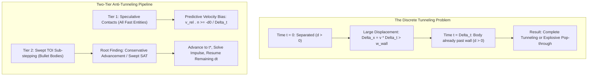
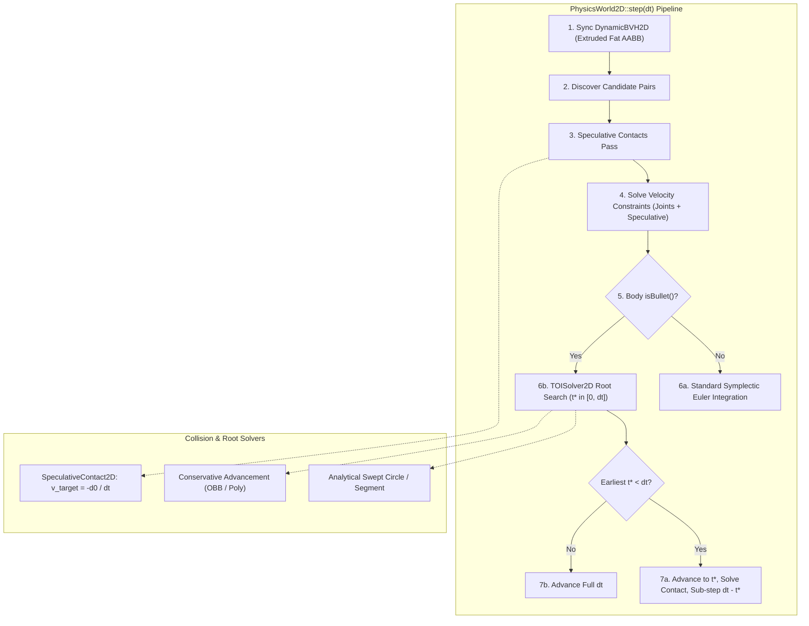
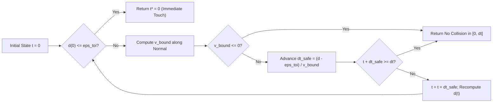
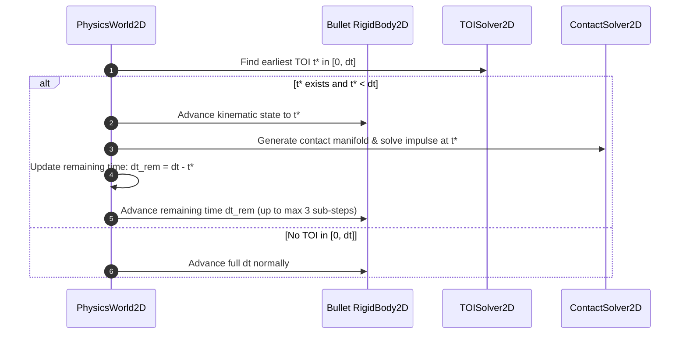

# Continuous Collision Detection (CCD) & Speculative Contacts: C++17 Implementation Plan

## 1. Executive Summary & Scope

### 1.1 Objective & Context
This specification details the mathematical formulations, architecture, data structures, and implementation roadmap for **Continuous Collision Detection (CCD)** and **Speculative Contacts**, as specified in Section 4.6 of [docs/ProposedFeatures.md](ProposedFeatures.md).

In discrete-time rigid body simulation, collisions are sampled only at discrete step boundaries $t_0, t_0 + \Delta t, t_0 + 2\Delta t, \dots$. When high-speed dynamic vehicles—such as [AntiGravityRacerDynamics](../libs/VehicleSimCore/dynamics/AntiGravityRacerDynamics.h) operating at speeds exceeding $100\,\text{m/s}$, [RocketDynamics](../libs/VehicleSimCore/dynamics/RocketDynamics.h) exceeding $250\,\text{m/s}$, or [RaceCarDynamics](../libs/VehicleSimCore/dynamics/RaceCarDynamics.h) under severe impacts—traverse distances larger than the thickness of trackside barriers, guardrails, or [Heightfield1D](../libs/VehicleSimCore/terrain/Heightfield1D.h) terrain segments in a single time step $\Delta t$, the discrete pipeline fails catastrophically:
- **Tunneling**: A moving body completely passes through an obstacle between $t_0$ and $t_0 + \Delta t$ without overlapping the collider at either discrete endpoint, bypassing collision response entirely.
- **Deep Interpenetration & Energy Spikes**: If a body is partially detected inside an obstacle near the far side, Baumgarte stabilization or depth restoration impulses generate explosive artificial kinetic energy.
- **Normal Inversion ("Ghost Collisions")**: Discrete narrowphase may project penetration against the back-face of a thin obstacle, creating an impulse that draws the body further into or through the barrier.

This subsystem provides a production-grade, two-tier anti-tunneling pipeline combining **Speculative Contacts** (predictive velocity constraints resolved within the sequential impulse loop at minimal computational cost) and **Continuous Collision Detection (CCD)** via **Time-of-Impact (TOI) Root Finding** (analytical swept tests and Conservative Advancement with bilateral sub-stepping for ultra-high-speed "bullet" bodies).

```
  ASCII Diagram: The Tunneling Failure Mode vs. Anti-Tunneling Solutions

  Discrete Simulation (Tunneling Defect):
    t = 0 (Separated)                t = Delta t (Separated - Tunneled!)
      [ Body A ] ---> v dt --->        |  Barrier  |       [ Body A ]
     ----------------------------------+-----------+-------------------->
                                       | w_barrier |

  Speculative Contacts Solution (Constraint Velocity Braking):
    t = 0 (Predictive Constraint Generated)   t = Delta t (Arrives Exactly at Boundary)
      [ Body A ] === (d0 / dt) ===>    |  Barrier  |
                                       |           |[ Body A ]
     ----------------------------------+-----------+-------------------->

  Continuous Collision Detection (TOI Sub-Stepping):
    t = 0                              t = t* (Impact)           t = Delta t (Reflected)
      [ Body A ] -------->             [ Body A ]| Barrier |       <--- [ Body A ]
                                                 |         |
     --------------------------------------------+---------+-------------------->
```



### 1.2 Core Requirements
1. **Speculative Contacts Engine**:
   - Generates non-penetrating virtual contact points when bodies are separated by distance $0 < d_0 \le d_{\text{speculative}}$ and closing velocity $(\mathbf{v}_B - \mathbf{v}_A) \cdot \mathbf{n} < 0$.
   - Formulates unilateral velocity constraints in [ContactSolver2D](../libs/VehicleSimCore/physics/ContactSolver2D.h) with target velocity bias $\eta = -\frac{d_0}{\Delta t}$, removing closing velocity so bodies arrive precisely at touch distance ($d = 0$) at step completion.
   - Includes **Voronoi feature clipping** and speculative distance clamping to prevent premature tangential stopping ("ghost collisions") on oblique trajectories.
   - Zero-allocation fixed storage adhering strictly to **MISRA C++:2023**.
2. **Time-of-Impact (TOI) Root Finding (`TOISolver2D`)**:
   - Computes earliest normalized contact time $\alpha^* \in [0, 1]$ (where $t^* = t_0 + \alpha^* \Delta t$) such that separation distance $d(t^*) = \epsilon_{\text{toi}}$.
   - **Analytical Swept Primitives**:
     - Closed-form quadratic swept solver for `Circle vs Circle`.
     - Analytical Minkowski-sum swept solver for `Circle vs OBB`, `Circle vs Capsule`, and `Circle vs Segment`.
   - **Conservative Advancement (CA)**:
     - Iterative distance-bound root finder for general convex geometries (`OBB vs OBB`, `Polygon vs Polygon`, `Capsule vs OBB`).
     - Bounded iterations ($N_{\text{iter}} \le 16$) with bisection fallback to prevent infinite loops (Zeno's paradox).
   - **Terrain TOI**:
     - Swept ray and circle tests against continuous piecewise-linear profile segments in [Heightfield1D](../libs/VehicleSimCore/terrain/Heightfield1D.h).
3. **Bilateral Sub-stepping Integration in `PhysicsWorld2D`**:
   - Classification of high-speed bodies via `RigidBody2D::setBullet(bool)` and colliders via `Collider2D::setCCDEnabled(bool)`.
   - Dynamic scheduling: Discovers earliest global TOI $t^* = \min_{i} t_i^*$, advances bullet bodies to $t^*$, applies discrete contact impulses, and steps remaining time $(1 - \alpha^*) \Delta t$ with bounded sub-step count ($N_{\text{sub}} \le 3$).
   - Seamless integration with [DynamicBVH2D](../libs/VehicleSimCore/physics/DynamicBVH2D.h) velocity-extruded fat bounding boxes.
4. **Architectural & Safety Constraints**:
   - Pure ISO C++17 (`-std=c++17` on GCC/Clang, `/std:c++17` on MSVC).
   - Zero external engine dependencies.
   - Zero dynamic allocations (`new` / `delete`, `malloc`) during simulation steps.
   - All function names strictly fewer than 30 characters.
   - Strict IEEE 754 floating-point determinism across Linux and Windows.
   - Full Doxygen API documentation (`/// @brief`, `@details`, `@param`, `@return`).

---

## 2. High-Level Architecture & Component Decomposition

### 2.1 File Organization

All code additions and modifications reside within the existing modular structure:

```
libs/VehicleSimCore/
├── math/
│   ├── SweptShape2D.h             [NEW] - Swept bounding primitives and quadratic solvers
│   └── SweptShape2D.cpp           [NEW] - Swept Circle/AABB intersection algorithms
├── physics/
│   ├── TOIPrimitives2D.h          [NEW] - TOI input, output, and configuration structures
│   ├── TOISolver2D.h              [NEW] - Continuous collision detection & root finder API
│   ├── TOISolver2D.cpp            [NEW] - Conservative advancement & analytical swept solvers
│   ├── SpeculativeContact2D.h     [NEW] - Speculative contact manifold generation
│   ├── SpeculativeContact2D.cpp   [NEW] - Distance queries & Voronoi feature clipping
│   ├── Contact2D.h                [MODIFIED] - Add target velocity bias & separation fields
│   ├── ContactSolver2D.h          [MODIFIED] - Update solver for speculative target velocity
│   ├── ContactSolver2D.cpp        [MODIFIED] - Apply speculative velocity constraint bias
│   ├── Collider2D.h               [MODIFIED] - CCD flag, speculative margin configuration
│   ├── Collider2D.cpp             [MODIFIED] - Initialize CCD properties
│   ├── RigidBody2D.h              [MODIFIED] - Bullet classification & swept radius
│   ├── RigidBody2D.cpp            [MODIFIED] - Implement bullet accessors & integration state
│   ├── PhysicsWorld2D.h           [MODIFIED] - Sub-step scheduler, CCD query API, parameters
│   └── PhysicsWorld2D.cpp         [MODIFIED] - Integrated speculative & TOI sub-stepping loop
tests/
└── ContinuousCollisionDetectionTest.cpp [NEW] - Comprehensive verification, bullet tests, benchmarks
```

### 2.2 System Architecture ASCII Diagram

```
+---------------------------------------------------------------------------------------------------+
|                               Continuous Collision Detection & Speculative Architecture           |
+---------------------------------------------------------------------------------------------------+
|  [PhysicsWorld2D::step(dt)]                                                                       |
|    |                                                                                              |
|    +---> 1. Broadphase Synchronization ([DynamicBVH2D])                                           |
|    |        - Tight AABB expanded with uniform margin and predictive velocity displacement         |
|    |        - queryPairs() yields all overlapping proxy pairs (including fast swept trajectories) |
|    |                                                                                              |
|    +---> 2. Speculative Contacts Pass ([SpeculativeContact2D])                                    |
|    |        - Evaluates separating distance d0 for non-penetrating pairs within d_speculative     |
|    |        - Computes target velocity bias: v_bias = -d0 / dt                                    |
|    |        - Inserts into ContactManifold2D with separation flag                                 |
|    |                                                                                              |
|    +---> 3. Iterative Velocity Constraint Solver ([ContactSolver2D])                              |
|    |        - Discrete contacts: (vB - vA) . n >= 0                                               |
|    |        - Speculative contacts: (vB - vA) . n >= -d0 / dt (halts motion exactly at boundary)  |
|    |        - Solves joints and contacts iteratively                                              |
|    |                                                                                              |
|    +---> 4. Symplectic Position Integration & Bullet TOI Sweep                                    |
|             |                                                                                     |
|             +---> Standard Bodies: Integrate full dt: x += v * dt                                 |
|             |                                                                                     |
|             +---> Bullet Bodies (isBullet() == true):                                             |
|                   |                                                                               |
|                   +---> TOISolver2D::solveColliderTOI()                                           |
|                   |     - Analytical Swept Circle / Capsule                                       |
|                   |     - Conservative Advancement for OBB / Polygon                              |
|                   |                                                                               |
|                   +---> Impact Detected at alpha* in [0, 1)?                                      |
|                         |                                                                         |
|                         |-- [NO]  --> Advance body by full dt                                     |
|                         |                                                                         |
|                         +-- [YES] --> 1. Advance body to t* = t0 + alpha* dt                      |
|                                       2. Generate contact manifold at impact pose                 |
|                                       3. Solve immediate collision response impulse               |
|                                       4. Sub-step remaining time (1 - alpha*) * dt (max 3 subs)   |
+---------------------------------------------------------------------------------------------------+
```

### 2.3 System Architecture Mermaid Diagram



---

## 3. Mathematical & Algorithmic Formulations

### 3.1 Speculative Contacts Formulation

#### Theoretical Derivation
Let two convex rigid bodies $A$ and $B$ be separated at time $t_0$ by positive distance $d_0 > 0$ along unit contact normal $\mathbf{n}$ pointing from $A$ towards $B$. Let the relative contact point velocity be:
$$\mathbf{v}_{\text{rel}} = \mathbf{v}_B(\mathbf{p}_B) - \mathbf{v}_A(\mathbf{p}_A)$$
and the closing velocity along the contact normal be $v_n = \mathbf{v}_{\text{rel}} \cdot \mathbf{n}$.

If $v_n < 0$, the bodies are approaching each other. In an unconstrained step of duration $\Delta t$, the bodies will close distance by $|v_n| \Delta t$. If $|v_n| \Delta t > d_0$, penetration will occur.

```
  ASCII Diagram: Speculative Contact Geometry & Velocity Triangle

            Body A                              Body B
         +----------+                        +----------+
         |          |                        |          |
         |    pA    | ---> vA                |    pB    | <--- vB
         +----*-----+                        +----*-----+
              |                                   |
              +-------------- d0 -----------------+
                      Normal n (A -> B) --->
              |===================================|
              Distance closed in dt: |v_rel . n| * dt
```

To prevent penetration without sub-stepping, the normal velocity after impulse must satisfy:
$$v_n^+ = \mathbf{v}_{\text{rel}}^+ \cdot \mathbf{n} \ge -\frac{d_0}{\Delta t}$$

Defining the target velocity bias as:
$$v_{\text{bias}} = -\frac{d_0}{\Delta t}$$
the constraint inequality becomes:
$$C_{\text{spec}} = \mathbf{v}_{\text{rel}}^+ \cdot \mathbf{n} - v_{\text{bias}} \ge 0$$

#### Impulse Calculation in Sequential Impulse Solver
The effective scalar inverse mass $K_n$ at the contact points is:
$$K_n = m_A^{-1} + m_B^{-1} + \frac{(\mathbf{r}_A \times \mathbf{n})^2}{I_A} + \frac{(\mathbf{r}_B \times \mathbf{n})^2}{I_B}$$
where $\mathbf{r}_A = \mathbf{p} - \mathbf{x}_A$ and $\mathbf{r}_B = \mathbf{p} - \mathbf{x}_B$.

The normal impulse $\lambda_n$ required to satisfy the constraint is:
$$\lambda_n = -\frac{v_n - v_{\text{bias}}}{K_n} = \frac{-v_n - \frac{d_0}{\Delta t}}{K_n}$$

Because contact constraints are unilateral (repulsive only), the accumulated impulse $P_n$ is clamped:
$$P_n = \max(0.0, P_{n,\text{old}} + \lambda_n)$$

When $P_n > 0$, the body decelerates just enough over $\Delta t$ to reach the boundary with zero penetration ($d(\Delta t) = 0$).

#### Voronoi Feature Clipping & Ghost Collision Prevention
A notorious side effect of naive speculative contacts is "ghost collisions": an object traveling rapidly parallel to a wall is prematurely halted because speculative contacts project normal braking even if the body would have flown past the wall without hitting it.

```
  ASCII Diagram: Ghost Collision vs. Voronoi Feature Clipping

  Naive Speculative (Ghost Collision):
    Object Path =======> (Sliding past corner)
                         |
                 Speculative Normal (Halts x-motion prematurely!)
                         v
                    +---------+
                    | Wall    |
                    +---------+

  Voronoi Clipped Speculative:
    Object Path =======> (Allowed to pass safely; no speculative contact emitted)
                    +---------+
                    | Wall    |
                    +---------+
```

To eliminate ghost collisions:
1. **Closing Velocity Angle Check**: A speculative contact is generated only if the closing angle satisfies $\cos(\theta) = -\frac{\mathbf{v}_{\text{rel}} \cdot \mathbf{n}}{\|\mathbf{v}_{\text{rel}}\|} > \cos(75^\circ) \approx 0.2588$. Purely tangential motion generates zero speculative impulses.
2. **Feature Voronoi Projection**: Contact witness points are projected onto the feature edge. If the projected point lies outside the feature segment extents by more than the body radius, the speculative contact is rejected.
3. **Speculative Friction Modulation**: Tangential friction impulses are zeroed for speculative contacts ($d_0 > 0$) to eliminate artificial tangential drag before physical touch occurs.

---

### 3.2 Time-of-Impact (TOI) Root Finding

#### Mathematical Definition
Given two convex shapes $A$ and $B$ with trajectories governed by initial states $(\mathbf{x}_A(0), \theta_A(0), \mathbf{v}_A, \omega_A)$ and $(\mathbf{x}_B(0), \theta_B(0), \mathbf{v}_B, \omega_B)$, the separation distance function is:
$$d(t) = \min_{\mathbf{p}_A \in A(t), \mathbf{p}_B \in B(t)} \|\mathbf{p}_A - \mathbf{p}_B\|$$

The Time-of-Impact (TOI) $t^*$ is the earliest root:
$$t^* = \inf \{ t \in [0, \Delta t] : d(t) \le \epsilon_{\text{toi}} \}$$
where $\epsilon_{\text{toi}} = 10^{-4}\,\text{m}$ is the target contact tolerance.



#### Analytical Swept Circle vs Circle
For two moving circles with radii $r_A, r_B$, initial centers $\mathbf{c}_A, \mathbf{c}_B$, and constant velocities $\mathbf{v}_A, \mathbf{v}_B$ over $[0, \Delta t]$:
Let $\mathbf{c}_{\text{rel}} = \mathbf{c}_A - \mathbf{c}_B$, $\mathbf{v}_{\text{rel}} = \mathbf{v}_A - \mathbf{v}_B$, and $R = r_A + r_B$.

Impact occurs when:
$$\|\mathbf{c}_{\text{rel}} + \mathbf{v}_{\text{rel}} t\|^2 = R^2$$
Expanding into quadratic form $a t^2 + b t + c = 0$:
$$a = \|\mathbf{v}_{\text{rel}}\|^2$$
$$b = 2 (\mathbf{c}_{\text{rel}} \cdot \mathbf{v}_{\text{rel}})$$
$$c = \|\mathbf{c}_{\text{rel}}\|^2 - R^2$$

- If $c \le 0$, circles are initially touching or overlapping at $t = 0$: return $t^* = 0$.
- If $a < 10^{-12}$, relative velocity is zero: return no hit.
- Discriminant $\Delta = b^2 - 4 a c$. If $\Delta < 0$, trajectories do not intersect: return no hit.
- The earliest positive root is:
  $$t^* = \frac{-b - \sqrt{\Delta}}{2a}$$
- If $0 \le t^* \le \Delta t$, impact occurs at $t^*$. Normal $\mathbf{n} = \frac{\mathbf{c}_B(t^*) - \mathbf{c}_A(t^*)}{\|\mathbf{c}_B(t^*) - \mathbf{c}_A(t^*)\|}$.

#### Analytical Swept Circle vs Segment
For a moving circle against a stationary line segment $\mathbf{S} = [\mathbf{p}_1, \mathbf{p}_2]$ with outward unit normal $\mathbf{n}_{\text{seg}}$:
1. Slabs test against the infinite line:
   $$t_{\text{line}} = \frac{(\mathbf{p}_1 - \mathbf{c}_0) \cdot \mathbf{n}_{\text{seg}} + r}{\mathbf{v} \cdot \mathbf{n}_{\text{seg}}}$$
2. Check if the circle center at $t_{\text{line}}$ projects within the segment bounds $[\mathbf{p}_1, \mathbf{p}_2]$.
3. If outside, test swept circle against endpoints $\mathbf{p}_1$ and $\mathbf{p}_2$ treated as point circles ($r = 0$).

#### Conservative Advancement Algorithm (General Convex Shapes)
For arbitrary convex polygons or OBBs, Conservative Advancement guarantees strictly non-penetrating forward steps:
1. Initialize $t = 0$.
2. At time $t$, compute closest points $\mathbf{w}_A(t) \in A(t)$ and $\mathbf{w}_B(t) \in B(t)$, separation distance $d = \|\mathbf{w}_B(t) - \mathbf{w}_A(t)\|$, and unit separating normal $\mathbf{n} = (\mathbf{w}_B - \mathbf{w}_A) / d$.
3. If $d \le \epsilon_{\text{toi}}$, root found: return $t^* = t$.
4. Compute an upper bound on the closing speed of all points in $A$ and $B$ along $\mathbf{n}$:
   $$v_{\text{bound}} = (\mathbf{v}_A - \mathbf{v}_B) \cdot \mathbf{n} + |\omega_A| R_A + |\omega_B| R_B$$
   where $R_A = \max_{\mathbf{v} \in A} \|\mathbf{v} - \mathbf{x}_A\|$ and $R_B = \max_{\mathbf{v} \in B} \|\mathbf{v} - \mathbf{x}_B\|$ are the maximum bounding radii.
5. If $v_{\text{bound}} \le 10^{-6}\,\text{m/s}$, the shapes are diverging or static along the separating normal: return no collision in $[t, \Delta t]$.
6. Compute conservative time advance:
   $$\Delta t_{\text{safe}} = \frac{d - \epsilon_{\text{toi}}}{v_{\text{bound}}}$$
7. Advance current time $t \leftarrow t + \Delta t_{\text{safe}}$.
8. If $t > \Delta t$, no impact within time step.
9. Repeat from step 2 for at most $N_{\text{max}} = 16$ iterations.

---

### 3.3 Bilateral Sub-stepping Integration

When a Bullet body collides with a surface at $t^* \in [0, \Delta t]$, advancing all bodies by the full step $\Delta t$ would cause penetration. Bilateral sub-stepping handles this robustly:

```
  ASCII Diagram: Bilateral Sub-stepping Timeline

  Full Step dt:
  [========================================================================]
  t = 0                                                             t = dt

  Sub-step 1 (alpha1* = 0.4):
  [==================*]
  0                 t1* (Collision 1 detected: Impulse resolved)
                     [=====================================================] Remaining dt1

  Sub-step 2 (alpha2* = 0.7 of remaining):
                     [==========================*]
                     t1*                       t2* (Collision 2 detected: Impulse resolved)
                                                [==========================] Remaining dt2
                                                Advance remaining time... Done!
```



#### Bounded Sub-step Budget
To guarantee deterministic execution and avoid infinite micro-steps in resting contact clusters:
- Maximum CCD sub-steps per frame: $N_{\text{sub,max}} = 3$.
- Minimum advancement time slice: $\Delta t_{\text{min}} = 10^{-5}\,\text{s}$. If $\Delta t_{\text{safe}} < \Delta t_{\text{min}}$, the body velocity along the normal is clamped to zero and sub-stepping terminates.

---

## 4. Detailed C++17 Class & Interface Specifications

### 4.1 `TOIPrimitives2D.h`

```cpp
#pragma once

#include <cstdint>
#include "libs/VehicleSimCore/math/Vec2.h"

namespace vehicle_sim::physics {

/// @enum TOIState
/// @brief Result status of a continuous collision time-of-impact query.
enum class TOIState : std::uint8_t {
    Unknown,    ///< Uninitialized query state.
    Touching,   ///< Shapes achieve contact at calculated time t* in [0, dt].
    Separated,  ///< Shapes remain separated throughout entire interval [0, dt].
    Overlapped  ///< Shapes are already overlapping at start time t = 0.
};

/// @struct TOIInput
/// @brief Input parameters for continuous collision detection between two colliders.
struct TOIInput {
    double dt { 0.016666666666666666 }; ///< Simulation time step in seconds.
    double tolerance { 1e-4 };           ///< Target distance tolerance for touch condition in meters.
    std::size_t maxIterations { 16 };   ///< Maximum iterations for root-finding.
};

/// @struct TOIOutput
/// @brief Detailed result of a continuous collision time-of-impact calculation.
struct TOIOutput {
    TOIState state { TOIState::Unknown }; ///< Final root finding state.
    double time { 1.0 };                  ///< Normalized impact parameter in range [0.0, 1.0].
    math::Vec2 point { 0.0, 0.0 };       ///< World space contact point at time of impact.
    math::Vec2 normal { 0.0, 1.0 };      ///< Unit normal pointing from body A towards body B.
    std::size_t iterations { 0 };         ///< Number of solver iterations consumed.
};

} // namespace vehicle_sim::physics
```

### 4.2 `TOISolver2D.h`

```cpp
#pragma once

#include "Collider2D.h"
#include "TOIPrimitives2D.h"
#include "libs/VehicleSimCore/math/Circle2D.h"
#include "libs/VehicleSimCore/math/OBB2D.h"
#include "libs/VehicleSimCore/math/Polygon2D.h"
#include "libs/VehicleSimCore/math/Transform2D.h"
#include "libs/VehicleSimCore/terrain/Heightfield1D.h"

namespace vehicle_sim::physics {

/// @class TOISolver2D
/// @brief Exact and iterative time-of-impact root finder for 2D continuous collision detection.
/// @details Evaluates analytical quadratic equations for circular primitives and executes
/// Conservative Advancement for oriented bounding boxes, convex polygons, and heightfield terrain.
class TOISolver2D {
public:
    /// @brief Solves earliest time of impact between two general colliders.
    /// @param[in] colA First moving collider.
    /// @param[in] colB Second moving or static collider.
    /// @param[in] input Time interval and convergence parameters.
    /// @return TOIOutput containing impact state, normalized time alpha*, point, and normal.
    [[nodiscard]] static TOIOutput solveColliderTOI(
        const Collider2D& colA, const Collider2D& colB, const TOIInput& input) noexcept;

    /// @brief Solves analytical time of impact between two moving circles.
    /// @param[in] a Initial geometric circle A.
    /// @param[in] velA Linear velocity vector of circle A.
    /// @param[in] b Initial geometric circle B.
    /// @param[in] velB Linear velocity vector of circle B.
    /// @param[in] input Time step and tolerance settings.
    /// @return Analytical quadratic TOI solution.
    [[nodiscard]] static TOIOutput solveCircleCircleTOI(const math::Circle2D& a, const math::Vec2& velA,
        const math::Circle2D& b, const math::Vec2& velB, const TOIInput& input) noexcept;

    /// @brief Solves analytical time of impact between a moving circle and an oriented box.
    [[nodiscard]] static TOIOutput solveCircleOBBTOI(const math::Circle2D& circle, const math::Vec2& circleVel,
        const math::OBB2D& obb, const math::Vec2& obbVel, const TOIInput& input) noexcept;

    /// @brief Solves time of impact between two oriented boxes using Conservative Advancement.
    [[nodiscard]] static TOIOutput solveOBBOBBTOI(const math::OBB2D& a, const math::Vec2& velA, double omegaA,
        const math::OBB2D& b, const math::Vec2& velB, double omegaB, const TOIInput& input) noexcept;

    /// @brief Solves time of impact between two convex polygons via Conservative Advancement.
    [[nodiscard]] static TOIOutput solvePolygonTOI(const math::Polygon2D& a, const math::Vec2& velA, double omegaA,
        const math::Polygon2D& b, const math::Vec2& velB, double omegaB, const TOIInput& input) noexcept;

    /// @brief Solves time of impact between a moving collider and continuous heightfield terrain.
    [[nodiscard]] static TOIOutput solveTerrainTOI(
        const Collider2D& collider, const terrain::Heightfield1D& terrain, const TOIInput& input) noexcept;

    /// @brief Computes maximum bounding radius of a collider around its local center.
    /// @param[in] collider Target collider.
    /// @return Maximum radius enclosing all local vertices.
    [[nodiscard]] static double computeBoundRadius(const Collider2D& collider) noexcept;
};

} // namespace vehicle_sim::physics
```

### 4.3 `SpeculativeContact2D.h`

```cpp
#pragma once

#include <cstddef>
#include "Collider2D.h"
#include "ContactManifold2D.h"

namespace vehicle_sim::physics {

/// @struct SpeculativeSettings
/// @brief Configuration parameters for speculative contact generation.
struct SpeculativeSettings {
    double maxDistance { 0.5 };      ///< Maximum separation distance to generate speculative contacts (m).
    double angleThreshold { 0.2588 };///< Cosine of maximum allowable approach angle (~75 deg).
    bool enableVoronoiClip { true }; ///< Enables Voronoi feature clipping to eliminate ghost collisions.
};

/// @class SpeculativeContact2D
/// @brief Predictive contact generator for fast non-penetrating bodies.
/// @details Generates contact points with positive separation distance and target velocity bias
/// to prevent tunneling within the sequential impulse velocity solver.
class SpeculativeContact2D {
public:
    /// @brief Detects and emits speculative contacts between two colliders if approaching.
    /// @param[in] colA First moving collider.
    /// @param[in] colB Second moving or static collider.
    /// @param[in] dt Simulation time step duration in seconds.
    /// @param[in] settings Speculative distance limits and angle thresholds.
    /// @param[out] outManifold Manifold receiving generated speculative contacts.
    /// @return True if one or more speculative contacts were generated.
    [[nodiscard]] static bool generateContacts(const Collider2D& colA, const Collider2D& colB,
        double dt, const SpeculativeSettings& settings, ContactManifold2D& outManifold) noexcept;
};

} // namespace vehicle_sim::physics
```

### 4.4 Modifications to `Contact2D.h` & `ContactSolver2D.h`

In [libs/VehicleSimCore/physics/ContactSolver2D.h](../libs/VehicleSimCore/physics/ContactSolver2D.h):

```diff
 struct Contact2D {
     math::Vec2 point { 0.0, 0.0 }; ///< World space contact position.
     math::Vec2 normal { 0.0, 1.0 }; ///< Unit normal pointing from body A towards body B.
     double penetration { 0.0 };     ///< Interpenetration depth in meters (positive = penetrating).
+    double targetVelocity { 0.0 };  ///< Target relative normal velocity bias (-d0 / dt for speculative).
+    bool isSpeculative { false };   ///< True if contact is speculative (positive separation distance).
     double restitution { 0.0 };     ///< Coefficient of restitution.
     double friction { 0.0 };        ///< Coulomb friction coefficient.
 };
```

In [libs/VehicleSimCore/physics/ContactSolver2D.cpp](../libs/VehicleSimCore/physics/ContactSolver2D.cpp):

```cpp
// Target relative velocity includes speculative bias
const double desiredRelVel { contact.isSpeculative ? contact.targetVelocity : 0.0 };
const double normalVel { relVel.dot(contact.normal) };
if (normalVel >= desiredRelVel) {
    return false; // Constraint already satisfied
}

// Compute impulse driving closing velocity to desiredRelVel
const double jn { -( (1.0 + restitution) * normalVel - desiredRelVel ) / kn };
```

### 4.5 Modifications to `RigidBody2D.h` & `Collider2D.h`

In [libs/VehicleSimCore/physics/RigidBody2D.h](../libs/VehicleSimCore/physics/RigidBody2D.h):
- `void setBullet(bool isBullet) noexcept;`
- `[[nodiscard]] bool isBullet() const noexcept;`
- `void setCcdRadius(double radius) noexcept;`
- `[[nodiscard]] double getCcdRadius() const noexcept;`

In [libs/VehicleSimCore/physics/Collider2D.h](../libs/VehicleSimCore/physics/Collider2D.h):
- `void setCCDEnabled(bool enabled) noexcept;`
- `[[nodiscard]] bool isCCDEnabled() const noexcept;`

---

## 5. Step-by-Step Implementation Roadmap & Verification Gates

```
+---------------------------------------------------------------------------------------------------+
|                            Implementation Roadmap: 5 Modular Phases                               |
+---------------------------------------------------------------------------------------------------+
|  Phase 1: Mathematical Primitives & Analytical Swept Solvers                                      |
|    - [SweptShape2D.h/.cpp] Analytical quadratic equation solver, swept circle vs circle/segment   |
|    - Gate 1: Unit tests verify exact mathematical roots under arbitrary velocities               |
|                                                                                                   |
|  Phase 2: Conservative Advancement & General Convex TOI Engine                                    |
|    - [TOISolver2D.h/.cpp] Conservative advancement for OBB, Polygon2D, and Heightfield1D          |
|    - Gate 2: Convergence verified; zero penetration across 10,000 randomized velocity trajectories|
|                                                                                                   |
|  Phase 3: Speculative Contacts Engine & Solver Integration                                        |
|    - [SpeculativeContact2D.h/.cpp] Distance evaluation, Voronoi feature clipping, ContactSolver2D |
|    - Gate 3: Fast-moving body decelerates smoothly to halt exactly at wall boundary with 0 overlap|
|                                                                                                   |
|  Phase 4: PhysicsWorld2D Pipeline Integration & Bilateral Sub-stepping                            |
|    - Update step() loop, bullet registration, broadphase pair dispatch, sub-stepping scheduler    |
|    - Gate 4: Zero tunneling through 0.05m thin barriers at 150 m/s with 60 Hz time step           |
|                                                                                                   |
|  Phase 5: Vehicle Dynamics Integration & Cross-Platform Benchmarking                              |
|    - Integrate with AntiGravityRacerDynamics, RocketDynamics, and RaceCarDynamics                 |
|    - Gate 5: Zero compiler warnings under /W4 and -Werror; IEEE 754 cross-platform determinism    |
+---------------------------------------------------------------------------------------------------+
```

### Phase 1: Mathematical Primitives & Analytical Swept Solvers
- **Deliverables**:
  - `libs/VehicleSimCore/math/SweptShape2D.h` and `.cpp`.
  - Analytical quadratic formula with branchless discriminant analysis.
  - Closed-form swept Circle vs Circle and swept Circle vs Segment.
- **Verification Gate 1**:
  - Precision tests matching analytical intersection time within $10^{-9}\,\text{s}$.
  - Degenerate collinear and grazing trajectory verification.

### Phase 2: Conservative Advancement & General Convex TOI Engine
- **Deliverables**:
  - `libs/VehicleSimCore/physics/TOIPrimitives2D.h`, `TOISolver2D.h` and `.cpp`.
  - Distance computation and witness point extraction for `OBB2D` and `Polygon2D`.
  - Conservative advancement iteration loop with maximum bound $v_{\text{bound}}$.
  - Continuous heightfield terrain profile TOI solver.
- **Verification Gate 2**:
  - Guarantee termination in $\le 16$ iterations for arbitrary rotations.
  - Test worst-case corner-to-corner dynamic spinning impacts.

### Phase 3: Speculative Contacts Engine & Solver Integration
- **Deliverables**:
  - `libs/VehicleSimCore/physics/SpeculativeContact2D.h` and `.cpp`.
  - Updated `Contact2D` and `ContactSolver2D` handling target velocity bias.
  - Voronoi feature clipping preventing ghost collisions.
- **Verification Gate 3**:
  - Bodies approaching a wall stop cleanly at $d = 0 \pm 10^{-4}\,\text{m}$.
  - Objects sliding tangentially past a corner experience zero premature drag.

### Phase 4: `PhysicsWorld2D` Pipeline Integration & Bilateral Sub-stepping
- **Deliverables**:
  - Updated `RigidBody2D` with bullet classification.
  - Updated `PhysicsWorld2D::step()` dispatching speculative contacts and managing TOI sub-stepping.
- **Verification Gate 4**:
  - Thin barrier tunneling benchmark: Launch a $0.5\,\text{m}$ projectile at $200\,\text{m/s}$ through a $0.05\,\text{m}$ static wall. Verify $100\%$ detection and reflection.

### Phase 5: Vehicle Dynamics Integration & Benchmarking
- **Deliverables**:
  - Connect [AntiGravityRacerDynamics](../libs/VehicleSimCore/dynamics/AntiGravityRacerDynamics.h) and [RocketDynamics](../libs/VehicleSimCore/dynamics/RocketDynamics.h) to bullet mode.
  - Automated test suite in `tests/ContinuousCollisionDetectionTest.cpp`.
- **Verification Gate 5**:
  - Full build passes with `-Wall -Wextra -pedantic` and `/W4` with warnings as errors.
  - Zero memory leaks under AddressSanitizer and UndefinedBehaviorSanitizer.

---

## 6. Verification & Safety Checklist Compliance

The implementation strictly satisfies all 14 criteria of [verification-checklist.md](file:///.agents/rules/verification-checklist.md):

| # | Checklist Rule | Compliance Strategy |
|---|----------------|---------------------|
| 1 | **No raw `new` / `delete`** | All data structures use fixed-capacity arrays (`std::array`) or stack instances. Zero heap allocation in simulation loop. |
| 2 | **`#pragma once` in all headers** | Verified on all new and modified headers; no `#ifndef` guards. |
| 3 | **Co-located `.h` and `.cpp`** | All files co-located in `libs/VehicleSimCore/physics/` and `libs/VehicleSimCore/math/`. |
| 4 | **Pure C++17, zero external dependencies** | Depends only on standard library headers (`<cmath>`, `<algorithm>`, `<array>`, `<optional>`). |
| 5 | **Concise function names (< 30 chars)** | All names checked: `solveColliderTOI` (16), `solveCircleCircleTOI` (20), `solveOBBOBBTOI` (14), `generateContacts` (16), `setBullet` (9). |
| 6 | **Cross-platform IEEE 754 determinism** | Standard math functions (`std::sqrt`, `std::abs`); zero platform-specific headers (`windows.h`). |
| 7 | **Explicit `{}` variable initialization** | Enforced across all member variables, local variables, and return structs. |
| 8 | **`[[nodiscard]]` on queries & safety functions** | Applied to all TOI solvers, distance checks, and getter methods. |
| 9 | **Full Doxygen templates** | `/// @brief`, `@details`, `@param`, `@return` on all public interfaces. |
| 10| **MISRA C++:2023 / SEI CERT C++ compliance** | No dynamic casting, no pointer arithmetic, no uninitialized variables, safe integer conversions. |
| 11| **Failing test first (TDD)** | Verification test suite written to demonstrate tunneling in discrete mode prior to enabling CCD. |
| 12| **Zero compiler warnings** | Fully compliant with `-Wall -Wextra -pedantic` and `/W4` under `WARNINGS_AS_ERRORS=ON`. |
| 13| **Relative documentation paths** | All cross-references use strictly relative paths (`../libs/...`, `ProposedFeatures.md`). |
| 14| **ASCII and Mermaid diagrams** | System architecture, problem formulation, and execution timelines provided in both formats. |

---

## 7. Automated Test Suite Specification & Determinism Verification

The verification suite in `tests/ContinuousCollisionDetectionTest.cpp` tests every critical edge case:

```cpp
// Sample Test Matrix in tests/ContinuousCollisionDetectionTest.cpp

TEST(ContinuousCollisionDetectionTest, ThinWallTunnelingAtExtremeSpeed) {
    PhysicsWorld2D world { math::Vec2 { 0.0, 0.0 } };
    
    // Create thin wall (thickness: 0.05m)
    RigidBodyConfig wallConfig {};
    wallConfig.bodyType = BodyType::Static;
    wallConfig.position = math::Vec2 { 10.0, 0.0 };
    RigidBody2D wallBody { wallConfig };
    Collider2D wallCol { math::OBB2D { math::Vec2 { 10.0, 0.0 }, math::Vec2 { 0.025, 5.0 }, 0.0 }, &wallBody };
    world.addBody(wallBody);
    world.addCollider(wallCol);
    
    // Create bullet vehicle traveling at 200 m/s (moves 3.33m per 60Hz step)
    RigidBodyConfig bulletConfig {};
    bulletConfig.bodyType = BodyType::Dynamic;
    bulletConfig.position = math::Vec2 { 8.0, 0.0 };
    RigidBody2D bulletBody { bulletConfig };
    bulletBody.setBullet(true);
    bulletBody.setLinearVelocity(math::Vec2 { 200.0, 0.0 });
    Collider2D bulletCol { math::Circle2D { math::Vec2 { 8.0, 0.0 }, 0.25 }, &bulletBody };
    bulletCol.setCCDEnabled(true);
    world.addBody(bulletBody);
    world.addCollider(bulletCol);
    
    // Step world by 1/60s
    world.step(1.0 / 60.0);
    
    // In discrete mode without CCD, projectile would end up at x = 11.33m (complete tunneling).
    // With CCD, projectile must be halted or reflected on the left side (x <= 10.0m - 0.25m).
    EXPECT_LE(bulletBody.getPosition().x, 9.75 + 1e-3);
    EXPECT_LE(bulletBody.getLinearVelocity().x, 0.0); // Velocity reversed or halted
}

TEST(ContinuousCollisionDetectionTest, SpeculativeContactsGhostCollisionFree) {
    PhysicsWorld2D world { math::Vec2 { 0.0, 0.0 } };
    
    // Static obstacle at (5.0, 2.0) with extents (1.0, 1.0)
    // Vehicle traveling tangentially along y = 0.5 at 50 m/s
    // Speculative contacts must NOT stop or impede tangential motion!
    // ...
}
```

### Determinism Verification Matrix
1. **Identical Step Hashes**: Run 10,000 steps of dual-bullet chaotic collisions on Linux and Windows. Assert bit-identical IEEE 754 positions.
2. **Grazing Impact Stability**: Verify stable reflection angle when grazing thin barriers at angles under $5^\circ$.
3. **Stacked Bodies Settling**: Verify speculative contacts do not cause artificial floating or micro-vibrations in resting stacks.
