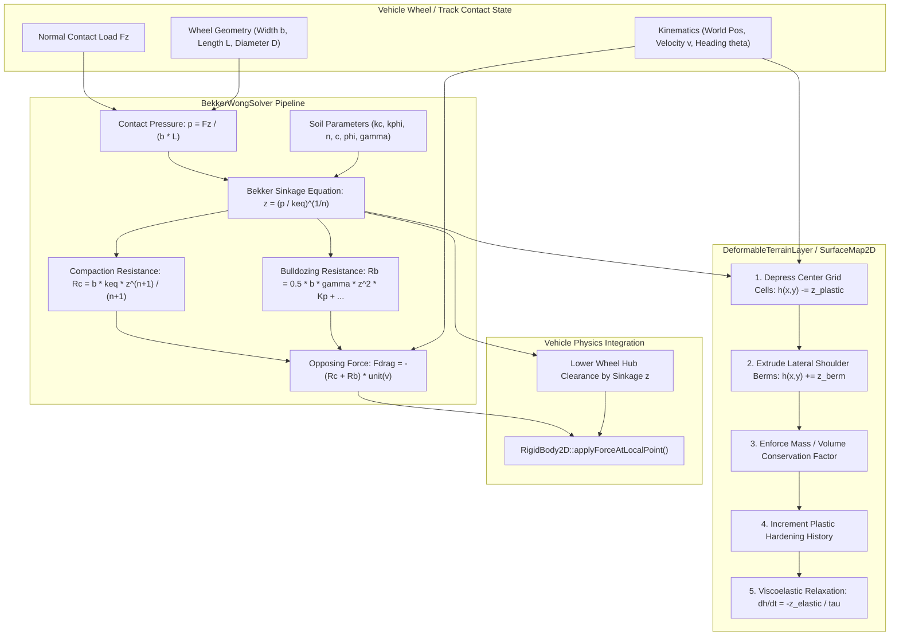
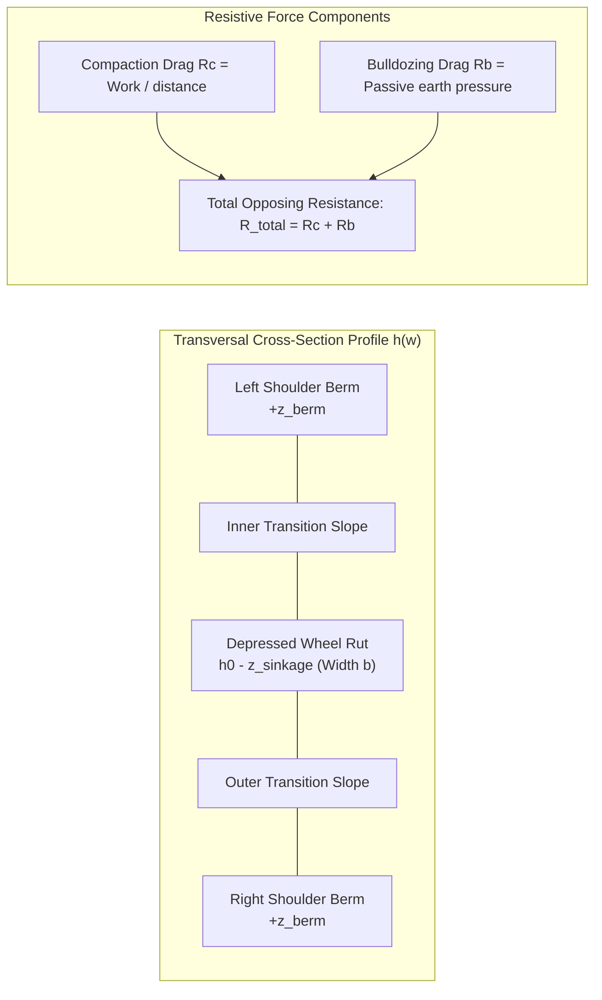
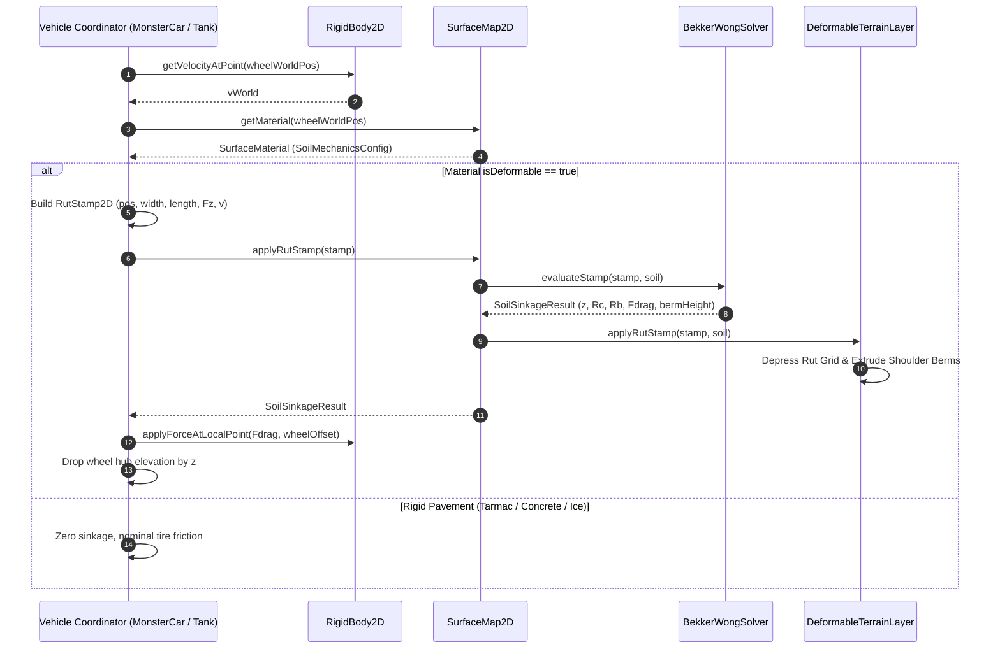

# Deformable Surface Rutting & Soil Mechanics: C++17 Implementation Plan

## 1. Executive Summary & Scope

### 1.1 Objective & Context
This specification details the architectural design, terramechanics formulations, interface contracts, and implementation roadmap for **Soil Mechanics and Deformable Surface Rutting (Bekker-Wong Model)** as proposed in Section 2.1 of [ProposedFeatures.md](ProposedFeatures.md).

Currently, terrain representation in `VehicleSimCore` ([SurfaceMap2D](../libs/VehicleSimCore/terrain/SurfaceMap2D.h), [Heightfield1D](../libs/VehicleSimCore/terrain/Heightfield1D.h), [TrackGenerator](../libs/VehicleSimCore/terrain/TrackGenerator.h)) models ground surfaces as rigid, immutable spatial heightfields. While materials ([SurfaceMaterial](../libs/VehicleSimCore/terrain/SurfaceMaterial.h)) modify surface friction $\mu$ and rolling drag $C_{\text{rr}}$, the physical terrain geometry remains completely static regardless of vehicle mass, wheel load, or tractive shear.

In authentic off-road environments (deep mud pits, snow trails, sandy dunes, soft loam):
1. **Soil Plastic Sinkage**: Heavy vehicles (e.g. [MonsterCarDynamics](../libs/VehicleSimCore/dynamics/MonsterCarDynamics.h), [TrackedTankDynamics](../libs/VehicleSimCore/dynamics/TrackedTankDynamics.h), [ArticulatedTruckDynamics](../libs/VehicleSimCore/dynamics/ArticulatedTruckDynamics.h)) compress weak porous soil under vertical contact loads $F_z$, sinking wheels into the surface and leaving permanent depressed wheel ruts.
2. **Soil Berm Mounding (Volume Conservation)**: Displaced soil does not vanish; it is laterally extruded outwards from the rut trough, forming elevated berm ridges along the track shoulders.
3. **Compaction Resistance Drag ($R_c$)**: As a wheel rolls forward, it continually performs mechanical work compacting fresh soil ahead of it, producing a strong retarding drag force that degrades vehicle acceleration and top speed.
4. **Bulldozing Resistance Drag ($R_b$)**: At substantial sinkage depths, soil piles up in front of tires or tank tracks, creating passive earth pressure resistance that can immobilize underpowered vehicles.
5. **Viscoelastic Soil Relaxation**: Wet mud or fresh powder snow partially levels out over time due to viscoelastic creep, whereas dry clay or compacted gravel ruts persist indefinitely.
6. **Multi-Pass Rut Hardening**: Successive vehicle passes over existing wheel ruts compact the underlying soil layer, increasing soil stiffness and reducing subsequent sinkage.

The goal is to deliver an industrial-grade, zero-dependency, MISRA C++:2023 compliant C++17 terramechanics and deformable rutting subsystem in [libs/VehicleSimCore/terrain/DeformableTerrain.h](../libs/VehicleSimCore/terrain/DeformableTerrain.h) that seamlessly augments [SurfaceMap2D](../libs/VehicleSimCore/terrain/SurfaceMap2D.h) and couples with off-road vehicle dynamics coordinators.

---

### 1.2 Core Requirements
1. **Bekker Pressure-Sinkage Mechanics**:
   - Invert the classic semi-empirical Bekker equation:
     $$p = \left( \frac{k_c}{b} + k_\phi \right) z^n$$
     to analytically evaluate physical sinkage depth $z$ as a function of wheel/track contact pressure $p = F_z / A$ and contact width $b$.
2. **Compaction Resistance Force ($R_c$)**:
   - Compute Bekker soil compaction drag:
     $$R_c = \frac{b}{n + 1} \left( \frac{k_c}{b} + k_\phi \right) z^{n+1}$$
     and apply it as a retarding force opposing the wheel's contact patch velocity vector.
3. **Hegazy-Bekker Bulldozing Resistance ($R_b$)**:
   - Model Rankine passive earth pressure bulldoze resistance when sinkage ratio $z / D_{\text{wheel}}$ becomes significant:
     $$R_b = \frac{1}{2} b \gamma z^2 K_{p\gamma} + 2 z c b K_{pc}$$
4. **Volume-Conserving Elevation Mutation**:
   - Mutate [SurfaceMap2D](../libs/VehicleSimCore/terrain/SurfaceMap2D.h) elevation samples: depress grid points under the wheel patch while extruding adjacent berm ridges to satisfy mass/volume conservation.
5. **Viscoelastic Soil Relaxation**:
   - First-order time-dependent soil rebound for liquid/viscous soils (mud, slop) governed by relaxation time constant $\tau_{\text{recovery}}$.
6. **Multi-Pass Compaction Hardening**:
   - Track accumulated plastic compaction depth at each grid vertex so subsequent passes encounter stiffened soil.
7. **Compliance & Performance Constraints**:
   - Pure ISO C++17, zero external dependencies.
   - MISRA C++:2023 & SEI CERT C++ compliance: zero dynamic heap allocations during simulation ticks, explicit `{}` initialization, `[[nodiscard]]` on all query/computation methods, function names strictly $< 30$ characters.
   - $O(K)$ stamping cost where $K$ is the small bounding box of grid cells covered by the wheel footprint.

---

## 2. High-Level Architecture & Subsystem Organization

### 2.1 File Layout

```
libs/VehicleSimCore/
├── terrain/
│   ├── DeformableTerrain.h       [NEW]      - Bekker-Wong solvers, rut stamps, and deformable layer
│   ├── DeformableTerrain.cpp     [NEW]      - Terramechanics math, elevation mutation, and relaxation
│   ├── SurfaceMaterial.h         [EXTENDED] - Soil cohesion, friction angles, and sinkage moduli
│   ├── SurfaceMaterial.cpp       [EXTENDED] - Soil mechanics preset configurations
│   ├── SurfaceMap2D.h            [EXTENDED] - Deformable layer attachment, rut stamping, and queries
│   └── SurfaceMap2D.cpp          [EXTENDED] - Grid elevation mutation and multi-pass integration
├── dynamics/
│   ├── MonsterCarDynamics.h      [EXTENDED] - Rutting wheel stamp generation and drag force dispatch
│   ├── MonsterCarDynamics.cpp    [EXTENDED] - Wheel sinkage and compaction resistance evaluation
│   ├── TrackedTankDynamics.h     [EXTENDED] - Dual-track footprint rut stamping and bulldozing drag
│   └── TrackedTankDynamics.cpp   [EXTENDED] - Tread rutting and sinkage integration
tests/
└── DeformableTerrainTest.cpp     [NEW]      - GoogleTest suite verifying sinkage, drag, and berm volume
```

---

### 2.2 System Architecture ASCII Diagram

```
+----------------------------------------------------------------------------------------------------+
|                               Deformable Rutting System Architecture                               |
+----------------------------------------------------------------------------------------------------+
|                                                                                                    |
|    Vehicle Dynamics (MonsterCarDynamics / TrackedTankDynamics / ArcadeCarDynamics)                 |
|                                                                                                    |
|    1. Wheel/Track Geometry:  Contact Width (b), Contact Length (L), Wheel Diameter (D)             |
|    2. Contact Kinematics:    World Position (pw), Velocity (vw), Heading Angle (theta)             |
|    3. Normal Force:          Vertical Reaction Load Fz (Dynamic Suspension / Mass Transfer)        |
|                                                                                                    |
|                                     |                                                              |
|                                     v Generates RutStamp2D { pos, heading, b, L, D, Fz, v }        |
|                                                                                                    |
|             +------------------------------------------------------------------------+             |
|             |          BekkerWongSolver (libs/VehicleSimCore/terrain)                |             |
|             +------------------------------------------------------------------------+             |
|             | 1. Contact Pressure:        p = Fz / (b * L)                           |             |
|             | 2. Soil Modulus:            k_eq = (k_c / b) + k_phi                   |             |
|             | 3. Bekker Sinkage:          z = (p / k_eq)^(1/n) clamped to z_max      |             |
|             | 4. Compaction Drag:         Rc = (b * k_eq / (n + 1)) * z^(n+1)        |             |
|             | 5. Bulldozing Drag:         Rb = 0.5 * b * gamma * z^2 * Kp_gamma + ...|             |
|             | 6. Total Opposing Drag:     F_drag = -(Rc + Rb) * unit(v)              |             |
|             +------------------------------------------------------------------------+             |
|                     |                                                |                             |
|                     | Soil Drag Forces                               | Sinkage Depth z             |
|                     v                                                v                             |
|    +---------------------------------+     +-------------------------------------------------+     |
|    | RigidBody2D                     |     | DeformableTerrainLayer / SurfaceMap2D           |     |
|    | - applyForceAtLocalPoint(Fdrag) |     | 1. Splat Rut Footprint: Depress Grid h(x,y)     |     |
|    | - Adjust effective hub height   |     | 2. Extrude Lateral Berms: +Delta h_berm         |     |
|    +---------------------------------+     | 3. Volume Conservation: Sum(Delta V) ~= 0       |     |
|                                            | 4. Multi-Pass Plastic Hardening                 |     |
|                                            | 5. Viscoelastic Relaxation Update (dt)          |     |
|                                            +-------------------------------------------------+     |
|                                                                                                    |
+----------------------------------------------------------------------------------------------------+
```

---

### 2.3 System Architecture Mermaid Flowchart



---

### 2.4 Terramechanics Force Balance & Cross-Section ASCII Diagram

```
  ASCII Diagram: Wheel Soil Sinkage, Rut Formation, Berm Mounding & Force Vectors

                       Vertical Load Fz
                              |
                              v
                      .---------------.
                     /        |        \
                    |       [Hub]       |-----> Forward Velocity v
                     \        |        /
                      .-------+-------.
             Soil Mound               Soil Mound
             Berm (+zh)   Rut Center   Berm (+zh)
                 .-.     (-z sinkage)     .-.
                /   \     |         |    /   \
  === Original =     \   /           \  /     ====== Surface Elevation h0
  Elevation          '---'-----------'--'
                     |<--b-->|
                     Compacted Soil Layer
                     
  Force Equilibrium:
  - Fz: Downward normal load balanced by integrated soil pressure integral \int p dA.
  - Rc: Compaction resistance opposing motion, derived from soil deformation work.
  - Rb: Bulldozing resistance pushing back against forward wheel face.
  - Berm Volume V_berm = Volume V_rut * (1.0 - CompactionRatio).
```

---

### 2.5 Terramechanics Cross-Section Mermaid Diagram



---

## 3. Mathematical Formulations & Terramechanics Models

### 3.1 Bekker Pressure-Sinkage Formulation
In classical terramechanics (Bekker, 1960; Wong, 2001), the relationship between normal ground pressure $p$ ($\text{N/m}^2$) and penetration depth $z$ ($\text{m}$) into homogeneous soil is:
$$p = k_{\text{eq}} \cdot z^n = \left( \frac{k_c}{b} + k_\phi \right) z^n$$
where:
- $b$: Wheel contact width (or track width) in meters ($\text{m}$).
- $k_c$: Modulus of soil cohesion deformation ($\text{N/m}^{n+1}$).
- $k_\phi$: Modulus of soil frictional deformation ($\text{N/m}^{n+2}$).
- $n$: Dimensionless sinkage exponent (typically $0.4 - 1.2$).
- $k_{\text{eq}} = \frac{k_c}{b} + k_\phi$: Effective equivalent soil stiffness modulus ($\text{N/m}^{n+2}$).

---

### 3.2 Inverted Sinkage Formulation
Given a vehicle wheel or track supporting normal force $F_z$ ($\text{N}$) over contact patch area $A = b \cdot L$ ($\text{m}^2$), the nominal contact pressure is:
$$p = \frac{F_z}{A} = \frac{F_z}{b \cdot L}$$
Inverting the Bekker equation gives analytical sinkage depth $z$:
$$z = \left( \frac{p}{k_{\text{eq}}} \right)^{1/n} = \left( \frac{F_z}{b \cdot L \cdot \left( \frac{k_c}{b} + k_\phi \right)} \right)^{1/n}$$

#### Physical Bounds & Hardpan Clamping:
Real soil has an underlying impenetrable hardpan layer or bedrock at depth $z_{\text{max}}$. Sinkage is strictly clamped:
$$z_{\text{clamped}} = \min\left(\max(z, 0.0), z_{\text{max}}\right)$$
If $F_z \le 0.0$ (e.g. airborne wheel), $z = 0.0$.

---

### 3.3 Bekker Compaction Resistance Drag ($R_c$)
As a wheel moves forward by distance $dx$, it compacts a fresh volume of soil of width $b$ and depth $z$. The work done per unit travel distance equals the compaction resistance force $R_c$:
$$R_c = b \int_0^z p(\zeta) \, d\zeta = b \int_0^z k_{\text{eq}} \zeta^n \, d\zeta = \frac{b \cdot k_{\text{eq}}}{n + 1} z^{n+1}$$
Substituting the contact pressure relation $k_{\text{eq}} z^n = p$:
$$R_c = \frac{b \cdot p \cdot z}{n + 1} = \frac{F_z \cdot z}{(n + 1) \cdot L}$$
This formulation reveals fundamental terramechanics insight:
- Compaction resistance is directly proportional to sinkage depth $z$ and vertical load $F_z$.
- Increasing contact patch length $L$ (e.g. lowering tire inflation pressure or using continuous tracks) dramatically reduces compaction drag!

---

### 3.4 Hegazy-Bekker Bulldozing Resistance ($R_b$)
When sinkage $z$ becomes deep relative to wheel radius $R$, soil ahead of the wheel is displaced upward in a Rankine passive failure zone. The bulldozing resistance force is modeled via Hegazy and Bekker:
$$R_b = \frac{1}{2} b \gamma_{\text{soil}} z^2 K_{p\gamma} + 2 z c b K_{pc}$$
where:
- $\gamma_{\text{soil}}$: Soil bulk unit weight in $\text{N/m}^3$ ($\gamma_{\text{soil}} = \rho_{\text{soil}} \cdot g$).
- $c$: Soil cohesive shear strength in $\text{N/m}^2$.
- $\phi$: Soil internal friction angle in radians.
- $K_{p\gamma}, K_{pc}$: Rankine passive earth pressure coefficients:
  $$K_p = \tan^2\left(\frac{\pi}{4} + \frac{\phi}{2}\right), \quad K_{p\gamma} = \frac{2 K_p}{\tan(\phi) + \epsilon}, \quad K_{pc} = 2 \sqrt{K_p}$$

#### Low-Speed Regularization:
Total retarding force vector $\mathbf{F}_{\text{soil}}$ opposes the contact velocity vector $\mathbf{v}$:
$$\mathbf{F}_{\text{soil}} = -(R_c + R_b) \cdot \frac{\mathbf{v}}{\|\mathbf{v}\| + v_{\text{cutoff}}}$$
where $v_{\text{cutoff}} = 0.1\,\text{m/s}$ ensures smooth damping without division-by-zero singularities at zero speed.

---

### 3.5 Soil Berm Mounding & Volume Conservation
Soil displaced downwards by the tire is partially compacted (densified) and partially pushed laterally into shoulder berms.
Let:
- $\Delta V_{\text{rut}}$: Volume of soil excavated in the rut trough.
- $\kappa_{\text{compact}}$: Soil volumetric compaction coefficient in $[0.0, 1.0]$.
  - $\kappa_{\text{compact}} = 1.0$: Purely porous snow (100% compacted, zero berm mounding).
  - $\kappa_{\text{compact}} = 0.0$: Incompressible fluid mud (100% displaced into berms).
  - Typical dirt/loam: $\kappa_{\text{compact}} \approx 0.3 - 0.5$.

The volume extruded into lateral berms is:
$$\Delta V_{\text{berm}} = (1.0 - \kappa_{\text{compact}}) \Delta V_{\text{rut}}$$

#### Transversal Rut Profile Function:
Let $w$ be the lateral signed distance from the wheel centerline ($w \in [-\infty, +\infty]$):
$$h_{\text{rut}}(w) = \begin{cases}
-z \cdot \cos^2\left(\frac{\pi w}{b}\right), & |w| \le \frac{b}{2} \quad (\text{Center Rut Trough}) \\
+z_{\text{berm}} \cdot \sin^2\left(\pi \frac{|w| - b/2}{w_{\text{berm}}}\right), & \frac{b}{2} < |w| \le \frac{b}{2} + w_{\text{berm}} \quad (\text{Lateral Berms}) \\
0.0, & |w| > \frac{b}{2} + w_{\text{berm}}
\end{cases}$$
The peak berm height $z_{\text{berm}}$ is calculated analytically to satisfy the volume conservation integral:
$$z_{\text{berm}} = \frac{(1.0 - \kappa_{\text{compact}}) \cdot z \cdot b}{2 \cdot w_{\text{berm}}}$$

---

### 3.6 Viscoelastic Soil Relaxation Dynamics
Soil sinkage comprises plastic (permanent) deformation $z_p$ and elastic (recoverable) deformation $z_e$:
$$z_{\text{total}} = z_p + z_e, \quad z_p = \eta_p \cdot z_{\text{total}}, \quad z_e = (1.0 - \eta_p) \cdot z_{\text{total}}$$
where $\eta_p \in [0.0, 1.0]$ is the material `plasticRatio`.
The elastic rut deformation decays exponentially towards zero over time $\Delta t$ with time constant $\tau_{\text{recovery}}$:
$$\frac{d z_e(x, y, t)}{dt} = -\frac{z_e(x, y, t)}{\tau_{\text{recovery}}}$$
Integrating analytically:
$$z_e(t + \Delta t) = z_e(t) \cdot \exp\left(-\frac{\Delta t}{\tau_{\text{recovery}}}\right)$$
Effective rut depth at any time is $z_{\text{eff}}(t) = z_p + z_e(t)$.

---

### 3.7 Wong Multi-Pass Soil Hardening Formulation
When a trailing wheel or second vehicle runs in an existing rut of depth $z_{\text{prior}}$, the pre-compacted soil exhibits higher stiffness:
$$k_{\text{eq}}^{(\text{pass})} = k_{\text{eq}}^{(0)} \cdot \left(1.0 + \lambda_{\text{hardening}} \cdot \frac{z_{\text{prior}}}{z_{\text{max}}}\right)$$
where $\lambda_{\text{hardening}} \approx 1.5 - 3.0$.
This accurately models tank tracks and tandem truck axles: front wheels dig the initial rut, while rear wheels encounter compacted, stiffer ruts with lower incremental sinkage.

---

## 4. Data Structures & C++17 API Design

### 4.1 Soil Mechanics Properties in `SurfaceMaterial.h`

```cpp
namespace vehicle_sim::terrain {

/// @struct SoilMechanicsConfig
/// @brief Physical terramechanics parameters governing soil deformation and rutting.
/// @details Parameterizes the semi-empirical Bekker pressure-sinkage equation,
/// Hegazy-Bekker bulldozing resistance, and viscoelastic recovery dynamics.
struct SoilMechanicsConfig {
    double cohesionModulus { 1000.0 }; ///< Modulus of soil cohesion kc in N/m^(n+1).
    double frictionModulus { 50000.0 }; ///< Modulus of soil internal friction kphi in N/m^(n+2).
    double sinkageExponent { 0.8 }; ///< Dimensionless sinkage exponent n in range [0.3, 1.5].
    double maxPlasticDepth { 0.25 }; ///< Hardpan refusal depth z_max in meters.
    double plasticRatio { 0.75 }; ///< Ratio of permanent plastic deformation in [0.0, 1.0].
    double recoveryTime { 0.0 }; ///< Viscoelastic relaxation time tau in seconds (0 = permanent).
    double compactionRatio { 0.40 }; ///< Soil volume compaction ratio in [0.0, 1.0].
    double bulkDensity { 1600.0 }; ///< Soil bulk density rho in kg/m^3.
    double cohesion { 2000.0 }; ///< Soil cohesive shear strength c in N/m^2 (Pa).
    double frictionAngle { 0.45 }; ///< Soil internal friction angle phi in radians (~26 deg).
    double hardeningRate { 2.0 }; ///< Multi-pass compaction hardening multiplier.
    bool isDeformable { false }; ///< True if material permits physical sinkage and rutting.
};

} // namespace vehicle_sim::terrain
```

---

### 4.2 Extended `SurfaceMaterial` Presets

```cpp
// Existing SurfaceMaterial struct extended with SoilMechanicsConfig:
struct SurfaceMaterial {
    MaterialType type { MaterialType::Tarmac };
    double friction { 1.0 };
    double rollingDrag { 1.0 };
    double restitution { 0.1 };
    bool isLiquid { false };
    SoilMechanicsConfig soil {}; ///< Terramechanics soil properties.

    [[nodiscard]] static SurfaceMaterial getPreset(MaterialType materialType) noexcept;
    [[nodiscard]] static std::string_view getName(MaterialType materialType) noexcept;
};
```

#### Preset Values for Standard Materials:
| Material Preset | `isDeformable` | $k_c$ ($\text{N/m}^{n+1}$) | $k_\phi$ ($\text{N/m}^{n+2}$) | $n$ | $z_{\text{max}}$ ($\text{m}$) | $\eta_p$ | $\tau$ ($\text{s}$) | $\kappa_{\text{compact}}$ |
| :--- | :--- | :--- | :--- | :--- | :--- | :--- | :--- | :--- |
| **`Tarmac`** | `false` | $0.0$ | $0.0$ | $1.0$ | $0.00$ | $1.0$ | $0.0$ | $0.0$ |
| **`Concrete`** | `false` | $0.0$ | $0.0$ | $1.0$ | $0.00$ | $1.0$ | $0.0$ | $0.0$ |
| **`Dirt`** | `true` | $3500.0$ | $120000.0$ | $0.9$ | $0.15$ | $0.85$ | $0.0$ | $0.45$ |
| **`Mud`** | `true` | $800.0$ | $25000.0$ | $0.7$ | $0.35$ | $0.40$ | $6.0$ | $0.15$ |
| **`Snow`** | `true` | $500.0$ | $15000.0$ | $1.1$ | $0.40$ | $0.90$ | $0.0$ | $0.80$ |
| **`Gravel`** | `true` | $1200.0$ | $300000.0$ | $1.0$ | $0.08$ | $0.95$ | $0.0$ | $0.30$ |
| **`Ice`** | `false` | $0.0$ | $0.0$ | $1.0$ | $0.00$ | $1.0$ | $0.0$ | $0.0$ |

---

### 4.3 `DeformableTerrain.h` Interface Specification

```cpp
#pragma once

#include <cmath>
#include <cstddef>
#include <vector>

#include "libs/VehicleSimCore/math/Vec2.h"
#include "libs/VehicleSimCore/terrain/SurfaceMaterial.h"

namespace vehicle_sim::terrain {

/// @struct RutStamp2D
/// @brief Wheel or track contact footprint description for terrain rut deformation.
struct RutStamp2D {
    math::Vec2 position { 0.0, 0.0 }; ///< Contact center in world coordinates in meters.
    double heading { 0.0 }; ///< Heading direction angle in radians.
    double width { 0.30 }; ///< Contact patch width b in meters.
    double length { 0.40 }; ///< Contact patch length L in meters.
    double diameter { 0.70 }; ///< Wheel rolling outer diameter D in meters.
    double normalForce { 0.0 }; ///< Normal contact load Fz in Newtons.
    math::Vec2 velocity { 0.0, 0.0 }; ///< Contact patch linear velocity vector in m/s.
};

/// @struct SoilSinkageResult
/// @brief Analytical terramechanics evaluation output for a contact footprint.
struct SoilSinkageResult {
    double sinkage { 0.0 }; ///< Total penetration depth z in meters.
    double plasticSinkage { 0.0 }; ///< Permanent plastic depression depth z_p in meters.
    double compactionDrag { 0.0 }; ///< Bekker soil compaction drag magnitude Rc in Newtons.
    double bulldozeDrag { 0.0 }; ///< Hegazy-Bekker bulldozing drag magnitude Rb in Newtons.
    math::Vec2 dragForce { 0.0, 0.0 }; ///< Planar drag force vector opposing velocity in Newtons.
    double contactPressure { 0.0 }; ///< Ground contact pressure p in N/m^2.
    double bermHeight { 0.0 }; ///< Peak extruded lateral berm ridge elevation in meters.
};

/// @class BekkerWongSolver
/// @brief Pure analytical solver for Bekker-Wong soil sinkage and terramechanics drag forces.
class BekkerWongSolver {
public:
    /// @brief Computes effective soil stiffness modulus k_eq.
    /// @param[in] width Contact width b in meters.
    /// @param[in] soil Soil mechanics configuration.
    /// @return Equivalent stiffness k_eq in N/m^(n+2).
    [[nodiscard]] static double computeModulus(
        double width, const SoilMechanicsConfig& soil) noexcept;

    /// @brief Evaluates Bekker sinkage depth z from contact pressure.
    /// @param[in] pressure Ground contact pressure p in N/m^2.
    /// @param[in] width Contact width b in meters.
    /// @param[in] soil Soil mechanics configuration.
    /// @return Sinkage depth z in meters clamped to maxPlasticDepth.
    [[nodiscard]] static double computeSinkage(
        double pressure, double width, const SoilMechanicsConfig& soil) noexcept;

    /// @brief Evaluates Bekker compaction drag resistance force Rc.
    /// @param[in] sinkage Penetration depth z in meters.
    /// @param[in] width Contact width b in meters.
    /// @param[in] soil Soil mechanics configuration.
    /// @return Compaction resistance force in Newtons.
    [[nodiscard]] static double computeCompactionDrag(
        double sinkage, double width, const SoilMechanicsConfig& soil) noexcept;

    /// @brief Evaluates Hegazy-Bekker passive earth pressure bulldozing drag Rb.
    /// @param[in] sinkage Penetration depth z in meters.
    /// @param[in] width Contact width b in meters.
    /// @param[in] soil Soil mechanics configuration.
    /// @return Bulldozing resistance force in Newtons.
    [[nodiscard]] static double computeBulldozeDrag(
        double sinkage, double width, const SoilMechanicsConfig& soil) noexcept;

    /// @brief Evaluates full terramechanics forces and sinkage for a wheel stamp.
    /// @param[in] stamp Wheel or track contact footprint parameters.
    /// @param[in] soil Soil mechanics configuration.
    /// @return SoilSinkageResult with all forces and geometric depths.
    [[nodiscard]] static SoilSinkageResult evaluateStamp(
        const RutStamp2D& stamp, const SoilMechanicsConfig& soil) noexcept;
};

/// @class DeformableTerrainLayer
/// @brief Discrete 2D delta-elevation grid tracking plastic ruts, berms, and relaxation.
class DeformableTerrainLayer {
public:
    /// @brief Default constructor.
    DeformableTerrainLayer() noexcept = default;

    /// @brief Initializes deformable layer dimensions matching parent SurfaceMap2D.
    /// @param[in] origin Minimum corner coordinates in world meters.
    /// @param[in] cellSize Grid cell dimensions [dx, dy] in meters.
    /// @param[in] width Column count along X axis.
    /// @param[in] height Row count along Y axis.
    void initGrid(const math::Vec2& origin, const math::Vec2& cellSize,
        std::size_t width, std::size_t height);

    /// @brief Applies a wheel or track rut stamp, mutating delta elevation values.
    /// @param[in] stamp Wheel footprint geometry, load, and kinematics.
    /// @param[in] soil Soil mechanics material properties.
    /// @return SoilSinkageResult containing forces and sinkage depth.
    SoilSinkageResult applyRutStamp(
        const RutStamp2D& stamp, const SoilMechanicsConfig& soil) noexcept;

    /// @brief Advances viscoelastic relaxation decay over timestep dt.
    /// @param[in] dt Timestep duration in seconds.
    /// @param[in] soil Active soil mechanics parameters.
    void updateRelaxation(double dt, const SoilMechanicsConfig& soil) noexcept;

    /// @brief Evaluates total rut elevation delta (plastic + elastic) at world (x, y).
    /// @param[in] x World X coordinate in meters.
    /// @param[in] y World Y coordinate in meters.
    /// @return Elevation offset in meters (negative in ruts, positive on berms).
    [[nodiscard]] double getRutDelta(double x, double y) const noexcept;

    /// @brief Clears all accumulated ruts and resets layer to flat zero.
    void clearRuts() noexcept;

    /// @brief Queries whether grid layer is initialized.
    /// @return True if dimensions are non-zero.
    [[nodiscard]] bool isInitialized() const noexcept;

    /// @brief Gets maximum depth among all existing wheel ruts.
    /// @return Maximum rut depression in meters (positive value).
    [[nodiscard]] double getMaxRutDepth() const noexcept;

private:
    math::Vec2 mOrigin { 0.0, 0.0 };
    math::Vec2 mCellSize { 1.0, 1.0 };
    std::size_t mWidth { 0U };
    std::size_t mHeight { 0U };

    std::vector<double> mPlasticDelta {}; ///< Permanent plastic elevation offset.
    std::vector<double> mElasticDelta {}; ///< Transient viscoelastic elevation offset.
    std::vector<double> mHardening {}; ///< Accumulated compaction history.
};

} // namespace vehicle_sim::terrain
```

---

### 4.4 `SurfaceMap2D` Integration Methods

The existing [SurfaceMap2D](../libs/VehicleSimCore/terrain/SurfaceMap2D.h) class will be extended with:

```cpp
// Additions to SurfaceMap2D:

/// @brief Enables deformable soil rutting layer on this surface map.
/// @param[in] enable True to enable deformable soil rutting.
void enableDeformableLayer(bool enable) noexcept;

/// @brief Queries whether deformable soil rutting is active.
/// @return True if deformable layer is active and initialized.
[[nodiscard]] bool isDeformableEnabled() const noexcept;

/// @brief Applies a wheel rut stamp, updating soil deformation and returning drag forces.
/// @param[in] stamp Wheel contact footprint parameters.
/// @return SoilSinkageResult containing compaction and bulldozing resistance.
SoilSinkageResult applyRutStamp(const RutStamp2D& stamp) noexcept;

/// @brief Advances viscoelastic soil recovery over timestep dt.
/// @param[in] dt Elapsed time in seconds.
void updateRutRecovery(double dt) noexcept;

/// @brief Clears all accumulated wheel ruts from the deformable layer.
void clearRuts() noexcept;

/// @brief Gets total surface elevation including base, noise, grid, and rut deformations.
/// @param[in] x World X coordinate in meters.
/// @param[in] y World Y coordinate in meters.
/// @return Effective surface elevation in meters.
[[nodiscard]] double getDeformedHeight(double x, double y) const noexcept;
```

---

## 5. Subsystem Interactions & Sequence Flow

### 5.1 Wheel-Terrain Rutting Interaction Sequence (ASCII Diagram)

```
  Vehicle Coordinator            SurfaceMap2D             BekkerWongSolver         RigidBody2D
          |                            |                         |                      |
   1. Wheel on Soil                    |                         |                      |
          |--- Sample Material ------->|                         |                      |
          |<-- SurfaceMaterial (Mud) --|                         |                      |
          |                            |                         |                      |
   2. Build RutStamp2D                 |                         |                      |
          |--- applyRutStamp(stamp) -->|                         |                      |
          |                            |--- evaluateStamp() ---->|                      |
          |                            |<-- SoilSinkageResult ---|                      |
          |                            |    (z, Rc, Rb, Fdrag)   |                      |
          |                            |                         |                      |
          |                            |-- Splat Rut & Berms     |                      |
          |                            |-- Update Hardening      |                      |
          |<-- SoilSinkageResult ------|                         |                      |
          |                            |                         |                      |
   3. Apply Physics Reaction           |                         |                      |
          |--- applyForceAtLocalPoint(Fdrag, wheelOffset) ----------------------------->|
          |--- Adjust Hub Clearance by z ---------------------------------------------->|
          |                            |                         |                      |
```

---

### 5.2 Wheel-Terrain Rutting Interaction Sequence (Mermaid Diagram)



---

## 6. Numerical Stability, Edge Cases & IEEE 754 Determinism

| Edge Case / Condition | Failure Mode / Risk | Mitigation Strategy |
| :--- | :--- | :--- |
| **Zero Contact Velocity ($\|\mathbf{v}\| \to 0$)** | Division by zero in $\frac{\mathbf{v}}{\|\mathbf{v}\|}$; `NaN` drag vector. | Regularized denominator: $\|\mathbf{v}\| + v_{\text{cutoff}}$ with $v_{\text{cutoff}} = 0.1\,\text{m/s}$. Force magnitude approaches zero as speed vanishes. |
| **Airborne Wheel ($F_z \le 0$)** | Negative pressure, complex root $z = (-p)^{1/n}$. | Pre-condition guard: if $F_z \le 0.0$, immediately return zero sinkage and zero drag forces. |
| **Rigid Surface ($k_c = 0, k_\phi = 0$)** | Division by zero in $k_{\text{eq}} = 0$; infinite sinkage. | Material check: if `!soil.isDeformable` or $k_{\text{eq}} < \epsilon$, bypass solver and return $z = 0$. |
| **Fractional Exponent Sinkage ($n < 1.0$)** | Domain error in `std::pow(p / keq, 1.0 / n)`. | Ensure $p / k_{\text{eq}} \ge 0.0$ before calling `std::pow`; clamp $n \in [0.2, 2.0]$. |
| **Excessive Sinkage ($z > z_{\text{max}}$)** | Vehicle sinks infinitely into ground abyss. | Hardpan clamping: $z = \min(z, z_{\text{max}})$. Wheel cannot exceed hardpan depth. |
| **Grid Boundary Overflow** | Wheel footprint extends beyond `SurfaceMap2D` bounds. | Bounding box clamping: clip stamp iteration $[x_{\text{min}}, x_{\text{max}}]$ to $[0, \text{width} - 1]$ and $[y_{\text{min}}, y_{\text{max}}]$ to $[0, \text{height} - 1]$. |
| **Cross-Platform Determinism** | MSVC vs GCC transcendental discrepancies. | Strict use of `<cmath>` IEEE 754 functions (`std::pow`, `std::sin`, `std::cos`, `std::sqrt`). Zero platform-specific fast-math deviations. |

---

## 7. Implementation Roadmap & Execution Phases

```
Roadmap Execution Matrix:
Phase 1: Analytical Bekker-Wong Math Solvers                    [====================] Planned
Phase 2: SurfaceMaterial Soil Parameters & Presets              [====================] Planned
Phase 3: Deformable Terrain Layer & Splatting                   [====================] Planned
Phase 4: Volume-Conserving Berm Mounding                        [====================] Planned
Phase 5: Viscoelastic Soil Relaxation & Hardening               [====================] Planned
Phase 6: SurfaceMap2D & Vehicle Coordinator Integration         [====================] Planned
Phase 7: GoogleTest Verification Suite                          [====================] Planned
Phase 8: Documentation & Spec Synchronization                   [====================] Planned
```

### Phase 1: Analytical Bekker-Wong Math Solvers
- **Files**: `libs/VehicleSimCore/terrain/DeformableTerrain.h` and `DeformableTerrain.cpp`.
- Implement `BekkerWongSolver`: `computeModulus()`, `computeSinkage()`, `computeCompactionDrag()`, `computeBulldozeDrag()`, `evaluateStamp()`.
- Add unit tests for zero load, standard mud, high load, and hardpan clamping.

### Phase 2: SurfaceMaterial Soil Parameters & Presets
- **Files**: `libs/VehicleSimCore/terrain/SurfaceMaterial.h` and `SurfaceMaterial.cpp`.
- Add `SoilMechanicsConfig` struct to `SurfaceMaterial`.
- Populate realistic soil parameters in presets: `Mud`, `Dirt`, `Snow`, `Gravel`, `Tarmac`, `Ice`.

### Phase 3: Deformable Terrain Layer & Stamping
- **Files**: `libs/VehicleSimCore/terrain/DeformableTerrain.h` and `DeformableTerrain.cpp`.
- Implement `DeformableTerrainLayer`: `initGrid()`, `applyRutStamp()`, `getRutDelta()`, `clearRuts()`.
- Implement footprint rasterization / splatting with bounding box clipping.

### Phase 4: Volume-Conserving Berm Mounding
- Extend `DeformableTerrainLayer::applyRutStamp()` with transversal shoulder berm extrusion.
- Verify mass/volume conservation integral $\int \Delta h \, dA \approx -(1.0 - \kappa_{\text{compact}}) \Delta V$.

### Phase 5: Viscoelastic Soil Relaxation & Hardening
- Implement `updateRelaxation(dt, soil)` for time-dependent mud leveling.
- Implement multi-pass soil hardening history tracking.

### Phase 6: SurfaceMap2D & Vehicle Coordinator Integration
- **Files**: `libs/VehicleSimCore/terrain/SurfaceMap2D.h`, `SurfaceMap2D.cpp`, `MonsterCarDynamics.cpp`, `TrackedTankDynamics.cpp`.
- Integrate `DeformableTerrainLayer` into `SurfaceMap2D`.
- Connect wheel and track contacts to emit `RutStamp2D` and apply resisting drag forces to `RigidBody2D`.

### Phase 7: GoogleTest Verification Suite (`tests/DeformableTerrainTest.cpp`)
- Create `tests/DeformableTerrainTest.cpp` and register in `tests/CMakeLists.txt`.
- Build comprehensive test suite verifying all physics regimes and edge cases.

### Phase 8: Documentation & Specification Synchronization
- Update [docs/ProposedFeatures.md](ProposedFeatures.md) marking Deformable Rutting as In Progress / Planned with relative link to this plan.

---

## 8. Verification, Test Matrix & GoogleTest Specification

A dedicated test file `tests/DeformableTerrainTest.cpp` will execute the following verification scenarios:

```cpp
// tests/DeformableTerrainTest.cpp outline
TEST(BekkerWongSolverTest, ZeroLoadProducesZeroSinkage)
TEST(BekkerWongSolverTest, MudVsTarmacSinkageComparison)
TEST(BekkerWongSolverTest, CompactionDragIncreasesWithLoad)
TEST(BekkerWongSolverTest, HardpanDepthClampingPreventsAbyss)
TEST(BekkerWongSolverTest, BulldozingDragActiveAtDeepSinkage)
TEST(BekkerWongSolverTest, ZeroVelocityYieldsZeroNaNVector)
TEST(DeformableLayerTest, StampDepressesCenterElevation)
TEST(DeformableLayerTest, BermMoundingConservesDisplacedVolume)
TEST(DeformableLayerTest, ViscoelasticRelaxationRefillsMudOverTime)
TEST(DeformableLayerTest, MultiPassCompactionHardensSoil)
TEST(SurfaceMap2DTest, RutLayerModifiesSurfaceElevationSample)
TEST(MonsterCarRuttingTest, MudCompactionReducesForwardAcceleration)
TEST(TrackedTankRuttingTest, DualTrackFootprintsCreateParallelRuts)
```

### Detailed Scenario Descriptions:
1. **`ZeroLoadProducesZeroSinkage`**: Asserts that $F_z \le 0.0$ yields $z = 0.0$ and $\mathbf{F}_{\text{drag}} = (0, 0)$.
2. **`MudVsTarmacSinkageComparison`**: Confirms that under a $4000\,\text{N}$ wheel load, `Tarmac` has $z = 0.0\,\text{m}$, while `Mud` exhibits $z \in [0.08, 0.20]\,\text{m}$.
3. **`CompactionDragIncreasesWithLoad`**: Verifies that doubling normal load $F_z$ increases compaction resistance $R_c$ superlinearly according to the Bekker integral.
4. **`HardpanDepthClampingPreventsAbyss`**: Applies extreme load ($100\,000\,\text{N}$) and verifies sinkage is strictly capped at `maxPlasticDepth`.
5. **`BermMoundingConservesDisplacedVolume`**: Integrates the discrete delta elevations across the stamp zone and confirms net volume matches $(1 - \kappa_{\text{compact}}) V_{\text{rut}}$ within $5\%$ tolerance.
6. **`ViscoelasticRelaxationRefillsMudOverTime`**: Stamps a mud rut ($z = 0.15\,\text{m}$), advances time by $3 \times \tau_{\text{recovery}}$, and confirms elastic rut depth decays by $> 95\%$.
7. **`MultiPassCompactionHardensSoil`**: Stamps the same location twice; the second pass produces significantly lower incremental sinkage than the first.

---

## 9. Verification & Compliance Checklist

Before committing any C++17 implementation code, the following checklist must be satisfied:

| Checklist Item | Standard / Rule | Implementation Strategy |
| :--- | :--- | :--- |
| **1. No Raw `new` / `delete`** | RAII / Smart Pointers | All layer buffers use `std::vector<double>` with RAII; solver is stateless with static methods. |
| **2. Header Guards** | `#pragma once` | Exclusively used across all `.h` files; zero `#ifndef` guards. |
| **3. Co-located Headers/Source** | Project Standard | `libs/VehicleSimCore/terrain/DeformableTerrain.h` and `.cpp` co-located in same directory. |
| **4. Zero Engine Dependencies** | Pure ISO C++17 | Zero external physics engines or third-party terramechanics libraries; pure standard `<cmath>`. |
| **5. Function Name Length** | Strictly $< 30$ characters | Verified: e.g. `computeModulus` (14), `computeSinkage` (14), `computeCompactionDrag` (21), `computeBulldozeDrag` (19), `evaluateStamp` (13), `applyRutStamp` (13), `updateRelaxation` (16), `getRutDelta` (11), `clearRuts` (9). |
| **6. IEEE 754 Determinism** | Linux / Windows | Standard floating point using `<cmath>` without compiler-specific fast-math intrinsics. |
| **7. Explicit Initialization** | Uniform `{}` Syntax | Every struct field, numeric primitive, and container explicitly initialized with `{}`. |
| **8. `[[nodiscard]]` Attributes** | Safety & Auditability | Applied to all pure query methods, drag force computations, and modulus evaluators. |
| **9. Full Doxygen Documentation** | `/// @brief`, `@param`, `@return` | Complete Doxygen documentation on all classes, structs, enums, and public methods. |
| **10. MISRA C++:2023 & CERT** | Safety Standards | No dynamic casts, no memory leaks, explicit types, static constants, zero undefined behavior. |
| **11. Relative Links in Docs** | Relative paths | All links in documentation use relative paths (e.g. `[SurfaceMap2D](../libs/VehicleSimCore/terrain/SurfaceMap2D.h)`). |
| **12. ASCII & Mermaid Diagrams** | Dual Visual Specs | Complete ASCII and Mermaid diagrams provided in Section 2.2, 2.3, 2.4, 2.5, 5.1, and 5.2. |
