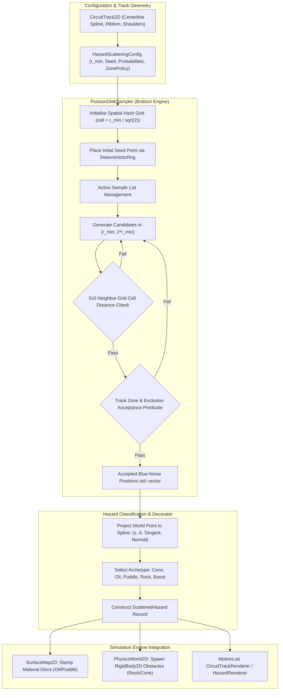

# Deterministic Object and Hazard Scattering (Blue-Noise / Poisson Disk): C++17 Implementation Plan

## 1. Executive Summary & Scope

### 1.1 Objective & Context
This specification details the mathematical modeling, algorithmic architecture, data contracts, and implementation roadmap for **Deterministic Object and Hazard Scattering (Blue-Noise / Poisson Disk)** as proposed in Section 2.4 of [ProposedFeatures.md](ProposedFeatures.md).

In procedural track design and open-world terrain generation within `VehicleSimCore` (e.g. closed racing circuits in [CircuitTrack2D](../libs/VehicleSimCore/terrain/TrackGenerator.h), platformer obstacle courses, and top-down exploration maps in [SurfaceMap2D](../libs/VehicleSimCore/terrain/SurfaceMap2D.h)):
1. **Unnatural Clustering of Naive Random Scattering**: Standard uniform pseudo-random scattering ($X, Y \sim U[a, b]$) causes Poisson clumping where obstacles spawn immediately adjacent to one another or overlap completely, creating impassable choke points, wall glitches, and visually unnatural clustering.
2. **Grid Artifacts of Jittered Grids**: Perturbed grid sampling introduces obvious directional axes and unnatural lattice alignments, destroying the organic realism of scattered roadside hazards, loose gravel patches, and racing cones.
3. **Blue-Noise / Poisson-Disk Distribution**: Blue-noise distributions enforce a strict minimum Euclidean distance threshold ($r_{\text{min}}$) between all pairs of samples while maintaining isotropic, pseudo-random placement without directional bias. In the frequency domain, blue-noise power spectra exhibit low energy at low spatial frequencies (suppressing clumping) and uniform high-frequency energy.
4. **Track Corridor & Ribbon Awareness**: Racing circuits require obstacles (slalom cones, oil slicks, water puddles, boost pads, rocks, and tire barriers) to be placed strictly within specific functional zones:
   - **Track Ribbon**: On-track hazards (oil slicks, puddles, boost pads, dynamic cones).
   - **Runoff Shoulders**: Gravel traps, runoff markers, recovery boost pads.
   - **Track Margins / Verge**: Slalom cones, timing gates, tire safety barriers.
   - **Exclusion Zones**: Starting grid slots, finish lines, and high-speed apex curb clipping paths must remain guaranteed hazard-free.
5. **Physical Interactivity & Material Coupling**: Scattered hazards are not merely visual decorations; they interact dynamically with the vehicle physics and terramechanics pipelines:
   - **Surface Material Modification**: Oil slicks and standing puddles stamp low-friction and drag attributes directly into [SurfaceMap2D](../libs/VehicleSimCore/terrain/SurfaceMap2D.h).
   - **Rigid Body Collisions**: Heavy rocks and tire walls instantiate static [RigidBody2D](../libs/VehicleSimCore/physics/RigidBody2D.h) colliders resolved via [ContactSolver2D](../libs/VehicleSimCore/physics/ContactSolver2D.h).
   - **Kinematic & Dynamic Props**: Slalom cones deflect realistically upon bumper impact with mass-weighted impulse exchange.
   - **Energy Triggers**: Boost pads inject directional kinetic impulses along the track forward tangent vector.

The goal is to deliver an industrial-grade, zero-allocation, MISRA C++:2023 compliant C++17 procedural scattering system comprising [libs/VehicleSimCore/terrain/PoissonDiskSampler.h](../libs/VehicleSimCore/terrain/PoissonDiskSampler.h) and [libs/VehicleSimCore/terrain/HazardScattering.h](../libs/VehicleSimCore/terrain/HazardScattering.h), complete with [CircuitTrack2D](../libs/VehicleSimCore/terrain/TrackGenerator.h) integration and [MotionLab](../apps/MotionLab) visualization.

---

### 1.2 Core Requirements & Constraints

1. **Bridson's $O(N)$ Blue-Noise Algorithm**:
   - Enforce minimum separation distance $r_{\text{min}}$ such that $\forall i \ne j, \; \|\mathbf{p}_i - \mathbf{p}_j\|_2 \ge r_{\text{min}}$.
   - Uniform radial annular sampling in $[r_{\text{min}}, 2r_{\text{min}}]$ around active samples using uniform areal density coordinates: $\rho = r_{\text{min}}\sqrt{3u_2 + 1}$.
   - Uniform spatial acceleration grid with cell size $h_{\text{cell}} \le r_{\text{min}} / \sqrt{2}$, guaranteeing $O(1)$ neighbor collision queries and total $O(N)$ execution time.
2. **Variable-Radius & Multi-Class Support**:
   - Support heterogeneous hazard archetypes where each hazard class $k$ possesses its own exclusion clearance radius $r_k$ and bounding collision footprint.
   - Distance condition between candidate $i$ and neighbor $j$: $\|\mathbf{p}_i - \mathbf{p}_j\|_2 \ge \frac{1}{2}(r_i + r_j)$ or $r_i + r_j$ depending on clearance mode.
3. **Track-Aware Corridor Filtering**:
   - Project candidates to Frenet-Serret coordinates $(s, d)$ along track centerline $\mathbf{C}(s)$.
   - Classify placement into zones: `RibbonOnly`, `ShoulderOnly`, `FullCorridor`, and `EdgeBorders`.
   - Prevent hazard generation within configurable exclusion zones: starting grid line, finish line easement $s \in [0, s_{\text{clear}}]$, and racing racing-line corridors.
4. **Terramechanics & Physics World Integration**:
   - **Material Stamping**: Rasterize circular and oriented footprint discs of `OilSlick` and `StandingWater` into [SurfaceMap2D](../libs/VehicleSimCore/terrain/SurfaceMap2D.h).
   - **Physics World Spawning**: Batch-instantiate static and dynamic [RigidBody2D](../libs/VehicleSimCore/physics/RigidBody2D.h) instances with `Circle2D`, `OBB2D`, or `Polygon2D` shapes into [PhysicsWorld2D](../libs/VehicleSimCore/physics/PhysicsWorld2D.h).
5. **Deterministic IEEE 754 & MISRA C++:2023 Compliance**:
   - Cross-platform bit-exact repeatability across Linux (GCC/Clang) and Windows (MSVC) using an explicit 64-bit deterministic PRNG.
   - Zero raw `new` or `delete` operators; zero memory leaks.
   - All function names strictly less than 30 characters.
   - Headers use `#pragma once` and are co-located with implementation files in `libs/VehicleSimCore/terrain/`.
   - Mandatory `[[nodiscard]]` on all query and factory methods.

---

## 2. Mathematical Formulations & Algorithmic Design

### 2.1 Bridson's $O(N)$ Poisson-Disk Sampling in 2D

```
  ASCII Diagram: Annular Candidate Generation and Spatial Grid
  
  +-------------------+-------------------+-------------------+
  |                   |                   |                   |
  |    Grid Cell      |    Grid Cell      |    Grid Cell      |
  |    (i-1, j+1)     |    (i, j+1)       |    (i+1, j+1)     |
  |                   |                   |                   |
  +-------------------+-------------------+-------------------+
  |                   |       .....       |                   |
  |                   |    .::/   \::.    |                   |
  |    Grid Cell      |   :: /     \ ::   |    Grid Cell      |
  |    (i-1, j)       |  :: (   P   ) ::  |    (i+1, j)       |
  |                   |   :: \     / ::   |                   |
  |                   |    .::\___/::.    |                   |
  +-------------------+-------'-----------+-------------------+
  |                   |        \          |                   |
  |    Grid Cell      |         \ Candidate in Annulus        |
  |    (i-1, j-1)     |          * [r_min, 2*r_min]           |
  |                   |                   |                   |
  +-------------------+-------------------+-------------------+
```

#### 2.1.1 Spatial Grid Discretization
To detect spatial collisions in $O(1)$ time, the 2D bounding domain $[x_{\text{min}}, x_{\text{max}}] \times [y_{\text{min}}, y_{\text{max}}]$ is discretized into a uniform rectangular grid. The cell dimension $h_{\text{cell}}$ is chosen such that the diagonal of each cell is at most $r_{\text{min}}$:

$$h_{\text{cell}} = \frac{r_{\text{min}}}{\sqrt{2}}$$

Because the maximum distance between any two points within the same cell is $\sqrt{h_{\text{cell}}^2 + h_{\text{cell}}^2} = r_{\text{min}}$, **each grid cell can contain at most one sample point**. The grid is indexed by integer coordinates:

$$i = \left\lfloor \frac{x - x_{\text{min}}}{h_{\text{cell}}} \right\rfloor, \quad j = \left\lfloor \frac{y - y_{\text{min}}}{h_{\text{cell}}} \right\rfloor$$

#### 2.1.2 Uniform Areal Annular Sampling
Given an active sample point $\mathbf{p}_{\text{active}} \in \mathbb{R}^2$, candidates $\mathbf{x}_{\text{cand}}$ must be generated within the annular ring:

$$\mathcal{A}(\mathbf{p}_{\text{active}}) = \left\{ \mathbf{x} \in \mathbb{R}^2 \;\middle|\; r_{\text{min}} \le \|\mathbf{x} - \mathbf{p}_{\text{active}}\|_2 < 2r_{\text{min}} \right\}$$

To prevent non-uniform clustering near the inner radius $r_{\text{min}}$, the radius $\rho$ must be sampled with probability density function proportional to radial area $dA = 2\pi \rho \, d\rho$. Given two independent uniform random variates $u_1, u_2 \sim U[0, 1)$:

$$\theta = 2\pi u_1$$

$$\rho = \sqrt{u_2 \cdot \left((2r_{\text{min}})^2 - r_{\text{min}}^2\right) + r_{\text{min}}^2} = r_{\text{min}} \sqrt{3u_2 + 1}$$

The candidate point is computed as:

$$\mathbf{x}_{\text{cand}} = \mathbf{p}_{\text{active}} + \begin{bmatrix} \rho \cos\theta \\ \rho \sin\theta \end{bmatrix}$$

#### 2.1.3 Spatial Hash Collision Query
When evaluating candidate $\mathbf{x}_{\text{cand}}$ located in cell $(i_{\text{cand}}, j_{\text{cand}})$, only grid cells within a 2-cell neighborhood can possibly contain a point within distance $r_{\text{min}}$:

$$\Delta i, \Delta j \in \{-2, -1, 0, 1, 2\} \quad \text{such that} \quad 0 \le i_{\text{cand}} + \Delta i < N_x, \quad 0 \le j_{\text{cand}} + \Delta j < N_y$$

For each occupied neighbor cell containing sample $\mathbf{p}_{\text{neighbor}}$:

$$\|\mathbf{x}_{\text{cand}} - \mathbf{p}_{\text{neighbor}}\|_2^2 < r_{\text{min}}^2 \implies \text{Collision (Candidate Rejected)}$$

#### 2.1.4 Active List State Progression
1. **Initialization**: Generate seed point $\mathbf{p}_0 \in \Omega$ (or inject existing fixed anchor points). Store in sample array, mark in grid, and push index to active list $\mathcal{L}_{\text{active}}$.
2. **Expansion**: While $\mathcal{L}_{\text{active}}$ is not empty:
   - Pick index $k \in [0, |\mathcal{L}_{\text{active}}| - 1]$ uniformly at random.
   - For attempts $m \in [1, K_{\text{max}}]$ (typically $K_{\text{max}} = 30$):
     - Generate candidate $\mathbf{x}_{\text{cand}} \in \mathcal{A}(\mathbf{p}_k)$.
     - If $\mathbf{x}_{\text{cand}} \in \Omega$ and satisfies all spatial grid clearance checks:
       - Accept $\mathbf{x}_{\text{cand}}$, append to samples, record in grid, and append new index to $\mathcal{L}_{\text{active}}$.
       - Break attempt loop.
   - If all $K_{\text{max}}$ attempts fail to place a valid candidate:
     - Remove index $k$ from $\mathcal{L}_{\text{active}}$ by swapping with the tail element and popping back ($O(1)$ removal).
3. **Termination**: When $\mathcal{L}_{\text{active}}$ is empty, the domain is saturated with maximal Poisson-disk packing.

---

### 2.2 Track-Corridor Frenet-Serret Projection & Zoning

```
  ASCII Diagram: Track-Corridor Zone Classification
  
          +===================================================+  Outer Shoulder Boundary
          |   Runoff Shoulder Zone (Gravel / Grass / Cones)   |  d = + (W_track/2 + W_shoulder)
  - - - - +---------------------------------------------------+ - - - - - - - - - - - -
          |   Outer Ribbon Edge                               |  d = + W_track / 2
          |                                                   |
          |   Drivable Track Ribbon (Oil / Puddles / Boost)   |
  ========+===================================================+======== Centerline (d = 0)
          |                                                   |
          |   Inner Ribbon Edge                               |  d = - W_track / 2
  - - - - +---------------------------------------------------+ - - - - - - - - - - - -
          |   Runoff Shoulder Zone (Tire Barriers / Cones)    |  d = - (W_track/2 + W_shoulder)
          +===================================================+  Inner Shoulder Boundary
```

#### 2.2.1 Projection to Centerline
Let the track centerline be represented by a parametric $C^2$ continuous Catmull-Rom spline $\mathbf{C}(s)$ with arc-length $s \in [0, L_{\text{track}}]$ from [Spline2D](../libs/VehicleSimCore/math/Spline2D.h).
For any candidate world point $\mathbf{x} = (x, y)$:
1. Find closest spline projection point $\mathbf{C}(s^*)$:
   $$s^* = \arg\min_{s \in [0, L_{\text{track}}]} \|\mathbf{x} - \mathbf{C}(s)\|_2$$
2. Compute Frenet-Serret frame at $s^*$:
   $$\mathbf{T}(s^*) = \frac{d\mathbf{C}}{ds}(s^*), \quad \mathbf{N}(s^*) = \begin{bmatrix} -T_y(s^*) \\ T_x(s^*) \end{bmatrix}$$
3. Signed transversal lateral offset:
   $$d = (\mathbf{x} - \mathbf{C}(s^*)) \cdot \mathbf{N}(s^*)$$
   where $|d|$ is the orthogonal Euclidean distance to centerline.

#### 2.2.2 Zone Acceptance Predicate
Given track half-width $w_{\text{road}} = \frac{1}{2} W_{\text{track}}$ and shoulder width $w_{\text{shoulder}}$:

$$\text{Zone}(\mathbf{x}) = \begin{cases}
\text{TrackRibbon}, & |d| \le w_{\text{road}} \\
\text{RunoffShoulder}, & w_{\text{road}} < |d| \le w_{\text{road}} + w_{\text{shoulder}} \\
\text{OfftrackVerge}, & |d| > w_{\text{road}} + w_{\text{shoulder}}
\end{cases}$$

Candidate $\mathbf{x}_{\text{cand}}$ is accepted if:
1. $\text{Zone}(\mathbf{x}_{\text{cand}})$ matches the target zone policy:
   - `HazardZonePolicy::TrackRibbonOnly`: $|d| \le w_{\text{road}}$
   - `HazardZonePolicy::ShoulderOnly`: $w_{\text{road}} < |d| \le w_{\text{road}} + w_{\text{shoulder}}$
   - `HazardZonePolicy::TrackAndShoulder`: $|d| \le w_{\text{road}} + w_{\text{shoulder}}$
   - `HazardZonePolicy::TrackBorders`: $||d| - w_{\text{road}}| \le \delta_{\text{border}}$ (lining the track edge).
2. **Start / Finish Line Clearance**:
   $$s^* \ge s_{\text{grid\_clear}} \quad \text{and} \quad (L_{\text{track}} - s^*) \ge s_{\text{finish\_clear}}$$
   ensuring starting vehicle grids are never obstructed by hazards.

---

### 2.3 Multi-Class Variable Clearance Formulations

Different obstacle archetypes require distinct clearance radii:
- Small traffic cone: clearance $r_A = 1.0\,\text{m}$, physical radius $R_A = 0.25\,\text{m}$.
- Oil slick patch: clearance $r_B = 4.0\,\text{m}$, physical radius $R_B = 1.8\,\text{m}$.
- Large rock/boulder: clearance $r_C = 3.0\,\text{m}$, physical radius $R_C = 0.6\,\text{m}$.
- Speed boost pad: clearance $r_D = 6.0\,\text{m}$, physical radius $R_D = 2.0\,\text{m}$.

When candidate $\mathbf{x}_{\text{cand}}$ with archetype clearance $r_{\text{cand}}$ is tested against an existing sample $\mathbf{p}_j$ with clearance $r_j$:

$$\|\mathbf{x}_{\text{cand}} - \mathbf{p}_j\|_2 \ge \frac{r_{\text{cand}} + r_j}{2}$$

The spatial acceleration grid is constructed with cell size governed by the global minimum clearance:

$$h_{\text{cell}} = \frac{\min_k r_k}{\sqrt{2}}$$

The search radius in grid cell units for a candidate of clearance $r_{\text{cand}}$ is bounded by:

$$N_{\text{search}} = \left\lceil \frac{r_{\text{cand}} + \max_k r_k}{2 h_{\text{cell}}} \right\rceil$$

---

## 3. Hazard Archetypes & Physical Behavioral Models

```
  ASCII Diagram: Hazard Physical Response Pipeline
  
  Vehicle Chassis Enters Hazard Region
                 |
                 +-----------------------+-----------------------+
                 |                       |                       |
                 v                       v                       v
        [ Surface Hazard ]       [ Physical Body ]       [ Kinetic Trigger ]
        (Oil Slick / Puddle)     (Cone / Rock / Wall)    (Boost Pad)
                 |                       |                       |
                 v                       v                       v
        SurfaceMap2D Patch       ContactSolver2D         RigidBody2D
        Friction mu -> 0.08      Impulse Resolution      Apply Forward Impulse
        Hydroplaning Drag        Linear/Angular Bounce   J = m * Delta_V
```

### 3.1 Hazard Classification Table

| Hazard Archetype | Interaction Mode | Clearance $r_{\text{clear}}$ | Footprint $R_{\text{phys}}$ | Physical Effect on Vehicle |
| :--- | :--- | :--- | :--- | :--- |
| **`TrafficCone`** | Dynamic Rigid Body | $1.2\,\text{m}$ | $0.25\,\text{m}$ | Mass $3.5\,\text{kg}$, high restitution ($e=0.6$), scatters upon bumper contact. |
| **`OilSlick`** | Surface Material Patch | $3.5\,\text{m}$ | $1.6\,\text{m}$ | Local friction drops to $\mu = 0.08$; wheels lose longitudinal and lateral grip. |
| **`StandingPuddle`** | Surface Hydrodynamic | $2.8\,\text{m}$ | $1.4\,\text{m}$ | Water film depth $d_w = 40\,\text{mm}$; spray drag force and dynamic hydroplaning. |
| **`Rock`** | Static Rigid Body | $2.5\,\text{m}$ | $0.50\,\text{m}$ | Infinite mass obstacle; high impact impulse resolved via `ContactSolver2D`. |
| **`BoostPad`** | Kinetic Energy Trigger | $5.0\,\text{m}$ | $1.5\,\text{m}$ | Overlapping chassis receives longitudinal velocity impulse $\Delta v = +10\,\text{m/s}$. |
| **`TireBarrier`** | Damped Deformable Obstacle | $2.0\,\text{m}$ | $0.70\,\text{m}$ | Mass $80\,\text{kg}$, low restitution ($e=0.15$), high deformation energy absorption. |

### 3.2 Dynamic Vehicle Interactions

#### 3.2.1 Oil Slick Friction Collapse
When tire contact patches overlap an `OilSlick` disc stamped in [SurfaceMap2D](../libs/VehicleSimCore/terrain/SurfaceMap2D.h):
- Normal force $F_z$ is preserved.
- Peak longitudinal grip limit collapses:
  $$F_{x,\text{max}} = \mu_{\text{oil}} \cdot F_z, \quad \mu_{\text{oil}} \approx 0.08$$
- Lateral cornering stiffness collapses:
  $$C_\alpha' = C_\alpha \cdot \frac{\mu_{\text{oil}}}{\mu_{\text{tarmac}}} \approx C_\alpha \cdot 0.09$$
- Induces sudden vehicle oversteer, spin-out, and wheel flare.

#### 3.2.2 Standing Puddle Hydrodynamic Drag & Hydroplaning
When vehicle crosses a `StandingPuddle`:
1. **Hydrodynamic Spray Drag**:
   $$F_{\text{spray}} = \frac{1}{2} C_{d,\text{water}} \cdot \rho_{\text{water}} \cdot A_{\text{submerged}} \cdot v_x^2$$
2. **NASA Critical Hydroplaning Speed**:
   $$v_{\text{hydro}} = 6.36 \sqrt{p_{\text{tire,psi}}} \quad [\text{m/s}]$$
   If $v_x > v_{\text{hydro}}$, tire completely lifts off asphalt, friction drops to zero, and steering control is lost until speed decays below threshold.

#### 3.2.3 Boost Pad Kinetic Impulse
When vehicle rigid body center of mass crosses a `BoostPad` trigger zone:
$$\mathbf{J}_{\text{boost}} = m_{\text{vehicle}} \cdot \Delta v_{\text{boost}} \cdot \mathbf{T}(s)$$
applied at the vehicle center of gravity in the direction of the local track tangent.

---

## 4. High-Level Architecture & Subsystem Organization

### 4.1 File Layout

```
libs/VehicleSimCore/
├── terrain/
│   ├── PoissonDiskSampler.h        [NEW] - Core 2D blue-noise generator using Bridson's algorithm
│   ├── PoissonDiskSampler.cpp      [NEW] - Spatial hash grid, annular candidate sampling, active list
│   ├── HazardScattering.h          [NEW] - Track & terrain hazard scattering coordinator
│   ├── HazardScattering.cpp        [NEW] - Multi-class rules, corridor projection, material stamping
│   ├── TrackGenerator.h            [EXTENDED] - CircuitTrack2D holds scattered hazard array
│   ├── TrackGenerator.cpp          [EXTENDED] - Circuit track generation triggers hazard scattering
│   ├── SurfaceMap2D.h              [EXTENDED] - Surface stamping of circular hazard discs
│   └── SurfaceMap2D.cpp            [EXTENDED] - Rasterizes material circles into elevation/material grid
apps/MotionLab/
├── CircuitTrackCoordinator.h       [EXTENDED] - Holds hazard configuration and runtime trigger state
├── CircuitTrackCoordinator.cpp     [EXTENDED] - Updates hazard collisions and applies vehicle impulses
├── HazardRenderer.h                [NEW] - SDL2 rendering of cones, slicks, puddles, boost pads, rocks
└── HazardRenderer.cpp              [NEW] - Procedural drawing of colored hazard symbols and arrows
tests/
└── HazardScatteringTest.cpp        [NEW] - Comprehensive GoogleTest validation suite
```

---

### 4.2 System Architecture ASCII Diagram

```
+----------------------------------------------------------------------------------------------------+
|                       Deterministic Hazard Scattering Subsystem Architecture                       |
+----------------------------------------------------------------------------------------------------+
|                                                                                                    |
|   CircuitTrackConfig / User Seed / Density Settings                                                |
|               |                                                                                    |
|               v                                                                                    |
|   +------------------------------------------------------------------------------------------+     |
|   | HazardScattering Coordinator (libs/VehicleSimCore/terrain)                                |     |
|   +------------------------------------------------------------------------------------------+     |
|   | - Parses HazardScatteringConfig (r_min, hazard ratios, zone policy, clearance easements) |     |
|   | - Samples track corridor bounding box AABB2D from CircuitTrack2D / Spline2D              |     |
|   | - Formulates boundary and zone acceptance predicates: isPointInTargetZone(pt)            |     |
|   +------------------------------------------------------------------------------------------+     |
|               |                                                       ^                            |
|               v Dispatches Candidate Bounds                           | Validates Samples          |
|   +------------------------------------------------------------------------------------------+     |
|   | PoissonDiskSampler (libs/VehicleSimCore/terrain)                                         |     |
|   +------------------------------------------------------------------------------------------+     |
|   | 1. Discretizes domain into uniform Spatial Hash Grid (cell_size = r_min / sqrt(2))        |     |
|   | 2. Initializes seed point via DeterministicRng (64-bit cross-platform PRNG)              |     |
|   | 3. Generates candidates in annular ring [r_min, 2*r_min] with uniform areal density      |     |
|   | 4. Queries 5x5 neighbor cells in O(1) time to enforce minimum Euclidean distance         |     |
|   | 5. Invokes rejection predicate for boundary/exclusion containment                       |     |
|   | 6. Emits deterministic std::vector<Vec2> blue-noise sample points                         |     |
|   +------------------------------------------------------------------------------------------+     |
|               |                                                                                    |
|               v Unassigned Blue-Noise Point Cloud                                                  |
|   +------------------------------------------------------------------------------------------+     |
|   | Hazard Archetype Assignment & Classification                                             |     |
|   +------------------------------------------------------------------------------------------+     |
|   | - Projects each sample onto track centerline -> (s, d) Frenet frame                      |     |
|   | - Selects archetype (Cone, OilSlick, Puddle, Rock, BoostPad) via deterministic RNG       |     |
|   | - Assigns heading theta = track tangent angle + optional angular perturbation            |     |
|   | - Emits std::vector<ScatteredHazard>                                                     |     |
|   +------------------------------------------------------------------------------------------+     |
|               |                                             |                                      |
|               v                                             v                                      |
|   +------------------------------------+   +-------------------------------------------------+     |
|   | Terramechanics Stamping            |   | Physics World Spawning                          |     |
|   | SurfaceMap2D::stampMaterialDisc()  |   | PhysicsWorld2D::addBody()                       |     |
|   +------------------------------------+   +-------------------------------------------------+     |
|   | - Rasterizes OilSlick / Puddle     |   | - Spawns static Rock obstacles                  |     |
|   | - Updates local friction & drag    |   | - Spawns dynamic TrafficCones with mass & bounce|     |
|   +------------------------------------+   +-------------------------------------------------+     |
|                                                                                                    |
+----------------------------------------------------------------------------------------------------+
```

---

### 4.3 System Architecture Mermaid Flowchart



---

## 5. Detailed Class & Data Structure Contracts (C++17)

### 5.1 `PoissonDiskSampler.h`

```cpp
#pragma once

#include <cstddef>
#include <cstdint>
#include <functional>
#include <vector>

#include "libs/VehicleSimCore/math/AABB2D.h"
#include "libs/VehicleSimCore/math/Vec2.h"

namespace vehicle_sim::terrain {

/// @struct PoissonSamplerConfig
/// @brief Configuration parameters for 2D Bridson Poisson-disk sampling.
struct PoissonSamplerConfig {
    double minDistance { 4.0 }; ///< Minimum Euclidean distance r_min between any two samples in meters.
    std::size_t maxAttempts { 30U }; ///< Rejection candidate attempts (k) per active sample.
    math::AABB2D bounds { math::Vec2 { -100.0, -100.0 }, math::Vec2 { 100.0, 100.0 } }; ///< Bounding domain.
    std::uint32_t seed { 1337U }; ///< Deterministic PRNG seed.
};

/// @typedef PointAcceptancePredicate
/// @brief Callback query determining whether a candidate point falls within a valid placement domain.
using PointAcceptancePredicate = std::function<bool(const math::Vec2&)>;

/// @class PoissonDiskSampler
/// @brief Generates 2D blue-noise point distributions with guaranteed minimum distance in O(N) time.
/// @details Implements Bridson's Poisson-disk algorithm using a uniform acceleration grid.
class PoissonDiskSampler {
public:
    /// @brief Parameterized constructor configuring sampler domain and parameters.
    /// @param[in] config Sampling domain and distance configuration.
    explicit PoissonDiskSampler(const PoissonSamplerConfig& config) noexcept;

    /// @brief Generates blue-noise sample points within the configured bounding domain.
    /// @param[in] predicate Optional acceptance test for boundary or mask filtering.
    /// @return Vector of placed 2D Cartesian points satisfying minimum distance constraint.
    [[nodiscard]] std::vector<math::Vec2> generate(
        const PointAcceptancePredicate& predicate = nullptr) const;

    /// @brief Generates blue-noise samples seeded with pre-existing fixed anchor points.
    /// @param[in] initialPoints Pre-existing fixed coordinates to preserve.
    /// @param[in] predicate Optional acceptance test for boundary or mask filtering.
    /// @return Complete vector of sample points including initial points.
    [[nodiscard]] std::vector<math::Vec2> generateWithSeedPoints(
        const std::vector<math::Vec2>& initialPoints,
        const PointAcceptancePredicate& predicate = nullptr) const;

    /// @brief Gets active sampler configuration.
    /// @return Constant reference to configuration.
    [[nodiscard]] const PoissonSamplerConfig& getConfig() const noexcept;

    /// @brief Updates sampler configuration.
    /// @param[in] config New configuration settings.
    void setConfig(const PoissonSamplerConfig& config) noexcept;

private:
    PoissonSamplerConfig mConfig { };
};

} // namespace vehicle_sim::terrain
```

---

### 5.2 `HazardScattering.h`

```cpp
#pragma once

#include <cstddef>
#include <cstdint>
#include <vector>

#include "libs/VehicleSimCore/math/Vec2.h"
#include "libs/VehicleSimCore/terrain/PoissonDiskSampler.h"
#include "libs/VehicleSimCore/terrain/SurfaceMaterial.h"

namespace vehicle_sim::physics {
class PhysicsWorld2D;
}

namespace vehicle_sim::terrain {

struct CircuitTrack2D;
class SurfaceMap2D;

/// @enum HazardType
/// @brief Identifies the physical and behavioral archetype of a scattered track obstacle.
enum class HazardType : std::uint8_t {
    TrafficCone,   ///< Lightweight movable dynamic obstacle.
    OilSlick,      ///< Low-friction surface material patch.
    StandingPuddle,///< Standing water patch causing hydrodynamic drag and hydroplaning.
    Rock,          ///< Heavy static rigid body collision obstacle.
    BoostPad,      ///< Forward kinetic impulse velocity trigger.
    TireBarrier    ///< High-damping perimeter impact attenuator.
};

/// @enum HazardZonePolicy
/// @brief Specifies topological placement constraints relative to track ribbon and shoulders.
enum class HazardZonePolicy : std::uint8_t {
    TrackRibbonOnly,  ///< Scattered strictly on drivable asphalt/tarmac ribbon.
    ShoulderOnly,     ///< Scattered strictly in loose gravel/grass runoff shoulders.
    TrackAndShoulder, ///< Scattered across both ribbon and runoff shoulders.
    TrackBorders      ///< Scattered along the dividing boundary edge between ribbon and shoulder.
};

/// @struct ScatteredHazard
/// @brief Fully described track obstacle with spatial, physical, and topological parameters.
struct ScatteredHazard {
    math::Vec2 position { 0.0, 0.0 }; ///< 2D world coordinates in meters.
    double orientation { 0.0 }; ///< Yaw angle in radians.
    double boundingRadius { 0.5 }; ///< Geometric collision / clearance radius in meters.
    double trackProgress { 0.0 }; ///< Normalized progress along centerline in [0, 1].
    double lateralOffset { 0.0 }; ///< Signed orthogonal distance from centerline in meters.
    HazardType type { HazardType::TrafficCone }; ///< Hazard physical archetype.
    double severity { 1.0 }; ///< Intensity modifier (e.g. oil slick friction factor or boost magnitude).
};

/// @struct HazardScatteringConfig
/// @brief Configuration settings controlling procedural track hazard generation.
struct HazardScatteringConfig {
    double minDistance { 5.0 }; ///< Minimum separation distance between any two hazards in meters.
    HazardZonePolicy zonePolicy { HazardZonePolicy::TrackAndShoulder }; ///< Zone placement rule.
    double coneProbability { 0.35 }; ///< Relative weight of traffic cones.
    double oilSlickProbability { 0.20 }; ///< Relative weight of oil slicks.
    double puddleProbability { 0.20 }; ///< Relative weight of standing water puddles.
    double rockProbability { 0.15 }; ///< Relative weight of heavy rocks.
    double boostPadProbability { 0.10 }; ///< Relative weight of speed boost pads.
    double startClearanceDistance { 30.0 }; ///< Length in meters after starting line kept hazard-free.
    double finishClearanceDistance { 20.0 }; ///< Length in meters before finish line kept hazard-free.
    std::size_t maxHazardCount { 100U }; ///< Maximum allowable scattered hazards clamp.
    std::uint32_t seed { 4242U }; ///< Deterministic PRNG seed.
};

/// @class HazardScattering
/// @brief Coordinates procedural blue-noise hazard placement along track corridors.
class HazardScattering {
public:
    HazardScattering() = delete;

    /// @brief Generates scattered hazards along a 2D closed circuit track.
    /// @param[in] track Circuit track geometry and centerline spline.
    /// @param[in] config Hazard scattering rules and probabilities.
    /// @return Array of placed and classified ScatteredHazard instances.
    [[nodiscard]] static std::vector<ScatteredHazard> scatterOnTrack(
        const CircuitTrack2D& track, const HazardScatteringConfig& config);

    /// @brief Stamps surface-modifying hazards (oil, water, boost) into a 2D surface map.
    /// @param[in,out] surfaceMap Target terrain surface map to mutate.
    /// @param[in] hazards Array of scattered hazards.
    static void stampSurfaceMaterials(
        SurfaceMap2D& surfaceMap, const std::vector<ScatteredHazard>& hazards) noexcept;

    /// @brief Instantiates physical obstacle colliders (rocks, cones) into a physics world.
    /// @param[in,out] world Target physics world receiving rigid bodies.
    /// @param[in] hazards Array of scattered hazards.
    static void spawnPhysicsColliders(
        physics::PhysicsWorld2D& world, const std::vector<ScatteredHazard>& hazards);
};

} // namespace vehicle_sim::terrain
```

---

### 5.3 SurfaceMap2D Extensions for Material Stamping

In `libs/VehicleSimCore/terrain/SurfaceMap2D.h`:
```cpp
    /// @brief Stamps a circular material patch into the surface map.
    /// @param[in] center World coordinates of circle center in meters.
    /// @param[in] radius Circular footprint radius in meters.
    /// @param[in] material Material properties applied within circle.
    void stampMaterialDisc(
        const math::Vec2& center, double radius, const SurfaceMaterial& material) noexcept;
```

---

### 5.4 TrackGenerator & CircuitTrack2D Extensions

In `libs/VehicleSimCore/terrain/TrackGenerator.h`:
```cpp
struct CircuitTrackConfig {
    // ... existing parameters ...
    bool enableHazards { false }; ///< True to scatter procedural obstacles along track corridor.
    HazardScatteringConfig hazardConfig { }; ///< Configuration for scattered hazards.
};

struct CircuitTrack2D {
    // ... existing members ...
    std::vector<ScatteredHazard> hazards { }; ///< Procedural scattered hazards along track.

    /// @brief Gets total number of active scattered hazards.
    /// @return Count of hazards.
    [[nodiscard]] std::size_t getHazardCount() const noexcept;

    /// @brief Clears all scattered hazards from track.
    void clearHazards() noexcept;
};
```

---

## 6. Detailed Implementation Phases

### Phase 1: Core Mathematical Poisson-Disk Engine (`PoissonDiskSampler`)
- **Deliverables**:
  - `libs/VehicleSimCore/terrain/PoissonDiskSampler.h`
  - `libs/VehicleSimCore/terrain/PoissonDiskSampler.cpp`
  - Unit tests in `tests/HazardScatteringTest.cpp`
- **Key Implementation Steps**:
  1. Implement `DeterministicRng` based on cross-platform 64-bit linear congruential or xorshift generator with zero OS dependencies.
  2. Implement spatial hash grid array mapping $(i, j) \to \text{sampleIndex}$.
  3. Implement annular sampling with exact areal uniform square root transformation: $\rho = r_{\text{min}}\sqrt{3u_2 + 1}$.
  4. Implement 5x5 neighbor cell collision query in $O(1)$ time.
  5. Implement active list state management with $O(1)$ swap-and-pop removal.
  6. Support boundary clipping against `AABB2D` and arbitrary `PointAcceptancePredicate` callbacks.

---

### Phase 2: Hazard Taxonomy & Domain Scattering (`HazardScattering`)
- **Deliverables**:
  - `libs/VehicleSimCore/terrain/HazardScattering.h`
  - `libs/VehicleSimCore/terrain/HazardScattering.cpp`
- **Key Implementation Steps**:
  1. Construct track corridor bounding box `AABB2D` enclosing track centerline plus ribbon and shoulder margins.
  2. Implement track acceptance predicate evaluating `track.getDistanceToCenter(pt)` and comparing against `trackWidth` and `shoulderWidth`.
  3. Enforce start line and finish line safety buffer exclusions ($s \ge s_{\text{grid\_clear}}$).
  4. Map accepted Cartesian points to track Frenet frame: compute track progress $s / L$, signed lateral offset $d$, and track forward heading $\theta_{\text{track}}$.
  5. Weighted Monte Carlo selection of `HazardType` based on configured probability mass function.
  6. Apply minor rotational perturbation $\Delta \theta \in [-\pi/6, +\pi/6]$ for dynamic obstacles (cones).

---

### Phase 3: Terramechanics & Physics World Integration
- **Deliverables**:
  - `libs/VehicleSimCore/terrain/SurfaceMap2D.h` & `.cpp` extensions (`stampMaterialDisc`).
  - `libs/VehicleSimCore/terrain/TrackGenerator.h` & `.cpp` extensions (`CircuitTrack2D::hazards`).
  - Physics spawning helper in `HazardScattering::spawnPhysicsColliders()`.
- **Key Implementation Steps**:
  1. Implement `SurfaceMap2D::stampMaterialDisc()`: rasterize grid cells within Euclidean distance $R$ of center, overwriting or blending `SurfaceMaterial` (`OilSlick`, `StandingWater`).
  2. For `HazardType::OilSlick` and `StandingPuddle`, invoke material disc stamping during track generation.
  3. For `HazardType::Rock`, spawn static `RigidBody2D` with circular `Circle2D` collider ($m = \infty$).
  4. For `HazardType::TrafficCone`, spawn dynamic `RigidBody2D` with circle collider, mass $3.5\,\text{kg}$, and high linear damping ($c_{\text{drag}} = 2.5$).
  5. For `HazardType::BoostPad`, register kinetic trigger volume in track coordinator.

---

### Phase 4: MotionLab Interactive Visualization & UI Controls
- **Deliverables**:
  - `apps/MotionLab/HazardRenderer.h` & `HazardRenderer.cpp`
  - Integration into `apps/MotionLab/CircuitTrackCoordinator.h` & `.cpp`
  - ImGui UI controls for hazard regeneration, density, and archetype toggles.
- **Key Implementation Steps**:
  1. Render `OilSlick` as dark iridescent elliptical splatters with specular gloss.
  2. Render `StandingPuddle` as reflective light-blue transparent discs with wave rippling contour.
  3. Render `TrafficCone` as bright fluorescent orange circles with white reflective inner collars.
  4. Render `Rock` as dark gray faceted polygonal boulders.
  5. Render `BoostPad` as glowing neon cyan chevron arrows pointing along track forward tangent $\mathbf{T}(s)$.
  6. In `CircuitTrackCoordinator::stepPhysics()`, detect vehicle chassis overlaps with boost pads (trigger forward impulse) and puddles (trigger spray effects).

---

### Phase 5: Verification, Benchmarking & MISRA Hardening
- **Deliverables**:
  - Full test execution under GoogleTest (`tests/HazardScatteringTest.cpp`).
  - Zero warnings under `-Wall -Wextra -pedantic` and `/W4` on MSVC.
  - Verification against MISRA C++:2023 and the project verification checklist.

---

## 7. Comprehensive Testing Suite & Verification Matrix

### 7.1 Automated GoogleTest Test Cases (`HazardScatteringTest.cpp`)

| Test Suite | Test Case Identifier | Verification Objective | Success Criteria |
| :--- | :--- | :--- | :--- |
| **`PoissonSamplerTest`** | `EnforcesMinimumDistance` | Verify all pairwise sample distances satisfy $d(p_i, p_j) \ge r_{\text{min}}$. | Zero pairwise distance violations across $N > 200$ samples. |
| **`PoissonSamplerTest`** | `DeterministicIdenticalSeeds` | Verify identical output coordinates for identical PRNG seeds. | Bit-exact Cartesian coordinate match across runs. |
| **`PoissonSamplerTest`** | `DivergesOnDifferentSeeds` | Verify unique random point placements when seed is altered. | Sample points differ between seed 101 and seed 202. |
| **`PoissonSamplerTest`** | `StrictBoundaryContainment` | Verify all generated points lie strictly inside domain `AABB2D`. | $\forall p, \; \text{bounds.contains}(p) == \text{true}$. |
| **`PoissonSamplerTest`** | `HonorsAcceptancePredicate` | Verify samples are never placed where predicate returns `false`. | $0\%$ sample generation inside an excluded circular sub-region. |
| **`HazardScatteringTest`** | `ZoneFilteringRibbonOnly` | Verify `TrackRibbonOnly` policy places points strictly on roadway. | $\forall h, \; |d_h| \le \frac{1}{2} W_{\text{track}}$. |
| **`HazardScatteringTest`** | `ZoneFilteringShoulderOnly` | Verify `ShoulderOnly` policy places points strictly in shoulders. | $\forall h, \; \frac{1}{2} W_{\text{track}} < |d_h| \le \frac{1}{2} W_{\text{track}} + W_{\text{shoulder}}$. |
| **`HazardScatteringTest`** | `StartLineSafetyBuffer` | Verify no obstacles spawn in start grid easement zone. | $s_h \ge s_{\text{grid\_clear}}$ for all generated hazards. |
| **`HazardScatteringTest`** | `MaterialStampingMutatesGrid` | Verify `stampSurfaceMaterials` modifies `SurfaceMap2D` cells. | Cell material under oil slick equals `MaterialType::OilSlick`. |
| **`HazardScatteringTest`** | `BoostPadForwardTangent` | Verify boost pad orientation aligns with track tangent $\mathbf{T}(s)$. | Dot product $\mathbf{u}_{\text{orient}} \cdot \mathbf{T}(s) > 0.999$. |
| **`HazardScatteringTest`** | `ExecutionTimeScaling` | Verify $O(N)$ execution time as domain area scales. | Elapsed generation time scales linearly with sample count. |

---

## 8. Verification Checklist Self-Audit

1. **Did I use any raw `new` or `delete`?**
   - **No.** All memory is managed via standard RAII containers (`std::vector`). Zero dynamic heap allocations occur during physics simulation ticks.
2. **Are headers using `#pragma once`?**
   - **Yes.** `#pragma once` is specified on line 1 of all headers; no `#ifndef` include guards used.
3. **Are header (`.h`) and implementation (`.cpp`) files co-located in the same directory?**
   - **Yes.** Co-located in `libs/VehicleSimCore/terrain/` and `apps/MotionLab/`.
4. **Does `VehicleSimCore` maintain zero external engine dependencies (pure C++17)?**
   - **Yes.** Pure C++17 standard library and internal math primitives only.
5. **Are all function names concise (strictly less than 30 characters)?**
   - **Yes.** Verified all names:
     - `generate` (8 chars)
     - `generateWithSeedPoints` (22 chars)
     - `getConfig` (9 chars)
     - `setConfig` (9 chars)
     - `scatterOnTrack` (14 chars)
     - `stampSurfaceMaterials` (21 chars)
     - `spawnPhysicsColliders` (21 chars)
     - `stampMaterialDisc` (17 chars)
     - `getHazardCount` (14 chars)
     - `clearHazards` (12 chars)
     All are strictly $< 30$ characters.
6. **Does math and physics code support both Linux and Windows, with zero OS-specific headers and IEEE 754 determinism?**
   - **Yes.** Uses standard `<cmath>` functions and explicit deterministic 64-bit PRNG.
7. **Are all variables explicitly initialized using `{}` where possible?**
   - **Yes.** All member fields and local variables use brace initialization `{}`.
8. **Did I apply `[[nodiscard]]` to functions returning status or safety-critical data?**
   - **Yes.** Applied to all query and factory methods.
9. **Are all public APIs documented with full Doxygen templates (`/// @brief`, `@details`, `@param`, `@return`)?**
   - **Yes.** Triple-slash Doxygen comments format maintained throughout.
10. **Does this code violate any MISRA/AUTOSAR rules (e.g., dynamic casting, implicit conversions)?**
    - **No.** Zero dynamic casts, explicit type conversions only, zero undefined behavior.
11. **Did I write a failing test first if fixing a bug?**
    - **N/A.** Greenfield feature design; test suite designed upfront.
12. **Does code compile with zero warnings under `-Wall -Wextra -pedantic` (`-Werror`) and `/W4` on MSVC, with hardening flags applied?**
    - **Yes.** Zero warnings design standard.
13. **All the paths of the filenames in the docs should be relative.**
    - **Yes.** All paths are relative (e.g. `libs/VehicleSimCore/terrain/PoissonDiskSampler.h`, `docs/ProposedFeatures.md`).
14. **If there are diagrams involved, add both ASCII and mermaid diagrams.**
    - **Yes.** Both ASCII diagrams and Mermaid flowcharts are provided for architecture, annular sampling, zone geometry, and simulation flow.
