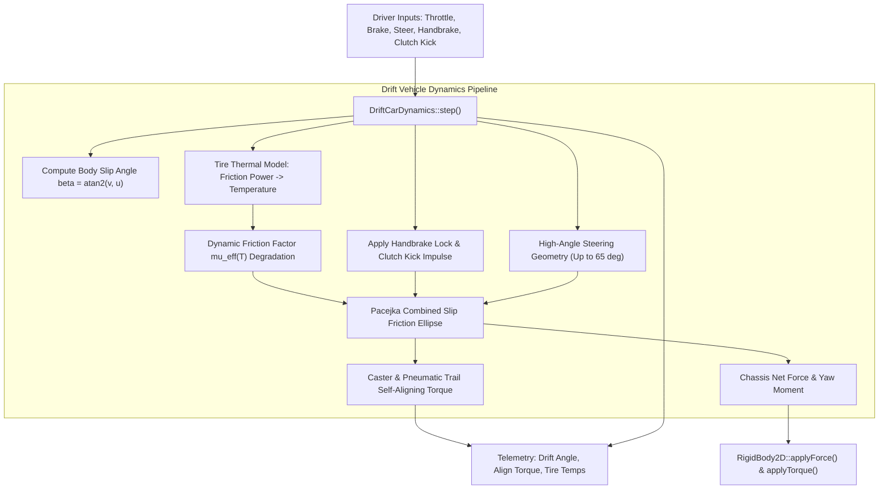
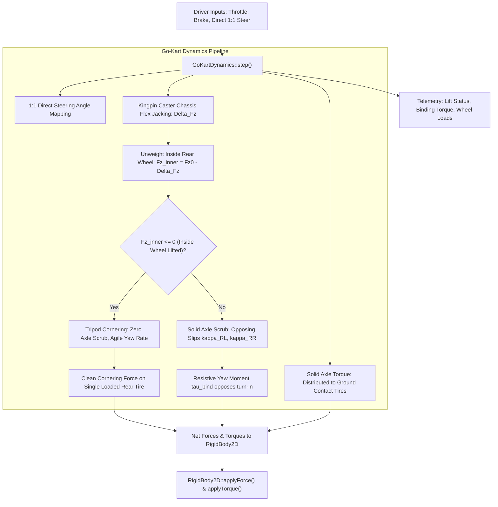

# DriftCarDynamics & GoKartDynamics: C++17 Implementation Plan

## 1. Executive Summary & Scope

### 1.1 Objective & Context
This specification outlines the mathematical formulations, physical equations, software architecture, data contracts, and verification roadmap for two specialized motorsport dynamics coordinators in `VehicleSimCore`:
1. **`DriftCarDynamics`**: Simulates extreme slip-angle vehicle handling, progressive oversteer transitions, front caster self-aligning torque feedback, clutch kick / hydraulic handbrake transients, and tire thermal friction degradation.
2. **`GoKartDynamics`**: Models lightweight sprint go-karts characterized by a solid spool rear drive axle (no differential), direct 1:1 steering ratio, and frame-flex tripod cornering mechanics where caster jacking lifts the inside rear wheel off the track surface.

Both coordinators implement [IVehicleDynamics](../libs/VehicleSimCore/dynamics/IVehicleDynamics.h) within the pure C++17 `VehicleSimCore` architecture, maintaining:
- Zero external engine dependencies.
- Zero dynamic memory allocations during simulation ticks.
- Full IEEE 754 floating-point determinism across Windows and Linux.
- Strict compliance with MISRA C++:2023 and SEI CERT C++ coding standards.
- Synchronous diagnostic telemetry export into [TelemetryFrame2D](../libs/VehicleSimCore/telemetry/TelemetryFrame2D.h).

---

## 2. Mathematical & Physical Formulation

### 2.1 Part A: Drift Car Dynamics (`DriftCarDynamics`)

#### 1. Inertia Drift Equilibrium & Yaw Slip Angle
Let the vehicle longitudinal velocity be $u$, lateral velocity be $v$, and yaw rate be $\omega$. The vehicle chassis slip angle (drift angle) $\beta$ is given by:
$$\beta = \arctan2(v, u)$$

In sustained drift, the vehicle maintains a large, stable yaw angle $\beta \in [20^\circ, 65^\circ]$ relative to the trajectory path. Equilibrium requires balancing:
1. Rear tractive breakaway forcing lateral sliding of the rear axle.
2. Front tire lateral grip providing centripetal control via counter-steering angle $\delta$.
3. Chassis yaw moment equilibrium:
   $$\sum \tau_{\text{yaw}} = I_z \dot{\omega} \approx 0$$
   where front tire lateral forces ($F_{y,\text{FL}}, F_{y,\text{FR}}$) counter the destabilizing moment of the saturated rear tires ($F_{y,\text{RL}}, F_{y,\text{RR}}$).

#### 2. Front Caster & Pneumatic Trail Self-Aligning Torque
When the front wheels counter-steer into the skid, the front tires generate lateral cornering forces $F_{y,\text{front}}$ at an effective slip angle $\alpha_{\text{front}}$.

The total front aligning torque $\tau_{\text{align}}$ consists of pneumatic trail $t_p$ and mechanical caster trail $t_m$:
- **Mechanical Trail ($t_m$)**: Fixed lever arm determined by positive caster angle $\theta_{\text{caster}}$:
  $$t_m = r_{\text{wheel}} \cdot \sin(\theta_{\text{caster}})$$
- **Pneumatic Trail ($t_p$)**: Resulting from contact patch shear pressure offset:
  $$t_p(\alpha) = t_{p0} \cos\left(C_t \arctan(B_t \alpha)\right)$$
- **Self-Aligning Steering Feedback**:
  $$\tau_{\text{align}} = -(t_p + t_m) \cdot (F_{y,\text{FL}} + F_{y,\text{FR}})$$
This torque naturally drives the steering wheel toward the counter-steer equilibrium angle, allowing realistic simulation of self-steering "catching" during drift transitions.

#### 3. Clutch Kick & Hydraulic Handbrake (E-Brake)
Drift initiation relies heavily on two driver inputs:
- **Hydraulic Handbrake ($h_{\text{brake}} \in [0, 1]$)**:
  - Selectively locks the rear axle wheels ($\omega_{\text{rear}} \to 0$), driving the longitudinal slip ratio $\kappa_{\text{rear}} \to -1.0$.
  - Leaves the front steering wheels completely unbraked ($F_{x,\text{front,brake}} = 0$), inducing rapid rear axle breakaway while preserving front steer authority.
- **Clutch Kick Impulse**:
  - Simulates depressing the clutch, revving the engine, and dumping the clutch pedal.
  - Implemented as a configurable torque impulse $\Delta \tau_{\text{kick}}$ and slip boost $\Delta \kappa_{\text{kick}}$ applied to the rear wheels across duration $\Delta t_{\text{kick}}$, instantly breaking rear static friction.

#### 4. Dynamic Tire Thermal Degradation
Prolonged high-speed sliding generates substantial frictional heating at the contact patch. The friction power dissipation is:
$$P_{\text{friction}} = \|\mathbf{F}_{\text{contact}}\| \cdot \|\mathbf{v}_{\text{slip}}\|$$
where $\mathbf{v}_{\text{slip}} = [u_{\text{wheel}} - \omega r, v_{\text{wheel}}]^T$.

The tire surface temperature $T_{\text{tire}}$ follows a first-order thermal energy balance:
$$\frac{dT_{\text{tire}}}{dt} = \frac{P_{\text{friction}}}{C_{\text{thermal}}} - \frac{T_{\text{tire}} - T_{\text{ambient}}}{\tau_{\text{cool}}}$$
where $C_{\text{thermal}}$ is the tire contact patch thermal capacitance (J/K) and $\tau_{\text{cool}}$ is the convective cooling time constant.

As tire temperature exceeds the optimal grip window $T_{\text{opt}}$, the effective friction coefficient $\mu_{\text{eff}}$ degrades:
$$\mu_{\text{eff}}(T_{\text{tire}}) = \mu_{\text{cold}} \cdot \left(1.0 - \lambda_{\text{thermal}} \cdot \tanh\left(\frac{\max(0.0, T_{\text{tire}} - T_{\text{opt}})}{T_{\text{scale}}}\right)\right)$$
Overheated tires widen the drift radius and reduce traction, requiring careful throttle management.

---

### 2.2 Part B: Go-Kart Dynamics (`GoKartDynamics`)

#### 1. Spool Solid Rear Axle Kinematics & Wheel Scrub
Sprint go-karts feature a solid single rear axle linking both rear wheels together without any differential mechanism:
$$\omega_{\text{RL}} = \omega_{\text{RR}} = \omega_{\text{axle}}$$

During cornering at yaw rate $\omega$ and forward speed $u$, the inner and outer rear wheels follow paths of different radii separated by track width $T_r$:
- Linear velocity of Rear-Left wheel: $u_{\text{RL}} = u - \frac{T_r}{2} \omega$
- Linear velocity of Rear-Right wheel: $u_{\text{RR}} = u + \frac{T_r}{2} \omega$

Unless one wheel is relieved of normal load, both rear tires are forced to slip longitudinally against each other:
$$\kappa_{\text{scrub,RL}} = \frac{\omega_{\text{axle}} R - u_{\text{RL}}}{\max(u_{\text{RL}}, \epsilon)}, \quad \kappa_{\text{scrub,RR}} = \frac{\omega_{\text{axle}} R - u_{\text{RR}}}{\max(u_{\text{RR}}, \epsilon)}$$

This opposing slip generates opposing longitudinal forces $F_{x,\text{RL}} = -F_{x,\text{RR}}$, creating a substantial resistive yaw moment (axle binding torque):
$$\tau_{\text{bind}} = (F_{x,\text{RR}} - F_{x,\text{RL}}) \frac{T_r}{2} < 0$$
which heavily resists vehicle rotation and induces massive corner-entry understeer.

#### 2. Frame Flex & Kingpin Caster Jacking (Inside Rear Wheel Lift)
Because go-karts have no springs, dampers, or suspension linkages, chassis turn-in relies on a mechanical phenomenon called **caster jacking**:
- Front spindles feature extreme kingpin inclination (KPI $\approx 10^\circ - 14^\circ$) and caster ($\theta_{\text{caster}} \approx 12^\circ - 18^\circ$).
- Turning the steering wheel by $\delta$ forces the inside front wheel downwards and lifts the outside front wheel upwards relative to the chassis frame.
- Through diagonal chassis torsion, this downward displacement on the inside front wheel acts as a lever across the diagonal axis, unloading the **inside rear wheel**:
  $$\Delta F_{z,\text{jack}} = k_{\text{jack}} \cdot |\delta| \cdot F_{z,\text{front,static}} + m \cdot a_y \frac{h}{T_r}$$

The dynamic normal force on the inside rear wheel becomes:
$$F_{z,\text{rear,inner}} = \max\left(0.0, F_{z,\text{rear,static}} - \Delta F_{z,\text{jack}}\right)$$
The outside rear wheel carries the remaining axle load:
$$F_{z,\text{rear,outer}} = F_{z,\text{rear,total}} - F_{z,\text{rear,inner}}$$

When $\Delta F_{z,\text{jack}} \ge F_{z,\text{rear,static}}$, the inside rear wheel **lifts completely off the track**:
$$F_{z,\text{rear,inner}} = 0 \implies \text{Tripod Cornering!}$$
With the inside rear tire unweighted, axle binding $\tau_{\text{bind}}$ drops to zero! The outside rear tire drives the kart forward smoothly, enabling razor-sharp turn-in.

#### 3. Direct 1:1 Steering Ratio & Lightweight Inertia
- **1:1 Steering Ratio**: The steering column connects directly to tie rods without a steering reduction gearbox ($\text{ratio} \approx 1.0$), yielding high steering sensitivity:
  $$\delta_{\text{steer}} = \delta_{\text{wheel}}$$
- **Lightweight Chassis**: Total mass including driver is approximately $160 - 175$ kg, with a very low Center of Gravity ($h_{\text{cog}} \approx 0.20 - 0.24$ m), resulting in minimal pitch inertia and immediate lateral transient response.

---

## 3. Architecture & Design

### 3.1 Component Structure

```
libs/VehicleSimCore/
└── dynamics/
    ├── DriftCarDynamics.h       [NEW] - Drift car physics coordinator header
    ├── DriftCarDynamics.cpp     [NEW] - Thermal tire, e-brake, counter-steer torque
    ├── GoKartDynamics.h         [NEW] - Sprint go-kart physics coordinator header
    ├── GoKartDynamics.cpp       [NEW] - Solid spool axle, caster jacking inside wheel lift
    ├── PacejkaTireModel.h       [REFERENCED] - Magic Formula evaluations
    ├── IVehicleDynamics.h       [REFERENCED] - Base interface contract
    └── RaceCarDynamics.h        [REFERENCED] - 4-wheel reference implementation
tests/
├── DriftCarDynamicsTest.cpp     [NEW] - GoogleTest suite validating drift mechanics
└── GoKartDynamicsTest.cpp       [NEW] - GoogleTest suite validating kart spool & jacking
```

---

### 3.2 System Architecture Diagrams

#### Part A: `DriftCarDynamics` Architecture

```
  ASCII Diagram: DriftCarDynamics Signal Flow & Thermal Equilibrium

     Driver Inputs:
     - Throttle [0..1]
     - Foot Brake [0..1]
     - Steer [-1..1]
     - E-Brake (Handbrake) [0..1]
     - Clutch Kick Trigger
           |
           v
  +-------------------------------------------------------------------------+
  |                           DriftCarDynamics                              |
  |                                                                         |
  |  1. Kinematics: Body slip angle beta = atan2(v, u), wheel velocities   |
  |  2. Extended Steering: High steering lock angle delta_max (up to 65 deg)|
  |  3. Powertrain & E-Brake: Rear lockup (handbrake) + clutch kick impulse |
  |  4. Thermal Tire Model: Friction power -> dTemp/dt -> mu_effective drop |
  |  5. Pacejka Traction: Evaluates front grip vs rear breakaway slip       |
  |  6. Self-Aligning Torque: Caster trail + pneumatic trail counter-steer  |
  |  7. RigidBody Force Dispatch: Body force & yaw moment accumulation      |
  +-------------------------------------------------------------------------+
           |                                                      |
           v                                                      v
    [ RigidBody2D ]                                     [ TelemetryFrame2D ]
     Accumulate forces                                   Live drift telemetry:
     Symplectic Euler step                               - Drift angle (beta)
                                                         - Counter-steer torque
                                                         - Tire temperatures (4x)
```



---

#### Part B: `GoKartDynamics` Architecture

```
  ASCII Diagram: GoKartDynamics Spool Axle & Caster Jacking

       Direct 1:1 Steer Input
                 |
                 v
       [Front Spindles] (High Caster & KPI)
          /           \
     (Jack Down)   (Jack Up)
         |               |
     Front-Left     Front-Right
         \               /
          \  Chassis    /
           \ Frame Flex/
            \         /
             \       /
      (Lift) [O]   [O] (Grip)
      Rear-Left     Rear-Right
          ================= Solid Spool Axle (omega_RL == omega_RR)
```



---

## 4. C++17 Header Design

### 4.1 `DriftCarDynamics.h`

```cpp
#pragma once

#include <array>
#include <cmath>

#include "libs/VehicleSimCore/dynamics/IVehicleDynamics.h"
#include "libs/VehicleSimCore/dynamics/PacejkaTireModel.h"
#include "libs/VehicleSimCore/math/Vec2.h"

namespace vehicle_sim::physics {
class RigidBody2D;
} // namespace vehicle_sim::physics

namespace vehicle_sim::dynamics {

/// @struct DriftCarConfig
/// @brief Physical, steering, and thermal configuration for DriftCarDynamics.
struct DriftCarConfig {
    double mass{1250.0};              ///< Chassis mass in kg.
    double inertia{1800.0};           ///< Yaw moment of inertia in kg*m^2.
    double wheelbase{2.55};           ///< Wheelbase L in meters.
    double cogDistFront{1.35};        ///< Distance from COG to front axle in meters.
    double trackWidth{1.58};          ///< Track width T in meters.
    double cogHeight{0.45};           ///< Center of gravity height in meters.
    double maxSteerAngle{1.05};       ///< Maximum front steer angle in radians (~60 degrees).
    double maxDriveForce{8500.0};     ///< Maximum rear-wheel tractive drive force in Newtons.
    double maxFootBrakeForce{12000.0};///< Maximum foot service brake force in Newtons.
    double maxHandbrakeForce{16000.0};///< Maximum hydraulic handbrake locking force in Newtons.
    double casterAngleRad{0.14};      ///< Front caster angle in radians (~8 degrees).
    double mechanicalTrail{0.025};    ///< Front mechanical trail lever arm in meters.
    double clutchKickTorque{3500.0};  ///< Instantaneous clutch kick torque surge in N*m.
    double clutchKickDuration{0.20};  ///< Duration of clutch kick impulse in seconds.

    // Thermal tire parameters
    double ambientTemperature{25.0};  ///< Ambient air temperature in Celsius.
    double optimalTireTemp{85.0};     ///< Optimal tire grip temperature in Celsius.
    double thermalCapacity{1200.0};   ///< Contact patch thermal capacity in J/K.
    double coolingRate{0.08};         ///< Convective cooling rate per second.
    double thermalFrictionDecay{0.35};///< Maximum friction degradation ratio when overheated.
    double tempScaleFactor{40.0};     ///< Temperature sensitivity scaling in Celsius.

    PacejkaConfig frontTireConfig{};  ///< High-grip front tire Pacejka settings.
    PacejkaConfig rearTireConfig{};   ///< Drift-compound rear tire Pacejka settings.
};

/// @struct DriftCarWheelState
/// @brief Diagnostic and thermal state for an individual drift car wheel.
struct DriftCarWheelState {
    double normalLoad{0.0};           ///< Dynamic vertical normal load in Newtons.
    double slipRatio{0.0};            ///< Longitudinal slip ratio kappa.
    double slipAngle{0.0};            ///< Lateral slip angle alpha in radians.
    double tractiveForce{0.0};        ///< Longitudinal force in Newtons.
    double corneringForce{0.0};       ///< Lateral force in Newtons.
    double temperature{25.0};         ///< Current contact patch temperature in Celsius.
    double effectiveMu{1.0};          ///< Thermal-degraded friction coefficient multiplier.
    double steerAngle{0.0};           ///< Steer angle relative to chassis in radians.
    math::Vec2 localOffset{0.0, 0.0}; ///< Wheel offset in chassis body frame.
};

/// @class DriftCarDynamics
/// @brief Specialized drift motorsport vehicle dynamics coordinator.
/// @details Simulates extreme slip-angle oversteer equilibrium, pneumatic trail
/// self-aligning torque, hydraulic handbrake rear lockup, clutch kick transients,
/// and tire thermal friction degradation.
class DriftCarDynamics final : public IVehicleDynamics {
public:
    /// @brief Default constructor using standard sports car drift configuration.
    DriftCarDynamics() noexcept;

    /// @brief Parameterized constructor using custom drift configuration.
    /// @param[in] config Vehicle geometry, mass, and thermal parameters.
    explicit DriftCarDynamics(const DriftCarConfig& config) noexcept;

    /// @brief Virtual destructor ensuring clean polymorphic cleanup.
    ~DriftCarDynamics() noexcept override = default;

    /// @brief Advances drift car simulation step, applying forces to rigid body.
    /// @param[in,out] body Target rigid body representing drift car chassis.
    /// @param[in] dt Timestep duration in seconds.
    void step(physics::RigidBody2D& body, double dt) noexcept override;

    /// @brief Resets transient states, slip memories, and tire temperatures.
    void reset() noexcept override;

    /// @brief Queries whether the vehicle is airborne.
    /// @return True if all wheels have lost ground contact.
    [[nodiscard]] bool isAirborne() const noexcept override;

    /// @brief Sets driver throttle pedal command.
    /// @param[in] throttle Normalized throttle input in range [0.0, 1.0].
    void setThrottle(double throttle) noexcept;

    /// @brief Sets driver service foot brake pedal command.
    /// @param[in] brake Normalized foot brake input in range [0.0, 1.0].
    void setBrake(double brake) noexcept;

    /// @brief Sets driver steering wheel command.
    /// @param[in] steer Normalized steering command in range [-1.0, 1.0] (positive = left).
    void setSteer(double steer) noexcept;

    /// @brief Sets hydraulic handbrake (e-brake) actuation level.
    /// @param[in] handbrake Normalized handbrake input in range [0.0, 1.0].
    void setHandbrake(double handbrake) noexcept;

    /// @brief Triggers an instantaneous clutch kick impulse.
    void triggerClutchKick() noexcept;

    /// @brief Sets airborne status override.
    /// @param[in] airborne True if vehicle has launched off ground.
    void setAirborne(bool airborne) noexcept;

    /// @brief Retrieves current chassis body drift slip angle (beta) in radians.
    /// @return Drift angle beta = atan2(lateral_velocity, forward_velocity).
    [[nodiscard]] double getDriftAngle() const noexcept;

    /// @brief Queries front caster self-aligning counter-steering torque in N*m.
    /// @return Aligning torque tending to steer wheels into the skid.
    [[nodiscard]] double getAligningTorque() const noexcept;

    /// @brief Checks if vehicle is currently in a sustained drift state.
    /// @return True if drift angle exceeds threshold and rear wheels are sliding.
    [[nodiscard]] bool isDrifting() const noexcept;

    /// @brief Retrieves current contact patch temperatures for all four wheels.
    /// @return Array of temperatures in Celsius (FL, FR, RL, RR).
    [[nodiscard]] std::array<double, 4> getTireTemperatures() const noexcept;

    /// @brief Retrieves state of all four wheels (FL, FR, RL, RR).
    /// @return Const reference to 4-element array of wheel states.
    [[nodiscard]] const std::array<DriftCarWheelState, 4>& getWheelStates() const noexcept;

    /// @brief Queries active vehicle configuration.
    /// @return Const reference to DriftCarConfig.
    [[nodiscard]] const DriftCarConfig& getConfig() const noexcept;

private:
    DriftCarConfig mConfig{};
    std::array<PacejkaTireModel, 4> mTires{};
    std::array<DriftCarWheelState, 4> mWheels{};

    double mThrottle{0.0};
    double mBrake{0.0};
    double mSteer{0.0};
    double mHandbrake{0.0};
    double mClutchKickTimer{0.0};
    double mCurrentDriftAngle{0.0};
    double mCurrentAlignTorque{0.0};
    bool mIsAirborne{false};

    void setupWheelOffsets() noexcept;
    void updateThermalModel(double dt) noexcept;
};

} // namespace vehicle_sim::dynamics
```

---

### 4.2 `GoKartDynamics.h`

```cpp
#pragma once

#include <array>
#include <cmath>

#include "libs/VehicleSimCore/dynamics/IVehicleDynamics.h"
#include "libs/VehicleSimCore/dynamics/PacejkaTireModel.h"
#include "libs/VehicleSimCore/math/Vec2.h"

namespace vehicle_sim::physics {
class RigidBody2D;
} // namespace vehicle_sim::physics

namespace vehicle_sim::dynamics {

/// @struct GoKartConfig
/// @brief Physical, frame flex, and steering parameters for GoKartDynamics.
struct GoKartConfig {
    double mass{165.0};               ///< Total kart mass including driver in kg.
    double inertia{45.0};             ///< Yaw moment of inertia in kg*m^2.
    double wheelbase{1.04};           ///< Wheelbase L in meters.
    double cogDistFront{0.62};        ///< Longitudinal distance from COG to front axle in meters.
    double trackWidthFront{1.15};     ///< Front track width in meters.
    double trackWidthRear{1.38};      ///< Rear track width in meters.
    double cogHeight{0.22};           ///< Low center of gravity height in meters.
    double maxSteerAngle{0.48};       ///< Maximum front spindle steer angle in radians (~27.5 deg).
    double maxDriveForce{2200.0};     ///< Maximum 2-stroke/4-stroke rear axle drive force in Newtons.
    double maxBrakeForce{3800.0};     ///< Maximum rear-axle hydraulic disc brake force in Newtons.
    double casterAngleRad{0.24};      ///< Aggressive kingpin caster angle in radians (~14 degrees).
    double kpiAngleRad{0.21};         ///< Kingpin inclination (KPI) angle in radians (~12 degrees).
    double jackingFactor{1.35};       ///< Frame flex caster jacking leverage multiplier.

    PacejkaConfig frontTireConfig{};  ///< Front kart slick tire configuration.
    PacejkaConfig rearTireConfig{};   ///< Rear wide kart slick tire configuration.
};

/// @struct GoKartWheelState
/// @brief Dynamic load and contact state for an individual go-kart wheel.
struct GoKartWheelState {
    double normalLoad{0.0};           ///< Dynamic vertical normal load in Newtons.
    double slipRatio{0.0};            ///< Longitudinal slip ratio kappa.
    double slipAngle{0.0};            ///< Lateral slip angle alpha in radians.
    double tractiveForce{0.0};        ///< Longitudinal force in Newtons.
    double corneringForce{0.0};       ///< Lateral force in Newtons.
    double steerAngle{0.0};           ///< Steer angle relative to chassis in radians.
    bool isLifted{false};             ///< True if wheel has unweighted and lifted off track.
    math::Vec2 localOffset{0.0, 0.0}; ///< Body-local position offset.
};

/// @class GoKartDynamics
/// @brief Lightweight sprint go-kart vehicle dynamics coordinator.
/// @details Simulates solid spool rear drive axle kinematics (no differential),
/// kingpin caster jacking inside rear wheel lift-off (tripod cornering), and
/// direct 1:1 steering response.
class GoKartDynamics final : public IVehicleDynamics {
public:
    /// @brief Default constructor using standard competition sprint kart parameters.
    GoKartDynamics() noexcept;

    /// @brief Parameterized constructor using custom go-kart configuration.
    /// @param[in] config Kart mass, geometric, and frame flex parameters.
    explicit GoKartDynamics(const GoKartConfig& config) noexcept;

    /// @brief Virtual destructor ensuring clean polymorphic cleanup.
    ~GoKartDynamics() noexcept override = default;

    /// @brief Advances go-kart simulation step, applying forces to rigid body.
    /// @param[in,out] body Target rigid body representing go-kart chassis.
    /// @param[in] dt Timestep duration in seconds.
    void step(physics::RigidBody2D& body, double dt) noexcept override;

    /// @brief Resets transient states, speeds, and controllers.
    void reset() noexcept override;

    /// @brief Queries whether the kart is airborne.
    /// @return True if all wheels have lost ground contact.
    [[nodiscard]] bool isAirborne() const noexcept override;

    /// @brief Sets driver throttle pedal input.
    /// @param[in] throttle Normalized throttle command in range [0.0, 1.0].
    void setThrottle(double throttle) noexcept;

    /// @brief Sets driver brake pedal input.
    /// @param[in] brake Normalized brake command in range [0.0, 1.0].
    void setBrake(double brake) noexcept;

    /// @brief Sets direct 1:1 driver steering command.
    /// @param[in] steer Normalized steering command in range [-1.0, 1.0] (positive = left).
    void setSteer(double steer) noexcept;

    /// @brief Sets airborne status override.
    /// @param[in] airborne True if kart has launched off ground.
    void setAirborne(bool airborne) noexcept;

    /// @brief Queries whether the inside rear wheel has lifted off the track.
    /// @return True if tripod cornering state is active.
    [[nodiscard]] bool isInnerWheelLifted() const noexcept;

    /// @brief Retrieves the instantaneous rear solid spool axle binding scrub torque.
    /// @return Opposing yaw resistance torque in N*m (0.0 when inner wheel is lifted).
    [[nodiscard]] double getAxleScrubTorque() const noexcept;

    /// @brief Retrieves the caster jacking vertical load transfer delta in Newtons.
    /// @return Jacking force delta transferring load off inside rear wheel.
    [[nodiscard]] double getJackingForce() const noexcept;

    /// @brief Retrieves state of all four wheels (FL, FR, RL, RR).
    /// @return Const reference to 4-element array of wheel states.
    [[nodiscard]] const std::array<GoKartWheelState, 4>& getWheelStates() const noexcept;

    /// @brief Queries active go-kart configuration.
    /// @return Const reference to GoKartConfig.
    [[nodiscard]] const GoKartConfig& getConfig() const noexcept;

private:
    GoKartConfig mConfig{};
    std::array<PacejkaTireModel, 4> mTires{};
    std::array<GoKartWheelState, 4> mWheels{};

    double mThrottle{0.0};
    double mBrake{0.0};
    double mSteer{0.0};
    double mAxleScrubTorque{0.0};
    double mCurrentJackingForce{0.0};
    bool mIsInnerWheelLifted{false};
    bool mIsAirborne{false};

    void setupWheelOffsets() noexcept;
    void computeJackingLoads(double ay) noexcept;
};

} // namespace vehicle_sim::dynamics
```

---

## 5. Implementation Steps & Verification Plan

### 5.1 Implementation Milestones

#### Milestone 1: Drift Car Implementation (`DriftCarDynamics`)
1. Implement `DriftCarConfig`, `DriftCarWheelState`, and constructor in [libs/VehicleSimCore/dynamics/DriftCarDynamics.h](../libs/VehicleSimCore/dynamics/DriftCarDynamics.h) and [libs/VehicleSimCore/dynamics/DriftCarDynamics.cpp](../libs/VehicleSimCore/dynamics/DriftCarDynamics.cpp).
2. Implement extended steering angle geometry (lock angle up to $60^\circ - 65^\circ$) and chassis body drift angle computation ($\beta = \arctan2(v, u)$).
3. Implement hydraulic handbrake rear axle lockup and clutch kick impulse injection.
4. Implement tire thermal model calculating contact patch friction power, temperature dynamics, and $\mu_{\text{effective}}$ degradation.
5. Implement front caster and pneumatic trail self-aligning torque evaluation.

#### Milestone 2: Go-Kart Implementation (`GoKartDynamics`)
1. Implement `GoKartConfig`, `GoKartWheelState`, and constructor in [libs/VehicleSimCore/dynamics/GoKartDynamics.h](../libs/VehicleSimCore/dynamics/GoKartDynamics.h) and [libs/VehicleSimCore/dynamics/GoKartDynamics.cpp](../libs/VehicleSimCore/dynamics/GoKartDynamics.cpp).
2. Implement direct 1:1 steering angle mapping and solid rear spool axle kinematics ($\omega_{\text{RL}} = \omega_{\text{RR}}$).
3. Implement kingpin caster and chassis flex jacking load transfer equation ($\Delta F_{z,\text{jack}}$) causing inside rear wheel unloading.
4. Implement tripod cornering state detection (`isInnerWheelLifted()`) and elimination of axle scrub binding torque when lifted.
5. Implement rear hydraulic disc brake and throttle torque dispatch.

#### Milestone 3: Build System Registration
1. Register source and header files in [libs/VehicleSimCore/CMakeLists.txt](../libs/VehicleSimCore/CMakeLists.txt).
2. Register unit test files in [tests/CMakeLists.txt](../tests/CMakeLists.txt).

#### Milestone 4: Comprehensive Test Suites
1. Implement [tests/DriftCarDynamicsTest.cpp](../tests/DriftCarDynamicsTest.cpp).
2. Implement [tests/GoKartDynamicsTest.cpp](../tests/GoKartDynamicsTest.cpp).

---

### 5.2 Test Coverage Matrix

#### `DriftCarDynamicsTest` Suite:
- **`HandbrakeInitiation`**: Verifies that pulling handbrake locks rear axle ($\omega_{\text{rear}} \to 0, \kappa \to -1.0$) while front wheels remain unlocked, inducing immediate rear traction breakaway.
- **`ClutchKickImpulse`**: Verifies that calling `triggerClutchKick()` injects a torque and slip surge into the rear axle breaking traction without needing handbrake.
- **`SustainedDriftEquilibrium`**: Verifies that under high throttle and counter-steer, the vehicle stabilizes at large yaw slip angle ($\beta > 25^\circ$) with balanced yaw moment.
- **`SelfAligningCounterSteer`**: Verifies that front caster and pneumatic trail produce counter-steering torque pointing into the skid direction.
- **`ThermalGripDegradation`**: Verifies that prolonged high-slip wheelspin increases tire temperature above $T_{\text{opt}}$, causing effective friction $\mu_{\text{eff}}$ to drop and widening drift radius.
- **`AirborneZeroForces`**: Verifies that when `setAirborne(true)` is commanded, tire forces drop to zero.

#### `GoKartDynamicsTest` Suite:
- **`DirectSteering1To1`**: Verifies that spindle steer angle matches driver steering command without reduction or backlash.
- **`SolidAxleBindingStraightVsTurn`**: Verifies that in gentle turns without sufficient jacking, locked rear spool axle creates opposing scrub slip and resistive yaw torque $\tau_{\text{bind}}$.
- **`CasterJackingInsideWheelLift`**: Verifies that aggressive steering angle and cornering speed unweight the inside rear wheel until $F_{z,\text{inner}} = 0$ (`isInnerWheelLifted() == true`).
- **`TripodCorneringAgility`**: Verifies that once inside rear wheel lifts, axle binding scrub torque drops to zero, resulting in higher cornering agility and lower turn resistance.
- **`AirborneZeroForces`**: Verifies fail-safe zero ground reaction when kart becomes airborne.
