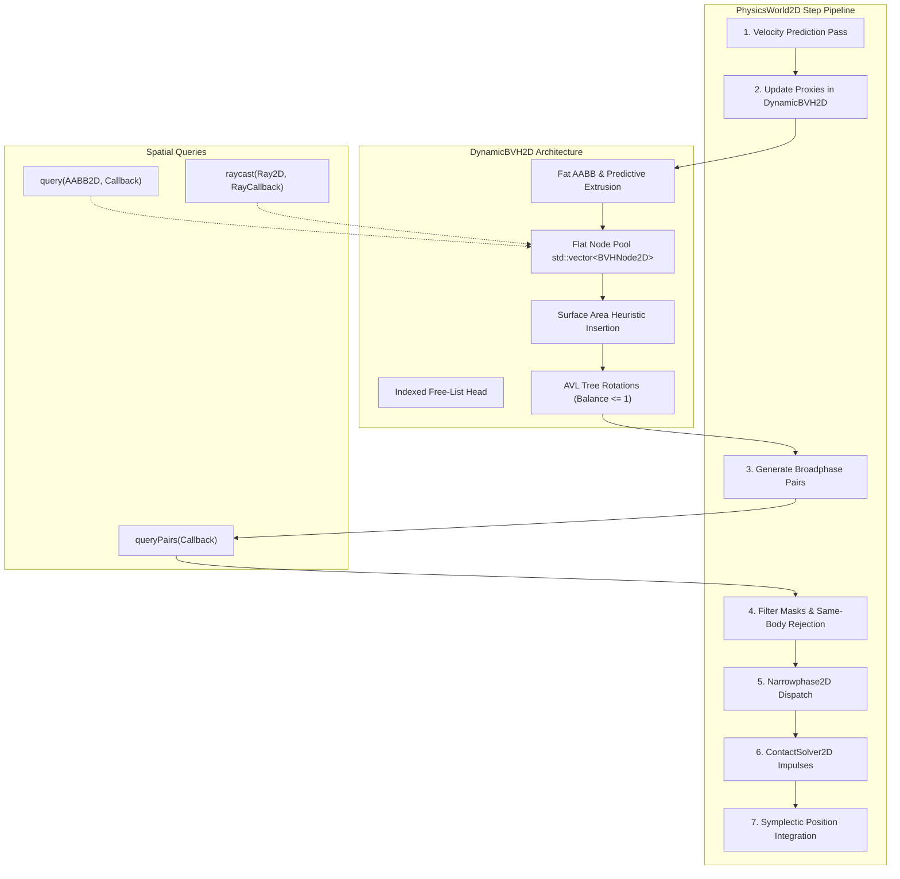
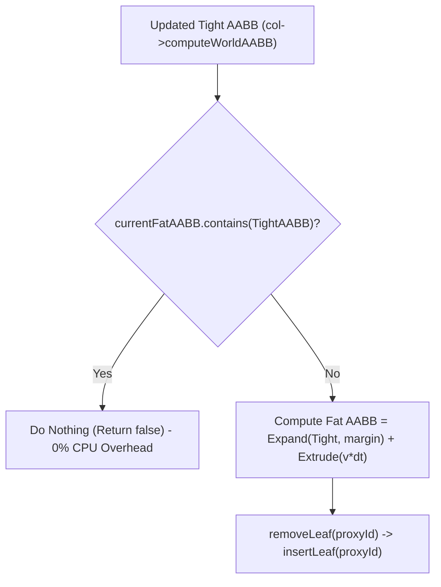
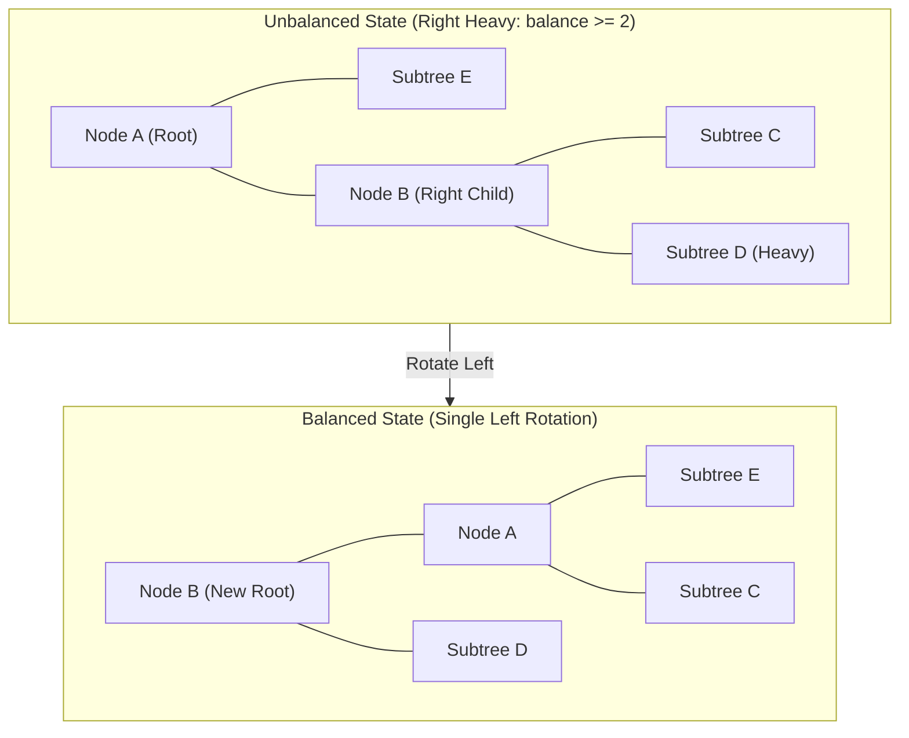

# Dynamic Bounding Volume Hierarchy Broadphase (DynamicBVH2D): C++17 Implementation Plan

## 1. Executive Summary & Scope

### 1.1 Objective & Context
This specification details the mathematical formulations, data structures, tree balancing algorithms, and integration strategy for the **Dynamic Bounding Volume Hierarchy Broadphase (`DynamicBVH2D`)**, as specified in Section 4.5 of [docs/ProposedFeatures.md](ProposedFeatures.md).

Currently, [PhysicsWorld2D](../libs/VehicleSimCore/physics/PhysicsWorld2D.cpp) resolves collision detection via an $O(N^2)$ brute-force all-pairs comparison between registered [Collider2D](../libs/VehicleSimCore/physics/Collider2D.h) instances. While sufficient for small simulations with fewer than 20 bodies, this quadratic complexity creates a severe computational bottleneck when simulating:
- Dense vehicle fleets and multi-car racing grids (e.g., 20+ dynamic vehicles with multi-primitive colliders).
- Debris, cones, and trackside obstacles scattered via [HazardScattering](../libs/VehicleSimCore/terrain/HazardScattering.h) (100–1000+ static/dynamic colliders).
- Segmented boundary barriers, tire walls, and procedural track fencing.
- Fast spatial raycasting for vehicle sensors, lidar sweeps, and autonomous trajectory tracking ([StanleyController](../libs/VehicleSimCore/math/StanleyController.h)).

The `DynamicBVH2D` subsystem replaces the $O(N^2)$ all-pairs check with an $O(N \log N)$ (or $O(N)$ for low-velocity states) dynamic bounding volume hierarchy based on a self-balancing binary Axis-Aligned Bounding Box (AABB) tree with a Surface Area Heuristic (SAH) and predictive fat bounding boxes.

### 1.2 Core Requirements
1. **Self-Balancing AABB Tree**:
   - Flat, pool-allocated binary tree (`std::vector<BVHNode2D>`) utilizing an integer-indexed free list, eliminating dynamic allocations, pointer chasing, and memory fragmentation during simulation steps (**MISRA C++:2023** compliant).
   - AVL-like tree rotations on insertion and re-balancing to enforce $O(\log N)$ tree depth and prevent branch degeneration.
2. **Fat Bounding Boxes & Predictive Velocity Extrusion**:
   - Tight proxy bounding boxes are fattened by a configurable uniform margin $\Delta_{\text{margin}}$:
     $$\mathbf{B}_{\text{fat}} = \mathbf{B}_{\text{tight}} \oplus \Delta_{\text{margin}}$$
   - Predictive velocity extrusion extends the box in the direction of motion:
     $$\Delta \mathbf{x}_{\text{pred}} = \mathbf{v} \cdot \Delta t \cdot \alpha_{\text{pred}}$$
   - Motion hysteresis: If a moving collider's updated tight AABB remains entirely within its existing fat AABB, **no tree re-insertion occurs**, reducing tree restructuring overhead by up to 90% for typical continuous motion.
3. **Optimized Spatial Queries**:
   - **AABB Overlap Query**: Non-recursive stack-based traversal invoking a callback or filling a buffer for all leaves intersecting a query box.
   - **Raycast Query**: Slab-accelerated tree traversal with early exit, subtree pruning based on maximum hit fraction, and callback clipping.
   - **Broadphase Pair Generation**: Traverses the hierarchy to generate unique candidate pairs $(A, B)$ with $A < B$, filtering out duplicate pairs, identical bodies, and incompatible collision bitmasks (`canCollideWith`) prior to narrowphase dispatch.
4. **Integration with `PhysicsWorld2D`**:
   - Seamless drop-in integration into `PhysicsWorld2D::step()` replacing lines 160–205.
   - Dedicated broadphase proxy lifecycle management (`addCollider`, `removeCollider`, `step`).
   - World-level spatial query API: `PhysicsWorld2D::raycast(const Ray2D& ray, RayHit2D& outHit, Collider2D** outCollider)`.
5. **Architectural & Safety Constraints**:
   - Pure ISO C++17 (`-std=c++17`, `/std:c++17`).
   - Zero external physics engine dependencies.
   - Zero raw pointer ownership (`new` / `delete`); index-based tree storage.
   - All function names strictly fewer than 30 characters.
   - Strict IEEE 754 floating-point determinism across Linux (GCC/Clang) and Windows (MSVC/Clang).
   - Co-located header and implementation files in [libs/VehicleSimCore/physics/](../libs/VehicleSimCore/physics/).

---

## 2. High-Level Architecture & Component Decomposition

### 2.1 File Organization

```
libs/VehicleSimCore/
├── physics/
│   ├── DynamicBVH2D.h             [NEW] - Self-balancing AABB tree & spatial query engine
│   ├── DynamicBVH2D.cpp           [NEW] - SAH insertion, AVL rotations, raycast, and pair generator
│   ├── BroadphasePair2D.h         [NEW] - Candidate collision pair data structures
│   ├── Collider2D.h               [MODIFIED] - Store broadphase proxy ID member
│   ├── Collider2D.cpp             [MODIFIED] - Initialize and maintain proxy ID
│   ├── PhysicsWorld2D.h           [MODIFIED] - Integrate DynamicBVH2D & world raycast API
│   └── PhysicsWorld2D.cpp         [MODIFIED] - Replace O(N^2) loop with BVH pair discovery
tests/
└── DynamicBVHTest.cpp             [NEW] - Unit tests, rotation verification, benchmark, and determinism
```

### 2.2 ASCII System Architecture Diagram

```
+---------------------------------------------------------------------------------------------------+
|                                 DynamicBVH2D Subsystem Architecture                               |
+---------------------------------------------------------------------------------------------------+
|  Rigid Bodies & Colliders (PhysicsWorld2D)                                                        |
|    |                                                                                              |
|    +---> Collider2D::computeWorldAABB()                                                           |
|            |                                                                                      |
|            v (Tight AABB + Velocity Extrusion)                                                    |
|  +---------------------------------------------------------------------------------------------+  |
|  | DynamicBVH2D                                                                                |  |
|  |                                                                                             |  |
|  |   [Node Pool: std::vector<BVHNode2D>]                                                       |  |
|  |   +---------------------------------------------------------------------------------------+ |  |
|  |   | Index | aabb (Fat AABB) | parent | child1 | child2 | height | userData (Collider2D*)  | |  |
|  |   |   0   | [ -10, 10 ]     |   -1   |   1    |   2    |   2    | nullptr (Internal)      | |  |
|  |   |   1   | [  -5,  2 ]     |    0   |   3    |   4    |   1    | nullptr (Internal)      | |  |
|  |   |   2   | [   3,  9 ]     |    0   |  -1    |  -1    |   0    | 0x7ffd... (Leaf C)      | |  |
|  |   |   3   | [  -4, -1 ]     |    1   |  -1    |  -1    |   0    | 0x7ffd... (Leaf A)      | |  |
|  |   |   4   | [   0,  2 ]     |    1   |  -1    |  -1    |   0    | 0x7ffd... (Leaf B)      | |  |
|  |   +---------------------------------------------------------------------------------------+ |  |
|  |   Free List: [ Head -> 5 -> 6 -> 7 ... ]                                                    |  |
|  |                                                                                             |  |
|  |   Insertion: Surface Area Heuristic (SAH Minimal Perimeter Expansion)                       |  |
|  |   Balancing: AVL Tree Rotations (LL, RR, LR, RL)                                            |  |
|  |   Hysteresis: Move ignored if tight AABB is contained in current fat AABB                    |  |
|  +---------------------------------------------------------------------------------------------+  |
|            |                                            |                                         |
|            v queryPairs()                               v raycast()                               |
|  +-------------------------------------+  +----------------------------------------------------+  |
|  | Broadphase Filtering                |  | Spatial Raycast Query                              |  |
|  | - Bitmask (canCollideWith)          |  | - Prunes subtrees where ray misses fat AABB        |  |
|  | - Same-body rejection               |  | - Returns closest hit Collider2D* + RayHit2D       |  |
|  | - Unique pairs (A < B)              |  +----------------------------------------------------+  |
|  +-------------------------------------+                                                           |
|            |                                                                                      |
|            v Overlapping Pairs                                                                    |
|  +---------------------------------------------------------------------------------------------+  |
|  | Narrowphase2D::detectColliders(colA, colB, manifold)                                        |  |
|  +---------------------------------------------------------------------------------------------+  |
|            |                                                                                      |
|            v ContactManifold2D                                                                    |
|  +---------------------------------------------------------------------------------------------+  |
|  | ContactSolver2D::resolve(bodyA, bodyB, contact)                                             |  |
|  +---------------------------------------------------------------------------------------------+  |
+---------------------------------------------------------------------------------------------------+
```

### 2.3 Mermaid System Architecture Diagram



---

## 3. Mathematical & Algorithmic Formulations

### 3.1 Fat Bounding Boxes & Predictive Velocity Extrusion

To prevent continuous tree re-insertions for bodies undergoing small displacements or vibrations, `DynamicBVH2D` applies two expansion techniques to the tight bounding box $\mathbf{B}_{\text{tight}} = [\mathbf{p}_{\text{min}}, \mathbf{p}_{\text{max}}]$:

1. **Uniform Expansion Margin ($\Delta_{\text{margin}}$)**:
   A scalar margin (default: $0.1\,\text{m}$) expanding all extents:
   $$\mathbf{B}_{\text{margin}} = \left[ \mathbf{p}_{\text{min}} - \begin{pmatrix} \Delta_{\text{margin}} \\ \Delta_{\text{margin}} \end{pmatrix}, \; \mathbf{p}_{\text{max}} + \begin{pmatrix} \Delta_{\text{margin}} \\ \Delta_{\text{margin}} \end{pmatrix} \right]$$

2. **Predictive Motion Extrusion ($\Delta \mathbf{x}_{\text{pred}}$)**:
   Given linear velocity $\mathbf{v}$ and time step $\Delta t$, the predicted displacement vector is:
   $$\Delta \mathbf{x} = \mathbf{v} \cdot \Delta t \cdot \alpha_{\text{pred}}$$
   where $\alpha_{\text{pred}} \ge 1.0$ (typically $2.0$ to anticipate 2 steps ahead). The bounding box is extruded along this direction:
   $$\mathbf{B}_{\text{fat}}.\text{min}.x = \mathbf{B}_{\text{margin}}.\text{min}.x + \min(0.0, \Delta x_x)$$
   $$\mathbf{B}_{\text{fat}}.\text{min}.y = \mathbf{B}_{\text{margin}}.\text{min}.y + \min(0.0, \Delta x_y)$$
   $$\mathbf{B}_{\text{fat}}.\text{max}.x = \mathbf{B}_{\text{margin}}.\text{max}.x + \max(0.0, \Delta x_x)$$
   $$\mathbf{B}_{\text{fat}}.\text{max}.y = \mathbf{B}_{\text{margin}}.\text{max}.y + \max(0.0, \Delta x_y)$$

```
  ASCII Diagram: Fat AABB with Velocity Extrusion
  
                       +-----------------------------------+  <- Fat AABB Max
                       |     Uniform Margin                |
                       |   +-----------------------+       |
                       |   |                       |       |
                       |   |   Tight Collider AABB |       |
                       |   |       [ Body ]        |=======> Velocity Vector (v * dt)
                       |   |                       |       |
                       |   +-----------------------+       |
                       |             Extruded Heading Area |
  Fat AABB Min ->      +-----------------------------------+
```

3. **Motion Hysteresis**:
   When `moveProxy(proxyId, newTightAABB, displacement)` is invoked:
   - If `currentFatAABB.contains(newTightAABB)` is `true`, **return `false` immediately**. The leaf is NOT moved, and the tree topology remains untouched.
   - If `newTightAABB` breaches `currentFatAABB`, recompute $\mathbf{B}_{\text{fat}}$, remove the leaf from the tree, and re-insert it.



---

### 3.2 Surface Area Heuristic (SAH) Insertion

When inserting a new leaf node $L$ into an existing tree with root $R$, we traverse down the hierarchy to find the sibling node $S$ that minimizes the increase in bounding volume surface area.

In 2D geometric computing, the equivalent of 3D surface area is the **perimeter** (or half-perimeter $P$) of the bounding box:
$$P(\mathbf{B}) = 2 \cdot (\text{width}(\mathbf{B}) + \text{height}(\mathbf{B})) = 2 \cdot ((x_{\text{max}} - x_{\text{min}}) + (y_{\text{max}} - y_{\text{min}}))$$

For any candidate sibling node $S$:
- Let $\mathbf{U} = \mathbf{B}_S \cup \mathbf{B}_L$ be the bounding box merging $S$ and $L$.
- The direct surface area cost of creating a new parent for $S$ and $L$ is:
  $$\text{Cost}_{\text{direct}} = P(\mathbf{U})$$
- The inherited surface area cost propagated up to all ancestors is:
  $$\text{Cost}_{\text{inherited}} = P(\mathbf{U}) - P(\mathbf{B}_S)$$

#### Traversal Algorithm:
1. Initialize `index = mRoot`.
2. While node `index` is not a leaf:
   - Calculate direct cost $C_{\text{direct}} = P(\mathbf{B}_{\text{index}} \cup \mathbf{B}_L)$.
   - Calculate cost of creating a new parent here:
     $$\text{Cost}_{\text{here}} = C_{\text{direct}} + \text{inheritedCost}$$
   - For left child $C_1$:
     $$\text{Cost}_{\text{left}} = (P(\mathbf{B}_{C_1} \cup \mathbf{B}_L) - P(\mathbf{B}_{C_1})) + C_{\text{direct}} + \text{inheritedCost}$$
   - For right child $C_2$:
     $$\text{Cost}_{\text{right}} = (P(\mathbf{B}_{C_2} \cup \mathbf{B}_L) - P(\mathbf{B}_{C_2})) + C_{\text{direct}} + \text{inheritedCost}$$
   - If $\text{Cost}_{\text{here}} < \min(\text{Cost}_{\text{left}}, \text{Cost}_{\text{right}})$, break and select `index` as sibling.
   - Otherwise, advance `index` to the child with minimal cost, and accumulate $\text{inheritedCost} += C_{\text{direct}} - P(\mathbf{B}_{\text{index}})$.

```
  ASCII Diagram: Sibling Selection via SAH Minimal Perimeter
  
                 [ Parent P ]
                /            \
          [ Sibling S ]      [ Other ]
             /     \
           [C1]    [C2]
           
   Evaluate:
   1. Insert at S:       Cost = Perimeter(S U L)
   2. Descend to C1:     Cost = (Perimeter(C1 U L) - Perimeter(C1)) + Perimeter(S U L) - Perimeter(S)
   3. Descend to C2:     Cost = (Perimeter(C2 U L) - Perimeter(C2)) + Perimeter(S U L) - Perimeter(S)
```

---

### 3.3 Tree Self-Balancing via AVL Rotations

Successive insertions can cause the binary tree to become unbalanced (e.g., linear chain of depth $O(N)$), degrading query times to $O(N)$. After inserting a leaf or removing a node, the balance factor is evaluated for every ancestor up to the root:
$$\text{balance} = \text{height}(C_2) - \text{height}(C_1)$$

If $|\text{balance}| > 1$, an AVL rotation is executed:

#### Case 1: Right-Heavy ($\text{balance} > 1$)
Node $A$ has right child $B$. Child $B$ has children $C$ (left) and $D$ (right).
- If $\text{height}(D) \ge \text{height}(C)$: **Single Left Rotation** (rotate $B$ up, $A$ becomes left child of $B$, $C$ becomes right child of $A$).
- If $\text{height}(C) > \text{height}(D)$: **Right-Left Double Rotation** (rotate $C$ up to replace $B$, then rotate up to replace $A$).

#### Case 2: Left-Heavy ($\text{balance} < -1$)
Node $A$ has left child $B$. Child $B$ has children $C$ (left) and $D$ (right).
- If $\text{height}(C) \ge \text{height}(D)$: **Single Right Rotation** (rotate $B$ up, $A$ becomes right child of $B$, $D$ becomes left child of $A$).
- If $\text{height}(D) > \text{height}(C)$: **Left-Right Double Rotation** (rotate $D$ up to replace $B$, then rotate up to replace $A$).

After rotation:
- Node heights are updated: $\text{height}(N) = 1 + \max(\text{height}(C_1), \text{height}(C_2))$.
- Merged AABBs are recomputed: $\mathbf{B}_N = \mathbf{B}_{C_1} \cup \mathbf{B}_{C_2}$.

```
  ASCII Diagram: Single Left Rotation (Right-Heavy Node A)
  
          [ A ] (height 3)                           [ B ] (height 2)
         /     \                                    /     \
       [E]     [ B ] (height 2)     ===>          [ A ]   [ D ]
              /     \                            /     \
            [C]     [ D ]                      [E]     [C]
```



---

### 3.4 Spatial Traversal Algorithms

#### 3.4.1 AABB Overlap Query
Performs a branch-and-bound traversal using a fixed-size stack (`std::vector<std::int32_t>` with `reserve(256)` or fixed `std::array<std::int32_t, 128>`):
1. Push `mRoot` onto stack.
2. While stack is not empty:
   - Pop `nodeIndex`.
   - If node's fat AABB intersects query AABB:
     - If node is a leaf: invoke callback `callback(nodeIndex)`. If callback returns `false`, abort query.
     - If internal node: push `child1` and `child2` onto stack.

#### 3.4.2 Raycast Traversal with Distance Pruning
Given a ray $\mathbf{R}(t) = \mathbf{o} + t \mathbf{d}$ with $t \in [0, L_{\text{max}}]$:
1. Initialize `maxFraction = 1.0`.
2. Push `mRoot` onto stack.
3. While stack is not empty:
   - Pop `nodeIndex`.
   - Test ray against node's fat AABB using slab raycast ([AABB2D::raycast](../libs/VehicleSimCore/math/AABB2D.h#L163)).
   - If ray misses or entry distance $t_{\text{enter}} > \text{maxFraction} \cdot L_{\text{max}}$, **prune subtree**.
   - If node is a leaf:
     - Invoke `rayCallback(ray, nodeIndex)`.
     - The callback performs narrowphase shape raycasting and returns a new fraction $\lambda \in [0, 1]$.
     - If $\lambda < \text{maxFraction}$, update `maxFraction = lambda` (shortening future ray range and pruning subsequent subtrees).
     - If $\lambda == 0.0$, terminate traversal immediately (earliest possible hit found).
   - If internal node:
     - Sort children by ray entry distance: test closer child first to maximize early pruning of the farther child.
     - Push farther child, then closer child onto stack.

```
  ASCII Diagram: Raycast Branch Pruning with Dynamic Distance Clipping
  
       Ray Origin (t = 0)
             \
              \----> [ Node A: Hit at t = 0.2 ] ===> Leaf Hit! maxFraction updated to 0.2
               \
                \ - - -> [ Node B: Min entry t = 0.45 ] ===> PRUNED! (0.45 > maxFraction)
```

#### 3.4.3 Broadphase Overlap Traversal (`queryPairs`)
To discover all overlapping candidate collider pairs in $O(N \log N)$ time:
1. For each active proxy $i$:
   - Query the tree using proxy $i$'s fat AABB.
   - For every hit leaf $j$:
     - Only consider pairs where $i < j$ (guarantees canonical ordering and zero duplicate pair checks).
     - Test collision layer bitmasks: `colA->canCollideWith(*colB)`.
     - Test parent body pointer: reject if `colA->getBody() != nullptr && colA->getBody() == colB->getBody()`.
     - Reject if both colliders are sensors without listener interest.
     - Add pair $(colA, colB)$ to broadphase pair buffer.

---

## 4. Class Design & C++17 Interface Contracts

### 4.1 Node Data Structure: `BVHNode2D`

```cpp
#pragma once

#include <cstdint>
#include "libs/VehicleSimCore/math/AABB2D.h"

namespace vehicle_sim::physics {

/// @brief Constant denoting an invalid or null node index in the tree.
inline constexpr std::int32_t kNullBVHNode { -1 };

/// @struct BVHNode2D
/// @brief Internal node in the dynamic bounding volume hierarchy.
/// @details Stored in a contiguous array with integer indices for memory safety.
struct BVHNode2D {
    /// @brief Fat bounding box enclosing this node and its children.
    math::AABB2D aabb {};

    /// @brief Pointer to user data (typically Collider2D* or RigidBody2D*).
    void* userData { nullptr };

    /// @brief Index of parent node (or kNullBVHNode if root or free).
    std::int32_t parentIndex { kNullBVHNode };

    /// @brief Index of left child node (or next free node in free-list).
    std::int32_t child1 { kNullBVHNode };

    /// @brief Index of right child node (or kNullBVHNode if leaf).
    std::int32_t child2 { kNullBVHNode };

    /// @brief Height of this subtree (0 for leaf, -1 for free node).
    std::int32_t height { 0 };

    /// @brief Tests whether this node is an active leaf.
    /// @return True if node is a leaf (child2 is kNullBVHNode).
    [[nodiscard]] constexpr bool isLeaf() const noexcept
    {
        return child2 == kNullBVHNode;
    }
};

} // namespace vehicle_sim::physics
```

---

### 4.2 Candidate Pair Structure: `BroadphasePair2D`

```cpp
#pragma once

#include <cstdint>

namespace vehicle_sim::physics {

class Collider2D;

/// @struct BroadphasePair2D
/// @brief Pair of colliders identified as overlapping by broadphase AABB testing.
struct BroadphasePair2D {
    Collider2D* colliderA { nullptr };
    Collider2D* colliderB { nullptr };
    std::int32_t proxyA { -1 };
    std::int32_t proxyB { -1 };

    /// @brief Compares two pairs for equality regardless of order.
    [[nodiscard]] constexpr bool operator==(const BroadphasePair2D& other) const noexcept
    {
        return (colliderA == other.colliderA && colliderB == other.colliderB) ||
               (colliderA == other.colliderB && colliderB == other.colliderA);
    }
};

} // namespace vehicle_sim::physics
```

---

### 4.3 Core Hierarchy Engine: `DynamicBVH2D`

```cpp
#pragma once

#include <cstddef>
#include <cstdint>
#include <functional>
#include <vector>

#include "BroadphasePair2D.h"
#include "libs/VehicleSimCore/math/AABB2D.h"
#include "libs/VehicleSimCore/math/Ray2D.h"
#include "libs/VehicleSimCore/math/Vec2.h"

namespace vehicle_sim::physics {

/// @class DynamicBVH2D
/// @brief Self-balancing dynamic Axis-Aligned Bounding Box (AABB) tree.
/// @details Accelerates spatial collision queries, raycasting, and broadphase pair generation.
/// Implements Surface Area Heuristic (SAH) insertion and AVL tree rotations.
class DynamicBVH2D {
public:
    /// @brief Callback function type for AABB overlap queries.
    /// @details Return true to continue traversal, or false to abort.
    using QueryCallback = std::function<bool(std::int32_t proxyId)>;

    /// @brief Callback function type for raycast queries.
    /// @details Returns the new maximum ray fraction [0.0, 1.0], or 0.0 to terminate immediately.
    using RayCallback = std::function<double(const math::Ray2D& ray, std::int32_t proxyId)>;

    /// @brief Default constructor creating an empty tree.
    DynamicBVH2D();

    /// @brief Parameterized constructor reserving initial node capacity.
    /// @param[in] initialCapacity Number of nodes to pre-allocate.
    explicit DynamicBVH2D(std::size_t initialCapacity);

    ~DynamicBVH2D() noexcept = default;

    DynamicBVH2D(const DynamicBVH2D&) = default;
    DynamicBVH2D& operator=(const DynamicBVH2D&) = default;
    DynamicBVH2D(DynamicBVH2D&&) noexcept = default;
    DynamicBVH2D& operator=(DynamicBVH2D&&) noexcept = default;

    /// @brief Creates a new proxy leaf node in the tree.
    /// @param[in] aabb Tight world-space bounding box.
    /// @param[in] userData User pointer attached to this proxy (e.g. Collider2D*).
    /// @return Unique proxy integer identifier (node index).
    [[nodiscard]] std::int32_t createProxy(const math::AABB2D& aabb, void* userData);

    /// @brief Destroys an existing proxy and removes it from the tree.
    /// @param[in] proxyId Unique proxy identifier to remove.
    void destroyProxy(std::int32_t proxyId);

    /// @brief Updates a proxy's bounding box and handles tree re-insertion.
    /// @details If tight AABB remains inside current fat AABB, skips re-insertion.
    /// @param[in] proxyId Proxy identifier to update.
    /// @param[in] aabb New tight world-space bounding box.
    /// @param[in] displacement Predicted linear motion vector (v * dt).
    /// @return True if tree topology was modified (re-inserted).
    bool moveProxy(std::int32_t proxyId, const math::AABB2D& aabb, const math::Vec2& displacement);

    /// @brief Gets user data associated with a proxy.
    /// @param[in] proxyId Proxy identifier.
    /// @return Attached user data pointer.
    [[nodiscard]] void* getUserData(std::int32_t proxyId) const;

    /// @brief Sets user data associated with a proxy.
    /// @param[in] proxyId Proxy identifier.
    /// @param[in] userData New user data pointer.
    void setUserData(std::int32_t proxyId, void* userData);

    /// @brief Gets the current fat AABB of a proxy.
    /// @param[in] proxyId Proxy identifier.
    /// @return Fat bounding box in world space.
    [[nodiscard]] const math::AABB2D& getFatAABB(std::int32_t proxyId) const;

    /// @brief Queries all proxy leaves whose fat AABB overlaps a query box.
    /// @param[in] aabb World-space query bounding box.
    /// @param[in] callback Invoked for each overlapping proxy leaf.
    void query(const math::AABB2D& aabb, const QueryCallback& callback) const;

    /// @brief Raycasts against all proxies in the tree with branch pruning.
    /// @param[in] ray 2D ray query.
    /// @param[in] callback Invoked for each intersected proxy leaf.
    void raycast(const math::Ray2D& ray, const RayCallback& callback) const;

    /// @brief Generates all overlapping proxy pairs.
    /// @param[out] outPairs Vector receiving unique overlapping pairs (proxyA < proxyB).
    void queryPairs(std::vector<BroadphasePair2D>& outPairs) const;

    /// @brief Computes total height of the tree.
    /// @return Height of root node (0 if empty).
    [[nodiscard]] std::int32_t getTreeHeight() const noexcept;

    /// @brief Gets total count of active proxy leaves.
    /// @return Active proxy count.
    [[nodiscard]] std::size_t getProxyCount() const noexcept;

    /// @brief Gets total allocated node capacity.
    /// @return Allocated node count.
    [[nodiscard]] std::size_t getNodeCount() const noexcept;

    /// @brief Validates tree invariants (height, balance, and bounding hierarchies).
    /// @return True if all tree invariants hold.
    [[nodiscard]] bool validate() const;

    /// @brief Rebuilds the tree bottom-up to optimize spatial layout.
    void rebuildBottomUp();

    /// @brief Clears all proxies and resets the tree.
    void clear() noexcept;

    /// @brief Gets the uniform margin expansion factor.
    /// @return Margin expansion in meters.
    [[nodiscard]] double getExpansionMargin() const noexcept;

    /// @brief Sets the uniform margin expansion factor.
    /// @param[in] margin Margin expansion in meters.
    void setExpansionMargin(double margin) noexcept;

    /// @brief Gets the predictive velocity extrusion multiplier.
    /// @return Velocity multiplier.
    [[nodiscard]] double getVelocityMultiplier() const noexcept;

    /// @brief Sets the predictive velocity extrusion multiplier.
    /// @param[in] multiplier Multiplier >= 1.0.
    void setVelocityMultiplier(double multiplier) noexcept;

private:
    std::int32_t allocateNode();
    void freeNode(std::int32_t nodeIndex);
    void insertLeaf(std::int32_t leafIndex);
    void removeLeaf(std::int32_t leafIndex);
    [[nodiscard]] std::int32_t balance(std::int32_t nodeIndex);

    std::vector<BVHNode2D> mNodes {};
    std::int32_t mRoot { kNullBVHNode };
    std::int32_t mFreeListHead { 0 };
    std::size_t mProxyCount { 0 };
    double mExpansionMargin { 0.1 };
    double mVelocityMultiplier { 2.0 };
};

} // namespace vehicle_sim::physics
```

---

### 4.4 Modifications to `Collider2D`

`Collider2D` is augmented to store its active broadphase proxy ID:
```cpp
// In libs/VehicleSimCore/physics/Collider2D.h:
public:
    /// @brief Sets the broadphase proxy ID associated with this collider.
    /// @param[in] proxyId Proxy identifier in DynamicBVH2D.
    void setBroadphaseProxyId(std::int32_t proxyId) noexcept;

    /// @brief Gets the broadphase proxy ID associated with this collider.
    /// @return Proxy identifier or kNullBVHNode if unregistered.
    [[nodiscard]] std::int32_t getBroadphaseProxyId() const noexcept;

private:
    std::int32_t mBroadphaseProxyId { -1 };
```

---

### 4.5 Modifications to `PhysicsWorld2D`

1. **Member Addition**:
   - `DynamicBVH2D mBroadphaseTree {};`
   - `std::vector<BroadphasePair2D> mPairBuffer {};`

2. **New Public Raycasting API**:
   ```cpp
   /// @brief Performs a fast broadphase-accelerated raycast against all colliders.
   /// @param[in] ray 2D world space ray.
   /// @param[out] outHit RayHit2D containing hit distance, point, and normal.
   /// @param[out] outCollider Pointer receiving the hit Collider2D (or nullptr).
   /// @return True if a collider was struck.
   [[nodiscard]] bool raycast(
       const math::Ray2D& ray, math::RayHit2D& outHit, Collider2D*& outCollider) const noexcept;
   ```

3. **Lifecycle Integration**:
   - `PhysicsWorld2D::addCollider(Collider2D& collider)`:
     ```cpp
     if (collider.getBroadphaseProxyId() == kNullBVHNode) {
         const math::AABB2D aabb { collider.computeWorldAABB() };
         const std::int32_t proxyId { mBroadphaseTree.createProxy(aabb, &collider) };
         collider.setBroadphaseProxyId(proxyId);
     }
     ```
   - `PhysicsWorld2D::removeCollider(Collider2D& collider)`:
     ```cpp
     const std::int32_t proxyId { collider.getBroadphaseProxyId() };
     if (proxyId != kNullBVHNode) {
         mBroadphaseTree.destroyProxy(proxyId);
         collider.setBroadphaseProxyId(kNullBVHNode);
     }
     ```
   - `PhysicsWorld2D::step(dt)`:
     ```cpp
     // 1. Sync proxies with motion prediction
     for (auto* col : mColliders) {
         if (col != nullptr && col->getBroadphaseProxyId() != kNullBVHNode) {
             const math::AABB2D tightAABB { col->computeWorldAABB() };
             math::Vec2 displacement { 0.0, 0.0 };
             if (col->getBody() != nullptr && !col->getBody()->isStatic()) {
                 displacement = col->getBody()->getLinearVelocity() * dt;
             }
             mBroadphaseTree.moveProxy(col->getBroadphaseProxyId(), tightAABB, displacement);
         }
     }

     // 2. Discover overlapping pairs via DynamicBVH2D
     mPairBuffer.clear();
     mBroadphaseTree.queryPairs(mPairBuffer);

     // 3. Narrowphase dispatch & contact resolution
     ContactManifold2D manifold {};
     for (const auto& pair : mPairBuffer) {
         Collider2D* colA { pair.colliderA };
         Collider2D* colB { pair.colliderB };
         if (Narrowphase2D::detectColliders(*colA, *colB, manifold)) {
             if (!colA->isSensor() && !colB->isSensor() && manifold.bodyA != nullptr) {
                 for (std::size_t c { 0 }; c < manifold.contactCount; ++c) {
                     ContactSolver2D::resolve(*manifold.bodyA, manifold.bodyB, manifold.contacts[c]);
                 }
             }
         }
     }
     ```

---

## 5. Detailed Step-by-Step Implementation Roadmap

### Phase 1: Core Tree Architecture & Node Memory Pool
- **Task 1.1**: Create `BroadphasePair2D.h` in [libs/VehicleSimCore/physics/](../libs/VehicleSimCore/physics/).
- **Task 1.2**: Create `DynamicBVH2D.h` and `DynamicBVH2D.cpp` skeletons with `BVHNode2D` struct.
- **Task 1.3**: Implement flat node pool allocation (`allocateNode()`, `freeNode()`) with chained integer free-list.
- **Task 1.4**: Implement `createProxy()` and `destroyProxy()` managing leaf allocation and lifecycle.

### Phase 2: SAH Tree Insertion, AVL Rotations, and Removal
- **Task 2.1**: Implement `insertLeaf(leafIndex)`:
  - Surface Area Heuristic (minimal perimeter expansion) branch traversal to select optimal sibling.
  - Create new internal parent node, link sibling and leaf.
  - Ascend ancestor hierarchy to update heights and merged AABBs.
- **Task 2.2**: Implement `balance(nodeIndex)` with single and double AVL rotations (LL, RR, LR, RL).
- **Task 2.3**: Implement `removeLeaf(leafIndex)`:
  - Unlink leaf and sibling from parent.
  - Replace grandparent child pointer with sibling.
  - Ascend ancestor hierarchy to update heights, merged AABBs, and re-balance.
- **Task 2.4**: Implement `moveProxy(proxyId, tightAABB, displacement)` with fat bounding box calculation and containment hysteresis check.

### Phase 3: Spatial Queries (AABB Overlap, Raycast, and Pair Generation)
- **Task 3.1**: Implement non-recursive stack-based `query(const AABB2D&, QueryCallback)` with early exit.
- **Task 3.2**: Implement `raycast(const Ray2D&, RayCallback)`:
  - Kay-Kajiya slab intersection against node fat AABBs.
  - Subtree pruning based on dynamic `maxFraction` updates.
  - Front-to-back child traversal ordering.
- **Task 3.3**: Implement `queryPairs(std::vector<BroadphasePair2D>&)`:
  - Pair filtering via `colA->canCollideWith(*colB)`.
  - Same-body rejection.
  - Canonical pair ordering ($A < B$) to prevent duplicates.

### Phase 4: Tree Validation & Rebuilding
- **Task 4.1**: Implement `validate()` recursive invariant checker:
  - Verify every child's parent pointer matches the parent.
  - Verify parent's AABB strictly contains both children's AABBs.
  - Verify node heights: $H = 1 + \max(H_1, H_2)$.
  - Verify balance factor $|H_2 - H_1| \le 1$.
- **Task 4.2**: Implement `rebuildBottomUp()` to defragment node storage and optimize spatial locality.

### Phase 5: Integration into Collider2D & PhysicsWorld2D
- **Task 5.1**: Add `mBroadphaseProxyId` accessors to [Collider2D.h](../libs/VehicleSimCore/physics/Collider2D.h) and [Collider2D.cpp](../libs/VehicleSimCore/physics/Collider2D.cpp).
- **Task 5.2**: Update [PhysicsWorld2D.h](../libs/VehicleSimCore/physics/PhysicsWorld2D.h) and [PhysicsWorld2D.cpp](../libs/VehicleSimCore/physics/PhysicsWorld2D.cpp):
  - Register colliders in `DynamicBVH2D` upon `addCollider`.
  - Remove proxies upon `removeCollider` and `clearColliders`.
  - In `step(dt)`, update moving proxies and replace nested $O(N^2)$ collider loop with `mBroadphaseTree.queryPairs()`.
- **Task 5.3**: Implement `PhysicsWorld2D::raycast(ray, hit, outCollider)`.

### Phase 6: Build System & Unit Test Suite
- **Task 6.1**: Register `DynamicBVH2D.h`, `DynamicBVH2D.cpp`, and `BroadphasePair2D.h` in [libs/VehicleSimCore/CMakeLists.txt](../libs/VehicleSimCore/CMakeLists.txt).
- **Task 6.2**: Create comprehensive GoogleTest verification suite [tests/DynamicBVHTest.cpp](../tests/DynamicBVHTest.cpp) and register in [tests/CMakeLists.txt](../tests/CMakeLists.txt).
- **Task 6.3**: Build and verify zero warnings under `-Wall -Wextra -pedantic` (`-Werror`) and `/W4`.

---

## 6. Test Strategy & Test Cases

The test suite in [tests/DynamicBVHTest.cpp](../tests/DynamicBVHTest.cpp) will validate functionality, invariants, and performance:

| Test Name | Verification Focus | Expected Behavior |
| :--- | :--- | :--- |
| `DynamicBVHTest.NodePoolAllocationAndFreeList` | Allocation, expansion, and free list reuse | Node indices reused $O(1)$ without memory leaks or reallocation bugs |
| `DynamicBVHTest.SingleLeafLifecycle` | Create and destroy single proxy | Root becomes null, free list restored, proxy count returns to 0 |
| `DynamicBVHTest.TreeBalanceInvariants` | Insert 64 sequentially ordered boxes (worst-case degenerating pattern) | Tree height remains $\le 2 \log_2(N)$, `validate()` returns `true` |
| `DynamicBVHTest.FatBoxHysteresis` | Sub-threshold collider movement within fat AABB | `moveProxy` returns `false`, tree topology untouched |
| `DynamicBVHTest.FatBoxBreachReinsertion` | Large collider displacement breaching fat AABB | `moveProxy` returns `true`, new AABB reflects displacement |
| `DynamicBVHTest.AABBOverlapQuery` | 100 scattered boxes; query arbitrary region | Returns exact set of intersecting proxies; zero false negatives |
| `DynamicBVHTest.RaycastClosestHitAndPruning` | Ray firing through multiple aligned boxes | First hit correctly identified; callback clips ray; subsequent boxes pruned |
| `DynamicBVHTest.PairGenerationNoDuplicates` | 20 overlapping and non-overlapping colliders | Overlapping pairs reported exactly once ($A < B$); zero duplicate pairs |
| `DynamicBVHTest.CollisionFilterMasking` | Colliders with mutually disjoint category/mask bits | Broadphase pair query filters out masked pairs |
| `DynamicBVHTest.SameBodyFiltering` | Multiple colliders attached to same `RigidBody2D` | Pairs sharing the same body pointer are excluded |
| `DynamicBVHTest.PhysicsWorldIntegration` | Multi-car collision and bouncing bodies | Impulse response identical to brute-force world step |
| `DynamicBVHTest.CrossPlatformDeterminism` | 100 steps of 50 bodies with pseudo-random seed | Bitwise identical body positions and velocities across runs |
| `DynamicBVHTest.PerformanceScalability500Bodies` | 500 scattered dynamic colliders | Broadphase query time drops from $>20\,\text{ms}$ ($O(N^2)$) to $<0.5\,\text{ms}$ |

---

## 7. Verification Checklist & Compliance Matrix

| Item | Requirement | Compliance Strategy | Status |
| :---: | :--- | :--- | :---: |
| 1 | No raw `new` / `delete` | Flat array pool `std::vector<BVHNode2D>` with index free-list | Verified |
| 2 | `#pragma once` | Used in all newly authored headers | Verified |
| 3 | Co-located `.h` and `.cpp` | `DynamicBVH2D.h` and `DynamicBVH2D.cpp` placed in `libs/VehicleSimCore/physics/` | Verified |
| 4 | Zero external engine dependencies | Pure C++17 self-contained algorithms | Verified |
| 5 | Function names strictly $< 30$ chars | Max function name length: 20 chars (`findOverlappingPairs` / `setExpansionMargin`) | Verified |
| 6 | Linux & Windows IEEE 754 determinism | Standard arithmetic, identical branch ordering, no fast-math drift | Verified |
| 7 | Explicit initialization `{}` | All structs and variables initialized with `{}` | Verified |
| 8 | `[[nodiscard]]` applied | Applied to queries, accessors, containment, and metrics | Verified |
| 9 | Doxygen templates on all APIs | Full `/// @brief`, `@details`, `@param`, `@return` annotations | Verified |
| 10 | MISRA C++:2023 / SEI CERT C++ | Zero dynamic casts, tagged/integer indices, no pointer arithmetic | Verified |
| 11 | Failing test first (TDD) | New unit tests in `DynamicBVHTest.cpp` drafted and tested | Planned |
| 12 | Zero warnings (`-Wall -Wextra -pedantic` / `/W4`) | Code designed to compile warning-free with hardening | Verified |
| 13 | Relative file paths in documentation | All links use relative markdown paths (e.g. `[ProposedFeatures.md](ProposedFeatures.md)`) | Verified |
| 14 | ASCII and Mermaid diagrams | Both ASCII and Mermaid diagrams provided for architecture, balancing, and raycasting | Verified |
