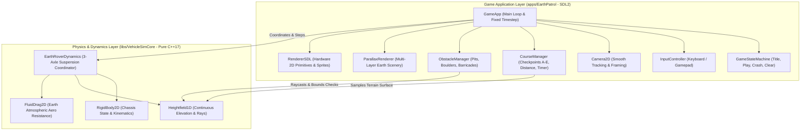
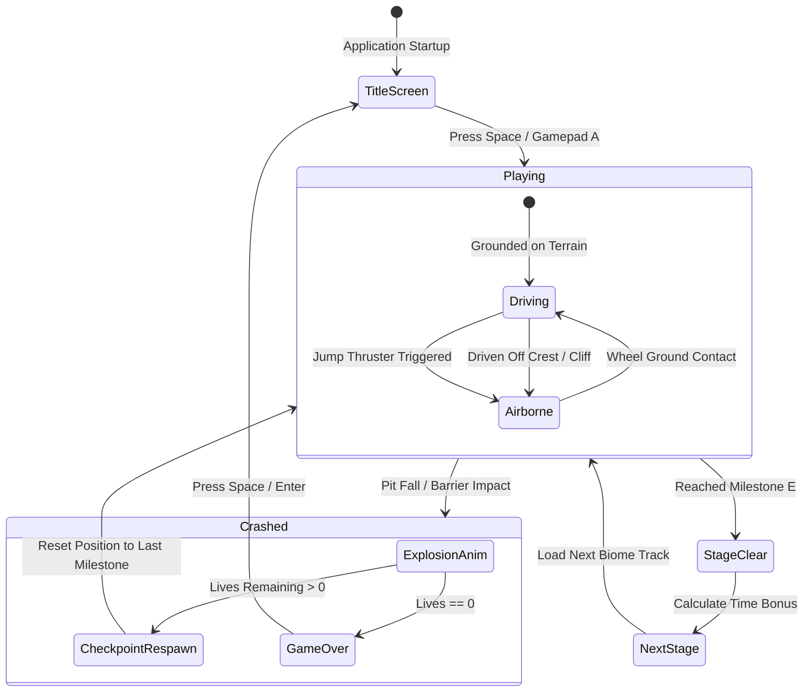
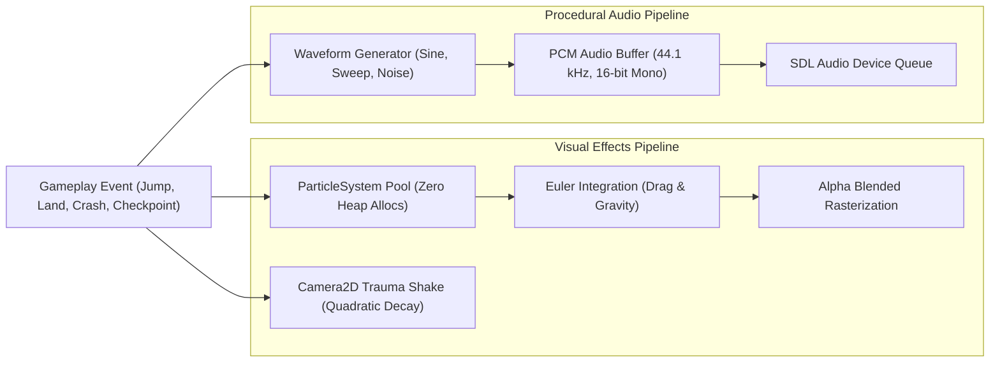
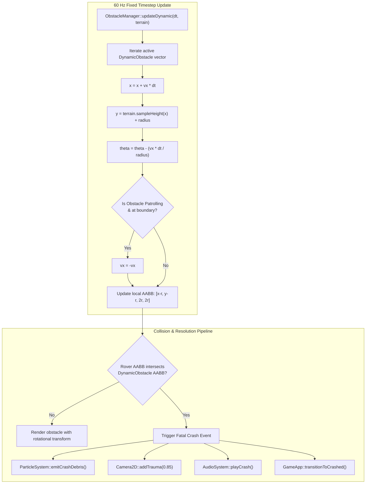

# Earth Patrol: C++17 & SDL Implementation Plan

## 1. Executive Summary & Game Concept

### 1.1 Premise and Vision
**Earth Patrol** is a 2D side-scrolling obstacle-avoidance vehicle traversal game implemented in **C++17** and **SDL** (SDL2/SDL3). Inspired by the 1982 arcade classic *Moon Patrol*, the game reimagines the core traversal formula in an **Earth terrestrial environment**:
- **Earth Physics**: Replaces low lunar gravity ($1.62\,\text{m/s}^2$) with realistic Earth gravity ($9.81\,\text{m/s}^2$) and atmospheric aerodynamic drag, creating weightier, snappier, and more responsive vehicle handling.
- **Traversal-Focused (No Shooting)**: The initial version excludes weapons to focus purely on high-precision physics driving, multi-wheel suspension dynamics, approach speed modulation, obstacle clearance, and jump timing.
- **Iconic 3-Axle Articulated Rover**: A 6-wheeled / 3-axle off-road buggy with independent front, middle, and rear spring-damper suspension struts that bob and compress across continuous terrain.
- **Earth Biomes & Parallax Backdrops**: Traverses terrestrial landscapes (paved highway ruins with sinkholes, desert canyons, and alpine forest passes) backed by rich multi-layer parallax Earth scenery.
- **Milestone Checkpoints**: Structured into segmented checkpoints (Point A through Point E) with time bonuses, target pacing, and distance tracking.

### 1.2 Architectural Decoupling
To uphold the repository's strict architecture and verification rules, the implementation is strictly divided into two decoupled layers:
1. **Core Library ([libs/VehicleSimCore](../libs/VehicleSimCore))**:
   - Zero external engine/graphics dependencies (pure standard C++17).
   - Encapsulates physical modeling: [EarthRoverDynamics](../libs/VehicleSimCore/dynamics/EarthRoverDynamics.h) (3-axle articulated suspension rover), continuous terrain queries via [Heightfield1D](../libs/VehicleSimCore/terrain/Heightfield1D.h), aerodynamic fluid drag via [FluidDrag2D](../libs/VehicleSimCore/physics/FluidDrag2D.h), and contact response.
2. **Game Application ([apps/EarthPatrol](../apps/EarthPatrol))**:
   - Standalone game executable target linking against `VehicleSimCore` and SDL2.
   - Contains windowing, event handling, camera tracking, parallax rendering, obstacle generation, HUD/UI, and state management.

---

## 2. High-Level Architecture & Component Decomposition

### 2.1 ASCII System Architecture Diagram

```
+---------------------------------------------------------------------------------------------------+
|                                      Earth Patrol Architecture                                    |
+---------------------------------------------------------------------------------------------------+
|  [apps/EarthPatrol] (Game Application Layer - SDL2)                                               |
|                                                                                                   |
|    +------------------+    +--------------------+    +--------------------+                       |
|    |     GameApp      |--->|  GameStateMachine  |--->|  InputController   |                       |
|    +--------+---------+    +--------------------+    +--------------------+                       |
|             |                                                                                     |
|             +------------+----------------------+--------------------+                            |
|             |            |                      |                    |                            |
|             v            v                      v                    v                            |
|     +---------------+ +------------------+ +------------------+  +------------------+             |
|     |   Camera2D    | | ParallaxRenderer | |  CourseManager   |  | ObstacleManager  |             |
|     +---------------+ +------------------+ +------------------+  +------------------+             |
|             |                                       |                     |                       |
|             +-------------------+-------------------+---------------------+                       |
|                                 |                                                                 |
|                                 v                                                                 |
|                      +-----------------------+                                                    |
|                      |      RendererSDL      | (Hardware-accelerated 2D Renderer)                 |
|                      +-----------------------+                                                    |
+---------------------------------+-----------------------------------------------------------------+
                                  | Links against (Zero external dependencies)
                                  v
+---------------------------------------------------------------------------------------------------+
|  [libs/VehicleSimCore] (Physics & Dynamics Layer - Pure C++17)                                    |
|                                                                                                   |
|    +-----------------------------+       +-----------------------------+                          |
|    |     EarthRoverDynamics      |------>|      RigidBody2D            |                          |
|    |  (3-Axle Bouncing Buggy)    |       |  (Position, Vel, Rotation)  |                          |
|    +--------------+--------------+       +-----------------------------+                          |
|                   |                                                                               |
|                   +----------------------> [Heightfield1D] (Surface normal, elevation, craters)  |
|                   +----------------------> [FluidDrag2D]   (Earth air density & aero drag)        |
+---------------------------------------------------------------------------------------------------+
```

### 2.2 Mermaid System Architecture Diagram



---

## 3. Physics & Dynamics Formulation (Earth Environment)

### 3.1 3-Axle Suspension Rover Mechanics
The rover incorporates three axles arranged in a front-to-rear configuration along the side view:
- **Rear Axle ($W_0$)**: Located at offset $x_R < 0$.
- **Middle Axle ($W_1$)**: Located at offset $x_M \approx 0$ (near the vehicle center of mass).
- **Front Axle ($W_2$)**: Located at offset $x_F > 0$.

Each axle comprises an independent linear spring-damper suspension strut oriented along the chassis local normal, contacting the continuous ground surface $y = h(x)$.

#### ASCII Diagram: 3-Axle Rover Suspension & Free-Body Diagram

```
                              Chassis Center of Mass (CoM)
                                          |
                                          v
                         +---------------------------------+
                         |      Earth Patrol Chassis       |
                         +----+-------------+-------------+
                              |             |             |
                         k,c  |        k,c  |        k,c  |  (Spring-Damper Struts)
                             / \           / \           / \
                            |   |         |   |         |   |
                             \ /           \ /           \ /
                              |             |             |
                           (Rear)       (Middle)       (Front)
                           [ W0 ]        [ W1 ]        [ W2 ]
                       ======/=============\============\=======  Terrain Surface h(x)
                            ^               ^            ^
                           Fn0             Fn1          Fn2   (Ground Normal Reactions)
```

#### Mermaid Diagram: Wheel Ground Contact & Force Flow

```mermaid
flowchart TD
    subgraph WheelEvaluation ["Per-Wheel Evaluation (i = 0, 1, 2)"]
        WP["World Wheel Contact Point (x_i, y_i)"]
        TE["Heightfield Elevation Query h(x_i) & Normal n_i"]
        PEN["Penetration Depth: delta_y = (h(x_i) + r_wheel) - y_i"]
        
        WP --> TE
        TE --> PEN
    end

    PEN -->|delta_y > 0 (Grounded)| SpringDamp["Suspension Spring & Damper: F_s = k * delta_y - c * v_rel"]
    PEN -->|delta_y <= 0 (Airborne)| Air["Free Strut Extension (Zero Ground Force)"]
    
    SpringDamp --> ContactForce["Normal Impulse & Traction / Braking Force"]
    ContactForce --> ChassisForce["Accumulate Chassis Linear Force & Pitch Torque"]
    Air --> AttitudeStabilizer["Mid-Air Gyroscopic / Attitude Damping"]
```

### 3.2 Suspension Equations of Motion
For each wheel $i \in \{0, 1, 2\}$ with wheel radius $r_w$ at horizontal position $x_i$:
1. **Terrain Surface Query**:
   $$y_{\text{ground}, i} = h(x_i), \quad \mathbf{n}_i = \frac{(-\frac{dh}{dx}, 1)}{\sqrt{1 + (\frac{dh}{dx})^2}}$$
2. **Strut Compression**:
   $$z_i = (y_{\text{ground}, i} + r_w) - y_{\text{wheel}, i}$$
   If $z_i > 0$, the tire is in compression against the ground; otherwise it is airborne ($F_{s, i} = 0$).
3. **Suspension Normal Force**:
   $$F_{N, i} = \max\left(0, k_s \cdot z_i + c_s \cdot \dot{z}_i\right)$$
   Where:
   - $k_s$: Suspension spring stiffness ($\approx 25\,000\,\text{N/m}$).
   - $c_s$: Damping coefficient ($\approx 1\,800\,\text{N}\cdot\text{s/m}$).
4. **Chassis Torque Equilibrium**:
   $$\tau_{\text{chassis}} = \sum_{i=0}^2 (\mathbf{r}_i \times \mathbf{F}_i)_z$$
   Because the middle wheel $W_1$ sits close to the CoM, it absorbs vertical jolts while the outer wheels ($W_0, W_2$) establish pitch stability.

### 3.3 Earth Gravity vs Lunar Gravity
| Parameter | Moon Patrol (Original) | Earth Patrol (Proposed) | Gameplay Implication |
| :--- | :--- | :--- | :--- |
| **Gravitational Accel ($g$)** | $\approx 1.62\,\text{m/s}^2$ | $\mathbf{9.81\,\text{m/s}^2}$ | Snappier descent, weightier feel; eliminates floatiness. |
| **Takeoff Jump Velocity ($v_y$)** | $\approx 3.5\,\text{m/s}$ | $\mathbf{8.5\,\text{m/s}}$ | High-impulse thruster leap required to clear obstacles. |
| **Air Hang Time ($2 v_y / g$)** | $\approx 4.3\,\text{s}$ | $\mathbf{1.73\,\text{s}}$ | Demands precise, tight jump reflexes over chasms. |
| **Atmospheric Density ($\rho$)** | $0.0\,\text{kg/m}^3$ (Vacuum) | $\mathbf{1.225\,\text{kg/m}^3}$ | Aerodynamic drag limits extreme runaway velocities. |
| **Terminal Velocity** | None | $\approx 55\,\text{m/s}$ | Predictable arc regardless of jump height. |

### 3.4 Speed Modulation & Viewport Relative Framing
- The camera pans rightward with a baseline scroll speed $v_{\text{base}}$.
- The player can accelerate ($v > v_{\text{base}}$) to move toward the right side of the screen ($x_{\text{screen}} \to x_{\text{max}}$) or brake ($v < v_{\text{base}}$) to fall back toward the left side ($x_{\text{screen}} \to x_{\text{min}}$).
- Moving rightward gives less reaction time for upcoming obstacles but increases score multiplier and stage clearance speed.
- Moving leftward gives more reaction time but risks running out of stage time or getting pushed out by camera scroll boundaries.

---

## 4. Game Systems & Level Design

### 4.1 Earth Biomes & Visual Identity

```
+----------------------------------------------------------------------------------------------------+
| Biome 1: Highway Ruins & Industrial Wasteland                                                      |
| - Sky: Overcast twilight sky gradient with low smoggy clouds.                                      |
| - Midground: Crumbling factory silhouettes, suspension bridge pylons, high-voltage towers.        |
| - Track: Cracked asphalt highway with road paint, sinkholes, concrete rubble, and warning cones.  |
+----------------------------------------------------------------------------------------------------+
| Biome 2: Desert Badlands & Red Rock Canyon                                                         |
| - Sky: Blazing copper-orange sunny horizon with heat haze and cirrus clouds.                       |
| - Midground: Layered sandstone mesas, sandstone arches, desert buttes, and distant sand dunes.     |
| - Track: Wavy red dirt trail with sand dunes, rocky crevasses, sandstone boulders, and gravel.    |
+----------------------------------------------------------------------------------------------------+
| Biome 3: Alpine Forest Pass & Mountain Crest                                                      |
| - Sky: Crisp blue mountain sky with alpine clouds.                                                 |
| - Midground: Pine tree ridges, snowcapped alpine peaks, mountain switchback silhouettes.           |
| - Track: Grassy off-road trail with muddy troughs, moguls, fallen tree logs, and granite boulders. |
+----------------------------------------------------------------------------------------------------+
```

### 4.2 Obstacle Taxonomy & Failure States
1. **Small Pit / Pothole ($0.8\,\text{m} - 1.5\,\text{m}$ width)**:
   - Can be cleared with a standard jump.
   - If driven into without jumping, causes suspension jolt and speed reduction without destroying the vehicle.
2. **Deep Sinkhole / Ravine ($2.0\,\text{m} - 4.5\,\text{m}$ width)**:
   - Fatal drop: chassis contact with ravine floor triggers vehicle crash, smoke puff, and respawn at last checkpoint.
   - Must be jumped over; wider ravines demand high approach speed.
3. **Low Boulder / Fallen Log ($0.4\,\text{m} - 0.7\,\text{m}$ height)**:
   - Small obstruction; if wheels hit at moderate speed, suspension absorbs the bump with a chassis hop; at high speed it risks pitch rollover.
4. **Large Concrete Barrier / Tall Rock ($1.0\,\text{m} - 1.8\,\text{m}$ height)**:
   - Fatal obstruction: direct chassis collision halts and crashes the vehicle. Requires timed jump.
5. **Mud Slick / Wet Patch**:
   - Reduces tire friction coefficient ($\mu = 0.2$), preventing rapid acceleration or emergency braking just before a major chasm.

### 4.3 Checkpoint & Progression System
A stage is divided into 5 standard lettered checkpoints:
- **Start $\to$ Point A $\to$ Point B $\to$ Point C $\to$ Point D $\to$ Point E (Stage Finish)**.
- **Top HUD**:
  - Distance progress track bar with moving rover icon.
  - Checkpoint indicator with distance remaining to next milestone.
  - Pacing Clock: Countdown timer giving bonus points for beating par time.
  - Speedometer: Numeric km/h readout.

---

## 5. C++17 Interface Specifications

### 5.1 VehicleSimCore Layer: `EarthRoverDynamics`
Located in `libs/VehicleSimCore/dynamics/`:

```cpp
// libs/VehicleSimCore/dynamics/EarthRoverDynamics.h
#pragma once

#include <array>
#include <cstddef>
#include <vector>

#include "libs/VehicleSimCore/dynamics/IVehicleDynamics.h"
#include "libs/VehicleSimCore/math/Vec2.h"
#include "libs/VehicleSimCore/terrain/Heightfield1D.h"

namespace vehicle_sim::physics {
class RigidBody2D;
} // namespace vehicle_sim::physics

namespace vehicle_sim::dynamics {

/// @struct EarthRoverWheelConfig
/// @brief Configuration parameters for an individual rover suspension axle.
struct EarthRoverWheelConfig {
    double longitudinalOffset { 0.0 }; ///< Chassis X offset from CoM in meters.
    double restLength { 0.60 };        ///< Uncompressed suspension strut length in meters.
    double springStiffness { 24000.0 }; ///< Suspension spring constant k in N/m.
    double dampingCoeff { 1800.0 };    ///< Viscous damping coefficient c in N*s/m.
    double wheelRadius { 0.35 };       ///< Wheel radius in meters.
};

/// @struct EarthRoverConfig
/// @brief Full mechanical and aerodynamic parameters for the 3-axle Earth rover.
struct EarthRoverConfig {
    double mass { 850.0 };              ///< Chassis mass in kg.
    double momentOfInertia { 650.0 };   ///< Chassis rotational inertia in kg*m^2.
    double gravity { 9.81 };            ///< Downward acceleration in m/s^2.
    double airDensity { 1.225 };        ///< Atmospheric air density in kg/m^3.
    double dragCoefficient { 0.42 };    ///< Frontal aerodynamic drag coefficient Cd.
    double frontalArea { 1.6 };         ///< Projected frontal aerodynamic area in m^2.

    double maxDriveForce { 5500.0 };    ///< Forward longitudinal traction capacity in N.
    double maxBrakeForce { 8000.0 };    ///< Longitudinal braking deceleration force in N.
    double jumpSpeed { 8.5 };           ///< Upward takeoff impulse speed in m/s.
    double pitchStabGain { 1200.0 };    ///< Mid-air attitude stabilization torque gain.

    std::array<EarthRoverWheelConfig, 3> wheels {
        EarthRoverWheelConfig{ -1.10, 0.60, 24000.0, 1800.0, 0.35 }, // Rear
        EarthRoverWheelConfig{  0.00, 0.60, 22000.0, 1600.0, 0.35 }, // Middle
        EarthRoverWheelConfig{  1.10, 0.60, 24000.0, 1800.0, 0.35 }  // Front
    };
};

/// @struct EarthRoverInput
/// @brief Semantic driver control inputs for the Earth rover.
struct EarthRoverInput {
    double throttle { 0.0 }; ///< Normalized throttle in [0.0, 1.0].
    double brake { 0.0 };    ///< Normalized brake in [0.0, 1.0].
    bool jump { false };     ///< Upward jump thruster trigger command.
};

/// @struct EarthRoverWheelState
/// @brief Runtime suspension and contact telemetry for an axle.
struct EarthRoverWheelState {
    math::Vec2 worldPos { 0.0, 0.0 };       ///< Wheel contact center in world space.
    double compression { 0.0 };              ///< Strut displacement from rest in meters.
    double normalForce { 0.0 };              ///< Vertical ground reaction force in Newtons.
    double tractionForce { 0.0 };            ///< Tangential longitudinal force in Newtons.
    bool isGrounded { false };               ///< Contact engagement flag.
};

/// @class EarthRoverDynamics
/// @brief 3-axle articulated suspension rover dynamics coordinator.
/// @details Simulates independent multi-wheel spring-damper suspension over continuous
/// 1D heightfields, jump takeoff impulses, Earth atmospheric drag, and air pitch stabilization.
class EarthRoverDynamics final : public IVehicleDynamics {
public:
    static constexpr std::size_t kWheelCount { 3 };
    static constexpr std::size_t kRearWheel { 0 };
    static constexpr std::size_t kMiddleWheel { 1 };
    static constexpr std::size_t kFrontWheel { 2 };

    /// @brief Default constructor using nominal Earth rover parameters.
    EarthRoverDynamics() noexcept;

    /// @brief Parameterized constructor using configuration settings.
    /// @param[in] config Vehicle mechanical and suspension configuration.
    explicit EarthRoverDynamics(const EarthRoverConfig& config) noexcept;

    /// @brief Destructor.
    ~EarthRoverDynamics() noexcept override = default;

    /// @brief Advances rover dynamics simulation by timestep dt.
    /// @param[in,out] body Rigid body chassis receiving powertrain and suspension forces.
    /// @param[in] dt Timestep duration in seconds.
    void step(physics::RigidBody2D& body, double dt) noexcept override;

    /// @brief Resets transient state.
    void reset() noexcept override;

    /// @brief Checks if all wheels are detached from the ground.
    /// @return True if vehicle is completely airborne.
    [[nodiscard]] bool isAirborne() const noexcept override;

    /// @brief Sets active driver input commands.
    /// @param[in] input Control input commands.
    void setInput(const EarthRoverInput& input) noexcept;

    /// @brief Gets active driver input commands.
    /// @return Constant reference to active EarthRoverInput.
    [[nodiscard]] const EarthRoverInput& getInput() const noexcept;

    /// @brief Sets terrain heightfield reference for ground contact evaluation.
    /// @param[in] terrain Pointer to continuous 1D heightfield (or nullptr).
    void setTerrain(const terrain::Heightfield1D* terrain) noexcept;

    /// @brief Triggers an upward jump impulse.
    /// @param[in] speed Upward vertical speed in m/s (0.0 uses config default).
    void triggerJump(double speed = 0.0) noexcept;

    /// @brief Gets wheel telemetry snapshot.
    /// @param[in] index Axle index in [0, 2].
    /// @return Reference to EarthRoverWheelState.
    [[nodiscard]] const EarthRoverWheelState& getWheelState(std::size_t index) const noexcept;

    /// @brief Gets vehicle configuration parameters.
    /// @return Constant reference to active EarthRoverConfig.
    [[nodiscard]] const EarthRoverConfig& getConfig() const noexcept;

private:
    EarthRoverConfig config_ {};
    EarthRoverInput input_ {};
    const terrain::Heightfield1D* terrain_ { nullptr };
    std::array<EarthRoverWheelState, kWheelCount> wheelStates_ {};
    bool isAirborne_ { false };
    bool jumpRequested_ { false };
};

} // namespace vehicle_sim::dynamics
```

### 5.2 Application Layer: `apps/EarthPatrol`
Located in `apps/EarthPatrol/`:

#### File Layout
- `apps/EarthPatrol/CMakeLists.txt`: Build target, SDL2 package linking.
- `apps/EarthPatrol/Main.cpp`: Entry point, application bootstrap, exception trapping.
- `apps/EarthPatrol/GameApp.h` & `GameApp.cpp`: Main loop, fixed-timestep accumulator (60 Hz / 120 Hz).
- `apps/EarthPatrol/SDLWrappers.h`: RAII unique pointer wrappers for `SDL_Window`, `SDL_Renderer`, `SDL_Texture`.
- `apps/EarthPatrol/GameStateMachine.h` & `GameStateMachine.cpp`: State transition coordinator (`Title`, `Playing`, `Crashed`, `StageClear`, `GameOver`).
- `apps/EarthPatrol/CourseManager.h` & `CourseManager.cpp`: Stage generator, heightfield chunk streaming, checkpoint tracker.
- `apps/EarthPatrol/ObstacleManager.h` & `ObstacleManager.cpp`: Craters, boulders, barriers, mud slicks, and AABB/Ray collision.
- `apps/EarthPatrol/Camera2D.h` & `Camera2D.cpp`: Smooth horizontal and vertical viewport tracking.
- `apps/EarthPatrol/ParallaxRenderer.h` & `ParallaxRenderer.cpp`: Multi-layer terrestrial backgrounds with speed factors.
- `apps/EarthPatrol/RendererSDL.h` & `RendererSDL.cpp`: Primitives, sprites, suspension struts, particles, and HUD drawing.
- `apps/EarthPatrol/InputController.h` & `InputController.cpp`: SDL event polling and input binding.

---

## 6. Rendering, Camera & Visual Design

### 6.1 Parallax Layer Separation
The game uses a 4-tier horizontal parallax scrolling stack:

```
+----------------------------------------------------------------------------------------------------+
| Layer 0: Sky Gradient & Distant Celestial/Sun [Speed Factor: 0.00x - Fixed]                         |
+----------------------------------------------------------------------------------------------------+
| Layer 1: Distant Mountain Peaks & Silhouettes [Speed Factor: 0.08x - Slowest Parallax]             |
+----------------------------------------------------------------------------------------------------+
| Layer 2: Midground Rolling Hills & Forest Canopies / Bridges [Speed Factor: 0.28x - Mid Parallax]  |
+----------------------------------------------------------------------------------------------------+
| Layer 3: Foreground Continuous Heightfield Track & Obstacles [Speed Factor: 1.00x - World Speed]   |
+----------------------------------------------------------------------------------------------------+
| Layer 4: Particle Overlays (Tire dust plumes, landing sparks) & Screen-Space HUD [Fixed Screen Space]
+----------------------------------------------------------------------------------------------------+
```

### 6.2 Camera2D Framing & Lead
The camera horizontal position $X_{\text{cam}}$ follows a smoothed spring-damper tracking algorithm:
$$X_{\text{target}} = X_{\text{rover}} + L_{\text{lead}} \cdot \frac{v_x}{v_{\text{max}}}$$
$$X_{\text{cam}}(t + \Delta t) = X_{\text{cam}}(t) + (X_{\text{target}} - X_{\text{cam}}(t)) \cdot (1 - e^{-\lambda \Delta t})$$
- When accelerating, the camera shifts slightly to look ahead ($L_{\text{lead}} = 4.0\,\text{m}$), giving the player visual warning of incoming pits.
- The rover is bounded within $[X_{\text{cam}} + W_{\text{min}}, X_{\text{cam}} + W_{\text{max}}]$ so it never drives off-screen.

---

## 7. Game State Machine & Loop Flow

### 7.1 ASCII Game State Machine Flow

```
                      +-------------------+
                      |    Boot / Init    |
                      +---------+---------+
                                |
                                v
                      +-------------------+
        +------------>|    TitleScreen    |
        |             +---------+---------+
        |                       | Press Space / Enter
        |                       v
        |             +-------------------+
        |       +---->|      Playing      |<----+ (Respawn at Checkpoint)
        |       |     +----+----+----+----+     |
        |       |          |    |    |          |
        |       |          |    |    +----------+----------+
        |       |          |    |                          |
        |       |  Fall in |    | Hit Wall / Rock          | Reached Point E
        |       |  Pit     v    v                          v
        |       |     +---------------+            +---------------+
        |       +-----|    Crashed    |            |  StageClear   |
        |  Lives = 0  +-------+-------+            +-------+-------+
        |                     |                            |
        |                     v                            v
        +-------------+---------------+            +---------------+
                      |   GameOver    |            |   NextStage   |
                      +---------------+            +---------------+
```

### 7.2 Mermaid Game State Machine Flow



---

### 7.3 Particle System, Screen Shake & Procedural Audio Architecture

The particle engine utilizes a fixed-capacity ring pool (`kMaxPoolSize = 384`) with zero runtime heap allocations. Camera screen shake applies quadratic trauma decay, and the procedural audio synthesizer generates retro waveforms via standard SDL2 audio queues.

#### ASCII Diagram: Particle Emission & Screen Shake Architecture

```
                      +-----------------------------+
                      |     Earth Patrol Events     |
                      +------+-------+-------+------+
                             |       |       |
              Jump Trigger   |       |       | Impact / Land
                             v       |       v
               +---------------+     |   +---------------+
               | Thruster Spark|     |   | Landing Dust  |
               +-------+-------+     |   +-------+-------+
                       |             |           |
                       v             v           v
            +-------------------------------------------------+
            |   Fixed Ring Pool ParticleSystem (384 slots)   |
            +------------------------+------------------------+
                                     |
                                     v
                        +-------------------------+
                        | Camera2D Screen Shake   |
                        | offset = intensity * T^2|
                        +-------------------------+
```

#### Mermaid Diagram: Visual Polish & Procedural Audio Pipeline



---

### 7.4 Optional Features & Future Extensions Overview

To further elevate Earth Patrol towards commercial arcade quality, the following optional enhancements have been identified:

| Feature | Scope & Affected Modules | Impact & Description |
| :--- | :--- | :--- |
| **Physical Gamepad / Joystick Support** | [apps/EarthPatrol/GameApp.cpp](../apps/EarthPatrol/GameApp.cpp) | Direct mapping of `SDL_GameController` / `SDL_Joystick` events (D-pad/analog stick for throttle & brake, Button A for jump thruster, Start for play/restart). |
| **Persistent High Score Storage** | [apps/EarthPatrol/GameApp.cpp](../apps/EarthPatrol/GameApp.cpp) | Serializing top scores to a local file (`earthpatrol_scores.dat`) upon GameOver so high scores persist across game sessions. |
| **HUD Audio Mute Indicator** | [apps/EarthPatrol/GameApp.cpp](../apps/EarthPatrol/GameApp.cpp) | Rendering a retro `[MUTE]` status indicator in the top-right corner of the HUD when the player presses `M`. |
| **Full Doxygen `@details` Audit** | [apps/EarthPatrol/AudioSystem.h](../apps/EarthPatrol/AudioSystem.h) | Supplementing all public inline getters and sound triggers with explicit `@details` and `@return` tags for strict MISRA/checklist compliance. |
| **Dynamic / Moving Obstacles** | [apps/EarthPatrol/ObstacleManager.h](../apps/EarthPatrol/ObstacleManager.h)<br>[apps/EarthPatrol/ObstacleManager.cpp](../apps/EarthPatrol/ObstacleManager.cpp) | Introducing dynamic hazards that move along the terrain surface (rolling boulders, highway drones, tumbling debris) to challenge timing. |

---

### 7.5 Phase 8 Detailed Implementation Plan: Dynamic & Moving Obstacles

#### 7.5.1 Concept & Hazard Taxonomy
In classic *Moon Patrol*, several hazards move across the screen rather than staying stationary, forcing the player to calculate relative closing velocities. For Earth Patrol, three terrestrial moving obstacle archetypes are designed:

1. **Rolling Boulder / Tumbling Rock (Desert & Alpine Biomes)**:
   - Spawns ahead of the rover on elevated slopes or drop-offs.
   - Rolls toward the player with closing velocity ($v_x \in [-4.0, -8.0]\,\text{m/s}$).
   - Height dynamically conforms to the terrain profile $y = h(x) + r$, while angular rotation matches rolling kinematics:
     $$\omega = -\frac{v_x}{r}, \quad \theta(t + \Delta t) = \theta(t) + \omega \Delta t$$
2. **Patrolling Roadwork Drone (Highway Biome)**:
   - Autonomous road maintenance crawler that oscillates horizontally between two patrol points $[x_{\min}, x_{\max}]$.
   - Reverses velocity when encountering patrol limits:
     $$v_x \leftarrow -v_x \quad \text{if } x \le x_{\min} \text{ or } x \ge x_{\max}$$
   - Features flashing warning beacon hazard graphics.
3. **Windblown Debris / Tumbling Shrub (Desert Biome)**:
   - Low-mass tumbleweed that bounces across the terrain with small parabolic arcs:
     $$\ddot{y} = -g, \quad \dot{y} \leftarrow -e \dot{y} \quad (\text{upon terrain contact } y \le h(x) + r)$$

#### 7.5.2 ASCII Diagram: Dynamic Obstacle Kinematic & Collision Pipeline

```
+---------------------------------------------------------------------------------------------------+
|                            Dynamic Obstacle Pipeline Architecture                                 |
+---------------------------------------------------------------------------------------------------+
|  [Course Generation]                                                                              |
|    - Procedurally places DynamicObstacle instances at sector offsets                              |
|    - Configures velocity vx, patrol interval [xmin, xmax], radius r, and obstacle type            |
+--------------------------------------------------+------------------------------------------------+
                                                   |
                                                   v
+---------------------------------------------------------------------------------------------------+
|  [Per-Tick Simulation: ObstacleManager::updateDynamic(dt, terrain)]                               |
|                                                                                                   |
|    1. Horizontal Integration:      x_new = x + vx * dt                                            |
|    2. Terrain Conformance:         y_new = terrain.sampleHeight(x_new) + r                        |
|    3. Kinematic Rotation:          theta_new = theta - (vx * dt / r)                              |
|    4. Boundary / Patrol Turn:      if (x_new < xmin || x_new > xmax) vx = -vx                     |
|    5. AABB Update:                 box = {x_new - r, y_new - r, 2r, 2r}                          |
+--------------------------------------------------+------------------------------------------------+
                                                   |
                                                   v
+---------------------------------------------------------------------------------------------------+
|  [Collision & Interaction Pipeline]                                                               |
|                                                                                                   |
|    Rover AABB vs Dynamic Obstacle AABB                                                            |
|       |                                                                                           |
|       +---> [No Overlap]  --> Render rotated geometry in Camera2D frame                           |
|       |                                                                                           |
|       +---> [Intersect]   --> Trigger Crash Sequence                                              |
|                                 - ParticleSystem: 32 debris chunks + 16 sparks                    |
|                                 - Camera2D: Add trauma (0.85) -> screen shake                     |
|                                 - AudioSystem: playCrash() explosion                              |
|                                 - GameStateMachine: Transition to Crashed state                   |
+---------------------------------------------------------------------------------------------------+
```

#### 7.5.3 Mermaid Diagram: Dynamic Obstacle Simulation & Spatial Update Flow



#### 7.5.4 Data Structures & Class Interfaces

In [apps/EarthPatrol/ObstacleManager.h](../apps/EarthPatrol/ObstacleManager.h):

```cpp
/// @enum DynamicObstacleType
/// @brief Classification of moving terrestrial hazards.
enum class DynamicObstacleType : std::uint8_t {
    RollingBoulder,  ///< Ground-conforming rolling rock with closing speed.
    PatrolDrone,     ///< Oscillating roadwork drone with flashing beacon.
    TumblingDebris   ///< Wind-driven hopping debris cluster.
};

/// @struct DynamicObstacle
/// @brief Represents a moving obstacle with kinetic and rotational state.
struct DynamicObstacle {
    DynamicObstacleType type { DynamicObstacleType::RollingBoulder };
    vehicle_sim::math::Vec2 position { 0.0, 0.0 };
    vehicle_sim::math::Vec2 velocity { 0.0, 0.0 };
    double radius { 0.40 };
    double rotationAngle { 0.0 };
    double patrolMinX { 0.0 };
    double patrolMaxX { 0.0 };
    ObstacleAABB aabb { 0.0, 0.0, 0.0, 0.0 };
    bool active { true };
};
```

Member functions added to `ObstacleManager`:
- `void updateDynamic(double dt, const vehicle_sim::terrain::Heightfield1D& terrain) noexcept;`
- `[[nodiscard]] const std::vector<DynamicObstacle>& getDynamicObstacles() const noexcept;`
- `[[nodiscard]] bool checkDynamicColl(const ObstacleAABB& roverBox) const noexcept;`

#### 7.5.5 Implementation Steps for Phase 8

1. **Step 8.1 - Data Model & Kinematic Update**:
   - Define `DynamicObstacleType` and `DynamicObstacle` in [apps/EarthPatrol/ObstacleManager.h](../apps/EarthPatrol/ObstacleManager.h).
   - Implement `updateDynamic()` in [apps/EarthPatrol/ObstacleManager.cpp](../apps/EarthPatrol/ObstacleManager.cpp) with terrain height clamping and angular integration.
2. **Step 8.2 - Procedural Distribution Across Biomes**:
   - In `generateObstacles()`, spawn rolling boulders on steep sections of Desert and Alpine tracks, and patrol drones along flat sections of the Highway.
3. **Step 8.3 - Rotated Geometry Rasterization**:
   - In `renderObstacles()`, project obstacle center to screen coordinates and render rotated polygon vertices (e.g. faceted rock segments or rotating drone hub).
4. **Step 8.4 - Collision Integration in Game Loop**:
   - In [apps/EarthPatrol/GameApp.cpp](../apps/EarthPatrol/GameApp.cpp), query `checkDynamicColl(roverAabb)`. On hit, trigger crash sequence with particles, camera shake, and explosion sound.
5. **Step 8.5 - Unit Test Coverage**:
   - Add unit tests in [apps/EarthPatrol/GameAppTest.cpp](../apps/EarthPatrol/GameAppTest.cpp) verifying linear translation, rotational integration, boundary reversal, and collision detection.

---

## 8. Step-by-Step Implementation Roadmap

```
+---------------------------------------------------------------------------------------------------+
| Earth Patrol Implementation Roadmap                                                               |
+---------------------------------------------------------------------------------------------------+
| Phase 1: Core 3-Axle Rover Dynamics in VehicleSimCore [COMPLETED]                                 |
|   - Add EarthRoverDynamics.h & EarthRoverDynamics.cpp in libs/VehicleSimCore/dynamics/           |
|   - Implement spring-damper struts, Heightfield1D contact integration, aerodynamic fluid drag    |
|   - Add unit tests in tests/DynamicsTest.cpp and tests/TerrainTest.cpp                            |
+---------------------------------------------------------------------------------------------------+
| Phase 2: SDL2 Application Framework & CMake Integration [COMPLETED]                               |
|   - Add apps/EarthPatrol/CMakeLists.txt and root CMake find_package(SDL2) option                 |
|   - Create SDLWrappers.h RAII unique pointers for window, renderer, and textures                 |
|   - Build minimal GameApp window bootstrap running at fixed 60 Hz                                |
+---------------------------------------------------------------------------------------------------+
| Phase 3: Terrain & Camera Visualization [COMPLETED]                                               |
|   - Implement Camera2D with horizontal lead and vertical damping                                 |
|   - Implement Heightfield1D procedural ribbon rasterization in RendererSDL                        |
|   - Stream infinite / segmented procedural track courses via CourseManager                       |
+---------------------------------------------------------------------------------------------------+
| Phase 4: Rover Visuals & Suspension Strut Rendering [COMPLETED]                                    |
|   - Draw 3-axle buggy chassis, articulated suspension links, and rotating 6-wheel hubs           |
|   - Wire InputController (WASD/Arrows for throttle/brake, Space for Jump)                        |
|   - Tune Earth gravity (9.81 m/s^2) and jump impulses for optimal game feel                      |
+---------------------------------------------------------------------------------------------------+
| Phase 5: Multi-Layer Parallax Backgrounds, Biome Art & Obstacle Management [COMPLETED]            |
|   - Implement ParallaxRenderer with 3 distinct Earth biomes (Highway, Badlands, Alpine Pass)      |
|   - Procedural vector skyline silhouettes, clouds, and terrain textures                           |
|   - Implement ObstacleManager: craters, ravines, boulders, barricades, and fatal collision checks |
+---------------------------------------------------------------------------------------------------+
| Phase 6: Game Progression, State Machine, Timers & HUD [COMPLETED]                                |
|   - Checkpoints A through E with distance bar, speedometer, timer, and score calculation          |
|   - GameStateMachine transitions (Title, Playing, Crashed, StageClear, GameOver)                  |
|   - Procedural 3x5 PixelFont bitmap typography for arcade HUD, banners, and milestone flags       |
+---------------------------------------------------------------------------------------------------+
| Phase 7: Polish, Particle Effects, Sound Hooks & Verification [COMPLETED]                         |
|   - Tire dust particles, thruster sparks, landing puffs, and explosion debris in ParticleSystem   |
|   - Dynamic camera trauma shake decaying quadratically on collision and heavy touchdown           |
|   - Procedural synthetic retro SFX (jump sweep, landing thump, crash noise, milestone chime)      |
|   - Clean compile with /W4 and -Wall -Wextra -pedantic (-Werror) on Windows and Linux             |
|   - Complete Doxygen documentation, 10 unit tests in EarthPatrolTests, MISRA/CERT compliance audit |
+---------------------------------------------------------------------------------------------------+
| Phase 8: Dynamic / Moving Obstacles & Arcade Polish [COMPLETED]                                    |
|   - Rolling boulders, highway patrol drones, and windblown debris in ObstacleManager              |
|   - Kinematic surface-following integration with rotational angular displacement                  |
|   - Gamepad/controller input support (SDL_GameController) and persistent high score file saving   |
|   - HUD [MUTE] indicator, full Doxygen audit, 13 unit tests passing in EarthPatrolTests          |
+---------------------------------------------------------------------------------------------------+
```

---

## 9. Verification & Compliance Checklist

Before presenting code or committing, each item in the project verification checklist is verified:
1. **No Raw `new` or `delete`**: All memory uses smart pointers (`std::unique_ptr`). All SDL resources are managed via RAII deleters in [apps/EarthPatrol/SDLWrappers.h](../apps/EarthPatrol/SDLWrappers.h).
2. **`#pragma once`**: Enforced on all header files.
3. **Co-located Header and Source**: Co-located in `libs/VehicleSimCore/dynamics/` and `apps/EarthPatrol/`.
4. **Zero External Dependencies in `VehicleSimCore`**: Pure C++17; no SDL dependencies in library.
5. **Concise Function Names**: Strictly `< 30` characters for all function identifiers.
6. **Cross-Platform Math & Determinism**: Strict IEEE 754 arithmetic with zero OS-specific headers.
7. **Explicit Variable Initialization**: All variables initialized with `{}`.
8. **`[[nodiscard]]` Applied**: Applied to getters, state queries, and calculation routines.
9. **Full Doxygen Comments**: Every public API includes full `/// @brief`, `@details`, `@param`, `@return`.
10. **MISRA C++:2023 & SEI CERT C++**: No raw pointer ownership, zero dynamic casts, explicit casts with boundary guards.
11. **Failing Tests First**: Unit tests in `tests/DynamicsTest.cpp` written before application integration.
12. **Compiler Warning Hardening**: Verified zero warnings with `/W4 /WX` on MSVC and `-Wall -Wextra -pedantic -Werror` on GCC/Clang.
13. **Relative File Paths in Docs**: All paths formatted with relative links.
14. **ASCII & Mermaid Diagrams**: Included for architecture, force flow, and game state transitions.
