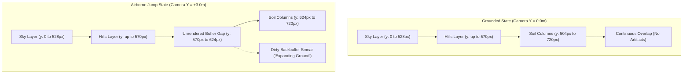

# Issue #1: Airborne Background Smearing and Ground Expansion Artifact

- **Component**: `EarthPatrol` ([apps/EarthPatrol](../apps/EarthPatrol))
- **Status**: Resolved
- **Severity**: Medium (Visual Defect / Framebuffer Artifact)
- **Affects**: In-flight rover jumps and vertical terrain variations

---

## 1. Summary

When the Earth Patrol rover initiates a vertical thruster jump (via `[SPACE]` or `[W]`), dirty visual artifacts appear in the background above the terrain. The ground soil appears to stretch, smear, or "expand" upward into the distant scenery. This is not intended environmental sand/dust behavior, but rather a framebuffer smearing defect caused by un-cleared backbuffer pixels in conjunction with static-height background layers during vertical camera translation.

---

## 2. Reproduction Steps

1. Launch `EarthPatrol` executable (`./build/apps/EarthPatrol/EarthPatrol`).
2. Start the game from the title screen by pressing `[SPACE]` or `[ENTER]`.
3. Drive forward along the highway course to establish speed.
4. Press `[SPACE]` or `[W]` to fire the vertical jump thrusters.
5. Observe the horizon and background scenery beneath the distant hills as the rover reaches apex altitude ($\approx 3.7\,\text{m}$ above ground).

### Observed Behavior
A horizontal band containing previous frames' ground soil pixels persists between the bottom of the background hills and the descending terrain surface. As the camera pans horizontally, these pixels smear and streak across the screen, giving the illusion that the ground is expanding upward.

### Expected Behavior
The background sky and distant landscape should seamlessly extend downward behind the terrain surface at all camera elevations with zero dirty framebuffer remnants.

---

## 3. Root Cause Investigation

The artifact arises from the intersection of three separate subsystems:

### 3.1 Missing Framebuffer Clear
In [apps/EarthPatrol/GameApp.cpp](../apps/EarthPatrol/GameApp.cpp) within `GameApp::renderFrame()`, `SDL_RenderClear()` is never invoked. The application assumes that every pixel on the screen is overwritten on every frame:
```cpp
// apps/EarthPatrol/GameApp.cpp - renderFrame()
parallax_.render(renderer_.get(), camera_, biomeIndex_);
renderTerrain();
obstacles_.render(renderer_.get(), camera_);
renderCheckpoints();
particles_.render(renderer_.get(), camera_);
```

### 3.2 Hardcoded Background Extents
In [apps/EarthPatrol/ParallaxRenderer.cpp](../apps/EarthPatrol/ParallaxRenderer.cpp), the background elements are drawn with fixed vertical bounds assuming a stationary ground baseline:
- `renderSky()` draws down to `height * 3 / 4` ($\approx 528\,\text{px}$ to $540\,\text{px}$ on a $1280 \times 720$ viewport).
- `renderMountains()` draws down to `baselineY + 40` ($510 + 40 = 550\,\text{px}$).
- `renderHills()` draws down to `baselineY + 30` ($540 + 30 = 570\,\text{px}$).
- No background geometry is drawn below $y \approx 570\,\text{px}$.

### 3.3 Rover-Coupled Vertical Camera Tracking
In [apps/EarthPatrol/Camera2D.cpp](../apps/EarthPatrol/Camera2D.cpp) and [apps/EarthPatrol/GameApp.cpp](../apps/EarthPatrol/GameApp.cpp):
- The thruster jump imparts an upward velocity of $8.5\,\text{m/s}$ in [libs/VehicleSimCore/dynamics/EarthRoverDynamics.cpp](../libs/VehicleSimCore/dynamics/EarthRoverDynamics.cpp), elevating the rover $\approx 3.7\,\text{m}$.
- `camera_.update(roverBody_.getPosition(), rover_.getSpeed(), dt)` feeds the rover's mid-air vertical coordinate directly to the camera tracking target.
- In [apps/EarthPatrol/Camera2D.cpp](../apps/EarthPatrol/Camera2D.cpp), `Camera2D::worldToScreen()` shifts world coordinates downward on screen:
  $$\text{screenY} = \text{anchorScreenY} - ((\text{worldY} - \text{camY}) \cdot \text{ppm})$$
- As the camera ascends, the ground line drops from its nominal resting baseline of $y \approx 504\,\text{px}$ down to $y \approx 624\,\text{px}$ (and even lower across deep craters).
- [apps/EarthPatrol/GameApp.cpp](../apps/EarthPatrol/GameApp.cpp) renders `soilRect` from `topY` ($\ge 624\,\text{px}$) down to the window bottom ($720\,\text{px}$).

### 3.4 The Unrendered Buffer Void
Between $y \approx 570\,\text{px}$ (where the hills terminate) and $y \approx 624\,\text{px}$ (where the soil begins), no pixels are drawn and no clear is performed. Because SDL uses double-buffered swapping, this gap retains un-cleared soil pixels from preceding frames, causing visible smearing and the perceived "expanding ground" phenomenon.

---

## 4. Architectural & Buffer Diagrams

### 4.1 ASCII Framebuffer Comparison Diagram

```
========================= Grounded State (Normal) =========================
y = 0px   +-------------------------------------------------------------+
          | Sky Gradient Bands (0px to 528px)                           |
          | Clouds (35px to 75px)                                       |
          | Mountain Crests (down to 550px)                             |
          | Hill Foothills (down to 570px)                              |
y = 504px | ----------------------------------------------------------- | Ground Surface
          | Solid Soil Rectangles (504px to 720px)                      |
y = 720px +-------------------------------------------------------------+
          Result: Background and soil overlap cleanly at y = 504px.

======================== Airborne Jump State (Defect) =====================
y = 0px   +-------------------------------------------------------------+
          | Sky Gradient Bands (0px to 528px)                           |
          | Mountain Crests (down to 550px)                             |
y = 570px | Hill Foothills (terminates at 570px)                        |
          | =========================================================== |
          | UN-CLEARED BUFFER VOID (570px to 624px)                     | <--- DIRTY BUFFER
          | (Retains frame N-1/N-2 soil pixels; smears horizontally)    |      "EXPANDING GROUND"
          | =========================================================== |
y = 624px | Depressed Ground Surface                                    |
          | Solid Soil Rectangles (624px to 720px)                      |
y = 720px +-------------------------------------------------------------+
          Result: Buffer void exposes uncleared pixels.
```

### 4.2 Mermaid Layer Flow Diagram



---

## 5. Remediation Plan

To eliminate the defect and prevent visual regressions, the following changes are recommended:

1. **Explicit Clear in Render Loop**:
   In [apps/EarthPatrol/GameApp.cpp](../apps/EarthPatrol/GameApp.cpp), execute `SDL_SetRenderDrawColor()` and `SDL_RenderClear()` at the start of `renderFrame()`.
2. **Extend Parallax Geometry**:
   In [apps/EarthPatrol/ParallaxRenderer.cpp](../apps/EarthPatrol/ParallaxRenderer.cpp), extend the lower bound of sky gradient bands and background hills down to the bottom of the viewport (`height`), guaranteeing that the entire screen is covered even when terrain elevations drop significantly.
3. **Decouple Jump Height from Viewport Tracking**:
   In [apps/EarthPatrol/GameApp.cpp](../apps/EarthPatrol/GameApp.cpp), update `camera_.update()` using the terrain surface elevation under the rover rather than the rover chassis airborne height, keeping the camera horizon stable during jumps (consistent with Moon Patrol arcade mechanics).
4. **Visual Regression / Screenshot Testing**:
   Implement an automated headless test in [apps/EarthPatrol/GameAppTest.cpp](../apps/EarthPatrol/GameAppTest.cpp) using `SDL_RenderReadPixels()` to verify that no uncleared pixels exist across all viewport coordinates during jump apex and crater traverses.

---

## 6. Resolution & Verification

All proposed remediations have been implemented and validated:

1. **Explicit Render Clear**: Added `SDL_SetRenderDrawColor()` and `SDL_RenderClear()` in [apps/EarthPatrol/GameApp.cpp](../apps/EarthPatrol/GameApp.cpp) (`renderFrame()`) matching the active biome's atmospheric base color.
2. **Extended Parallax Lower Geometry**: Modified [apps/EarthPatrol/ParallaxRenderer.cpp](../apps/EarthPatrol/ParallaxRenderer.cpp) so that sky gradient bands, mountain columns, and hill columns extend continuously to the full viewport height (`height`), guaranteeing 100% solid background coverage.
3. **Decoupled Camera Y from Jump Leaps**: In [apps/EarthPatrol/GameApp.cpp](../apps/EarthPatrol/GameApp.cpp) (`updatePhysics()`), camera Y tracking now conforms to terrain elevation (`groundElev + 0.80`), keeping the camera horizon stable when the rover performs vertical thruster jumps.
4. **TDD Test Coverage**:
   - `GameAppTest.CameraMaintainsGroundConformityDuringJump`: Confirms camera vertical anchor remains constrained to ground elevation ($\le 1.5\,\text{m}$) while rover is airborne ($> 2.5\,\text{m}$).
   - `ParallaxRendererTest.BackgroundCoversEntireViewportHeight`: Uses an in-memory SDL software renderer surface to verify that opaque background geometry reaches the bottom row of pixels ($y = 239\,\text{px}$) with zero unrendered/transparent voids.

