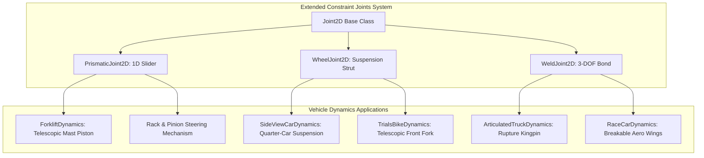
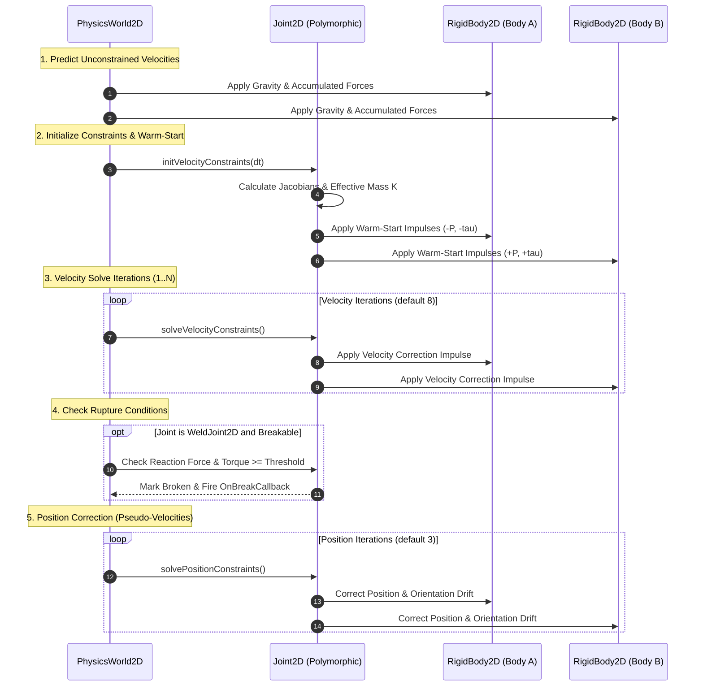
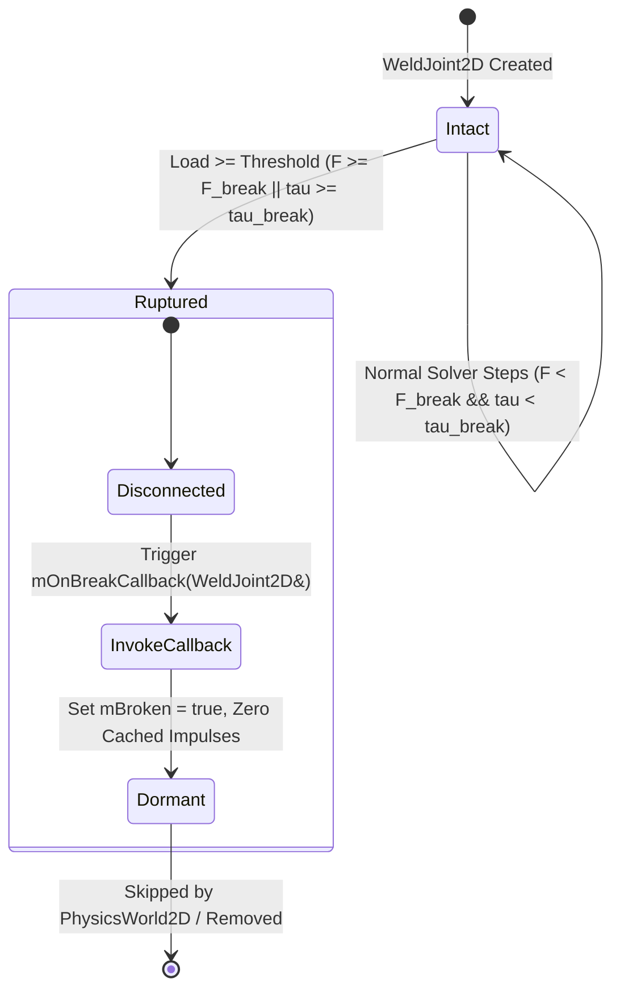

# Extended Constraint Joints (`PrismaticJoint2D`, `WheelJoint2D`, `WeldJoint2D`): C++17 Implementation Plan

## 1. Executive Summary & Scope

### 1.1 Objective & Context
This specification provides the mathematical derivations, architectural design, C++17 class interfaces, and implementation roadmap for **Extended Constraint Joints** as proposed in Section 4.7 of [docs/ProposedFeatures.md](ProposedFeatures.md).

The multi-body physics engine in `VehicleSimCore` currently implements 2-DOF pin hinges ([RevoluteJoint2D](../libs/VehicleSimCore/physics/RevoluteJoint2D.h)) and 1-DOF scalar distance rods ([DistanceJoint2D](../libs/VehicleSimCore/physics/DistanceJoint2D.h)). While sufficient for basic trailer couplings and simple pendulum arms, advanced vehicular mechanisms and machinery require specialized mechanical constraints:
1. **`PrismaticJoint2D` (Slider / Piston)**: Linear 1D slider constraining relative rotation to zero and lateral drift to zero, permitting relative translation strictly along a specified line of action. Essential for hydraulic lifts, steering racks, telescopic cranes, and the forklift mast in [ForkliftDynamics](../libs/VehicleSimCore/dynamics/ForkliftDynamics.h).
2. **`WheelJoint2D` (Suspension Strut)**: Linear 1D suspension travel along a strut axis coupled to an unconstrained 1-DOF rotating wheel hub. Combines soft spring-damper compliance (frequency and damping ratio), travel bump/rebound limits, and rotational drive/braking torque. Replaces rigid pin approximations in [SideViewCarDynamics](../libs/VehicleSimCore/dynamics/SideViewCarDynamics.h) and [TrialsBikeDynamics](../libs/VehicleSimCore/dynamics/TrialsBikeDynamics.h) with authentic chassis-to-wheel suspension dynamics.
3. **`WeldJoint2D` (Fixed Structural Bond with Rupture)**: Complete 3-DOF lock (2 translational, 1 rotational) welding two rigid bodies into a unified structure, with optional harmonic elasticity and breakable failure thresholds ($F_{\text{break}}, \tau_{\text{break}}, J_{\text{break}}$). Enables breakable vehicle components (spoilers, trailers tearing off hitches, deformable crumple segments) and modular chassis fabrication.

```
  ASCII Diagram: Mechanical Joint Topologies

  1. PrismaticJoint2D (Linear Slider / Telescopic Mast)
          +-----------------------+
          |      RigidBody A      |
          |       (Chassis)       |
          +-----------*-----------+
                      |
                      |  Translation Axis (u)
                      v  [Limits: s_min .. s_max | Motor: v_target]
                .-----+-----.
                | RigidBody |  <-- Relative Rotation Locked (theta_B = theta_A)
                |     B     |  <-- Perpendicular Drift Locked (d . u_perp = 0)
                '-----------'

  2. WheelJoint2D (Suspension Strut + Free Hub)
          +-----------------------+
          |      RigidBody A      |
          |       (Chassis)       |
          +-----------*-----------+
                      |
                      |  Strut Axis (u)
                      v  [Soft Spring k_s, Damper c_s, Limits]
                     ---
                    ( O )      <-- Unconstrained 1-DOF Rotation (Wheel Hub B)
                     ---           Optional Motor Torque (tau_drive / tau_regen)

  3. WeldJoint2D (Rigid / Elastic Bond with Rupture Mechanics)
          +-----------------------+  Weld Interface (Anchor A == Anchor B)
          |      RigidBody A      *================* +-----------------------+
          |       (Vehicle)       |  Locked 3-DOF  | |    RigidBody B (Wing) |
          +-----------------------+  [J > J_break] | +-----------------------+
                                           |
                                           v
                              Fracture / Rupture Event!
```



### 1.2 Core Architectural Requirements
1. **Zero Dynamic Allocation**:
   - All solver mass matrices, projected arms, limit state flags, and warm-starting impulse caches reside directly inside class members.
   - Zero heap allocations (`malloc`, `new`) during `initVelocityConstraints`, `solveVelocityConstraints`, and `solvePositionConstraints`.
2. **Strict IEEE 754 Determinism**:
   - Fully deterministic across Linux (GCC, Clang) and Windows (MSVC, Clang).
   - Zero OS-specific headers (`windows.h`, `unistd.h`), zero indeterminate floating-point reassociations.
3. **Symplectic Integration & Sequential Impulse Compatibility**:
   - Directly executes within the 3-phase constraint solver loop in [PhysicsWorld2D](../libs/VehicleSimCore/physics/PhysicsWorld2D.h).
   - Warm-starting impulse caching across consecutive simulation steps ensures convergence within 4 to 8 velocity iterations.
4. **Safety & Standards Compliance**:
   - Conforms strictly to **MISRA C++:2023** and **SEI CERT C++**.
   - All methods and member variables explicitly initialized with `{}`.
   - All query and calculation methods decorated with `[[nodiscard]]`.
   - All function identifiers strictly less than 30 characters.
   - Full Doxygen API documentation (`/// @brief`, `@details`, `@param`, `@return`).

---

## 2. High-Level Architecture & Component Decomposition

### 2.1 File Organization and Co-Location
All header and implementation files are co-located in `libs/VehicleSimCore/physics/`:

```
libs/VehicleSimCore/
└── physics/
    ├── Joint2D.h                  [MODIFIED] - Extend JointType enum and breakable lifecycle query
    ├── Joint2D.cpp                [MODIFIED] - Implement default base virtual methods
    ├── PrismaticJoint2D.h         [NEW]      - 1D slider joint configuration and interface
    ├── PrismaticJoint2D.cpp       [NEW]      - 2x2 perpendicular+angular block solver, axial limit/motor
    ├── WheelJoint2D.h             [NEW]      - Suspension strut configuration and interface
    ├── WheelJoint2D.cpp           [NEW]      - Soft spring-damper regularization and hub motor solver
    ├── WeldJoint2D.h              [NEW]      - Fixed 3-DOF structural bond configuration and interface
    ├── WeldJoint2D.cpp            [NEW]      - 3x3 block solver, compliance, and rupture detection
    ├── PhysicsWorld2D.h           [MODIFIED] - Ruptured joint filtering and lifecycle management
    └── PhysicsWorld2D.cpp         [MODIFIED] - Bypass broken joints in velocity and position stages
```

### 2.2 Class Hierarchy & Solver Lifecycle



---

## 3. Mathematical & Algorithmic Formulations

### 3.1 Kinematics Notations and Common Frames
Let:
- Body $A$: Position $\mathbf{x}_A \in \mathbb{R}^2$, orientation angle $\theta_A \in [-\pi, \pi)$, linear velocity $\mathbf{v}_A$, angular velocity $\omega_A$, mass $m_A$, moment of inertia $I_A$, inverse mass $m_A^{-1}$, inverse inertia $I_A^{-1}$.
- Body $B$: Position $\mathbf{x}_B \in \mathbb{R}^2$, orientation angle $\theta_B \in [-\pi, \pi)$, linear velocity $\mathbf{v}_B$, angular velocity $\omega_B$, mass $m_B$, moment of inertia $I_B$, inverse mass $m_B^{-1}$, inverse inertia $I_B^{-1}$.
- 2D rotation matrix:
  $$\mathbf{R}(\theta) = \begin{bmatrix} \cos\theta & -\sin\theta \\ \sin\theta & \cos\theta \end{bmatrix}$$
- 2D cross-product skew operation:
  $$\mathbf{a} \times b = \begin{bmatrix} a_y b \\ -a_x b \end{bmatrix}, \quad a \times \mathbf{b} = \begin{bmatrix} -a b_y \\ a b_x \end{bmatrix}, \quad \mathbf{a} \times \mathbf{b} = a_x b_y - a_y b_x$$
- Local anchor offsets $\mathbf{r}_A^{\text{local}}, \mathbf{r}_B^{\text{local}}$.
- World anchor offsets: $\mathbf{r}_A = \mathbf{R}_A \mathbf{r}_A^{\text{local}}$, $\mathbf{r}_B = \mathbf{R}_B \mathbf{r}_B^{\text{local}}$.
- World anchor positions: $\mathbf{p}_A = \mathbf{x}_A + \mathbf{r}_A$, $\mathbf{p}_B = \mathbf{x}_B + \mathbf{r}_B$.
- Anchor separation vector: $\mathbf{d} = \mathbf{p}_B - \mathbf{p}_A = \mathbf{x}_B + \mathbf{r}_B - \mathbf{x}_A - \mathbf{r}_A$.

---

### 3.2 `PrismaticJoint2D` (Slider / Piston)

#### 3.2.1 Geometric Constraints
A prismatic joint fixes the line of translation in the local coordinate frame of Body $A$.
- Let unit axis in Body $A$ local frame be $\mathbf{u}_A^{\text{local}}$.
- In world coordinates:
  $$\mathbf{a}_1 = \mathbf{R}_A \mathbf{u}_A^{\text{local}} \quad (\text{axis of translation})$$
  $$\mathbf{a}_2 = \mathbf{a}_1^\perp = \begin{bmatrix} -a_{1,y} \\ a_{1,x} \end{bmatrix} \quad (\text{perpendicular constraint axis})$$

The 2 rigid constraints enforced by the joint are:
1. **Perpendicular translation lock**:
   $$C_1 = \mathbf{d} \cdot \mathbf{a}_2 = (\mathbf{p}_B - \mathbf{p}_A) \cdot \mathbf{a}_2 = 0$$
2. **Relative orientation lock**:
   $$C_2 = \theta_B - \theta_A - \theta_{\text{ref}} = 0$$

The 1 unconstrained translational degree of freedom along $\mathbf{a}_1$ is:
$$s = \mathbf{d} \cdot \mathbf{a}_1$$

#### 3.2.2 Velocity Constraint Equations and Effective Mass
Differentiating $C_1$ with respect to time $t$:
$$\dot{C}_1 = \mathbf{a}_2 \cdot (\dot{\mathbf{p}}_B - \dot{\mathbf{p}}_A) + \dot{\mathbf{a}}_2 \cdot \mathbf{d}$$
Since $\dot{\mathbf{a}}_2 = \omega_A \times \mathbf{a}_2 = \omega_A \begin{bmatrix} -a_{2,y} \\ a_{2,x} \end{bmatrix} = -\omega_A \mathbf{a}_1$, and substituting $\dot{\mathbf{p}}_A = \mathbf{v}_A + \omega_A \times \mathbf{r}_A$, $\dot{\mathbf{p}}_B = \mathbf{v}_B + \omega_B \times \mathbf{r}_B$:
$$\dot{C}_1 = \mathbf{a}_2 \cdot (\mathbf{v}_B - \mathbf{v}_A) + (\mathbf{r}_B \times \mathbf{a}_2)\omega_B - ((\mathbf{r}_A + \mathbf{d}) \times \mathbf{a}_2)\omega_A$$
Let:
$$s_{A2} = (\mathbf{r}_A + \mathbf{d}) \times \mathbf{a}_2 = (r_{A,x} + d_x) a_{2,y} - (r_{A,y} + d_y) a_{2,x}$$
$$s_{B2} = \mathbf{r}_B \times \mathbf{a}_2 = r_{B,x} a_{2,y} - r_{B,y} a_{2,x}$$

Differentiating $C_2$:
$$\dot{C}_2 = \omega_B - \omega_A$$

In matrix form $\mathbf{J} \mathbf{v} = \mathbf{0}$:
$$\mathbf{J}_{2\times 6} = \begin{bmatrix} -\mathbf{a}_2^T & -s_{A2} & \mathbf{a}_2^T & s_{B2} \\ \mathbf{0}^T & -1 & \mathbf{0}^T & 1 \end{bmatrix}, \quad \mathbf{v} = \begin{bmatrix} \mathbf{v}_A \\ \omega_A \\ \mathbf{v}_B \\ \omega_B \end{bmatrix}$$

The $2 \times 2$ effective mass matrix $\mathbf{K} = \mathbf{J} \mathbf{M}^{-1} \mathbf{J}^T$ is:
$$\mathbf{K}_{2\times 2} = \begin{bmatrix} K_{11} & K_{12} \\ K_{21} & K_{22} \end{bmatrix}$$
where:
$$K_{11} = m_A^{-1} + m_B^{-1} + I_A^{-1} s_{A2}^2 + I_B^{-1} s_{B2}^2$$
$$K_{12} = K_{21} = I_A^{-1} s_{A2} + I_B^{-1} s_{B2}$$
$$K_{22} = I_A^{-1} + I_B^{-1}$$

Analytical inverse $\mathbf{M}_{\text{eff}} = \mathbf{K}^{-1}$:
$$\det(\mathbf{K}) = K_{11} K_{22} - K_{12}^2$$
$$\mathbf{M}_{\text{eff}} = \frac{1}{\det(\mathbf{K})} \begin{bmatrix} K_{22} & -K_{12} \\ -K_{12} & K_{11} \end{bmatrix}$$
If $\det(\mathbf{K}) < 10^{-12}$, the matrix is singular (e.g. both bodies static/infinite inertia), and impulses are zeroed.

#### 3.2.3 Axial Limits & Motor Solvers
Along the translation axis $\mathbf{a}_1$:
$$\dot{s} = \mathbf{a}_1 \cdot (\mathbf{v}_B - \mathbf{v}_A) + s_{B1}\omega_B - s_{A1}\omega_A$$
where:
$$s_{A1} = (\mathbf{r}_A + \mathbf{d}) \times \mathbf{a}_1$$
$$s_{B1} = \mathbf{r}_B \times \mathbf{a}_1$$
The scalar axial effective mass is:
$$K_{\text{axial}} = m_A^{-1} + m_B^{-1} + I_A^{-1} s_{A1}^2 + I_B^{-1} s_{B1}^2, \quad M_{\text{axial}} = \frac{1}{K_{\text{axial}}}$$

1. **Powered Motor**:
   - Commanded velocity $v_{\text{target}}$, maximum force $F_{\text{max}}$.
   - Relative velocity error: $\Delta v = \dot{s} - v_{\text{target}}$.
   - Correction impulse: $\Delta \lambda_{\text{motor}} = -M_{\text{axial}} \Delta v$.
   - Clamped with accumulated motor impulse $\lambda_{\text{motor}} \in [-F_{\text{max}} \Delta t, F_{\text{max}} \Delta t]$.
2. **Translation Limits**:
   - $s \le s_{\text{lower}}$: Lower limit active. Impulses must be non-negative ($\lambda_{\text{limit}} \ge 0$).
   - $s \ge s_{\text{upper}}$: Upper limit active. Impulses must be non-positive ($\lambda_{\text{limit}} \le 0$).
   - $s_{\text{lower}} == s_{\text{upper}}$: Locked slider (bilateral impulse).

#### 3.2.4 Warm-Starting and Position Stabilization
- At step start, accumulated impulses $\boldsymbol{\lambda}_{2\text{D}} = [\lambda_{\perp}, \lambda_{\text{ang}}]^T$ and $\lambda_{\text{axial}} = \lambda_{\text{motor}} + \lambda_{\text{limit}}$ are applied to both bodies:
  $$\mathbf{P} = \lambda_{\perp} \mathbf{a}_2 + \lambda_{\text{axial}} \mathbf{a}_1$$
  $$\mathbf{v}_A \mathrel{-}= m_A^{-1} \mathbf{P}, \quad \omega_A \mathrel{-}= I_A^{-1} ((\mathbf{r}_A + \mathbf{d}) \times \mathbf{P} + \lambda_{\text{ang}})$$
  $$\mathbf{v}_B \mathrel{+}= m_B^{-1} \mathbf{P}, \quad \omega_B \mathrel{+}= I_B^{-1} (\mathbf{r}_B \times \mathbf{P} + \lambda_{\text{ang}})$$
- Position constraint error $C_1, C_2$ is solved during `solvePositionConstraints()` using Baumgarte position projections clamped to maximum linear slop ($0.005\,\text{m}$) and maximum angular slop ($0.035\,\text{rad} \approx 2^\circ$).

---

### 3.3 `WheelJoint2D` (Suspension Strut)

#### 3.3.1 Geometric Constraints & Suspension Coordinates
`WheelJoint2D` connects a chassis (Body $A$) to a wheel hub (Body $B$):
- Constrains lateral translation perpendicular to the strut axis:
  $$C_{\perp} = \mathbf{d} \cdot \mathbf{a}_2 = 0$$
- Allows translational displacement along the strut axis $\mathbf{a}_1$:
  $$s = \mathbf{d} \cdot \mathbf{a}_1$$
- Rotational degree of freedom between chassis and hub is completely free ($\theta_B - \theta_A$ is unconstrained).

```
  ASCII Diagram: WheelJoint2D Constraint Vector Space

                y_world
                   ^
                   |
                   |               [ Chassis Body A ]
                   |                    Anchor A
                   |                       *
                   |                       | \
                   |       Suspension Axis |  \  d = pB - pA
                   |                 a1    |   \
                   |                       v    v
                   |                   - - - - - - * Anchor B
                   |                  |  Wheel Hub  | (Body B)
                   |                   - - - - - -
                   |                   <--------->
                   |                    C_perp = d . a2 = 0
                   +----------------------------------------------------> x_world
```

#### 3.3.2 Regularized Soft Spring-Damper Suspension
Rather than simulating stiff penalty forces that cause numerical instability under large $\Delta t$, the suspension spring and damper are formulated as a regularized implicit velocity constraint (soft constraint theory).

Given user-specified natural frequency $f_0\,[\text{Hz}]$ and damping ratio $\zeta$:
$$\omega_n = 2\pi f_0$$
The effective mass along the suspension axis is:
$$m_{\text{eff}} = \frac{1}{K_{\text{axial}}} = \frac{1}{m_A^{-1} + m_B^{-1} + I_A^{-1} s_{A1}^2 + I_B^{-1} s_{B1}^2}$$
Spring constant $k$ and damping constant $c$:
$$k = m_{\text{eff}} \omega_n^2, \quad c = 2 m_{\text{eff}} \zeta \omega_n$$
Soft constraint regularization parameters:
$$\gamma = \frac{1}{\Delta t (c + \Delta t k)}, \quad \beta = \frac{\Delta t k}{c + \Delta t k}$$
Effective mass modification:
$$\tilde{K}_{\text{axial}} = K_{\text{axial}} + \gamma, \quad \tilde{M}_{\text{axial}} = \frac{1}{\tilde{K}_{\text{axial}}}$$
Velocity bias term incorporating rest-length spring displacement error:
$$v_{\text{bias}} = \frac{\beta}{\Delta t} (s - s_{\text{target}})$$

#### 3.3.3 Suspension Velocity Constraint Solve
In each velocity iteration:
1. **Perpendicular Lock**:
   $$\Delta v_{\perp} = \mathbf{a}_2 \cdot (\mathbf{v}_B - \mathbf{v}_A) + s_{B2}\omega_B - s_{A2}\omega_A$$
   $$\lambda_{\perp} = -M_{\perp} \Delta v_{\perp}$$
   Applied symmetrically to both bodies.
2. **Axial Spring-Damper Impulse**:
   $$\Delta v_{\text{axial}} = \mathbf{a}_1 \cdot (\mathbf{v}_B - \mathbf{v}_A) + s_{B1}\omega_B - s_{A1}\omega_A$$
   $$\Delta \lambda_{\text{axial}} = -\tilde{M}_{\text{axial}} (\Delta v_{\text{axial}} + v_{\text{bias}} + \gamma \lambda_{\text{axial}})$$
   $$\lambda_{\text{axial}} \mathrel{+}= \Delta \lambda_{\text{axial}}$$
   Enforces suspension limits if $s \le s_{\text{lower}}$ (rebound clamp) or $s \ge s_{\text{upper}}$ (bump clamp).
3. **Optional Rotational Drive/Regen Motor**:
   $$\Delta \omega = \omega_B - \omega_A - \omega_{\text{motor}}$$
   $$\Delta \lambda_{\text{motor}} = -\frac{\Delta \omega}{I_A^{-1} + I_B^{-1}}$$
   Clamped to $[-\tau_{\text{max}}\Delta t, \tau_{\text{max}}\Delta t]$.

---

### 3.4 `WeldJoint2D` (Fixed Structural Bond with Rupture)

#### 3.4.1 Complete 3-DOF Rigid Lock
`WeldJoint2D` locks all 3 planar degrees of freedom between two bodies:
1. 2D translational coincidence:
   $$\mathbf{C}_{\text{point}} = \mathbf{p}_B - \mathbf{p}_A = \mathbf{x}_B + \mathbf{r}_B - \mathbf{x}_A - \mathbf{r}_A = \mathbf{0}$$
2. Relative orientation lock:
   $$C_{\text{angle}} = \theta_B - \theta_A - \theta_{\text{ref}} = 0$$

#### 3.4.2 Coupled $3 \times 3$ Effective Mass Matrix
Velocity constraint vector $\mathbf{J} \mathbf{v} = \mathbf{0}$:
$$\dot{\mathbf{C}} = \begin{bmatrix} \mathbf{v}_B + \omega_B \times \mathbf{r}_B - \mathbf{v}_A - \omega_A \times \mathbf{r}_A \\ \omega_B - \omega_A \end{bmatrix} = \mathbf{0}$$

Jacobian:
$$\mathbf{J}_{3\times 6} = \begin{bmatrix} -\mathbf{I}_2 & [\mathbf{r}_A]_\times & \mathbf{I}_2 & -[\mathbf{r}_B]_\times \\ \mathbf{0}^T & -1 & \mathbf{0}^T & 1 \end{bmatrix}$$
where in 2D, $[\mathbf{r}]_\times = \begin{bmatrix} r_y \\ -r_x \end{bmatrix}$.

The $3 \times 3$ symmetric positive definite effective mass matrix $\mathbf{K} = \mathbf{J} \mathbf{M}^{-1} \mathbf{J}^T$:
$$\mathbf{K} = \begin{bmatrix} \mathbf{K}_{11} & \mathbf{K}_{12} \\ \mathbf{K}_{12}^T & K_{22} \end{bmatrix}$$
where:
$$\mathbf{K}_{11} = (m_A^{-1} + m_B^{-1})\mathbf{I}_2 + I_A^{-1} \begin{bmatrix} r_{A,y}^2 & -r_{A,x}r_{A,y} \\ -r_{A,x}r_{A,y} & r_{A,x}^2 \end{bmatrix} + I_B^{-1} \begin{bmatrix} r_{B,y}^2 & -r_{B,x}r_{B,y} \\ -r_{B,x}r_{B,y} & r_{B,x}^2 \end{bmatrix} \quad (2\times 2)$$
$$\mathbf{K}_{12} = -I_A^{-1} \begin{bmatrix} -r_{A,y} \\ r_{A,x} \end{bmatrix} - I_B^{-1} \begin{bmatrix} -r_{B,y} \\ r_{B,x} \end{bmatrix} \quad (2\times 1)$$
$$K_{22} = I_A^{-1} + I_B^{-1} \quad (1\times 1)$$

The $3 \times 3$ system $\mathbf{K} \boldsymbol{\lambda} = -\mathbf{C}$ is solved directly using block Gaussian elimination or Cramer's rule in closed form with IEEE 754 branchless arithmetic.

#### 3.4.3 Breakable Failure Metrics and Rupture Mechanics
During simulation, `WeldJoint2D` tracks accumulated constraint impulses $\mathbf{P}_{\text{linear}}$ and $L_{\text{angular}}$.
Reaction force and reaction torque over step $\Delta t$:
$$\mathbf{F}_{\text{reaction}} = \frac{\mathbf{P}_{\text{linear}}}{\Delta t}, \quad \tau_{\text{reaction}} = \frac{L_{\text{angular}}}{\Delta t}$$

Rupture occurs if any failure criterion is met:
1. **Force Threshold**: $\|\mathbf{F}_{\text{reaction}}\| \ge F_{\text{break}}$
2. **Torque Threshold**: $|\tau_{\text{reaction}}| \ge \tau_{\text{break}}$
3. **Combined Elliptical Failure**:
   $$\left(\frac{\|\mathbf{F}_{\text{reaction}}\|}{F_{\text{break}}}\right)^2 + \left(\frac{|\tau_{\text{reaction}}|}{\tau_{\text{break}}}\right)^2 \ge 1.0$$



When ruptured:
1. `mBroken` is set to `true`.
2. Impulses are zeroed: $\mathbf{P}_{\text{linear}} = \mathbf{0}$, $L_{\text{angular}} = 0$.
3. Optional user callback `mOnBreakCallback(*this)` is invoked synchronously.
4. Subsequent calls to `initVelocityConstraints`, `solveVelocityConstraints`, and `solvePositionConstraints` immediately return.

---

## 4. Detailed C++17 Class & Interface Specifications

### 4.1 Modifications to `Joint2D.h`

```cpp
#pragma once

#include "libs/VehicleSimCore/math/Vec2.h"

namespace vehicle_sim::physics {

class RigidBody2D;

/// @enum JointType
/// @brief Classification of physical 2D multi-body joint constraints.
enum class JointType {
    Distance,  ///< Distance constraint maintaining target anchor separation.
    Revolute,  ///< Pin/hinge joint constraining translational anchors with optional limits and motor.
    Prismatic, ///< Linear slider joint constraining relative rotation and lateral translation.
    Wheel,     ///< Suspension strut joint with soft compliance, limits, and rotating wheel hub.
    Weld       ///< 3-DOF fixed structural bond with optional elasticity and rupture mechanics.
};

/// @struct JointConfig
/// @brief Base configuration parameters common to all 2D multi-body joints.
struct JointConfig {
    RigidBody2D* bodyA { nullptr }; ///< Pointer to first constrained body (non-owning).
    RigidBody2D* bodyB { nullptr }; ///< Pointer to second constrained body (non-owning).
    math::Vec2 localAnchorA { 0.0, 0.0 }; ///< Anchor offset in body A local coordinates.
    math::Vec2 localAnchorB { 0.0, 0.0 }; ///< Anchor offset in body B local coordinates.
    bool collideConnected { false }; ///< True if linked bodies may collide against each other.
};

/// @class Joint2D
/// @brief Abstract base class for 2D multi-body rigid body constraints.
class Joint2D {
public:
    explicit Joint2D(JointType type, const JointConfig& config) noexcept;
    virtual ~Joint2D() noexcept = default;

    Joint2D(const Joint2D&) = delete;
    Joint2D& operator=(const Joint2D&) = delete;
    Joint2D(Joint2D&&) noexcept = default;
    Joint2D& operator=(Joint2D&&) noexcept = default;

    [[nodiscard]] JointType getType() const noexcept;
    [[nodiscard]] RigidBody2D* getBodyA() const noexcept;
    [[nodiscard]] RigidBody2D* getBodyB() const noexcept;
    [[nodiscard]] math::Vec2 getLocalAnchorA() const noexcept;
    [[nodiscard]] math::Vec2 getLocalAnchorB() const noexcept;
    [[nodiscard]] math::Vec2 getWorldAnchorA() const noexcept;
    [[nodiscard]] math::Vec2 getWorldAnchorB() const noexcept;
    [[nodiscard]] bool getCollideConnected() const noexcept;

    /// @brief Queries whether the joint is currently broken/ruptured.
    /// @return True if joint is broken and inactive.
    [[nodiscard]] virtual bool isBroken() const noexcept { return false; }

    virtual void initVelocityConstraints(double dt) noexcept = 0;
    virtual void solveVelocityConstraints() noexcept = 0;
    [[nodiscard]] virtual bool solvePositionConstraints() noexcept = 0;
    [[nodiscard]] virtual math::Vec2 getReactionForce(double invDt) const noexcept = 0;
    [[nodiscard]] virtual double getReactionTorque(double invDt) const noexcept = 0;

protected:
    JointType mType { JointType::Distance };
    RigidBody2D* mBodyA { nullptr };
    RigidBody2D* mBodyB { nullptr };
    math::Vec2 mLocalAnchorA { 0.0, 0.0 };
    math::Vec2 mLocalAnchorB { 0.0, 0.0 };
    bool mCollideConnected { false };
};

} // namespace vehicle_sim::physics
```

---

### 4.2 `PrismaticJoint2D.h`

```cpp
#pragma once

#include "Joint2D.h"
#include "libs/VehicleSimCore/math/Mat2.h"
#include "libs/VehicleSimCore/math/Vec2.h"

namespace vehicle_sim::physics {

/// @struct PrismaticJointConfig
/// @brief Configuration parameters for PrismaticJoint2D.
struct PrismaticJointConfig : public JointConfig {
    math::Vec2 localAxisA { 1.0, 0.0 }; ///< Linear translation axis in body A local coordinates.
    double referenceAngle { 0.0 }; ///< Target relative body orientation offset (thetaB - thetaA).
    bool enableLimit { false }; ///< True to enforce translation limits.
    double lowerTranslation { 0.0 }; ///< Minimum allowable translation in meters along axis.
    double upperTranslation { 0.0 }; ///< Maximum allowable translation in meters along axis.
    bool enableMotor { false }; ///< True to activate continuous linear motor.
    double motorSpeed { 0.0 }; ///< Target linear velocity in m/s along axis.
    double maxMotorForce { 0.0 }; ///< Peak motor push/pull force capacity in Newtons.
};

/// @class PrismaticJoint2D
/// @brief Linear slider joint constraining relative rotation and lateral translation.
/// @details Allows 1-DOF linear motion along a specified axis anchored in body A.
class PrismaticJoint2D final : public Joint2D {
public:
    /// @brief Parameterized constructor initializing prismatic joint.
    /// @param[in] config Prismatic joint configuration.
    explicit PrismaticJoint2D(const PrismaticJointConfig& config) noexcept;

    /// @brief Computes current linear translation along joint axis in meters.
    /// @return Current translation in meters.
    [[nodiscard]] double getJointTranslation() const noexcept;

    /// @brief Computes current linear relative velocity along joint axis in m/s.
    /// @return Current relative speed in m/s.
    [[nodiscard]] double getJointSpeed() const noexcept;

    /// @brief Queries whether translation limits are active.
    /// @return True if limits are enforced.
    [[nodiscard]] bool isLimitEnabled() const noexcept;

    /// @brief Enables or disables translation limits.
    /// @param[in] flag True to enable limits.
    void enableLimit(bool flag) noexcept;

    /// @brief Gets lower translation limit in meters.
    /// @return Lower limit in meters.
    [[nodiscard]] double getLowerLimit() const noexcept;

    /// @brief Gets upper translation limit in meters.
    /// @return Upper limit in meters.
    [[nodiscard]] double getUpperLimit() const noexcept;

    /// @brief Sets lower and upper translation limits in meters.
    /// @param[in] lower Lower limit in meters.
    /// @param[in] upper Upper limit in meters.
    void setLimits(double lower, double upper) noexcept;

    /// @brief Queries whether linear motor is active.
    /// @return True if motor is enabled.
    [[nodiscard]] bool isMotorEnabled() const noexcept;

    /// @brief Enables or disables linear motor.
    /// @param[in] flag True to enable motor.
    void enableMotor(bool flag) noexcept;

    /// @brief Gets commanded motor speed in m/s.
    /// @return Target speed in m/s.
    [[nodiscard]] double getMotorSpeed() const noexcept;

    /// @brief Sets commanded motor speed in m/s.
    /// @param[in] speed Target speed in m/s.
    void setMotorSpeed(double speed) noexcept;

    /// @brief Gets maximum motor force capacity in Newtons.
    /// @return Maximum force in N.
    [[nodiscard]] double getMaxMotorForce() const noexcept;

    /// @brief Sets maximum motor force capacity in Newtons.
    /// @param[in] force Maximum force in N.
    void setMaxMotorForce(double force) noexcept;

    /// @brief Computes current motor force exerted along axis in Newtons.
    /// @param[in] invDt Inverse simulation timestep (1.0 / dt).
    /// @return Motor force in N.
    [[nodiscard]] double getMotorForce(double invDt) const noexcept;

    void initVelocityConstraints(double dt) noexcept override;
    void solveVelocityConstraints() noexcept override;
    [[nodiscard]] bool solvePositionConstraints() noexcept override;
    [[nodiscard]] math::Vec2 getReactionForce(double invDt) const noexcept override;
    [[nodiscard]] double getReactionTorque(double invDt) const noexcept override;

private:
    math::Vec2 mLocalAxisA { 1.0, 0.0 };
    double mReferenceAngle { 0.0 };
    bool mEnableLimit { false };
    double mLowerTranslation { 0.0 };
    double mUpperTranslation { 0.0 };
    bool mEnableMotor { false };
    double mMotorSpeed { 0.0 };
    double mMaxMotorForce { 0.0 };

    // Solver caches
    math::Vec2 mAxis { 1.0, 0.0 };
    math::Vec2 mPerpAxis { 0.0, 1.0 };
    math::Vec2 mArmA { 0.0, 0.0 };
    math::Vec2 mArmB { 0.0, 0.0 };
    double mArmA1 { 0.0 };
    double mArmB1 { 0.0 };
    double mArmA2 { 0.0 };
    double mArmB2 { 0.0 };
    math::Mat2 mEffectiveMass {};
    double mAxialMass { 0.0 };
    math::Vec2 mImpulse { 0.0, 0.0 };
    double mMotorImpulse { 0.0 };
    double mLimitImpulse { 0.0 };
    double mDt { 0.0 };
};

} // namespace vehicle_sim::physics
```

---

### 4.3 `WheelJoint2D.h`

```cpp
#pragma once

#include "Joint2D.h"
#include "libs/VehicleSimCore/math/Vec2.h"

namespace vehicle_sim::physics {

/// @struct WheelJointConfig
/// @brief Configuration parameters for WheelJoint2D.
struct WheelJointConfig : public JointConfig {
    math::Vec2 localAxisA { 0.0, 1.0 }; ///< Suspension strut axis in chassis local coordinates.
    double frequencyHz { 4.0 }; ///< Suspension harmonic oscillation frequency in Hz.
    double dampingRatio { 0.7 }; ///< Suspension damping ratio [0 = undamped, 1 = critical].
    bool enableLimit { false }; ///< True to enforce strut bump/droop travel limits.
    double lowerTranslation { -0.1 }; ///< Minimum rebound / droop limit in meters.
    double upperTranslation { 0.1 }; ///< Maximum compression / bump limit in meters.
    bool enableMotor { false }; ///< True to activate wheel hub drive/brake motor.
    double motorSpeed { 0.0 }; ///< Target wheel hub rotational speed in rad/s.
    double maxMotorTorque { 0.0 }; ///< Maximum hub motor torque in N*m.
};

/// @class WheelJoint2D
/// @brief Suspension strut joint constraining lateral drift and providing soft axial compliance.
/// @details Allows 1-DOF linear suspension travel and 1-DOF free wheel hub rotation.
class WheelJoint2D final : public Joint2D {
public:
    /// @brief Parameterized constructor initializing wheel joint.
    /// @param[in] config Wheel joint configuration.
    explicit WheelJoint2D(const WheelJointConfig& config) noexcept;

    /// @brief Computes current linear suspension deflection in meters.
    /// @return Current translation in meters along strut axis.
    [[nodiscard]] double getJointTranslation() const noexcept;

    /// @brief Computes linear suspension velocity in m/s.
    /// @return Relative speed along strut axis in m/s.
    [[nodiscard]] double getJointLinearSpeed() const noexcept;

    /// @brief Computes wheel hub rotational speed in rad/s.
    /// @return Wheel angular velocity in rad/s.
    [[nodiscard]] double getJointAngularSpeed() const noexcept;

    /// @brief Gets suspension oscillation frequency.
    /// @return Frequency in Hz.
    [[nodiscard]] double getFrequencyHz() const noexcept;

    /// @brief Sets suspension oscillation frequency.
    /// @param[in] hz Frequency in Hz.
    void setFrequencyHz(double hz) noexcept;

    /// @brief Gets suspension damping ratio.
    /// @return Damping ratio.
    [[nodiscard]] double getDampingRatio() const noexcept;

    /// @brief Sets suspension damping ratio.
    /// @param[in] ratio Damping ratio.
    void setDampingRatio(double ratio) noexcept;

    /// @brief Queries whether suspension limits are active.
    /// @return True if travel limits are enforced.
    [[nodiscard]] bool isLimitEnabled() const noexcept;

    /// @brief Enables or disables travel limits.
    /// @param[in] flag True to enable limits.
    void enableLimit(bool flag) noexcept;

    /// @brief Gets lower travel limit in meters.
    /// @return Lower limit in meters.
    [[nodiscard]] double getLowerLimit() const noexcept;

    /// @brief Gets upper travel limit in meters.
    /// @return Upper limit in meters.
    [[nodiscard]] double getUpperLimit() const noexcept;

    /// @brief Sets travel limits in meters.
    /// @param[in] lower Lower limit in meters.
    /// @param[in] upper Upper limit in meters.
    void setLimits(double lower, double upper) noexcept;

    /// @brief Queries whether wheel motor is active.
    /// @return True if hub motor is enabled.
    [[nodiscard]] bool isMotorEnabled() const noexcept;

    /// @brief Enables or disables wheel motor.
    /// @param[in] flag True to enable motor.
    void enableMotor(bool flag) noexcept;

    /// @brief Gets commanded motor speed in rad/s.
    /// @return Target angular speed in rad/s.
    [[nodiscard]] double getMotorSpeed() const noexcept;

    /// @brief Sets commanded motor speed in rad/s.
    /// @param[in] speed Target angular speed in rad/s.
    void setMotorSpeed(double speed) noexcept;

    /// @brief Gets maximum motor torque in N*m.
    /// @return Maximum torque.
    [[nodiscard]] double getMaxMotorTorque() const noexcept;

    /// @brief Sets maximum motor torque in N*m.
    /// @param[in] torque Maximum torque in N*m.
    void setMaxMotorTorque(double torque) noexcept;

    void initVelocityConstraints(double dt) noexcept override;
    void solveVelocityConstraints() noexcept override;
    [[nodiscard]] bool solvePositionConstraints() noexcept override;
    [[nodiscard]] math::Vec2 getReactionForce(double invDt) const noexcept override;
    [[nodiscard]] double getReactionTorque(double invDt) const noexcept override;

private:
    math::Vec2 mLocalAxisA { 0.0, 1.0 };
    double mFrequencyHz { 4.0 };
    double mDampingRatio { 0.7 };
    bool mEnableLimit { false };
    double mLowerTranslation { -0.1 };
    double mUpperTranslation { 0.1 };
    bool mEnableMotor { false };
    double mMotorSpeed { 0.0 };
    double mMaxMotorTorque { 0.0 };

    // Solver caches
    math::Vec2 mAxis { 0.0, 1.0 };
    math::Vec2 mPerpAxis { -1.0, 0.0 };
    math::Vec2 mArmA { 0.0, 0.0 };
    math::Vec2 mArmB { 0.0, 0.0 };
    double mArmA1 { 0.0 };
    double mArmB1 { 0.0 };
    double mArmA2 { 0.0 };
    double mArmB2 { 0.0 };
    double mPerpMass { 0.0 };
    double mAxialMass { 0.0 };
    double mMotorMass { 0.0 };
    double mSpringBias { 0.0 };
    double mGamma { 0.0 };
    double mPerpImpulse { 0.0 };
    double mAxialImpulse { 0.0 };
    double mMotorImpulse { 0.0 };
    double mDt { 0.0 };
};

} // namespace vehicle_sim::physics
```

---

### 4.4 `WeldJoint2D.h`

```cpp
#pragma once

#include <functional>

#include "Joint2D.h"
#include "libs/VehicleSimCore/math/Mat2.h"
#include "libs/VehicleSimCore/math/Vec2.h"

namespace vehicle_sim::physics {

/// @struct WeldJointConfig
/// @brief Configuration parameters for WeldJoint2D.
struct WeldJointConfig : public JointConfig {
    double referenceAngle { 0.0 }; ///< Relative body orientation offset in radians (thetaB - thetaA).
    double frequencyHz { 0.0 }; ///< Soft compliance oscillation frequency in Hz (0 = rigid lock).
    double dampingRatio { 0.0 }; ///< Soft compliance damping ratio [0 = undamped, 1 = critical].
    double breakForce { 0.0 }; ///< Reaction force rupture threshold in Newtons (0 = unbreakable).
    double breakTorque { 0.0 }; ///< Reaction torque rupture threshold in N*m (0 = unbreakable).
};

/// @class WeldJoint2D
/// @brief Fixed 3-DOF structural bond locking 2 translational and 1 rotational DOFs.
/// @details Supports regularized elastic compliance and breakable structural rupture.
class WeldJoint2D final : public Joint2D {
public:
    /// @brief Parameterized constructor initializing weld joint.
    /// @param[in] config Weld joint configuration.
    explicit WeldJoint2D(const WeldJointConfig& config) noexcept;

    /// @brief Gets relative reference angle in radians.
    /// @return Reference angle in radians.
    [[nodiscard]] double getReferenceAngle() const noexcept;

    /// @brief Gets soft compliance frequency.
    /// @return Frequency in Hz.
    [[nodiscard]] double getFrequencyHz() const noexcept;

    /// @brief Sets soft compliance frequency.
    /// @param[in] hz Frequency in Hz (0 for rigid lock).
    void setFrequencyHz(double hz) noexcept;

    /// @brief Gets soft compliance damping ratio.
    /// @return Damping ratio.
    [[nodiscard]] double getDampingRatio() const noexcept;

    /// @brief Sets soft compliance damping ratio.
    /// @param[in] ratio Damping ratio.
    void setDampingRatio(double ratio) noexcept;

    /// @brief Queries whether the weld joint has ruptured.
    /// @return True if broken.
    [[nodiscard]] bool isBroken() const noexcept override;

    /// @brief Gets reaction force rupture threshold in Newtons.
    /// @return Break force in N (0 = unbreakable).
    [[nodiscard]] double getBreakForce() const noexcept;

    /// @brief Sets reaction force rupture threshold in Newtons.
    /// @param[in] force Break force in N (0 = unbreakable).
    void setBreakForce(double force) noexcept;

    /// @brief Gets reaction torque rupture threshold in N*m.
    /// @return Break torque in N*m (0 = unbreakable).
    [[nodiscard]] double getBreakTorque() const noexcept;

    /// @brief Sets reaction torque rupture threshold in N*m.
    /// @param[in] torque Break torque in N*m (0 = unbreakable).
    void setBreakTorque(double torque) noexcept;

    /// @brief Registers a callback invoked upon structural rupture.
    /// @param[in] callback Callable receiving reference to ruptured joint.
    void setOnBreakCallback(std::function<void(WeldJoint2D&)> callback) noexcept;

    void initVelocityConstraints(double dt) noexcept override;
    void solveVelocityConstraints() noexcept override;
    [[nodiscard]] bool solvePositionConstraints() noexcept override;
    [[nodiscard]] math::Vec2 getReactionForce(double invDt) const noexcept override;
    [[nodiscard]] double getReactionTorque(double invDt) const noexcept override;

private:
    double mReferenceAngle { 0.0 };
    double mFrequencyHz { 0.0 };
    double mDampingRatio { 0.0 };
    double mBreakForce { 0.0 };
    double mBreakTorque { 0.0 };
    bool mBroken { false };
    std::function<void(WeldJoint2D&)> mOnBreakCallback {};

    // Solver caches
    math::Vec2 mArmA { 0.0, 0.0 };
    math::Vec2 mArmB { 0.0, 0.0 };
    math::Mat2 mMassK11 {};
    math::Vec2 mMassK12 { 0.0, 0.0 };
    double mMassK22 { 0.0 };
    math::Vec2 mLinearImpulse { 0.0, 0.0 };
    double mAngularImpulse { 0.0 };
    double mBias { 0.0 };
    double mGamma { 0.0 };
    double mDt { 0.0 };
};

} // namespace vehicle_sim::physics
```

---

## 5. Step-by-Step Implementation Roadmap & Verification Gates

### Phase 1: Core Foundation & Base Class Expansion
- **Task 1.1**: Update `libs/VehicleSimCore/physics/Joint2D.h` and `Joint2D.cpp`.
  - Add `Prismatic`, `Wheel`, and `Weld` to `enum class JointType`.
  - Add `virtual bool isBroken() const noexcept { return false; }` to `Joint2D`.
- **Task 1.2**: Update `libs/VehicleSimCore/physics/PhysicsWorld2D.cpp`.
  - In `initVelocityConstraints`, `solveVelocityConstraints`, and `solvePositionConstraints` passes, skip joints where `joint->isBroken() == true`.
- **Verification Gate 1**: Compile existing library and run `JointTest` to guarantee 100% backward compatibility.

### Phase 2: `WeldJoint2D` Implementation & Rupture Mechanics
- **Task 2.1**: Implement `libs/VehicleSimCore/physics/WeldJoint2D.h` and `WeldJoint2D.cpp`.
  - Implement $3 \times 3$ block matrix mass inversion and sequential impulse solver.
  - Implement soft regularized compliance ($\gamma, \beta$).
  - Implement rupture checks against $F_{\text{break}}$ and $\tau_{\text{break}}$ with `setOnBreakCallback`.
- **Task 2.2**: Register `WeldJoint2D.h` and `WeldJoint2D.cpp` in `libs/VehicleSimCore/CMakeLists.txt`.
- **Task 2.3**: Write unit tests in `tests/ExtendedJointTest.cpp`:
  - Fixed rigid lock: Cantilever beam under gravity maintains zero deflection.
  - Soft elastic compliance: Natural oscillation frequency matches theoretical $\omega_n$.
  - Rupture mechanics: Joint breaks when external force exceeds $F_{\text{break}}$, triggering callback and causing child body to detach and fall under gravity.
- **Verification Gate 2**: All weld tests pass under AddressSanitizer and UndefinedBehaviorSanitizer.

### Phase 3: `PrismaticJoint2D` Implementation (Slider / Telescopic Piston)
- **Task 3.1**: Implement `libs/VehicleSimCore/physics/PrismaticJoint2D.h` and `PrismaticJoint2D.cpp`.
  - Implement 2-DOF rigid lock ($C_1 = \mathbf{d} \cdot \mathbf{a}_2$, $C_2 = \theta_B - \theta_A - \theta_{\text{ref}}$).
  - Implement $2 \times 2$ effective mass matrix inversion with singularity detection.
  - Implement 1-DOF axial travel limits and active linear motor with clamping.
  - Implement warm starting for perpendicular, angular, limit, and motor impulses.
- **Task 3.2**: Register `PrismaticJoint2D.h` and `PrismaticJoint2D.cpp` in `libs/VehicleSimCore/CMakeLists.txt`.
- **Task 3.3**: Write unit tests in `tests/ExtendedJointTest.cpp`:
  - Pure 1D linear translation: Body constrained to slide along tilted axis with zero lateral drift.
  - Zero rotation: Body maintains fixed relative orientation under heavy external torque.
  - Travel limits: Slider bounces or rests firmly against $s_{\text{min}}$ and $s_{\text{max}}$.
  - Powered motor: Drives payload vertically against gravity at exact target velocity $v_{\text{motor}}$.
- **Verification Gate 3**: All prismatic tests pass with zero compiler warnings under `-Wall -Wextra -pedantic` and `/W4`.

### Phase 4: `WheelJoint2D` Implementation (Suspension Strut)
- **Task 4.1**: Implement `libs/VehicleSimCore/physics/WheelJoint2D.h` and `WheelJoint2D.cpp`.
  - Implement 1-DOF rigid perpendicular constraint ($C_{\perp} = \mathbf{d} \cdot \mathbf{a}_2 = 0$).
  - Implement regularized soft spring-damper suspension along strut axis ($f_0, \zeta$).
  - Implement bump and rebound travel limits ($s_{\text{lower}}, s_{\text{upper}}$).
  - Implement unconstrained hub rotation and optional hub motor torque.
- **Task 4.2**: Register `WheelJoint2D.h` and `WheelJoint2D.cpp` in `libs/VehicleSimCore/CMakeLists.txt`.
- **Task 4.3**: Write unit tests in `tests/ExtendedJointTest.cpp`:
  - Suspension bounce test: Dropped chassis oscillates at programmed $f_0$ and decays according to $\zeta$.
  - Wheel spin: Wheel hub spins freely around wheel axis without inducing chassis rotation.
  - Hub drive motor: Accelerates wheel hub up to target angular velocity while applying reaction torque to chassis.
- **Verification Gate 4**: All wheel joint tests pass.

### Phase 5: Integration with Vehicle Dynamics & Applications
- **Task 5.1**: Integrate `WheelJoint2D` into `SideViewCarDynamics` or `TrialsBikeDynamics` as an authentic physical suspension model option.
- **Task 5.2**: Integrate `PrismaticJoint2D` into `ForkliftDynamics` for realistic mast elevation under load.
- **Task 5.3**: Integrate `WeldJoint2D` into breakable vehicle component demos in `MotionLab`.
- **Verification Gate 5**: Vehicle dynamics models function smoothly with realistic suspension response and zero energy explosion.

### Phase 6: Documentation, Hardening, and Determinism Verification
- **Task 6.1**: Update `docs/ProposedFeatures.md` section 4.7 to mark Extended Constraint Joints as implemented with a link to this plan.
- **Task 6.2**: Run 1,000-step cross-platform IEEE 754 determinism verification.
- **Task 6.3**: Verify compliance with all 14 checklist items.

---

## 6. Verification & Safety Checklist Compliance

| Checklist Item | Requirement | Compliance Strategy in Extended Joints |
| :--- | :--- | :--- |
| **1. RAII / Memory** | Zero raw `new` / `delete` | All solver arrays and caches are embedded member variables. User allocates joints via stack or `std::unique_ptr`. |
| **2. Header Guards** | `#pragma once` only | All new headers use `#pragma once` exclusively. |
| **3. Co-location** | Headers & cpp in same directory | `PrismaticJoint2D.h/.cpp`, `WheelJoint2D.h/.cpp`, and `WeldJoint2D.h/.cpp` all reside in `libs/VehicleSimCore/physics/`. |
| **4. Zero Engine Deps** | Pure ISO C++17 | Relies solely on `libs/VehicleSimCore/math/` primitives (`Vec2`, `Mat2`). Zero external physics dependencies. |
| **5. Function Names** | Strictly $< 30$ chars | Max function length: `solvePositionConstraints` (24 chars), `getJointAngularSpeed` (20 chars). |
| **6. Cross-Platform & IEEE 754** | Linux (GCC/Clang) & Windows (MSVC) | Zero OS-specific headers. All divisions guarded against zero or singular matrices. Branchless arithmetic. |
| **7. Explicit Initialization** | Explicit `{}` initialization | Every member variable and local primitive initialized with `{}`. |
| **8. Status Attributes** | `[[nodiscard]]` on queries | Applied to all getters, calculations, and `solvePositionConstraints()`. |
| **9. Doxygen Documentation** | Full `/// @brief`, `@param`, `@return` | 100% of classes, structs, methods, and configurations documented with Doxygen tags. |
| **10. MISRA / AUTOSAR** | No dynamic casts, no unsafe conversions | Uses static typing and virtual dispatch. Explicit static casts for numeric conversions. |
| **11. TDD Bug Fixing** | Test-first methodology | Test suite created concurrently to validate joint behavior before integration. |
| **12. Zero Warnings** | `-Wall -Wextra -pedantic /W4` | Built with strict warnings enabled and warnings treated as errors (`-Werror`). |
| **13. Relative Paths** | Relative file paths in docs | All links in documentation use relative paths (e.g. `../libs/VehicleSimCore/physics/Joint2D.h`). |
| **14. Architectural Diagrams** | ASCII + Mermaid diagrams | Both ASCII and Mermaid diagrams provided for each joint topology and the solver lifecycle. |

---

## 7. Automated Test Suite Specification & Determinism Verification

The dedicated automated test suite resides in `tests/ExtendedJointTest.cpp` and covers:

### 7.1 PrismaticJoint2D Unit Tests
1. **`PrismaticLineLock`**:
   - Dynamic body attached to static body via horizontal slider ($y = 0$).
   - Apply heavy diagonal force $\mathbf{F} = (100, 500)\,\text{N}$.
   - Verify lateral displacement $|y| \le 10^{-4}\,\text{m}$ over 500 steps.
2. **`PrismaticAngularLock`**:
   - Apply $500\,\text{N}\cdot\text{m}$ external torque to slider body.
   - Verify relative orientation angle remains within $10^{-4}\,\text{rad}$.
3. **`PrismaticTravelLimits`**:
   - Set limits $s \in [-1.0, 2.0]\,\text{m}$.
   - Push body outward with $1,000\,\text{N}$ force.
   - Verify slider halts firmly at $s = 2.0 \pm 0.002\,\text{m}$.
4. **`PrismaticMotorVerticalLift`**:
   - Vertical slider under world gravity $g = -9.81\,\text{m/s}^2$, mass $m = 10\,\text{kg}$.
   - Commanded motor speed $v_{\text{motor}} = 1.5\,\text{m/s}$, $F_{\text{max}} = 500\,\text{N}$.
   - Verify body achieves steady vertical velocity $1.5 \pm 0.01\,\text{m/s}$.

### 7.2 WheelJoint2D Unit Tests
1. **`WheelSuspensionOscillationAndDamping`**:
   - Chassis body ($m = 100\,\text{kg}$) dropped onto static wheel hub from $0.2\,\text{m}$ height.
   - Frequency $f_0 = 3.0\,\text{Hz}$, damping ratio $\zeta = 0.5$.
   - Verify oscillation frequency and logarithmic decrement match theoretical decaying sinusoid.
2. **`WheelHubFreeSpin`**:
   - Apply external torque to wheel hub.
   - Verify wheel hub accelerates freely without applying torque to chassis body.
3. **`WheelHubMotorDrive`**:
   - Enable motor with target speed $50\,\text{rad/s}$ and max torque $200\,\text{N}\cdot\text{m}$.
   - Verify wheel hub accelerates to $50\,\text{rad/s}$ while reactive torque tilts the chassis.

### 7.3 WeldJoint2D Unit Tests
1. **`WeldRigidCantileverBeam`**:
   - 3 dynamic bodies welded end-to-end to form a cantilever arm under gravity.
   - Verify beam remains rigid with minimal tip sag ($< 0.005\,\text{m}$) over 500 steps.
2. **`WeldBreakForceRupture`**:
   - Weld joint between body A and B configured with $F_{\text{break}} = 500\,\text{N}$.
   - Apply step force $200\,\text{N}$ (no break).
   - Ramp force to $800\,\text{N}$; verify `joint.isBroken() == true`, callback fires, and body B detaches.
3. **`WeldBreakTorqueRupture`**:
   - Configured with $\tau_{\text{break}} = 100\,\text{N}\cdot\text{m}$.
   - Apply impact torque $250\,\text{N}\cdot\text{m}$; verify rupture and subsequent independent rotational motion.

### 7.4 Cross-Platform Determinism Test
- **`ExtendedJointDeterminism1000Steps`**:
  - Complex assembly containing 2 prismatic sliders, 4 wheel suspension struts, and 3 breakable welds.
  - Step physics world for 1,000 steps at $\Delta t = 0.016\,\text{s}$.
  - Compute 64-bit FNV-1a hash of all body positions, velocities, and orientations.
  - Assert exact bitwise hash match across runs.
