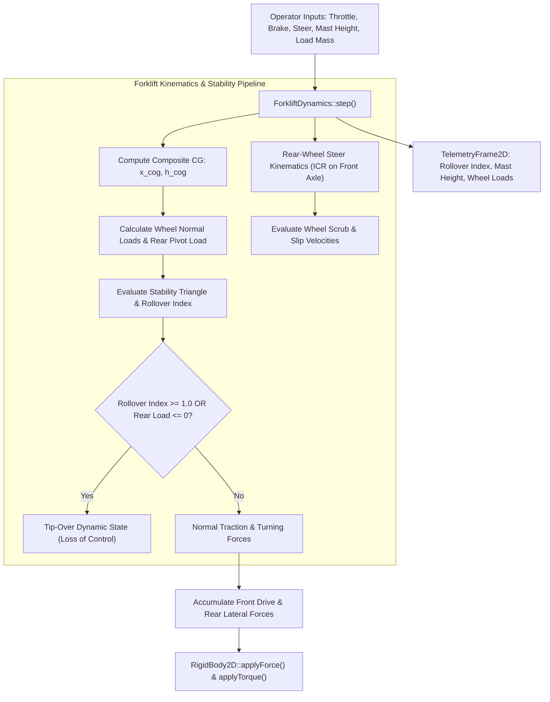

# ForkliftDynamics: C++17 Implementation Plan

## 1. Executive Summary & Scope

### 1.1 Objective & Context
This specification defines the physics formulation, software architecture, data contracts, and verification strategy for **`ForkliftDynamics`** in `VehicleSimCore`.

Counterbalanced forklifts are ubiquitous in logistics, warehousing, and industrial simulations, exhibiting distinct dynamics unlike standard road vehicles:
1. **Rear-Wheel Steer Kinematics**: Steering occurs at the rear axle with steering angles up to $\pm 90^\circ$. At extreme steering lock, the vehicle pivots directly around its front drive wheels, producing an instantaneous center of rotation (ICR) located on or near the front axle.
2. **Dynamic Stability Triangle & Variable Center of Gravity**: Industrial forklifts rest on a 3-point stability triangle formed by the two front drive wheels and the rear steering axle pivot pin. As the hydraulic mast raises a heavy payload ($m_{\text{load}}$) to elevation $h_{\text{mast}}$, the composite Center of Gravity ($h_{\text{cog}}$) shifts upwards and forwards. High mast elevation drastically shrinks the dynamic lateral tipping margin during turns.
3. **Front-Wheel Traction & Hydraulic Drive**: Drive and service braking are applied to the front axle, while the counterweight at the rear balances the cantilevered fork load.

`ForkliftDynamics` models these specialized industrial mechanics within the standard [IVehicleDynamics](../libs/VehicleSimCore/dynamics/IVehicleDynamics.h) interface, outputting real-time stability indices to [TelemetryFrame2D](../libs/VehicleSimCore/telemetry/TelemetryFrame2D.h).

---

### 1.2 Mathematical Formulation

#### 1. Rear-Wheel Steer Kinematics & Instantaneous Center of Rotation
Let wheelbase be $L$, front track width be $T_f$, and rear steer angle command be $\delta \in [-\frac{\pi}{2}, \frac{\pi}{2}]$.

In rear-wheel steering, the instantaneous center of rotation (ICR) lies along the collinear axis of the **front** wheels:
- Distance from vehicle centerline to ICR:
  $$R_{\text{icr}} = \frac{L}{\tan(\delta) + \operatorname{sgn}(\delta)\epsilon}$$
- Individual rear wheel angles for dual-wheel rear steer assemblies:
  $$\delta_{\text{inner}} = \arctan\left(\frac{L}{R_{\text{icr}} - \frac{T_r}{2}}\right), \quad \delta_{\text{outer}} = \arctan\left(\frac{L}{R_{\text{icr}} + \frac{T_r}{2}}\right)$$
At $\delta = \pm 90^\circ$, $R_{\text{icr}} \to 0$, causing the forklift to execute a zero-radius spin around the front axle midpoint.

#### 2. Composite Center of Gravity & Mast Kinematics
Let empty forklift chassis have mass $m_{\text{chassis}}$, longitudinal COG offset $x_{\text{chassis}}$ (measured relative to the front drive axle), and COG height $h_{\text{chassis}}$.
Let the lifted payload have mass $m_{\text{load}}$, longitudinal fork cantilever offset $x_{\text{fork}}$ (ahead of front axle, so $x_{\text{fork}} > 0$), and vertical mast lift height $h_{\text{mast}}$:
- **Total Combined Mass**:
  $$m_{\text{total}} = m_{\text{chassis}} + m_{\text{load}}$$
- **Composite Longitudinal COG**:
  $$x_{\text{cog}} = \frac{m_{\text{chassis}} \cdot x_{\text{chassis}} + m_{\text{load}} \cdot x_{\text{fork}}}{m_{\text{total}}}$$
- **Composite Vertical COG Height**:
  $$h_{\text{cog}} = \frac{m_{\text{chassis}} \cdot h_{\text{chassis}} + m_{\text{load}} \cdot (h_{\text{fork0}} + h_{\text{mast}})}{m_{\text{total}}}$$

#### 3. Industrial Stability Triangle & Dynamic Rollover Index
The stability base is an isosceles triangle with vertices at the Front-Left wheel $(0, -T_f/2)$, Front-Right wheel $(0, T_f/2)$, and the Rear Steer Axle Pivot Pin $(-L, 0)$:

- **Longitudinal Tipping Condition (Forward Pitch)**:
  Forward tipping occurs if the ground reaction on the rear steering pivot drops to zero ($F_{z,\text{rear}} \le 0$):
  $$F_{z,\text{rear}} = \frac{m_{\text{total}} \cdot g \cdot x_{\text{cog}} - m_{\text{total}} \cdot a_x \cdot h_{\text{cog}}}{L}$$
  If $F_{z,\text{rear}} \le 0$, the rear counterweight lifts off the ground (forward tip-over).

- **Lateral Rollover Stability Index ($I_{\text{rollover}}$)**:
  Under lateral acceleration $a_y = u \cdot \omega$, the overturning moment around the triangular edge connecting a front wheel to the rear pivot pin is evaluated:
  $$I_{\text{rollover}} = \frac{|a_y| \cdot h_{\text{cog}}}{g \cdot w_{\text{eff}}(x_{\text{cog}})}$$
  where $w_{\text{eff}}(x_{\text{cog}}) = \frac{T_f}{2} \cdot \left(1 - \frac{|x_{\text{cog}}|}{L}\right)$ is the effective half-track width at the longitudinal position of the composite COG.
  When $I_{\text{rollover}} \ge 1.0$, lateral wheel lift-off occurs, inducing rollover.

---

## 2. Architecture & Design

### 2.1 Component Structure

```
libs/VehicleSimCore/
└── dynamics/
    ├── ForkliftDynamics.h     [NEW] - Rear-steer forklift coordinator header
    ├── ForkliftDynamics.cpp   [NEW] - Kinematics, dynamic mast CG, stability triangle
    └── IVehicleDynamics.h     [REFERENCED] - Base interface contract
tests/
└── ForkliftDynamicsTest.cpp   [NEW] - GoogleTest suite validating steering & tipping
```

### 2.2 System Architecture Diagrams

```
  ASCII Diagram: Forklift Stability Triangle & Dynamics Flow

               Front Axle (Drive & Braking)
              [Front-Left] ========= [Front-Right]
                    \                     /
                     \   Stability       /
                      \   Triangle      /
                       \               /
                        \   * (x_cog, y_cog) [Shifts with Mast Height]
                         \           /
                          \         /
                           \       /
                            \     /
                             [ * ] Rear Steer Pivot Pin (Steer Angle +/- 90 deg)
```



---

## 3. C++17 Header Design

```cpp
#pragma once

#include "IVehicleDynamics.h"
#include "../math/Vec2.h"

namespace vehicle_sim::dynamics {

/// @struct ForkliftConfig
/// @brief Physical configuration parameters for ForkliftDynamics.
struct ForkliftConfig {
    double chassisMass{3500.0};      ///< Unladen chassis and counterweight mass in kg.
    double chassisInertia{4200.0};   ///< Chassis moment of inertia in kg*m^2.
    double wheelbase{1.8};           ///< Longitudinal distance from front axle to rear pivot in m.
    double frontTrackWidth{1.1};     ///< Front drive axle track width in meters.
    double chassisCogDistFront{0.8}; ///< Chassis COG distance behind front axle in meters.
    double chassisCogHeight{0.55};   ///< Unladen chassis COG height in meters.
    double forkDistFront{0.5};       ///< Longitudinal distance from front axle to fork load in m.
    double baseForkHeight{0.15};     ///< Base fork carriage height above ground in meters.
    double maxMastHeight{4.5};       ///< Maximum hydraulic mast extension in meters.
    double maxSteerAngle{1.48};      ///< Maximum rear wheel steer angle (~85 degrees) in rad.
    double maxDriveForce{9000.0};    ///< Maximum front axle traction force in Newtons.
    double maxBrakeForce{15000.0};   ///< Maximum front axle braking force in Newtons.
    double maxSpeed{5.5};            ///< Factory speed governor limit in m/s (~20 km/h).
};

/// @class ForkliftDynamics
/// @brief Rear-wheel steer industrial forklift dynamics model.
/// @details Simulates rear-wheel pivot steering, dynamic mast height Center of Gravity
/// shifting, stability triangle boundary evaluation, and dynamic rollover index.
class ForkliftDynamics final : public IVehicleDynamics {
public:
    /// @brief Constructs ForkliftDynamics with physical parameters.
    /// @param[in] config Vehicle geometry, mass, and mast configurations.
    explicit ForkliftDynamics(const ForkliftConfig& config = {}) noexcept;

    /// @brief Advances simulation step, applying forces to rigid body.
    /// @param[in,out] body Target rigid body representing forklift chassis.
    /// @param[in] dt Timestep duration in seconds.
    void step(physics::RigidBody2D& body, double dt) noexcept override;

    /// @brief Resets operator commands and internal states.
    void reset() noexcept override;

    /// @brief Queries whether vehicle has lost ground contact or tipped over.
    /// @return True if vehicle is tipped over or airborne.
    [[nodiscard]] bool isAirborne() const noexcept override;

    /// @brief Sets accelerator pedal input.
    /// @param[in] throttle Normalized throttle in range [0.0, 1.0].
    void setThrottle(double throttle) noexcept;

    /// @brief Sets service brake pedal input.
    /// @param[in] brake Normalized brake in range [0.0, 1.0].
    void setBrake(double brake) noexcept;

    /// @brief Sets rear steering command.
    /// @param[in] steer Normalized steering command in range [-1.0, 1.0].
    void setSteer(double steer) noexcept;

    /// @brief Sets hydraulic mast extension height.
    /// @param[in] height Mast height in meters [0.0, maxMastHeight].
    void setMastHeight(double height) noexcept;

    /// @brief Sets payload mass currently carried on the forks.
    /// @param[in] mass Payload mass in kg.
    void setPayloadMass(double mass) noexcept;

    /// @brief Retrieves the current dynamic lateral rollover index.
    /// @return Rollover index [0.0 = centered, 1.0 = wheel lift-off/rollover].
    [[nodiscard]] double getRolloverIndex() const noexcept;

    /// @brief Retrieves the normal force on the rear steering pivot.
    /// @return Vertical load in Newtons (<= 0 implies forward tipping).
    [[nodiscard]] double getRearPivotLoad() const noexcept;

    /// @brief Queries current composite Center of Gravity height.
    /// @return Composite COG elevation above ground in meters.
    [[nodiscard]] double getCompositeCogHeight() const noexcept;

    /// @brief Queries whether vehicle has experienced forward or lateral tip-over.
    /// @return True if tipped over beyond the stability triangle.
    [[nodiscard]] bool isTippedOver() const noexcept;

private:
    ForkliftConfig m_config{};
    double m_throttle{0.0};
    double m_brake{0.0};
    double m_steer{0.0};
    double m_mastHeight{0.0};
    double m_payloadMass{0.0};
    double m_rolloverIndex{0.0};
    double m_rearPivotLoad{0.0};
    double m_compositeCogHeight{0.55};
    bool m_isTippedOver{false};

    void updateCenterOfGravity() noexcept;
    void evaluateStability(double ax, double ay) noexcept;
};

} // namespace vehicle_sim::dynamics
```

---

## 4. Implementation Steps & Verification Plan

### 4.1 Implementation Milestones
1. **Milestone 1**: Implement `ForkliftConfig` and constructor in `ForkliftDynamics.h` and `ForkliftDynamics.cpp`.
2. **Milestone 2**: Implement rear-wheel steer kinematics and Instantaneous Center of Rotation (ICR) computation.
3. **Milestone 3**: Implement dynamic Center of Gravity updates shifting with payload mass $m_{\text{load}}$ and mast height $h_{\text{mast}}$.
4. **Milestone 4**: Implement stability triangle evaluation, rear pivot vertical load, and dynamic lateral rollover index $I_{\text{rollover}}$.
5. **Milestone 5**: Implement GoogleTest suite in `tests/ForkliftDynamicsTest.cpp`.

### 4.2 Test Coverage Matrix
- `ZeroRadiusTurn`: Verifies that at 90-degree steer lock, the forklift rotates cleanly around its front axle center.
- `MastHeightCogShift`: Verifies that raising mast height increases $h_{\text{cog}}$ and increases rollover index during turns.
- `ForwardTipOverLimit`: Verifies that excessive payload mass on forks causes rear pivot vertical load to drop to zero ($F_{z,\text{rear}} \le 0$).
- `SpeedGovernor`: Verifies that forward and reverse drive forces automatically taper as velocity approaches `maxSpeed`.
- `TipOverFlag`: Verifies that when $I_{\text{rollover}} \ge 1.0$, `isTippedOver()` returns true and control forces degrade.
