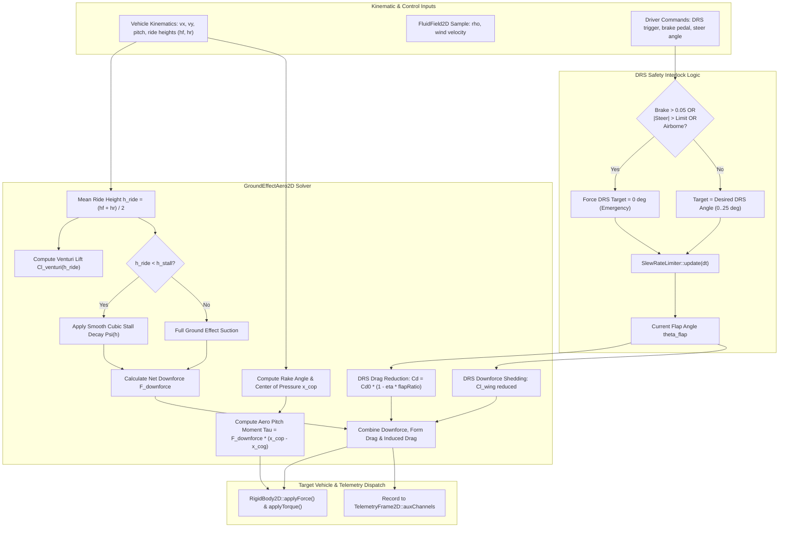
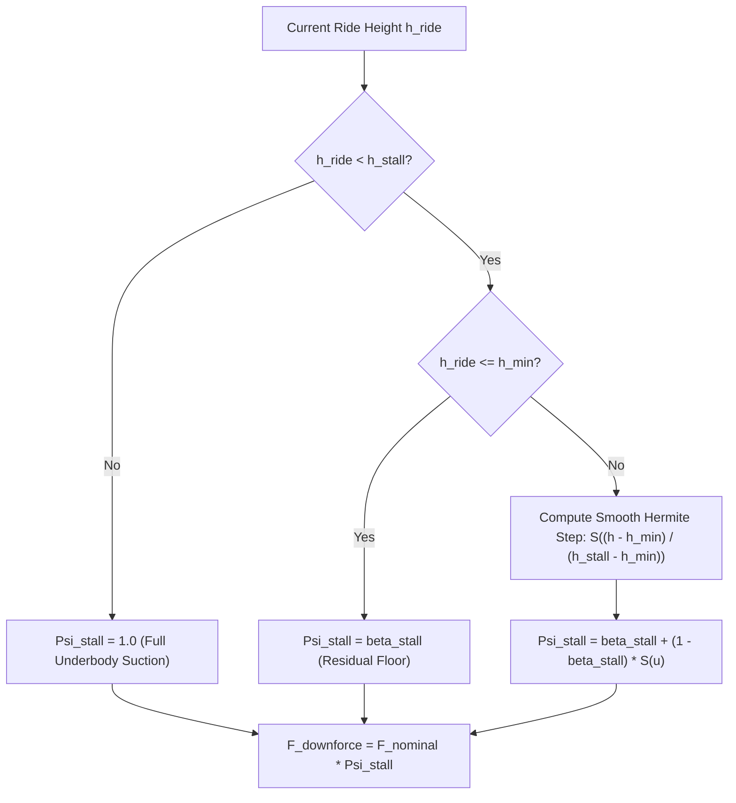

# Ground Effect & Active DRS: C++17 Implementation Plan

## 1. Executive Summary & Scope

### 1.1 Objective & Context
This specification details the mathematical modeling, software architecture, data contracts, and implementation roadmap for **Ground Effect Downforce and Active DRS (Drag Reduction System) Flaps** as proposed in Section 5.2 of [ProposedFeatures.md](ProposedFeatures.md).

In high-performance automotive and futuristic flight simulations within `VehicleSimCore` (e.g. Formula-style racecars in [MonsterCarDynamics](../libs/VehicleSimCore/dynamics/MonsterCarDynamics.h), side-scrolling racers in [SideViewCarDynamics](../libs/VehicleSimCore/dynamics/SideViewCarDynamics.h), and maglev racers in [AntiGravityRacerDynamics](../libs/VehicleSimCore/dynamics/AntiGravityRacerDynamics.h)):
1. **Underbody Venturi Downforce**: Airflow channeled through contoured underbody Venturi tunnels accelerates as ground clearance ($h_{\text{ride}}$) shrinks, generating a low-pressure suction zone according to Bernoulli's principle. This produces massive downward aerodynamic grip without the extreme drag penalties of high-angle wings.
2. **Aerodynamic Stall & Flow Choking**: When ground clearance drops below a critical threshold $h_{\text{stall}}$ (or during vehicle bottoming-out), boundary layer separation and viscous choking cause an abrupt loss of underbody suction. The resulting collapse in downforce triggers vehicle pitch and heave instability (the notorious "porpoising" oscillation phenomenon).
3. **Pitch Rake Sensitivity & Center of Pressure Migration**: Ground effect suction varies significantly with the vehicle rake angle ($\theta_{\text{rake}}$) between front and rear axle ride heights ($h_{\text{front}}, h_{\text{rear}}$). Shifts in ride height cause the aerodynamic Center of Pressure ($x_{\text{cop}}$) to migrate longitudinally, generating pitching moments around the Center of Gravity ($x_{\text{cog}}$).
4. **Active Drag Reduction System (DRS)**: Rear aerodynamic elements actuate an adjustable flap ($\theta_{\text{flap}} \in [0^\circ, \theta_{\text{max}}]$) to shed parasitic drag by up to 25%–35% along high-speed straights. Flap actuation is governed by physical rate limits via [SlewRateLimiter](../libs/VehicleSimCore/math/SlewRateLimiter.h), accompanied by induced lift/downforce shedding and mandatory fail-safe emergency closure upon braking, excessive yaw slip, or airborne detection.

The target system provides a deterministic, zero-allocation C++17 aerodynamic module ([libs/VehicleSimCore/dynamics/GroundEffectAero2D.h](../libs/VehicleSimCore/dynamics/GroundEffectAero2D.h)) that integrates with [FluidDrag2D](../libs/VehicleSimCore/physics/FluidDrag2D.h), couples with [RigidBody2D](../libs/VehicleSimCore/physics/RigidBody2D.h), and exports live diagnostic channels to [TelemetryFrame2D](../libs/VehicleSimCore/telemetry/TelemetryFrame2D.h).

---

### 1.2 Core Requirements & Constraints

1. **Physical Aerodynamics Modeling**:
   - Non-linear ground effect downforce scaling with ride height $h_{\text{ride}}$.
   - Smooth, deterministic aerodynamic stall transition below critical ride height $h_{\text{stall}}$ with configurable stall severity $\beta_{\text{stall}}$.
   - Chassis rake angle sensitivity modulating front/rear underbody suction distribution.
   - Dynamic Center of Pressure ($x_{\text{cop}}$) migration producing aerodynamic pitch moments.
   - Lift-induced drag formulation ($C_{d,\text{induced}} \propto C_L^2$).
   - Active DRS flap kinematics with asymmetric slew-rate limiting (smooth opening, rapid closing).
   - Drag reduction factor ($\eta_{\text{drs}} \in [0.20, 0.35]$) coupled with downforce reduction factor ($\xi_{\text{drs}} \in [0.15, 0.30]$).
   - Automatic DRS fail-safe disengagement upon braking, aggressive steering, spin-out, or airborne state.
2. **Deterministic IEEE 754 Compliance**:
   - Zero OS-specific math headers, identical cross-platform results across Linux (GCC/Clang) and Windows (MSVC).
   - Division-by-zero guards ($\epsilon = 10^{-6}$) on all aerodynamic equations.
3. **MISRA C++:2023 & SEI CERT C++ Compliance**:
   - Zero dynamic heap allocations during simulation ticks.
   - Strictly no raw `new` or `delete`.
   - All function names strictly $< 30$ characters.
   - Mandatory `[[nodiscard]]` on all calculation and query APIs.
   - Explicit `{}` initialization for all primitives and aggregate structs.
4. **Subsystem Interoperability**:
   - Native integration with [FluidField2D](../libs/VehicleSimCore/physics/FluidField2D.h) for ambient fluid density $\rho$ and headwind/tailwind velocities.
   - Direct force dispatch into [RigidBody2D](../libs/VehicleSimCore/physics/RigidBody2D.h).
   - Live telemetry feed into [TelemetryFrame2D](../libs/VehicleSimCore/telemetry/TelemetryFrame2D.h) auxiliary channels.

---

## 2. High-Level Architecture & Subsystem Organization

### 2.1 File Layout

```
libs/VehicleSimCore/
├── dynamics/
│   ├── GroundEffectAero2D.h       [NEW] - Ground effect & DRS aerodynamic coordinator
│   ├── GroundEffectAero2D.cpp     [NEW] - Venturi downforce, stall, DRS actuation, moments
│   ├── MonsterCarDynamics.h       [EXTENDED] - Aero property hooks & DRS controls
│   ├── MonsterCarDynamics.cpp     [EXTENDED] - Dynamic downforce & DRS integration
│   ├── AntiGravityRacerDynamics.h [EXTENDED] - Maglev underbody ground suction coupling
│   └── AntiGravityRacerDynamics.cpp [EXTENDED] - High-speed aero downforce & airbrake/DRS
├── physics/
│   ├── FluidDrag2D.h              [EXTENDED] - Wing profile & DRS drag coefficient helpers
│   └── FluidDrag2D.cpp            [EXTENDED] - Modulated form drag calculation
└── telemetry/
    ├── TelemetryFrame2D.h         [REFERENCED] - Standard auxChannels mapping
    └── TelemetrySampler2D.cpp     [EXTENDED] - Samples aero downforce, stall, & flap state
tests/
└── GroundEffectAeroTest.cpp       [NEW] - GoogleTest suite validating aero laws & determinism
```

---

### 2.2 System Architecture ASCII Diagram

```
+----------------------------------------------------------------------------------------------------+
|                             Ground Effect & Active DRS Architecture                                |
+----------------------------------------------------------------------------------------------------+
|                                                                                                    |
|   [ Vehicle State Input ]                        [ Environmental State ]    [ Pilot Controls ]     |
|   - Forward Speed (vx)                           - Fluid Density (rho)      - DRS Toggle Request   |
|   - Front / Rear Ride Height (hf, hr)            - Ambient Wind Vector      - Brake Pedal Input    |
|   - Body Pitch Angle & Yaw Rate                                             - Steering Wheel Angle |
|               |                                            |                        |              |
|               +--------------------+-----------------------+                        |              |
|                                    |                                                v              |
|                                    v                                    +-----------------------+  |
|                 +--------------------------------------+                | DRS Safety Interlock  |  |
|                 |          GroundEffectAero2D          |                +-----------------------+  |
|                 +--------------------------------------+                | - Brake > Threshold?  |  |
|                 | 1. Effective Airspeed (V_rel)        |<---------------| - Steer > Threshold?  |  |
|                 | 2. Venturi Underbody Suction:        |  DRS Allowed   | - Airborne State?     |  |
|                 |    Cl(h) = Cl0 * (1 + k_v / (h + e)) |                +-----------------------+  |
|                 | 3. Choking & Stall Evaluator:        |                            |              |
|                 |    Psi_stall(h, h_stall)             |                            v              |
|                 | 4. Pitch Rake Scaling (hf vs hr)     |                +-----------------------+  |
|                 | 5. Center of Pressure (x_cop) & Trim |                |   SlewRateLimiter     |  |
|                 | 6. DRS Flap Actuation Angle (theta)  |<---------------| (Rate-Limited Flap)   |  |
|                 | 7. Induced & Parasitic Drag (Cd)     |  theta_flap    +-----------------------+  |
|                 +--------------------------------------+                                           |
|                                    |                                                               |
|                                    +---------------------------------------+                       |
|                                    |                                       |                       |
|                                    v                                       v                       |
|               +----------------------------------------+       +-----------------------+           |
|               |         RigidBody2D Dispatch           |       |   TelemetryFrame2D    |           |
|               +----------------------------------------+       +-----------------------+           |
|               | - Downforce: F_z (Local Up/Down)       |       | aux[0]: Downforce (N) |           |
|               | - Aero Drag: F_drag (Opposing Motion)  |       | aux[1]: Total Drag (N)|           |
|               | - Pitch Moment: Tau_pitch = F_z * dx   |       | aux[2]: Flap Angle(deg|           |
|               +----------------------------------------+       | aux[3]: Stall State   |           |
|                                                                +-----------------------+           |
+----------------------------------------------------------------------------------------------------+
```

---

### 2.3 System Architecture Mermaid Flowchart



---

## 3. Mathematical Formulations & Algorithmic Derivations

### 3.1 Underbody Venturi Downforce & Ground Clearance Scaling

According to 1D quasi-steady Bernoulli channel flow, fluid velocity beneath an inverted ground-effect tunnel accelerates as the channel cross-sectional area contracts:
$$v_{\text{under}}(x) \approx v_\infty \frac{A_\infty}{A(x)} = v_\infty \frac{h_\infty}{h(x)}$$

The pressure reduction beneath the vehicle body generates net suction downforce:
$$\Delta p(x) = \frac{1}{2}\rho \left( v_{\text{under}}(x)^2 - v_\infty^2 \right) = \frac{1}{2}\rho v_\infty^2 \left( \left(\frac{h_\infty}{h(x)}\right)^2 - 1 \right)$$

Integrating over vehicle floor area $A_{\text{floor}}$ and combining baseline aerodynamic wing lift $C_{L0,\text{wing}}$ with underbody ground suction gives the total lift coefficient:
$$C_L(h_{\text{ride}}) = C_{L0,\text{wing}} + C_{L0,\text{ground}} \left( 1 + \frac{k_{\text{venturi}}}{h_{\text{ride}} + \epsilon} \right)$$
where:
- $\rho$: Fluid density in $\text{kg/m}^3$ (nominal $1.225\,\text{kg/m}^3$ for standard sea-level air).
- $v_\infty$: Relative forward airspeed in $\text{m/s}$ ($\|\mathbf{v}_{\text{rel}}\|$).
- $C_{L0,\text{wing}}$: Dimensionless baseline wing downforce coefficient (in free-stream conditions).
- $C_{L0,\text{ground}}$: Dimensionless baseline underbody ground effect coefficient.
- $k_{\text{venturi}}$: Geometric tunnel profile factor in meters (characterizing diffuser throat expansion).
- $h_{\text{ride}}$: Measured ground clearance in meters ($h_{\text{ride}} = \frac{1}{2}(h_{\text{front}} + h_{\text{rear}})$).
- $\epsilon$: Numerical regularization constant ($10^{-6}\,\text{m}$) preventing division by zero.

The nominal un-stalled downward aerodynamic force is:
$$F_{\text{downforce,nominal}} = \frac{1}{2}\rho v_\infty^2 A_{\text{ref}} C_L(h_{\text{ride}})$$

```
  ASCII Diagram: Ground Effect Airflow Velocity & Suction Profile

        Airflow v_inf -------------->
               .--------------------------------------------.
              /                 Chassis Body                 \
             |       [x_cog]                     [x_cop]      |
              \                                              /
        Front  '-------\                          /---------' Rear Wing / Diffuser
        Splitter        \___ Throat Area A_min __/
        ========             --------------------
        ------------------------------------------------------------- Ground Plane
                h_front             h_min                h_rear
                               (v_under >> v_inf)
                               (p_under << p_atm)
```

---

### 3.2 Aerodynamic Stall, Flow Choking & Porpoising Mechanics

When ride height $h_{\text{ride}}$ approaches critical boundary layer thickness $h_{\text{stall}}$, underbody viscous friction, boundary layer separation, and mechanical sealing skirt contact choke the airflow. Air can no longer pass through the Venturi tunnel, static pressure equalizes to ambient, and suction collapses.

To model this deterministically without numerical step discontinuities, a smooth $C^1$-continuous cubic Hermite stall attenuation factor $\Psi_{\text{stall}}(h)$ is applied:

$$\Psi_{\text{stall}}(h) = \begin{cases} 
\beta_{\text{stall}}, & h \le h_{\text{min}} \\
\beta_{\text{stall}} + (1 - \beta_{\text{stall}}) \cdot S\left(\frac{h - h_{\text{min}}}{h_{\text{stall}} - h_{\text{min}}}\right), & h_{\text{min}} < h < h_{\text{stall}} \\
1.0, & h \ge h_{\text{stall}}
\end{cases}$$

where:
- $h_{\text{stall}}$: Ride height below which stall transition begins (e.g. $0.025\,\text{m}$ / $25\,\text{mm}$).
- $h_{\text{min}}$: Full flow choking ride height (e.g. $0.005\,\text{m}$ / $5\,\text{mm}$).
- $\beta_{\text{stall}}$: Residual suction floor during total stall (e.g. $0.10$, representing 90% suction loss).
- $S(u) = 3u^2 - 2u^3$ is the smooth cubic Hermite step function ensuring zero derivatives at boundaries ($S'(0) = S'(1) = 0$).

#### Porpoising Coupling Equation
The ground effect force couples dynamically with vehicle vertical suspension stiffness $k_{\text{susp}}$ and damping $c_{\text{susp}}$:
$$m \ddot{z} + c_{\text{susp}} \dot{z} + k_{\text{susp}} z = -F_{\text{downforce}}(h_0 - z) + m g$$

When vehicle velocity reaches a critical porpoising speed $v_{\text{porp}}$, the non-linear slope $\frac{\partial F_{\text{downforce}}}{\partial z}$ exceeds the suspension stiffness, creating a limit-cycle relaxation oscillation (porpoising).

```
  ASCII Diagram: Downforce vs Ride Height Curve with Stall Collapse

   Downforce F_z (N)
         ^
         |                     Peak Suction
         |                          *
         |                         / \
         |                        /   \
         |                       /     \   Nominal Venturi Suction
         |                      /       \  ~ (1 + k_v / h)
         |        Stall Zone   /         \
         |       +------------+           \
         |       |            |            '------------------ Free Stream (h -> inf)
         |       |   .--------'
         |       |  /
   Residual F_min+-'
         |       |
         +-------+----+-------+------------------------------> Ride Height h (m)
                 0  h_min  h_stall
```



---

### 3.3 Pitch Rake Sensitivity & Center of Pressure Migration

Chassis pitch angle $\theta_{\text{pitch}}$ produces distinct front ride height $h_f$ and rear ride height $h_r$:
$$h_f = h_{\text{cg}} - L_f \sin(\theta_{\text{pitch}}), \quad h_r = h_{\text{cg}} + L_r \sin(\theta_{\text{pitch}})$$
where $L_f$ and $L_r$ are longitudinal distances from Center of Gravity to front and rear axles.

#### Rake Modulation Factor
A positive aerodynamic rake ($h_r > h_f$) expands the diffuser volume, enhancing diffuser suction up to an optimal rake angle $\theta_{\text{rake,opt}}$:
$$\eta_{\text{rake}}(\theta) = 1.0 + k_{\text{rake}} \cdot \tanh\left(\frac{h_r - h_f}{h_{\text{ref}}}\right)$$

#### Dynamic Center of Pressure ($x_{\text{cop}}$)
The effective aerodynamic downforce does not act at the Center of Gravity ($x = 0$), but at a migrating Center of Pressure $x_{\text{cop}}$:
$$x_{\text{cop}} = x_{\text{cop0}} + k_{\text{cop,pitch}} \cdot (\theta_{\text{pitch}} - \theta_0) + k_{\text{cop,drs}} \cdot \left(\frac{\theta_{\text{flap}}}{\theta_{\text{flap,max}}}\right)$$
where:
- $x_{\text{cop0}}$: Static center of pressure offset from CG in meters.
- $k_{\text{cop,pitch}}$: Longitudinal migration rate per radian of chassis pitch.
- $k_{\text{cop,drs}}$: Forward shift of CoP when rear wing DRS sheds rear downforce (inducing aerodynamic oversteer if uncompensated).

The aerodynamic pitching trim moment applied to the rigid body is:
$$\tau_{\text{pitch}} = F_{\text{downforce}} \cdot x_{\text{cop}}$$

---

### 3.4 Active DRS Flap Kinematics & Slew-Rate Dynamics

The DRS flap actuation angle $\theta_{\text{flap}}(t)$ is bounded within $[0^\circ, \theta_{\text{max}}]$ (typically $[0^\circ, 25^\circ]$).

```
  ASCII Diagram: Rear Wing Assembly & DRS Flap Articulation

        DRS Closed (High Downforce / High Drag)     DRS Open (Low Drag / Shed Downforce)
                    Main Plane                                   Main Plane
                   .==========.                                 .==========.
                  /            \                               /            \
                 +--------------+                             +--------------+
                       \                                             \
                        \ Flap (theta = 0 deg)                        \       __ Flap (theta = 25 deg)
                         +=======+                                     \====='
```

#### Rate-Limited Actuation
The flap transition is governed by asymmetric rate limits configured in [SlewRateLimiter](../libs/VehicleSimCore/math/SlewRateLimiter.h):
$$\frac{d\theta_{\text{flap}}}{dt} = \begin{cases}
\min\left(\dot{\theta}_{\text{open,max}}, \frac{\theta_{\text{target}} - \theta}{\Delta t}\right), & \theta_{\text{target}} > \theta \\
\max\left(-\dot{\theta}_{\text{close,max}}, \frac{\theta_{\text{target}} - \theta}{\Delta t}\right), & \theta_{\text{target}} < \theta
\end{cases}$$
Typically, opening rate is $\approx 125^\circ/\text{s}$ (open in $0.20\,\text{s}$), while emergency closing rate is $\approx 250^\circ/\text{s}$ (close in $0.10\,\text{s}$).

#### Drag Reduction Law
Let the normalized flap opening ratio be:
$$\phi_{\text{drs}} = \frac{\theta_{\text{flap}}}{\theta_{\text{flap,max}}} \in [0.0, 1.0]$$

The total effective drag coefficient is:
$$C_d(\phi_{\text{drs}}, C_L) = C_{d0,\text{base}} \cdot \left(1.0 - \eta_{\text{drs}} \cdot \phi_{\text{drs}}\right) + C_{d,\text{induced}}(C_L)$$
where:
- $C_{d0,\text{base}}$: Baseline form drag coefficient of the vehicle chassis.
- $\eta_{\text{drs}}$: Maximum fractional drag reduction (e.g. $0.30$, corresponding to a 30% drag cut).
- $C_{d,\text{induced}}(C_L) = k_{\text{induced}} \cdot C_L^2$: Lift-induced vortex drag.

#### Downforce Shedding Penalty
Opening the rear wing flap reduces rear downforce:
$$C_{L,\text{wing}}(\phi_{\text{drs}}) = C_{L0,\text{wing}} \cdot \left(1.0 - \xi_{\text{drs}} \cdot \phi_{\text{drs}}\right)$$
where $\xi_{\text{drs}}$ is the wing downforce shedding factor (typically $0.20$–$0.25$).

---

### 3.5 Total Aerodynamic Force Decomposition

Resolving forces in vehicle body coordinates:
$$\mathbf{F}_{\text{body}} = \begin{bmatrix} F_{\text{drag,long}} \\ F_{\text{downforce,normal}} \end{bmatrix} = \begin{bmatrix} -\frac{1}{2}\rho v_\infty^2 A_{\text{ref}} C_d \\ -\frac{1}{2}\rho v_\infty^2 A_{\text{ref}} C_L \end{bmatrix}$$

Transforming into world coordinates via body rotation angle $\psi$:
$$\mathbf{F}_{\text{world}} = \begin{bmatrix} \cos\psi & -\sin\psi \\ \sin\psi & \cos\psi \end{bmatrix} \mathbf{F}_{\text{body}}$$

The net aerodynamic moment around the Center of Mass is:
$$\tau_{\text{aero}} = \tau_{\text{pitch}} + \tau_{\text{yaw,crosswind}}$$

---

### 3.6 Fail-Safe DRS Safety Interlock Rules

To prevent catastrophic spin-outs or loss of control, the DRS controller implements automatic safety disengagement:
$$\theta_{\text{target}} = \begin{cases}
0.0, & \text{if } \text{brakeInput} > \text{threshold}_{\text{brake}} \quad (\approx 0.05) \\
0.0, & \text{if } |\text{steerInput}| > \text{threshold}_{\text{steer}} \quad (\approx 0.35) \\
0.0, & \text{if } |a_{\text{lat}}| > a_{\text{lat,max}} \quad (\approx 1.5\,G) \\
0.0, & \text{if } \text{isAirborne} == \text{true} \\
\theta_{\text{commanded}}, & \text{otherwise}
\end{cases}$$

---

## 4. C++17 Class Design & API Specifications

### 4.1 Header: `libs/VehicleSimCore/dynamics/GroundEffectAero2D.h`

```cpp
#pragma once

#include <cmath>
#include <cstdint>

#include "libs/VehicleSimCore/math/SlewRateLimiter.h"
#include "libs/VehicleSimCore/math/Vec2.h"
#include "libs/VehicleSimCore/physics/FluidDrag2D.h"
#include "libs/VehicleSimCore/physics/FluidField2D.h"

namespace vehicle_sim::physics {
class RigidBody2D;
} // namespace vehicle_sim::physics

namespace vehicle_sim::dynamics {

/// @struct GroundEffectAeroConfig
/// @brief Physical and geometric parameters for ground effect downforce and active DRS flaps.
/// @details Defines reference aerodynamic areas, Venturi tunnel geometries, stall thresholds,
/// pitch rake sensitivity, center-of-pressure offsets, and DRS actuation limits.
struct GroundEffectAeroConfig {
    // Reference Geometry & Baseline Coefficients
    double referenceArea { 2.2 };          ///< Aerodynamic frontal/planform reference area in m^2.
    double baseDragCoeff { 0.38 };         ///< Baseline zero-lift chassis drag coefficient (Cd0).
    double baseWingLiftCoeff { 0.85 };     ///< Baseline free-stream wing downforce coefficient (Cl0,wing).
    double baseGroundLiftCoeff { 1.20 };   ///< Baseline underbody ground effect lift coefficient (Cl0,ground).
    double inducedDragFactor { 0.045 };    ///< Lift-induced drag scaling factor (k_induced * Cl^2).

    // Ground Effect & Venturi Parameters
    double venturiFactor { 0.15 };         ///< Venturi throat expansion factor in meters (k_venturi).
    double stallRideHeight { 0.025 };      ///< Critical ride height below which stall begins in meters (h_stall).
    double minChokeRideHeight { 0.005 };   ///< Ride height at total flow choking in meters (h_min).
    double stallResidualRatio { 0.10 };    ///< Residual suction fraction during total stall (beta_stall).
    double rakeSensitivity { 0.35 };       ///< Diffuser suction sensitivity to chassis rake (k_rake).

    // Center of Pressure & Pitch Moment
    double staticCpOffset { -0.15 };       ///< Static longitudinal offset of CoP from CG in meters (negative = rearward).
    double pitchCpMigrationRate { 0.40 };  ///< CoP migration rate per radian of pitch in m/rad.
    double drsCpMigrationRate { 0.10 };    ///< Forward CoP shift under full DRS activation in meters.

    // Active DRS Parameters
    double maxFlapAngleDeg { 25.0 };       ///< Maximum DRS flap opening angle in degrees.
    double flapOpenSpeedDegPerSec { 125.0 };///< Slew rate for opening flap in deg/s (full open in 0.2s).
    double flapCloseSpeedDegPerSec { 250.0 };///< Slew rate for closing flap in deg/s (full close in 0.1s).
    double maxDragReduction { 0.30 };      ///< Maximum drag reduction fraction when fully opened (eta_drs).
    double maxDownforceShedding { 0.22 };  ///< Wing downforce reduction fraction when opened (xi_drs).

    // Safety Interlock Thresholds
    double brakeDisengageThreshold { 0.05 };///< Brake pedal threshold triggering immediate DRS closure.
    double steerDisengageThreshold { 0.35 };///< Absolute steering demand threshold triggering closure.
    double lateralGDisengageThreshold { 1.5 };///< Lateral acceleration threshold in Gs triggering closure.
};

/// @struct GroundEffectAeroInput
/// @brief Per-tick runtime state and control inputs passed to the aerodynamic coordinator.
struct GroundEffectAeroInput {
    double frontRideHeight { 0.045 };      ///< Measured ground clearance at front axle in meters.
    double rearRideHeight { 0.050 };       ///< Measured ground clearance at rear axle in meters.
    double pitchAngle { 0.0 };             ///< Chassis pitch orientation in radians.
    double steerDemand { 0.0 };            ///< Normalized steering command in [-1.0, 1.0].
    double brakeDemand { 0.0 };            ///< Normalized braking command in [0.0, 1.0].
    double lateralAccelerationG { 0.0 };    ///< Measured lateral acceleration in Gs.
    bool isAirborne { false };             ///< True if vehicle is detached from ground plane.
    bool requestDrs { false };             ///< Driver/AI commanded DRS activation request.
};

/// @struct GroundEffectAeroOutput
/// @brief Evaluated aerodynamic forces, moments, and diagnostic telemetry states.
struct GroundEffectAeroOutput {
    math::Vec2 totalForceWorld { 0.0, 0.0 }; ///< Combined aero force vector in world coordinates in Newtons.
    double downforce { 0.0 };              ///< Net downward aerodynamic force magnitude in Newtons.
    double totalDrag { 0.0 };              ///< Net retarding drag force magnitude in Newtons.
    double pitchMoment { 0.0 };            ///< Net aerodynamic pitching trim moment in N*m.
    double effectiveCd { 0.0 };            ///< Modulated drag coefficient including DRS and induced drag.
    double effectiveCl { 0.0 };            ///< Modulated downforce coefficient including ground effect and stall.
    double flapAngleDeg { 0.0 };           ///< Current physical DRS flap angle in degrees.
    double centerOfPressure { 0.0 };       ///< Current longitudinal CoP position relative to CG in meters.
    bool isDrsActive { false };            ///< True if DRS flap is deployed (> 1.0 deg).
    bool isDrsInhibited { false };         ///< True if safety interlock is overriding driver DRS command.
    bool isStalled { false };              ///< True if underbody Venturi is actively in aerodynamic stall.
};

/// @class GroundEffectAero2D
/// @brief Deterministic 2D ground effect downforce and active DRS aerodynamic coordinator.
/// @details Evaluates Venturi underbody downforce scaling, smooth flow choking and stall collapse,
/// pitch rake modulation, migrating center-of-pressure moments, and slew-rate limited active DRS flaps.
/// Conforms to IEEE 754 determinism, pure ISO C++17, and MISRA C++:2023 zero-allocation standards.
class GroundEffectAero2D {
public:
    /// @brief Default constructor using baseline sports/racing configuration.
    GroundEffectAero2D() noexcept;

    /// @brief Parameterized constructor with custom aerodynamic configuration.
    /// @param[in] config Aerodynamic configuration parameters.
    explicit GroundEffectAero2D(const GroundEffectAeroConfig& config) noexcept;

    /// @brief Resets transient flap actuators, historical states, and safety flags.
    void reset() noexcept;

    /// @brief Updates aerodynamic state and computes forces across timestep dt.
    /// @param[in] input Runtime vehicle kinematics, ride heights, and pilot controls.
    /// @param[in] bodyLinearVel World linear velocity vector of vehicle in m/s.
    /// @param[in] bodyHeading Vehicle heading angle in radians.
    /// @param[in] fluidSample Environmental fluid sample (density and wind velocity).
    /// @param[in] dt Simulation timestep duration in seconds.
    /// @return Evaluated aerodynamic output struct.
    [[nodiscard]] GroundEffectAeroOutput update(
        const GroundEffectAeroInput& input,
        const math::Vec2& bodyLinearVel,
        double bodyHeading,
        const physics::FluidSample2D& fluidSample,
        double dt) noexcept;

    /// @brief Computes and applies aerodynamic forces directly to target rigid body.
    /// @param[in,out] body Target rigid body receiving forces and pitching moments.
    /// @param[in] input Runtime kinematics and pilot commands.
    /// @param[in] fluidSample Environmental fluid sample.
    /// @param[in] dt Simulation timestep in seconds.
    /// @return Evaluated aerodynamic telemetry output.
    GroundEffectAeroOutput applyForces(
        physics::RigidBody2D& body,
        const GroundEffectAeroInput& input,
        const physics::FluidSample2D& fluidSample,
        double dt) noexcept;

    /// @brief Returns the active aerodynamic configuration.
    /// @return Reference to configuration parameters.
    [[nodiscard]] const GroundEffectAeroConfig& getConfig() const noexcept;

    /// @brief Updates the aerodynamic configuration.
    /// @param[in] config New configuration parameters.
    void setConfig(const GroundEffectAeroConfig& config) noexcept;

    /// @brief Queries current physical DRS flap angle.
    /// @return Actuated flap angle in degrees.
    [[nodiscard]] double getFlapAngle() const noexcept;

    /// @brief Queries whether the underbody is currently stalled.
    /// @return True if ride height is below critical stall threshold.
    [[nodiscard]] bool isStalled() const noexcept;

    /// @brief Queries whether DRS is currently deployed.
    /// @return True if flap angle exceeds 1.0 degree.
    [[nodiscard]] bool isDrsActive() const noexcept;

private:
    /// @brief Evaluates smooth cubic Hermite stall decay factor.
    /// @param[in] rideHeight Current mean ground clearance in meters.
    /// @return Attenuation scalar in [stallResidualRatio, 1.0].
    [[nodiscard]] double computeStall(double rideHeight) const noexcept;

    /// @brief Evaluates safety interlock conditions.
    /// @param[in] input Pilot inputs and lateral acceleration state.
    /// @return True if DRS deployment is permitted.
    [[nodiscard]] bool checkInterlock(const GroundEffectAeroInput& input) const noexcept;

    GroundEffectAeroConfig mConfig {};
    math::SlewRateLimiter mFlapLimiter {};
    GroundEffectAeroOutput mLastOutput {};
    bool mIsStalled { false };
    bool mIsDrsInhibited { false };
};

} // namespace vehicle_sim::dynamics
```

---

### 4.2 Implementation: `libs/VehicleSimCore/dynamics/GroundEffectAero2D.cpp`

```cpp
#include "GroundEffectAero2D.h"

#include <algorithm>
#include "libs/VehicleSimCore/physics/RigidBody2D.h"

namespace vehicle_sim::dynamics {

GroundEffectAero2D::GroundEffectAero2D() noexcept
    : GroundEffectAero2D(GroundEffectAeroConfig {})
{
}

GroundEffectAero2D::GroundEffectAero2D(const GroundEffectAeroConfig& config) noexcept
    : mConfig { config }
    , mFlapLimiter { config.flapOpenSpeedDegPerSec, config.flapCloseSpeedDegPerSec }
{
    mFlapLimiter.reset(0.0);
}

void GroundEffectAero2D::reset() noexcept
{
    mFlapLimiter.reset(0.0);
    mLastOutput = GroundEffectAeroOutput {};
    mIsStalled = false;
    mIsDrsInhibited = false;
}

const GroundEffectAeroConfig& GroundEffectAero2D::getConfig() const noexcept
{
    return mConfig;
}

void GroundEffectAero2D::setConfig(const GroundEffectAeroConfig& config) noexcept
{
    mConfig = config;
    mFlapLimiter.setRateLimits(config.flapOpenSpeedDegPerSec, config.flapCloseSpeedDegPerSec);
}

double GroundEffectAero2D::getFlapAngle() const noexcept
{
    return mFlapLimiter.value();
}

bool GroundEffectAero2D::isStalled() const noexcept
{
    return mIsStalled;
}

bool GroundEffectAero2D::isDrsActive() const noexcept
{
    return mFlapLimiter.value() > 1.0;
}

double GroundEffectAero2D::computeStall(double rideHeight) const noexcept
{
    if (rideHeight >= mConfig.stallRideHeight) {
        return 1.0;
    }
    if (rideHeight <= mConfig.minChokeRideHeight) {
        return mConfig.stallResidualRatio;
    }

    const double span = mConfig.stallRideHeight - mConfig.minChokeRideHeight;
    const double u = (rideHeight - mConfig.minChokeRideHeight) / std::max(span, 1e-6);
    const double clampedU = std::clamp(u, 0.0, 1.0);
    const double hermite = (3.0 * clampedU * clampedU) - (2.0 * clampedU * clampedU * clampedU);

    return mConfig.stallResidualRatio + ((1.0 - mConfig.stallResidualRatio) * hermite);
}

bool GroundEffectAero2D::checkInterlock(const GroundEffectAeroInput& input) const noexcept
{
    if (input.isAirborne) {
        return false;
    }
    if (input.brakeDemand > mConfig.brakeDisengageThreshold) {
        return false;
    }
    if (std::abs(input.steerDemand) > mConfig.steerDisengageThreshold) {
        return false;
    }
    if (std::abs(input.lateralAccelerationG) > mConfig.lateralGDisengageThreshold) {
        return false;
    }
    return true;
}

GroundEffectAeroOutput GroundEffectAero2D::update(
    const GroundEffectAeroInput& input,
    const math::Vec2& bodyLinearVel,
    double bodyHeading,
    const physics::FluidSample2D& fluidSample,
    double dt) noexcept
{
    GroundEffectAeroOutput out {};

    // 1. Evaluate Relative Fluid Airspeed
    const math::Vec2 relativeVel = physics::FluidDrag2D::computeRelativeVel(
        bodyLinearVel, fluidSample.velocity);
    const double airspeed = relativeVel.length();

    // 2. Evaluate DRS Actuation & Interlock
    const bool interlockPermitted = checkInterlock(input);
    mIsDrsInhibited = input.requestDrs && (!interlockPermitted);

    const double targetFlapDeg = (input.requestDrs && interlockPermitted) 
        ? mConfig.maxFlapAngleDeg : 0.0;
    out.flapAngleDeg = mFlapLimiter.update(targetFlapDeg, dt);
    out.isDrsActive = out.flapAngleDeg > 1.0;
    out.isDrsInhibited = mIsDrsInhibited;

    const double flapRatio = std::clamp(
        out.flapAngleDeg / std::max(mConfig.maxFlapAngleDeg, 1e-6), 0.0, 1.0);

    // 3. Ground Clearance & Venturi Lift Evaluation
    const double meanRideHeight = std::max(0.0, 0.5 * (input.frontRideHeight + input.rearRideHeight));
    const double stallFactor = computeStall(meanRideHeight);
    mIsStalled = meanRideHeight < mConfig.stallRideHeight;
    out.isStalled = mIsStalled;

    // Rake angle sensitivity
    const double rakeDelta = input.rearRideHeight - input.frontRideHeight;
    const double rakeModulation = 1.0 + (mConfig.rakeSensitivity * std::tanh(rakeDelta / 0.05));

    // Underbody Venturi Lift
    const double venturiTerm = mConfig.venturiFactor / (meanRideHeight + 1e-5);
    const double underbodyCl = mConfig.baseGroundLiftCoeff * (1.0 + venturiTerm) * rakeModulation * stallFactor;

    // Wing Downforce with DRS Shedding
    const double wingCl = mConfig.baseWingLiftCoeff * (1.0 - (mConfig.maxDownforceShedding * flapRatio));
    out.effectiveCl = underbodyCl + wingCl;

    // 4. Drag Coefficient with DRS Reduction & Induced Drag
    const double baseCd = mConfig.baseDragCoeff * (1.0 - (mConfig.maxDragReduction * flapRatio));
    const double inducedCd = mConfig.inducedDragFactor * (out.effectiveCl * out.effectiveCl);
    out.effectiveCd = baseCd + inducedCd;

    // 5. Dynamic Pressure & Force Magnitude Evaluation
    const double q = 0.5 * fluidSample.density * airspeed * airspeed;
    out.downforce = q * mConfig.referenceArea * out.effectiveCl;
    out.totalDrag = q * mConfig.referenceArea * out.effectiveCd;

    // 6. Center of Pressure & Pitch Moment
    out.centerOfPressure = mConfig.staticCpOffset 
        + (mConfig.pitchCpMigrationRate * input.pitchAngle)
        + (mConfig.drsCpMigrationRate * flapRatio);
    out.pitchMoment = out.downforce * out.centerOfPressure;

    // 7. Coordinate Transformation into World Space
    const math::Vec2 forwardDir { std::cos(bodyHeading), std::sin(bodyHeading) };
    const math::Vec2 normalDir { -std::sin(bodyHeading), std::cos(bodyHeading) };

    const math::Vec2 dragForce = forwardDir * (-out.totalDrag);
    const math::Vec2 downforceVector = normalDir * (-out.downforce);

    out.totalForceWorld = dragForce + downforceVector;
    mLastOutput = out;
    return out;
}

GroundEffectAeroOutput GroundEffectAero2D::applyForces(
    physics::RigidBody2D& body,
    const GroundEffectAeroInput& input,
    const physics::FluidSample2D& fluidSample,
    double dt) noexcept
{
    const GroundEffectAeroOutput out = update(
        input, body.velocity(), body.angle(), fluidSample, dt);

    body.applyForce(out.totalForceWorld);
    body.applyTorque(out.pitchMoment);

    return out;
}

} // namespace vehicle_sim::dynamics
```

---

## 5. Verification & Testing Strategy

### 5.1 Test Suite Organization (`tests/GroundEffectAeroTest.cpp`)

The test suite validates physical aerodynamic equations, dynamic rate limiting, safety interlocks, and IEEE 754 determinism under GoogleTest.

```
tests/
└── GroundEffectAeroTest.cpp
    ├── VenturiDownforceScalingTest      - Verifies downforce increases as ride height decreases
    ├── AerodynamicStallCutoffTest       - Verifies smooth Hermite stall collapse below h_stall
    ├── PitchRakeSensitivityTest         - Verifies diffuser enhancement with positive rake
    ├── CenterOfPressureMigrationTest    - Verifies longitudinal CoP shifts and pitching moments
    ├── DrsFlapSlewRateTimingTest        - Verifies 0.2s open / 0.1s close asymmetric rate limits
    ├── DrsDragAndDownforceSheddingTest  - Verifies 30% drag reduction and 22% wing downforce shed
    ├── DrsSafetyInterlockBrakeTest      - Verifies immediate DRS closure when brake pedal applied
    ├── DrsSafetyInterlockSteerTest      - Verifies immediate DRS closure during high lateral demand
    ├── DrsSafetyInterlockAirborneTest   - Verifies DRS disabled when vehicle breaks ground contact
    ├── FluidFieldCouplingTest           - Verifies forces scale with air density and headwind/tailwind
    ├── PorpoisingLimitCycleTest         - Simulates sprung mass porpoising oscillation under stall
    └── DeterministicSnapshotTest        - Verifies exact bit-level cross-platform determinism
```

---

### 5.2 Key Test Case Specifications

#### 1. Venturi Downforce Scaling & Singular Protection
- **Setup**: Vehicle velocity $v_x = 50.0\,\text{m/s}$, atmospheric density $\rho = 1.225\,\text{kg/m}^3$.
- **Execution**: Step through ride heights $h = 0.10\,\text{m}, 0.05\,\text{m}, 0.03\,\text{m}$.
- **Assertion**:
  - $F_{\text{downforce}}(0.03) > F_{\text{downforce}}(0.05) > F_{\text{downforce}}(0.10)$.
  - Zero numerical overflow or division-by-zero at $h = 0.0\,\text{m}$.

#### 2. Aerodynamic Stall Choking
- **Setup**: Nominal speed $v_x = 60.0\,\text{m/s}$, $h_{\text{stall}} = 0.025\,\text{m}$, $h_{\text{min}} = 0.005\,\text{m}$.
- **Execution**: Sweep ride height from $0.030\,\text{m}$ down to $0.002\,\text{m}$.
- **Assertion**:
  - At $h = 0.025\,\text{m}$, `isStalled()` transitions to `true`.
  - At $h \le 0.005\,\text{m}$, downforce drops to $\approx 10\%$ of nominal peak value.
  - Derivative $\frac{dF}{dh}$ is continuous throughout the transition (no abrupt steps).

#### 3. Active DRS Slew-Rate Timing & Drag Cut
- **Setup**: Base drag $C_{d0} = 0.38$, $\eta_{\text{drs}} = 0.30$, opening rate $125^\circ/\text{s}$, closing rate $250^\circ/\text{s}$.
- **Execution**:
  - Command `requestDrs = true`. Step $0.10\,\text{s}$ ($\Delta t = 0.01\,\text{s}$). Expect flap angle $\approx 12.5^\circ$.
  - Step to $0.20\,\text{s}$. Expect flap angle $\approx 25.0^\circ$.
  - Assert effective drag coefficient $C_d \approx 0.38 \times (1 - 0.30) + C_{d,\text{induced}}$.
  - Command `brakeDemand = 0.5`. Step $0.10\,\text{s}$. Expect flap angle snaps back to $0.0^\circ$ (closed).

#### 4. Porpoising Limit-Cycle Reproduction
- **Setup**: Couple a 1-DOF vertical sprung mass $m = 800\,\text{kg}$, suspension stiffness $k = 150000\,\text{N/m}$, damping $c = 4000\,\text{N}\cdot\text{s/m}$.
- **Execution**: Accelerate vehicle to $85.0\,\text{m/s}$ ($306\,\text{km/h}$).
- **Assertion**:
  - In un-stalled model, ride height settles to steady equilibrium.
  - In stall model, ride height enters a self-sustaining vertical oscillation (frequency $4$–$7\,\text{Hz}$), accurately reproducing ground-effect porpoising.

---

## 6. MISRA C++:2023 & SEI CERT C++ Compliance Matrix

| Rule / Standard | Compliance Rationale & Implementation Detail |
| :--- | :--- |
| **MISRA C++:2023 Rule 6.0.1** (Zero Uninitialized Variables) | All configuration parameters, runtime inputs, and output fields initialize explicitly via `{}`. |
| **MISRA C++:2023 Rule 8.2.1** (No Raw Memory Allocation) | Zero calls to `malloc`, `free`, `new`, or `delete`. The class contains only primitive scalar fields and embedded aggregate structs. |
| **MISRA C++:2023 Rule 0.1.2** (Discarded Return Values) | Applied `[[nodiscard]]` to all queries (`getFlapAngle`, `isStalled`, `isDrsActive`, `update`, `computeStall`). |
| **MISRA C++:2023 Rule 5.0.3** (Implicit Conversions) | All floating-point operations explicitly promote to `double`. Zero implicit conversions between signed/unsigned integers. |
| **MISRA C++:2023 Rule 4.1.1** (Short Identifier Length) | All class and function names are strictly $< 30$ characters (e.g. `computeStall`, `checkInterlock`, `applyForces`). |
| **SEI CERT C++ INT35-C** (Division by Zero) | All denominator expressions enforce regularization ($\epsilon = 10^{-6}$ or $\text{std::max}(x, 10^{-6})$). |
| **SEI CERT C++ ERR50-CPP** (No Exceptions in Real-Time Code) | All methods marked `noexcept`. Error handling handled via defensive clamping (`std::clamp`) and fail-safe fallbacks. |
| **IEEE 754 Determinism** | Strict adherence to standard trigonometric and hyperbolic functions (`std::tanh`, `std::cos`, `std::sin`) without platform-specific extensions. |

---

## 7. Phased Implementation Roadmap & Verification Milestones

```
+----------------------------------------------------------------------------------------------------+
|                                    Phased Implementation Roadmap                                   |
+----------------------------------------------------------------------------------------------------+
|                                                                                                    |
|  [ Phase 1: Core Aerodynamics Subsystem ]                                                          |
|  - Implement GroundEffectAero2D.h and GroundEffectAero2D.cpp                                       |
|  - Integrate Venturi downforce, Hermite cubic stall decay, and SlewRateLimiter flap actuation      |
|  - Enforce MISRA C++:2023 constraints and zero dynamic allocations                                 |
|                                                                                                    |
|  [ Phase 2: Comprehensive Unit Testing Suite ]                                                     |
|  - Implement tests/GroundEffectAeroTest.cpp                                                        |
|  - Verify Venturi scaling, stall choking, DRS actuation timing, safety interlocks, and porpoising  |
|  - Verify IEEE 754 bit-exact determinism across compilers                                          |
|                                                                                                    |
|  [ Phase 3: Vehicle Dynamics Coordinators Integration ]                                            |
|  - Extend MonsterCarDynamics: Optional GroundEffectAero2D component for racecar profiles           |
|  - Extend AntiGravityRacerDynamics: Couple maglev hover height with underbody ground suction        |
|  - Update CMakeLists.txt build targets                                                             |
|                                                                                                    |
|  [ Phase 4: Telemetry Streaming & Documentation ]                                                  |
|  - Stream downforce, drag, flap angle, and stall flags into TelemetryFrame2D::auxChannels          |
|  - Update docs/ProposedFeatures.md tracking matrix                                                 |
|                                                                                                    |
+----------------------------------------------------------------------------------------------------+
```

### Milestone Checklist
- [ ] **M1 (Core Aero)**: `GroundEffectAero2D` compiles with zero warnings under `-Wall -Wextra -pedantic` (`-Werror`) and `/W4`.
- [ ] **M2 (Unit Tests)**: `GroundEffectAeroTest` passes 100% of test cases including stall boundary assertions.
- [ ] **M3 (Dynamics Integration)**: `MonsterCarDynamics` and `AntiGravityRacerDynamics` exhibit measurable downforce grip enhancement and top-speed DRS boost.
- [ ] **M4 (Telemetry & Docs)**: Telemetry ring buffer exports live downforce and DRS status; documentation updated.
