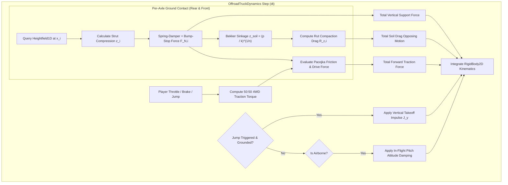
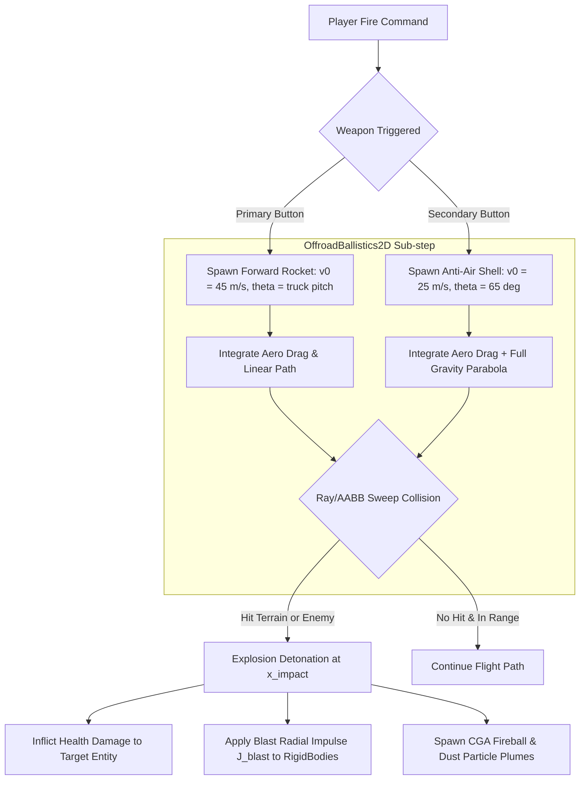
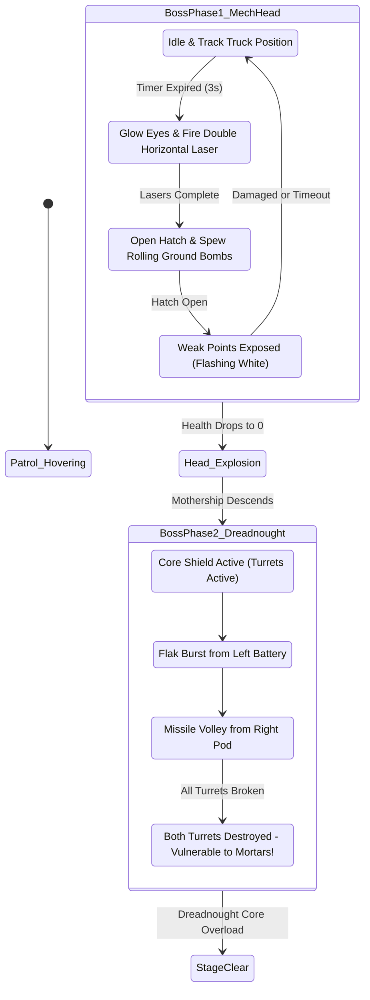
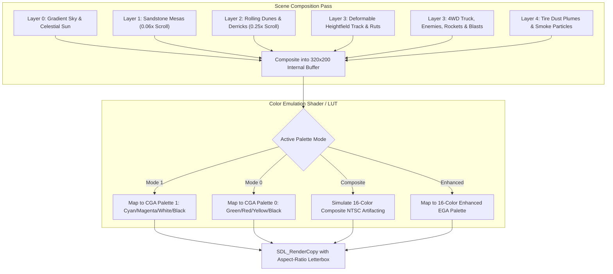

# Montsoft Offroad: C++17 & SDL Implementation Plan

## 1. Executive Summary & Game Concept

### 1.1 Historical Context: Monte Variakojis & Montsoft (1988)
In **1988**, independent developer **Monte Variakojis**, operating under his self-publishing shareware banner **Montsoft**, released ***Offroad*** (also distributed as *Off Road*) for MS-DOS personal computers. 

Borrowing foundational mechanics from Irem's 1982 arcade pioneer *Moon Patrol*, *Offroad* transposed the side-scrolling traversal loop into an aggressive, rugged **terrestrial desert combat** setting:
- **Vehicle**: A lifted, high-clearance **Four-Wheel-Drive (4WD) Desert Racing Truck** featuring heavy spring suspension and off-road knobby tires.
- **Combat Integration**: Unlike pure driving simulations, the player piloted an armed vehicle equipped with dual combat ordnance: a forward-firing horizontal cannon/missile system to destroy ground obstacles, landmines, and hostile vehicles, coupled with an upward/diagonal anti-air weapon system to neutralize airborne threats.
- **Enemies & Hazards**: Pitched battles against high-speed scout motorcycles, aggressive red chase buggies, strafing jet fighters, bouncing drone squares, hovering surveillance saucers, landmines, and boulder avalanches.
- **Surreal Boss Encounters**: Culminating in multi-stage boss duels—most famously a bizarre and iconic armored **Giant Mech Head** and flying battle cruisers.
- **Legacy**: *Offroad* stood as one of the earliest successful DOS shareware combat racers and served as the direct technological and design foundation for Variakojis's acclaimed 1990 follow-up, *Jumpjet*.

### 1.2 Core Vision: Reimagining Offroad in C++17 & SDL
This implementation plan establishes the architectural blueprint for **Montsoft Offroad**, a modern, high-fidelity reimagining built upon:
1. **Deterministic Physics**: Implemented in [libs/VehicleSimCore](../libs/VehicleSimCore) using pure standard C++17, simulating real 4WD suspension kinematics, tire traction, terramechanical soil sinkage (Bekker-Wong rutting), and ballistic projectile aerodynamics with strict IEEE 754 floating-point determinism.
2. **Authentic Retro Aesthetics with Modern Polish**: Built in [apps/MontsoftOffroad](../apps/MontsoftOffroad) with SDL2/SDL3, featuring an authentic, toggleable **CGA Graphics Pipeline** (Palette 1 Cyan/Magenta/White, Palette 0 Green/Red/Brown, NTSC Composite Color Artifacting, and an Enhanced 16-color EGA mode), 4-tier parallax desert backdrops, particle plumes, and synthetic PC-speaker retro chiptune audio.
3. **Complete 8-Level Campaign**: Delivering all 8 original level themes with progressive difficulty, enemy formations, and multi-phase boss battles.

### 1.3 Gameplay Pillar Comparison
The following table outlines how Montsoft Offroad expands upon both classic arcade inspiration and existing workspace projects:

| Design Dimension | Moon Patrol (1982) | Earth Patrol (Workspace App) | Montsoft Offroad (Proposed) |
| :--- | :--- | :--- | :--- |
| **Theme / Biome** | Lunar crater surface | Post-collapse Earth highway/alpine | Harsh desert badlands, arroyos, salt flats, volcanic crags |
| **Vehicle Configuration** | 3-axle / 6-wheel lunar buggy | 3-axle / 6-wheel articulated rover | **2-axle / 4WD high-clearance desert racing pickup truck** |
| **Suspension Model** | Basic spring hop | Linear spring-damper per axle | **Long-travel off-road struts + anti-roll torsion + differential** |
| **Terramechanics** | Static heightfield | Heightfield collision | **Deformable Bekker-Wong rutting (sand drag, mud sinkage)** |
| **Combat System** | Dual laser (forward & up) | Traversal-only (No weapons) | **Dual ordnance: Heavy kinetic rockets + anti-air flak mortars** |
| **Enemy Threats** | UFOs, rocks, craters | Rolling boulders, highway drones | **Motorcycles, red chase buggies, fighter jets, saucers, bosses** |
| **End-Level Battles** | Checkpoint milestone only | Checkpoint milestone only | **Stage Bosses (Armored Mech Head, Hover Cruiser, Gunship)** |
| **Visual Presentation** | 8-bit arcade RGB | Modern procedural vector SDL | **Authentic CGA Palette 0/1/Composite + Enhanced EGA mode** |
| **Audio Architecture** | Arcade FM / PSG | Procedural retro SFX | **Programmable PC-Speaker square-wave pulse synth engine** |

### 1.4 Decoupled Architectural Strategy
To guarantee strict compliance with project safety standards ([compliance.md](../.agents/rules/compliance.md)) and verification constraints ([verification-checklist.md](../.agents/rules/verification-checklist.md)):
- **Zero Graphics in Core**: [libs/VehicleSimCore](../libs/VehicleSimCore) contains no OS-specific code, no SDL headers, and no dynamic heap allocation in the hot simulation path.
- **Dedicated Dynamics Coordinator**: [OffroadTruckDynamics](../libs/VehicleSimCore/dynamics/OffroadTruckDynamics.h) implements [IVehicleDynamics](../libs/VehicleSimCore/dynamics/IVehicleDynamics.h) for 4WD mechanics.
- **Dedicated Ballistics System**: [OffroadBallistics2D](../libs/VehicleSimCore/dynamics/OffroadBallistics2D.h) computes physical projectile trajectories, aerodynamic drag, terrain impacts, and blast impulse transfer.
- **Standalone Game Application**: [apps/MontsoftOffroad](../apps/MontsoftOffroad) houses gameplay state machines, rendering shaders/rasterization, enemy AI logic, audio synthesis, and input polling.

---

## 2. High-Level Architecture & Component Decomposition

### 2.1 ASCII System Architecture Diagram

```
+---------------------------------------------------------------------------------------------------+
|                                      Montsoft Offroad Architecture                                |
+---------------------------------------------------------------------------------------------------+
|  [apps/MontsoftOffroad] (Game Application Layer - SDL2 / C++17)                                   |
|                                                                                                   |
|    +-------------------+    +--------------------+    +--------------------+                      |
|    |      GameApp      |--->|  GameStateMachine  |--->|  InputController   |                      |
|    +---------+---------+    +--------------------+    +--------------------+                      |
|              |                                                                                    |
|              +------------+----------------------+--------------------+--------------------+       |
|              |            |                      |                    |                    |      |
|              v            v                      v                    v                    v      |
|      +---------------+ +------------------+ +------------------+ +------------------+ +----------+|
|      |   Camera2D    | | ParallaxRenderer | |  CourseManager   | |   CombatManager  | | AudioSys ||
|      +---------------+ +------------------+ +------------------+ +--------+---------+ +----------+|
|              |                                       |                    |                       |
|              |                                       |                    v                       |
|              |                                       |           +------------------+             |
|              |                                       |           |   EnemyManager   |             |
|              |                                       |           +--------+---------+             |
|              |                                       |                    |                       |
|              |                                       |                    v                       |
|              |                                       |           +------------------+             |
|              |                                       |           |  BossController  |             |
|              |                                       |           +------------------+             |
|              |                                       |                    |                       |
|              +-------------------+-------------------+--------------------+                       |
|                                  |                                                                |
|                                  v                                                                |
|                       +-----------------------+                                                   |
|                       |  CgaPaletteRenderer   | (CGA Mode 0/1, Composite, EGA Emulator)           |
|                       +-----------------------+                                                   |
+----------------------------------+----------------------------------------------------------------+
                                   | Links against (Zero external dependencies)
                                   v
+---------------------------------------------------------------------------------------------------+
|  [libs/VehicleSimCore] (Physics, Terramechanics & Dynamics Layer - Pure C++17)                    |
|                                                                                                   |
|    +-----------------------------+       +-----------------------------+                          |
|    |    OffroadTruckDynamics     |------>|      RigidBody2D            |                          |
|    |  (4WD Twin-Axle Suspension) |       |  (Position, Vel, Rotation)  |                          |
|    +--------------+--------------+       +-----------------------------+                          |
|                   |                                                                               |
|                   +----------------------> [Heightfield1D]   (Continuous elevation & slopes)      |
|                   +----------------------> [DeformableTerrain] (Bekker-Wong sand rutting & drag) |
|                   +----------------------> [FluidDrag2D]     (Atmospheric drag & desert gusts)    |
|                   +----------------------> [PacejkaTireModel](Non-linear dirt friction & slip)   |
|                                                                                                   |
|    +-----------------------------+       +-----------------------------+                          |
|    |     OffroadBallistics2D     |------>|   ContactSolver2D / Ray2D   |                          |
|    |  (Rockets, Mortars, Blast)  |       |  (Impact & Impulse Forces)  |                          |
|    +-----------------------------+       +-----------------------------+                          |
+---------------------------------------------------------------------------------------------------+
```

### 2.2 Mermaid System Architecture Diagram

```mermaid
graph TD
    subgraph AppLayer ["Game Application Layer (apps/MontsoftOffroad)"]
        APP["GameApp (Fixed 60Hz Timestep Loop)"]
        GSM["GameStateMachine (Title, Briefing, Play, Boss, Over)"]
        INP["InputController (Gamepad / Keyboard)"]
        CAM["Camera2D (Lookahead Velocity Lead)"]
        PAR["ParallaxRenderer (4-Layer Desert Backdrop)"]
        CRS["CourseManager (8 Stages, Checkpoints A-E)"]
        CBT["CombatManager (Projectiles, Collision Grid)"]
        ENM["EnemyManager (Bikes, Chase Trucks, Jets, Saucers)"]
        BSS["BossController (Giant Mech Head, Dreadnought)"]
        CGA["CgaPaletteRenderer (CGA 0/1, Composite, EGA)"]
        AUD["AudioSystem (PC-Speaker Square Synth)"]

        APP --> GSM
        APP --> INP
        APP --> CAM
        APP --> CRS
        APP --> CBT
        APP --> ENM
        APP --> PAR
        APP --> CGA
        APP --> AUD
        CBT --> ENM
        ENM --> BSS
    end

    subgraph CoreLayer ["Core Simulation Layer (libs/VehicleSimCore)"]
        OTD["OffroadTruckDynamics (4WD Suspension Coordinator)"]
        OB2["OffroadBallistics2D (Rockets, Mortars & Blast)"]
        RB["RigidBody2D (Chassis Kinematics)"]
        HF["Heightfield1D (Continuous Surface Normal/Height)"]
        DT["DeformableTerrain (Bekker-Wong Soil Sinkage & Ruts)"]
        FD["FluidDrag2D (Atmospheric Resistance & Wind)"]
        PT["PacejkaTireModel (Off-road Slip Traction)"]

        OTD --> RB
        OTD --> HF
        OTD --> DT
        OTD --> FD
        OTD --> PT
        OB2 --> HF
    end

    APP -->|Coordinates Fixed Steps| OTD
    CBT -->|Steps Ballistics & Blasts| OB2
    CRS -->|Evaluates Surface Rays| HF
    CGA -->|Visualizes Entities & Ruts| DT
```



---

## 3. Terramechanics & 4WD Off-Road Truck Physics (`VehicleSimCore`)

### 3.1 4WD Twin-Axle Suspension & Powertrain Kinematics
The truck is modeled as a rigid body chassis coupled with two independent suspension axles (Rear $W_0$, Front $W_1$):
- **Wheelbase ($L = x_F - x_R \approx 2.4\,\text{m}$)**: Optimized for conquering sand moguls, boulders, and steep arroyo grades.
- **Long-Travel Suspension Struts**: Heavy-duty coil springs with progressive non-linear bump stops preventing hard chassis bottoming.
- **Anti-Roll Torsion Coupling**: Stabilizes high-speed pitching over sudden terrain drops.
- **4WD Powertrain Split**: Center differential with equal 50:50 torque delivery between front and rear axles, allowing relentless hill climbs even when one axle is partially unloaded.
- **Bekker-Wong Terramechanics**: Wheels sink into soft sand dunes and mud pits, generating soil rut drag $R_c$ and permanently deflecting the terrain profile.

### 3.2 Mathematical Formulation

#### 1. Suspension Spring-Damper & Bump-Stop Force
For axle $i \in \{0, 1\}$ (where $0 = \text{Rear}$, $1 = \text{Front}$):
$$y_{\text{ground}, i} = h(x_i), \quad \hat{\mathbf{n}}_i = \frac{(-\frac{dh}{dx}, 1)}{\sqrt{1 + (\frac{dh}{dx})^2}}$$
Strut compression displacement $z_i$:
$$z_i = (y_{\text{ground}, i} + r_{\text{tire}}) - y_{\text{axle}, i}$$
If $z_i > 0$ (wheel is in ground contact), the normal suspension force $F_{N, i}$ is:
$$F_{N, i} = \max\left(0.0, \, k_s \cdot z_i + c_s \cdot \dot{z}_i + k_{\text{bump}} \cdot \max(0.0, z_i - z_{\text{bump}})^2\right)$$
where $k_s$ is primary spring stiffness ($28\,000\,\text{N/m}$), $c_s$ is damping ($2\,200\,\text{N}\cdot\text{s/m}$), and $k_{\text{bump}}$ is the quadratic elastomer bump-stop stiffness ($150\,000\,\text{N/m}^2$).

#### 2. Bekker-Wong Soil Sinkage & Rut Drag
Using semi-empirical terramechanics matching [DeformableTerrain](../libs/VehicleSimCore/terrain/DeformableTerrain.h):
$$p_i = \frac{F_{N, i}}{b \cdot \ell_p}$$
Sinkage depth $z_{\text{soil}, i}$:
$$z_{\text{soil}, i} = \left(\frac{p_i}{\frac{k_c}{b} + k_\phi}\right)^{\frac{1}{n}}$$
Soil compaction resistance force opposing forward velocity:
$$R_{c, i} = b \cdot \left(\frac{k_c}{b} + k_\phi\right) \frac{z_{\text{soil}, i}^{n+1}}{n+1}$$
This drag is directly applied as an opposing horizontal force on the chassis, simulating the sluggish, churning sensation of deep dune sand or marsh mud.

#### 3. 4WD Longitudinal Traction Force
Driven by a center-differential 50:50 torque split:
$$F_{\text{drive}, i} = 0.5 \cdot T_{\text{engine}} \cdot \frac{G_{\text{ratio}}}{r_{\text{tire}}} \cdot \text{throttle}$$
Actual contact traction force is capped by the Coulomb-Pacejka friction envelope:
$$F_{\text{tract}, i} = \text{clamp}\left(F_{\text{drive}, i} - F_{\text{brake}, i}, \, -\mu_i F_{N, i}, \, \mu_i F_{N, i}\right)$$

#### 4. Jump Thruster Kinematics
Pressing the Jump button injects an instantaneous vertical impulse $J_y = m \cdot v_{\text{jump}}$ when grounded, launching the 4WD truck over chasms. An in-flight attitude stabilizer exerts corrective torque $\tau_{\text{air}} = -k_\theta \cdot \theta - c_\theta \cdot \omega$ to keep the truck level for landing.

### 3.3 ASCII & Mermaid Diagrams: Suspension & Terramechanics

```
  ASCII Diagram: 4WD Desert Truck Suspension & Soil Rutting
  
                         Chassis Center of Mass (CoM)
                                     |
                                     v
                  +-----------------------------------------+
                  |         Montsoft Offroad 4WD Truck      |=======> Forward Missile
                  +------------+-----------------------+----+
                               |                       |
                          k, c |                  k, c |  (Long-Travel Struts)
                              / \                     / \
                             |   |                   |   |
                              \ /                     \ /
                               |                       |
                          [ Rear Axle ]           [ Front Axle ]
                          (   W_0     )           (   W_1      )
                    -------'----+----'-------------'----+----'------- Original Surface h_0
                    \           |    /             \    |    /
                     \  z_soil  v   /               \   v   /  Compaction Sinkage
                      '------------'                 '-----'
                      ======|======                  ===|===  Bekker Soil Layer (Rc Drag)
```



---

## 4. Ballistics & Combat Physics (`VehicleSimCore`)

### 4.1 Dual Weapon Ballistic System
Montsoft *Offroad* is defined by its two distinct weapon trajectories:
1. **Forward Heavy Missile / Rocket**:
   - Fired horizontally along the truck's forward heading ($+X$).
   - Flat, high-velocity trajectory ($v_0 \approx 45\,\text{m/s}$) with light aerodynamic drop.
   - Designed to punch through oncoming scout dirt bikes, chase trucks, rocks, and ground landmines.
2. **High-Angle Anti-Air Mortar / Sky Flak**:
   - Launched at an elevated angle ($\theta_0 \approx 65^\circ$) with medium velocity ($v_0 \approx 25\,\text{m/s}$).
   - Follows a classic parabolic ballistic arc subject to full gravity ($g = 9.81\,\text{m/s}^2$).
   - Designed to strike overhead strafing jets, hovering alien saucers, bouncing squares, and elevated boss weak points.

### 4.2 Mathematical Formulation

#### 1. Projectile Flight Equations of Motion
For each projectile with position $\mathbf{p} = [x, y]^T$, velocity $\mathbf{v} = [v_x, v_y]^T$, mass $m_p$, and aerodynamic drag coefficient $C_d$:
$$\mathbf{F}_{\text{drag}} = -\frac{1}{2} \rho C_d A_p \|\mathbf{v}\| \mathbf{v}$$
$$\frac{d\mathbf{v}}{dt} = \frac{\mathbf{F}_{\text{drag}}}{m_p} + \begin{bmatrix} 0 \\ -g \end{bmatrix}$$
$$\frac{d\mathbf{p}}{dt} = \mathbf{v}$$
Solved using Symplectic Euler integration at fixed sub-steps for absolute trajectory determinism.

#### 2. Blast Radius Impulse Transfer
Upon impact with an entity or terrain at point $\mathbf{x}_{\text{impact}}$, an explosive pressure wave expands over radius $R_{\text{blast}}$. Any nearby [RigidBody2D](../libs/VehicleSimCore/physics/RigidBody2D.h) receives an explosive impulse $\mathbf{J}_{\text{blast}}$:
$$\mathbf{r} = \mathbf{x}_{\text{body}} - \mathbf{x}_{\text{impact}}, \quad d = \|\mathbf{r}\|$$
If $d < R_{\text{blast}}$:
$$\mathbf{J}_{\text{blast}} = J_{\text{max}} \cdot \left(1 - \frac{d}{R_{\text{blast}}}\right)^2 \frac{\mathbf{r}}{d}$$
$$\Delta \mathbf{v}_{\text{body}} = \frac{\mathbf{J}_{\text{blast}}}{m_{\text{body}}}, \quad \Delta \omega_{\text{body}} = \frac{(\mathbf{r}_{\text{offset}} \times \mathbf{J}_{\text{blast}})_z}{I_{\text{body}}}$$
This allows rocket blasts to launch defeated enemy buggies and airborne drone debris into spectacular physics tumble trajectories.

### 4.3 ASCII & Mermaid Diagrams: Ballistic Trajectories & Blast Transfer

```
  ASCII Diagram: Dual Weapon Ballistic Paths & Blast Radius
  
                            [ Overhead Jet / Saucer ]
                                      ^
                                     /
                                    /   Parabolic Arc (theta = 65 deg)
                                   /    Anti-Air Mortar
                                  /
                                 /
     +--------------------------+
     |   Montsoft Offroad 4WD   |----------> High-Speed Rocket (Flat Trajectory) ----* [ Ground Target ]
     +--------------------------+                                                    |
                                                                             /====== * ======\
                                                                            |  Blast Radius   |
                                                                            |  J_blast Imp.   |
                                                                             \===============/
```



---

## 5. Level Design & 8 Distinct Stages

### 5.1 Overview of 8 Classic Montsoft Levels
True to Monte Variakojis's original 1988 design, the game features **8 progressively challenging stages**, transitioning across distinctive geological biomes:

```
+---------------------------------------------------------------------------------------------------+
| Stage 1: Dunes of Mojave                                                                          |
| - Atmosphere: Blazing midday desert sun, waving dunes, distant oil derricks.                      |
| - Terrain: Rolling sand dunes with moderate moguls, shallow sand rutting.                         |
| - Threats: Fast scout dirt bikes, small roadside craters, static landmines.                       |
+---------------------------------------------------------------------------------------------------+
| Stage 2: Red Rock Arroyo                                                                          |
| - Atmosphere: Jagged copper-red sandstone cliffs, dry wash riverbeds.                             |
| - Threats: Tumbling boulders rolling down slopes, high-speed strafing fighter jets.               |
| - Obstacles: Deep sandstone chasms requiring full-throttle approach jumps.                        |
+---------------------------------------------------------------------------------------------------+
| Stage 3: Great Salt Flats                                                                         |
| - Atmosphere: Gleaming white salt crust, heat-shimmer mirages, mountain shadows.                  |
| - Threats: Aggressive red chase trucks that match player speed and ram from behind.               |
| - Special: Bouncing drone squares executing erratic harmonic jumps.                               |
+---------------------------------------------------------------------------------------------------+
| Stage 4: Muddy Quagmire & Swamp Crossing                                                          |
| - Atmosphere: Gloomy marshland, murky brown silt, mossy cypress stumps.                           |
| - Terramechanics: Extreme Bekker soil sinkage, heavy rut drag, slippery traction.                 |
| - Threats: Hovercraft patrol scouts, submerged sinkholes.                                         |
| - Boss: Heavy Armored Assault Hovercraft (twin machine-gun pods).                                 |
+---------------------------------------------------------------------------------------------------+
| Stage 5: Volcanic Badlands & Lava Crags                                                           |
| - Atmosphere: Smoldering basalt cliffs, glowing magma veins, dark soot clouds.                    |
| - Threats: Falling volcanic magma bombs, magma crevasses (instant fatal incineration).            |
| - Enemies: Armored tracked artillery crawlers firing high-angle shells.                           |
+---------------------------------------------------------------------------------------------------+
| Stage 6: Scrap Canyon Wasteland                                                                   |
| - Atmosphere: Post-industrial junkyard valley, rusted car piles, crumbling steel girders.        |
| - Threats: Crushed car barrier stacks, slippery toxic sludge slicks (zero friction).              |
| - Airborne: Heavily armored strafing attack gunships with searchlights.                           |
+---------------------------------------------------------------------------------------------------+
| Stage 7: Alpine Scree Ridge                                                                       |
| - Atmosphere: High-altitude mountain pass, razor rock spires, thin atmosphere.                    |
| - Threats: Loose scree gravel causing spontaneous slideouts, high-altitude bomber zeppelins.      |
| - Traversal: Step-up cliff ledges demanding rhythmic suspension loading.                         |
+---------------------------------------------------------------------------------------------------+
| Stage 8: Montsoft Secret Fortress                                                                 |
| - Atmosphere: Concrete blast bunkers, barbed wire fences, radar dishes, searchlights.             |
| - Hazards: Laser tripwires, retractable barricades, dense anti-vehicle minefields.                |
| - Final Boss Dual Phase:                                                                          |
|   Phase 1: The Iconic Giant Mech Head (vulnerable eye sensors, launches missile volleys).        |
|   Phase 2: Heavy Dreadnought Battlecruiser (descending mothership with rotating laser cannons).   |
+---------------------------------------------------------------------------------------------------+
```

### 5.2 Course Checkpoints & Pacing
Each stage is segmented into five lettered milestone sectors:
$$\text{Start} \longrightarrow \mathbf{Point\,A} \longrightarrow \mathbf{Point\,B} \longrightarrow \mathbf{Point\,C} \longrightarrow \mathbf{Point\,D} \longrightarrow \mathbf{Point\,E\,(Finish / Boss)}$$
- Passing each checkpoint records split times, awards pacing bonuses, and serves as the vehicle respawn anchor upon crash.

---

## 6. Enemy AI Hierarchy & Boss Battle Systems

### 6.1 Ground Threat AI

```
+---------------------------------------------------------------------------------------------------+
| Ground Enemy Hierarchy                                                                            |
+---------------------------------------------------------------------------------------------------+
| 1. Scout Dirt Bike: Light, nimble, high closing speed. Easily destroyed with a single rocket.     |
| 2. Red Chase Buggy: Heavy, matches player speed, actively maneuvers to ram the player from rear.   |
| 3. Buried Landmine: Small, partially concealed in sand/mud ruts. Destructible with forward cannon.|
| 4. Tracked Artillery Crawler: Fires ballistic mortar shells toward player position.               |
+---------------------------------------------------------------------------------------------------+
```

### 6.2 Aerial Threat AI
1. **Strafing Jet Fighter**: Sweeps across screen from top-right to bottom-left at $60\,\text{m/s}$, firing dual downward machine guns. Must be intercepted with timed anti-air mortar.
2. **Hovering Alien Saucer**: Approaches at medium altitude, matching horizontal speed with player and pulsing vertical energy bombs.
3. **Bouncing Drone Square**: Executes erratic vertical sinusoidal hops ($y(t) = y_0 + A \sin(\omega t)$) while drifting leftward, demanding prediction for weapon targeting.

### 6.3 Stage Boss Encounters

#### Stage 8 Boss Phase 1: The Giant Mech Head
An authentic recreation of the surreal signature boss of Monte Variakojis's original 1988 *Offroad*:
- **Appearance**: A giant armored mechanical stone/steel head anchored at the right screen boundary.
- **Attack Cycle**:
  1. *Eye Laser Barrage*: Red eye sensors glow, firing dual high-energy horizontal beam bursts.
  2. *Cluster Bomb Breath*: Mouth hatch opens to vomit a cluster of rolling ground bombs.
  3. *Sonic Roar Shockwave*: Emits a physical impulse shockwave that compresses the truck's suspension and induces heavy pitch torque.
- **Weak Point**: The open mouth hatch and flashing eye sensors during laser warm-up.

#### Stage 8 Boss Phase 2: The Dreadnought Battlecruiser
Following the destruction of the Mech Head, an ominous heavy aerial battlecruiser descends from the sky:
- **Phase Mechanics**: Features 3 destructible turret sub-systems (Left Flak Pod, Right Missile Silo, Core Reactor). Destroying both weapon pods exposes the central reactor for the finishing anti-air strike.

### 6.4 ASCII & Mermaid Diagrams: Enemy & Boss State Machine

```
  ASCII Diagram: Boss Phase 1 - Giant Mech Head Battle Arena
  
                                                  [ Eye Lasers ]
                                                   (O)      (O)
                                                    \        /
                                                +----+------+----+
                                                |   Armored      |
       [ High-Angle Anti-Air Mortar ]           |   Mech Head    |
                     ^                          |   (Boss 1)     |
                    /                           |                |
                   /                            |   [Mouth Hatch]|
                  /                             +--------+-------+
       +---------+                                       |
       | 4WD     |==========> Forward Cannon             v
       | Truck   |                               [ Cluster Bombs ]
  ====='----+----'======================================='-------'===== Terrain Surface
```



---

## 7. Graphics, CGA Palette Emulation & Parallax Rendering

### 7.1 Retro CGA Display Pipeline
To capture the authentic 1988 DOS aesthetic while delivering smooth 60 Hz modern rendering:
- **Base Native Resolution**: Emulated at $320 \times 200$ (or scaled integer multiple $1280 \times 800$), preserving razor-sharp pixel aspect ratio.
- **Four Selectable Color Modes**:
  1. **CGA Palette 1 (High-Intensity)**: Black (`#000000`), Cyan (`#55FFFF`), Magenta (`#FF55FF`), White (`#FFFFFF`). (The iconic default MS-DOS look).
  2. **CGA Palette 0 (High-Intensity)**: Black (`#000000`), Green (`#55FF55`), Red (`#FF5555`), Yellow/Brown (`#FFFF55`).
  3. **Composite Color NTSC Emulation**: 16-color simulated artifacting mimicking early IBM PC composite video monitors.
  4. **Enhanced 16-Color EGA Mode**: Rich desert tans (`#AA5500`), rust red, sky cyan, and golden sand dunes for players desiring retro warmth.

### 7.2 Multi-Layer Desert Parallax Backdrop
The camera renders four distinct depth layers:

```
+---------------------------------------------------------------------------------------------------+
| Layer 0: Sky Gradient & Blazing Sun [Scroll Speed: 0.00x - Fixed Celestial Frame]                 |
+---------------------------------------------------------------------------------------------------+
| Layer 1: Distant Desert Buttes & Sandstone Mesas [Scroll Speed: 0.06x - Slowest Parallax]         |
+---------------------------------------------------------------------------------------------------+
| Layer 2: Midground Rolling Sand Dunes & Oil Derricks [Scroll Speed: 0.25x - Mid Parallax]         |
+---------------------------------------------------------------------------------------------------+
| Layer 3: Foreground Continuous Heightfield Track & Obstacles [Scroll Speed: 1.00x - World Speed]  |
+---------------------------------------------------------------------------------------------------+
| Layer 4: Particle Overlays (Tire dust plumes, rocket smoke, sparks) & HUD [Fixed Screen Space]    |
+---------------------------------------------------------------------------------------------------+
```

### 7.3 ASCII & Mermaid Diagrams: CGA Rendering Pipeline

```
  ASCII Diagram: CGA Color Quantization & Parallax Composition
  
  [ World Entities & Heightfield ]      [ Multi-Layer Parallax Backdrops ]
                \                                     /
                 \                                   /
                  v                                 v
          +-------------------------------------------------+
          |        Virtual 320x200 32-bit Framebuffer       |
          +-------------------------------------------------+
                                  |
                                  v
          +-------------------------------------------------+
          |    CGA Quantization & Color Palette Mapping     |
          |    (Palette 1: Black, Cyan, Magenta, White)     |
          +-------------------------------------------------+
                                  |
                                  v
          +-------------------------------------------------+
          | Hardware Scaled SDL2 Renderer (Aspect-Preserved)|
          +-------------------------------------------------+
```



---

## 8. Retro Audio Synthesis & Sound Design

### 8.1 PC-Speaker Square-Wave Synthesizer Emulation
To faithfully replicate the unmistakable sonic character of 1988 DOS shareware gaming without relying on external sampled audio files:
- Built in [AudioSystem](../apps/MontsoftOffroad/AudioSystem.h) using SDL's audio callback stream.
- **Programmable Square-Wave Oscillator**: Generates classic 8253 PIT (Programmable Interval Timer) frequency sweeps and pulsed duty cycles.
- **Pseudo-Random White Noise Generator**: Uses a deterministic 16-bit Galois Linear Feedback Shift Register (LFSR) to produce crunchy, uncompressed explosion blasts and tire screech bursts.
- **Dynamic Engine Pitch Modulation**: The truck's engine sound is synthesized as a continuous low-frequency square wave whose fundamental frequency scales dynamically with chassis speed:
  $$f_{\text{engine}} = f_{\text{idle}} + \left(\frac{v_x}{v_{\text{max}}}\right) \cdot (f_{\text{redline}} - f_{\text{idle}})$$
  where $f_{\text{idle}} = 65\,\text{Hz}$ and $f_{\text{redline}} = 280\,\text{Hz}$.

### 8.2 Sound Effect Event Table

| Sound Event | Waveform / Synthesis Algorithm | Frequency Range | Envelope Duration |
| :--- | :--- | :--- | :--- |
| **Engine Hum** | Continuous square wave (50% duty cycle) | $65\,\text{Hz} - 280\,\text{Hz}$ | Continuous |
| **Jump Thruster** | Exponential rising pitch chirp | $180\,\text{Hz} \to 880\,\text{Hz}$ | $0.22\,\text{s}$ |
| **Rocket Launch** | Dual-tone downward frequency slide | $950\,\text{Hz} \to 320\,\text{Hz}$ | $0.15\,\text{s}$ |
| **Anti-Air Mortar** | Low-frequency thump + high pop | $90\,\text{Hz} \to 440\,\text{Hz}$ | $0.18\,\text{s}$ |
| **Explosion / Crash** | 16-bit LFSR white noise with low-pass decay | Broadband noise | $0.65\,\text{s}$ |
| **Enemy Hit (Clink)**| High metallic square ping | $1200\,\text{Hz} \to 1800\,\text{Hz}$ | $0.06\,\text{s}$ |
| **Boss Laser Warning**| Rapid oscillating square warble | $440\,\text{Hz} \leftrightarrow 660\,\text{Hz}$ | $0.40\,\text{s}$ |
| **Stage Clear Fanfare**| 4-note arpeggiated retro chiptune jingle | $523\,\text{Hz} \to 659\,\text{Hz} \to 784\,\text{Hz} \to 1046\,\text{Hz}$ | $1.20\,\text{s}$ |

---

## 9. Detailed C++17 Class & Interface Specifications

### 9.1 `libs/VehicleSimCore/dynamics/OffroadTruckDynamics.h`

```cpp
#pragma once

#include <array>
#include <cstddef>
#include <vector>

#include "libs/VehicleSimCore/dynamics/IVehicleDynamics.h"
#include "libs/VehicleSimCore/math/Vec2.h"
#include "libs/VehicleSimCore/terrain/Heightfield1D.h"

namespace vehicle_sim::physics {
class RigidBody2D;
} // namespace vehicle_sim::physics

namespace vehicle_sim::terrain {
class DeformableTerrain;
} // namespace vehicle_sim::terrain

namespace vehicle_sim::dynamics {

/// @struct OffroadAxleConfig
/// @brief Configuration parameters for a heavy-duty 4WD truck suspension axle.
struct OffroadAxleConfig {
    double longitudinalOffset { 0.0 };   ///< Chassis X offset from CoM in meters.
    double restLength { 0.70 };          ///< Uncompressed suspension strut length in meters.
    double springStiffness { 28000.0 };  ///< Suspension spring constant k in N/m.
    double dampingCoeff { 2200.0 };      ///< Viscous damping coefficient c in N*s/m.
    double bumpStopStiffness { 150000.0 }; ///< Non-linear elastomer bump stop stiffness in N/m^2.
    double bumpStopDistance { 0.22 };   ///< Strut deflection threshold activating bump stop.
    double tireRadius { 0.42 };          ///< Off-road knobby tire radius in meters.
    double tireWidth { 0.28 };           ///< Tire contact patch width in meters.
};

/// @struct OffroadTruckConfig
/// @brief Mechanical, suspension, and terramechanic parameters for the 4WD truck.
struct OffroadTruckConfig {
    double mass { 1450.0 };              ///< Chassis mass in kg.
    double momentOfInertia { 1200.0 };   ///< Chassis pitch rotational inertia in kg*m^2.
    double gravity { 9.81 };             ///< Downward acceleration in m/s^2.
    double airDensity { 1.225 };         ///< Atmospheric air density in kg/m^3.
    double dragCoefficient { 0.52 };     ///< Frontal aerodynamic drag coefficient Cd.
    double frontalArea { 2.1 };          ///< Projected frontal aerodynamic area in m^2.

    double maxDriveForce { 8500.0 };     ///< Total forward 4WD traction capacity in N.
    double maxBrakeForce { 11000.0 };    ///< Total 4WD service braking force capacity in N.
    double jumpSpeed { 8.8 };            ///< Upward takeoff impulse speed in m/s.
    double pitchStabGain { 1600.0 };     ///< Mid-air attitude stabilization torque gain.
    double antiRollTorqueGain { 3500.0 };///< Anti-roll pitch stiffness coupling axles.

    std::array<OffroadAxleConfig, 2> axles {
        OffroadAxleConfig{ -1.20, 0.70, 28000.0, 2200.0, 150000.0, 0.22, 0.42, 0.28 }, // Rear
        OffroadAxleConfig{  1.20, 0.70, 28000.0, 2200.0, 150000.0, 0.22, 0.42, 0.28 }  // Front
    };
};

/// @struct OffroadTruckInput
/// @brief Semantic driver control inputs for the 4WD desert truck.
struct OffroadTruckInput {
    double throttle { 0.0 }; ///< Normalized forward drive in [0.0, 1.0].
    double brake { 0.0 };    ///< Normalized brake in [0.0, 1.0].
    bool jump { false };     ///< Upward jump thruster command.
    bool firePrimary { false };   ///< Command to fire forward kinetic rocket.
    bool fireSecondary { false }; ///< Command to fire high-angle anti-air mortar.
};

/// @struct OffroadAxleState
/// @brief Diagnostic runtime suspension and terramechanic telemetry per axle.
struct OffroadAxleState {
    math::Vec2 worldPos { 0.0, 0.0 };       ///< Wheel contact center in world coordinates.
    double compression { 0.0 };              ///< Strut displacement from rest in meters.
    double normalForce { 0.0 };              ///< Vertical ground reaction force in Newtons.
    double tractionForce { 0.0 };            ///< Tangential longitudinal force in Newtons.
    double soilSinkage { 0.0 };              ///< Bekker soil rut penetration depth in meters.
    double soilDragForce { 0.0 };            ///< Compaction resistance force opposing motion in N.
    bool isGrounded { false };               ///< Ground contact flag.
};

/// @class OffroadTruckDynamics
/// @brief 4WD desert racing truck dynamics coordinator.
/// @details Simulates independent long-travel spring-damper suspension with non-linear bump stops,
/// 50:50 4WD differential drive, Bekker terramechanic soil rut drag, and in-flight attitude stabilization.
class OffroadTruckDynamics final : public IVehicleDynamics {
public:
    static constexpr std::size_t kAxleCount { 2 };
    static constexpr std::size_t kRearAxle { 0 };
    static constexpr std::size_t kFrontAxle { 1 };

    /// @brief Default constructor using nominal 4WD desert truck parameters.
    OffroadTruckDynamics() noexcept;

    /// @brief Parameterized constructor using configuration settings.
    /// @param[in] config Vehicle mechanical and suspension configuration.
    explicit OffroadTruckDynamics(const OffroadTruckConfig& config) noexcept;

    /// @brief Destructor.
    ~OffroadTruckDynamics() noexcept override = default;

    /// @brief Advances 4WD truck dynamics simulation by timestep dt.
    /// @param[in,out] body Rigid body chassis receiving powertrain and suspension forces.
    /// @param[in] dt Timestep duration in seconds.
    void step(physics::RigidBody2D& body, double dt) noexcept override;

    /// @brief Resets transient state.
    void reset() noexcept override;

    /// @brief Checks if both axles are detached from the ground.
    /// @return True if truck is completely airborne.
    [[nodiscard]] bool isAirborne() const noexcept override;

    /// @brief Sets active driver control inputs.
    /// @param[in] input Control input commands.
    void setInput(const OffroadTruckInput& input) noexcept;

    /// @brief Gets active driver control inputs.
    /// @return Constant reference to active OffroadTruckInput.
    [[nodiscard]] const OffroadTruckInput& getInput() const noexcept;

    /// @brief Sets terrain heightfield reference for elevation and slope queries.
    /// @param[in] terrain Pointer to continuous 1D heightfield.
    void setTerrain(const terrain::Heightfield1D* terrain) noexcept;

    /// @brief Sets deformable terrain reference for Bekker rutting.
    /// @param[in] deformable Pointer to deformable terrain system.
    void setDeformableTerrain(terrain::DeformableTerrain* deformable) noexcept;

    /// @brief Triggers an upward jump impulse.
    /// @param[in] speed Upward vertical speed in m/s (0 uses config default).
    void triggerJump(double speed = 0.0) noexcept;

    /// @brief Gets telemetry snapshot for an axle.
    /// @param[in] index Axle index (0 = Rear, 1 = Front).
    /// @return Reference to OffroadAxleState.
    [[nodiscard]] const OffroadAxleState& getAxleState(std::size_t index) const noexcept;

    /// @brief Gets vehicle configuration parameters.
    /// @return Constant reference to active OffroadTruckConfig.
    [[nodiscard]] const OffroadTruckConfig& getConfig() const noexcept;

private:
    OffroadTruckConfig config_ {};
    OffroadTruckInput input_ {};
    const terrain::Heightfield1D* terrain_ { nullptr };
    terrain::DeformableTerrain* deformableTerrain_ { nullptr };
    std::array<OffroadAxleState, kAxleCount> axleStates_ {};
    bool isAirborne_ { false };
    bool jumpRequested_ { false };
};

} // namespace vehicle_sim::dynamics
```

### 9.2 `libs/VehicleSimCore/dynamics/OffroadBallistics2D.h`

```cpp
#pragma once

#include <cstddef>
#include <vector>

#include "libs/VehicleSimCore/math/Vec2.h"
#include "libs/VehicleSimCore/terrain/Heightfield1D.h"

namespace vehicle_sim::physics {
class RigidBody2D;
} // namespace vehicle_sim::physics

namespace vehicle_sim::dynamics {

/// @enum ProjectileType
/// @brief Classification of ballistic combat ordnance.
enum class ProjectileType : std::uint8_t {
    ForwardRocket,   ///< High-speed horizontal kinetic missile.
    AntiAirMortar    ///< High-angle parabolic anti-air flak shell.
};

/// @struct ProjectileConfig
/// @brief Physical and damage properties for a projectile class.
struct ProjectileConfig {
    double mass { 8.0 };                ///< Projectile mass in kg.
    double muzzleVelocity { 45.0 };     ///< Launch speed in m/s.
    double launchAngleOffset { 0.0 };   ///< Relative launch angle offset in radians.
    double dragCoefficient { 0.25 };    ///< Aerodynamic drag coefficient Cd.
    double crossSectionArea { 0.02 };   ///< Frontal area in m^2.
    double blastRadius { 2.5 };         ///< Explosive blast radius in meters.
    double blastMaxImpulse { 4500.0 };  ///< Peak explosive impulse at epicenter in N*s.
    double baseDamage { 50.0 };         ///< Damage points inflicted at epicenter.
    double maxLifespan { 4.0 };         ///< Maximum active flight time in seconds.
};

/// @struct ProjectileState
/// @brief Kinetic and visual state of an active in-flight projectile.
struct ProjectileState {
    ProjectileType type { ProjectileType::ForwardRocket };
    math::Vec2 position { 0.0, 0.0 };
    math::Vec2 velocity { 0.0, 0.0 };
    double age { 0.0 };
    bool isAlive { true };
};

/// @struct BlastEvent
/// @brief Telemetry of an explosion detonation for visual/sound triggering.
struct BlastEvent {
    math::Vec2 epicenter { 0.0, 0.0 };
    double radius { 2.5 };
    double intensity { 1.0 };
};

/// @class OffroadBallistics2D
/// @brief Ballistic trajectory integrator and explosion impulse coordinator.
class OffroadBallistics2D final {
public:
    /// @brief Default constructor.
    OffroadBallistics2D() noexcept;

    /// @brief Advances all active projectiles by timestep dt.
    /// @param[in] dt Timestep duration in seconds.
    /// @param[in] terrain Pointer to heightfield for ground collision checks.
    void step(double dt, const terrain::Heightfield1D* terrain) noexcept;

    /// @brief Spawns a forward kinetic missile.
    /// @param[in] origin Launch position in world coordinates.
    /// @param[in] heading Truck heading angle in radians.
    /// @param[in] baseVelocity Initial velocity of launcher vehicle in m/s.
    void fireRocket(const math::Vec2& origin, double heading, const math::Vec2& baseVelocity) noexcept;

    /// @brief Spawns a high-angle anti-air mortar shell.
    /// @param[in] origin Launch position in world coordinates.
    /// @param[in] baseVelocity Initial velocity of launcher vehicle in m/s.
    void fireMortar(const math::Vec2& origin, const math::Vec2& baseVelocity) noexcept;

    /// @brief Applies explosive blast impulses to nearby rigid bodies.
    /// @param[in] blast Detonation event parameters.
    /// @param[in,out] bodies Array of pointers to rigid bodies in scene.
    void applyBlast(const BlastEvent& blast, const std::vector<physics::RigidBody2D*>& bodies) noexcept;

    /// @brief Gets constant reference to active projectiles.
    /// @return Vector of active ProjectileState instances.
    [[nodiscard]] const std::vector<ProjectileState>& getProjectiles() const noexcept;

    /// @brief Consumes and clears pending detonation events from current step.
    /// @return Vector of BlastEvent instances.
    [[nodiscard]] std::vector<BlastEvent> consumeBlasts() noexcept;

    /// @brief Clears all active projectiles.
    void reset() noexcept;

private:
    std::vector<ProjectileState> projectiles_ {};
    std::vector<BlastEvent> pendingBlasts_ {};
    ProjectileConfig rocketConfig_ {};
    ProjectileConfig mortarConfig_ {};
};

} // namespace vehicle_sim::dynamics
```

### 9.3 Application Layer Classes (`apps/MontsoftOffroad/`)
- **`apps/MontsoftOffroad/CMakeLists.txt`**: Target definition linking SDL2 and `VehicleSimCore`.
- **`apps/MontsoftOffroad/Main.cpp`**: Bootstrapper with exception trapping.
- **`apps/MontsoftOffroad/GameApp.h` & `.cpp`**: High-precision fixed-timestep loop (60 Hz accumulator).
- **`apps/MontsoftOffroad/SDLWrappers.h`**: RAII deleters for `SDL_Window`, `SDL_Renderer`, `SDL_Texture`.
- **`apps/MontsoftOffroad/GameStateMachine.h` & `.cpp`**: Coordinates states (`TitleScreen`, `MissionBriefing`, `Playing`, `BossBattle`, `StageClear`, `GameOver`).
- **`apps/MontsoftOffroad/CourseManager.h` & `.cpp`**: Procedural and authored streaming for the 8 desert stages.
- **`apps/MontsoftOffroad/CombatManager.h` & `.cpp`**: Bridges `OffroadBallistics2D` with game entities, bounding boxes, and hit detection.
- **`apps/MontsoftOffroad/EnemyManager.h` & `.cpp`**: AI coordinators for motorcycles, chase trucks, jets, and bouncing saucers.
- **`apps/MontsoftOffroad/BossController.h` & `.cpp`**: Phase management for the Giant Mech Head and Dreadnought Cruiser.
- **`apps/MontsoftOffroad/CgaPaletteRenderer.h` & `.cpp`**: Color conversion shader/LUT supporting CGA Modes 0, 1, Composite, and EGA.
- **`apps/MontsoftOffroad/Camera2D.h` & `.cpp`**: Dynamic tracking with velocity lead and terrain boundary clamping.
- **`apps/MontsoftOffroad/ParallaxRenderer.h` & `.cpp`**: 4-layer desert background scroller.
- **`apps/MontsoftOffroad/AudioSystem.h` & `.cpp`**: PC-Speaker square-wave pulse synthesizer.
- **`apps/MontsoftOffroad/ParticleSystem.h` & `.cpp`**: Tire dust clouds, rocket exhaust, explosive fireballs, and mechanical shrapnel.

---

## 10. Step-by-Step Implementation Roadmap

```
+---------------------------------------------------------------------------------------------------+
| Montsoft Offroad Implementation Roadmap                                                           |
+---------------------------------------------------------------------------------------------------+
| Phase 1: Core 4WD Truck Dynamics & Ballistics in VehicleSimCore                                   |
|   - Implement OffroadTruckDynamics.h & OffroadTruckDynamics.cpp in libs/VehicleSimCore/dynamics/ |
|   - Implement OffroadBallistics2D.h & OffroadBallistics2D.cpp in libs/VehicleSimCore/dynamics/    |
|   - Integrate Bekker-Wong soil sinkage rut drag and Pacejka dirt friction                         |
|   - Add comprehensive unit tests in tests/DynamicsTest.cpp and tests/BallisticsTest.cpp          |
+---------------------------------------------------------------------------------------------------+
| Phase 2: SDL2 Application Framework & CGA Emulation Pipeline                                      |
|   - Create apps/MontsoftOffroad/CMakeLists.txt and configure SDL2 dependency linking              |
|   - Implement SDLWrappers.h for RAII memory safety                                                |
|   - Implement CgaPaletteRenderer supporting Palette 1, Palette 0, Composite, and EGA modes        |
|   - Establish fixed-timestep 60 Hz game loop in GameApp.h & GameApp.cpp                           |
+---------------------------------------------------------------------------------------------------+
| Phase 3: Terrain Streaming, Camera & Desert Parallax Scenery                                      |
|   - Implement Camera2D with lookahead velocity lead and vertical smoothing                        |
|   - Implement CourseManager with continuous Heightfield1D chunk synthesis                         |
|   - Build 4-tier ParallaxRenderer: gradient sky, sandstone mesas, rolling dunes, foreground track  |
+---------------------------------------------------------------------------------------------------+
| Phase 4: Truck Controls, Suspension Rendering & Dust Plumes                                       |
|   - Draw 4WD desert pickup truck with articulated twin axles, oversized knobby tires, and rollbar |
|   - Wire InputController (WASD/Arrows, Space for Jump, Z for Rocket, X for Mortar)                |
|   - Implement ParticleSystem: sand rooster tails, landing dust clouds, and thruster sparks       |
+---------------------------------------------------------------------------------------------------+
| Phase 5: Combat System, Projectile Flight & Shrapnel Blasts                                       |
|   - Wire CombatManager to step OffroadBallistics2D and spawn rockets/mortars                      |
|   - Rasterize animated rocket exhaust trails and arched mortar trajectories                       |
|   - Implement explosive detonations with radial impulse transfer to nearby entities               |
+---------------------------------------------------------------------------------------------------+
| Phase 6: Ground & Aerial Enemy AI Formations                                                      |
|   - Implement EnemyManager spawning dirt bikes, aggressive red chase buggies, and landmines       |
|   - Implement aerial strafing fighter jets, hovering saucers, and bouncing sine-wave drones       |
|   - Collision resolution between player weapons, enemy attacks, and truck chassis                 |
+---------------------------------------------------------------------------------------------------+
| Phase 7: Boss Battles (Giant Mech Head & Dreadnought Cruiser)                                     |
|   - Implement BossController with multi-phase state machine in apps/MontsoftOffroad/              |
|   - Build Stage 8 Phase 1: Giant Mech Head (eye lasers, cluster bomb mouth hatch, weak points)    |
|   - Build Stage 8 Phase 2: Dreadnought Cruiser (destructible flak pods, exposed reactor core)     |
+---------------------------------------------------------------------------------------------------+
| Phase 8: Sound Synthesis, Campaign Polish & Full Compliance Verification                           |
|   - Implement AudioSystem PC-Speaker square wave synth (engine pitch, fire chitter, blast noise)  |
|   - Complete 8-stage campaign progression with briefings, checkpoints A-E, and high-score saving |
|   - Verify zero compiler warnings under /W4 and -Wall -Wextra -pedantic (-Werror)                 |
|   - Conduct full MISRA C++:2023 and SEI CERT C++ compliance audit                                 |
+---------------------------------------------------------------------------------------------------+
```

---

## 11. Verification & Compliance Checklist

Before presenting code or merging changes, every item is verified against this checklist:
1. **No Raw `new` or `delete`**: All memory uses smart pointers (`std::unique_ptr`). All SDL resources managed via RAII deleters in [apps/MontsoftOffroad/SDLWrappers.h](../apps/MontsoftOffroad/SDLWrappers.h).
2. **`#pragma once`**: Enforced on all header files.
3. **Co-located Header and Source**: Co-located in `libs/VehicleSimCore/dynamics/` and `apps/MontsoftOffroad/`.
4. **Zero External Dependencies in `VehicleSimCore`**: Pure standard C++17; zero SDL or OS headers in library.
5. **Concise Function Names**: Strictly `< 30` characters for all function identifiers.
6. **Cross-Platform Math & Determinism**: Strict IEEE 754 arithmetic with zero OS-specific headers.
7. **Explicit Variable Initialization**: All variables initialized with `{}`.
8. **`[[nodiscard]]` Applied**: Applied to all getters, state queries, and calculation routines.
9. **Full Doxygen Comments**: Every public API includes full `/// @brief`, `@details`, `@param`, `@return`.
10. **MISRA C++:2023 & SEI CERT C++**: No raw pointer ownership, zero dynamic casts, explicit casts with boundary guards.
11. **Failing Tests First**: Unit tests in `tests/OffroadDynamicsTest.cpp` and `tests/BallisticsTest.cpp` written before application integration.
12. **Compiler Warning Hardening**: Verified zero warnings with `/W4 /WX` on MSVC and `-Wall -Wextra -pedantic -Werror` on GCC/Clang.
13. **Relative File Paths in Docs**: All paths formatted with relative links.
14. **ASCII & Mermaid Diagrams**: Both ASCII and Mermaid diagrams included for architecture, force flow, weapon trajectories, boss states, and rendering pipelines.
