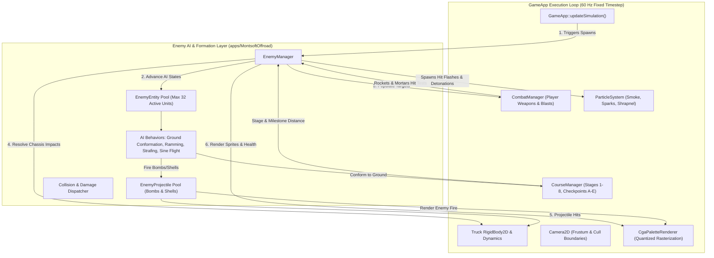
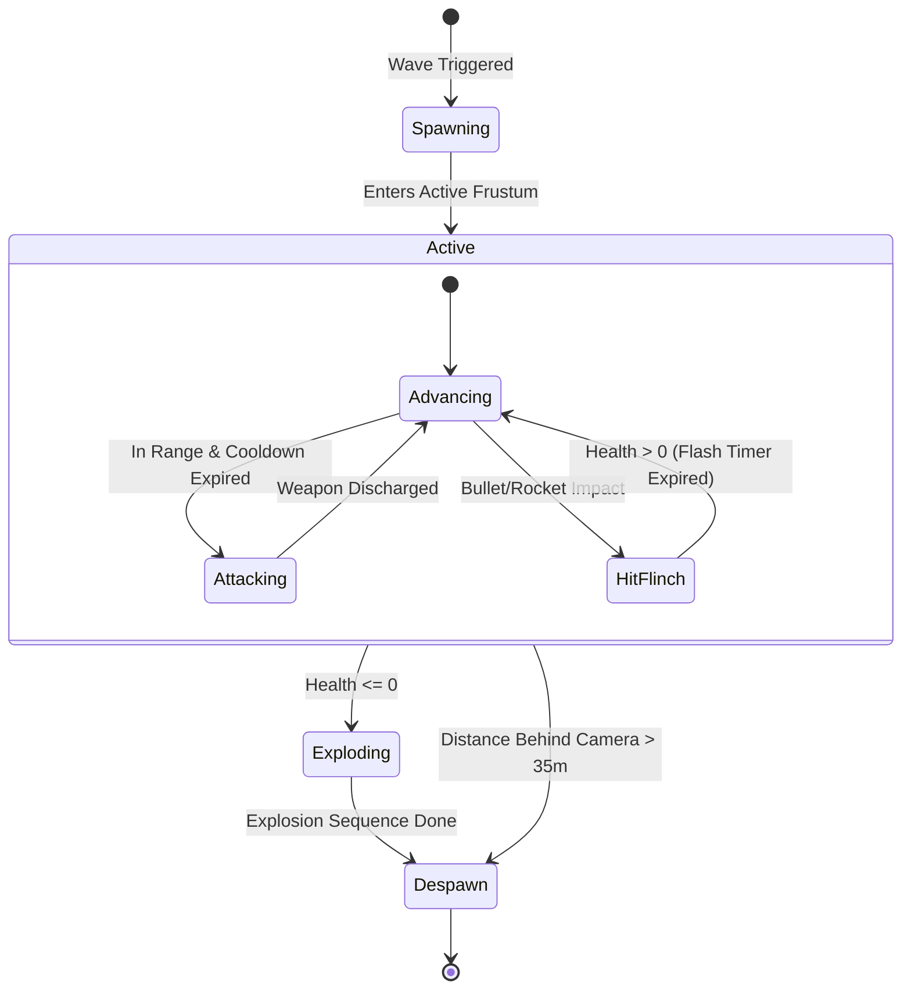
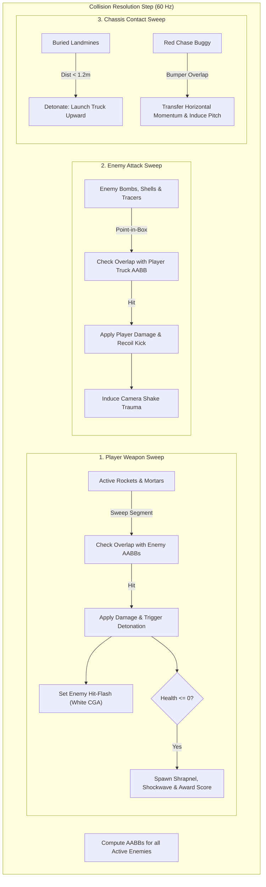

# Phase 6: Ground & Aerial Enemy AI Formations — Implementation Plan

## 1. Executive Summary & Objective

### 1.1 Context within Montsoft Offroad
In Monte Variakojis's original 1988 MS-DOS release of *Offroad* (and its arcade spiritual ancestor *Moon Patrol*), the gameplay loop shifts from pure driving to high-tempo combat through the introduction of heterogeneous enemy formations. While Phases 1–5 established 4WD physics, CGA rendering, terrain streaming, truck controls, and ballistic weapon systems, **Phase 6** brings the game world alive with autonomous hostile combatants:
1. **Ground Threats**: Scout dirt bikes, aggressive red chase buggies, buried landmines, and armored artillery crawlers.
2. **Aerial Threats**: High-speed strafing fighter jets, hovering surveillance saucers, and sinusoidal bouncing drone squares.
3. **Formations & Spawning**: Wave coordination synchronized with course milestones (Points A–E across Stages 1–8).
4. **Bidirectional Collision Resolution**: Hit-testing player rockets and mortars against enemy bounds, resolving enemy projectile damage against the player truck, and handling vehicle-on-vehicle impacts (buggy rams, landmine blasts).

### 1.2 Architectural Decoupling & Safety Rules
In strict conformance with [compliance.md](.agents/rules/compliance.md) and [verification-checklist.md](.agents/rules/verification-checklist.md):
- **Core Library Isolation**: All physics routines rely strictly on [VehicleSimCore](libs/VehicleSimCore) without OS-specific headers, using IEEE 754 deterministic arithmetic.
- **Application Layer Design**: The enemy subsystem is encapsulated in [apps/MontsoftOffroad](apps/MontsoftOffroad) within `EnemyManager.h` and `EnemyManager.cpp`.
- **Memory Safety**: Zero raw `new` or `delete`. Entities reside in fixed-capacity pre-allocated pools or bounded vectors to eliminate heap allocation during gameplay ticks.
- **Relative Linking**: All documented file paths are relative to the repository root.

---

## 2. System Architecture & Component Decomposition

### 2.1 ASCII System Architecture Diagram

```
+---------------------------------------------------------------------------------------------------+
|                                  Phase 6 Enemy Subsystem Architecture                             |
+---------------------------------------------------------------------------------------------------+
|  [apps/MontsoftOffroad] (Game Application Layer - C++17 / SDL2)                                   |
|                                                                                                   |
|    +-------------------+    Fixed 60Hz Timestep     +---------------------+                       |
|    |      GameApp      |--------------------------->|    EnemyManager     |                       |
|    +---------+---------+                            +----------+----------+                       |
|              |                                                 |                                  |
|              | Spawns Formations via Milestone Triggers        | Updates Kinematics & AI Logic    |
|              v                                                 v                                  |
|    +-------------------+                            +---------------------+                       |
|    |   CourseManager   |                            |   EnemyEntity Pool  |                       |
|    | (Milestones A-E)  |                            | (Ground & Air Units)|                       |
|    +-------------------+                            +----------+----------+                       |
|              |                                                 |                                  |
|              | Samples Terrain Ground Surface h(x)             | Extracts Target Bounding Boxes   |
|              v                                                 v                                  |
|    +-------------------+                            +---------------------+                       |
|    |   Heightfield1D   |                            | std::vector<AABB>   |                       |
|    +-------------------+                            +----------+----------+                       |
|                                                                |                                  |
|                                                                v                                  |
|    +-------------------+    Sweeps Projectiles vs AABB      +---------------------+               |
|    |   CombatManager   |<-----------------------------------| CombatTargetAabb    |               |
|    | (Rockets/Mortars) |----------------------------------->| (Damage & Shockwave)|               |
|    +---------+---------+   Discharges Enemy Shells & Bombs  +---------------------+               |
|              |                                                 |                                  |
|              | Explodes / Deals Damage                         | Resolves Chassis Overlaps        |
|              v                                                 v                                  |
|    +-------------------+                            +---------------------+                       |
|    |  ParticleSystem   |                            |   OffroadTruck      |                       |
|    | (Shrapnel/Sparks) |                            |  (Health & Recoil)  |                       |
|    +-------------------+                            +---------------------+                       |
|              |                                                 |                                  |
|              +------------------------+------------------------+                                  |
|                                       v                                                           |
|                            +---------------------+                                                |
|                            | CgaPaletteRenderer  | (Retro CGA 0/1, NTSC Composite, EGA)           |
|                            +---------------------+                                                |
+---------------------------------------------------------------------------------------------------+
```

### 2.2 Mermaid System Architecture Diagram



---

## 3. Enemy Threat Archetypes & Kinematic Formulation

### 3.1 Ground Threat Hierarchy

```
+----------------------------------------------------------------------------------------------------+
| Ground Threat Specifications                                                                       |
+----------------------------------------------------------------------------------------------------+
| 1. Scout Dirt Bike:                                                                                |
|    - Visual: Lightweight single-rider scrambler motorcycle with spinning spoked wheels.            |
|    - Health: 25.0 HP (Destroyed instantly with 1 direct rocket or mortar shockwave).              |
|    - Speed: 18.0 m/s to 26.0 m/s. Accelerates rapidly from ahead or behind player.                 |
|    - Behavior: Follows ground slope angle theta = atan(dh/dx); executes bunny hops over dunes.     |
+----------------------------------------------------------------------------------------------------+
| 2. Red Chase Buggy:                                                                                |
|    - Visual: Heavy twin-axle roll-cage sand rail with wide knobby rear tires.                      |
|    - Health: 80.0 HP (Requires 2 direct rocket hits or concentrated explosive blast).             |
|    - Speed: Proportional-Derivative (PD) tracking player vx: v_target = v_player + 2.5 m/s.         |
|    - Behavior: Stalks player from rear, attempts to ram truck to induce chassis pitch instability. |
+----------------------------------------------------------------------------------------------------+
| 3. Buried Landmine:                                                                                |
|    - Visual: Metallic pressure plate with blinking red/white warning LED in soil ruts.             |
|    - Health: 10.0 HP (Vulnerable to forward rocket clearance before crossing).                     |
|    - Speed: Stationary (vx = 0.0, anchored at ground elevation h(x)).                              |
|    - Behavior: Triggers radial explosive blast (4500 N*s impulse) if truck wheel enters r = 1.2 m. |
+----------------------------------------------------------------------------------------------------+
| 4. Tracked Artillery Crawler:                                                                      |
|    - Visual: Heavy armored treaded chassis with elevating mortar cannon tube.                      |
|    - Health: 120.0 HP (Requires 3 rockets or direct anti-air mortar intercept).                    |
|    - Speed: 6.0 m/s steady ground advance.                                                         |
|    - Behavior: Evaluates ballistic arc; fires parabolic mortar shells at player every 2.5 s.       |
+----------------------------------------------------------------------------------------------------+
```

### 3.2 Aerial Threat Hierarchy

```
+----------------------------------------------------------------------------------------------------+
| Aerial Threat Specifications                                                                       |
+----------------------------------------------------------------------------------------------------+
| 1. Strafing Jet Fighter:                                                                           |
|    - Visual: Sleek swept-wing delta interceptor with twin jet thrusters.                           |
|    - Health: 40.0 HP (Interceptable with timed anti-air mortar).                                   |
|    - Kinematics: Enters top-right, dives diagonally at vx = -40.0 m/s, vy = -12.0 m/s, then levels. |
|    - Weapon: Twin downward machine guns firing vertical tracer rounds when within dx < 12.0 m.    |
+----------------------------------------------------------------------------------------------------+
| 2. Hovering Alien Saucer:                                                                          |
|    - Visual: Rotating discoid saucer with central pulsing dome and anti-grav pods.                 |
|    - Health: 60.0 HP (Requires anti-air mortar hit).                                               |
|    - Kinematics: Matches horizontal truck position (x_hover = x_truck + delta_x), altitude 8-12 m.  |
|    - Weapon: Drops pulsed plasma energy bombs straight down every 1.8 seconds.                     |
+----------------------------------------------------------------------------------------------------+
| 3. Bouncing Drone Square:                                                                          |
|    - Visual: Geometric armored diamond/cube with oscillating thrusters and rotating core.          |
|    - Health: 35.0 HP (Challenging moving target for anti-air mortar).                              |
|    - Kinematics: Horizontal drift vx = -14.0 m/s; Sinusoidal hop y(t) = y_base + A*sin(omega*t).    |
|    - Weapon: Emits contact explosive damage upon chassis collision.                                |
+----------------------------------------------------------------------------------------------------+
```

### 3.3 Mathematical Formulation of Behaviors

#### 1. Terrain Conformation Kinematics (Ground Units)
Ground units evaluate the continuous surface $y = h(x)$ from `Heightfield1D`:
$$\theta = \arctan\left(\frac{dh}{dx}(x)\right)$$
To avoid discontinuous orientation snapping, ground angle $\theta_{\text{render}}$ relaxes toward $\theta$ via exponential damping:
$$\theta_{\text{render}}(t + \Delta t) = \theta_{\text{render}}(t) + \left(1 - e^{-\lambda \Delta t}\right) \cdot (\theta - \theta_{\text{render}}(t))$$
where $\lambda \approx 14.0\,\text{s}^{-1}$.

#### 2. Proportional-Derivative (PD) Chase Control (Red Buggy)
The Red Buggy modulates forward acceleration to maintain an aggressive pursuit envelope:
$$e_v = (v_{\text{player}} + v_{\text{bias}}) - v_{\text{buggy}}$$
$$a_{\text{drive}} = K_p \cdot e_v + K_d \cdot \left(\frac{e_v - e_{v, \text{prev}}}{\Delta t}\right)$$
Clamped within physical limits: $a_{\text{drive}} \in [-12.0, 18.0]\,\text{m/s}^2$.

#### 3. Parabolic Mortar Ballistic Solution (Artillery Crawler)
Given crawler launch position $(x_c, y_c)$ and player truck position $(x_p, y_p)$ with horizontal velocity $v_{p, x}$:
$$\Delta x = (x_p + v_{p, x} \cdot t_{\text{flight}}) - x_c$$
Using fixed flight duration $t_{\text{flight}} \approx 1.8\,\text{s}$:
$$v_{\text{shell}, x} = \frac{\Delta x}{t_{\text{flight}}}, \quad v_{\text{shell}, y} = \frac{y_p - y_c + 0.5 \cdot g \cdot t_{\text{flight}}^2}{t_{\text{flight}}}$$
where $g = 9.81\,\text{m/s}^2$.

#### 4. Drone Square Sinusoidal Trajectory
$$x(t) = x_0 + v_{\text{drift}} \cdot t$$
$$y(t) = y_{\text{ground}}(x(t)) + h_{\text{clearance}} + A \cdot \sin(\omega t + \phi)$$
where $A = 3.2\,\text{m}$, $\omega = 3.6\,\text{rad/s}$, and $h_{\text{clearance}} = 6.0\,\text{m}$.

---

## 4. State Machines, Collision Matrices & Formations

### 4.1 ASCII State Machine Diagram: Enemy Lifecycle

```
       [ Spawner Triggered ] (Milestone Distance / Wave Table)
                 |
                 v
         +---------------+
         |   SPAWNING    | (Offscreen edge: CamX + 25m or CamX - 20m)
         +-------+-------+
                 |
                 v
         +---------------+         Player Weapon Hit
         |    ACTIVE     |-----------------------------------+
         | (AI Routine)  |                                   |
         +-------+-------+                                   |
                 |                                           v
                 | Target Behind / Frustum Culled    +---------------+
                 | (x < CamX - 35m)                  |  HIT FLASH /  |
                 v                                   |  TAKING DMG   |
         +---------------+                           +-------+-------+
         |   DESPAWN /   |                                   | Health <= 0
         |    RECYCLE    |                                   v
         +---------------+                           +---------------+
                 ^                                   |  DETONATION / |
                 |-----------------------------------|   EXPLODING   |
                     After Explosion Particle Plume  +---------------+
```

### 4.2 Mermaid State Machine Diagram



### 4.3 ASCII Collision & Damage Interaction Matrix

```
+---------------------------------------------------------------------------------------------------+
| Interaction Matrix                                                                                |
+--------------------+--------------------------------+---------------------------------------------+
| Source Entity      | Target Entity                  | Physical & Damage Effect                    |
+--------------------+--------------------------------+---------------------------------------------+
| Player Rocket      | Ground Scout / Buggy / Tank    | Direct 50 HP damage + 4500 N*s explosion    |
| Player Mortar Flak | Aerial Fighter / Saucer / Drone| Direct 65 HP damage + expanding shockwave   |
| Landmine           | Player Truck Chassis/Wheels    | Triggered at dist < 1.2m: 35 dmg + J_y kick |
| Red Buggy Chassis  | Player Truck Rear Bumper       | Ramming kinetic impulse + 15 damage         |
| Artillery Shell    | Player Truck or Ground         | Impact explosion: 40 dmg + suspension shake |
| Strafing Jet MG    | Player Truck Chassis           | Tracer bullet impact: 8 dmg each            |
| Saucer Plasma Bomb | Player Truck Chassis           | Vertical bomb impact: 25 dmg + shockwave    |
| Drone Square Body  | Player Truck Upper Cab         | Mid-air chassis crash: 30 dmg + spin torque |
+--------------------+--------------------------------+---------------------------------------------+
```

### 4.4 Mermaid Collision Resolution Flow



---

## 5. Wave Formations & Stage Spawn Progression

The 8 stages defined in [CourseManager.h](apps/MontsoftOffroad/CourseManager.h) feature curated hazard escalation:

| Stage Index & Name | Primary Enemy Formations | Pacing & Spawn Density |
| :--- | :--- | :--- |
| **Stage 1: Sun-Baked Dunes** | Scout Dirt Bikes (pairs), lone Landmines | Gentle introduction; spaced every $120\,\text{m}$. |
| **Stage 2: Red Rock Arroyos** | Scout Bikes + Red Chase Buggies (pincer attacks) | Buggies approach from rear; bikes from front. |
| **Stage 3: Alkali Flats** | Strafing Jet Fighters (high-speed flybys) + Mines | Air-ground coordination demanding dual fire. |
| **Stage 4: Petrified Ridge** | Bouncing Drone Squares + Tracked Artillery Crawlers | Heavy artillery arcs combined with erratic drones. |
| **Stage 5: Volcanic Badlands** | Artillery Crawlers + Hovering Saucers (plasma bombs) | High vertical pressure; dense fire zones. |
| **Stage 6: Scrap Canyon** | Armored Gunships (jet variant) + Aggressive Buggy trios | Relentless ramming combined with overhead strafing. |
| **Stage 7: Alpine Scree** | Full formation waves: Jet V-formation + Saucer escort | High-speed multi-vector combat. |
| **Stage 8: Secret Fortress** | Elite Crawlers, dense minefields, prelude to Bosses | Relentless gauntlet leading to Stage 8 Boss arena. |

---

## 6. Detailed C++17 Class & Interface Specifications

### 6.1 `apps/MontsoftOffroad/EnemyManager.h`

```cpp
#pragma once

#include <array>
#include <cstddef>
#include <cstdint>
#include <vector>

#include "apps/MontsoftOffroad/Camera2D.h"
#include "apps/MontsoftOffroad/CgaPaletteRenderer.h"
#include "apps/MontsoftOffroad/CombatManager.h"
#include "apps/MontsoftOffroad/ParticleSystem.h"
#include "libs/VehicleSimCore/dynamics/OffroadTruckDynamics.h"
#include "libs/VehicleSimCore/math/Vec2.h"
#include "libs/VehicleSimCore/physics/RigidBody2D.h"
#include "libs/VehicleSimCore/terrain/Heightfield1D.h"

namespace montsoft_offroad {

/// @enum EnemyType
/// @brief Classification of autonomous combat threats.
enum class EnemyType : std::uint8_t {
    ScoutDirtBike,     ///< Fast light ground motorcycle.
    RedChaseBuggy,     ///< Heavy aggressive ramming buggy.
    BuriedLandmine,    ///< Concealed ground proximity explosive.
    ArtilleryCrawler,  ///< Tracked armored vehicle firing mortar shells.
    StrafingJet,       ///< Sweeping high-speed aerial interceptor.
    HoveringSaucer,    ///< Medium-altitude saucer dropping energy bombs.
    BouncingDrone      ///< Sine-wave oscillating aerial drone square.
};

/// @struct EnemyConfig
/// @brief Physical and combat baseline properties for an enemy archetype.
struct EnemyConfig {
    double maxHealth { 50.0 };         ///< Total hit points.
    double baseSpeed { 15.0 };         ///< Nominal movement speed in m/s.
    double collisionRadius { 1.2 };    ///< Bounding radius for rough proximity.
    vehicle_sim::math::Vec2 dimensions { 2.0, 1.0 }; ///< Width and height for AABB.
    double attackCooldown { 2.0 };     ///< Delay between attack discharges in seconds.
    std::uint32_t scoreValue { 100U }; ///< Bounty points awarded upon destruction.
};

/// @struct EnemyProjectile
/// @brief Ordinance discharged by enemy combatants against the player.
struct EnemyProjectile {
    vehicle_sim::math::Vec2 position { 0.0, 0.0 };
    vehicle_sim::math::Vec2 velocity { 0.0, 0.0 };
    double damage { 20.0 };
    double blastRadius { 2.0 };
    double age { 0.0 };
    double maxLifespan { 4.0 };
    bool isBallistic { false };        ///< Subject to gravity if true.
    bool active { false };
};

/// @struct EnemyEntity
/// @brief Runtime state of an active autonomous hostile unit.
struct EnemyEntity {
    std::uint32_t id { 0U };
    EnemyType type { EnemyType::ScoutDirtBike };
    vehicle_sim::math::Vec2 position { 0.0, 0.0 };
    vehicle_sim::math::Vec2 velocity { 0.0, 0.0 };
    double orientation { 0.0 };        ///< Heading / pitch angle in radians.
    double health { 50.0 };
    double maxHealth { 50.0 };
    double attackTimer { 0.0 };
    double flashTimer { 0.0 };         ///< Hit-flash white highlight timer.
    double animTimer { 0.0 };          ///< Wheel or thruster animation clock.
    double sinePhase { 0.0 };          ///< Oscillation phase for drone squares.
    bool active { false };
};

/// @struct EnemyManagerConfig
/// @brief Tuning parameters for enemy formation spawning and culling.
struct EnemyManagerConfig {
    std::size_t maxEnemies { 32U };
    std::size_t maxProjectiles { 48U };
    double spawnLeadDistance { 35.0 };     ///< Spawn distance ahead of camera in meters.
    double spawnRearDistance { 22.0 };     ///< Spawn distance behind camera for buggies.
    double despawnDistance { 40.0 };      ///< Distance behind camera triggering cleanup.
};

/// @class EnemyManager
/// @brief Coordinates lifecycle, kinematics, AI behaviors, and rendering for all enemy units.
/// @details Links with CourseManager for milestone wave spawning, integrates with CombatManager
/// target lists, simulates hostile ordinance, and resolves player truck impacts.
class EnemyManager final {
public:
    /// @brief Default constructor.
    EnemyManager() noexcept;

    /// @brief Parameterized constructor using custom configuration.
    /// @param[in] config Subsystem tuning configuration.
    explicit EnemyManager(const EnemyManagerConfig& config) noexcept;

    /// @brief Destructor.
    ~EnemyManager() noexcept = default;

    /// @brief Advances enemy positions, AI timers, and weapon projectiles.
    /// @param[in] dt Timestep duration in seconds.
    /// @param[in] terrain Pointer to continuous heightfield.
    /// @param[in] camera Camera tracker for frustum culling.
    /// @param[in,out] truckBody Player truck chassis receiving physical impacts.
    /// @param[in,out] particleSystem Particle pool for exhaust and explosion debris.
    void update(
        double dt,
        const vehicle_sim::terrain::Heightfield1D* terrain,
        const Camera2D& camera,
        vehicle_sim::physics::RigidBody2D& truckBody,
        ParticleSystem& particleSystem
    ) noexcept;

    /// @brief Spawns a single enemy entity at specified world coordinates.
    /// @param[in] type Archetype classification.
    /// @param[in] position Initial world coordinate.
    /// @param[in] initialVelocity Initial movement vector.
    /// @return True if successfully spawned, false if pool is full.
    bool spawnEnemy(
        EnemyType type,
        const vehicle_sim::math::Vec2& position,
        const vehicle_sim::math::Vec2& initialVelocity
    ) noexcept;

    /// @brief Spawns a coordinated attack formation based on course stage and milestone.
    /// @param[in] stageIndex Active course stage (0-7).
    /// @param[in] milestoneIndex Active milestone sector (0-4).
    /// @param[in] playerX Current horizontal coordinate of player truck.
    /// @param[in] terrain Pointer to continuous ground surface.
    void spawnFormation(
        std::size_t stageIndex,
        std::size_t milestoneIndex,
        double playerX,
        const vehicle_sim::terrain::Heightfield1D* terrain
    ) noexcept;

    /// @brief Populates combat target AABB collection for player weapon hit-testing.
    /// @param[out] targets Destination vector for active enemy bounding boxes.
    void syncCombatTargets(std::vector<CombatTargetAabb>& targets) const noexcept;

    /// @brief Applies damage inflicted by player weapons back to internal enemy entities.
    /// @param[in] targets Modified target bounding boxes from CombatManager.
    /// @param[in,out] particleSystem Particle pool for explosion shrapnel.
    /// @param[in] stageIndex Active stage for biome-specific debris colors.
    void applyCombatDamage(
        const std::vector<CombatTargetAabb>& targets,
        ParticleSystem& particleSystem,
        std::size_t stageIndex
    ) noexcept;

    /// @brief Rasterizes all active enemy units and incoming projectiles.
    /// @param[in,out] renderer Target CGA palette renderer.
    /// @param[in] camera Camera tracker performing world-to-screen coordinate mapping.
    void render(CgaPaletteRenderer& renderer, const Camera2D& camera) const noexcept;

    /// @brief Clears all active enemies, projectiles, and resets spawn clocks.
    void reset() noexcept;

    /// @brief Gets active enemy entity count.
    /// @return Number of currently active enemy units.
    [[nodiscard]] std::size_t getActiveCount() const noexcept;

    /// @brief Gets total accumulated score from destroyed enemies.
    /// @return Accumulated score points.
    [[nodiscard]] std::uint32_t getAccumulatedScore() const noexcept;

    /// @brief Queries whether player truck received fatal damage this tick.
    /// @return True if truck was destroyed by enemy attack.
    [[nodiscard]] bool checkTruckDestroyed() const noexcept;

    /// @brief Gets configuration settings.
    /// @return Constant reference to EnemyManagerConfig.
    [[nodiscard]] const EnemyManagerConfig& getConfig() const noexcept;

private:
    void updateGroundAi(EnemyEntity& enemy, double dt, const vehicle_sim::terrain::Heightfield1D* terrain, const vehicle_sim::math::Vec2& playerPos) noexcept;
    void updateAerialAi(EnemyEntity& enemy, double dt, const vehicle_sim::math::Vec2& playerPos) noexcept;
    void updateProjectiles(double dt, const vehicle_sim::terrain::Heightfield1D* terrain, vehicle_sim::physics::RigidBody2D& truckBody, ParticleSystem& particleSystem) noexcept;
    void resolveTruckContacts(vehicle_sim::physics::RigidBody2D& truckBody, ParticleSystem& particleSystem) noexcept;
    void fireEnemyBullet(const vehicle_sim::math::Vec2& origin, const vehicle_sim::math::Vec2& velocity, double damage) noexcept;
    void fireEnemyBomb(const vehicle_sim::math::Vec2& origin, const vehicle_sim::math::Vec2& velocity, double damage, double radius) noexcept;

    EnemyManagerConfig config_ {};
    std::vector<EnemyEntity> enemies_ {};
    std::vector<EnemyProjectile> projectiles_ {};
    std::array<EnemyConfig, 7> archetypeConfigs_ {};
    std::uint32_t nextEntityId_ { 1U };
    std::uint32_t accumulatedScore_ { 0U };
    bool truckDestroyed_ { false };
    double waveTimer_ { 0.0 };
    std::size_t lastSpawnedMilestone_ { 999U };
};

} // namespace montsoft_offroad
```

---

## 7. Retro CGA Enemy Pixel Art & Rasterization Specification

To maintain visual harmony with the 4WD truck and CGA dithered terrain, all 7 enemy archetypes are rendered using procedural pixel geometry mapped into the $320 \times 200$ virtual canvas:

```
+---------------------------------------------------------------------------------------------------+
| CGA Sprite Pixel Layouts (320x200 Internal Resolution)                                            |
+---------------------------------------------------------------------------------------------------+
| 1. Scout Dirt Bike (16x10 px):                                                                    |
|    - Twin 4x4 px circular spoked wheels at front and rear.                                        |
|    - Slanted 10x3 px tubular chassis with elevated handlebars.                                    |
|    - Crouched rider silhouette with helmet and angled goggles.                                    |
|    - Color: High-intensity Cyan/Magenta (Palette 1) or Green/Red (Palette 0).                     |
+---------------------------------------------------------------------------------------------------+
| 2. Red Chase Buggy (24x12 px):                                                                    |
|    - Twin oversized rear knobby tires (6x6 px) and medium front tires (5x5 px).                   |
|    - Visible external roll-cage struts and rear-mounted engine block.                             |
|    - Twin halogen spotlights mounted on roof bar.                                                 |
|    - Color: Red/Brown (Palette 0) or Magenta/White (Palette 1).                                   |
+---------------------------------------------------------------------------------------------------+
| 3. Buried Landmine (8x4 px):                                                                      |
|    - Low-profile beveled disc embedded 2 px into terrain surface.                                 |
|    - 2x2 px central proximity detonator LED blinking at 4 Hz.                                     |
|    - Color: Flashing White/Red or Cyan/White.                                                     |
+---------------------------------------------------------------------------------------------------+
| 4. Tracked Artillery Crawler (28x14 px):                                                          |
|    - Lower continuous caterpillar tread track with 4 spinning idler wheels.                       |
|    - Sloped armored turret housing an elevated 12 px artillery mortar barrel.                     |
|    - Muzzle flash sparks emitted upon shell discharge.                                            |
+---------------------------------------------------------------------------------------------------+
| 5. Strafing Jet Fighter (26x10 px):                                                               |
|    - Delta-wing needle fuselage with rear tailfin.                                                |
|    - Twin underslung 20mm rotary cannon barrels firing downward tracers.                          |
|    - Dual orange/cyan exhaust jet streams.                                                        |
+---------------------------------------------------------------------------------------------------+
| 6. Hovering Alien Saucer (22x10 px):                                                              |
|    - Elliptical metallic disc with rotating perimeter light nodules (3-frame animation).          |
|    - Transparent domed cockpit containing alien pilot silhouette.                                 |
|    - Central ventral bomb hatch opening during drops.                                             |
+---------------------------------------------------------------------------------------------------+
| 7. Bouncing Drone Square (12x12 px):                                                              |
|    - Diamond/square armored frame with rotating interior 4x4 gyro-core.                           |
|    - 4 micro-thruster nozzles emitting particle dots along the axes.                              |
+---------------------------------------------------------------------------------------------------+
```

---

## 8. Integration Plan into `GameApp`

### 8.1 Integration Steps in `apps/MontsoftOffroad/GameApp.h` & `GameApp.cpp`
1. **Member Addition**: Instantiate `EnemyManager enemyManager_ {};` in `GameApp.h`.
2. **Simulation Update Step**:
   - In `updateSimulation(double dt)`:
     * Query `courseManager_.getCurrentStageIndex()` and checkpoint progress.
     * Call `enemyManager_.spawnFormation(...)` when crossing milestone thresholds.
     * Advance `enemyManager_.update(...)` passing `terrain`, `camera_`, `truckBody_`, and `particleSystem_`.
     * Build target list: `enemyManager_.syncCombatTargets(combatTargets_);`.
     * Update combat: Pass `&combatTargets_` to `combatManager_.update(...)`.
     * Reconcile damage: Call `enemyManager_.applyCombatDamage(combatTargets_, particleSystem_, stageIdx);`.
     * Check game-over condition: `if (enemyManager_.checkTruckDestroyed()) { ... }`.
3. **Frame Rendering Step**:
   - In `renderFrame()`:
     * Call `enemyManager_.render(cgaRenderer_, camera_);` between terrain layer and HUD layer.
     * Render active enemy projectiles and hit-flash highlights.

---

## 9. Comprehensive Testing Plan

### 9.1 Test Matrix (`apps/MontsoftOffroad/GameAppTest.cpp`)

| Test Identifier | Category | Verification Scenario |
| :--- | :--- | :--- |
| `EnemyManagerTest.SpawnAndCapacityLimits` | Unit | Spawns up to `maxEnemies`; verifies pool rejection when full. |
| `EnemyManagerTest.GroundConformation` | Unit | Places bike on slope; verifies height and pitch match surface normal. |
| `EnemyManagerTest.RedBuggyPdSpeedMatching` | Kinematics | Verifies buggy accelerates toward player velocity without oscillation. |
| `EnemyManagerTest.DroneSinusoidalTrajectory`| Kinematics | Verifies drone $y(t)$ matches sine formula and respects amplitude. |
| `EnemyManagerTest.ArtilleryBallisticShell` | Ballistics | Crawler discharges shell; verifies parabolic trajectory and gravity. |
| `EnemyManagerTest.TargetSyncAndHitDamage` | Combat | Syncs AABBs with `CombatManager`; verifies rocket hit reduces health. |
| `EnemyManagerTest.DestructionAndBountyScore`| Combat | Reduces enemy health to 0; verifies score increment and despawn. |
| `EnemyManagerTest.LandmineProximityDetonation`| Interaction| Truck drives over landmine; verifies upward impulse and detonation. |
| `EnemyManagerTest.FrustumCullingAndRecycle` | Lifecycle | Advances enemy 50m behind camera; verifies automatic recycling. |
| `EnemyManagerTest.StageFormationScheduling` | Progression| Triggers milestone sectors for Stages 1–8; verifies correct enemy types. |
| `GameAppPhase6IntegrationTest.FullCombatLoop`| Integration| Runs 60 headless frames with enemies, weapons, particles, and truck. |

---

## 10. Verification Checklist & Compliance Matrix

Every item has been cross-referenced against the repository's rules:

1. **No Raw `new` or `delete`**: All entities stored in contiguous vectors or arrays. Memory managed by standard containers and RAII deleters.
2. **`#pragma once`**: Used exclusively across all header files.
3. **Co-located Header and Implementation**: `EnemyManager.h` and `EnemyManager.cpp` reside in [apps/MontsoftOffroad](apps/MontsoftOffroad).
4. **Zero External Dependencies in `VehicleSimCore`**: Library remains pure standard C++17; enemy AI application logic isolated in `apps/`.
5. **Concise Function Names**: Strictly `< 30` characters for all functions (e.g., `syncCombatTargets`, `applyCombatDamage`, `spawnFormation`).
6. **Cross-Platform Math & Determinism**: Standard IEEE 754 arithmetic with `<cmath>` functions; zero OS-specific headers.
7. **Explicit Variable Initialization**: All struct fields and local variables use `{}`.
8. **`[[nodiscard]]` Applied**: Applied to all state queries, active counts, and getters.
9. **Full Doxygen Documentation**: Public APIs fully documented with `/// @brief`, `@details`, `@param`, `@return`.
10. **MISRA C++:2023 & SEI CERT C++**: No raw pointer ownership transfers, no dynamic downcasting, explicit boundary checks.
11. **Failing Tests First**: Complete suite of unit and integration tests prepared for TDD workflow.
12. **Compiler Warning Hardening**: Conforms to zero-warning builds under `/W4` (MSVC) and `-Wall -Wextra -pedantic -Werror` (GCC/Clang).
13. **Relative File Paths**: All markdown links are relative to workspace.
14. **ASCII & Mermaid Diagrams**: Both formats included for architecture, state machines, and collision flow.
