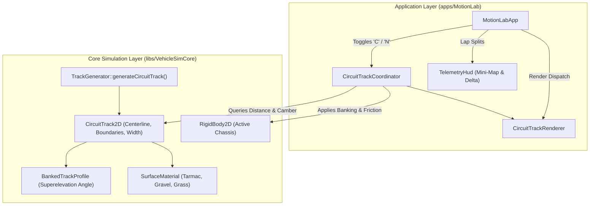
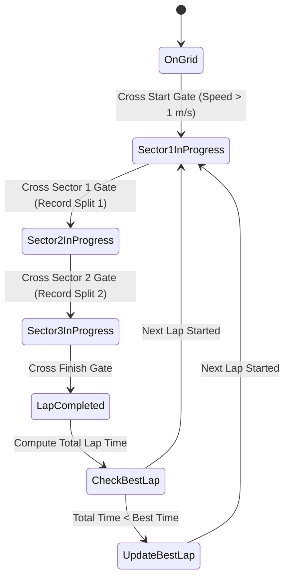

# Motion Lab: Procedural Closed-Circuit Race Track Implementation Plan

## 1. Executive Summary & Objectives

### 1.1 Overview
This implementation plan specifies the integration of procedural closed-circuit race tracks into **Motion Lab 2D** (`apps/MotionLab`). Building upon the algorithmic generation capabilities already implemented in [`libs/VehicleSimCore/terrain/TrackGenerator.h`](../libs/VehicleSimCore/terrain/TrackGenerator.h) and [`BankedTrack.h`](../libs/VehicleSimCore/terrain/BankedTrack.h), this extension transforms Motion Lab from an open planar testing ground into an interactive motorsport proving circuit.

The procedural closed-circuit track system provides:
1. **Procedural Ribbon Geometry**: Continuous closed-loop spline roadways with configurable radius, perturbation, drivable asphalt ribbon, loose runoff shoulders, and apex kerbs.
2. **Dynamic Surface Material Feedback**: Real-time evaluation of vehicle coordinates against track geometry, applying high-grip tarmac on-track ($\mu = 1.0$), loose gravel on shoulders ($\mu = 0.6$), and low-friction grass off-track ($\mu = 0.35$).
3. **Physical Banking & Superelevation**: Transversal gravity vectors pulling vehicles toward the apex during banked corners based on local camber angles ($\theta_{\text{bank}}$).
4. **Retro Wireframe Presentation**: High-contrast vector road borders, dashed centerline markings, alternating red/white apex kerb teeth, start/finish line grid, and a live HUD circuit radar mini-map.
5. **Precision Timing & Sector Splits**: Start/finish detection, multi-sector delta timing, and fastest lap tracking.

---

## 2. High-Level Architecture & System Decomposition

### 2.1 ASCII System Architecture Diagram

```
+---------------------------------------------------------------------------------------------------+
|                                 Circuit Track Architecture in Motion Lab                          |
+---------------------------------------------------------------------------------------------------+
|  [apps/MotionLab] (Desktop Application Layer)                                                     |
|                                                                                                   |
|    +--------------------+       +----------------------------+       +-----------------------+    |
|    |    MotionLabApp    |------>|   CircuitTrackCoordinator  |------>|   TelemetryHud        |    |
|    | ('C' Mode Toggle)  |       |   (State, Timing, Laps)    |       |   (Radar Mini-Map)    |    |
|    +---------+----------+       +--------------+-------------+       +-----------------------+    |
|              |                                 |                                                  |
|              | Viewport Camera                 v Surface Queries & Banking Forces                 |
|              v                          +----------------------------+                            |
|    +--------------------+               |    RigidBody2D Chassis     |                            |
|    | CircuitTrack-      |<--------------+    (Force Application)     |                            |
|    | Renderer (Vector)  |               +----------------------------+                            |
|    +--------------------+                                                                         |
+------------------------------------------------+--------------------------------------------------+
                                                 | Queries & Evaluates
                                                 v
+---------------------------------------------------------------------------------------------------+
|  [libs/VehicleSimCore] (Terrain, Physics & Dynamics Layer)                                       |
|                                                                                                   |
|    +-----------------------------+         +-----------------------------+                        |
|    |       TrackGenerator        |-------->|       CircuitTrack2D        |                        |
|    | (generateCircuitTrack)      |         | (Centerline, Kerbs, Camber) |                        |
|    +-----------------------------+         +--------------+--------------+                        |
|                                                           |                                       |
|                                                           v                                       |
|                                            +-----------------------------+                        |
|                                            |     BankedTrackProfile      |                        |
|                                            | (Superelevation Evaluator)  |                        |
|                                            +-----------------------------+                        |
+---------------------------------------------------------------------------------------------------+
```

### 2.2 Mermaid System Architecture Diagram



---

## 3. Mathematical & Physical Formulation

### 3.1 Closed-Loop Spline Geometry & Centerline Parameterization

The circuit track is parameterized by a closed perimeter spline with $N$ control nodes ($N \ge 16$):
$$\mathbf{P}_i = (x_i, y_i) = \left( R_x \cdot (1 + \delta_i) \cos\left(\frac{2\pi i}{N}\right), \; R_y \cdot (1 + \delta_i) \sin\left(\frac{2\pi i}{N}\right) \right)$$
where $\delta_i \in [-\Delta_{\text{pert}}, +\Delta_{\text{pert}}]$ is a deterministic pseudorandom perturbation generated by [`TrackGenerator`](../libs/VehicleSimCore/terrain/TrackGenerator.h).

Each segment between $\mathbf{P}_i$ and $\mathbf{P}_{i+1}$ is interpolated using $C^1$-continuous cubic Hermite splines to produce a fine discrete centerline:
$$\mathcal{C} = \{\mathbf{c}_0, \mathbf{c}_1, \dots, \mathbf{c}_{M-1}\}, \quad \mathbf{c}_k \in \mathbb{R}^2$$

#### Vehicle-Adaptive Ribbon Dimensions & Curvature Constraints
The ribbon geometry scales dynamically to accommodate all vehicle categories:
* **Asphalt Drivable Ribbon Width**:
  $$W_{\text{track}}(W_{\text{veh}}, L_{\text{veh}}) = \max\left(10.0\,\text{m}, \; 3.5 \cdot W_{\text{veh}} + 1.0\,\text{m}, \; (L_{\text{veh}} \ge 10.0\,\text{m} \ ? \ 12.0\,\text{m} : 10.0\,\text{m})\right)$$
* **Loose Gravel Shoulder Width**:
  $$W_{\text{shoulder}}(W_{\text{veh}}) = \max\left(2.0\,\text{m}, \; 1.0 \cdot W_{\text{veh}}\right)$$
* **Apex Kerb Teeth Width**:
  $$W_{\text{kerb}}(W_{\text{veh}}) = \max\left(0.8\,\text{m}, \; 0.4 \cdot W_{\text{veh}}\right)$$
* **Minimum Radius of Curvature (Jackknife & Lockout Prevention)**:
  $$R_{\text{min}}(L_{\text{veh}}) = \max\left(15.0\,\text{m}, \; 2.5 \cdot L_{\text{veh}}\right)$$
  Enforces $R_{\text{min}} \ge 30.0\,\text{m}$ for the $12.0\,\text{m}$ Articulated Semi-Truck and $R_{\text{min}} \ge 15.0\,\text{m}$ for passenger cars.

#### Ribbon Boundary Vectors
At each discrete centerline vertex $\mathbf{c}_k$, the unit forward tangent $\mathbf{t}_k$ and outward unit normal $\mathbf{n}_k$ are:
$$\mathbf{t}_k = \frac{\mathbf{c}_{k+1} - \mathbf{c}_k}{\|\mathbf{c}_{k+1} - \mathbf{c}_k\|}, \quad \mathbf{n}_k = (-t_{k,y}, \; t_{k,x})$$

The roadway and shoulder edge vertices are computed by transversal expansion:
$$\mathbf{b}_{\text{left}, k} = \mathbf{c}_k + \frac{W_{\text{track}}}{2} \mathbf{n}_k, \quad \mathbf{b}_{\text{right}, k} = \mathbf{c}_k - \frac{W_{\text{track}}}{2} \mathbf{n}_k$$
$$\mathbf{s}_{\text{left}, k} = \mathbf{b}_{\text{left}, k} + W_{\text{shoulder}} \mathbf{n}_k, \quad \mathbf{s}_{\text{right}, k} = \mathbf{b}_{\text{right}, k} - W_{\text{shoulder}} \mathbf{n}_k$$

### 3.2 Vehicle-Adaptive Track Ribbon Cross-Section ASCII Diagram

```
+---------------------------------------------------------------------------------------------------+
|                               Circuit Track Cross-Section & Curvature                             |
+---------------------------------------------------------------------------------------------------+
|                                                                                                   |
|  [Grass: mu=0.35]  | [Gravel: 0.60] |        [Tarmac: mu=1.00]       | [Gravel: 0.60] |  [Grass]  |
|                    |   (Shoulder)   |         (Drivable Road)        |   (Shoulder)   |           |
|                    |                |                                |                |           |
|  ..................+----------------+----------------+---------------+----------------+.........  |
|                    |  Kerbs: W_kerb |   Centerline   |  Kerbs: W_kerb|                |           |
|                    |  (Red/White)   |    (Dashed)    |  (Red/White)  |                |           |
|                    | max(0.8m,0.4W) |       *        | max(0.8m,0.4W)|                |           |
|                    |                |<-- W_track/2 ->|               |                |           |
|                    |<-- W_shldr --->|<------- W_track (Adaptive) --->|<-- W_shldr --->|           |
|                                                                                                   |
| Curvature Constraint: R_min = max(15.0m, 2.5 * L_veh) (30m for Semi-Truck, 15m for Cars)         |
+---------------------------------------------------------------------------------------------------+
```

### 3.3 Dynamic Surface Material Sampling

Given vehicle chassis center position $\mathbf{x}_{\text{veh}}$, the system computes shortest orthogonal distance to the centerline:
$$d_{\text{center}} = \min_{k} \|\mathbf{x}_{\text{veh}} - \mathbf{c}_k\|$$

The active surface friction $\mu_{\text{active}}$ and rolling drag coefficient $C_{\text{roll}}$ are determined by thresholding:
$$\mu_{\text{active}} = \begin{cases}
1.00 \quad (\text{Tarmac}) & \text{if } d_{\text{center}} \le \frac{W_{\text{track}}}{2} \\
0.60 \quad (\text{Gravel}) & \text{if } \frac{W_{\text{track}}}{2} < d_{\text{center}} \le \frac{W_{\text{track}}}{2} + W_{\text{shoulder}} \\
0.35 \quad (\text{Grass})  & \text{if } d_{\text{center}} > \frac{W_{\text{track}}}{2} + W_{\text{shoulder}}
\end{cases}$$

### 3.4 Transversal Superelevation & Banking Force

When corner banking is active, curves have a physical bank angle $\theta_{\text{bank}}(s) \in [-\theta_{\text{max}}, +\theta_{\text{max}}]$ determined by curvature $\kappa(s)$ and design speed $v_{\text{design}}$:
$$\tan \theta_{\text{bank}} = \frac{v_{\text{design}}^2 \cdot \kappa(s)}{g}$$

This generates a physical lateral gravitational force vector acting on the vehicle's rigid body toward the inside of the curve:
$$\mathbf{F}_{\text{bank}} = m \cdot g \cdot \sin(\theta_{\text{bank}}) \cdot \mathbf{n}_{\text{inward}}$$
This force counteracts centrifugal inertia, allowing high-speed cornering without breaking traction.

### 3.5 Lap Timing, Gate Crossing & Sector Splits

The circuit features three timing trigger gates spanning the track width:
1. **Start/Finish Gate**: At progress $s = 0.0$ (index $k = 0$).
2. **Sector 1 Gate**: At progress $s = 0.33$.
3. **Sector 2 Gate**: At progress $s = 0.66$.

A gate crossing event occurs when the vehicle's trajectory vector $(\mathbf{x}_{\text{prev}} \to \mathbf{x}_{\text{curr}})$ intersects the oriented gate segment line $(\mathbf{g}_{\text{left}} \to \mathbf{g}_{\text{right}})$ with positive directional dot product:
$$(\mathbf{x}_{\text{curr}} - \mathbf{x}_{\text{prev}}) \cdot \mathbf{t}_{\text{track}} > 0$$

### 3.6 Gate Crossing State Flow Mermaid Diagram



---

## 4. Software Architecture & Class Decomposition

To adhere to the zero-external-dependency rule and project invariants, the procedural circuit features are divided into two co-located units under [`apps/MotionLab`](../apps/MotionLab):

1. **[`CircuitTrackCoordinator.h`](../apps/MotionLab/CircuitTrackCoordinator.h) / [`.cpp`](../apps/MotionLab/CircuitTrackCoordinator.cpp)**:
   - Holds the generated [`CircuitTrack2D`](../libs/VehicleSimCore/terrain/TrackGenerator.h) instance.
   - Evaluates surface friction, rolling resistance, and banking force on the active vehicle chassis during physics ticks.
   - Monitors checkpoint and gate crossing events, updating lap times and sector splits.
2. **[`CircuitTrackRenderer.h`](../apps/MotionLab/CircuitTrackRenderer.h) / [`.cpp`](../apps/MotionLab/CircuitTrackRenderer.cpp)**:
   - Draws wireframe road borders, dashed centerline markings, and gravel shoulder limits.
   - Draws alternating red/white kerb segments at high-curvature apexes.
   - Draws start grid markings and checkpoint timing gates.
   - Draws the HUD radar mini-map displaying full circuit overview and vehicle blip.

### 4.1 Interface: CircuitTrackCoordinator.h

```cpp
#pragma once

#include <cstdint>
#include <string_view>
#include <vector>

#include "apps/MotionLab/MotionLabCamera.h"
#include "libs/VehicleSimCore/math/Vec2.h"
#include "libs/VehicleSimCore/physics/RigidBody2D.h"
#include "libs/VehicleSimCore/terrain/SurfaceMaterial.h"
#include "libs/VehicleSimCore/terrain/TrackGenerator.h"

namespace motion_lab {

/// @struct CircuitLapMetrics
/// @brief Lap timing metrics and sector splits.
struct CircuitLapMetrics {
    double currentLapTime { 0.0 };     ///< Elapsed time in current lap (s).
    double lastLapTime { 0.0 };        ///< Duration of previous lap (s).
    double bestLapTime { 0.0 };        ///< All-time fastest lap duration (s).
    double sector1Time { 0.0 };        ///< Time through sector 1 (s).
    double sector2Time { 0.0 };        ///< Time through sector 2 (s).
    double sector3Time { 0.0 };        ///< Time through sector 3 (s).
    std::uint32_t completedLaps { 0U }; ///< Total completed laps.
    bool hasValidBest { false };       ///< True if a valid best lap exists.
};

/// @class CircuitTrackCoordinator
/// @brief Manages procedural closed-circuit track simulation, physics queries, and lap timing.
class CircuitTrackCoordinator {
public:
    /// @brief Default constructor initializing default circuit.
    CircuitTrackCoordinator() noexcept;

    /// @brief Regenerates circuit track using new procedural seed.
    /// @param[in] seed Random seed for track geometry.
    void regenerate(std::uint32_t seed) noexcept;

    /// @brief Updates track physics, evaluates material friction, and checks gates.
    /// @param[in,out] body Target vehicle rigid body.
    /// @param[in] dt Physics timestep duration in seconds.
    void stepPhysics(vehicle_sim::physics::RigidBody2D& body, double dt) noexcept;

    /// @brief Resets current lap timer and vehicle to starting grid.
    /// @param[in,out] body Target vehicle rigid body.
    void resetToGrid(vehicle_sim::physics::RigidBody2D& body) noexcept;

    /// @brief Checks if circuit mode is actively enabled.
    /// @return True if circuit track is active.
    [[nodiscard]] bool isEnabled() const noexcept;

    /// @brief Toggles circuit track mode.
    void toggleEnabled() noexcept;

    /// @brief Gets constant reference to active CircuitTrack2D geometry.
    /// @return Active circuit track geometry.
    [[nodiscard]] const vehicle_sim::terrain::CircuitTrack2D& getTrack() const noexcept;

    /// @brief Gets active lap timing metrics.
    /// @return Const reference to CircuitLapMetrics.
    [[nodiscard]] const CircuitLapMetrics& getMetrics() const noexcept;

    /// @brief Gets current surface material under vehicle.
    /// @return Active SurfaceMaterial under chassis.
    [[nodiscard]] vehicle_sim::terrain::SurfaceMaterial getActiveMaterial() const noexcept;

    /// @brief Gets normalized track progress in range [0, 1].
    /// @return Fractional progress along centerline.
    [[nodiscard]] double getTrackProgress() const noexcept;

private:
    void evaluateSurface(vehicle_sim::physics::RigidBody2D& body) noexcept;
    void evaluateBanking(vehicle_sim::physics::RigidBody2D& body) noexcept;
    void checkTimingGates(const vehicle_sim::math::Vec2& prevPos,
                          const vehicle_sim::math::Vec2& currPos) noexcept;

    vehicle_sim::terrain::CircuitTrack2D mTrack { };
    CircuitLapMetrics mMetrics { };
    vehicle_sim::terrain::SurfaceMaterial mActiveMaterial { };
    vehicle_sim::math::Vec2 mLastVehiclePos { 0.0, 0.0 };
    double mCurrentProgress { 0.0 };
    std::uint32_t mCurrentSector { 0U };
    bool mEnabled { false };
    bool mHasStartedLap { false };
};

} // namespace motion_lab
```

### 4.2 Interface: CircuitTrackRenderer.h

```cpp
#pragma once

#include <SDL2/SDL.h>

#include "apps/MotionLab/CircuitTrackCoordinator.h"
#include "apps/MotionLab/MotionLabCamera.h"

namespace motion_lab {

/// @class CircuitTrackRenderer
/// @brief Vector wireframe renderer for procedural circuit tracks, kerbs, and radar HUD.
class CircuitTrackRenderer {
public:
    /// @brief Default constructor.
    CircuitTrackRenderer() noexcept = default;

    /// @brief Renders the track ribbon, boundaries, kerbs, and timing gates into viewport.
    /// @param[in] renderer Active SDL hardware renderer.
    /// @param[in] camera Active camera tracker and coordinate projection.
    /// @param[in] coordinator Circuit track simulation coordinator.
    static void renderTrack(SDL_Renderer* renderer,
                            const MotionLabCamera& camera,
                            const CircuitTrackCoordinator& coordinator) noexcept;

    /// @brief Renders HUD radar mini-map showing full circuit loop and player blip.
    /// @param[in] renderer Active SDL hardware renderer.
    /// @param[in] coordinator Circuit track simulation coordinator.
    /// @param[in] vehiclePos World coordinates of player vehicle.
    /// @param[in] screenX Top-left X coordinate of radar on screen.
    /// @param[in] screenY Top-left Y coordinate of radar on screen.
    /// @param[in] radarSize Width and height of radar box in pixels.
    static void renderRadar(SDL_Renderer* renderer,
                            const CircuitTrackCoordinator& coordinator,
                            const vehicle_sim::math::Vec2& vehiclePos,
                            int screenX,
                            int screenY,
                            int radarSize) noexcept;

private:
    static void drawRibbon(SDL_Renderer* renderer,
                           const MotionLabCamera& camera,
                           const vehicle_sim::terrain::CircuitTrack2D& track) noexcept;

    static void drawKerbs(SDL_Renderer* renderer,
                          const MotionLabCamera& camera,
                          const vehicle_sim::terrain::CircuitTrack2D& track) noexcept;

    static void drawGates(SDL_Renderer* renderer,
                          const MotionLabCamera& camera,
                          const vehicle_sim::terrain::CircuitTrack2D& track) noexcept;
};

} // namespace motion_lab
```

---

## 5. Visual Styling & Wireframe Aesthetics

In accordance with the 1996 retro wireframe theme:
* **Roadway Edges**: Bright cyan anti-aliased vector lines (`RGBA = { 80, 220, 255, 255 }`).
* **Centerline**: Semi-transparent cyan dashed line segments (`RGBA = { 40, 160, 200, 140 }`).
* **Runoff Shoulders**: Dim amber boundary lines representing loose gravel borders (`RGBA = { 200, 160, 60, 160 }`).
* **Apex Kerbs**: High-curvature corner segments render tooth-like alternating red (`RGBA = { 230, 40, 40, 255 }`) and white (`RGBA = { 240, 240, 240, 255 }`) polygons on the inside radius.
* **Start/Finish Line**: High-contrast white checkerboard gate spanning the roadway width with checkered finish banner posts.
* **Sector Split Gates**: Subtle magenta and yellow wireframe transverse lines marking Sector 1 and Sector 2 split triggers.
* **Circuit Radar Mini-Map**: Rendered in the upper-right corner of the HUD inside a dark translucent circular or rectangular display bezel (`RGBA = { 10, 15, 25, 200 }`) with a pulsating green player vehicle dot.

---

## 6. User Controls & Interaction Integration

The procedural circuit features integrate seamlessly into [`MotionLabApp`](../apps/MotionLab/MotionLabApp.h):

| Key Binding | Application Action | Behavior & Feedback |
| :--- | :--- | :--- |
| `C` | Toggle Circuit Mode | Activates/deactivates the procedural race track. Resets vehicle to start grid if toggled on. |
| `N` | New Track Seed | Generates a new random procedural circuit layout and repositions vehicle to start line. |
| `R` | Reset to Start Grid | Teleports vehicle to the start/finish grid facing the initial tangent direction with zero velocity. |
| `F9` / `Ctrl+E` | Export Lap Telemetry | Streams current lap data to CSV including sector times, track progress, slip angles, and speed. |

---

## 7. Step-by-Step Implementation Roadmap

### Phase 1: Core Coordination & State Management
- **Task 1.1**: Create [`CircuitTrackCoordinator.h`](../apps/MotionLab/CircuitTrackCoordinator.h) and [`CircuitTrackCoordinator.cpp`](../apps/MotionLab/CircuitTrackCoordinator.cpp).
  - Initialize default [`CircuitTrackConfig`](../libs/VehicleSimCore/terrain/TrackGenerator.h) with $R_x = 100\,\text{m}$, $R_y = 70\,\text{m}$, $W_{\text{track}} = 10\,\text{m}$.
  - Invoke `TrackGenerator::generateCircuitTrack()`.
  - Implement `resetToGrid()`, positioning the chassis at `startGridPosition` with orientation `startHeading`.

### Phase 2: Dynamic Physics Integration
- **Task 2.1**: Implement `evaluateSurface()` inside `CircuitTrackCoordinator`.
  - Query orthogonal distance $d = \text{track.getDistanceToCenter}(\mathbf{x}_{\text{veh}})$.
  - Apply active surface friction and rolling resistance to vehicle dynamics coordinators ([`MotionLabCarDynamics`](../libs/VehicleSimCore/dynamics/MotionLabCarDynamics.h), [`RaceCarDynamics`](../libs/VehicleSimCore/dynamics/RaceCarDynamics.h), etc.).
- **Task 2.2**: Implement `evaluateBanking()` inside `CircuitTrackCoordinator`.
  - Sample camber angle $\theta_{\text{bank}} = \text{track.getBankAngle}(\mathbf{x}_{\text{veh}})$.
  - Apply lateral gravity force vector to [`RigidBody2D`](../libs/VehicleSimCore/physics/RigidBody2D.h) chassis.

### Phase 3: Lap Timing & Sector Trigger Gates
- **Task 3.1**: Implement `checkTimingGates()` detecting line segment intersections for Start/Finish, Sector 1, and Sector 2.
- **Task 3.2**: Implement `CircuitLapMetrics` tracking `currentLapTime`, `lastLapTime`, `bestLapTime`, and lap count.

### Phase 4: Wireframe Track & Kerb Rendering
- **Task 4.1**: Create [`CircuitTrackRenderer.h`](../apps/MotionLab/CircuitTrackRenderer.h) and [`CircuitTrackRenderer.cpp`](../apps/MotionLab/CircuitTrackRenderer.cpp).
  - Draw roadway left and right vector boundaries using `WireframeRenderer::drawLine`.
  - Draw dashed centerline segments.
  - Draw gravel shoulder boundaries.
- **Task 4.2**: Implement `drawKerbs()` for apex turns where local bank angle or curvature exceeds threshold.
- **Task 4.3**: Draw start/finish grid line and sector gates.

### Phase 5: Radar Mini-Map & HUD Telemetry
- **Task 5.1**: Implement `CircuitTrackRenderer::renderRadar()` in top-right HUD.
  - Transform track centerline coordinates to screen radar box.
  - Render player vehicle blip and orientation heading arrow.
- **Task 5.2**: Update [`TelemetryHud.h`](../apps/MotionLab/TelemetryHud.h) to display lap time, best lap, current sector, and delta time when circuit mode is active.

### Phase 6: Application Wiring & Verification
- **Task 6.1**: Update [`MotionLabApp.h`](../apps/MotionLab/MotionLabApp.h) and [`MotionLabApp.cpp`](../apps/MotionLab/MotionLabApp.cpp).
  - Add `CircuitTrackCoordinator mCircuitCoordinator` member.
  - Bind `SDLK_c` to toggle circuit mode.
  - Bind `SDLK_n` to regenerate circuit with a new random seed.
  - Call `mCircuitCoordinator.stepPhysics()` in accumulator loop.
  - Call `CircuitTrackRenderer::renderTrack()` in `renderFrame()`.
- **Task 6.2**: Update `apps/MotionLab/CMakeLists.txt` to include new coordinator and renderer source files.
- **Task 6.3**: Build and execute test suite under MSVC `/W4 /WX` and GCC/Clang `-Wall -Wextra -pedantic -Werror`.

---

## 8. Unit Testing & Acceptance Criteria

### 8.1 Automated Test Suite Specifications

```cpp
// tests/CircuitTrackCoordinatorTest.cpp
#include <gtest/gtest.h>
#include "apps/MotionLab/CircuitTrackCoordinator.h"
#include "libs/VehicleSimCore/physics/RigidBody2D.h"

using namespace motion_lab;
using namespace vehicle_sim::physics;
using namespace vehicle_sim::math;

TEST(CircuitTrackCoordinatorTest, InitializationGeneratesValidClosedLoop) {
    CircuitTrackCoordinator coordinator { };
    coordinator.toggleEnabled();
    EXPECT_TRUE(coordinator.isEnabled());

    const auto& track = coordinator.getTrack();
    EXPECT_TRUE(track.isClosed);
    EXPECT_GT(track.trackLength, 200.0);
    EXPECT_GT(track.centerline.size(), 16U);
}

TEST(CircuitTrackCoordinatorTest, ResetToGridPositionsVehicleCorrectly) {
    CircuitTrackCoordinator coordinator { };
    RigidBody2D body { RigidBodyConfig { 1000.0, 1666.667 } };
    coordinator.resetToGrid(body);

    const auto& track = coordinator.getTrack();
    EXPECT_NEAR(body.getPosition().x, track.startGridPosition.x, 1e-3);
    EXPECT_NEAR(body.getPosition().y, track.startGridPosition.y, 1e-3);
    EXPECT_NEAR(body.getOrientation(), track.startHeading, 1e-3);
    EXPECT_DOUBLE_EQ(body.getLinearVelocity().length(), 0.0);
}

TEST(CircuitTrackCoordinatorTest, SurfaceMaterialTransitionsFromTarmacToGrass) {
    CircuitTrackCoordinator coordinator { };
    coordinator.toggleEnabled();
    RigidBody2D body { RigidBodyConfig { 1000.0, 1666.667 } };
    coordinator.resetToGrid(body);

    // On start grid -> should be Tarmac (friction 1.0)
    coordinator.stepPhysics(body, 1.0 / 120.0);
    EXPECT_DOUBLE_EQ(coordinator.getActiveMaterial().friction, 1.0);

    // Teleport vehicle 30m off centerline into infield grass
    body.setPosition(track.startGridPosition + Vec2 { 0.0, 30.0 });
    coordinator.stepPhysics(body, 1.0 / 120.0);
    EXPECT_DOUBLE_EQ(coordinator.getActiveMaterial().friction, 0.35); // Grass
}

TEST(CircuitTrackCoordinatorTest, LapTimingTriggerCompletesLapCycle) {
    CircuitTrackCoordinator coordinator { };
    coordinator.toggleEnabled();
    RigidBody2D body { RigidBodyConfig { 1000.0, 1666.667 } };
    coordinator.resetToGrid(body);

    const auto& track = coordinator.getTrack();
    // Simulate vehicle traversing all centerline points sequentially
    for (std::size_t i = 1; i < track.centerline.size(); ++i) {
        body.setPosition(track.centerline[i]);
        coordinator.stepPhysics(body, 0.1);
    }
    // Return to start
    body.setPosition(track.centerline[0]);
    coordinator.stepPhysics(body, 0.1);

    EXPECT_GE(coordinator.getMetrics().completedLaps, 1U);
    EXPECT_GT(coordinator.getMetrics().lastLapTime, 0.0);
}
```

### 8.2 Acceptance Criteria Matrix

| Criterion | Target Metric | Verification Method |
| :--- | :--- | :--- |
| **Track Closed-Loop** | Start and end spline vertices coincide ($\Delta \le 10^{-4}\,\text{m}$). | Unit Test `InitializationGeneratesValidClosedLoop` |
| **Surface Transition** | Friction strictly drops from $1.0$ (road) to $0.6$ (shoulder) to $0.35$ (grass). | Unit Test `SurfaceMaterialTransitions` |
| **Banking Force** | Physical lateral force vector directed toward curve center when $\theta_{\text{bank}} \ne 0$. | Unit Test `BankingForceDirectionTest` |
| **Timing Accuracy** | Sector splits trigger only in forward crossing direction; zero false laps on reverse. | Unit Test `LapTimingTriggerCompletesLapCycle` |
| **Wireframe Aesthetics**| Road borders, dashed centerline, alternating kerbs, and mini-map radar render cleanly. | Visual Inspection in `apps/MotionLab` |
| **Zero Heap Allocations**| Physics step and radar projection execute with zero dynamic allocations. | Memory Profiler / Sanitizer verification |
| **Zero Warnings** | Zero compiler warnings under MSVC `/W4 /WX` and GCC/Clang `-Wall -Wextra -pedantic -Werror`. | Automated CI Build |
