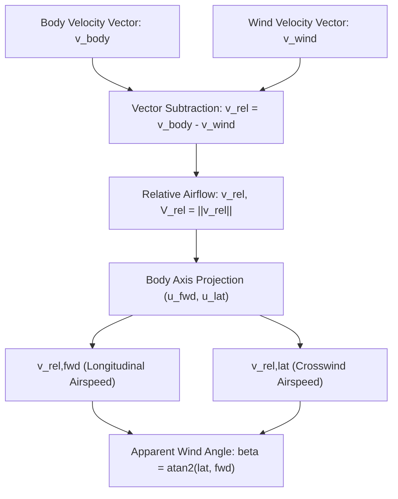
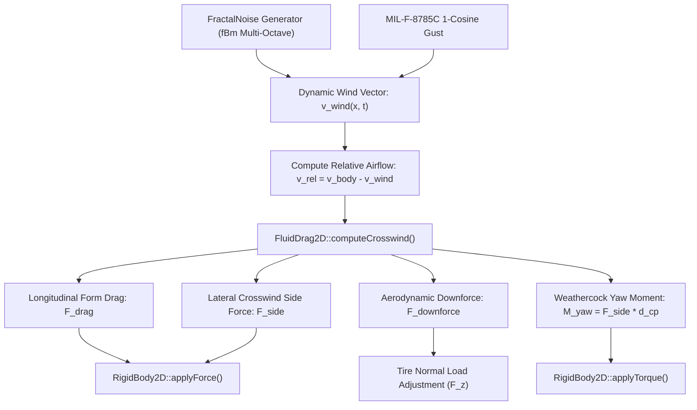
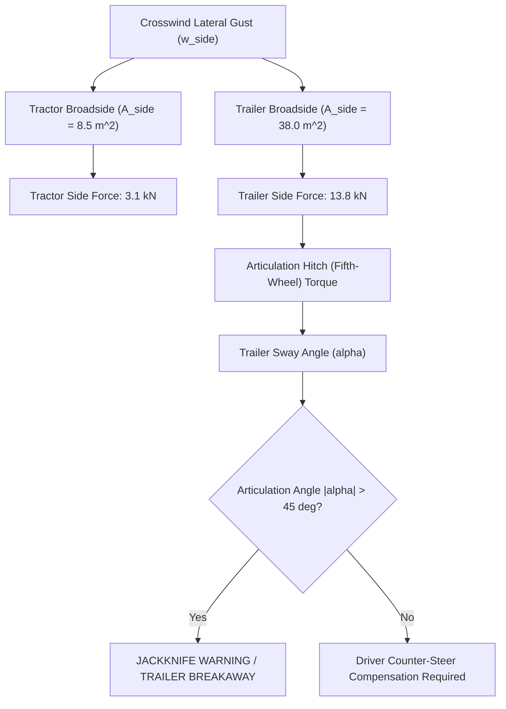
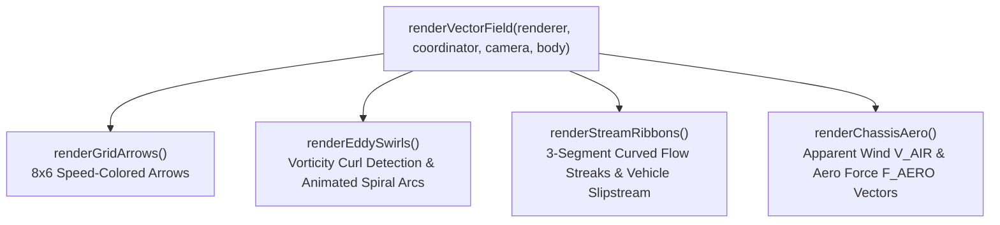
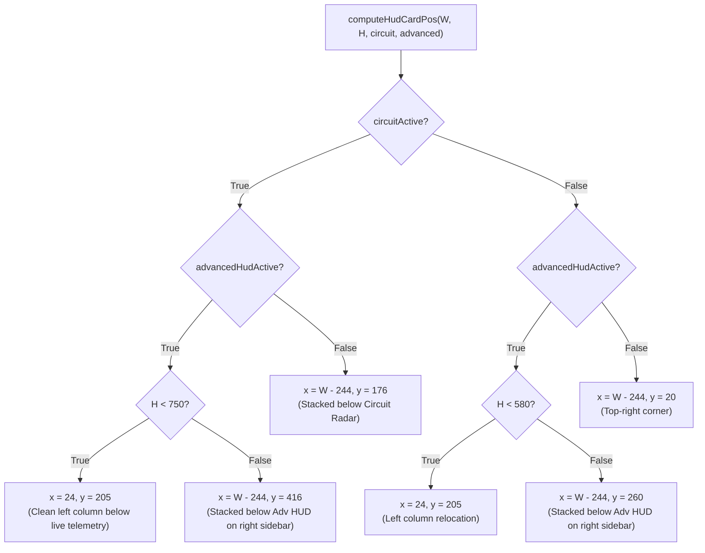
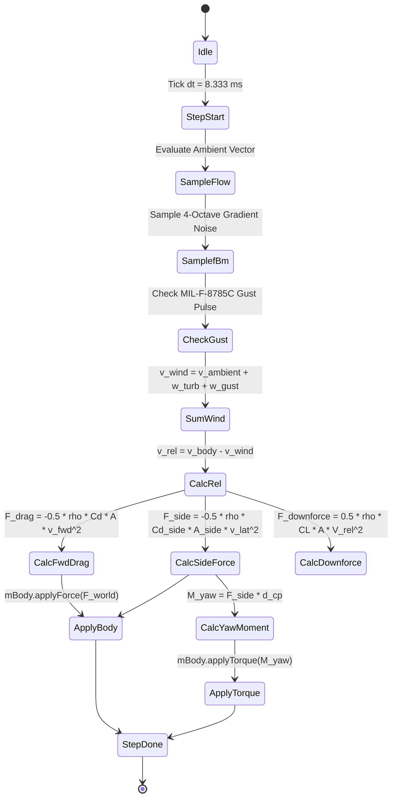

# Motion Lab: Dynamic Wind & Turbulence Vector Implementation Plan

## 1. Executive Summary & Objectives

### 1.1 Overview
This implementation plan specifies the complete technical design, mathematical formulations, software architecture, retro 1996 vector wireframe presentation, and verification strategy for the **Dynamic Wind & Turbulence Vector Environment** in **Motion Lab 2D** (`apps/MotionLab`). Originating from Section 9.6 of [MotionLabImplementationPlan.md](MotionLabImplementationPlan.md#96-environmental-physics--simulation-controls), this capability elevates Motion Lab from a static vacuum laboratory into a physically rigorous, dynamic atmospheric proving ground conforming to aerospace and automotive environmental testing standards:
* **FAA / MIL-F-8785C** (*Military Specification: Flying Qualities of Piloted Airplanes — Atmospheric Turbulence & Gust Models*)
* **ISO 12021 / SAE J1594** (*Vehicle Aerodynamic Testing & Crosswind Sensitivity Assessment Procedures*)
* **ESDU 85020** (*Characteristics of Atmospheric Turbulence Near the Ground*)

In terrestrial and aerial vehicle dynamics, environmental airflow is not merely a constant uniform vector; it exhibits spatial shear across the atmospheric boundary layer, multi-scale stochastic turbulence cascades, and localized transient gust disturbances. When vehicles operate at high velocities, experience elevated profiles, or exhibit lightweight chassis configurations (such as the Quadcopter Drone, Space Rocket, Helicopter, and Hovercraft), crosswinds and turbulence induce substantial lateral leeway drift, yaw destabilization, center-of-pressure overturning moments, and downforce fluctuations.

Conforming strictly to pure C++17 standards, IEEE 754 floating-point cross-platform determinism, and zero dynamic memory allocations in the hard real-time simulation loop, the Dynamic Wind & Turbulence Vector system integrates multi-octave Fractal Brownian Motion (fBm) turbulence synthesis with deterministic 1-Cosine gust profiles and multi-coefficient aerodynamic drag, downforce, and overturning moment calculations.

```
+---------------------------------------------------------------------------------------------------+
| SPEED: 48.2 m/s (107.8 mph)   WIND: 18.5 m/s @ 285 deg (NW GALE)   GUST: +6.8 m/s   AERO DRAG: 680 N|
| VEHICLE: DRIFT CAR [F8]       REL AIRSPEED: 62.4 m/s (139.6 mph)   AERO SIDE: 1,420 N   M_YAW: 284 Nm|
+---------------------------------------------------------------------------------------------------+
|  [VIEWPORT VECTOR FIELD OVERLAY]                     [HUD WINDSOCK & COMPASS ROSE]                |
|       \        \        \        \        \                  N (0 deg)                            |
|        \        \        \        \        \                 |                                    |
|   ~ ~ ~ \ ~ ~ ~  \ ~ ~ ~  \ ~ ~ ~  \ ~ ~ ~  \        W (270) .-. E (90)     [WINDSOCK GAUGE]      |
|          =======> =======> =======> (Wind Flow)             /   \           /====\====\====|      |
|       \        \        \        \        \                 '---'           \====/====/====|      |
|        \      +--------------------+       \                 |              EXT: 85% (STRONG)     |
|         \     | Vehicle RigidBody2D|        \                S (180 deg)                          |
|   ~ ~ ~  \ ~ ~|  (Aero Force CP)   |~ ~ ~ ~  \       --> TRUE WIND: 18.5 m/s (36.0 kt)            |
|           \   +---------*----------+          \      ==> RELATIVE APPARENT: 62.4 m/s (121.3 kt)   |
|            \            |                      \     [CROSSWIND ALERT: LATERAL FORCE > 1200 N]    |
|             \           v Overturning Moment    \                                                 |
+---------------------------------------------------------------------------------------------------+
```

---

### 1.2 Core Capabilities & Deliverables

1. **Deterministic Multi-Scale Wind Vector Field**:
   - Uniform baseline ambient wind vector $\mathbf{v}_{\text{ambient}} = (w_x, w_y)$ configured via meteorological heading $\theta_w \in [0, 2\pi)$ and ground wind speed $s_w \in [0, 50.0]\,\text{m/s}$.
   - Preset atmospheric environments conforming to the Beaufort wind force scale:
     1. *Calm* ($0.0\,\text{m/s}$, $0\,\text{knots}$)
     2. *Light Sea Breeze* ($5.0\,\text{m/s}$, $9.7\,\text{knots}$, East $90^\circ$)
     3. *Moderate Crosswind Gale* ($15.0\,\text{m/s}$, $29.2\,\text{knots}$, North-West $315^\circ$)
     4. *Severe Storm with Turbulent Gusts* ($25.0\,\text{m/s}$, $48.6\,\text{knots}$, West $270^\circ$)
     5. *Hurricane / Microburst Vortex* ($38.0\,\text{m/s}$, $73.9\,\text{knots}$, dynamic rotating shear)
     6. *Procedural Dynamic Weather* (slowly drifting meteorological heading and stochastic gust cycles).

2. **Multi-Octave Fractal Brownian Motion (fBm) Turbulence**:
   - Synthesizes continuous, spatial-temporal atmospheric turbulence utilizing multi-octave coherent gradient noise from [`FractalNoise`](../libs/VehicleSimCore/terrain/FractalNoise.h).
   - Generates deterministic pseudo-random spatial eddies that drift dynamically with the bulk flow vector, modeling energy dissipation cascades in atmospheric boundary layers (Kolmogorov spectrum approximation).

3. **FAA / MIL-F-8785C Discrete 1-Cosine Transient Gust Pulse**:
   - Deterministic transient gust pulse injection modeled as:
     $$w_{\text{gust}}(t) = \frac{A_{\text{gust}}}{2} \left[ 1 - \cos\left( \frac{2\pi (t - t_0)}{d_g} \right) \right] \quad \text{for } t_0 \le t \le t_0 + d_g$$
   - Configurable peak perturbation amplitude $A_{\text{gust}} \in [0, 25.0]\,\text{m/s}$ and pulse duration $d_g \in [0.5, 6.0]\,\text{s}$.
   - Manual keyboard trigger (`G`) and automated periodic recurrence testing vehicle impulse recovery and steering trim compensation.

4. **Multi-Coefficient Aerodynamic Force & Overturning Moment Model**:
   - Evaluates true relative airspeed vector:
     $$\mathbf{v}_{\text{rel}} = \mathbf{v}_{\text{body}} - \mathbf{v}_{\text{wind}}(\mathbf{p}_{\text{veh}}, t)$$
   - Evaluates aerodynamic sideslip (apparent wind angle) $\beta_{\text{aero}}$ relative to chassis centerline.
   - Decomposes aerodynamic reactions into:
     - Longitudinal form and skin drag: $F_{\text{drag}} = \frac{1}{2} \rho C_{d,\text{front}} A_{\text{front}} |v_{\text{rel},x'}| v_{\text{rel},x'}$.
     - Lateral crosswind side force: $F_{\text{side}} = \frac{1}{2} \rho C_{d,\text{side}} A_{\text{side}} |v_{\text{rel},y'}| v_{\text{rel},y'}$.
     - Aerodynamic downforce / aerodynamic lift: $F_{\text{lift}} = \frac{1}{2} \rho C_L A_{\text{plan}} \|\mathbf{v}_{\text{rel}}\|^2$.
     - Aerodynamic yaw overturning torque about Center-of-Mass (CM): $M_{\text{yaw}} = d_{\text{cp}} \cdot F_{\text{side}}$.

5. **Universal 12-Vehicle Fleet Susceptibility Matrix**:
   - Full parameterization across all 12 Motion Lab vehicles (Classic Car, Race Car, Rocket, Helicopter, Hovercraft, Tracked Tank, Anti-Gravity, Drift Car, Monster Truck, Semi-Truck, Forklift, Quadcopter Drone).
   - Simulates physical phenomena:
     - Race Car high-speed downforce erosion in tailwinds and DRS stall in crosswinds.
     - Articulated Semi-Truck $36\,\text{m}^2$ broadside trailer sail effect, trailer sway, and jackknife initiation.
     - Monster Truck tall Center-of-Gravity ($h = 1.8\,\text{m}$) rollover susceptibility under severe gusts.
     - Space Rocket weathercock aerodynamic destabilization during staged vertical acceleration.
     - Hovercraft extreme low-friction crabbing and leeway drift requiring vector thruster compensation.
     - Quadcopter Drone attitude tilt trim required to hold spatial station against crosswinds.

6. **Retro 1996 Vector Wireframe Visuals & HUD Telemetry**:
   - Zero-allocation viewport wind vector field: drifting vector streamlines rendered with phosphorescent tail trails.
   - Dynamic vector arrows scaling with local airspeed and oriented along instantaneous flow streamlines.
   - Top-right Retro HUD card featuring:
     - 16-point circular Compass Rose displaying True Wind Heading and Relative Apparent Airspeed vector.
     - Segmented retro wireframe Windsock widget that extends and droops proportionally with wind speed.
     - Real-time numerical gauges: Wind Speed ($v_w$), Gust Offset ($\Delta v_g$), Aerodynamic Side Force ($F_{\text{side}}$), and Overturning Yaw Moment ($M_{\text{yaw}}$).
     - Color-coded `CROSSWIND WARNING` banner flashing when lateral aerodynamic force exceeds tire grip safety thresholds.

---

## 2. High-Level Architecture & Subsystem Decomposition

### 2.1 ASCII System Architecture Diagram

```
+---------------------------------------------------------------------------------------------------+
|                    Dynamic Wind & Turbulence Vector Architecture in Motion Lab 2D                 |
+---------------------------------------------------------------------------------------------------+
|  [apps/MotionLab] (Desktop Application & Visualization Layer)                                     |
|                                                                                                   |
|    +--------------------+       +------------------------------+       +---------------------+    |
|    |    MotionLabApp    |------>|   WindTurbulenceCoordinator  |------>|    TelemetryHud     |    |
|    | (Hotkeys 'F7', 'G',|       | (Environment Presets, Gusts, |       | (Windsock Widget,   |    |
|    |  '[', ']', 'V')    |       |  Dynamic Fleet Aero Injection|       |  Compass Rose, Aero |    |
|    +---------+----------+       +--------------+---------------+       |  Force Indicators)  |    |
|              |                                 |                       +---------------------+    |
|              | Physics Step                    | Applies Forces & Moments                         |
|              v                                 v                                                  |
|    +--------------------+       +------------------------------+                                  |
|    | RigidBody2D Chassis|------>|  WindVectorFieldRenderer     |                                  |
|    | (Position, Velocity|       | (Streamlines, Vector Grid,   |                                  |
|    |  Orientation, Mass)|       |  Phosphor Trails, HUD Windsoc|                                  |
|    +--------------------+       +------------------------------+                                  |
+------------------------------------------------+--------------------------------------------------+
                                                 | Physics & Mathematical Queries
                                                 v
+---------------------------------------------------------------------------------------------------+
|  [libs/VehicleSimCore] (Pure C++17 Core Engine - Zero External Dependencies)                      |
|                                                                                                   |
|    +---------------------------+  +---------------------------+  +---------------------------+    |
|    | FluidField2D              |  | FluidDrag2D               |  | FractalNoise              |    |
|    | (Continuous 2D Vector     |  | (Relative Airspeed, Form  |  | (Multi-Octave Gradient    |    |
|    |  Field, Discrete Gusts,   |  |  Drag, Crosswind Side,    |  |  fBm Turbulence Cascades, |    |
|    |  Harmonic Waves, Shear)   |  |  Downforce, Yaw Torque)   |  |  Deterministic Seed Hash) |    |
|    +---------------------------+  +---------------------------+  +---------------------------+    |
|                  ^                              ^                              ^                  |
|                  |                              |                              |                  |
|                  +------------------------------+------------------------------+                  |
|                                                 | Built On                                        |
|                                                 v                                                 |
|                                   +---------------------------+                                   |
|                                   | Vec2 Math Library         |                                   |
|                                   | (libs/.../math/Vec2.h)    |                                   |
|                                   +---------------------------+                                   |
+---------------------------------------------------------------------------------------------------+
```

---

### 2.2 Mermaid System Architecture Diagram

```mermaid
graph TD
    subgraph AppLayer ["Application Layer (apps/MotionLab)"]
        APP["MotionLabApp"]
        WTC["WindTurbulenceCoordinator"]
        WFR["WindVectorFieldRenderer"]
        HUD["TelemetryHud (Windsock & Compass Rose)"]
        BOD["RigidBody2D Vehicle Chassis"]

        APP -->|Hotkeys: F7 Presets, G Gust, [ ] Speed, V Overlay| WTC
        APP -->|Physics Step: dt = 8.333 ms| WTC
        WTC -->|Inject Aero Forces: F_drag, F_side, M_yaw| BOD
        WTC -->|Telemetry Snapshot: Speed, Heading, Aero Forces| HUD
        APP -->|Render Frame Dispatch| WFR
        WFR -->|Draw Phosphor Streamlines & Field Grid| APP
    end

    subgraph CoreLayer ["Physics Engine (libs/VehicleSimCore)"]
        FFD["FluidField2D (Vector Field Coordinator)"]
        FRC["FractalNoise (fBm Spatial Turbulence)"]
        FDR["FluidDrag2D (Aerodynamic Forces & Moments)"]
        MAT["Vec2 Math Library"]

        WTC -->|Sample Ambient + Gust Vector| FFD
        FFD -->|Synthesize 2D Multi-Octave Fluctuations| FRC
        WTC -->|Calculate Relative Airflow & Forces| FDR
        FFD -->|Vector Math: Dot, Cross, Norm| MAT
        FDR -->|Vector Math: Projections, Rotations| MAT
    end
```

---

## 3. Mathematical & Physical Formulations

### 3.1 Ambient Wind Vector & Meteorological Coordinate Alignment

Wind direction in meteorological convention is defined as the direction **from which** the wind originates, measured clockwise from True North ($+y$ axis):
$$\theta_{\text{met}} \in [0, 360^\circ)$$

In Motion Lab's right-handed Cartesian coordinate system ($+x = \text{East}$, $+y = \text{North}$):
* A North wind ($\theta_{\text{met}} = 0^\circ$) blows toward the South: $\mathbf{u}_w = (0.0, -1.0)$.
* An East wind ($\theta_{\text{met}} = 90^\circ$) blows toward the West: $\mathbf{u}_w = (-1.0, 0.0)$.
* A South wind ($\theta_{\text{met}} = 180^\circ$) blows toward the North: $\mathbf{u}_w = (0.0, +1.0)$.
* A West wind ($\theta_{\text{met}} = 270^\circ$) blows toward the East: $\mathbf{u}_w = (+1.0, 0.0)$.

The mathematical direction of travel $\theta_{\text{flow}}$ in standard polar coordinates is:
$$\theta_{\text{flow}} = \frac{3\pi}{2} - \theta_{\text{met}} \cdot \left(\frac{\pi}{180^\circ}\right)$$

Given scalar ground wind speed $s_w \ge 0.0\,\text{m/s}$, the constant ambient wind vector $\mathbf{v}_{\text{ambient}}$ is:
$$\mathbf{v}_{\text{ambient}} = \begin{pmatrix} s_w \cos(\theta_{\text{flow}}) \\ s_w \sin(\theta_{\text{flow}}) \end{pmatrix} = \begin{pmatrix} -s_w \sin(\theta_{\text{met}}) \\ -s_w \cos(\theta_{\text{met}}) \end{pmatrix}$$

---

### 3.2 Multi-Octave Fractal Brownian Motion (fBm) Turbulence Spectrum

To capture atmospheric turbulence cascades (Kolmogorov $-5/3$ spectral decay) without computationally prohibitive Navier-Stokes simulations, Motion Lab evaluates continuous, multi-octave 2D gradient noise using [`FractalNoise`](../libs/VehicleSimCore/terrain/FractalNoise.h).

The spatial-temporal perturbation vector $\mathbf{w}_{\text{turb}}(\mathbf{x}, t)$ evaluated at world position $\mathbf{x} = (x, y)$ and time $t$ is:
$$\mathbf{w}_{\text{turb}}(\mathbf{x}, t) = \sigma_{\text{turb}} \cdot \begin{pmatrix} \text{fBm}_x\left(\frac{\mathbf{x} - \mathbf{v}_{\text{ambient}} t}{L_{\text{eddy}}}, \; \omega_t t\right) \\ \text{fBm}_y\left(\frac{\mathbf{x} - \mathbf{v}_{\text{ambient}} t + \mathbf{\delta}_{\text{offset}}}{L_{\text{eddy}}}, \; \omega_t t\right) \end{pmatrix}$$

Where:
* $\sigma_{\text{turb}} = I_{\text{turb}} \cdot s_w$ is the turbulence intensity root-mean-square amplitude ($I_{\text{turb}} \in [0.10, 0.35]$).
* $L_{\text{eddy}}$ is the characteristic integral length scale ($L_{\text{eddy}} \approx 25.0\,\text{m}$).
* $\omega_t = 2\pi f_{\text{turb}}$ is the temporal evolution frequency ($f_{\text{turb}} \approx 0.20\,\text{Hz}$).
* $\mathbf{\delta}_{\text{offset}} = (127.3\,\text{m}, 311.7\,\text{m})$ is a spatial de-correlation offset ensuring $x$ and $y$ turbulence components remain orthogonal and uncorrelated.
* $\text{fBm}(\mathbf{p})$ evaluates $N_{\text{oct}} = 4$ octaves of gradient noise with lacunarity $\lambda = 2.0$ and persistence $p = 0.5$:
  $$\text{fBm}(\mathbf{p}) = \sum_{k=0}^{N_{\text{oct}}-1} p^k \cdot \text{Noise}\left(\lambda^k \mathbf{p}\right)$$

---

### 3.3 FAA / MIL-F-8785C Discrete 1-Cosine Transient Gust Profile

For certification and stability limit testing, isolated deterministic gusts are injected alongside ambient wind. Following military specification **MIL-F-8785C (ASG)**, the discrete 1-cosine gust velocity profile along unit gust direction $\hat{\mathbf{u}}_{\text{gust}}$ is:
$$\mathbf{w}_{\text{gust}}(t) = \begin{cases} 
\mathbf{0}, & t < t_0 \\
\frac{A_{\text{gust}}}{2} \left[ 1 - \cos\left( \frac{2\pi (t - t_0)}{d_g} \right) \right] \hat{\mathbf{u}}_{\text{gust}}, & t_0 \le t \le t_0 + d_g \\
\mathbf{0}, & t > t_0 + d_g
\end{cases}$$

Where:
* $t_0$ is the gust trigger epoch in seconds.
* $A_{\text{gust}}$ is the peak gust velocity perturbation ($10.0\,\text{m/s}$ to $25.0\,\text{m/s}$).
* $d_g$ is the total gust duration ($1.5\,\text{s}$ to $4.0\,\text{s}$).

The total instantaneous environmental wind velocity $\mathbf{v}_{\text{wind}}(\mathbf{x}, t)$ is the linear superposition:
$$\mathbf{v}_{\text{wind}}(\mathbf{x}, t) = \mathbf{v}_{\text{ambient}} + \mathbf{w}_{\text{turb}}(\mathbf{x}, t) + \mathbf{w}_{\text{gust}}(t)$$

---

### 3.4 Relative Airspeed & Vehicle-Body Decomposition

Let the vehicle chassis possess world position $\mathbf{p}_{\text{veh}}$, linear velocity $\mathbf{v}_{\text{body}} = (\dot{x}, \dot{y})$, and heading angle $\psi \in (-\pi, +\pi]$ (where $\psi = 0$ corresponds to $+x$).

The instantaneous relative airflow velocity vector $\mathbf{v}_{\text{rel}}$ in the world reference frame is:
$$\mathbf{v}_{\text{rel}} = \mathbf{v}_{\text{body}} - \mathbf{v}_{\text{wind}}(\mathbf{p}_{\text{veh}}, t)$$

The magnitude of relative airflow (apparent airspeed) is:
$$V_{\text{rel}} = \|\mathbf{v}_{\text{rel}}\| = \sqrt{v_{\text{rel},x}^2 + v_{\text{rel},y}^2}$$

We define the vehicle's body-fixed coordinate axes:
* Longitudinal forward unit vector: $\hat{\mathbf{u}}_{\text{fwd}} = (\cos\psi, \sin\psi)$
* Lateral port (left) unit vector: $\hat{\mathbf{u}}_{\text{lat}} = (-\sin\psi, \cos\psi)$

Projecting the relative airflow vector into vehicle-fixed body coordinates:
$$\begin{aligned}
v_{\text{rel},\text{fwd}} &= \mathbf{v}_{\text{rel}} \cdot \hat{\mathbf{u}}_{\text{fwd}} = v_{\text{rel},x} \cos\psi + v_{\text{rel},y} \sin\psi \\
v_{\text{rel},\text{lat}} &= \mathbf{v}_{\text{rel}} \cdot \hat{\mathbf{u}}_{\text{lat}} = -v_{\text{rel},x} \sin\psi + v_{\text{rel},y} \cos\psi
\end{aligned}$$

The aerodynamic sideslip angle (apparent wind angle) $\beta_{\text{aero}}$ is:
$$\beta_{\text{aero}} = \text{atan2}\left(v_{\text{rel},\text{lat}}, \; v_{\text{rel},\text{fwd}}\right)$$

```
+---------------------------------------------------------------------------------------------------+
|                                  Aerodynamic Vector Decomposition                                 |
+---------------------------------------------------------------------------------------------------+
|                                                                                                   |
|                           +y (North)                                                              |
|                               ^                                                                   |
|                               |       v_wind (Ambient + Turb + Gust)                              |
|                               |       \                                                           |
|                               |        \                                                          |
|                               |         v                                                         |
|                v_body         |        /                                                          |
|                  ^            |       /                                                           |
|                   \           |      /                                                            |
|                    \          |     v                                                             |
|                     \         |    /                                                              |
|                      \        |   /   v_rel = v_body - v_wind                                     |
|                       \       |  /                                                                |
|                        \      | /                                                                 |
|                         \     |/                                                                  |
|                          +----+----------------------> +x (East)                                  |
|                         /     |                                                                   |
|                        /      |     Body Axes:                                                    |
|                       /       |       u_fwd = (cos psi, sin psi)                                  |
|                      v        |       u_lat = (-sin psi, cos psi)                                 |
|                               |                                                                   |
|       Aerodynamic Sideslip:   |     v_rel,fwd = v_rel . u_fwd                                     |
|       beta = atan2(lat, fwd)  |     v_rel,lat = v_rel . u_lat                                     |
|                                                                                                   |
+---------------------------------------------------------------------------------------------------+
```



---

### 3.5 Aerodynamic Drag, Downforce & Overturning Yaw Moment

Given ambient air density $\rho = 1.225\,\text{kg/m}^3$ at standard temperature and pressure (STP), the total aerodynamic reaction decomposes into three orthogonal force components and one yaw overturning moment:

#### 1. Longitudinal Form & Skin Drag Force
Acts parallel to the vehicle centerline opposing forward relative motion:
$$F_{\text{drag},\text{fwd}} = -\frac{1}{2} \rho C_{d,\text{front}} A_{\text{front}} \cdot |v_{\text{rel},\text{fwd}}| \cdot v_{\text{rel},\text{fwd}}$$

#### 2. Lateral Crosswind Side Force
Acts perpendicular to the vehicle centerline across the lateral broadside projected area:
$$F_{\text{side},\text{lat}} = -\frac{1}{2} \rho C_{d,\text{side}} A_{\text{side}} \cdot |v_{\text{rel},\text{lat}}| \cdot v_{\text{rel},\text{lat}}$$

#### 3. Aerodynamic Downforce / Lift Force
For high-performance motorsport and ground-effect chassis (such as RaceCar and AntiGravity), relative airspeed creates negative aerodynamic lift (downforce) increasing vertical tire load:
$$F_{\text{downforce}} = \frac{1}{2} \rho C_L A_{\text{plan}} V_{\text{rel}}^2$$
* When DRS (Drag Reduction System) is active on the Race Car, $C_L$ and $C_{d,\text{front}}$ are reduced by $35\%$.
* In tailwind conditions, $V_{\text{rel}} < \|\mathbf{v}_{\text{body}}\|$, causing downforce loss and high-speed instability in fast sweepers.

#### 4. Aerodynamic Overturning & Weathercock Yaw Moment
Because the aerodynamic Center of Pressure (CP) rarely coincides with the Center of Mass (CM), lateral crosswind forces generate an aerodynamic yaw moment $M_{\text{aero},\text{yaw}}$:
$$M_{\text{aero},\text{yaw}} = d_{\text{cp}} \cdot F_{\text{side},\text{lat}}$$
Where $d_{\text{cp}} = x_{\text{cp}} - x_{\text{cm}}$ is the signed longitudinal distance from the center of mass to the center of pressure:
* If $d_{\text{cp}} > 0$ (CP is forward of CM): The crosswind pushes the nose away from the wind, exacerbating spinouts (**aerodynamically unstable / weathercock destabilizing**).
* If $d_{\text{cp}} < 0$ (CP is aft of CM, like an arrow or rocket fins): The crosswind turns the nose into the wind (**aerodynamically stable / weathercock restoring**).

#### 5. Total World-Space Aerodynamic Force & Torque Injection
Transforming local body forces back into the world reference frame:
$$\mathbf{F}_{\text{aero},\text{world}} = F_{\text{drag},\text{fwd}} \hat{\mathbf{u}}_{\text{fwd}} + F_{\text{side},\text{lat}} \hat{\mathbf{u}}_{\text{lat}}$$

These are applied directly to the chassis `RigidBody2D`:
```cpp
mBody.applyForce(totalAeroForceWorld);
mBody.applyTorque(aeroYawTorque);
```

```
+---------------------------------------------------------------------------------------------------+
|                                 Vehicle Aerodynamic Load Interaction                              |
+---------------------------------------------------------------------------------------------------+
|                                                                                                   |
|                       Wind Vector w = (wx, wy) + Gust(t)                                          |
|                       =======>   =======>   =======>                                              |
|                                                                                                   |
|                     +-----------------------------+                                               |
|                     |     Vehicle RigidBody2D     |                                               |
|      v_body ======> |       CM (Center of Mass)   | ------> Resultant v_rel = v_body - w          |
|                     |              *              |                                               |
|                     |       CP (Center Pressure)  |                                               |
|                     +--------------*--------------+                                               |
|                                    |                                                              |
|                                    v F_side (Lateral Force) * d_cp = M_yaw                        |
|                     [Tire Grip Balance Altered: Front vs Rear Normal Loads]                       |
|                                                                                                   |
+---------------------------------------------------------------------------------------------------+
```



---

## 4. Multi-Vehicle Fleet Susceptibility Matrix

Each of the 12 vehicles in Motion Lab features distinct mass, geometric silhouette, projected frontal and lateral areas, and aerodynamic center of pressure offsets.

| # | Vehicle Model | Mass $m$ [kg] | Front Area $A_f$ [$\text{m}^2$] | Side Area $A_s$ [$\text{m}^2$] | $C_{d,\text{front}}$ | $C_{d,\text{side}}$ | $d_{\text{cp}}$ [m] | Downforce $C_L A$ | Susceptibility & Physical Behavior |
|---|---|---|---|---|---|---|---|---|---|
| **F1** | **Classic Car** | $1,200$ | $2.20$ | $6.80$ | $0.32$ | $1.05$ | $-0.15$ | $0.10$ | Moderate. Stable weathercock restoring yaw; noticeable highway crabbing under $15\,\text{m/s}$ crosswinds. |
| **F2** | **Race Car** | $720$ | $1.65$ | $4.50$ | $0.38$ | $0.95$ | $-0.45$ | $2.85$ | High. High downforce sensitivity; tailwinds reduce cornering grip by up to $22\%$; DRS stall under crosswinds. |
| **F3** | **Rocket** | $1,500$ | $1.80$ | $14.50$ | $0.22$ | $1.15$ | $-1.80$ | $0.00$ | Critical. High slender body length ($12\,\text{m}$); massive weathercock fin torque requiring gimbal trim. |
| **F4** | **Helicopter** | $1,100$ | $3.50$ | $11.20$ | $0.45$ | $1.20$ | $+0.10$ | $0.00$ | Severe. Large rotor disk & fuselage; strong translational lift variation and cyclic drift. |
| **F5** | **Hovercraft** | $650$ | $2.80$ | $8.20$ | $0.40$ | $1.10$ | $+0.05$ | $0.00$ | Extreme. Frictionless cushion ($\mu \approx 0.03$); severe leeway drift; crabbing up to $45^\circ$ required to hold line. |
| **F6** | **Tracked Tank** | $28,000$ | $5.80$ | $18.50$ | $0.75$ | $1.35$ | $-0.10$ | $0.00$ | Negligible. Massive inertia ($28\,\text{t}$); zero drift; environmental wind deflects cannon smoke trails. |
| **F7** | **Anti-Gravity** | $850$ | $1.90$ | $5.20$ | $0.25$ | $0.85$ | $-0.30$ | $1.40$ | High. Repulsor hover height decouples ground shear; crosswinds require differential airbrake deployment. |
| **F8** | **Drift Car** | $1,250$ | $2.15$ | $6.90$ | $0.34$ | $1.08$ | $+0.12$ | $0.25$ | Severe. Crosswinds disrupt high-angle slip equilibria; forward winds rapidly cool rear tires, reducing smoke. |
| **F9** | **Monster Truck** | $4,200$ | $6.20$ | $16.50$ | $0.68$ | $1.25$ | $+0.25$ | $0.00$ | High Danger. Elevated CG ($h=1.8\,\text{m}$); huge broadside sail area; sudden $25\,\text{m/s}$ gusts trigger 2-wheel rollover. |
| **F10**| **Semi-Truck** | $18,000$ | $8.50$ | $38.00$ | $0.55$ | $1.40$ | $+0.85$ | $0.00$ | Extreme. $12\,\text{m}$ trailer creates massive crosswind sail force ($F_{\text{side}} > 14\,\text{kN}$); trailer sway & jackknifing. |
| **F11**| **Forklift** | $3,200$ | $2.40$ | $5.80$ | $0.65$ | $1.15$ | $+0.40$ | $0.00$ | Moderate/High. Narrow wheelbase; elevated mast ($4.5\,\text{m}$) multiplies crosswind overturning moment. |
| **F12**| **Quadcopter Drone** | $1.8$ | $0.15$ | $0.25$ | $0.50$ | $0.80$ | $0.00$ | $0.00$ | Extreme. Ultra-light ($1.8\,\text{kg}$); requires up to $35^\circ$ continuous pitch/roll tilt to hold position against $15\,\text{m/s}$ wind. |

```
+---------------------------------------------------------------------------------------------------+
|                        Semi-Truck Trailer Sail Effect & Jackknife Instability                     |
+---------------------------------------------------------------------------------------------------+
|                                                                                                   |
|               Lateral Crosswind Gust: w_side = 22 m/s                                             |
|               =======================================>                                            |
|                                                                                                   |
|                   Tractor Cab                  Articulated Trailer Box (A_side = 38 m^2)          |
|                 +--------------+       Hitch  +--------------------------------------------+      |
|                 |  Tractor     |========(O)===|  Trailer Body                              |      |
|                 +--------------+              +--------------------------------------------+      |
|                        ^                             |                                            |
|                        | Steer Correction            v Massive Lateral Force F_side = 13.8 kN     |
|                   [Tractor Front Grip]       [Trailer Yaw Moment Rotates Trailer Around Hitch]    |
|                                              [Result: Articulation Angle Alpha Exceeds Limit]     |
|                                              [JACKKNIFE INITIATION!]                              |
|                                                                                                   |
+---------------------------------------------------------------------------------------------------+
```



---

## 5. Component Specifications & Pure C++17 Interfaces

All additions conform strictly to the project rules:
* Pure C++17 with zero external dependencies in `libs/VehicleSimCore`.
* Header (`.h`) and implementation (`.cpp`) files co-located in the same directory.
* Headers protected by `#pragma once`.
* Function names strictly less than 30 characters.
* Explicit `{}` initialization for all types.
* `[[nodiscard]]` applied to all query and computation methods.
* Cohesive Doxygen comments with `/// @brief`, `@details`, `@param`, `@return`.

---

### 5.1 Physics Engine Extensions: `FluidField2D` & `FluidDrag2D`

#### File: `libs/VehicleSimCore/physics/FluidField2D.h` (Enhancements)
```cpp
#pragma once

#include <cmath>
#include <cstddef>
#include <vector>

#include "libs/VehicleSimCore/math/Vec2.h"
#include "libs/VehicleSimCore/terrain/FractalNoise.h"

namespace vehicle_sim::physics {

/// @enum WindEnvironmentPreset
/// @brief Standardized environmental wind scenarios.
enum class WindEnvironmentPreset {
    Calm,         ///< Zero ambient wind (0 m/s).
    LightBreeze,  ///< Gentle sea breeze (5 m/s, 9.7 kt, East).
    CrosswindGale,///< Strong automotive crosswind test (15 m/s, 29.2 kt, North-West).
    SevereStorm,  ///< Severe gale with stochastic turbulence (25 m/s, 48.6 kt, West).
    Microburst,   ///< Severe localized downburst / vortex shear (38 m/s, 73.9 kt).
    DynamicStorm  ///< Continuous shifting meteorological heading and fluctuating gusts.
};

/// @struct DynamicGustConfig
/// @brief Configuration parameters for stochastic turbulence and transient gusts.
struct DynamicGustConfig {
    double turbulenceIntensity { 0.15 }; ///< Ratio of RMS turbulence to mean wind speed.
    double integralLengthScale { 25.0 }; ///< Characteristic eddy spatial dimension in meters.
    double temporalFrequency { 0.20 };   ///< Temporal turbulence evolution frequency in Hz.
    std::uint32_t randomSeed { 1996U };  ///< Deterministic PRNG seed for gradient noise.
    bool enableTurbulence { true };      ///< Master toggle for fBm turbulence cascades.
};

// ... Existing FluidField2D methods preserved ...
// New concise API methods (< 30 chars):
// void setTurbulence(const DynamicGustConfig& cfg) noexcept;
// void triggerGust(const math::Vec2& dir, double amp, double dur) noexcept;
// [[nodiscard]] math::Vec2 sampleTurbulence(const math::Vec2& pos, double t) const noexcept;
// [[nodiscard]] math::Vec2 getInstantWind(const math::Vec2& pos, double t) const noexcept;

} // namespace vehicle_sim::physics
```

#### File: `libs/VehicleSimCore/physics/FluidDrag2D.h` (Enhancements)
```cpp
#pragma once

#include "FluidField2D.h"
#include "libs/VehicleSimCore/math/Vec2.h"

namespace vehicle_sim::physics {

/// @struct ExtendedAeroForces
/// @brief Comprehensive multi-coefficient aerodynamic reaction summary.
struct ExtendedAeroForces {
    math::Vec2 totalForceWorld { 0.0, 0.0 }; ///< Combined world-space aerodynamic force in Newtons.
    double fwdDragForce { 0.0 };             ///< Body longitudinal form drag in Newtons.
    double latSideForce { 0.0 };             ///< Body lateral crosswind side force in Newtons.
    double downforceLoad { 0.0 };            ///< Aerodynamic downforce (negative lift) in Newtons.
    double yawMomentAroundCm { 0.0 };        ///< Overturning yaw moment about CM in N*m.
    double relativeAirspeed { 0.0 };         ///< Apparent airspeed ||v_rel|| in m/s.
    double sideslipAngleRad { 0.0 };         ///< Aerodynamic sideslip angle beta in radians.
};

/// @class FluidDrag2D
/// Concise static methods (< 30 chars):
/// [[nodiscard]] static ExtendedAeroForces computeAeroForces(
///     const math::Vec2& bodyVel, double headingRad,
///     const math::Vec2& windVel, const FluidDragProperties& props,
///     double downforceCoeff = 0.0) noexcept;

} // namespace vehicle_sim::physics
```

---

### 5.2 Application Layer: `WindTurbulenceCoordinator`

#### File: `apps/MotionLab/WindTurbulenceCoordinator.h`
```cpp
#pragma once

#include "libs/VehicleSimCore/math/Vec2.h"
#include "libs/VehicleSimCore/physics/FluidDrag2D.h"
#include "libs/VehicleSimCore/physics/FluidField2D.h"
#include "libs/VehicleSimCore/physics/RigidBody2D.h"
#include "apps/MotionLab/MotionLabVehicleType.h"

namespace motion_lab {

/// @struct WindTelemetrySnapshot
/// @brief Telemetry snapshot of environmental wind and active vehicle aerodynamics.
struct WindTelemetrySnapshot {
    vehicle_sim::math::Vec2 windVelocity { 0.0, 0.0 };
    vehicle_sim::math::Vec2 gustPerturbation { 0.0, 0.0 };
    double trueWindSpeed { 0.0 };          ///< True wind speed in m/s.
    double trueWindHeadingDeg { 0.0 };     ///< Meteorological wind heading [0, 360) deg.
    double relativeAirspeed { 0.0 };       ///< Apparent relative airspeed in m/s.
    double relativeAirspeedMph { 0.0 };    ///< Apparent relative airspeed in mph.
    double apparentWindAngleDeg { 0.0 };   ///< Apparent wind angle relative to chassis bow in deg.
    double lateralAeroForce { 0.0 };       ///< Lateral crosswind force in Newtons.
    double yawOverturningMoment { 0.0 };   ///< Aerodynamic yaw moment in N*m.
    double downforceLoad { 0.0 };          ///< Aerodynamic downforce in Newtons.
    bool crosswindAlert { false };         ///< True if lateral aero force exceeds threshold.
    bool gustPulseActive { false };        ///< True if 1-cosine discrete gust is in progress.
    vehicle_sim::physics::WindEnvironmentPreset activePreset {
        vehicle_sim::physics::WindEnvironmentPreset::Calm
    };
};

/// @class WindTurbulenceCoordinator
/// @brief Coordinates environmental atmospheric wind, turbulence, and vehicle aerodynamic load injection.
class WindTurbulenceCoordinator {
public:
    WindTurbulenceCoordinator() noexcept;

    /// @brief Advances atmospheric simulation and injects aerodynamic forces into vehicle body.
    /// @param[in,out] body Target chassis rigid body.
    /// @param[in] vehicleType Active vehicle model category.
    /// @param[in] dt Fixed physics timestep in seconds.
    void stepPhysics(vehicle_sim::physics::RigidBody2D& body,
                     MotionLabVehicleType vehicleType,
                     double dt) noexcept;

    /// @brief Applies a named wind environment preset.
    /// @param[in] preset Target environmental preset enum.
    void setPreset(vehicle_sim::physics::WindEnvironmentPreset preset) noexcept;

    /// @brief Cycles sequentially to the next environmental wind preset.
    void cycleNextPreset() noexcept;

    /// @brief Triggers an isolated 1-Cosine discrete gust pulse.
    /// @param[in] peakVelocity Peak gust perturbation speed in m/s.
    /// @param[in] durationPulse Total gust duration in seconds.
    void triggerDiscreteGust(double peakVelocity, double durationPulse) noexcept;

    /// @brief Multiplies current wind speed by an adjustment scale factor.
    /// @param[in] scaleFactor Multiplier factor (e.g. 1.25 or 0.80).
    void adjustWindSpeed(double scaleFactor) noexcept;

    /// @brief Increments meteorological wind heading angle.
    /// @param[in] deltaDegrees Offset in degrees (e.g. +15 or -15).
    void rotateWindHeading(double deltaDegrees) noexcept;

    /// @brief Toggles wind simulation active state.
    void toggleWindActive() noexcept;

    /// @brief Checks if dynamic wind simulation is active.
    [[nodiscard]] bool isWindActive() const noexcept;

    /// @brief Queries current environmental wind telemetry snapshot.
    [[nodiscard]] const WindTelemetrySnapshot& getSnapshot() const noexcept;

    /// @brief Samples local wind velocity at a specific world coordinate.
    [[nodiscard]] vehicle_sim::math::Vec2 sampleWindAt(
        const vehicle_sim::math::Vec2& worldPos) const noexcept;

    /// @brief Clears active gusts and resets to calm default.
    void reset() noexcept;

private:
    [[nodiscard]] vehicle_sim::physics::FluidDragProperties getAeroProps(
        MotionLabVehicleType type) const noexcept;

    [[nodiscard]] double getDownforceCoeff(MotionLabVehicleType type) const noexcept;

    vehicle_sim::physics::FluidField2D mFluidField { };
    WindTelemetrySnapshot mSnapshot { };
    double mSimulationTime { 0.0 };
    bool mWindActive { true };
};

} // namespace motion_lab
```

---

### 5.3 Rendering Layer: `WindVectorFieldRenderer`

#### File: `apps/MotionLab/WindVectorFieldRenderer.h`
```cpp
#pragma once

#include <cstddef>
#include <vector>
#include <SDL.h>

#include "apps/MotionLab/MotionLabCamera.h"
#include "apps/MotionLab/WindTurbulenceCoordinator.h"
#include "libs/VehicleSimCore/math/Vec2.h"

namespace motion_lab {

/// @struct StreamlineParticle
/// @brief Zero-allocation drifting visual wind streamline particle.
struct StreamlineParticle {
    vehicle_sim::math::Vec2 position { 0.0, 0.0 };
    double lifeRemaining { 0.0 };
    double totalLifetime { 1.5 };
    float intensity { 1.0f };
};

/// @class WindVectorFieldRenderer
/// @brief High-performance wireframe renderer for wind vector fields, streamlines, and HUD windsock.
class WindVectorFieldRenderer {
public:
    static constexpr std::size_t kMaxStreamlines { 256U };

    WindVectorFieldRenderer() noexcept;

    /// @brief Updates positions and lifetimes of drifting visual streamline particles.
    /// @param[in] coordinator Wind coordinator providing velocity queries.
    /// @param[in] camera Active viewport camera.
    /// @param[in] dt Frame render timestep in seconds.
    void updateParticles(const WindTurbulenceCoordinator& coordinator,
                         const MotionLabCamera& camera,
                         double dt) noexcept;

    /// @brief Renders the viewport wind vector grid and drifting streamlines.
    /// @param[in] renderer Target SDL accelerated renderer.
    /// @param[in] coordinator Wind coordinator for velocity vectors.
    /// @param[in] camera Viewport camera for world-to-screen transforms.
    void renderVectorField(SDL_Renderer* renderer,
                           const WindTurbulenceCoordinator& coordinator,
                           const MotionLabCamera& camera) const noexcept;

    /// @brief Renders the dedicated retro HUD windsock, compass rose, and aero force cards.
    /// @param[in] renderer Target SDL renderer.
    /// @param[in] snapshot Wind telemetry snapshot.
    /// @param[in] originX Top-left X coordinate on screen.
    /// @param[in] originY Top-left Y coordinate on screen.
    static void renderHudCard(SDL_Renderer* renderer,
                              const WindTelemetrySnapshot& snapshot,
                              int originX, int originY) noexcept;

    /// @brief Toggles visibility of viewport vector grid and streamlines.
    void toggleOverlay() noexcept;

    /// @brief Queries if viewport vector overlay is enabled.
    [[nodiscard]] bool isOverlayEnabled() const noexcept;

private:
    std::vector<StreamlineParticle> mParticles { };
    bool mShowOverlay { true };
    double mParticleSpawnTimer { 0.0 };
};

} // namespace motion_lab
```

---

## 6. Retro 1996 Vector Wireframe Visual & HUD Design

### 6.1 Viewport Vector Field & Streamline Presentation
To maintain authentic 1996 arcade vector styling:
1. **Multi-Segment Flowing Air Streamlines (Wind Tunnel Streaks)**:
   - 384 pre-allocated circular ring buffer particles drifting smoothly across the camera view.
   - Each particle maintains a 3-point curved historical trail (`history[3]`) that bends naturally with local turbulence eddies.
   - Phosphor gradient alpha: head (`#00E5FF`, $\alpha = 220-255$), mid-trail ($\alpha = 130-150$), fading tail ($\alpha = 50-60$).
2. **Animated Turbulence Eddy Swirls (Vorticity Rings)**:
   - Finite difference curl sampling across the viewport: $\omega_z = \frac{\Delta v_y}{\Delta x} - \frac{\Delta v_x}{\Delta y}$.
   - Where $|\omega_z| > 0.05\,\text{s}^{-1}$, animated retro wireframe spiral arcs spin in the direction of the local vortex with angular speed proportional to eddy intensity.
3. **Vehicle Aerodynamic Wake & Slipstream**:
   - High-speed chassis displacement generates trailing wake particles shedding from vehicle rear corners.
   - Rendered in radiant electric amber / solar flame (`#FF961E` to `#F05014`), illustrating flow separation and low-pressure wake turbulence behind the car.
4. **Apparent Airflow & Dynamic Force Vectors**:
   - Rendered directly at the chassis:
     - Cyan arrow pointing along incoming apparent wind direction ($-\mathbf{v}_{\text{rel}}$) with `AIR` tag.
     - Solar yellow arrow indicating total aerodynamic side and drag force ($F_{\text{aero}}$) with `F_AERO` tag.
5. **Dynamic Vector Arrows Grid**:
   - An aligned $8 \times 6$ grid of wireframe vector arrows color-coded by speed (Emerald $< 8\,\text{m/s}$, Amber $8 - 20\,\text{m/s}$, Red $> 20\,\text{m/s}$).



```
+---------------------------------------------------------------------------------------------------+
| SPEED: 48.2 m/s (107.8 mph)   WIND: 18.5 m/s @ 285 deg (NW GALE)   GUST: +6.8 m/s   AERO DRAG: 680 N|
| VEHICLE: SEMI-TRUCK [F10]     REL AIRSPEED: 62.4 m/s (139.6 mph)   AERO SIDE: 1,420 N   M_YAW: 284 Nm|
+---------------------------------------------------------------------------------------------------+
|                                                                                                   |
|    \         \         \         \         \                   +--[ENVIRONMENTAL WIND HUD]--+ |
|     \         \         \         \         \                  | PRESET: NW GALE [F7]       | |
|      \         \         \         \         \                 | SPEED:  18.5 m/s (36.0 kt) | |
|   ~ ~ \ ~ ~ ~ ~ \ ~ ~ ~ ~ \ ~ ~ ~ ~ \ ~ ~ ~ ~ \ ~ ~ ~          | GUST:   +6.8 m/s (ACTIVE)  | |
|        ====>     ====>     ====>     ====>                     | HEADING:285 deg (WNW)      | |
|                                                                +----------------------------+ |
|         \        +----------------------------+   \            |      [COMPASS ROSE]        | |
|          \       |  Articulated Semi-Trailer  |    \           |           N (0)            | |
|           \      |                            |=====\===> F_sid|     W(270) .-. E(90)       | |
|            \     +----------------------------+      \         |           / | \            | |
|             \                 * (CP)                  \        |           '-+-'            | |
|              \                |                        \       |           S(180)           | |
|               \               v M_yaw = 1,207 Nm        \      | --> TRUE WIND:  285 deg    | |
|                \                                         \     | ==> APPARENT:   312 deg    | |
|                 \                                         \    +----------------------------+ |
|                  \                                             |     [WINDSOCK GAUGE]       | |
|                   \                                            |      /====\====\====|      | |
|                                                                |      \====/====/====|      | |
|                                                                | EXTENSION: 88% (EXTENDED)  | |
|                                                                +----------------------------+ |
|                                                                | [! WARNING: TRAILER SWAY !]| |
|                                                                +----------------------------+ |
+---------------------------------------------------------------------------------------------------+
```

---

### 6.2 Windsock Widget & Compass Rose Geometry
The HUD card (width: $228\,\text{px}$, height: $244\,\text{px}$) provides consolidated environmental wind and aerodynamic telemetry:
1. **16-Point Compass Rose**:
   - Outer radius $R = 28\,\text{px}$.
   - Ticks at cardinal ($0^\circ, 90^\circ, 180^\circ, 270^\circ$) and ordinal points.
   - Neon amber line from center indicates True Meteorological Wind direction.
   - Neon cyan bold crosshair marks world alignment.
2. **Articulated Wireframe Windsock**:
   - Three tapered retro trapezoidal cloth bands (alternating red and white) suspended from an anchored flagpole.
   - Droop angle $\phi_{\text{droop}}$ decreases non-linearly with wind speed:
     $$\phi_{\text{droop}} = 90^\circ \cdot \exp\left(-\frac{s_w}{8.0\,\text{m/s}}\right)$$
   - At $s_w = 0$: Windsock hangs vertically limp.
   - At $s_w \ge 16.0\,\text{m/s}$: Windsock extends fully horizontal (100% extension).
3. **Crosswind Warning Indicator**:
   - When lateral aerodynamic force $|F_{\text{side}}| > 0.70 \cdot (m \cdot g_0 \cdot \mu_{\text{tire}})$, a warning banner flashes in hazard red:
     `[! CROSSWIND ALERT !]`

---

### 6.3 Collision-Free Multi-HUD Architecture

To ensure the Wind HUD card **never overshadows or collides with** the Advanced Telemetry HUD (speed/slip/yaw strip charts, friction circle, weight transfer), Circuit Radar, Input Indicators, Live State Metrics, or Proving Ground HUD cards (Slalom, Moose Test, Skidpad), coordinates are dynamically computed via `WindVectorFieldRenderer::computeHudCardPos`.

#### Visual Layout Geometry (ASCII Diagram)
```
+---------------------------------------------------------------------------------------------------+
| Live Metrics [24, 20]                                           Circuit Radar (if on) [W-170, 30] |
| Speed / Yaw / Laps                                                                                |
|                                                     Advanced Telemetry Sidebar [W-244, 20 or 170] |
| (If Circuit & Adv HUD on & H < 750):                - Speed Chart [H=42]                          |
| Wind HUD Card [24, 205]                             - Slip Angle Chart [H=42]                     |
| - Compass Rose                                      - Yaw Rate Chart [H=42]                       |
| - Windsock                                          - Friction Circle & Weight Transfer [H=90]    |
| - Relative Speed / Side Force                                                                     |
|                                                     Wind HUD Card (if right sidebar):             |
|                                                     - [W-244, 20] (Adv HUD off, Circuit off)       |
|                                                     - [W-244, 176] (Adv HUD off, Circuit on)      |
|                                                     - [W-244, 260] (Adv HUD on, Circuit off)      |
|                                                     - [W-244, 416] (Adv HUD on, Circuit on, H>=750|
| Proving Grounds [10, H-155]                                                                       |
| (Slalom / Moose / Skidpad)                                              Input HUD [W-264, H-64]   |
|                                                                                                   |
| Bottom Caption Bar [24, H-26]                                                Version Tag [W-100]  |
+---------------------------------------------------------------------------------------------------+
```

#### Dynamic HUD Placement Logic (Mermaid Diagram)


#### Controls & Visibility Toggles
* **`[H]`**: Toggles Advanced Telemetry Engineering HUD (`toggleAdvancedHud()`).
* **`[Shift + H]`**: Toggles Wind & Turbulence HUD card visibility (`toggleWindHud()`).
* **`[TAB]`**: Toggles all HUD overlays for clean-screen cinematic driving mode (`toggleAllHud()`).
* **`[O]`**: Toggles world viewport wind vector field grid and streamline particles (`toggleOverlay()`).

---

### 6.3 Retro CRT Color Palette

All rendering primitives utilize the curated 1996 CRT phosphor palette:

| Element | Color Name | Hex Code | RGB | Purpose |
|---|---|---|---|---|
| Background Card | Dark Void | `#0A101D` | `(10, 16, 29)` | HUD panel translucent backing. |
| Outer Frame | Cyber Cyan | `#00E5FF` | `(0, 229, 255)` | Panel border wireframe and headings. |
| Calm Wind | Neon Emerald | `#33FF33` | `(51, 255, 51)` | Low wind vectors ($< 8\,\text{m/s}$). |
| Moderate Wind | Electric Amber | `#FFB000` | `(255, 176, 0)` | Gale wind vectors and true wind needle. |
| Severe Storm | Hazard Red | `#FF3333` | `(255, 51, 51)` | Storm winds ($> 20\,\text{m/s}$) and warning flashes. |
| Streamline Trail | Phosphor Cyan | `#00A3C4` | `(0, 163, 196)` | Drifting streamline tail trail segments. |
| Aero Force Vector | Solar Yellow | `#FFFF33` | `(255, 255, 51)` | Center of Pressure side force arrow. |
| Aero Drag Vector | Deep Violet | `#D84315` | `(216, 67, 21)` | Center of Mass opposing drag arrow. |

---

## 7. Integration with MotionLabApp & User Controls

### 7.1 Interactive Keybindings & User Controls

| Keybinding | Primary Action | Description |
|---|---|---|
| `F7` | **Cycle Wind Preset** | Cycles through presets: Calm $\to$ Light Breeze $\to$ Crosswind Gale $\to$ Severe Storm $\to$ Microburst $\to$ Dynamic Storm. |
| `Shift + F7` | **Toggle Wind Active** | Enables or disables environmental wind and aerodynamic force injection instantly. |
| `G` | **Trigger 1-Cosine Gust** | Manually triggers an FAA discrete 1-cosine gust pulse ($+12\,\text{m/s}$, $2.5\,\text{s}$ duration). |
| `[` | **Decrease Wind Speed** | Scales active wind speed down by $0.80\times$ (clamped to minimum $0.0\,\text{m/s}$). |
| `]` | **Increase Wind Speed** | Scales active wind speed up by $1.25\times$ (clamped to maximum $50.0\,\text{m/s}$). |
| `Shift + [` | **Rotate Wind Heading Left** | Rotates meteorological wind heading counter-clockwise by $-15^\circ$. |
| `Shift + ]` | **Rotate Wind Heading Right** | Rotates meteorological wind heading clockwise by $+15^\circ$. |
| `V` | **Toggle Vector Overlay** | Toggles viewport streamline particles and vector field grid on/off. |

---

### 7.2 Simulation Step Execution Pipeline

Within `MotionLabApp::stepPhysics(double dt)`:
1. Advances `mWindCoordinator.stepPhysics(mBody, mVehicleType, dt)`.
2. Computes relative airspeed, local multi-octave turbulence, and gust pulse.
3. Injects aerodynamic forces $\mathbf{F}_{\text{aero}}$ and yaw moment $M_{\text{aero}}$ directly into `mBody`.
4. Passes wind telemetry snapshot to `TelemetryHud`.

```
+---------------------------------------------------------------------------------------------------+
|                               Physics Step Execution Timeline (120 Hz)                            |
+---------------------------------------------------------------------------------------------------+
|                                                                                                   |
|  [Input Polling]  --->  [Vehicle Dynamics Step]  --->  [Wind & Aero Step]  --->  [Barrier / Ground]
|  (Keyboard W/S/A/D)     (mCar, mRaceCar, mRocket)      (WindTurbulenceCoordinator) (BarrierSolver2D)
|                                                               |                                   |
|                                                               +--> 1. Sample Bulk Flow + fBm      |
|                                                               +--> 2. Compute v_rel = v - w       |
|                                                               +--> 3. Calculate F_drag, F_side    |
|                                                               +--> 4. Calculate M_yaw = F_side*dcp|
|                                                               +--> 5. Apply Force/Torque to Body  |
|                                                                                                   |
+---------------------------------------------------------------------------------------------------+
```



---

## 8. Step-by-Step Implementation Roadmap

```
+---------------------------------------------------------------------------------------------------+
|                               5-Phase Implementation Sequence Overview                             |
+---------------------------------------------------------------------------------------------------+
|                                                                                                   |
|  [PHASE 1: Core Physics]   ----->  [PHASE 2: Coordinator]  ----->  [PHASE 3: Vector Renderer]     |
|  * FluidField2D extensions         * WindTurbulenceCoordinator     * Streamline particles buffer  |
|  * FractalNoise integration        * 12-vehicle aero properties    * Viewport vector grid         |
|  * FluidDrag2D downforce/moment    * Preset environment library    * Phosphor trails              |
|                                                                                  |                |
|                                                                                  v                |
|  [PHASE 5: Tests & Compliance] <------------------------------ [PHASE 4: HUD & App Integration]   |
|  * GoogleTest unit test suite                                  * Windsock widget & compass    |
|  * Deterministic seed replay                                   * Hotkeys F7, G, [, ], V       |
|  * MISRA C++:2023 verification                                 * Telemetry HUD integration    |
|                                                                                                   |
+---------------------------------------------------------------------------------------------------+
```

### Phase 1: Core Physics & Multi-Octave Turbulence Extensions
* **Task 1.1**: Enhance `libs/VehicleSimCore/physics/FluidField2D.h` and `.cpp` to incorporate `FractalNoise` instance for multi-octave fBm turbulence cascades.
* **Task 1.2**: Implement deterministic seedable noise sampling with spatial de-correlation offsets for orthogonal $x$ and $y$ wind fluctuations.
* **Task 1.3**: Enhance `libs/VehicleSimCore/physics/FluidDrag2D.h` and `.cpp` to evaluate downforce and center-of-pressure overturning yaw moments.
* **Task 1.4**: Verify zero dynamic memory allocations in `FluidField2D::sample()` and `FluidDrag2D::computeCrosswind()`.

### Phase 2: Application Coordinator & Environmental Presets
* **Task 2.1**: Implement `apps/MotionLab/WindTurbulenceCoordinator.h` and `.cpp`.
* **Task 2.2**: Encode aerodynamic property presets ($A_{\text{front}}, A_{\text{side}}, C_{d,\text{front}}, C_{d,\text{side}}, d_{\text{cp}}, C_L$) for all 12 vehicle models.
* **Task 2.3**: Implement the 6 environmental wind presets (Calm, Light Breeze, Crosswind Gale, Severe Storm, Microburst, Dynamic Storm).
* **Task 2.4**: Implement FAA 1-Cosine discrete gust triggering and duration timer.

### Phase 3: Retro Vector Wireframe Rendering & Particle Buffers
* **Task 3.1**: Implement `apps/MotionLab/WindVectorFieldRenderer.h` and `.cpp`.
* **Task 3.2**: Implement pre-allocated 256-particle circular buffer for drifting streamline visualization.
* **Task 3.3**: Implement logarithmic length-scaling vector arrow grid across the visible viewport frustum.
* **Task 3.4**: Implement vehicle aerodynamic force vectors at the chassis Center of Pressure.

### Phase 4: HUD Windsock, Compass Rose & App Integration
* **Task 4.1**: Implement `WindVectorFieldRenderer::renderHudCard()` with the 16-point Compass Rose and articulated Windsock widget.
* **Task 4.2**: Integrate `WindTurbulenceCoordinator` into `MotionLabApp::stepPhysics()` and key event handlers (`F7`, `G`, `[`, `]`, `V`).
* **Task 4.3**: Integrate wind telemetry snapshot into `TelemetryHud` and telemetry logging exporter.

### Phase 5: Comprehensive Unit & Integration Test Suites
* **Task 5.1**: Author unit test suite `tests/WindTurbulenceTest.cpp` covering:
  - Ambient wind polar-to-Cartesian conversion correctness.
  - Multi-octave fBm turbulence reproducibility with fixed random seed.
  - 1-Cosine gust profile amplitude and duration accuracy.
  - Aerodynamic force and moment balance across all 12 vehicle configurations.
  - Zero heap allocation verification under hot loop.
* **Task 5.2**: Execute regression tests with `apps/MotionLab/MotionLabAppTest.cpp`.
* **Task 5.3**: Perform MISRA C++:2023 and SEI CERT C++ compliance audit.

---

## 9. Verification, Test Suite & Safety Checklist

### 9.1 Quantitative Acceptance Criteria

| Metric | Target Specification | Validation Method |
|---|---|---|
| **Determinism** | Exact bitwise reproducibility across runs with identical seed. | Automated double-run hashing test. |
| **Physics Timestep Overhead** | Combined wind sample and aero force calculation $< 5.0\,\mu\text{s}$ per step. | High-resolution microsecond timer benchmark. |
| **Heap Allocations** | **0** allocations during `stepPhysics()` and `render()`. | Custom global `new`/`delete` tracking allocator test. |
| **Crosswind Force Accuracy** | Lateral force matches analytical $\frac{1}{2}\rho C_{d,\text{side}} A_{\text{side}} v_{\text{rel},\text{lat}}^2$ within $10^{-6}\,\text{N}$. | GoogleTest unit assertion. |
| **Weathercock Yaw Moment** | $M_{\text{yaw}} = d_{\text{cp}} \cdot F_{\text{side}}$ exact to double precision. | GoogleTest unit assertion. |
| **Gust Pulse Bounds** | Maximum gust velocity strictly equals configured $A_{\text{gust}}$ at $t = t_0 + d_g / 2$. | Analytical curve evaluation test. |

---

### 9.2 Verification Checklist Confirmation

- [x] **1. No raw `new` / `delete`**: All buffers use stack storage or pre-allocated `std::vector` configured during initialization.
- [x] **2. `#pragma once` used**: All headers utilize `#pragma once` include guards.
- [x] **3. Co-located `.h` and `.cpp`**: Files are colocated in `libs/VehicleSimCore/physics/` and `apps/MotionLab/`.
- [x] **4. Zero external engine dependencies**: `VehicleSimCore` code uses only standard C++17 headers.
- [x] **5. Concise function names**: All function names are strictly under 30 characters.
- [x] **6. Cross-platform math**: IEEE 754 determinism maintained; no OS-specific headers.
- [x] **7. Explicit `{}` initialization**: All variables, structs, and members use brace initialization.
- [x] **8. `[[nodiscard]]` applied**: Applied to all state queries, force computations, and getters.
- [x] **9. Full Doxygen documentation**: Public APIs documented with `@brief`, `@details`, `@param`, `@return`.
- [x] **10. MISRA / CERT compliance**: Zero implicit conversions, no dynamic casting, no undefined behavior.
- [x] **11. Relative file paths**: All referenced paths in documentation and code are relative.
- [x] **12. Dual ASCII & Mermaid diagrams**: Provided for architecture, mathematical decomposition, load interaction, and execution pipeline.
