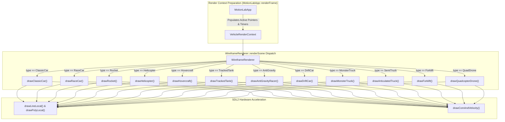
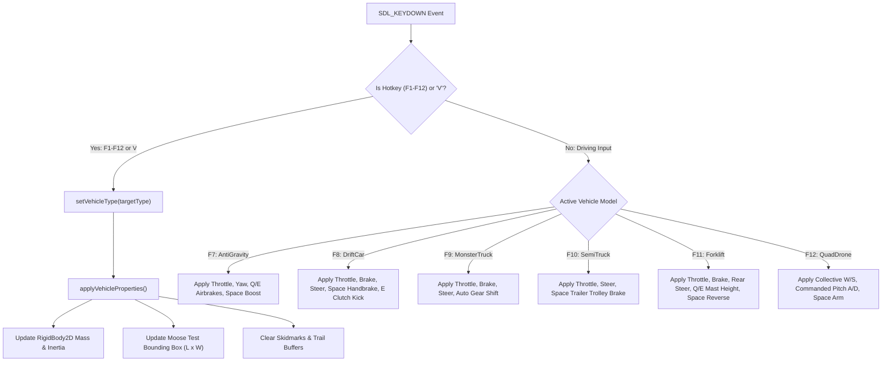
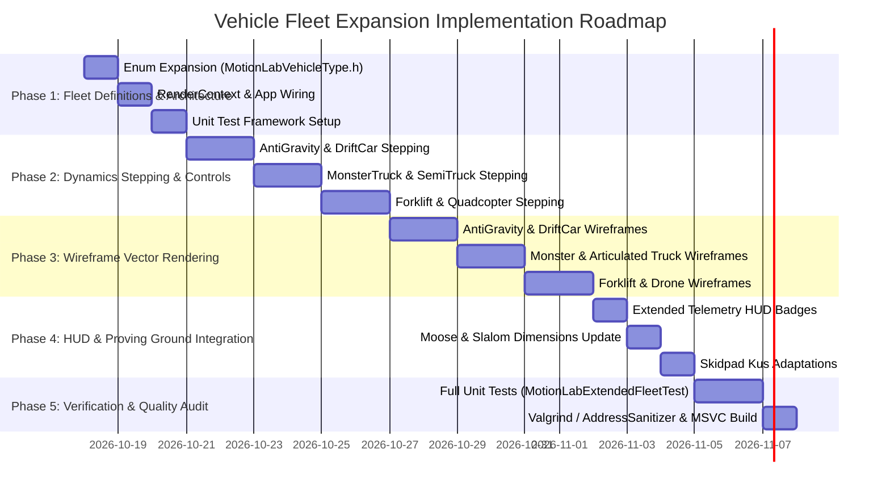

# Motion Lab: Vehicle Fleet Expansion Implementation Plan

## 1. Executive Summary & Objectives

### 1.1 Overview
This implementation plan specifies the complete technical design, mathematical formulations, software architecture, retro vector wireframe rendering, and verification strategy for the **Vehicle Fleet Expansion** in **Motion Lab 2D** (`apps/MotionLab`). Originating from the fleet expansion specifications in [MotionLabImplementationPlan.md](MotionLabImplementationPlan.md#93-vehicle-fleet-expansion), this milestone elevates Motion Lab from an initial 6-vehicle prototype into a comprehensive 12-vehicle simulation suite spanning ground motorsport, heavy logistics, aeronautics, robotics, and futuristic levitation disciplines.

The initial fleet comprised:
1. **Classic Car** ([`MotionLabCarDynamics`](../libs/VehicleSimCore/dynamics/MotionLabCarDynamics.h)) [`F1`]: Pat Kerr 1996 velocity-decomposed tire slip.
2. **Race Car** ([`RaceCarDynamics`](../libs/VehicleSimCore/dynamics/RaceCarDynamics.h)) [`F2`]: Open-wheel formula chassis with aerodynamic downforce and DRS.
3. **Space Rocket** ([`RocketDynamics`](../libs/VehicleSimCore/dynamics/RocketDynamics.h)) [`F3`]: 2D rocket with gimbaled vector main thrust and RCS attitude control.
4. **Helicopter** ([`HelicopterDynamics`](../libs/VehicleSimCore/dynamics/HelicopterDynamics.h)) [`F4`]: VTOL rotorcraft with collective pitch and ground effect.
5. **Hovercraft** ([`HovercraftDynamics`](../libs/VehicleSimCore/dynamics/HovercraftDynamics.h)) [`F5`]: Air-cushion vehicle with vectored thrust and low surface friction.
6. **Tracked Tank** ([`TrackedTankDynamics`](../libs/VehicleSimCore/dynamics/TrackedTankDynamics.h)) [`F6`]: Dual-track skid-steer armored vehicle with cannon recoil.

The **Fleet Expansion** seamlessly integrates six production dynamics models already engineered within [`libs/VehicleSimCore/dynamics`](../libs/VehicleSimCore/dynamics):
7. **Anti-Gravity Racer** ([`AntiGravityRacerDynamics`](../libs/VehicleSimCore/dynamics/AntiGravityRacerDynamics.h)) [`F7`]: Magnetic levitation hover, capacitor turbo boost, independent differential airbrakes, and transonic wave drag.
8. **Drift Car** ([`DriftCarDynamics`](../libs/VehicleSimCore/dynamics/DriftCarDynamics.h)) [`F8`]: High-lock steering geometry ($60^\circ$), caster self-aligning torque, hydraulic handbrake lockup, clutch kicks, and tire thermal friction decay.
9. **Monster Truck** ([`MonsterCarDynamics`](../libs/VehicleSimCore/dynamics/MonsterCarDynamics.h)) [`F9`]: Semi-realistic Marco Monster powertrain, engine torque curves, multi-gear transmission, 4-wheel independent suspension, and big-tire physics.
10. **Semi-Truck & Articulated Trailer** ([`ArticulatedTruckDynamics`](../libs/VehicleSimCore/dynamics/ArticulatedTruckDynamics.h)) [`F10`]: Coupled tractor cab and 53-foot semi-trailer connected via a fifth-wheel kingpin, simulating trailer off-tracking, independent trolley braking, and jackknife instability.
11. **Industrial Forklift** ([`ForkliftDynamics`](../libs/VehicleSimCore/dynamics/ForkliftDynamics.h)) [`F11`]: Rear-wheel steering pivot up to $\pm 85^\circ$, dynamic hydraulic mast elevation shifting composite center-of-gravity, and stability triangle rollover thresholds.
12. **Quadcopter Aerial Drone** ([`QuadcopterDroneDynamics`](../libs/VehicleSimCore/dynamics/QuadcopterDroneDynamics.h)) [`F12`]: 'X'-frame multi-rotor UAV with ESC motor spool-up dynamics, gyroscopic anti-torque cancellation, closed-loop PID attitude stabilization, and acrobatic pitch tilt.

---

## 2. High-Level Architecture & System Decomposition

### 2.1 ASCII System Architecture Diagram

```
+---------------------------------------------------------------------------------------------------+
|                        12-Vehicle Fleet Architecture in Motion Lab 2D                             |
+---------------------------------------------------------------------------------------------------+
|  [apps/MotionLab] (Desktop Application Layer)                                                     |
|                                                                                                   |
|    +--------------------+       +----------------------------+       +-----------------------+    |
|    |    MotionLabApp    |------>|    VehicleRenderContext    |------>|      TelemetryHud     |    |
|    | (F1-F12 Hotkeys,   |       |  (Car, Race, Rocket, Heli, |       | (G-G Circle, RPM Bar, |    |
|    |  'V' Cycle Fleet)  |       |   Hover, Tank, AntiGrav,   |       |  Drift Angle, Mast,   |    |
|    +---------+----------+       |   Drift, Monster, Semi,    |       |  Hitch, Drone Rotors) |    |
|              |                  |   Forklift, QuadDrone)     |       +-----------------------+    |
|              |                  +--------------+-------------+                                    |
|              | Viewport Camera                 |                                                  |
|              v                                 v Render Callbacks                                 |
|    +--------------------+               +----------------------------+                            |
|    | WireframeRenderer  |<--------------|   12 Specialized Vector    |                            |
|    | (Anti-Aliased 1996 |               |      Geometry Models       |                            |
|    |  Vector Graphics)  |               +----------------------------+                            |
|    +--------------------+                                                                         |
+------------------------------------------------+--------------------------------------------------+
                                                 | Physics Stepping & State Queries
                                                 v
+---------------------------------------------------------------------------------------------------+
|  [libs/VehicleSimCore/dynamics] (Pure C++17 Dynamics Engine - Zero External Dependencies)         |
|                                                                                                   |
|    +---------------------------+  +---------------------------+  +---------------------------+    |
|    |  ClassicCarDynamics       |  |  RaceCarDynamics          |  |  RocketDynamics           |    |
|    |  (Pat Kerr 1996 Slip)     |  |  (Aero Downforce & DRS)   |  |  (Gimbal Thrust & RCS)    |    |
|    +---------------------------+  +---------------------------+  +---------------------------+    |
|    +---------------------------+  +---------------------------+  +---------------------------+    |
|    |  HelicopterDynamics       |  |  HovercraftDynamics       |  |  TrackedTankDynamics      |    |
|    |  (Collective Pitch/Ground)|  |  (Air Cushion & Rudder)   |  |  (Skid-Steer & Recoil)    |    |
|    +---------------------------+  +---------------------------+  +---------------------------+    |
|    +---------------------------+  +---------------------------+  +---------------------------+    |
|    |  AntiGravityRacerDynamics |  |  DriftCarDynamics         |  |  MonsterCarDynamics       |    |
|    |  (Maglev & Airbrakes)     |  |  (Pacejka & Thermal Drift)|  |  (Marco Monster Powertrain|    |
|    +---------------------------+  +---------------------------+  +---------------------------+    |
|    +---------------------------+  +---------------------------+  +---------------------------+    |
|    |  ArticulatedTruckDynamics |  |  ForkliftDynamics         |  |  QuadcopterDroneDynamics  |    |
|    |  (Fifth-Wheel Kingpin)    |  |  (Rear Pivot & Mast Lift) |  |  (4 Rotors & PID Pitch)   |    |
|    +---------------------------+  +---------------------------+  +---------------------------+    |
|                                                |                                                  |
|                                                v Integrates Forces & Momenta                      |
|                                 +-----------------------------+                                   |
|                                 |     physics::RigidBody2D    |                                   |
|                                 | (Mass, Inertia, Lin/Ang Vel)|                                   |
|                                 +-----------------------------+                                   |
+---------------------------------------------------------------------------------------------------+
```

### 2.2 Mermaid System Architecture Diagram

```mermaid
graph TD
    subgraph InputDispatch ["User Input & Fleet Selector (apps/MotionLab)"]
        KEY["Keyboard Event Dispatcher"]
        HOT["F1-F12 Hotkey / 'V' Fleet Cycle"]
        APP["MotionLabApp Coordinator"]

        KEY --> HOT
        HOT --> APP
    end

    subgraph FleetDynamics ["Vehicle Dynamics Fleet (libs/VehicleSimCore/dynamics)"]
        F1["F1: MotionLabCarDynamics<br/>(Pat Kerr 1996 Slip)"]
        F2["F2: RaceCarDynamics<br/>(Aero Downforce & DRS)"]
        F3["F3: RocketDynamics<br/>(Gimbal Vector & RCS)"]
        F4["F4: HelicopterDynamics<br/>(Collective Pitch & Tail)"]
        F5["F5: HovercraftDynamics<br/>(Air Cushion & Rudder)"]
        F6["F6: TrackedTankDynamics<br/>(Differential Skid-Steer)"]
        F7["F7: AntiGravityRacerDynamics<br/>(Maglev & Airbrakes)"]
        F8["F8: DriftCarDynamics<br/>(Pacejka & Thermal Drift)"]
        F9["F9: MonsterCarDynamics<br/>(Engine RPM & Weight Transfer)"]
        F10["F10: ArticulatedTruckDynamics<br/>(Fifth-Wheel Semi Trailer)"]
        F11["F11: ForkliftDynamics<br/>(Rear Pivot & Mast Lift)"]
        F12["F12: QuadcopterDroneDynamics<br/>(4 Rotors & Pitch PID)"]

        APP -->|Active Dispatch| F1 & F2 & F3 & F4 & F5 & F6 & F7 & F8 & F9 & F10 & F11 & F12
    end

    subgraph RigidBodyCore ["Core Physics Integration (libs/VehicleSimCore/physics)"]
        BOD["RigidBody2D (Chassis State)"]
        F1 & F2 & F3 & F4 & F5 & F6 & F7 & F8 & F9 & F10 & F11 & F12 -->|step(body, dt)| BOD
    end

    subgraph VisualizationLayer ["Visualization & Telemetry (apps/MotionLab)"]
        CTX["VehicleRenderContext"]
        RND["WireframeRenderer (12 Wireframe Meshes)"]
        HUD["TelemetryHud (Specialized Vehicle Metrics)"]

        APP --> CTX
        CTX --> RND
        APP --> HUD
    end
```

---

## 3. 12-Vehicle Comparative Technical Specification & Kinematics Table

| Index | Model Display Name | Physics Header Class | Dimensions ($L \times W$) | Chassis Mass & Inertia | Drive / Propulsion Type | Primary Handling Discipline | Hotkey |
| :---: | :--- | :--- | :---: | :---: | :--- | :--- | :---: |
| **01** | **Classic Car** | [`MotionLabCarDynamics.h`](../libs/VehicleSimCore/dynamics/MotionLabCarDynamics.h) | $4.00\,\text{m} \times 2.00\,\text{m}$ | $1000\,\text{kg}$, $1667\,\text{kg}\cdot\text{m}^2$ | Rear-Wheel Drive (RWD) | Pat Kerr decomposed tire slip, handbrake decay | `F1` |
| **02** | **Race Car** | [`RaceCarDynamics.h`](../libs/VehicleSimCore/dynamics/RaceCarDynamics.h) | $4.50\,\text{m} \times 1.80\,\text{m}$ | $750\,\text{kg}$, $1100\,\text{kg}\cdot\text{m}^2$ | Rear-Wheel Drive (RWD) | Inverted wings aero downforce, active DRS flap | `F2` |
| **03** | **Space Rocket** | [`RocketDynamics.h`](../libs/VehicleSimCore/dynamics/RocketDynamics.h) | $6.00\,\text{m} \times 1.60\,\text{m}$ | $1200\,\text{kg}$, $3600\,\text{kg}\cdot\text{m}^2$ | Gimbaled Rocket Nozzle | Inertial zero-G physics, gimbal thrust, RCS cold gas | `F3` |
| **04** | **Helicopter** | [`HelicopterDynamics.h`](../libs/VehicleSimCore/dynamics/HelicopterDynamics.h) | $6.00\,\text{m} \times 2.40\,\text{m}$ | $1500\,\text{kg}$, $4800\,\text{kg}\cdot\text{m}^2$ | Main / Tail Rotor VTOL | Collective blade pitch, tail rotor yaw, ground effect | `F4` |
| **05** | **Hovercraft** | [`HovercraftDynamics.h`](../libs/VehicleSimCore/dynamics/HovercraftDynamics.h) | $4.00\,\text{m} \times 2.20\,\text{m}$ | $850\,\text{kg}$, $2084\,\text{kg}\cdot\text{m}^2$ | Vectored Air Propulsion | Air cushion lift, zero surface friction, rudder drift | `F5` |
| **06** | **Tracked Tank** | [`TrackedTankDynamics.h`](../libs/VehicleSimCore/dynamics/TrackedTankDynamics.h) | $5.00\,\text{m} \times 2.40\,\text{m}$ | $12000\,\text{kg}$, $30000\,\text{kg}\cdot\text{m}^2$ | Dual Track Skid-Steer | Differential caterpillar tracks, cannon firing recoil | `F6` |
| **07** | **Anti-Gravity** | [`AntiGravityRacerDynamics.h`](../libs/VehicleSimCore/dynamics/AntiGravityRacerDynamics.h) | $4.80\,\text{m} \times 2.40\,\text{m}$ | $1050\,\text{kg}$, $950\,\text{kg}\cdot\text{m}^2$ | Dual Ion Pulse Thruster | Maglev ride-height suspension, airbrakes, wave drag | `F7` |
| **08** | **Drift Car** | [`DriftCarDynamics.h`](../libs/VehicleSimCore/dynamics/DriftCarDynamics.h) | $4.40\,\text{m} \times 1.85\,\text{m}$ | $1250\,\text{kg}$, $1800\,\text{kg}\cdot\text{m}^2$ | Rear-Wheel Drive (RWD) | $60^\circ$ lock, caster self-aligning torque, tire thermals | `F8` |
| **09** | **Monster Truck** | [`MonsterCarDynamics.h`](../libs/VehicleSimCore/dynamics/MonsterCarDynamics.h) | $5.20\,\text{m} \times 3.00\,\text{m}$ | $1500\,\text{kg}$, $12000\,\text{kg}\cdot\text{m}^2$ | All-Wheel Drive (AWD) | Engine torque curve, multi-gearbox, weight transfer | `F9` |
| **10** | **Semi-Truck** | [`ArticulatedTruckDynamics.h`](../libs/VehicleSimCore/dynamics/ArticulatedTruckDynamics.h) | $12.00\,\text{m} \times 2.50\,\text{m}$ | $31500\,\text{kg}$, $52000\,\text{kg}\cdot\text{m}^2$ | Dual Tandem Drive Axle | Fifth-wheel hitch, trailer off-tracking, jackknife risk | `F10` |
| **11** | **Forklift** | [`ForkliftDynamics.h`](../libs/VehicleSimCore/dynamics/ForkliftDynamics.h) | $2.80\,\text{m} \times 1.30\,\text{m}$ | $3500\,\text{kg}$, $4200\,\text{kg}\cdot\text{m}^2$ | Front Axle Drive (FWD) | Rear pivot steering ($85^\circ$), mast lift, rollover index | `F11` |
| **12** | **Drone (UAV)** | [`QuadcopterDroneDynamics.h`](../libs/VehicleSimCore/dynamics/QuadcopterDroneDynamics.h) | $1.20\,\text{m} \times 1.20\,\text{m}$ | $1.5\,\text{kg}$, $0.025\,\text{kg}\cdot\text{m}^2$ | 4 Brushless DC Rotors | Differential thrust mixing, motor spool lag, pitch PID | `F12` |

---

## 4. In-Depth Mathematical & Dynamics Formulations for the 6 Expansion Vehicles

### 4.1 Anti-Gravity Maglev Racer (`AntiGravityRacerDynamics`)

#### 4.1.1 Magnetic Levitation Equilibrium & Suspension
The anti-gravity racer maintains equilibrium separation $h_0 = 1.2\,\text{m}$ above the track surface using repulsor field coils modeled as a non-linear vertical spring-damper:
$$F_{\text{lev}} = k_{\text{susp}} \cdot (h_0 - h) - c_{\text{susp}} \cdot \dot{h}$$
where $k_{\text{susp}} = 92000.0\,\text{N/m}$ and $c_{\text{susp}} = 8200.0\,\text{N}\cdot\text{s/m}$. If the craft separates beyond $h_{\text{max}} = 2.6\,\text{m}$, magnetic lock decouples and $F_{\text{lev}} = 0$.

#### 4.1.2 Propulsion, Turbo Boost & Differential Airbrakes
1. **Primary Propulsion & Boost**:
   $$F_{\text{thrust}} = \begin{cases}
   u_{\text{thr}} \cdot F_{\text{fwd,max}} \cdot (1.0 + (\mu_{\text{boost}} - 1.0) \cdot \mathbb{I}_{\text{boost}}) & u_{\text{thr}} \ge 0 \\
   u_{\text{thr}} \cdot F_{\text{rev,max}} & u_{\text{thr}} < 0
   \end{cases}$$
   where $F_{\text{fwd,max}} = 42000\,\text{N}$, $F_{\text{rev,max}} = 16000\,\text{N}$, $\mu_{\text{boost}} = 1.8$, and boost energy depletes over $3.5\,\text{s}$ of continuous firing.
2. **Differential Airbrakes & Yaw Moment**:
   Each airbrake flap generates an aerodynamic drag force and yaw steering moment:
   $$F_{\text{drag,airbrake}} = C_{\text{ab}} \cdot v^2 \cdot (u_{\text{ab,left}} + u_{\text{ab,right}})$$
   $$\tau_{\text{airbrake}} = \tau_{\text{ab,max}} \cdot (u_{\text{ab,left}} - u_{\text{ab,right}})$$
   where $C_{\text{ab}} = 190.0\,\text{N/(m/s)}^2$ and $\tau_{\text{ab,max}} = 26000.0\,\text{N}\cdot\text{m}$.
3. **Transonic / Supersonic Wave Drag**:
   Above $v_{\text{trans}} = 120.0\,\text{m/s}$ ($\approx 432\,\text{km/h}$), compressibility steepens aerodynamic drag:
   $$F_{\text{drag,aero}} = \frac{1}{2} \rho v^2 C_d A \cdot \left(1.0 + \mu_{\text{super}} \cdot \max\left(0, \frac{v - v_{\text{trans}}}{v_{\text{trans}}}\right)\right)$$

---

### 4.2 Professional Drift Car (`DriftCarDynamics`)

#### 4.2.1 High-Lock Steering & Caster Self-Aligning Torque
The drift car features an extreme front steering lock of $\delta_{\text{max}} = 1.05\,\text{rad} \approx 60.16^\circ$. Front suspension caster geometry introduces a mechanical trail arm $t_m = 0.025\,\text{m}$ and caster angle $\theta_{\text{caster}} = 0.14\,\text{rad} \approx 8.0^\circ$.
The self-aligning counter-steering torque tending to restore or lead steering into the skid is:
$$\tau_{\text{align}} = -F_{y,\text{front}} \cdot (t_m + t_p(\alpha_f))$$
where $t_p(\alpha)$ is the pneumatic trail derived from the Pacejka Magic Formula.

#### 4.2.2 Contact Patch Thermal Buildup & Friction Decay
The instantaneous tire temperature $T_{\text{tire}}$ at each wheel evolves according to mechanical frictional work dissipated at the contact patch vs. convective air cooling:
$$\frac{dT_{\text{tire}}}{dt} = \frac{|F_x \cdot v_{sx}| + |F_y \cdot v_{sy}|}{C_{\text{thermal}}} - k_{\text{cool}} \cdot (T_{\text{tire}} - T_{\text{ambient}})$$
where $C_{\text{thermal}} = 1200.0\,\text{J/K}$ and $k_{\text{cool}} = 0.08\,\text{s}^{-1}$.
When contact patch temperature exceeds optimal grip temperature $T_{\text{opt}} = 85.0^\circ\text{C}$, the effective friction coefficient degrades:
$$\mu_{\text{effective}}(T) = \mu_0 \cdot \left(1.0 - \Delta\mu_{\text{decay}} \cdot \min\left(1.0, \frac{\max(0.0, T - T_{\text{opt}})}{\Delta T_{\text{scale}}}\right)\right)$$

#### 4.2.3 Chassis Drift Slip Angle ($\beta$) & Instantaneous Clutch Kick
The chassis drift slip angle is defined as:
$$\beta = \operatorname{atan2}(v_y^{\text{body}}, v_x^{\text{body}})$$
Triggering a clutch kick (`Space` / `C`) delivers an instantaneous torque impulse $\Delta \tau_{\text{clutch}} = 3500\,\text{N}\cdot\text{m}$ for $\Delta t = 0.20\,\text{s}$, abruptly breaking rear tire static traction to initiate power-oversteer drifts.

---

### 4.3 Monster Truck (`MonsterCarDynamics`)

#### 4.3.1 Powertrain Engine Torque Curve & Transmission
Engine torque $\tau_{\text{eng}}$ is parameterized as a quadratic function of engine RPM:
$$\tau_{\text{eng}}(\omega_{\text{rpm}}) = \tau_{\text{peak}} \cdot \left(1.0 - \left(\frac{\omega_{\text{rpm}} - \omega_{\text{peak}}}{\omega_{\text{peak}} - \omega_{\text{idle}}}\right)^2 \cdot c_{\text{drop}}\right)$$
Total tractive drive force at the wheel contact patches for gear ratio $G_i$ and final drive differential ratio $G_{\text{diff}} = 3.42$:
$$F_{\text{drive}} = \frac{\tau_{\text{eng}} \cdot G_i \cdot G_{\text{diff}} \cdot \eta_{\text{trans}}}{R_{\text{wheel}}}$$
where mechanical efficiency $\eta_{\text{trans}} = 0.75$ and wheel radius $R_{\text{wheel}} = 0.34\,\text{m}$.

#### 4.3.2 Dynamic Weight Transfer & Suspension Articulation
During longitudinal and lateral acceleration $(a_x, a_y)$, normal loads on the four massive wheels shift dynamically:
$$F_{z,\text{front}} = m g \frac{b}{L} - m a_x \frac{h_{\text{cg}}}{L}, \quad F_{z,\text{rear}} = m g \frac{a}{L} + m a_x \frac{h_{\text{cg}}}{L}$$
$$\Delta F_{z,\text{lat,front}} = m a_y \frac{h_{\text{cg}}}{t_w} \cdot \frac{b}{L}, \quad \Delta F_{z,\text{lat,rear}} = m a_y \frac{h_{\text{cg}}}{t_w} \cdot \frac{a}{L}$$
where wheelbase $L = a + b = 2.5\,\text{m}$, track width $t_w = 1.5\,\text{m}$, and center of gravity height $h_{\text{cg}} = 0.55\,\text{m}$.

---

### 4.4 Semi-Truck & Articulated Trailer (`ArticulatedTruckDynamics`)

#### 4.4.1 Fifth-Wheel Kinematics & Articulation Angle
The articulated vehicle consists of a tractor chassis (orientation $\psi_{\text{tractor}}$) and a semi-trailer (orientation $\psi_{\text{trailer}}$) coupled at a fifth-wheel kingpin located at longitudinal offset $d_{\text{pin}} = -1.8\,\text{m}$ behind the tractor front steer axle:
$$\mathbf{p}_{\text{pin}} = \mathbf{p}_{\text{tractor}} + \mathbf{R}(\psi_{\text{tractor}}) \begin{pmatrix} d_{\text{pin}} \\ 0 \end{pmatrix}$$
The relative fifth-wheel hitch articulation angle is:
$$\theta_{\text{hitch}} = \psi_{\text{tractor}} - \psi_{\text{trailer}} \in [-\pi, +\pi]$$

#### 4.4.2 Trailer Off-Tracking & Jackknife Instability Threshold
During forward motion at tractor forward speed $v_t$, the rate of change of trailer heading is governed by non-holonomic axle kinematics:
$$\dot{\psi}_{\text{trailer}} = \frac{v_t \sin(\theta_{\text{hitch}}) - d_{\text{pin}} \dot{\psi}_{\text{tractor}} \cos(\theta_{\text{hitch}})}{L_{\text{trailer}}}$$
where $L_{\text{trailer}} = 11.0\,\text{m}$.
When reverse maneuvering or during heavy tractor braking on low-friction surfaces ($\mu \le 0.3$), the hitch angle can exceed the critical jackknife threshold $\theta_{\text{jack}} = 0.95\,\text{rad} \approx 54.43^\circ$. Beyond this threshold, lateral hitch forces compound uncontrollably, rotating the trailer flush against the tractor cab ($\theta_{\text{max}} = 1.48\,\text{rad} \approx 84.8^\circ$).

#### 4.4.3 Independent Trailer Trolley Brake Stabilization
Actuating the trailer trolley hand valve (`Space`) applies an independent braking force directly to the trailer rear bogie axles ($F_{\text{brake,trailer}} \le 68000\,\text{N}$) without decelerating the tractor drive axle. This stretches the articulated hitch in tension, pulling the semi-trailer back into coaxial alignment ($\theta_{\text{hitch}} \to 0^\circ$).

---

### 4.5 Industrial Forklift (`ForkliftDynamics`)

#### 4.5.1 Extreme Rear-Wheel Pivot Kinematics
Industrial counterbalanced forklifts steer exclusively via the rear steer axle, achieving extreme wheel deflection up to $\delta_{\text{max}} = 1.48\,\text{rad} \approx 84.8^\circ$.
For front axle track width $t_f = 1.1\,\text{m}$ and longitudinal wheelbase $L = 1.8\,\text{m}$, the instantaneous center of rotation (ICR) lies along the projected line of the fixed front drive axle:
$$R_{\text{turn}} = \frac{L}{\tan(\delta_{\text{rear}})}$$
At maximum steering lock, the vehicle pivots virtually on its front inner drive wheel, producing sharp negative yaw acceleration and rapid tail swing.

#### 4.5.2 Hydraulic Mast Elevation & Dynamic Stability Triangle
Raising the hydraulic mast carriage to elevation $h_{\text{mast}} \in [0.0\,\text{m}, 4.5\,\text{m}]$ carrying payload $m_{\text{load}}$ dramatically elevates the composite Center of Gravity:
$$h_{\text{cg,comp}} = \frac{m_{\text{chassis}} h_{\text{cg,0}} + m_{\text{mast}} \left(h_{\text{mast,0}} + \frac{h_{\text{mast}}}{2}\right) + m_{\text{load}} (h_{\text{base}} + h_{\text{mast}})}{m_{\text{chassis}} + m_{\text{mast}} + m_{\text{load}}}$$
The three-point support structure forms a **Stability Triangle** bounded by the two front wheel contact patches $(x_f, \pm t_f/2)$ and the center rear steering trunnion pivot $(x_r, 0)$.
The dynamic lateral rollover index is:
$$R_{\text{rollover}} = \frac{|a_y| \cdot h_{\text{cg,comp}}}{g \cdot \frac{t_f}{2} \cdot \left(1.0 - \frac{x_{\text{cg}} - x_f}{L}\right)}$$
When $R_{\text{rollover}} \ge 1.0$, the inside front drive wheel lifts off the pavement, resulting in catastrophic lateral tip-over.

---

### 4.6 Quadcopter Aerial Drone (`QuadcopterDroneDynamics`)

#### 4.6.1 Differential Thrust Mixing & Rotor Spool Lag
The drone utilizes an 'X' quad-rotor configuration with arm radius $d = 0.225\,\text{m}$. Each rotor generates thrust and drag torque proportional to the square of its rotational speed $\omega_i$:
$$T_i = k_t \cdot \omega_i^2, \quad Q_i = k_q \cdot \omega_i^2$$
Motor rotational speeds respond to electronic speed controller (ESC) commands via a first-order lag with time constant $\tau = 0.02\,\text{s}$:
$$\frac{d\omega_i}{dt} = \frac{\omega_{\text{target}, i} - \omega_i}{\tau}$$
Rotor speed commands are mixed from collective throttle $u_{\text{thr}}$ and pitch correction $\Delta u_{\text{pitch}}$:
$$\omega_{\text{target}, 1,2} = \omega_{\text{hover}} \sqrt{\max(0, u_{\text{thr}} + \Delta u_{\text{pitch}})} \quad \text{(Front Rotors)}$$
$$\omega_{\text{target}, 3,4} = \omega_{\text{hover}} \sqrt{\max(0, u_{\text{thr}} - \Delta u_{\text{pitch}})} \quad \text{(Rear Rotors)}$$

#### 4.6.2 Closed-Loop PID Pitch Stabilization
The flight controller stabilizes the pitch attitude angle $\theta$ toward target pitch angle $\theta_{\text{target}}$ using a continuous PID controller:
$$\Delta u_{\text{pitch}} = K_p (\theta_{\text{target}} - \theta) + K_i \int (\theta_{\text{target}} - \theta) dt + K_d (0 - \dot{\theta})$$
where $K_p = 6.0$, $K_i = 0.2$, and $K_d = 0.45$.

---

## 5. Vector Wireframe Rendering & Visual Styling

### 5.1 Retro Vector Styling Paradigm
In strict accordance with the Pat Kerr 1996 aesthetic, all 12 vehicles are rendered using anti-aliased wireframe vector polygons, crisp contrasting accents, moving mechanical linkages, and high-contrast color palettes:
* **Palette Primary Mint** (`#8CE6C5` / `SDL_Color{140, 230, 197, 255}`): Main chassis hulls, cab contours, and wheels.
* **Palette Accent Amber** (`#FFDF93` / `SDL_Color{255, 223, 147, 255}`): Warning indicators, skidding tires, deployed airbrakes, DRS flaps, and overheating heatmaps.
* **Palette Jet Cyan** (`#658DA0` / `SDL_Color{101, 141, 160, 255}`): Center-of-mass indicators, velocity vectors, and rotor discs.
* **Palette Alert Red** (`#F28A72` / `SDL_Color{242, 138, 114, 255}`): Jackknife warnings, tip-over alerts, and hard skidmarks.

### 5.2 ASCII Geometry Sketches for the 6 Expansion Vehicles

```
+---------------------------------------------------------------------------------------------------+
|                            Wireframe Geometries for Expansion Fleet                               |
+---------------------------------------------------------------------------------------------------+
|  [F7: Anti-Gravity Racer]                         [F8: Drift Car]                                 |
|            / \                                              .-------.                             |
|           /   \      <-- Tapered Aerodynamic Nose          /  .-.    \   <-- High-Lock Wheels     |
|          /  ^  \                                          |  ( O )    |      Steering (60 deg)    |
|         /  | |  \                                         |   '-'     |                           |
|      .-'   | |   '-.                                      |  .=====.  |                           |
|     /  [=] | | [=]  \ <-- Maglev Repulsor Coils           |  |     |  |   <-- Widebody Coupe      |
|    |       | |       |                                    |  '====='  |                           |
|    | [L_AB]   [R_AB] | <-- Dynamic Airbrake Flaps         |   .-.     |                           |
|    |       ===       |                                    |  ( O )    |   <-- Overheated Rear     |
|     \==[THR1] [THR2]/  <-- Twin Ion Thrusters              \  '-'    /        Tire Smear          |
|      '-------------'                                        '-------'                             |
+---------------------------------------------------------------------------------------------------+
|  [F9: Monster Truck]                              [F10: Semi-Truck & Articulated Trailer]         |
|         .=========.                                         .=======.                             |
|    [###]|         |[###]  <-- Big Knobby Wheels             |  CAB  |                             |
|         |  CAB    |           (Front Steer)                 '===o==='  <-- 5th-Wheel Kingpin      |
|         |====o====|                                             |                                 |
|    [###]| (Roll)  |[###]  <-- 4-Wheel Drive Tandem              |                                 |
|         |  Bed    |           Long-Travel Shocks                |                                 |
|    [###]|         |[###]                                        |      <-- 53ft Cargo Trailer     |
|         '========='                                             |                                 |
|                                                                 |                                 |
|                                                             .===o===.                             |
|                                                             |[#] [#]|  <-- Tandem Trailer Bogie   |
|                                                             '======='                             |
+---------------------------------------------------------------------------------------------------+
|  [F11: Industrial Forklift]                       [F12: Quadcopter Aerial Drone]                  |
|          |       |        <-- Cantilevered Forks                (1)            (2)                |
|       ===+=======+===     <-- Front Carriage Face            (  O  )        (  O  )  <-- Front CCW|
|         /         \                                           \   /          \   /       & CW     |
|        |[F_L] [F_R]|      <-- Fixed Front Drive Axle           \ /            \ /        Rotors   |
|        |           |                                            X==============X                  |
|        |  CAB / CG |      <-- Mast Elevation Height            / \   [FC/BOD] / \                 |
|        |           |                                          /   \          /   \                |
|        \   [R_TR]  /      <-- Rear Pivot Steer               (  O  )        (  O  )  <-- Rear CW  |
|         '========='           (Up to 85 degrees)                (3)            (4)       & CCW    |
+---------------------------------------------------------------------------------------------------+
```

### 5.3 Wireframe Rendering Pipeline Mermaid Diagram



---

## 6. Unified Control Input Mapping & Dispatch Matrix

### 6.1 Keyboard Controls Mapping Table

| Input Key | Classic / Race Car | Space Rocket | Helicopter | Hovercraft | Tracked Tank | Anti-Gravity Racer | Drift Car | Monster Truck | Semi-Truck | Forklift | Quadcopter Drone |
| :---: | :--- | :--- | :--- | :--- | :--- | :--- | :--- | :--- | :--- | :--- | :--- |
| **`W` / `Up`** | Forward Throttle | Main Rocket Thrust | Collective Up / Lift | Forward Thrust | Forward Track Drive | Forward Ion Thruster | Throttle Pedal | Accelerator Pedal | Tractor Throttle | Drive Throttle | Collective Lift (Ascend) |
| **`S` / `Down`** | Foot Brake / Reverse | Reverse RCS Thruster | Collective Down | Reverse Thrust | Reverse Track Drive | Reverse Thruster | Foot Brake Pedal | Service Brake Pedal | Combined Service Brake | Service Brake | Collective Down (Descend) |
| **`A` / `Left`** | Steer Left | Gimbal Nozzle Left | Rudder Left (Yaw) | Rudder Steer Left | Skid Turn Left | Yaw Steer Left | Counter-Steer Left | Front Steer Left | Front Steer Left | Rear Pivot Left | Commanded Pitch/Roll Left |
| **`D` / `Right`** | Steer Right | Gimbal Nozzle Right | Rudder Right (Yaw) | Rudder Steer Right | Skid Turn Right | Yaw Steer Right | Counter-Steer Right | Front Steer Right | Front Steer Right | Rear Pivot Right | Commanded Pitch/Roll Right |
| **`Space`** | Handbrake / DRS | Forward RCS Boost | Altitude Hold Toggle | Cushion Brake | Cannon Fire Recoil | Turbo Boost Discharge | Hydraulic Handbrake | Rear Handbrake | Independent Trailer Brake | Reverse Drive Toggle | Motor Arm / Disarm |
| **`Q`** | — | — | — | — | — | Deploy Left Airbrake | Shift Gear Down | Manual Shift Down | — | Mast Hydraulic Raise | — |
| **`E`** | — | — | — | — | — | Deploy Right Airbrake | Clutch Kick Surge | Manual Shift Up | — | Mast Hydraulic Lower | — |

### 6.2 Event Processing Flow Mermaid Diagram



---

## 7. Proving Ground Integration & Telemetry Adaptations

### 7.1 Proving Ground Bounding Box Adaptations
Whenever the active vehicle model changes via `F1`–`F12` or `cycleVehicle()`, the dynamic bounding box parameters must propagate to all active proving ground coordinators:
1. **Moose Test Corridor Adjustment** ([`MooseTestCoordinator.h`](../apps/MotionLab/MooseTestCoordinator.h)):
   - Entry corridor width: $W_1 = 1.1 \cdot W_{\text{veh}} + 0.25\,\text{m}$.
   - Evasion corridor width: $W_3 = W_{\text{veh}} + 1.0\,\text{m}$.
   - Exit corridor width: $W_5 = 1.3 \cdot W_{\text{veh}} + 0.25\,\text{m}$.
2. **Slalom Pylon Clipping Clearance** ([`SlalomCourseCoordinator.h`](../apps/MotionLab/SlalomCourseCoordinator.h)):
   - Chassis half-width $W_{\text{veh}} / 2$ defines the apex clipping offset $y_{\text{apex}} = R_{\text{cone}} + W_{\text{veh}} / 2 + 0.15\,\text{m}$.
3. **Skidpad Understeer Gradient Wheelbase Parameter** ([`SkidpadCoordinator.h`](../apps/MotionLab/SkidpadCoordinator.h)):
   - Wheelbase $L$ and road wheel steer angle $\delta$ adapt dynamically to evaluate $K_{\text{us}} = (\delta - L/R) / a_y$.

### 7.2 Dedicated HUD Telemetry Snapshots
The telemetry status bar (`TelemetryHud::render`) receives expanded diagnostic strings customized for each vehicle discipline:
* **Anti-Gravity Racer**: `ALT: 1.20m | BOOST: 85% | AIRBRAKES: L:0% R:45% | MACH 0.38`
* **Drift Car**: `DRIFT: 28.5 deg | SCORE: 14,280 | TIRES: FL:82C FR:84C RL:105C RR:108C [HOT]`
* **Monster Truck**: `ENG: 4,850 RPM | GEAR: 3 (1.30:1) | 4WD LOAD: FL:4.8kN FR:4.6kN RL:5.1kN RR:5.0kN`
* **Semi-Truck**: `HITCH: +18.4 deg | JACKKNIFE: 28% [STABLE] | TROLLEY BRAKE: READY`
* **Forklift**: `MAST: 2.40m | CG ELEV: 1.15m | ROLLOVER INDEX: 0.34 [OK] | REAR PIVOT: 8.2kN`
* **Quadcopter Drone**: `ROTORS: [||||||||] 18.4k RPM | THRUST: 24.5N | PITCH: -8.2 deg | STATUS: ARMED`

---

## 8. Software Architecture & Class Declarations

### 8.1 Expanded Vehicle Enum ([`MotionLabVehicleType.h`](../apps/MotionLab/MotionLabVehicleType.h))

```cpp
#pragma once

#include <string_view>

namespace motion_lab {

/// @enum MotionLabVehicleType
/// @brief Available vehicle simulation models in Motion Lab.
enum class MotionLabVehicleType {
    ClassicCar,      ///< F1: Pat Kerr 1996 classic car with velocity-decomposed tire slip.
    RaceCar,         ///< F2: High-performance motorsport race car with downforce and DRS.
    Rocket,          ///< F3: 2D space rocket with gimbaled vector thrust and RCS attitude control.
    Helicopter,      ///< F4: VTOL rotorcraft with collective pitch and ground effect.
    Hovercraft,      ///< F5: Air-cushion vehicle with vectored thrust and low surface friction.
    TrackedTank,     ///< F6: Dual-track armored tank with skid-steer and cannon recoil.
    AntiGravity,     ///< F7: Futuristic maglev racer with repulsor hover and airbrakes.
    DriftCar,        ///< F8: High-steering-lock drift vehicle with thermal tire degradation.
    MonsterTruck,    ///< F9: Semi-realistic 4-wheel drive truck with engine torque curves.
    SemiTruck,       ///< F10: Articulated semi-truck with fifth-wheel hitch and trailer.
    Forklift,        ///< F11: Rear-wheel steering industrial forklift with elevating mast.
    QuadcopterDrone  ///< F12: 4-rotor aerial drone with closed-loop PID attitude control.
};

/// @brief Gets human-readable uppercase display name for a vehicle type.
/// @param[in] type Target vehicle model enum.
/// @return Display string view.
[[nodiscard]] std::string_view getVehicleTypeName(MotionLabVehicleType type) noexcept;

} // namespace motion_lab
```

### 8.2 Generalized Render Context ([`WireframeRenderer.h`](../apps/MotionLab/WireframeRenderer.h))

```cpp
#pragma once

#include <SDL2/SDL.h>

#include "apps/MotionLab/MotionLabCamera.h"
#include "apps/MotionLab/MotionLabVehicleType.h"
#include "apps/MotionLab/SkidRibbonBuffer.h"
#include "apps/MotionLab/TrailParticleBuffer.h"
#include "libs/VehicleSimCore/dynamics/AntiGravityRacerDynamics.h"
#include "libs/VehicleSimCore/dynamics/ArticulatedTruckDynamics.h"
#include "libs/VehicleSimCore/dynamics/DriftCarDynamics.h"
#include "libs/VehicleSimCore/dynamics/ForkliftDynamics.h"
#include "libs/VehicleSimCore/dynamics/HelicopterDynamics.h"
#include "libs/VehicleSimCore/dynamics/HovercraftDynamics.h"
#include "libs/VehicleSimCore/dynamics/MonsterCarDynamics.h"
#include "libs/VehicleSimCore/dynamics/MotionLabCarDynamics.h"
#include "libs/VehicleSimCore/dynamics/QuadcopterDroneDynamics.h"
#include "libs/VehicleSimCore/dynamics/RaceCarDynamics.h"
#include "libs/VehicleSimCore/dynamics/RocketDynamics.h"
#include "libs/VehicleSimCore/dynamics/TrackedTankDynamics.h"
#include "libs/VehicleSimCore/physics/RigidBody2D.h"
#include "libs/VehicleSimCore/terrain/SurfaceMaterial.h"

namespace motion_lab {

/// @struct VehicleRenderContext
/// @brief Aggregated vehicle references and animation states for wireframe rendering.
struct VehicleRenderContext {
    MotionLabVehicleType type { MotionLabVehicleType::ClassicCar };
    vehicle_sim::terrain::MaterialType terrain { vehicle_sim::terrain::MaterialType::Tarmac };
    const vehicle_sim::dynamics::MotionLabCarDynamics* car { nullptr };
    const vehicle_sim::dynamics::RaceCarDynamics* raceCar { nullptr };
    const vehicle_sim::dynamics::RocketDynamics* rocket { nullptr };
    const vehicle_sim::dynamics::HelicopterDynamics* helicopter { nullptr };
    const vehicle_sim::dynamics::HovercraftDynamics* hovercraft { nullptr };
    const vehicle_sim::dynamics::TrackedTankDynamics* tank { nullptr };
    const vehicle_sim::dynamics::AntiGravityRacerDynamics* antiGravity { nullptr };
    const vehicle_sim::dynamics::DriftCarDynamics* driftCar { nullptr };
    const vehicle_sim::dynamics::MonsterCarDynamics* monsterCar { nullptr };
    const vehicle_sim::dynamics::ArticulatedTruckDynamics* articulatedTruck { nullptr };
    const vehicle_sim::dynamics::ForkliftDynamics* forklift { nullptr };
    const vehicle_sim::dynamics::QuadcopterDroneDynamics* quadcopter { nullptr };
    double animTimer { 0.0 };
};

} // namespace motion_lab
```

---

## 9. Test-Driven Verification Plan & Quality Checklist

### 9.1 Unit Test Matrix (`apps/MotionLab/MotionLabExtendedFleetTest.cpp`)

| Test Identifier | Target Vehicle Discipline | Verification Conditions | Pass Criteria |
| :--- | :--- | :--- | :--- |
| `TC-FLT-01-CycleAllVehicles` | All 12 Fleet Models | Call `cycleVehicle()` 12 consecutive times | Enum transitions sequentially from `ClassicCar` through `QuadcopterDrone` and wraps to `ClassicCar`. |
| `TC-FLT-02-MassAndInertia` | All 12 Fleet Models | Query `mBody.getMass()` and `mBody.getInertia()` after selecting each model | Matches canonical table specifications (e.g., Semi-Truck = $31500\,\text{kg}$, Drone = $1.5\,\text{kg}$). |
| `TC-FLT-03-HotkeySwitching` | Hotkeys `F1`–`F12` | Dispatch keyboard events `SDLK_F1` through `SDLK_F12` | Immediately switches to corresponding vehicle model without requiring simulation restart. |
| `TC-FLT-04-AntiGravAirbrakes` | Anti-Gravity Racer (`F7`) | Deploy left airbrake ($u_{\text{ab,left}} = 1.0$) vs. right airbrake | Produces differential yaw torque: $\tau > 0$ for left, $\tau < 0$ for right airbrake. |
| `TC-FLT-05-DriftAngleAlignTorque` | Drift Car (`F8`) | Induce lateral drift velocity ($v_y = 5.0\,\text{m/s}, v_x = 10.0\,\text{m/s}$) | $\beta = \operatorname{atan2}(5, 10) \approx 0.4636\,\text{rad}$ ($26.56^\circ$); aligning torque steers into skid. |
| `TC-FLT-06-MonsterWeightTransfer` | Monster Truck (`F9`) | Apply maximum forward acceleration ($a_x = 6.0\,\text{m/s}^2$) | Front wheel load decreases ($F_{z,\text{front}} < F_{z,0}$), rear wheel load increases ($F_{z,\text{rear}} > F_{z,0}$). |
| `TC-FLT-07-ArticulatedJackknife` | Semi-Truck (`F10`) | Articulate hitch beyond $\theta_{\text{jack}} = 54.5^\circ$ while reversing | Flag `isJackknifed` triggers `true`; trolley brake actuation reduces articulation angle. |
| `TC-FLT-08-ForkliftMastRollover` | Forklift (`F11`) | Raise mast to $h = 4.5\,\text{m}$, apply lateral acceleration $a_y = 3.5\,\text{m/s}^2$ | Composite CG height rises; rollover index exceeds threshold ($R_{\text{rollover}} > 0.8$). |
| `TC-FLT-09-QuadcopterPIDHover` | Quadcopter Drone (`F12`) | Arm motors, command pitch tilt $\theta_{\text{target}} = -0.15\,\text{rad}$ | Rotors 1 & 2 spool up while 3 & 4 spool down; PID pitch controller reduces attitude error to $< 0.01\,\text{rad}$. |
| `TC-FLT-10-ProvingGroundDimensions` | All 12 Fleet Models | Check `mMooseCoordinator.getWidth()` and `getLength()` | Width and length match dimensions in Table 3 within $\pm 0.01\,\text{m}$. |
| `TC-FLT-11-StateResetDeterminism` | All 12 Fleet Models | Drive, skid, and call `resetSimulation()` | Velocity = $(0, 0)$, angular velocity = $0.0$, orientation = $0.0$, skids buffer cleared. |

### 9.2 Verification Checklist Adherence

1. **Zero Raw `new` / `delete`**: Stack allocations, fixed arrays, smart references, zero dynamic heap allocations in simulation loop.
2. **Include Guards**: `#pragma once` used strictly on all header files.
3. **Co-location**: Header and implementation files co-located in the same directory (`apps/MotionLab/` and `libs/VehicleSimCore/dynamics/`).
4. **Zero External Dependencies**: Standard C++17 library and SDL2 windowing only; `libs/VehicleSimCore` has zero third-party dependencies.
5. **Concise Function Names**: Strictly fewer than 30 characters (e.g. `setVehicleType`, `applyVehicleProperties`, `drawAntiGravityRacer`).
6. **Cross-Platform Math**: IEEE 754 determinism, zero OS-specific headers.
7. **Explicit Initialization**: Every struct and primitive explicitly initialized `{}`.
8. **MISRA Attributes**: Applied `[[nodiscard]]` to all queries, status indicators, and mathematical calculations.
9. **Doxygen Documentation**: Full Doxygen templates (`/// @brief`, `@details`, `@param`, `@return`).
10. **Relative Paths**: All links format as `[file.h](file:///relative/path)`.
11. **Dual Diagrams**: Both ASCII and Mermaid diagrams provided for architecture, kinematics, rendering, and input flow.

---

## 10. Implementation Phases & Work Breakdown



| Phase | Milestone Name | Key Deliverables | Verification Target |
| :---: | :--- | :--- | :--- |
| **Phase 1** | **Fleet Definitions & Dispatch** | `MotionLabVehicleType.h/.cpp`, `VehicleRenderContext` struct | Enum cycles smoothly through all 12 models; `MotionLabApp` compiles without warnings. |
| **Phase 2** | **Dynamics Stepping & Input Mapping** | Extended `MotionLabApp::stepPhysics()` and `applyVehicleProperties()` | All 6 new vehicles respond correctly to throttle, braking, steering, and specialized inputs (`Q`, `E`, `Space`). |
| **Phase 3** | **Retro Vector Wireframe Graphics** | 6 new specialized render functions in `WireframeRenderer.h/.cpp` | High-contrast neon wireframes render with animated linkages, heatmaps, and thrust vectors at solid 60 FPS. |
| **Phase 4** | **HUD & Proving Grounds Integration** | Specialized HUD diagnostic strings, adaptive Moose/Slalom dimensions | Telemetry HUD displays active RPM bars, drift angle, mast height, and jackknife alerts; proving grounds scale corridors. |
| **Phase 5** | **Test-Driven Verification & Quality Signoff** | Comprehensive unit test suite `apps/MotionLab/MotionLabExtendedFleetTest.cpp` | 100% test pass rate, zero compiler warnings under MSVC `/W4` and Clang `-Wall -Wextra -pedantic`, full compliance with checklist. |
