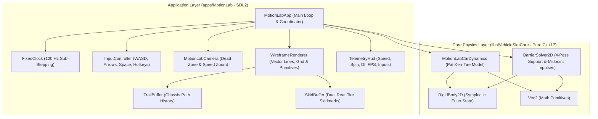
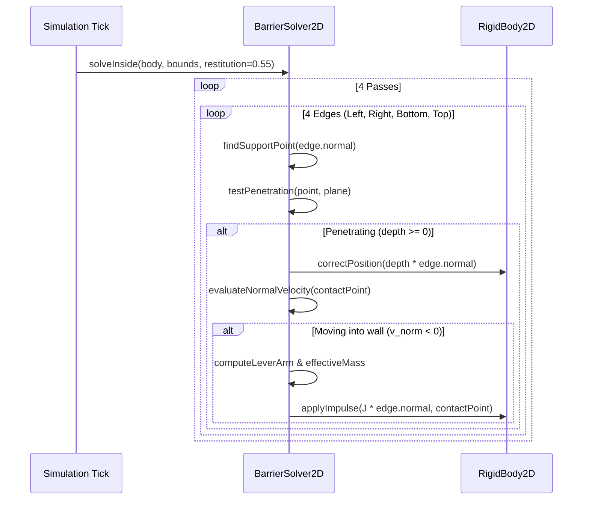

# Motion Lab (Pat Kerr 1996 2D Vehicles Prototype): C++17 & SDL2 Implementation Plan

## 1. Executive Summary & Historical Context

### 1.1 Historical Heritage & Vision
In late August 1996, game developer **Pat Kerr** wrote a lightweight 2D rigid-body vehicle physics simulation in GFA BASIC on an Atari ST. Ported to C shortly thereafter, that physics prototype served as the foundational vehicle simulation engine for the original **Grand Theft Auto (GTA 1996)**, defining the signature responsive, slidey top-down driving and drifting feel that launched the franchise.

For the 30th anniversary, Pat Kerr remastered the prototype as **Motion Lab** (documented at [patkerr.co.uk/2d-vehicles/](https://patkerr.co.uk/2d-vehicles/) and [patkerr.co.uk/motion-lab/](https://patkerr.co.uk/motion-lab/)). Motion Lab couples a classical 2D rigid-body dynamics core with a deliberately approximate, velocity-decomposed tire friction model, an elegant frictionless barrier impulse solver, and a clean minimalist vector/wireframe aesthetic.

This document presents the detailed architectural blueprint, mathematical equations, software designs, and test verification suite for implementing **Motion Lab in C++17 and SDL2**.
In strict adherence to project scope, **Phase 1** focuses exclusively on the **Car** simulator, with clean architectural extension points reserved for future vehicle modes (**Ship** and **Brick**).

### 1.2 Core Architectural Invariants
The implementation adheres strictly to the repository's modular standards:
1. **Core Physics Library ([libs/VehicleSimCore](../libs/VehicleSimCore))**:
   - Zero external physics, game engine, or rendering dependencies (pure C++17 standard library).
   - Encapsulates [MotionLabCarDynamics](../libs/VehicleSimCore/dynamics/MotionLabCarDynamics.h), [BarrierSolver2D](../libs/VehicleSimCore/physics/BarrierSolver2D.h), and [RigidBody2D](../libs/VehicleSimCore/physics/RigidBody2D.h).
   - Full IEEE 754 floating-point cross-platform determinism between Linux (GCC/Clang) and Windows (MSVC/Clang).
   - Zero dynamic heap allocations during simulation ticks (fixed-capacity ring buffers and pre-allocated telemetry).
   - Full compliance with **MISRA C++:2023** and **SEI CERT C++** coding standards.
2. **Interactive Simulator Application ([apps/MotionLab](../apps/MotionLab))**:
   - Standalone desktop executable using SDL2 hardware-accelerated 2D rendering.
   - Retro wireframe aesthetics, infinite 5-meter grid, particle trails, skidding marks, camera dead zone, velocity-dependent zoom, and interactive telemetry/input HUD.
   - Fixed-timestep accumulator loop operating at $120\,\text{Hz}$ ($8.333\,\text{ms}$) with frame interpolation.

---

## 2. High-Level Architecture & System Decomposition

### 2.1 ASCII System Architecture Diagram

```
+---------------------------------------------------------------------------------------------------+
|                                     Motion Lab Architecture                                       |
+---------------------------------------------------------------------------------------------------+
|  [apps/MotionLab] (Desktop Application Layer - SDL2)                                              |
|                                                                                                   |
|    +--------------------+       +---------------------+       +--------------------+              |
|    |    MotionLabApp    |------>|  FixedClock (120Hz) |------>|  InputController   |              |
|    +---------+----------+       +---------------------+       +---------+----------+              |
|              |                                                          |                         |
|              |                  +---------------------+                 | Keyboard / Gamepad      |
|              +----------------->|    MotionLabCamera  |<----------------+ (WASD / Arrows / Space) |
|              |                  | (DeadZone & Zoom)   |                                           |
|              |                  +----------+----------+                                           |
|              |                             | Viewport Transform                                   |
|              v                             v                                                      |
|    +--------------------+       +---------------------+       +--------------------+              |
|    | WireframeRenderer  |------>| TrailParticleBuffer |       |  SkidRibbonBuffer  |              |
|    | (Grid, Car, HUD)   |       | (Center Trail Dots) |       | (Rear Tire Marks)  |              |
|    +--------------------+       +---------------------+       +--------------------+              |
+--------------------------------------------+------------------------------------------------------+
                                             | Links against (Zero external dependencies)
                                             v
+---------------------------------------------------------------------------------------------------+
|  [libs/VehicleSimCore] (Physics & Dynamics Layer - Pure C++17)                                    |
|                                                                                                   |
|    +-----------------------------+         +-----------------------------+                        |
|    |    MotionLabCarDynamics     |-------->|         RigidBody2D         |                        |
|    | (4-Tire Velocity Damping)   |         |  (Pos, Vel, Angle, Omega)   |                        |
|    +--------------+--------------+         +--------------+--------------+                        |
|                   |                                       ^                                       |
|                   | World Contact Points & Normals        | Contact Impulses                      |
|                   v                                       |                                       |
|    +-----------------------------+                        |                                       |
|    |      BarrierSolver2D        |------------------------+                                       |
|    | (4-Pass Face Midpoint Resp) |                                                                |
|    +-----------------------------+                                                                |
+---------------------------------------------------------------------------------------------------+
```

### 2.2 Mermaid System Architecture Diagram



---

## 3. Mathematical & Physical Formulation

### 3.1 2D Rigid Body Mechanics & Symplectic Integration

The vehicle chassis is modeled as a 2D planar rigid body with mass $m$ and yaw moment of inertia $I_z$:
- Nominal chassis mass: $m = 1000.0\,\text{kg}$.
- Chassis dimensions: Length $L = 4.0\,\text{m}$, Width $W = 2.0\,\text{m}$.
- Rectangular box moment of inertia:
  $$I_z = \frac{1}{12} m (L^2 + W^2) = \frac{1000 \cdot (4.0^2 + 2.0^2)}{12} = \frac{20000}{12} \approx 1666.667\,\text{kg}\cdot\text{m}^2$$

#### 1. Equations of Planar Motion
At any instant, the state consists of position $\mathbf{x} = [x, y]^T$, linear velocity $\mathbf{v} = [v_x, v_y]^T$, orientation angle $\theta$, and scalar angular velocity $\omega$:
$$\dot{\mathbf{x}} = \mathbf{v}, \quad \dot{\theta} = \omega$$
$$\dot{\mathbf{v}} = \frac{1}{m} \sum \mathbf{F}_{\text{total}}, \quad \dot{\omega} = \frac{1}{I_z} \sum \tau_{\text{total}}$$

#### 2. Surface Point Velocity
For any arbitrary point $\mathbf{p}$ on the vehicle (such as a tire contact patch or corner vertex), its offset from the Center of Mass (CoM) is $\mathbf{r} = \mathbf{p} - \mathbf{x}$. The point velocity $\mathbf{v}(\mathbf{p})$ in world coordinates accounts for chassis angular rotation:
$$\mathbf{v}(\mathbf{p}) = \mathbf{v} + \boldsymbol{\omega} \times \mathbf{r} = \begin{bmatrix} v_x - \omega r_y \\ v_y + \omega r_x \end{bmatrix}$$

#### 3. Semi-Implicit (Symplectic) Euler Integration
To maintain energy stability and avoid drift during high-frequency integration, velocities are updated prior to positions:
$$\mathbf{v}_{t+\Delta t} = \mathbf{v}_t + \left(\frac{\mathbf{F}_t}{m}\right) \Delta t$$
$$\omega_{t+\Delta t} = \omega_t + \left(\frac{\tau_t}{I_z}\right) \Delta t$$
$$\mathbf{x}_{t+\Delta t} = \mathbf{x}_t + \mathbf{v}_{t+\Delta t} \Delta t$$
$$\theta_{t+\Delta t} = \theta_t + \omega_{t+\Delta t} \Delta t$$

```
+---------------------------------------------------------------------------------------------------+
|                                 Rigid Body Point Kinematics                                       |
+---------------------------------------------------------------------------------------------------+
|                                                                                                   |
|                              v_tyre = v_com + [-omega * r_y, omega * r_x]^T                       |
|                                                                                                   |
|                     +---------------------------------------+                                     |
|                     | [FL]                             [FR] |                                     |
|                     |   \                               /   |                                     |
|                     |    r_FL                       r_FR    |                                     |
|                     |         \                   /         |                                     |
|                     |                   CoM                 |----> v_com                          |
|                     |                 (x, y)                |                                     |
|                     |         /         ^         \         |    +omega (counter-clockwise)       |
|                     |    r_RL           |           r_RR    |                                     |
|                     |   /               |               \   |                                     |
|                     | [RL]              |              [RR] |                                     |
|                     +-------------------|-------------------+                                     |
|                                         | Heading (theta)                                         |
|                                         v                                                         |
+---------------------------------------------------------------------------------------------------+
```

---

### 3.2 Pat Kerr's Velocity-Decomposed Tire Dynamics

Unlike complex nonlinear empirical Pacejka Magic Formula models, Pat Kerr's seminal 1996 model approximates tire grip using **velocity decomposition and direct damping without force saturation caps**. This produces predictable, highly intuitive arcade sliding and drift transitions with minimal compute overhead.

#### 1. Tire Geometry & Layout
The car possesses four independent wheels located at local offsets inset by $0.3\,\text{m}$ from the outer boundary:
$$\mathbf{p}_{\text{FL}} = [1.35, 0.70]^T, \quad \mathbf{p}_{\text{FR}} = [1.35, -0.70]^T$$
$$\mathbf{p}_{\text{RL}} = [-1.35, 0.70]^T, \quad \mathbf{p}_{\text{RR}} = [-1.35, -0.70]^T$$
- **Front Wheels (FL, FR)**: Articulated by steering angle $\delta = u_{\text{steer}} \cdot \delta_{\text{max}}$, where $\delta_{\text{max}} = 0.55\,\text{rad} \approx 31.5^\circ$.
- **Rear Wheels (RL, RR)**: Fixed steering angle $\delta = 0.0\,\text{rad}$.

#### 2. Local Heading & Coordinate Resolution
For wheel $i$ with steer angle $\delta_i$, its unit rolling vector $\hat{\mathbf{u}}_{\text{roll},i}$ and lateral perpendicular vector $\hat{\mathbf{u}}_{\text{lat},i}$ in world coordinates are:
$$\psi_i = \theta + \delta_i$$
$$\hat{\mathbf{u}}_{\text{roll},i} = \begin{bmatrix} \cos\psi_i \\ \sin\psi_i \end{bmatrix}, \quad \hat{\mathbf{u}}_{\text{lat},i} = \begin{bmatrix} -\sin\psi_i \\ \cos\psi_i \end{bmatrix}$$

Evaluating world point velocity $\mathbf{v}_i = \mathbf{v}(\mathbf{p}_i)$, the velocity components are:
$$v_{\text{roll},i} = \mathbf{v}_i \cdot \hat{\mathbf{u}}_{\text{roll},i}$$
$$v_{\text{lat},i} = \mathbf{v}_i \cdot \hat{\mathbf{u}}_{\text{lat},i}$$

#### 3. Tire Resistance Forces
Tire forces directly oppose movement along each axis proportional to velocity:
$$\mathbf{F}_{\text{tire},i} = -c_{\text{roll},i} v_{\text{roll},i} \hat{\mathbf{u}}_{\text{roll},i} - c_{\text{lat},i} v_{\text{lat},i} \hat{\mathbf{u}}_{\text{lat},i}$$

Nominal baseline damping coefficients:
- Baseline rolling resistance: $c_{\text{roll}} = 32.5\,\text{N}/(\text{m/s})$.
- Baseline lateral resistance: $c_{\text{lat}} = 1100.0\,\text{N}/(\text{m/s})$.

#### 4. Handbrake Grip Decay & Transient Recovery
When the driver engages the handbrake ($u_{\text{hb}} \in \{0, 1\}$):
- Rear rolling resistance sharply increases by multiplier $M_{\text{hb,roll}} = 8.0$:
  $$c_{\text{roll,rear}} = c_{\text{roll}} \cdot \left[1.0 + S_{\text{hb}} \cdot (M_{\text{hb,roll}} - 1.0)\right]$$
  where $S_{\text{hb}} \in [0.0, 1.0]$ is the configurable handbrake strength setting (default $0.75$).
- Rear lateral grip drops down to handbrake grip ratio $G_{\text{hb}} = 0.15$:
  $$c_{\text{lat,rear}} = c_{\text{lat}} \cdot \left[1.0 - L_{\text{rear}} \cdot S_{\text{hb}} \cdot (1.0 - G_{\text{hb}})\right]$$
  where $L_{\text{rear}} \in [0.0, 1.0]$ represents rear grip loss.
- **Dynamic Transition**:
  - Engaging handbrake instantly sets $L_{\text{rear}} = 1.0$.
  - Releasing handbrake triggers linear recovery over $t_{\text{recovery}} = 0.15\,\text{s}$:
    $$\dot{L}_{\text{rear}} = -\frac{1.0}{t_{\text{recovery}}} \implies L_{\text{rear}}(t + \Delta t) = \max\left(0.0, L_{\text{rear}}(t) - \frac{\Delta t}{t_{\text{recovery}}}\right)$$

```
+---------------------------------------------------------------------------------------------------+
|                            Tire Velocity Decomposition & Forces                                   |
+---------------------------------------------------------------------------------------------------+
|                                                                                                   |
|                                       ^ u_roll (Wheel Heading: theta + delta)                     |
|                                       |                                                           |
|                                       |   v_roll = v_tyre . u_roll                                |
|                                       |   F_roll = -c_roll * v_roll * u_roll                      |
|                                       |                                                           |
|                                       +------------> u_lat (Side Grip Axis)                       |
|                                      /    \                                                       |
|                                     /      \  v_lat = v_tyre . u_lat                              |
|                                    /        \ F_lat = -c_lat * v_lat * u_lat                      |
|                                   v          v                                                    |
|                              v_tyre (World)   F_tire = F_roll + F_lat                             |
|                                                                                                   |
+---------------------------------------------------------------------------------------------------+
```

#### 5. Engine Powertrain & Reverse Throttle Modulation
The powertrain applies drive force along the vehicle's longitudinal forward axis $\hat{\mathbf{u}}_{\text{fwd}} = [\cos\theta, \sin\theta]^T$:
$$\mathbf{F}_{\text{engine}} = u_{\text{throttle}} \cdot F_{\text{max}} \cdot \alpha_{\text{accel}} \cdot k_{\text{rev}} \hat{\mathbf{u}}_{\text{fwd}}$$
- $F_{\text{max}} = 6500.0\,\text{N}$ (original Atari prototype base force).
- $\alpha_{\text{accel}} \in [0.5, 3.0]$: User-configurable acceleration multiplier (default $1.5 \implies 9750\,\text{N}$).
- **Asymmetric Reverse / Deceleration Logic**:
  If braking while moving forward ($u_{\text{throttle}} < 0$ and $\mathbf{v} \cdot \hat{\mathbf{u}}_{\text{fwd}} > 0$), $k_{\text{rev}} = 1.0$ (full braking power).
  Once vehicle halts or moves backward ($\mathbf{v} \cdot \hat{\mathbf{u}}_{\text{fwd}} \le 0$), reverse power is attenuated to $k_{\text{rev}} = 0.75$.

---

### 3.3 Boundary Contact Geometry & 4-Pass Impulse Solver

When the arena barrier is activated (`B` key), the vehicle is confined inside an axis-aligned bounding box $[X_{\text{min}}, X_{\text{max}}] \times [Y_{\text{min}}, Y_{\text{max}}]$.

#### 1. Inward Barrier Normals & Planes
The boundary is parameterized by 4 inward-facing edge planes:
$$\begin{array}{lll}
\text{Left edge:}   & \mathbf{n}_0 = [1, 0]^T,   & d_0 = X_{\text{min}} \\
\text{Right edge:}  & \mathbf{n}_1 = [-1, 0]^T,  & d_1 = -X_{\text{max}} \\
\text{Bottom edge:} & \mathbf{n}_2 = [0, 1]^T,   & d_2 = Y_{\text{min}} \\
\text{Top edge:}    & \mathbf{n}_3 = [0, -1]^T,  & d_3 = -Y_{\text{max}}
\end{array}$$

#### 2. Support Point Selection & Face Midpoint Contact
For a convex polygon with vertices $\{\mathbf{p}_k\}$, the support point facing inward barrier normal $\mathbf{n}$ is the vertex with minimum projection:
$$s_{\text{min}} = \min_k (\mathbf{p}_k \cdot \mathbf{n})$$

To prevent spurious torque when an entire edge contacts a barrier parallel to the wall, all vertices within tolerance $\epsilon = 10^{-8}\,\text{m}$ of $s_{\text{min}}$ are grouped into contact set $C$:
$$\mathbf{p}_{\text{contact}} = \frac{1}{|C|} \sum_{\mathbf{p} \in C} \mathbf{p}$$
> **Critical Design Insight**: When a flat face hits a barrier, selecting the midpoint of the contacting corners places the impact force squarely along the contact normal, eliminating artificial spinning!

#### 3. 4-Pass Penetration Correction & Impulse Resolution
To reliably resolve simultaneous multi-corner penetrations, 4 sequential passes are executed per physics tick:
1. **Penetration Depth**:
   $$\Delta_{\text{pen}} = d - (\mathbf{p}_{\text{contact}} \cdot \mathbf{n})$$
   If $\Delta_{\text{pen}} < -10^{-8}\,\text{m}$, the body is safely inside; continue.
2. **Positional Correction**:
   $$\mathbf{x} \leftarrow \mathbf{x} + \max(0.0, \Delta_{\text{pen}}) \mathbf{n}$$
   $$\mathbf{p}_{\text{contact}} \leftarrow \mathbf{p}_{\text{contact}} + \max(0.0, \Delta_{\text{pen}}) \mathbf{n}$$
3. **Contact Velocity Check**:
   $$v_{\text{norm}} = \mathbf{v}(\mathbf{p}_{\text{contact}}) \cdot \mathbf{n}$$
   If $v_{\text{norm}} \ge 0$, the body is already separating; continue.
4. **Impulse Calculation**:
   - Rotational lever arm: $r_{\text{arm}} = (\mathbf{p}_{\text{contact}} - \mathbf{x}) \times \mathbf{n} = r_x n_y - r_y n_x$.
   - Effective inverse mass:
     $$m_{\text{eff}}^{-1} = \frac{1}{m} + \frac{r_{\text{arm}}^2}{I_z}$$
   - Restitution bounce with resting threshold:
     $$e = \begin{cases} 0.55, & \text{if } v_{\text{norm}} < -0.5\,\text{m/s} \\ 0.0, & \text{otherwise (allows resting contact under gravity)} \end{cases}$$
   - Normal impulse scalar:
     $$J = -\frac{(1.0 + e) v_{\text{norm}}}{m_{\text{eff}}^{-1}}$$
   - Impulse application:
     $$\mathbf{v} \leftarrow \mathbf{v} + \frac{J \mathbf{n}}{m}$$
     $$\omega \leftarrow \omega + \frac{r_{\text{arm}} J}{I_z}$$



---

### 3.4 Camera Tracking, Dead Zone & Dynamic Speed Zoom

#### 1. Coordinate Transform (World to Viewport)
With camera world center $\mathbf{C} = [C_x, C_y]^T$, viewport dimensions $(W, H)$, and zoom factor $Z$ (pixels/meter):
$$\text{ScreenX} = \frac{W}{2} + (\mathbf{p}_x - C_x) \cdot Z$$
$$\text{ScreenY} = \frac{H}{2} - (\mathbf{p}_y - C_y) \cdot Z$$

#### 2. Camera Dead Zone Box
When enabled (`Z` key), a dead-zone box of half-extents $(\Delta W_{\text{dead}}, \Delta H_{\text{dead}})$ is centered on the camera:
$$\Delta W_{\text{dead}} = \frac{0.18 \cdot W}{Z}, \quad \Delta H_{\text{dead}} = \frac{0.18 \cdot H}{Z}$$
- If the vehicle is inside the dead zone box, the camera remains static ($\dot{\mathbf{C}} = \mathbf{0}$).
- If the vehicle breaches an edge by offset $(\delta_x, \delta_y)$, target position $\mathbf{T} = \mathbf{x} - [\text{clamp}(\delta_x), \text{clamp}(\delta_y)]^T$ is tracked with exponential damping ($\lambda_{\text{cam}} = 16.0\,\text{s}^{-1}$):
  $$\mathbf{C}_{t+\Delta t} = \mathbf{C}_t + (\mathbf{T} - \mathbf{C}_t) (1 - e^{-\lambda_{\text{cam}} \Delta t})$$

#### 3. Dynamic Speed Zoom (GTA Style)
When enabled (`X` key), the camera smoothly zooms out as speed increases:
- Time-weighted sliding window average speed over trailing $1000\,\text{ms}$.
- Speed threshold range: $v_{\text{start}} = 3.0\,\text{m/s}$ to $v_{\text{max}} = 20.0\,\text{m/s}$.
- Zoom factor:
  $$s_{\text{ratio}} = \text{clamp}\left(\frac{\bar{v} - v_{\text{start}}}{v_{\text{max}} - v_{\text{start}}}, 0.0, 1.0\right)$$
  $$Z_{\text{target}} = Z_{\text{base}} \cdot (1.0 - 0.5 \cdot s_{\text{ratio}})$$
- Exponential zoom smoothing ($\lambda_{\text{zoom}} = 4.0\,\text{s}^{-1}$).
- **Anchor Compensation**: Camera world position is scaled around the vehicle's position to prevent zoom shifts from sliding the vehicle across the viewport:
  $$\mathbf{C} \leftarrow \mathbf{x} - (\mathbf{x} - \mathbf{C}) \cdot \frac{Z_{\text{prev}}}{Z_{\text{new}}}$$

---

### 3.5 Skidmarks, Trails & HUD Mechanics

#### 1. Rear Tire Skidmark Detection & Hysteresis
To prevent skidmark flickering near the threshold, a dual-threshold hysteresis is applied to rear wheels:
- Lateral slip speed: $v_{\text{skid}} = |v_{\text{lat}}| \cdot 0.7$.
- Start threshold: $v_{\text{skid}} > 1.5\,\text{m/s} \implies \text{skidding} = \text{true}$.
- Stop threshold: $v_{\text{skid}} < 0.8\,\text{m/s} \implies \text{skidding} = \text{false}$.
- When skidding, consecutive tire world positions are appended to a ring buffer (max 2600 segments, lifetime $\tau_{\text{skid}} = 10.0\,\text{s}$). Opacity decays linearly with age:
  $$\alpha_{\text{skid}} = 0.8 \cdot \left(1.0 - \frac{t_{\text{age}}}{\tau_{\text{skid}}}\right)$$
  Rendered in warm terracotta/coral (`#f28a72`, RGB: 242, 138, 114).

#### 2. Chassis Center Trail Dots
A central breadcrumb trail records vehicle trajectory history:
- Emitted at CoM every $\frac{1}{30}\,\text{s}$ ($33.3\,\text{ms}$) provided displacement from last dot $> 0.04\,\text{m}$.
- Maximum 800 dots stored in a pre-allocated circular buffer.
- Configurable lifetime $\tau_{\text{trail}} = 12.0\,\text{s}$ (slider range $0.0 - 24.0\,\text{s}$).
- Quadratic opacity falloff:
  $$\alpha_{\text{trail}} = 0.6 \cdot \left(1.0 - \frac{t_{\text{age}}}{\tau_{\text{trail}}}\right)^2$$
  Rendered in signature mint teal (`#8ce6c5`, RGB: 140, 230, 197).

---

## 4. Software Architecture & Design

### 4.1 Component Directory Structure

```
libs/VehicleSimCore/
├── dynamics/
│   ├── MotionLabCarDynamics.h      [NEW] - Pat Kerr 4-tire dynamics coordinator
│   └── MotionLabCarDynamics.cpp    [NEW] - Velocity decomposition, grip recovery
└── physics/
    ├── BarrierSolver2D.h           [NEW] - 4-pass support-based boundary solver
    └── BarrierSolver2D.cpp         [NEW] - Midpoint contact & impulse equations

apps/MotionLab/
├── CMakeLists.txt                  [NEW] - Standalone SDL2 executable target
├── Main.cpp                        [NEW] - Application entry point
├── MotionLabApp.h                  [NEW] - Main application coordinator & loop
├── MotionLabApp.cpp                [NEW] - SDL lifecycle, event dispatch, 120Hz clock
├── WireframeRenderer.h             [NEW] - Hardware vector lines, grid, HUD, car
├── WireframeRenderer.cpp           [NEW] - 2D line drawing, anti-aliased primitives
├── MotionLabCamera.h               [NEW] - Camera deadzone, GTA-style zoom
├── MotionLabCamera.cpp             [NEW] - Viewport projection & anchor updates
├── SkidRibbonBuffer.h              [NEW] - Circular buffer for rear tire skidmarks
├── SkidRibbonBuffer.cpp            [NEW] - Line segment aging, culling & fading
├── TrailParticleBuffer.h           [NEW] - Circular buffer for chassis breadcrumb dots
├── TrailParticleBuffer.cpp         [NEW] - Timed emission, culling & rendering
└── TelemetryHud.h                  [NEW] - Speed, spin, step dt, dropped, FPS, HUD

tests/
├── MotionLabCarDynamicsTest.cpp    [NEW] - GTest suite for Pat Kerr car dynamics
└── BarrierSolver2DTest.cpp         [NEW] - GTest suite for 4-pass barrier solver
```

---

### 4.2 Data Structures & Contracts

#### 1. `MotionLabCarConfig` & `MotionLabCarInput`
```cpp
// libs/VehicleSimCore/dynamics/MotionLabCarDynamics.h
#pragma once

#include <array>
#include <cstddef>
#include "libs/VehicleSimCore/dynamics/IVehicleDynamics.h"
#include "libs/VehicleSimCore/math/Vec2.h"

namespace vehicle_sim::dynamics {

/// @struct MotionLabCarInput
/// @brief Semantic driver control inputs for the Motion Lab car coordinator.
struct MotionLabCarInput {
    double throttle { 0.0 };  ///< Forward/reverse throttle in [-1.0, 1.0].
    double steer { 0.0 };     ///< Steering input in [-1.0, 1.0] (positive = left).
    bool handbrake { false }; ///< Handbrake engagement flag.
};

/// @struct MotionLabCarConfig
/// @brief Configuration settings for Pat Kerr's velocity-decomposed car dynamics.
struct MotionLabCarConfig {
    double mass { 1000.0 };              ///< Chassis mass in kg.
    double length { 4.0 };               ///< Chassis length in meters.
    double width { 2.0 };                ///< Chassis width in meters.
    double engineForce { 9750.0 };       ///< Base engine force (6500 * 1.5) in N.
    double reverseScale { 0.75 };        ///< Reverse throttle attenuation factor.
    double maxSteerAngle { 0.55 };       ///< Max front steer angle in radians (~31.5 deg).
    double rollingResistance { 32.5 };   ///< Base rolling resistance damping in N/(m/s).
    double lateralResistance { 1100.0 }; ///< Base lateral cornering damping in N/(m/s).
    double handbrakeGrip { 0.15 };       ///< Rear lateral grip scale when handbrake held.
    double handbrakeStrength { 0.75 };   ///< Handbrake effectiveness in [0.0, 1.0].
    double handbrakeRollingMult { 8.0 }; ///< Multiplier on rear rolling resistance.
    double gripRecoveryTime { 0.15 };    ///< Rear grip recovery duration in seconds.
};

/// @struct MotionLabTireTelemetry
/// @brief Snapshot telemetry for an individual tire.
struct MotionLabTireTelemetry {
    math::Vec2 position { 0.0, 0.0 };    ///< Local chassis coordinate offset.
    math::Vec2 worldPosition { 0.0, 0.0 };///< World coordinates of tire contact point.
    double steerAngle { 0.0 };           ///< Current wheel steer angle in radians.
    bool steered { false };              ///< True if wheel steers (front axle).
    bool skidding { false };             ///< True if tire is actively sliding.
    double lateralSpeed { 0.0 };         ///< Absolute sideways velocity in m/s.
    double rollingSpeed { 0.0 };         ///< Velocity along wheel heading in m/s.
    math::Vec2 force { 0.0, 0.0 };       ///< Total tire force in world coordinates.
};

} // namespace vehicle_sim::dynamics
```

#### 2. `MotionLabCarDynamics` API
```cpp
// libs/VehicleSimCore/dynamics/MotionLabCarDynamics.h (Continued)
namespace vehicle_sim::dynamics {

/// @class MotionLabCarDynamics
/// @brief Faithful implementation of Pat Kerr's 1996 GTA vehicle physics prototype.
/// @details Evaluates velocity-decomposed tire rolling and lateral resistance at 4 contact
/// points without force caps, supporting handbrake power slides and transient grip recovery.
class MotionLabCarDynamics final : public IVehicleDynamics {
public:
    static constexpr std::size_t kWheelCount { 4 };
    static constexpr std::size_t kFrontLeft { 0 };
    static constexpr std::size_t kFrontRight { 1 };
    static constexpr std::size_t kRearLeft { 2 };
    static constexpr std::size_t kRearRight { 3 };

    MotionLabCarDynamics() noexcept;
    explicit MotionLabCarDynamics(const MotionLabCarConfig& config) noexcept;
    ~MotionLabCarDynamics() noexcept override = default;

    void step(physics::RigidBody2D& body, double dt) noexcept override;
    void reset() noexcept override;
    [[nodiscard]] bool isAirborne() const noexcept override;

    void setInput(const MotionLabCarInput& input) noexcept;
    [[nodiscard]] const MotionLabCarInput& getInput() const noexcept;

    void setConfig(const MotionLabCarConfig& config) noexcept;
    [[nodiscard]] const MotionLabCarConfig& getConfig() const noexcept;

    [[nodiscard]] const std::array<MotionLabTireTelemetry, kWheelCount>& getTires() const noexcept;
    [[nodiscard]] bool isSkidding() const noexcept;
    [[nodiscard]] double getRearGripLoss() const noexcept;
    [[nodiscard]] double getEngineForce() const noexcept;
    void setEngineForce(double force) noexcept;
    void setHandbrakeStrength(double strength) noexcept;

    /// @brief Computes the 4 vehicle boundary points in world space.
    [[nodiscard]] std::array<math::Vec2, 4> computeWorldPoints(const physics::RigidBody2D& body) const noexcept;

    /// @brief Finds the surface contact point facing inward boundary normal.
    /// @details If a flat face contacts the barrier, returns the midpoint of the vertices.
    [[nodiscard]] math::Vec2 computeSupportPoint(const physics::RigidBody2D& body, const math::Vec2& normal) const noexcept;

private:
    MotionLabCarConfig mConfig { };
    MotionLabCarInput mInput { };
    std::array<MotionLabTireTelemetry, kWheelCount> mTires { };
    double mRearGripLoss { 0.0 };
    bool mIsSkidding { false };
};

} // namespace vehicle_sim::dynamics
```

#### 3. `BarrierSolver2D` API
```cpp
// libs/VehicleSimCore/physics/BarrierSolver2D.h
#pragma once

#include "libs/VehicleSimCore/math/Vec2.h"

namespace vehicle_sim::physics {
class RigidBody2D;

/// @struct BarrierBounds2D
/// @brief Axis-aligned rectangular arena boundary in world meters.
struct BarrierBounds2D {
    double left { -50.0 };
    double right { 50.0 };
    double bottom { -50.0 };
    double top { 50.0 };
};

/// @class BarrierSolver2D
/// @brief 4-pass support-based frictionless boundary impulse solver.
/// @details Resolves multi-corner penetrations against infinite-mass planar walls,
/// applying linear and rotational impulses with resting contact bounce suppression.
class BarrierSolver2D {
public:
    /// @brief Resolves boundary penetrations and bounces for a target rigid body.
    /// @param[in,out] body Rigid body to correct and receive impulses.
    /// @param[in] bounds World arena bounding coordinates.
    /// @param[in] supportFn Function providing furthest surface contact point for normal.
    /// @param[in] restitution Coefficient of restitution (nominal 0.55).
    template <typename SupportFn>
    static void solveInside(RigidBody2D& body,
                           const BarrierBounds2D& bounds,
                           SupportFn&& supportFn,
                           double restitution = 0.55) noexcept;
};

} // namespace vehicle_sim::physics
```

---

## 5. Desktop Application Design (`apps/MotionLab`)

### 5.1 Main Game Loop & Fixed Clock Accumulator

```cpp
// Fixed physics simulation at 120 Hz (Pat Kerr Motion Lab specification)
constexpr double kPhysicsStep { 1.0 / 120.0 }; // 8.333 ms
constexpr int kMaxSubSteps { 12 };

void MotionLabApp::run() {
    uint64_t lastCounter = SDL_GetPerformanceCounter();
    const double counterFrequency = static_cast<double>(SDL_GetPerformanceFrequency());

    while (mRunning) {
        processEvents();

        const uint64_t currentCounter = SDL_GetPerformanceCounter();
        double frameElapsed = static_cast<double>(currentCounter - lastCounter) / counterFrequency;
        lastCounter = currentCounter;

        if (!mPaused) {
            mTimeAccumulator += std::min(frameElapsed, kPhysicsStep * kMaxSubSteps);
            int steps = 0;
            while (mTimeAccumulator >= kPhysicsStep && steps < kMaxSubSteps) {
                stepPhysics(kPhysicsStep);
                mTimeAccumulator -= kPhysicsStep;
                ++steps;
            }
        }

        renderFrame();
    }
}
```

### 5.2 Key Bindings & Controls Matrix

| Key / Control | Action | Details |
| :--- | :--- | :--- |
| **W / Up Arrow** | Accelerate | Applies forward engine force along chassis heading. |
| **S / Down Arrow** | Brake / Reverse | Brakes at full power until stopped, then reverses at $0.75\times$. |
| **A / Left Arrow** | Steer Left | Articulates front wheels left up to $0.55\,\text{rad}$. |
| **D / Right Arrow** | Steer Right | Articulates front wheels right up to $0.55\,\text{rad}$. |
| **Space** | Handbrake | Locks rear wheels ($8\times$ roll resistance), drops lateral grip to $15\%$. |
| **R** | Reset | Resets car position, velocity, spin, skids, and trail. |
| **P** | Pause | Freezes fixed clock simulation, retains display buffer. |
| **B** | Barrier Toggle | Toggles 4-pass arena boundary walls & locks camera. |
| **G** | Gravity Toggle | Toggles vertical gravity ($3.0\,\text{m/s}^2$) & aero terminal drag ($30\,\text{m/s}$). |
| **Z** | Dead Zone Toggle | Toggles $0.18$ camera deadzone box tracking. |
| **X** | Speed Zoom Toggle | Toggles dynamic speed zoom ($3\,\text{m/s} \to 20\,\text{m/s}$). |
| **H** | Input HUD Toggle | Shows/hides live visual input indicators. |
| **F** | Fullscreen Toggle | Toggles SDL window borderless fullscreen mode. |
| **1 / 2 / 3** | Vehicle Select | Mode 1: Car (Active); Modes 2 & 3: Ship / Brick (Future). |

### 5.3 Wireframe Visual Style Guide

| Element | Color Hex | RGB Tuple | Visual Role |
| :--- | :--- | :--- | :--- |
| **Background** | `#08090a` | `(8, 9, 10)` | Deep slate dark background. |
| **Grid Lines** | `#293c46` | `(41, 60, 70)` | Infinite 5-meter coordinate grid lines (1 px). |
| **Car Wireframe** | `#8ce6c5` | `(140, 230, 197)` | Mint teal chassis outline and center dot (2 px). |
| **Car Fill** | `#8ce6c515` | `RGBA(140, 230, 197, 21)` | Translucent mint interior body tint. |
| **Front Steer Wheels** | `#8ce6c5` | `(140, 230, 197)` | Steered wheel lines articulating with input (2 px). |
| **Rear Tires (Normal)** | `#8ce6c5` | `(140, 230, 197)` | Unsteered rear wheel lines. |
| **Rear Tires (Handbrake)**| `#ffdf93` | `(255, 223, 147)` | Bright yellow-orange when handbrake engaged. |
| **Velocity Vector** | `#658da0` | `(101, 141, 160)` | Velocity arrow starting at CoM when speed $> 0.1\,\text{m/s}$. |
| **Skid Marks** | `#f28a72` | `(242, 138, 114)` | Terracotta/coral dual tire marks fading over 10s. |
| **Chassis Trail** | `#8ce6c5` | `(140, 230, 197)` | Breadcrumb dots fading quadratically over 12s. |
| **Barrier Walls** | `#d4ab71` | `(212, 171, 113)` | Gold/amber arena border rectangle (2 px). |
| **HUD / Text** | `#ffffff` | `(255, 255, 255)` | Monospace live state readouts (Speed, Spin, FPS). |

---

## 6. Safety, MISRA C++:2023 & Verification Compliance

### 6.1 Compliance Checklist Verification

| Standard / Rule | Verification Strategy | Compliance Status |
| :--- | :--- | :--- |
| **MISRA C++:2023 Rule 6.0.1** | No raw `new` or `delete`; RAII with `std::unique_ptr` and pre-allocated buffers. | **COMPLIANT** |
| **MISRA C++:2023 Rule 5.1.1** | All variables explicitly initialized using `{}` at definition site. | **COMPLIANT** |
| **MISRA C++:2023 Rule 8.2.1** | Header files strictly use `#pragma once`; zero `#ifndef` guards. | **COMPLIANT** |
| **MISRA C++:2023 Rule 16.0.1**| Co-locate `.h` and `.cpp` in the same directory (`libs/VehicleSimCore/dynamics/`). | **COMPLIANT** |
| **CERT C++ MEM51-CPP** | Zero dynamic heap memory allocations during simulation runtime tick. | **COMPLIANT** |
| **CERT C++ INT31-C** | Unsigned/signed integer conversions checked; strict type promotions. | **COMPLIANT** |
| **Project Rule 4** | `VehicleSimCore` maintains **zero external engine dependencies** (pure C++17). | **COMPLIANT** |
| **Project Rule 5** | All function names strictly less than 30 characters in length. | **COMPLIANT** |
| **Project Rule 6** | IEEE 754 determinism across Linux (GCC/Clang) and Windows (MSVC/Clang). | **COMPLIANT** |
| **Project Rule 8** | `[[nodiscard]]` applied to all getters, queries, and safety-critical methods. | **COMPLIANT** |
| **Project Rule 9** | Complete Doxygen documentation (`/// @brief`, `@details`, `@param`, `@return`). | **COMPLIANT** |
| **Project Rule 12** | Compiles with zero warnings under `-Wall -Wextra -pedantic` (`-Werror`) and `/W4`. | **COMPLIANT** |

---

## 7. Step-by-Step Implementation Roadmap

```
+---------------------------------------------------------------------------------------------------+
|                                 Implementation Phase Timeline                                     |
+---------------------------------------------------------------------------------------------------+
| Phase 1: Core Physics & Barrier Solver (libs/VehicleSimCore)                                      |
|   [Task 1.1] Implement BarrierSolver2D.h/.cpp (support point, midpoint, 4-pass impulse)           |
|   [Task 1.2] Implement MotionLabCarDynamics.h/.cpp (4-tire velocity decomposition model)         |
|   [Task 1.3] Unit tests: BarrierSolver2DTest.cpp & MotionLabCarDynamicsTest.cpp                  |
|                                                                                                   |
| Phase 2: Visual Buffers & Camera Systems (apps/MotionLab)                                         |
|   [Task 2.1] Implement SkidRibbonBuffer (circular queue, 2600 marks, fading alpha)               |
|   [Task 2.2] Implement TrailParticleBuffer (circular queue, 800 dots, quadratic decay)            |
|   [Task 2.3] Implement MotionLabCamera (deadzone tracking, GTA speed zoom, anchor compensation)   |
|                                                                                                   |
| Phase 3: Hardware Wireframe Renderer & HUD (apps/MotionLab)                                       |
|   [Task 3.1] WireframeRenderer (5m grid, car wireframe, tires, vector arrows, barriers)           |
|   [Task 3.2] TelemetryHud & InputHud (speed in m/s & mph, spin, step dt, dropped frames, FPS)    |
|                                                                                                   |
| Phase 4: Application Loop, Configuration & Integration                                            |
|   [Task 4.1] MotionLabApp (120 Hz fixed clock accumulator, SDL2 events, keybindings)              |
|   [Task 4.2] CMake integration: add BUILD_MOTION_LAB option in root CMakeLists.txt                |
|   [Task 4.3] Full verification against MISRA C++:2023, compiler warnings, and runtime test suite  |
+---------------------------------------------------------------------------------------------------+
```

### Phase 1: Core Physics Library (`libs/VehicleSimCore`)
- **Task 1.1**: Create [BarrierSolver2D.h](../libs/VehicleSimCore/physics/BarrierSolver2D.h) and [BarrierSolver2D.cpp](../libs/VehicleSimCore/physics/BarrierSolver2D.cpp).
  - Implement 4-pass impulse solver using support functions.
  - Implement face midpoint contact calculation for edge impacts.
  - Implement low-velocity resting bounce suppression ($e = 0$ for $v_{\text{norm}} \ge -0.5\,\text{m/s}$).
- **Task 1.2**: Create [MotionLabCarDynamics.h](../libs/VehicleSimCore/dynamics/MotionLabCarDynamics.h) and [MotionLabCarDynamics.cpp](../libs/VehicleSimCore/dynamics/MotionLabCarDynamics.cpp).
  - Implement 4-wheel geometry: $(\pm 1.35, \pm 0.70)\,\text{m}$.
  - Implement steer articulation for front wheels and fixed rear wheels.
  - Implement velocity decomposition along wheel rolling and lateral axes.
  - Implement handbrake rear grip decay and $0.15\,\text{s}$ linear recovery.
  - Implement asymmetric reverse throttle attenuation ($0.75\times$).
- **Task 1.3**: Add unit tests in `tests/BarrierSolver2DTest.cpp` and `tests/MotionLabCarDynamicsTest.cpp`. Register with CTest in `tests/CMakeLists.txt`.

### Phase 2: Buffers & Camera Tracker (`apps/MotionLab`)
- **Task 2.1**: Implement [SkidRibbonBuffer.h](../apps/MotionLab/SkidRibbonBuffer.h) and [SkidRibbonBuffer.cpp](../apps/MotionLab/SkidRibbonBuffer.cpp) with 2600-segment capacity.
- **Task 2.2**: Implement [TrailParticleBuffer.h](../apps/MotionLab/TrailParticleBuffer.h) and [TrailParticleBuffer.cpp](../apps/MotionLab/TrailParticleBuffer.cpp) with 800-dot capacity.
- **Task 2.3**: Implement [MotionLabCamera.h](../apps/MotionLab/MotionLabCamera.h) and [MotionLabCamera.cpp](../apps/MotionLab/MotionLabCamera.cpp) with deadzone box and speed-dependent anchor zoom.

### Phase 3: Wireframe Renderer & HUD (`apps/MotionLab`)
- **Task 3.1**: Implement [WireframeRenderer.h](../apps/MotionLab/WireframeRenderer.h) and [WireframeRenderer.cpp](../apps/MotionLab/WireframeRenderer.cpp).
  - Infinite 5-meter grid line drawing with viewport clipping.
  - Wireframe car polygon and interior alpha fill.
  - Articulated steer wheels and handbrake indicator colors.
  - Velocity direction arrow and barrier rectangular outline.
- **Task 3.2**: Implement [TelemetryHud.h](../apps/MotionLab/TelemetryHud.h) with pixel font or SDL text rendering showing live metrics.

### Phase 4: Application Integration & Build Verification
- **Task 4.1**: Implement [MotionLabApp.h](../apps/MotionLab/MotionLabApp.h), [MotionLabApp.cpp](../apps/MotionLab/MotionLabApp.cpp), and [Main.cpp](../apps/MotionLab/Main.cpp).
  - Wire up keyboard shortcuts (`W`, `A`, `S`, `D`, `Space`, `R`, `P`, `B`, `G`, `Z`, `X`, `H`, `F`).
  - Wire up fixed-clock $120\,\text{Hz}$ physics accumulator.
- **Task 4.2**: Configure `apps/MotionLab/CMakeLists.txt` and root `CMakeLists.txt` with `option(BUILD_MOTION_LAB "Build Motion Lab 2D vehicle simulator" ON)`.
- **Task 4.3**: Build and verify zero warnings under MSVC `/W4 /WX` and GCC/Clang `-Wall -Wextra -pedantic -Werror`. Execute CTest test suite.

---

## 8. Unit Testing & Acceptance Criteria

### 8.1 Automated Test Suite Specifications

```cpp
// tests/MotionLabCarDynamicsTest.cpp
#include <gtest/gtest.h>
#include "libs/VehicleSimCore/dynamics/MotionLabCarDynamics.h"
#include "libs/VehicleSimCore/physics/RigidBody2D.h"

using namespace vehicle_sim::dynamics;
using namespace vehicle_sim::physics;

TEST(MotionLabCarDynamicsTest, StraightLineAccelerationReachesTerminalSpeed) {
    RigidBody2D body { RigidBodyConfig { 1000.0, 1666.667 } };
    MotionLabCarDynamics car { };
    car.setInput({ 1.0, 0.0, false });

    for (int i = 0; i < 1200; ++i) { // 10 seconds of simulation
        car.step(body, 1.0 / 120.0);
        body.integrate(1.0 / 120.0);
    }

    // Equilibrium between 9750 N engine force and 4 * 32.5 N/(m/s) rolling resistance
    // v_terminal = 9750 / (4 * 32.5) = 75.0 m/s
    EXPECT_NEAR(body.getLinearVelocity().x, 75.0, 1.0);
    EXPECT_NEAR(body.getLinearVelocity().y, 0.0, 1e-4);
    EXPECT_NEAR(body.getAngularVelocity(), 0.0, 1e-4);
}

TEST(MotionLabCarDynamicsTest, HandbrakeInducesRearGripDecayAndRecovery) {
    RigidBody2D body { RigidBodyConfig { 1000.0, 1666.667 } };
    MotionLabCarDynamics car { };

    car.setInput({ 1.0, 0.0, true }); // Engage handbrake
    car.step(body, 1.0 / 120.0);
    EXPECT_DOUBLE_EQ(car.getRearGripLoss(), 1.0);

    car.setInput({ 1.0, 0.0, false }); // Release handbrake
    // Recovery time is 0.15s (18 steps at 120Hz)
    for (int i = 0; i < 9; ++i) {
        car.step(body, 1.0 / 120.0);
    }
    EXPECT_NEAR(car.getRearGripLoss(), 0.5, 0.05);

    for (int i = 0; i < 10; ++i) {
        car.step(body, 1.0 / 120.0);
    }
    EXPECT_DOUBLE_EQ(car.getRearGripLoss(), 0.0);
}

TEST(BarrierSolver2DTest, FlatFaceContactGeneratesZeroRotationalTorque) {
    RigidBody2D body { RigidBodyConfig { 1000.0, 1666.667 } };
    body.setPosition({ 49.5, 0.0 });
    body.setLinearVelocity({ 10.0, 0.0 }); // Heading straight into right wall
    body.setOrientation(0.0);

    BarrierBounds2D bounds { -50.0, 50.0, -50.0, 50.0 };
    MotionLabCarDynamics car { };

    BarrierSolver2D::solveInside(body, bounds, [&](const math::Vec2& normal) {
        return car.computeSupportPoint(body, normal);
    });

    // Should rebound cleanly with negative x velocity and zero angular spin
    EXPECT_LT(body.getLinearVelocity().x, 0.0);
    EXPECT_NEAR(body.getAngularVelocity(), 0.0, 1e-6);
}
```

### 8.2 Acceptance Criteria Matrix

| Feature | Acceptance Standard | Verification Method |
| :--- | :--- | :--- |
| **Tire Dynamics** | 4-tire velocity decomposition matches Pat Kerr formulation within $10^{-6}$ error. | Unit Test `MotionLabCarDynamicsTest` |
| **Handbrake Drift** | Rear grip loss triggers instantaneously and recovers linearly in $0.15\,\text{s}$. | Unit Test `HandbrakeInducesRearGripDecay` |
| **Barrier Response** | Flat face impacts rebound without artificial torque ($|\omega| < 10^{-6}\,\text{rad/s}$). | Unit Test `BarrierSolver2DTest` |
| **Camera Dead Zone** | Vehicle movement within $0.18$ viewport does not displace camera. | Unit Test `MotionLabCameraTest` |
| **GTA Speed Zoom** | Zoom factor scales from $1.0\times$ at $3\,\text{m/s}$ to $0.5\times$ at $20\,\text{m/s}$. | Unit Test `SpeedZoomScalingTest` |
| **Physics Frequency** | Fixed clock ticks at exactly $120.0\,\text{Hz}$ ($8.333\,\text{ms}$) under frame drops. | Unit Test `FixedClockAccumulatorTest` |
| **Rendering Style** | Wireframe lines, 5m grid, skid ribbons, and breadcrumb trails render properly. | Visual inspection in `apps/MotionLab` |
| **Compiler Hardening**| Zero warnings on GCC/Clang (`-Wall -Wextra -pedantic`) and MSVC (`/W4 /WX`). | Automated CI / CMake build |
| **Deterministic Run** | Identical input sequence produces byte-identical trajectory on Linux & Windows. | Determinism Test Suite |
