# Motion Lab (Pat Kerr 1996 2D Vehicles Prototype): C++17 & SDL2 Implementation Plan

## 1. Executive Summary & Historical Context

### 1.1 Historical Heritage & Vision
In late August 1996, game developer **Pat Kerr** wrote a lightweight 2D rigid-body vehicle physics simulation in GFA BASIC on an Atari ST. Ported to C shortly thereafter, that physics prototype served as the foundational vehicle simulation engine for the original **Grand Theft Auto (GTA 1996)**, defining the signature responsive, slidey top-down driving and drifting feel that launched the franchise.

For the 30th anniversary, Pat Kerr remastered the prototype as **Motion Lab** (documented at [patkerr.co.uk/2d-vehicles/](https://patkerr.co.uk/2d-vehicles/) and [patkerr.co.uk/motion-lab/](https://patkerr.co.uk/motion-lab/)). Motion Lab couples a classical 2D rigid-body dynamics core with a deliberately approximate, velocity-decomposed tire friction model, an elegant frictionless barrier impulse solver, and a clean minimalist vector/wireframe aesthetic.

This document presents the detailed architectural blueprint, mathematical equations, software designs, and test verification suite for implementing **Motion Lab in C++17 and SDL2**.
In strict adherence to project scope, **Phase 1** focuses exclusively on the **Car** simulator, with clean architectural extension points reserved for future vehicle modes (**Ship** and **Brick**).

### 1.2 Core Architectural Invariants
The implementation adheres strictly to the repository's modular standards:
1. **Core Physics Library ([libs/VehicleSimCore](../libs/VehicleSimCore))**:
   - Zero external physics, game engine, or rendering dependencies (pure C++17 standard library).
   - Encapsulates [MotionLabCarDynamics](../libs/VehicleSimCore/dynamics/MotionLabCarDynamics.h), [BarrierSolver2D](../libs/VehicleSimCore/physics/BarrierSolver2D.h), and [RigidBody2D](../libs/VehicleSimCore/physics/RigidBody2D.h).
   - Full IEEE 754 floating-point cross-platform determinism between Linux (GCC/Clang) and Windows (MSVC/Clang).
   - Zero dynamic heap allocations during simulation ticks (fixed-capacity ring buffers and pre-allocated telemetry).
   - Full compliance with **MISRA C++:2023** and **SEI CERT C++** coding standards.
2. **Interactive Simulator Application ([apps/MotionLab](../apps/MotionLab))**:
   - Standalone desktop executable using SDL2 hardware-accelerated 2D rendering.
   - Retro wireframe aesthetics, infinite 5-meter grid, particle trails, skidding marks, camera dead zone, velocity-dependent zoom, and interactive telemetry/input HUD.
   - Fixed-timestep accumulator loop operating at $120\,\text{Hz}$ ($8.333\,\text{ms}$) with frame interpolation.

---

## 2. High-Level Architecture & System Decomposition

### 2.1 ASCII System Architecture Diagram

```
+---------------------------------------------------------------------------------------------------+
|                                     Motion Lab Architecture                                       |
+---------------------------------------------------------------------------------------------------+
|  [apps/MotionLab] (Desktop Application Layer - SDL2)                                              |
|                                                                                                   |
|    +--------------------+       +---------------------+       +--------------------+              |
|    |    MotionLabApp    |------>|  FixedClock (120Hz) |------>|  InputController   |              |
|    +---------+----------+       +---------------------+       +---------+----------+              |
|              |                                                          |                         |
|              |                  +---------------------+                 | Keyboard / Gamepad      |
|              +----------------->|    MotionLabCamera  |<----------------+ (WASD / Arrows / Space) |
|              |                  | (DeadZone & Zoom)   |                                           |
|              |                  +----------+----------+                                           |
|              |                             | Viewport Transform                                   |
|              v                             v                                                      |
|    +--------------------+       +---------------------+       +--------------------+              |
|    | WireframeRenderer  |------>| TrailParticleBuffer |       |  SkidRibbonBuffer  |              |
|    | (Grid, Car, HUD)   |       | (Center Trail Dots) |       | (Rear Tire Marks)  |              |
|    +--------------------+       +---------------------+       +--------------------+              |
+--------------------------------------------+------------------------------------------------------+
                                             | Links against (Zero external dependencies)
                                             v
+---------------------------------------------------------------------------------------------------+
|  [libs/VehicleSimCore] (Physics & Dynamics Layer - Pure C++17)                                    |
|                                                                                                   |
|    +-----------------------------+         +-----------------------------+                        |
|    |    MotionLabCarDynamics     |-------->|         RigidBody2D         |                        |
|    | (4-Tire Velocity Damping)   |         |  (Pos, Vel, Angle, Omega)   |                        |
|    +--------------+--------------+         +--------------+--------------+                        |
|                   |                                       ^                                       |
|                   | World Contact Points & Normals        | Contact Impulses                      |
|                   v                                       |                                       |
|    +-----------------------------+                        |                                       |
|    |      BarrierSolver2D        |------------------------+                                       |
|    | (4-Pass Face Midpoint Resp) |                                                                |
|    +-----------------------------+                                                                |
+---------------------------------------------------------------------------------------------------+
```

### 2.2 Mermaid System Architecture Diagram

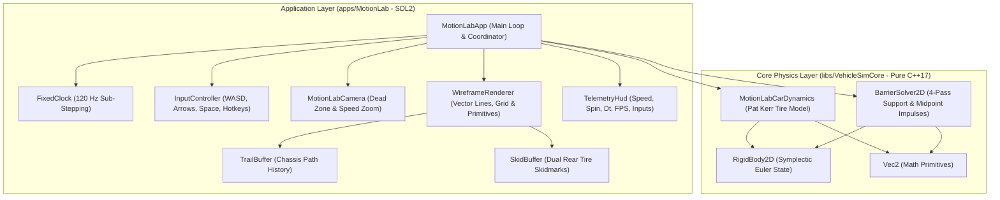

---

## 3. Mathematical & Physical Formulation

### 3.1 2D Rigid Body Mechanics & Symplectic Integration

The vehicle chassis is modeled as a 2D planar rigid body with mass $m$ and yaw moment of inertia $I_z$:
- Nominal chassis mass: $m = 1000.0\,\text{kg}$.
- Chassis dimensions: Length $L = 4.0\,\text{m}$, Width $W = 2.0\,\text{m}$.
- Rectangular box moment of inertia:
  $$I_z = \frac{1}{12} m (L^2 + W^2) = \frac{1000 \cdot (4.0^2 + 2.0^2)}{12} = \frac{20000}{12} \approx 1666.667\,\text{kg}\cdot\text{m}^2$$

#### 1. Equations of Planar Motion
At any instant, the state consists of position $\mathbf{x} = [x, y]^T$, linear velocity $\mathbf{v} = [v_x, v_y]^T$, orientation angle $\theta$, and scalar angular velocity $\omega$:
$$\dot{\mathbf{x}} = \mathbf{v}, \quad \dot{\theta} = \omega$$
$$\dot{\mathbf{v}} = \frac{1}{m} \sum \mathbf{F}_{\text{total}}, \quad \dot{\omega} = \frac{1}{I_z} \sum \tau_{\text{total}}$$

#### 2. Surface Point Velocity
For any arbitrary point $\mathbf{p}$ on the vehicle (such as a tire contact patch or corner vertex), its offset from the Center of Mass (CoM) is $\mathbf{r} = \mathbf{p} - \mathbf{x}$. The point velocity $\mathbf{v}(\mathbf{p})$ in world coordinates accounts for chassis angular rotation:
$$\mathbf{v}(\mathbf{p}) = \mathbf{v} + \boldsymbol{\omega} \times \mathbf{r} = \begin{bmatrix} v_x - \omega r_y \\ v_y + \omega r_x \end{bmatrix}$$

#### 3. Semi-Implicit (Symplectic) Euler Integration
To maintain energy stability and avoid drift during high-frequency integration, velocities are updated prior to positions:
$$\mathbf{v}_{t+\Delta t} = \mathbf{v}_t + \left(\frac{\mathbf{F}_t}{m}\right) \Delta t$$
$$\omega_{t+\Delta t} = \omega_t + \left(\frac{\tau_t}{I_z}\right) \Delta t$$
$$\mathbf{x}_{t+\Delta t} = \mathbf{x}_t + \mathbf{v}_{t+\Delta t} \Delta t$$
$$\theta_{t+\Delta t} = \theta_t + \omega_{t+\Delta t} \Delta t$$

```
+---------------------------------------------------------------------------------------------------+
|                                 Rigid Body Point Kinematics                                       |
+---------------------------------------------------------------------------------------------------+
|                                                                                                   |
|                              v_tyre = v_com + [-omega * r_y, omega * r_x]^T                       |
|                                                                                                   |
|                     +---------------------------------------+                                     |
|                     | [FL]                             [FR] |                                     |
|                     |   \                               /   |                                     |
|                     |    r_FL                       r_FR    |                                     |
|                     |         \                   /         |                                     |
|                     |                   CoM                 |----> v_com                          |
|                     |                 (x, y)                |                                     |
|                     |         /         ^         \         |    +omega (counter-clockwise)       |
|                     |    r_RL           |           r_RR    |                                     |
|                     |   /               |               \   |                                     |
|                     | [RL]              |              [RR] |                                     |
|                     +-------------------|-------------------+                                     |
|                                         | Heading (theta)                                         |
|                                         v                                                         |
+---------------------------------------------------------------------------------------------------+
```

---

### 3.2 Pat Kerr's Velocity-Decomposed Tire Dynamics

Unlike complex nonlinear empirical Pacejka Magic Formula models, Pat Kerr's seminal 1996 model approximates tire grip using **velocity decomposition and direct damping without force saturation caps**. This produces predictable, highly intuitive arcade sliding and drift transitions with minimal compute overhead.

#### 1. Tire Geometry & Layout
The car possesses four independent wheels located at local offsets inset by $0.3\,\text{m}$ from the outer boundary:
$$\mathbf{p}_{\text{FL}} = [1.35, 0.70]^T, \quad \mathbf{p}_{\text{FR}} = [1.35, -0.70]^T$$
$$\mathbf{p}_{\text{RL}} = [-1.35, 0.70]^T, \quad \mathbf{p}_{\text{RR}} = [-1.35, -0.70]^T$$
- **Front Wheels (FL, FR)**: Articulated by steering angle $\delta = u_{\text{steer}} \cdot \delta_{\text{max}}$, where $\delta_{\text{max}} = 0.55\,\text{rad} \approx 31.5^\circ$.
- **Rear Wheels (RL, RR)**: Fixed steering angle $\delta = 0.0\,\text{rad}$.

#### 2. Local Heading & Coordinate Resolution
For wheel $i$ with steer angle $\delta_i$, its unit rolling vector $\hat{\mathbf{u}}_{\text{roll},i}$ and lateral perpendicular vector $\hat{\mathbf{u}}_{\text{lat},i}$ in world coordinates are:
$$\psi_i = \theta + \delta_i$$
$$\hat{\mathbf{u}}_{\text{roll},i} = \begin{bmatrix} \cos\psi_i \\ \sin\psi_i \end{bmatrix}, \quad \hat{\mathbf{u}}_{\text{lat},i} = \begin{bmatrix} -\sin\psi_i \\ \cos\psi_i \end{bmatrix}$$

Evaluating world point velocity $\mathbf{v}_i = \mathbf{v}(\mathbf{p}_i)$, the velocity components are:
$$v_{\text{roll},i} = \mathbf{v}_i \cdot \hat{\mathbf{u}}_{\text{roll},i}$$
$$v_{\text{lat},i} = \mathbf{v}_i \cdot \hat{\mathbf{u}}_{\text{lat},i}$$

#### 3. Tire Resistance Forces
Tire forces directly oppose movement along each axis proportional to velocity:
$$\mathbf{F}_{\text{tire},i} = -c_{\text{roll},i} v_{\text{roll},i} \hat{\mathbf{u}}_{\text{roll},i} - c_{\text{lat},i} v_{\text{lat},i} \hat{\mathbf{u}}_{\text{lat},i}$$

Nominal baseline damping coefficients:
- Baseline rolling resistance: $c_{\text{roll}} = 32.5\,\text{N}/(\text{m/s})$.
- Baseline lateral resistance: $c_{\text{lat}} = 1100.0\,\text{N}/(\text{m/s})$.

#### 4. Handbrake Grip Decay & Transient Recovery
When the driver engages the handbrake ($u_{\text{hb}} \in \{0, 1\}$):
- Rear rolling resistance sharply increases by multiplier $M_{\text{hb,roll}} = 8.0$:
  $$c_{\text{roll,rear}} = c_{\text{roll}} \cdot \left[1.0 + S_{\text{hb}} \cdot (M_{\text{hb,roll}} - 1.0)\right]$$
  where $S_{\text{hb}} \in [0.0, 1.0]$ is the configurable handbrake strength setting (default $0.75$).
- Rear lateral grip drops down to handbrake grip ratio $G_{\text{hb}} = 0.15$:
  $$c_{\text{lat,rear}} = c_{\text{lat}} \cdot \left[1.0 - L_{\text{rear}} \cdot S_{\text{hb}} \cdot (1.0 - G_{\text{hb}})\right]$$
  where $L_{\text{rear}} \in [0.0, 1.0]$ represents rear grip loss.
- **Dynamic Transition**:
  - Engaging handbrake instantly sets $L_{\text{rear}} = 1.0$.
  - Releasing handbrake triggers linear recovery over $t_{\text{recovery}} = 0.15\,\text{s}$:
    $$\dot{L}_{\text{rear}} = -\frac{1.0}{t_{\text{recovery}}} \implies L_{\text{rear}}(t + \Delta t) = \max\left(0.0, L_{\text{rear}}(t) - \frac{\Delta t}{t_{\text{recovery}}}\right)$$

```
+---------------------------------------------------------------------------------------------------+
|                            Tire Velocity Decomposition & Forces                                   |
+---------------------------------------------------------------------------------------------------+
|                                                                                                   |
|                                       ^ u_roll (Wheel Heading: theta + delta)                     |
|                                       |                                                           |
|                                       |   v_roll = v_tyre . u_roll                                |
|                                       |   F_roll = -c_roll * v_roll * u_roll                      |
|                                       |                                                           |
|                                       +------------> u_lat (Side Grip Axis)                       |
|                                      /    \                                                       |
|                                     /      \  v_lat = v_tyre . u_lat                              |
|                                    /        \ F_lat = -c_lat * v_lat * u_lat                      |
|                                   v          v                                                    |
|                              v_tyre (World)   F_tire = F_roll + F_lat                             |
|                                                                                                   |
+---------------------------------------------------------------------------------------------------+
```

#### 5. Engine Powertrain & Reverse Throttle Modulation
The powertrain applies drive force along the vehicle's longitudinal forward axis $\hat{\mathbf{u}}_{\text{fwd}} = [\cos\theta, \sin\theta]^T$:
$$\mathbf{F}_{\text{engine}} = u_{\text{throttle}} \cdot F_{\text{max}} \cdot \alpha_{\text{accel}} \cdot k_{\text{rev}} \hat{\mathbf{u}}_{\text{fwd}}$$
- $F_{\text{max}} = 6500.0\,\text{N}$ (original Atari prototype base force).
- $\alpha_{\text{accel}} \in [0.5, 3.0]$: User-configurable acceleration multiplier (default $1.5 \implies 9750\,\text{N}$).
- **Asymmetric Reverse / Deceleration Logic**:
  If braking while moving forward ($u_{\text{throttle}} < 0$ and $\mathbf{v} \cdot \hat{\mathbf{u}}_{\text{fwd}} > 0$), $k_{\text{rev}} = 1.0$ (full braking power).
  Once vehicle halts or moves backward ($\mathbf{v} \cdot \hat{\mathbf{u}}_{\text{fwd}} \le 0$), reverse power is attenuated to $k_{\text{rev}} = 0.75$.

---

### 3.3 Boundary Contact Geometry & 4-Pass Impulse Solver

When the arena barrier is activated (`B` key), the vehicle is confined inside an axis-aligned bounding box $[X_{\text{min}}, X_{\text{max}}] \times [Y_{\text{min}}, Y_{\text{max}}]$.

#### 1. Inward Barrier Normals & Planes
The boundary is parameterized by 4 inward-facing edge planes:
$$\begin{array}{lll}
\text{Left edge:}   & \mathbf{n}_0 = [1, 0]^T,   & d_0 = X_{\text{min}} \\
\text{Right edge:}  & \mathbf{n}_1 = [-1, 0]^T,  & d_1 = -X_{\text{max}} \\
\text{Bottom edge:} & \mathbf{n}_2 = [0, 1]^T,   & d_2 = Y_{\text{min}} \\
\text{Top edge:}    & \mathbf{n}_3 = [0, -1]^T,  & d_3 = -Y_{\text{max}}
\end{array}$$

#### 2. Support Point Selection & Face Midpoint Contact
For a convex polygon with vertices $\{\mathbf{p}_k\}$, the support point facing inward barrier normal $\mathbf{n}$ is the vertex with minimum projection:
$$s_{\text{min}} = \min_k (\mathbf{p}_k \cdot \mathbf{n})$$

To prevent spurious torque when an entire edge contacts a barrier parallel to the wall, all vertices within tolerance $\epsilon = 10^{-8}\,\text{m}$ of $s_{\text{min}}$ are grouped into contact set $C$:
$$\mathbf{p}_{\text{contact}} = \frac{1}{|C|} \sum_{\mathbf{p} \in C} \mathbf{p}$$
> **Critical Design Insight**: When a flat face hits a barrier, selecting the midpoint of the contacting corners places the impact force squarely along the contact normal, eliminating artificial spinning!

#### 3. 4-Pass Penetration Correction & Impulse Resolution
To reliably resolve simultaneous multi-corner penetrations, 4 sequential passes are executed per physics tick:
1. **Penetration Depth**:
   $$\Delta_{\text{pen}} = d - (\mathbf{p}_{\text{contact}} \cdot \mathbf{n})$$
   If $\Delta_{\text{pen}} < -10^{-8}\,\text{m}$, the body is safely inside; continue.
2. **Positional Correction**:
   $$\mathbf{x} \leftarrow \mathbf{x} + \max(0.0, \Delta_{\text{pen}}) \mathbf{n}$$
   $$\mathbf{p}_{\text{contact}} \leftarrow \mathbf{p}_{\text{contact}} + \max(0.0, \Delta_{\text{pen}}) \mathbf{n}$$
3. **Contact Velocity Check**:
   $$v_{\text{norm}} = \mathbf{v}(\mathbf{p}_{\text{contact}}) \cdot \mathbf{n}$$
   If $v_{\text{norm}} \ge 0$, the body is already separating; continue.
4. **Impulse Calculation**:
   - Rotational lever arm: $r_{\text{arm}} = (\mathbf{p}_{\text{contact}} - \mathbf{x}) \times \mathbf{n} = r_x n_y - r_y n_x$.
   - Effective inverse mass:
     $$m_{\text{eff}}^{-1} = \frac{1}{m} + \frac{r_{\text{arm}}^2}{I_z}$$
   - Restitution bounce with resting threshold:
     $$e = \begin{cases} 0.55, & \text{if } v_{\text{norm}} < -0.5\,\text{m/s} \\ 0.0, & \text{otherwise (allows resting contact under gravity)} \end{cases}$$
   - Normal impulse scalar:
     $$J = -\frac{(1.0 + e) v_{\text{norm}}}{m_{\text{eff}}^{-1}}$$
   - Impulse application:
     $$\mathbf{v} \leftarrow \mathbf{v} + \frac{J \mathbf{n}}{m}$$
     $$\omega \leftarrow \omega + \frac{r_{\text{arm}} J}{I_z}$$

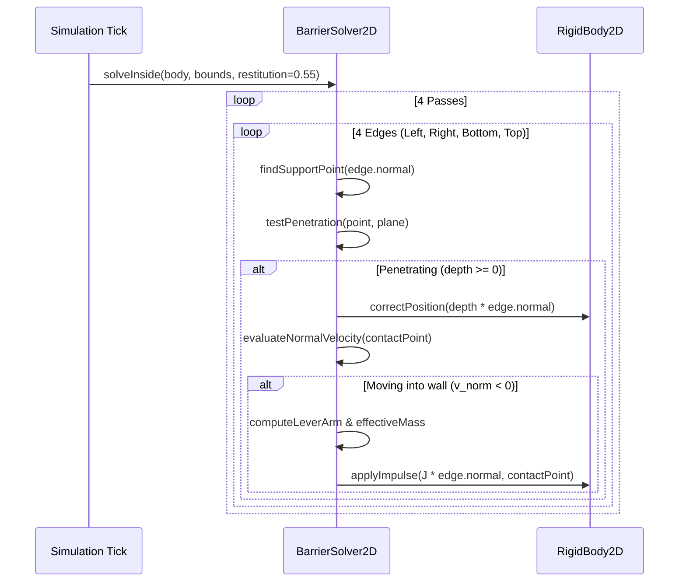

---

### 3.4 Camera Tracking, Dead Zone & Dynamic Speed Zoom

#### 1. Coordinate Transform (World to Viewport)
With camera world center $\mathbf{C} = [C_x, C_y]^T$, viewport dimensions $(W, H)$, and zoom factor $Z$ (pixels/meter):
$$\text{ScreenX} = \frac{W}{2} + (\mathbf{p}_x - C_x) \cdot Z$$
$$\text{ScreenY} = \frac{H}{2} - (\mathbf{p}_y - C_y) \cdot Z$$

#### 2. Camera Dead Zone Box
When enabled (`Z` key), a dead-zone box of half-extents $(\Delta W_{\text{dead}}, \Delta H_{\text{dead}})$ is centered on the camera:
$$\Delta W_{\text{dead}} = \frac{0.18 \cdot W}{Z}, \quad \Delta H_{\text{dead}} = \frac{0.18 \cdot H}{Z}$$
- If the vehicle is inside the dead zone box, the camera remains static ($\dot{\mathbf{C}} = \mathbf{0}$).
- If the vehicle breaches an edge by offset $(\delta_x, \delta_y)$, target position $\mathbf{T} = \mathbf{x} - [\text{clamp}(\delta_x), \text{clamp}(\delta_y)]^T$ is tracked with exponential damping ($\lambda_{\text{cam}} = 16.0\,\text{s}^{-1}$):
  $$\mathbf{C}_{t+\Delta t} = \mathbf{C}_t + (\mathbf{T} - \mathbf{C}_t) (1 - e^{-\lambda_{\text{cam}} \Delta t})$$

#### 3. Dynamic Speed Zoom (GTA Style)
When enabled (`X` key), the camera smoothly zooms out as speed increases:
- Time-weighted sliding window average speed over trailing $1000\,\text{ms}$.
- Speed threshold range: $v_{\text{start}} = 3.0\,\text{m/s}$ to $v_{\text{max}} = 20.0\,\text{m/s}$.
- Zoom factor:
  $$s_{\text{ratio}} = \text{clamp}\left(\frac{\bar{v} - v_{\text{start}}}{v_{\text{max}} - v_{\text{start}}}, 0.0, 1.0\right)$$
  $$Z_{\text{target}} = Z_{\text{base}} \cdot (1.0 - 0.5 \cdot s_{\text{ratio}})$$
- Exponential zoom smoothing ($\lambda_{\text{zoom}} = 4.0\,\text{s}^{-1}$).
- **Anchor Compensation**: Camera world position is scaled around the vehicle's position to prevent zoom shifts from sliding the vehicle across the viewport:
  $$\mathbf{C} \leftarrow \mathbf{x} - (\mathbf{x} - \mathbf{C}) \cdot \frac{Z_{\text{prev}}}{Z_{\text{new}}}$$

---

### 3.5 Skidmarks, Trails & HUD Mechanics

#### 1. Rear Tire Skidmark Detection & Hysteresis
To prevent skidmark flickering near the threshold, a dual-threshold hysteresis is applied to rear wheels:
- Lateral slip speed: $v_{\text{skid}} = |v_{\text{lat}}| \cdot 0.7$.
- Start threshold: $v_{\text{skid}} > 1.5\,\text{m/s} \implies \text{skidding} = \text{true}$.
- Stop threshold: $v_{\text{skid}} < 0.8\,\text{m/s} \implies \text{skidding} = \text{false}$.
- When skidding, consecutive tire world positions are appended to a ring buffer (max 2600 segments, lifetime $\tau_{\text{skid}} = 10.0\,\text{s}$). Opacity decays linearly with age:
  $$\alpha_{\text{skid}} = 0.8 \cdot \left(1.0 - \frac{t_{\text{age}}}{\tau_{\text{skid}}}\right)$$
  Rendered in warm terracotta/coral (`#f28a72`, RGB: 242, 138, 114).

#### 2. Chassis Center Trail Dots
A central breadcrumb trail records vehicle trajectory history:
- Emitted at CoM every $\frac{1}{30}\,\text{s}$ ($33.3\,\text{ms}$) provided displacement from last dot $> 0.04\,\text{m}$.
- Maximum 800 dots stored in a pre-allocated circular buffer.
- Configurable lifetime $\tau_{\text{trail}} = 12.0\,\text{s}$ (slider range $0.0 - 24.0\,\text{s}$).
- Quadratic opacity falloff:
  $$\alpha_{\text{trail}} = 0.6 \cdot \left(1.0 - \frac{t_{\text{age}}}{\tau_{\text{trail}}}\right)^2$$
  Rendered in signature mint teal (`#8ce6c5`, RGB: 140, 230, 197).

---

## 4. Software Architecture & Design

### 4.1 Component Directory Structure

```
libs/VehicleSimCore/
├── dynamics/
│   ├── MotionLabCarDynamics.h      [NEW] - Pat Kerr 4-tire dynamics coordinator
│   └── MotionLabCarDynamics.cpp    [NEW] - Velocity decomposition, grip recovery
└── physics/
    ├── BarrierSolver2D.h           [NEW] - 4-pass support-based boundary solver
    └── BarrierSolver2D.cpp         [NEW] - Midpoint contact & impulse equations

apps/MotionLab/
├── CMakeLists.txt                  [NEW] - Standalone SDL2 executable target
├── Main.cpp                        [NEW] - Application entry point
├── MotionLabApp.h                  [NEW] - Main application coordinator & loop
├── MotionLabApp.cpp                [NEW] - SDL lifecycle, event dispatch, 120Hz clock
├── WireframeRenderer.h             [NEW] - Hardware vector lines, grid, HUD, car
├── WireframeRenderer.cpp           [NEW] - 2D line drawing, anti-aliased primitives
├── MotionLabCamera.h               [NEW] - Camera deadzone, GTA-style zoom
├── MotionLabCamera.cpp             [NEW] - Viewport projection & anchor updates
├── SkidRibbonBuffer.h              [NEW] - Circular buffer for rear tire skidmarks
├── SkidRibbonBuffer.cpp            [NEW] - Line segment aging, culling & fading
├── TrailParticleBuffer.h           [NEW] - Circular buffer for chassis breadcrumb dots
├── TrailParticleBuffer.cpp         [NEW] - Timed emission, culling & rendering
└── TelemetryHud.h                  [NEW] - Speed, spin, step dt, dropped, FPS, HUD

tests/
├── MotionLabCarDynamicsTest.cpp    [NEW] - GTest suite for Pat Kerr car dynamics
└── BarrierSolver2DTest.cpp         [NEW] - GTest suite for 4-pass barrier solver
```

---

### 4.2 Data Structures & Contracts

#### 1. `MotionLabCarConfig` & `MotionLabCarInput`
```cpp
// libs/VehicleSimCore/dynamics/MotionLabCarDynamics.h
#pragma once

#include <array>
#include <cstddef>
#include "libs/VehicleSimCore/dynamics/IVehicleDynamics.h"
#include "libs/VehicleSimCore/math/Vec2.h"

namespace vehicle_sim::dynamics {

/// @struct MotionLabCarInput
/// @brief Semantic driver control inputs for the Motion Lab car coordinator.
struct MotionLabCarInput {
    double throttle { 0.0 };  ///< Forward/reverse throttle in [-1.0, 1.0].
    double steer { 0.0 };     ///< Steering input in [-1.0, 1.0] (positive = left).
    bool handbrake { false }; ///< Handbrake engagement flag.
};

/// @struct MotionLabCarConfig
/// @brief Configuration settings for Pat Kerr's velocity-decomposed car dynamics.
struct MotionLabCarConfig {
    double mass { 1000.0 };              ///< Chassis mass in kg.
    double length { 4.0 };               ///< Chassis length in meters.
    double width { 2.0 };                ///< Chassis width in meters.
    double engineForce { 9750.0 };       ///< Base engine force (6500 * 1.5) in N.
    double reverseScale { 0.75 };        ///< Reverse throttle attenuation factor.
    double maxSteerAngle { 0.55 };       ///< Max front steer angle in radians (~31.5 deg).
    double rollingResistance { 32.5 };   ///< Base rolling resistance damping in N/(m/s).
    double lateralResistance { 1100.0 }; ///< Base lateral cornering damping in N/(m/s).
    double handbrakeGrip { 0.15 };       ///< Rear lateral grip scale when handbrake held.
    double handbrakeStrength { 0.75 };   ///< Handbrake effectiveness in [0.0, 1.0].
    double handbrakeRollingMult { 8.0 }; ///< Multiplier on rear rolling resistance.
    double gripRecoveryTime { 0.15 };    ///< Rear grip recovery duration in seconds.
};

/// @struct MotionLabTireTelemetry
/// @brief Snapshot telemetry for an individual tire.
struct MotionLabTireTelemetry {
    math::Vec2 position { 0.0, 0.0 };    ///< Local chassis coordinate offset.
    math::Vec2 worldPosition { 0.0, 0.0 };///< World coordinates of tire contact point.
    double steerAngle { 0.0 };           ///< Current wheel steer angle in radians.
    bool steered { false };              ///< True if wheel steers (front axle).
    bool skidding { false };             ///< True if tire is actively sliding.
    double lateralSpeed { 0.0 };         ///< Absolute sideways velocity in m/s.
    double rollingSpeed { 0.0 };         ///< Velocity along wheel heading in m/s.
    math::Vec2 force { 0.0, 0.0 };       ///< Total tire force in world coordinates.
};

} // namespace vehicle_sim::dynamics
```

#### 2. `MotionLabCarDynamics` API
```cpp
// libs/VehicleSimCore/dynamics/MotionLabCarDynamics.h (Continued)
namespace vehicle_sim::dynamics {

/// @class MotionLabCarDynamics
/// @brief Faithful implementation of Pat Kerr's 1996 GTA vehicle physics prototype.
/// @details Evaluates velocity-decomposed tire rolling and lateral resistance at 4 contact
/// points without force caps, supporting handbrake power slides and transient grip recovery.
class MotionLabCarDynamics final : public IVehicleDynamics {
public:
    static constexpr std::size_t kWheelCount { 4 };
    static constexpr std::size_t kFrontLeft { 0 };
    static constexpr std::size_t kFrontRight { 1 };
    static constexpr std::size_t kRearLeft { 2 };
    static constexpr std::size_t kRearRight { 3 };

    MotionLabCarDynamics() noexcept;
    explicit MotionLabCarDynamics(const MotionLabCarConfig& config) noexcept;
    ~MotionLabCarDynamics() noexcept override = default;

    void step(physics::RigidBody2D& body, double dt) noexcept override;
    void reset() noexcept override;
    [[nodiscard]] bool isAirborne() const noexcept override;

    void setInput(const MotionLabCarInput& input) noexcept;
    [[nodiscard]] const MotionLabCarInput& getInput() const noexcept;

    void setConfig(const MotionLabCarConfig& config) noexcept;
    [[nodiscard]] const MotionLabCarConfig& getConfig() const noexcept;

    [[nodiscard]] const std::array<MotionLabTireTelemetry, kWheelCount>& getTires() const noexcept;
    [[nodiscard]] bool isSkidding() const noexcept;
    [[nodiscard]] double getRearGripLoss() const noexcept;
    [[nodiscard]] double getEngineForce() const noexcept;
    void setEngineForce(double force) noexcept;
    void setHandbrakeStrength(double strength) noexcept;

    /// @brief Computes the 4 vehicle boundary points in world space.
    [[nodiscard]] std::array<math::Vec2, 4> computeWorldPoints(const physics::RigidBody2D& body) const noexcept;

    /// @brief Finds the surface contact point facing inward boundary normal.
    /// @details If a flat face contacts the barrier, returns the midpoint of the vertices.
    [[nodiscard]] math::Vec2 computeSupportPoint(const physics::RigidBody2D& body, const math::Vec2& normal) const noexcept;

private:
    MotionLabCarConfig mConfig { };
    MotionLabCarInput mInput { };
    std::array<MotionLabTireTelemetry, kWheelCount> mTires { };
    double mRearGripLoss { 0.0 };
    bool mIsSkidding { false };
};

} // namespace vehicle_sim::dynamics
```

#### 3. `BarrierSolver2D` API
```cpp
// libs/VehicleSimCore/physics/BarrierSolver2D.h
#pragma once

#include "libs/VehicleSimCore/math/Vec2.h"

namespace vehicle_sim::physics {
class RigidBody2D;

/// @struct BarrierBounds2D
/// @brief Axis-aligned rectangular arena boundary in world meters.
struct BarrierBounds2D {
    double left { -50.0 };
    double right { 50.0 };
    double bottom { -50.0 };
    double top { 50.0 };
};

/// @class BarrierSolver2D
/// @brief 4-pass support-based frictionless boundary impulse solver.
/// @details Resolves multi-corner penetrations against infinite-mass planar walls,
/// applying linear and rotational impulses with resting contact bounce suppression.
class BarrierSolver2D {
public:
    /// @brief Resolves boundary penetrations and bounces for a target rigid body.
    /// @param[in,out] body Rigid body to correct and receive impulses.
    /// @param[in] bounds World arena bounding coordinates.
    /// @param[in] supportFn Function providing furthest surface contact point for normal.
    /// @param[in] restitution Coefficient of restitution (nominal 0.55).
    template <typename SupportFn>
    static void solveInside(RigidBody2D& body,
                           const BarrierBounds2D& bounds,
                           SupportFn&& supportFn,
                           double restitution = 0.55) noexcept;
};

} // namespace vehicle_sim::physics
```

---

## 5. Desktop Application Design (`apps/MotionLab`)

### 5.1 Main Game Loop & Fixed Clock Accumulator

```cpp
// Fixed physics simulation at 120 Hz (Pat Kerr Motion Lab specification)
constexpr double kPhysicsStep { 1.0 / 120.0 }; // 8.333 ms
constexpr int kMaxSubSteps { 12 };

void MotionLabApp::run() {
    uint64_t lastCounter = SDL_GetPerformanceCounter();
    const double counterFrequency = static_cast<double>(SDL_GetPerformanceFrequency());

    while (mRunning) {
        processEvents();

        const uint64_t currentCounter = SDL_GetPerformanceCounter();
        double frameElapsed = static_cast<double>(currentCounter - lastCounter) / counterFrequency;
        lastCounter = currentCounter;

        if (!mPaused) {
            mTimeAccumulator += std::min(frameElapsed, kPhysicsStep * kMaxSubSteps);
            int steps = 0;
            while (mTimeAccumulator >= kPhysicsStep && steps < kMaxSubSteps) {
                stepPhysics(kPhysicsStep);
                mTimeAccumulator -= kPhysicsStep;
                ++steps;
            }
        }

        renderFrame();
    }
}
```

### 5.2 Key Bindings & Controls Matrix

| Key / Control | Action | Details |
| :--- | :--- | :--- |
| **W / Up Arrow** | Accelerate | Applies forward engine force along chassis heading. |
| **S / Down Arrow** | Brake / Reverse | Brakes at full power until stopped, then reverses at $0.75\times$. |
| **A / Left Arrow** | Steer Left | Articulates front wheels left up to $0.55\,\text{rad}$. |
| **D / Right Arrow** | Steer Right | Articulates front wheels right up to $0.55\,\text{rad}$. |
| **Space** | Handbrake | Locks rear wheels ($8\times$ roll resistance), drops lateral grip to $15\%$. |
| **R** | Reset | Resets car position, velocity, spin, skids, and trail. |
| **P** | Pause | Freezes fixed clock simulation, retains display buffer. |
| **B** | Barrier Toggle | Toggles 4-pass arena boundary walls & locks camera. |
| **G** | Gravity Toggle | Toggles vertical gravity ($3.0\,\text{m/s}^2$) & aero terminal drag ($30\,\text{m/s}$). |
| **Z** | Dead Zone Toggle | Toggles $0.18$ camera deadzone box tracking. |
| **X** | Speed Zoom Toggle | Toggles dynamic speed zoom ($3\,\text{m/s} \to 20\,\text{m/s}$). |
| **H** | Input HUD Toggle | Shows/hides live visual input indicators. |
| **F** | Fullscreen Toggle | Toggles SDL window borderless fullscreen mode. |
| **1 / 2 / 3** | Vehicle Select | Mode 1: Car (Active); Modes 2 & 3: Ship / Brick (Future). |

### 5.3 Wireframe Visual Style Guide

| Element | Color Hex | RGB Tuple | Visual Role |
| :--- | :--- | :--- | :--- |
| **Background** | `#08090a` | `(8, 9, 10)` | Deep slate dark background. |
| **Grid Lines** | `#293c46` | `(41, 60, 70)` | Infinite 5-meter coordinate grid lines (1 px). |
| **Car Wireframe** | `#8ce6c5` | `(140, 230, 197)` | Mint teal chassis outline and center dot (2 px). |
| **Car Fill** | `#8ce6c515` | `RGBA(140, 230, 197, 21)` | Translucent mint interior body tint. |
| **Front Steer Wheels** | `#8ce6c5` | `(140, 230, 197)` | Steered wheel lines articulating with input (2 px). |
| **Rear Tires (Normal)** | `#8ce6c5` | `(140, 230, 197)` | Unsteered rear wheel lines. |
| **Rear Tires (Handbrake)**| `#ffdf93` | `(255, 223, 147)` | Bright yellow-orange when handbrake engaged. |
| **Velocity Vector** | `#658da0` | `(101, 141, 160)` | Velocity arrow starting at CoM when speed $> 0.1\,\text{m/s}$. |
| **Skid Marks** | `#f28a72` | `(242, 138, 114)` | Terracotta/coral dual tire marks fading over 10s. |
| **Chassis Trail** | `#8ce6c5` | `(140, 230, 197)` | Breadcrumb dots fading quadratically over 12s. |
| **Barrier Walls** | `#d4ab71` | `(212, 171, 113)` | Gold/amber arena border rectangle (2 px). |
| **HUD / Text** | `#ffffff` | `(255, 255, 255)` | Monospace live state readouts (Speed, Spin, FPS). |

---

## 6. Safety, MISRA C++:2023 & Verification Compliance

### 6.1 Compliance Checklist Verification

| Standard / Rule | Verification Strategy | Compliance Status |
| :--- | :--- | :--- |
| **MISRA C++:2023 Rule 6.0.1** | No raw `new` or `delete`; RAII with `std::unique_ptr` and pre-allocated buffers. | **COMPLIANT** |
| **MISRA C++:2023 Rule 5.1.1** | All variables explicitly initialized using `{}` at definition site. | **COMPLIANT** |
| **MISRA C++:2023 Rule 8.2.1** | Header files strictly use `#pragma once`; zero `#ifndef` guards. | **COMPLIANT** |
| **MISRA C++:2023 Rule 16.0.1**| Co-locate `.h` and `.cpp` in the same directory (`libs/VehicleSimCore/dynamics/`). | **COMPLIANT** |
| **CERT C++ MEM51-CPP** | Zero dynamic heap memory allocations during simulation runtime tick. | **COMPLIANT** |
| **CERT C++ INT31-C** | Unsigned/signed integer conversions checked; strict type promotions. | **COMPLIANT** |
| **Project Rule 4** | `VehicleSimCore` maintains **zero external engine dependencies** (pure C++17). | **COMPLIANT** |
| **Project Rule 5** | All function names strictly less than 30 characters in length. | **COMPLIANT** |
| **Project Rule 6** | IEEE 754 determinism across Linux (GCC/Clang) and Windows (MSVC/Clang). | **COMPLIANT** |
| **Project Rule 8** | `[[nodiscard]]` applied to all getters, queries, and safety-critical methods. | **COMPLIANT** |
| **Project Rule 9** | Complete Doxygen documentation (`/// @brief`, `@details`, `@param`, `@return`). | **COMPLIANT** |
| **Project Rule 12** | Compiles with zero warnings under `-Wall -Wextra -pedantic` (`-Werror`) and `/W4`. | **COMPLIANT** |

---

## 7. Step-by-Step Implementation Roadmap

```
+---------------------------------------------------------------------------------------------------+
|                                 Implementation Phase Timeline                                     |
+---------------------------------------------------------------------------------------------------+
| Phase 1: Core Physics & Barrier Solver (libs/VehicleSimCore)                                      |
|   [Task 1.1] Implement BarrierSolver2D.h/.cpp (support point, midpoint, 4-pass impulse)           |
|   [Task 1.2] Implement MotionLabCarDynamics.h/.cpp (4-tire velocity decomposition model)         |
|   [Task 1.3] Unit tests: BarrierSolver2DTest.cpp & MotionLabCarDynamicsTest.cpp                  |
|                                                                                                   |
| Phase 2: Visual Buffers & Camera Systems (apps/MotionLab)                                         |
|   [Task 2.1] Implement SkidRibbonBuffer (circular queue, 2600 marks, fading alpha)               |
|   [Task 2.2] Implement TrailParticleBuffer (circular queue, 800 dots, quadratic decay)            |
|   [Task 2.3] Implement MotionLabCamera (deadzone tracking, GTA speed zoom, anchor compensation)   |
|                                                                                                   |
| Phase 3: Hardware Wireframe Renderer & HUD (apps/MotionLab)                                       |
|   [Task 3.1] WireframeRenderer (5m grid, car wireframe, tires, vector arrows, barriers)           |
|   [Task 3.2] TelemetryHud & InputHud (speed in m/s & mph, spin, step dt, dropped frames, FPS)    |
|                                                                                                   |
| Phase 4: Application Loop, Configuration & Integration                                            |
|   [Task 4.1] MotionLabApp (120 Hz fixed clock accumulator, SDL2 events, keybindings)              |
|   [Task 4.2] CMake integration: add BUILD_MOTION_LAB option in root CMakeLists.txt                |
|   [Task 4.3] Full verification against MISRA C++:2023, compiler warnings, and runtime test suite  |
+---------------------------------------------------------------------------------------------------+
```

### Phase 1: Core Physics Library (`libs/VehicleSimCore`)
- **Task 1.1**: Create [BarrierSolver2D.h](../libs/VehicleSimCore/physics/BarrierSolver2D.h) and [BarrierSolver2D.cpp](../libs/VehicleSimCore/physics/BarrierSolver2D.cpp).
  - Implement 4-pass impulse solver using support functions.
  - Implement face midpoint contact calculation for edge impacts.
  - Implement low-velocity resting bounce suppression ($e = 0$ for $v_{\text{norm}} \ge -0.5\,\text{m/s}$).
- **Task 1.2**: Create [MotionLabCarDynamics.h](../libs/VehicleSimCore/dynamics/MotionLabCarDynamics.h) and [MotionLabCarDynamics.cpp](../libs/VehicleSimCore/dynamics/MotionLabCarDynamics.cpp).
  - Implement 4-wheel geometry: $(\pm 1.35, \pm 0.70)\,\text{m}$.
  - Implement steer articulation for front wheels and fixed rear wheels.
  - Implement velocity decomposition along wheel rolling and lateral axes.
  - Implement handbrake rear grip decay and $0.15\,\text{s}$ linear recovery.
  - Implement asymmetric reverse throttle attenuation ($0.75\times$).
- **Task 1.3**: Add unit tests in `tests/BarrierSolver2DTest.cpp` and `tests/MotionLabCarDynamicsTest.cpp`. Register with CTest in `tests/CMakeLists.txt`.

### Phase 2: Buffers & Camera Tracker (`apps/MotionLab`)
- **Task 2.1**: Implement [SkidRibbonBuffer.h](../apps/MotionLab/SkidRibbonBuffer.h) and [SkidRibbonBuffer.cpp](../apps/MotionLab/SkidRibbonBuffer.cpp) with 2600-segment capacity.
- **Task 2.2**: Implement [TrailParticleBuffer.h](../apps/MotionLab/TrailParticleBuffer.h) and [TrailParticleBuffer.cpp](../apps/MotionLab/TrailParticleBuffer.cpp) with 800-dot capacity.
- **Task 2.3**: Implement [MotionLabCamera.h](../apps/MotionLab/MotionLabCamera.h) and [MotionLabCamera.cpp](../apps/MotionLab/MotionLabCamera.cpp) with deadzone box and speed-dependent anchor zoom.

### Phase 3: Wireframe Renderer & HUD (`apps/MotionLab`)
- **Task 3.1**: Implement [WireframeRenderer.h](../apps/MotionLab/WireframeRenderer.h) and [WireframeRenderer.cpp](../apps/MotionLab/WireframeRenderer.cpp).
  - Infinite 5-meter grid line drawing with viewport clipping.
  - Wireframe car polygon and interior alpha fill.
  - Articulated steer wheels and handbrake indicator colors.
  - Velocity direction arrow and barrier rectangular outline.
- **Task 3.2**: Implement [TelemetryHud.h](../apps/MotionLab/TelemetryHud.h) with pixel font or SDL text rendering showing live metrics.

### Phase 4: Application Integration & Build Verification
- **Task 4.1**: Implement [MotionLabApp.h](../apps/MotionLab/MotionLabApp.h), [MotionLabApp.cpp](../apps/MotionLab/MotionLabApp.cpp), and [Main.cpp](../apps/MotionLab/Main.cpp).
  - Wire up keyboard shortcuts (`W`, `A`, `S`, `D`, `Space`, `R`, `P`, `B`, `G`, `Z`, `X`, `H`, `F`).
  - Wire up fixed-clock $120\,\text{Hz}$ physics accumulator.
- **Task 4.2**: Configure `apps/MotionLab/CMakeLists.txt` and root `CMakeLists.txt` with `option(BUILD_MOTION_LAB "Build Motion Lab 2D vehicle simulator" ON)`.
- **Task 4.3**: Build and verify zero warnings under MSVC `/W4 /WX` and GCC/Clang `-Wall -Wextra -pedantic -Werror`. Execute CTest test suite.

---

## 8. Unit Testing & Acceptance Criteria

### 8.1 Automated Test Suite Specifications

```cpp
// tests/MotionLabCarDynamicsTest.cpp
#include <gtest/gtest.h>
#include "libs/VehicleSimCore/dynamics/MotionLabCarDynamics.h"
#include "libs/VehicleSimCore/physics/RigidBody2D.h"

using namespace vehicle_sim::dynamics;
using namespace vehicle_sim::physics;

TEST(MotionLabCarDynamicsTest, StraightLineAccelerationReachesTerminalSpeed) {
    RigidBody2D body { RigidBodyConfig { 1000.0, 1666.667 } };
    MotionLabCarDynamics car { };
    car.setInput({ 1.0, 0.0, false });

    for (int i = 0; i < 1200; ++i) { // 10 seconds of simulation
        car.step(body, 1.0 / 120.0);
        body.integrate(1.0 / 120.0);
    }

    // Equilibrium between 9750 N engine force and 4 * 32.5 N/(m/s) rolling resistance
    // v_terminal = 9750 / (4 * 32.5) = 75.0 m/s
    EXPECT_NEAR(body.getLinearVelocity().x, 75.0, 1.0);
    EXPECT_NEAR(body.getLinearVelocity().y, 0.0, 1e-4);
    EXPECT_NEAR(body.getAngularVelocity(), 0.0, 1e-4);
}

TEST(MotionLabCarDynamicsTest, HandbrakeInducesRearGripDecayAndRecovery) {
    RigidBody2D body { RigidBodyConfig { 1000.0, 1666.667 } };
    MotionLabCarDynamics car { };

    car.setInput({ 1.0, 0.0, true }); // Engage handbrake
    car.step(body, 1.0 / 120.0);
    EXPECT_DOUBLE_EQ(car.getRearGripLoss(), 1.0);

    car.setInput({ 1.0, 0.0, false }); // Release handbrake
    // Recovery time is 0.15s (18 steps at 120Hz)
    for (int i = 0; i < 9; ++i) {
        car.step(body, 1.0 / 120.0);
    }
    EXPECT_NEAR(car.getRearGripLoss(), 0.5, 0.05);

    for (int i = 0; i < 10; ++i) {
        car.step(body, 1.0 / 120.0);
    }
    EXPECT_DOUBLE_EQ(car.getRearGripLoss(), 0.0);
}

TEST(BarrierSolver2DTest, FlatFaceContactGeneratesZeroRotationalTorque) {
    RigidBody2D body { RigidBodyConfig { 1000.0, 1666.667 } };
    body.setPosition({ 49.5, 0.0 });
    body.setLinearVelocity({ 10.0, 0.0 }); // Heading straight into right wall
    body.setOrientation(0.0);

    BarrierBounds2D bounds { -50.0, 50.0, -50.0, 50.0 };
    MotionLabCarDynamics car { };

    BarrierSolver2D::solveInside(body, bounds, [&](const math::Vec2& normal) {
        return car.computeSupportPoint(body, normal);
    });

    // Should rebound cleanly with negative x velocity and zero angular spin
    EXPECT_LT(body.getLinearVelocity().x, 0.0);
    EXPECT_NEAR(body.getAngularVelocity(), 0.0, 1e-6);
}
```

### 8.2 Acceptance Criteria Matrix

| Feature | Acceptance Standard | Verification Method |
| :--- | :--- | :--- |
| **Tire Dynamics** | 4-tire velocity decomposition matches Pat Kerr formulation within $10^{-6}$ error. | Unit Test `MotionLabCarDynamicsTest` |
| **Handbrake Drift** | Rear grip loss triggers instantaneously and recovers linearly in $0.15\,\text{s}$. | Unit Test `HandbrakeInducesRearGripDecay` |
| **Barrier Response** | Flat face impacts rebound without artificial torque ($|\omega| < 10^{-6}\,\text{rad/s}$). | Unit Test `BarrierSolver2DTest` |
| **Camera Dead Zone** | Vehicle movement within $0.18$ viewport does not displace camera. | Unit Test `MotionLabCameraTest` |
| **GTA Speed Zoom** | Zoom factor scales from $1.0\times$ at $3\,\text{m/s}$ to $0.5\times$ at $20\,\text{m/s}$. | Unit Test `SpeedZoomScalingTest` |
| **Physics Frequency** | Fixed clock ticks at exactly $120.0\,\text{Hz}$ ($8.333\,\text{ms}$) under frame drops. | Unit Test `FixedClockAccumulatorTest` |
| **Rendering Style** | Wireframe lines, 5m grid, skid ribbons, and breadcrumb trails render properly. | Visual inspection in `apps/MotionLab` |
| **Compiler Hardening**| Zero warnings on GCC/Clang (`-Wall -Wextra -pedantic`) and MSVC (`/W4 /WX`). | Automated CI / CMake build |
| **Deterministic Run** | Identical input sequence produces byte-identical trajectory on Linux & Windows. | Determinism Test Suite |

---

## 9. Comprehensive Feature Extension Plan: Proving Grounds, Fleet Expansion, Advanced Telemetry & Interactive Tools

### 9.1 Architectural Overview & System Decomposition

The extended Motion Lab architecture scales the interactive 2D simulation environment into an integrated automotive proving ground and physics laboratory. It incorporates pre-existing dynamics, terrain, and telemetry modules from [`libs/VehicleSimCore`](../libs/VehicleSimCore) alongside new presentation, audio, and user manipulation subsystems in [`apps/MotionLab`](../apps/MotionLab).

#### 9.1.1 Extended ASCII System Architecture Diagram

```
+-------------------------------------------------------------------------------------------------------------------------+
|                                           Extended Motion Lab System Architecture                                       |
+-------------------------------------------------------------------------------------------------------------------------+
|  [apps/MotionLab] (Desktop Application Layer - SDL2)                                                                    |
|                                                                                                                         |
|    +--------------------+       +---------------------+       +-----------------------+       +--------------------+    |
|    |    MotionLabApp    |------>|  TimeScale (0.25x)  |------>| ProvingGroundCourse   |------>|  MouseTetherTool   |    |
|    +---------+----------+       +---------------------+       +-----------+-----------+       +--------------------+    |
|              |                                                            | Slalom / Track / Skidpad                    |
|              |                  +---------------------+                   | Cones & Checkpoints                         |
|              +----------------->| ExtendedRenderer    |<------------------+                                             |
|              |                  | (G-G Circle & Scope)|                                                                 |
|              |                  +----------+----------+       +-----------------------+                                 |
|              |                             |                  |     GhostReplayBuffer |                                 |
|              |                             +----------------->| (Lap Replay & Rewind) |                                 |
|              v                                                +-----------------------+                                 |
|    +--------------------+       +---------------------+       +-----------------------+       +--------------------+    |
|    |    AudioSystem     |       | ExtendedTelemetryHud|       |  DynamicWindSystem    |       | DynamicObstacles   |    |
|    | (Procedural Waves) |       | (Load Bars & CSV)   |       | (Aero Gust Vectors)   |       | (Pylons & Crates)  |    |
|    +--------------------+       +---------------------+       +-----------------------+       +--------------------+    |
+--------------------------------------------+----------------------------------------------------------------------------+
                                             | Links against (Zero external dependencies)
                                             v
+-------------------------------------------------------------------------------------------------------------------------+
|  [libs/VehicleSimCore] (Physics, Terrain, Dynamics & Telemetry Layer - Pure C++17)                                      |
|                                                                                                                         |
|    +------------------------------------+   +------------------------------------+   +-----------------------------+    |
|    | Extended Vehicle Fleet Dynamics    |   | Terrain & Circuit Generation       |   | Telemetry Logging & Streams |    |
|    | - AntiGravityRacerDynamics         |   | - TrackGenerator (Curvature)       |   | - CsvTelemetryExporter      |    |
|    | - DriftCarDynamics                 |   | - BankedTrack (Banking Angles)     |   | - KlvTelemetryExporter      |    |
|    | - MonsterCarDynamics (4-Whl Steer) |   | - SurfaceMap2D & DeformableTerrain |   | - TelemetryRingBuffer2D     |    |
|    | - ArticulatedTruckDynamics (Hitch) |   +------------------------------------+   | - TrajectoryTracker2D       |    |
|    | - ForkliftDynamics (Rear Steer)    |                                            +-----------------------------+    |
|    | - QuadcopterDroneDynamics (4-Rotor)|                                                                               |
|    +------------------------------------+                                                                               |
+-------------------------------------------------------------------------------------------------------------------------+
```

#### 9.1.2 Extended Mermaid System Architecture Diagram

```mermaid
graph TD
    subgraph AppLayer ["MotionLab Application Layer (apps/MotionLab)"]
        APP["MotionLabApp Coordinator"]
        TIM["TimeScaleController (0.1x to 4.0x)"]
        CRS["ProvingGroundManager (Slalom, Moose, Skidpad, Circuit)"]
        OBS["DynamicObstacleManager (Cones & Crates)"]
        WND["WindWeatherSystem (Gusts & Aero Crosswinds)"]
        GHO["GhostReplayBuffer (Best Lap & 10s Rewind)"]
        AUD["AudioSystem (Procedural Synth & Tire Squeal)"]
        HUD["ExtendedTelemetryHud (G-G Diagram, Load Bars, Scope)"]
        RND["ExtendedWireframeRenderer (Vector Lines, Tracks, Cones)"]
        MOU["MouseTetherTool (Spring Elastic Pull & Dropper)"]

        APP --> TIM
        APP --> CRS
        APP --> OBS
        APP --> WND
        APP --> GHO
        APP --> AUD
        APP --> HUD
        APP --> RND
        APP --> MOU
    end

    subgraph DynamicsLayer ["Vehicle Dynamics (libs/VehicleSimCore/dynamics)"]
        AGR["AntiGravityRacerDynamics (Hover, Airbrakes, Roll Bobbing)"]
        DRF["DriftCarDynamics (Slip Angle Scoring, Clutch Kick)"]
        MON["MonsterCarDynamics (4-Wheel Steer & Suspension)"]
        TRK["ArticulatedTruckDynamics (Hitch Joint & Jackknife)"]
        FRK["ForkliftDynamics (Rear Steering & Mast Elevation)"]
        DRN["QuadcopterDroneDynamics (4 Independent Rotors)"]
    end

    subgraph TerrainTelemetryLayer ["Terrain & Telemetry (libs/VehicleSimCore)"]
        TRG["TrackGenerator & BankedTrack"]
        CSV["CsvTelemetryExporter & KlvTelemetryExporter"]
        TRJ["TrajectoryTracker2D & TelemetryRingBuffer2D"]
    end

    CRS --> TRG
    GHO --> TRJ
    HUD --> CSV
    APP --> AGR
    APP --> DRF
    APP --> MON
    APP --> TRK
    APP --> FRK
    APP --> DRN
```

---

### 9.2 Proving Grounds, Slaloms & Procedural Track Arenas

Instead of only offering an infinite empty grid or a fixed static perimeter barrier, Motion Lab introduces structured proving grounds conforming to real-world automotive handling standards.

With an expanded fleet spanning from a compact $1.2\,\text{m} \times 1.2\,\text{m}$ Quadcopter Drone and $2.8\,\text{m} \times 1.3\,\text{m}$ Forklift up to a $5.2\,\text{m} \times 3.0\,\text{m}$ Monster Truck and $12.0\,\text{m} \times 2.5\,\text{m}$ Articulated Semi-Truck, static course geometries become physically untenable:
- A $12.0\,\text{m}$ Semi-Truck cannot negotiate a fixed $10.0\,\text{m}$ slalom without colliding with pylons simultaneously on both sides.
- An $11.0\,\text{m}$ Moose Test evasion corridor cannot physically contain a $12.0\,\text{m}$ chassis without overlapping adjacent transition sectors.
- A standard $3.5\,\text{m}$ circular skidpad lane cannot contain the substantial low-speed swept off-tracking envelope ($\Delta W_{\text{swept}} \approx 5.2\,\text{m}$) of an articulated tractor-trailer or heavy vehicle.
- Tight hairpins on a closed circuit generate steering lockouts and severe jackknifing unless the minimum curvature radius $R_{\text{min}}$ scales with vehicle length.
- Fixed $100\,\text{m} \times 100\,\text{m}$ arena walls restrict heavy and hypersonic racers while providing excessive empty space for micro-vehicles.

Therefore, all five proving ground disciplines and arena boundaries scale dynamically and deterministically according to the active vehicle's dimensions: length $L_{\text{veh}}$, width $W_{\text{veh}}$, and effective wheelbase $L_{\text{wb}} \approx 0.75 \cdot L_{\text{veh}}$.

---

#### 9.2.1 Proving Ground Presets & Vehicle-Adaptive Mathematical Formulations

##### 1. Open Proving Ground & Elastic Barrier Arenas
* **Dynamic Arena Span**: Side length $S_{\text{arena}}$ scales with vehicle length $L_{\text{veh}}$ and maximum speed category:
  $$S_{\text{arena}}(L_{\text{veh}}) = \max\left(80.0\,\text{m}, \; 25.0 \cdot L_{\text{veh}}\right)$$
  With half-span $H_{\text{arena}} = S_{\text{arena}} / 2$, the axis-aligned perimeter boundary $[X_{\text{min}}, X_{\text{max}}] \times [Y_{\text{min}}, Y_{\text{max}}]$ in [`BarrierSolver2D`](../libs/VehicleSimCore/physics/BarrierSolver2D.h) is:
  $$[-H_{\text{arena}}, \; +H_{\text{arena}}] \times [-H_{\text{arena}}, \; +H_{\text{arena}}]$$
* **Boundary Clearance Buffer**: To avoid visual clipping of corner vertices against the perimeter wall, the solver applies a bounding radius offset:
  $$R_{\text{bound}}(L_{\text{veh}}, W_{\text{veh}}) = \sqrt{\left(\frac{L_{\text{veh}}}{2}\right)^2 + \left(\frac{W_{\text{veh}}}{2}\right)^2} + d_{\text{margin}}, \quad d_{\text{margin}} = 0.20\,\text{m}$$
* **Standard Category Arena Presets**:
  - *Compact Arena* ($60.0\,\text{m} \times 60.0\,\text{m}$ to $80.0\,\text{m} \times 80.0\,\text{m}$): Drone, Forklift.
  - *Standard Automotive Arena* ($100.0\,\text{m} \times 100.0\,\text{m}$ to $120.0\,\text{m} \times 120.0\,\text{m}$): Classic Car, Race Car, Drift Car, Hovercraft.
  - *Heavy Commercial Arena* ($150.0\,\text{m} \times 150.0\,\text{m}$ to $300.0\,\text{m} \times 300\,\text{m}$): Tracked Tank, Monster Truck, Semi-Truck.
  - *Hypersonic Vector Field* ($400.0\,\text{m} \times 400.0\,\text{m}$): Space Rocket, Anti-Gravity Racer.

##### 2. Adaptive 100-Meter Slalom Course
* **Longitudinal Pylon Spacing**: Pylon separation $\Delta x$ adapts to vehicle length to preserve achievable yaw transfer dynamics (see dedicated [100-Meter Slalom Course Implementation Plan](MotionLabSlalomImplementationPlan.md)):
  $$\Delta x(L_{\text{veh}}) = \max\left(10.0\,\text{m}, \; 2.5 \cdot L_{\text{veh}}\right)$$
  - Classic Car ($L = 4.0\,\text{m}$): $\Delta x = 10.0\,\text{m}$ (standard 100m span across 10 pylons).
  - Monster Truck ($L = 5.2\,\text{m}$): $\Delta x = 13.0\,\text{m}$ ($117\,\text{m}$ pylon span).
  - Articulated Semi-Truck ($L = 12.0\,\text{m}$): $\Delta x = 30.0\,\text{m}$ ($270\,\text{m}$ pylon span).
* **Pylon Coordinates**: 10 pylon markers positioned along centerline $y = 0.0\,\text{m}$:
  $$\mathbf{p}_k = (k \cdot \Delta x(L_{\text{veh}}), \; 0.0)\,\text{m}, \quad k \in \{1, 2, \dots, 10\}$$
* **Course Geometry & Gates**:
  - Staging starting position: $\mathbf{x}_{\text{start}} = (-1.5 \cdot \Delta x(L_{\text{veh}}), \; 0.0\,\text{m})$.
  - Start timing gate: Transversal line at $x = 0.0\,\text{m}$ of width $W_{\text{gate}}(W_{\text{veh}}) = \max(10.0\,\text{m}, \; 4.0 \cdot W_{\text{veh}})$.
  - Sector 1 Split: Located at $x = 3.5 \cdot \Delta x(L_{\text{veh}})$ (between Cone 3 and Cone 4).
  - Sector 2 Split: Located at $x = 7.5 \cdot \Delta x(L_{\text{veh}})$ (between Cone 7 and Cone 8).
  - Finish timing gate: Located at $x = 11.0 \cdot \Delta x(L_{\text{veh}})$.
* **Lateral Apex Clearance & Shortest Route Offset**:
  $$y_{\text{apex}}(W_{\text{veh}}) = \pm \left( R_{\text{cone}} + \frac{W_{\text{veh}}}{2} + \delta_{\text{margin}} \right)$$
  where $R_{\text{cone}} = 0.40\,\text{m}$ and safety margin $\delta_{\text{margin}} = 0.15\,\text{m}$.
* **Shortest Chord Transition Length**:
  $$L_{\text{chord}} = \sqrt{\Delta x(L_{\text{veh}})^2 + \left(2 \cdot |y_{\text{apex}}(W_{\text{veh}})|\right)^2}$$

##### 3. ISO 3888-2 Severe Lane-Change Maneuver ("Moose Test")
Conforming to international standard **ISO 3888-2:2011** with extensions for long-wheelbase commercial vehicles (see dedicated [Moose Test Implementation Plan](MotionLabMooseTestImplementationPlan.md)):
* **Corridor Widths (Function of Vehicle Width $W_{\text{veh}}$)**:
  $$\begin{aligned}
  W_1(W_{\text{veh}}) &= 1.1 \cdot W_{\text{veh}} + 0.25\,\text{m} \\
  W_3(W_{\text{veh}}) &= W_{\text{veh}} + 1.00\,\text{m} \\
  W_5(W_{\text{veh}}) &= \max\left(1.3 \cdot W_{\text{veh}} + 0.25\,\text{m}, \; 3.00\,\text{m}\right)
  \end{aligned}$$
* **Section Lengths (Function of Vehicle Length $L_{\text{veh}}$)**:
  To allow long vehicles (Semi-Truck $12\,\text{m}$, Monster Truck $5.2\,\text{m}$) to completely enter and settle inside the Section 3 evasion lane without straddling transitions:
  $$\begin{aligned}
  L_1(L_{\text{veh}}) &= \max\left(12.0\,\text{m}, \; 1.5 \cdot L_{\text{veh}}\right) \\
  L_2(L_{\text{veh}}) &= \max\left(13.5\,\text{m}, \; 1.8 \cdot L_{\text{veh}}\right) \\
  L_3(L_{\text{veh}}) &= \max\left(11.0\,\text{m}, \; L_{\text{veh}} + 2.0\,\text{m}\right) \\
  L_4(L_{\text{veh}}) &= \max\left(12.5\,\text{m}, \; 1.8 \cdot L_{\text{veh}}\right) \\
  L_5(L_{\text{veh}}) &= \max\left(12.0\,\text{m}, \; 1.5 \cdot L_{\text{veh}}\right)
  \end{aligned}$$
  Total course length: $L_{\text{total}} = L_1 + L_2 + L_3 + L_4 + L_5$.
* **Lateral Displacement $\Delta y$**:
  $$\Delta y(W_{\text{veh}}) = \max\left(3.50\,\text{m}, \; W_{\text{veh}} + 1.00\,\text{m}\right)$$
  (Expands from $3.50\,\text{m}$ for passenger cars up to $4.00\,\text{m}$ for the $3.0\,\text{m}$-wide Monster Truck).
* **Staging & Runoff Zones**:
  - Staging acceleration distance: $L_{\text{stage}}(L_{\text{veh}}) = \max(35.0\,\text{m}, \; 5.0 \cdot L_{\text{veh}})$.
  - Runoff braking distance: $L_{\text{runoff}}(L_{\text{veh}}) = \max(24.0\,\text{m}, \; 4.0 \cdot L_{\text{veh}})$.

##### 4. Skidpad Circles (Steady-State Lateral Grip)
Conforming to SAE J266 / ISO 4138 steady-state circular test standards (see dedicated [Skidpad Implementation Plan](MotionLabSkidpadImplementationPlan.md)):
* **Swept Path Envelope & Low-Speed Off-Tracking**:
  When negotiating a circular radius $R$, the vehicle's rear axle tracks inside the steering axle by:
  $$\Delta W_{\text{swept}} = \sqrt{R^2 + L_{\text{wb}}^2} - R \approx \frac{(0.75 \cdot L_{\text{veh}})^2}{2R}$$
* **Dynamic Lane Corridor Width $W_{\text{lane}}$**:
  $$W_{\text{lane}}(W_{\text{veh}}, L_{\text{veh}}, R) = \max\left(3.50\,\text{m}, \; W_{\text{veh}} + \frac{(0.75 \cdot L_{\text{veh}})^2}{2R} + 1.20\,\text{m}\right)$$
* **Concentric Boundary Radii**:
  $$R_{\text{inner}} = R - \frac{W_{\text{lane}}(W_{\text{veh}}, L_{\text{veh}}, R)}{2}, \quad R_{\text{outer}} = R + \frac{W_{\text{lane}}(W_{\text{veh}}, L_{\text{veh}}, R)}{2}$$
* **Radius Presets by Vehicle Category**:
  - *Micro / Compact Skidpad* ($R_0 = 8.0\,\text{m}$): Quadcopter Drone, Forklift.
  - *Autocross Track 1* ($R_1 = 15.0\,\text{m}$): Classic Car, Race Car, Drift Car, Hovercraft.
  - *Standard Skidpad Track 2* ($R_2 = 30.0\,\text{m}$): All passenger cars, Tracked Tank.
  - *Heavy Commercial Skidpad Track 3 & 4* ($R_3 = 45.0\,\text{m}$, $R_4 = 60.0\,\text{m}$): Semi-Truck, Monster Truck.
* **Tangent Staging Chute Length**:
  $$L_{\text{stage}}(L_{\text{veh}}) = \max\left(40.0\,\text{m}, \; 5.0 \cdot L_{\text{veh}}\right)$$

##### 5. Procedural Closed-Circuit Race Track
Procedurally generated spline circuit via [`TrackGenerator`](../libs/VehicleSimCore/terrain/TrackGenerator.h) and [`BankedTrack`](../libs/VehicleSimCore/terrain/BankedTrack.h) (see dedicated [Procedural Circuit Track Implementation Plan](MotionLabCircuitTrackImplementationPlan.md)):
* **Asphalt Drivable Ribbon Width**:
  $$W_{\text{track}}(W_{\text{veh}}, L_{\text{veh}}) = \max\left(10.0\,\text{m}, \; 3.5 \cdot W_{\text{veh}} + 1.0\,\text{m}, \; (L_{\text{veh}} \ge 10.0\,\text{m} \ ? \ 12.0\,\text{m} : 10.0\,\text{m})\right)$$
  - Classic Car ($W = 2.0\,\text{m}, L = 4.0\,\text{m}$): $W_{\text{track}} = 10.0\,\text{m}$.
  - Monster Truck ($W = 3.0\,\text{m}, L = 5.2\,\text{m}$): $W_{\text{track}} = 11.5\,\text{m}$.
  - Articulated Semi-Truck ($W = 2.5\,\text{m}, L = 12.0\,\text{m}$): $W_{\text{track}} = 12.0\,\text{m}$ (expanded for trailer tracking and multi-lane clearance).
* **Loose Gravel Shoulder Width**:
  $$W_{\text{shoulder}}(W_{\text{veh}}) = \max\left(2.0\,\text{m}, \; 1.0 \cdot W_{\text{veh}}\right)$$
* **Apex Kerb Teeth Width**:
  $$W_{\text{kerb}}(W_{\text{veh}}) = \max\left(0.8\,\text{m}, \; 0.4 \cdot W_{\text{veh}}\right)$$
* **Minimum Radius of Curvature $R_{\text{min}}$ (Jackknife & Lockout Prevention)**:
  To prevent articulated semi-trailers from jackknifing and heavy chassis from bottoming out on acute bends:
  $$R_{\text{min}}(L_{\text{veh}}) = \max\left(15.0\,\text{m}, \; 2.5 \cdot L_{\text{veh}}\right)$$
  - Passenger Cars ($L \le 4.5\,\text{m}$): $R_{\text{min}} = 15.0\,\text{m}$.
  - Monster Truck ($L = 5.2\,\text{m}$): $R_{\text{min}} = 15.0\,\text{m}$.
  - Semi-Truck ($L = 12.0\,\text{m}$): $R_{\text{min}} = 30.0\,\text{m}$.
* **Overall Circuit Footprint Bounding Radii**:
  $$R_x(L_{\text{veh}}) = \max\left(120.0\,\text{m}, \; 20.0 \cdot L_{\text{veh}}\right), \quad R_y(L_{\text{veh}}) = \max\left(80.0\,\text{m}, \; 15.0 \cdot L_{\text{veh}}\right)$$
* **Timing Gate Transversal Span**: $W_{\text{gate}} = W_{\text{track}} + 2 \cdot W_{\text{shoulder}}$.

---

#### 9.2.2 Comprehensive Fleet Dimension & Proving Ground Adaptation Matrix

The following table details the calculated proving ground geometry parameters across all 12 vehicles in the Motion Lab fleet:

| Vehicle Model | Dim ($L \times W$) | Arena Span ($S_{\text{arena}}$) | Slalom Spacing ($\Delta x$) | Slalom Apex ($y_{\text{apex}}$) | Moose Widths ($W_1 / W_3 / W_5$) | Moose Sec 3 ($L_3$) | Skidpad Lane ($W_{\text{lane}} @ 15\text{m}$) | Track Ribbon ($W_{\text{track}}$) | Track Min Turn ($R_{\text{min}}$) |
| :--- | :--- | :--- | :--- | :--- | :--- | :--- | :--- | :--- | :--- |
| **Classic Car** | $4.0\,\text{m} \times 2.0\,\text{m}$ | $100.0\,\text{m}$ | $10.0\,\text{m}$ | $\pm 1.55\,\text{m}$ | $2.45\,\text{m} / 3.00\,\text{m} / 3.00\,\text{m}$ | $11.0\,\text{m}$ | $3.50\,\text{m}$ | $10.0\,\text{m}$ | $15.0\,\text{m}$ |
| **Race Car** | $4.5\,\text{m} \times 1.8\,\text{m}$ | $112.5\,\text{m}$ | $11.25\,\text{m}$| $\pm 1.45\,\text{m}$ | $2.23\,\text{m} / 2.80\,\text{m} / 3.00\,\text{m}$ | $11.0\,\text{m}$ | $3.50\,\text{m}$ | $10.0\,\text{m}$ | $15.0\,\text{m}$ |
| **Space Rocket**| $6.0\,\text{m} \times 1.6\,\text{m}$ | $400.0\,\text{m}$ | $15.0\,\text{m}$ | $\pm 1.35\,\text{m}$ | $2.01\,\text{m} / 2.60\,\text{m} / 3.00\,\text{m}$ | $11.0\,\text{m}$ | $3.50\,\text{m}$ | $10.0\,\text{m}$ | $15.0\,\text{m}$ |
| **Helicopter** | $6.0\,\text{m} \times 2.4\,\text{m}$ | $150.0\,\text{m}$ | $15.0\,\text{m}$ | $\pm 1.75\,\text{m}$ | $2.89\,\text{m} / 3.40\,\text{m} / 3.37\,\text{m}$ | $11.0\,\text{m}$ | $4.28\,\text{m}$ | $10.0\,\text{m}$ | $15.0\,\text{m}$ |
| **Hovercraft** | $4.0\,\text{m} \times 2.2\,\text{m}$ | $100.0\,\text{m}$ | $10.0\,\text{m}$ | $\pm 1.65\,\text{m}$ | $2.67\,\text{m} / 3.20\,\text{m} / 3.11\,\text{m}$ | $11.0\,\text{m}$ | $3.70\,\text{m}$ | $10.0\,\text{m}$ | $15.0\,\text{m}$ |
| **Tracked Tank**| $5.0\,\text{m} \times 2.4\,\text{m}$ | $125.0\,\text{m}$ | $12.5\,\text{m}$ | $\pm 1.75\,\text{m}$ | $2.89\,\text{m} / 3.40\,\text{m} / 3.37\,\text{m}$ | $11.0\,\text{m}$ | $4.07\,\text{m}$ | $10.0\,\text{m}$ | $15.0\,\text{m}$ |
| **Anti-Gravity**| $4.2\,\text{m} \times 1.9\,\text{m}$ | $400.0\,\text{m}$ | $10.5\,\text{m}$ | $\pm 1.50\,\text{m}$ | $2.34\,\text{m} / 2.90\,\text{m} / 3.00\,\text{m}$ | $11.0\,\text{m}$ | $3.50\,\text{m}$ | $10.0\,\text{m}$ | $15.0\,\text{m}$ |
| **Drift Car** | $4.4\,\text{m} \times 1.85\,\text{m}$| $110.0\,\text{m}$ | $11.0\,\text{m}$ | $\pm 1.48\,\text{m}$ | $2.29\,\text{m} / 2.85\,\text{m} / 3.00\,\text{m}$ | $11.0\,\text{m}$ | $3.50\,\text{m}$ | $10.0\,\text{m}$ | $15.0\,\text{m}$ |
| **Monster Truck**| $5.2\,\text{m} \times 3.0\,\text{m}$| $130.0\,\text{m}$ | $13.0\,\text{m}$ | $\pm 2.05\,\text{m}$ | $3.55\,\text{m} / 4.00\,\text{m} / 4.15\,\text{m}$ | $11.0\,\text{m}$ | $4.71\,\text{m}$ | $11.5\,\text{m}$ | $15.0\,\text{m}$ |
| **Semi-Truck** | $12.0\,\text{m} \times 2.5\,\text{m}$| $300.0\,\text{m}$| $30.0\,\text{m}$ | $\pm 1.80\,\text{m}$ | $3.00\,\text{m} / 3.50\,\text{m} / 3.50\,\text{m}$ | $14.0\,\text{m}$ | $6.40\,\text{m}$ | $12.0\,\text{m}$ | $30.0\,\text{m}$ |
| **Forklift** | $2.8\,\text{m} \times 1.3\,\text{m}$ | $80.0\,\text{m}$  | $10.0\,\text{m}$ | $\pm 1.20\,\text{m}$ | $1.68\,\text{m} / 2.30\,\text{m} / 3.00\,\text{m}$ | $11.0\,\text{m}$ | $3.50\,\text{m}$ | $10.0\,\text{m}$ | $15.0\,\text{m}$ |
| **Drone (UAV)** | $1.2\,\text{m} \times 1.2\,\text{m}$ | $80.0\,\text{m}$  | $10.0\,\text{m}$ | $\pm 1.15\,\text{m}$ | $1.57\,\text{m} / 2.20\,\text{m} / 3.00\,\text{m}$ | $11.0\,\text{m}$ | $3.50\,\text{m}$ | $10.0\,\text{m}$ | $15.0\,\text{m}$ |

---

#### 9.2.3 Proving Ground ASCII Course Layout & Shortest Route Trajectory Diagrams

##### 1. Vehicle-Adaptive Elastic Barrier Arena Layout
```
+---------------------------------------------------------------------------------------------------+
|                        Vehicle-Adaptive Elastic Perimeter Barrier Arena                           |
+---------------------------------------------------------------------------------------------------+
|                                                                                                   |
|    (-H_arena, +H_arena)                                    (+H_arena, +H_arena)                   |
|    #==========================================================================#                   |
|    |                                                                          |                   |
|    |   Side Length S_arena = max(80m, 25 * L_veh)                             |                   |
|    |     Compact (Forklift / Drone):  80m x 80m                               |                   |
|    |     Standard Car (L = 4.0m):    100m x 100m                              |                   |
|    |     Semi-Truck (L = 12.0m):     300m x 300m                              |                   |
|    |                                                                          |                   |
|    |                +---------------------------------------+                 |                   |
|    |                | [FL]                             [FR] |                 |                   |
|    |                |   \           L_veh/2             /   |                 |                   |
|    |                |    \ <-------------------------> /    |                 |                   |
|    |                |     \          CoM (x, y)       /     | <--- Barrier    |                   |
|    |                |      \             *           /      |      Buffer     |                   |
|    |                |       \                       /       |      R_bound    |                   |
|    |                |        \                     /        |                 |                   |
|    |                |         \                   /         |                 |                   |
|    |                |        [RL]               [RR]        |                 |                   |
|    |                +---------------------------------------+                 |                   |
|    |                |<------------ W_veh/2 ----------->|                      |                   |
|    |                                                                          |                   |
|    |   Wall Collision Margin: R_bound = sqrt((L/2)^2 + (W/2)^2) + 0.2m        |                   |
|    #==========================================================================#                   |
|    (-H_arena, -H_arena)                                    (+H_arena, -H_arena)                   |
|                                                                                                   |
+---------------------------------------------------------------------------------------------------+
```

##### 2. Vehicle-Adaptive ISO 3888-2 Severe Lane-Change Layout ("Moose Test")
```
+---------------------------------------------------------------------------------------------------+
|              Vehicle-Adaptive ISO 3888-2 Severe Lane-Change Layout ("Moose Test")                 |
+---------------------------------------------------------------------------------------------------+
|                                                                                                   |
| y = +dy + W3/2            *====================* (Section 3 Left Cones: y = dy + W3/2)            |
|                           |  Section 3         |                                                  |
|                           |  L3 = max(11m,     |                                                  |
| y = +dy                   |      L_veh + 2.0m) |                                                  |
|                     . - - | - - - - - - - - - >| - - .  dy = max(3.5m, W_veh + 1.0m)             |
|                   /       *====================*       \                                          |
|                  /       (Section 3 Right Cones)        \  Shortest Diagonal Chord                |
|   Shortest      /                                        \ Section 4 (L4 = max(12.5m, 1.8*L))     |
|   Diagonal     /                                          \                                       |
|   Chord       /                                            \                                      |
|   Section 2  /                                              \                                     |
|  (L2 =      /                                                \                                    |
|   max(13.5m,                                                  .                                   |
|    1.8*L)) /                                                   \                                  |
|           .                                                     \                                 |
|   *======*=====* (Sec 1 Left)                          *======*=====* (Sec 5 Left)                |
|   | Section 1  |                                       | Section 5  |                             |
|==>|- - - - - ->.                                       . - - - - - >|==> [FINISH / PASSED]        |
|   | L1 =       | (Throttle Release: x = L1)            | L5 =       |    (x = L_total)            |
|   | max(12.0m, |                                       | max(12.0m, |                             |
|   |  1.5*L)    |                                       |  1.5*L)    |                             |
|   *======*=====* (Sec 1 Right: y = -W1/2)              *======*=====* (Sec 5 Right: y = -W5/2)    |
|   (Start: x=0m)                                                                                   |
|                                                                                                   |
| Corridor Widths:                                                                                  |
|   Section 1 Entry : W1 = 1.1 * W_veh + 0.25m                                                      |
|   Section 3 Evasion: W3 = W_veh + 1.00m                                                           |
|   Section 5 Exit  : W5 = max(1.3 * W_veh + 0.25m, 3.00m)                                          |
+---------------------------------------------------------------------------------------------------+
```

##### 3. Vehicle-Adaptive 100-Meter Slalom Course Layout
```
+---------------------------------------------------------------------------------------------------+
|               Vehicle-Adaptive Slalom Course Layout & Shortest Clipping Weave                     |
+---------------------------------------------------------------------------------------------------+
|                                                                                                   |
| y=+y_apex     .-.         .-.         .-.         .-.         .-.  <-- Clipping Apex (+y_apex)    |
|             ./   \.     ./   \.     ./   \.     ./   \.     ./   \.                               |
|            /  ^    \   /  ^    \   /  ^    \   /  ^    \   /  ^    \   Chord Transitions          |
|           / (Clip L)\ / (Clip L)\ / (Clip L)\ / (Clip L)\ / (Clip L)\  L_chord =                  |
| y=0m   ==>.- -* - - -.- - -* - - -.- - -* - - -.- - -* - - -.- - -* - - -.- - -* - - -.- - ==>    |
|      [START] (1)          (3)          (5)          (7)          (9)       Finish Gate [FINISH]   |
|      x=0.0m  x=1*dx       x=3*dx       x=5*dx       x=7*dx       x=9*dx    x=11*dx                |
|                       \ (Clip R)/ \ (Clip R)/ \ (Clip R)/ \ (Clip R)/ \ (Clip R)/                 |
|                        \  v    /   \  v    /   \  v    /   \  v    /   \  v    /                  |
|                         '\   /'     '\   /'     '\   /'     '\   /'     '\   /'                   |
| y=-y_apex                 '-'         '-'         '-'         '-'         '-'  <-- Apex (-y_apex)  |
|                           (2)         (4)         (6)         (8)         (10)                    |
|                          x=2*dx      x=4*dx      x=6*dx      x=8*dx      x=10*dx                  |
|                                                                                                   |
| Geometry Formulations:                                                                            |
|   Pylon Spacing dx(L_veh) = max(10.0m, 2.5 * L_veh)  (e.g. 10m for cars, 30m for Semi-Truck)      |
|   Apex Offset   y_apex    = R_cone (0.4m) + W_veh/2 + Margin (0.15m)                              |
|   Gate Width    W_gate    = max(10.0m, 4.0 * W_veh)                                               |
+---------------------------------------------------------------------------------------------------+
```

##### 4. Vehicle-Adaptive Skidpad Concentric Circles & Swept Envelope
```
+---------------------------------------------------------------------------------------------------+
|                     Vehicle-Adaptive Skidpad Concentric Circles & Swept Envelope                  |
+---------------------------------------------------------------------------------------------------+
|                                                                                                   |
|                                              (0, +R_outer)                                        |
|                                           *  *  *  *  *  *                                        |
|                                      *                      *                                     |
|                                  *     (0, +R_inner)            *                                 |
|                                *     . - - - - - - - .            *                               |
|                               *    /                   \           *                              |
|                              *    |      Centerline     |           *                             |
|                             *     |      Radius R       |            *                            |
|                             *     |         (0, 0)      |            *                            |
|                             *     |           *         |            *                            |
|                             *     |                     |            *                            |
|                              *    \                    /            *                             |
|                               *    ' - - - - - - - - '             *                              |
|                                *                                  *                               |
|                     [ENTRY]      *                              *                                 |
|        x_stage =====> .            *  *  *  *  *  *  *  *  *  *                                   |
|   (-L_stage, -R)     \              |<------- W_lane -------->|                                   |
|                       ' - - - - - - > Tangent Merge (0, -R)                                       |
|                                                                                                   |
| Formulations:                                                                                     |
|   Swept Envelope Off-Tracking: dW_swept = (0.75 * L_veh)^2 / (2 * R)                              |
|   Lane Width: W_lane = max(3.5m, W_veh + dW_swept + 1.2m)                                         |
|   Boundary Radii: R_inner = R - W_lane/2,  R_outer = R + W_lane/2                                 |
|   Staging Length: L_stage = max(40.0m, 5.0 * L_veh)                                               |
+---------------------------------------------------------------------------------------------------+
```

##### 5. Vehicle-Adaptive Circuit Track Cross-Section & Curvature
```
+---------------------------------------------------------------------------------------------------+
|                       Vehicle-Adaptive Circuit Track Cross-Section & Curvature                    |
+---------------------------------------------------------------------------------------------------+
|                                                                                                   |
|  [Grass: mu=0.35]  | [Gravel: 0.60] |        [Tarmac: mu=1.00]       | [Gravel: 0.60] |  [Grass]  |
|                    |   (Shoulder)   |         (Drivable Road)        |   (Shoulder)   |           |
|                    |  W_shoulder    |             W_track            |  W_shoulder    |           |
|  ..................+----------------+----------------+---------------+----------------+.........  |
|                    |  Kerbs: W_kerb |   Centerline   | Kerbs: W_kerb |                |           |
|                    |  (Red / White) |    (Dashed)    | (Red / White) |                |           |
|                    |<-- max(2m, W)->|<-- max(10m, 3.5*W + 1m) ------>|<-- max(2m, W)->|           |
|                                                                                                   |
| Curvature Constraint (Anti-Jackknife & Steering Lockout Prevention):                              |
|   Minimum Turn Radius: R_min(L_veh) = max(15.0m, 2.5 * L_veh)                                     |
|   Enforces R_min >= 30.0m for Semi-Truck (L=12m) and R_min >= 15.0m for Cars (L=4m)               |
+---------------------------------------------------------------------------------------------------+
```

---

#### 9.2.4 Proving Ground Trajectory & Adaptation Mermaid Diagrams

##### 1. Vehicle-Adaptive ISO 3888-2 Severe Lane-Change Trajectory
```mermaid
flowchart LR
    subgraph MooseRoute ["ISO 3888-2 Moose Test: Vehicle-Adaptive Shortest Route"]
        direction LR
        M_Start["Start Gate<br/>(x = 0.0m, y = 0.0m)"]
        M_Lift["Throttle Release<br/>(x = L1, y = 0.0m)"]
        M_Shift["Diagonal Chord Sec 2<br/>(dx = L2, dy = +dy)"]
        M_Apex["Section 3 Evasion Corridor<br/>(L3 = max(11m, L_veh+2m), y = +dy)"]
        M_Return["Diagonal Chord Sec 4<br/>(dx = L4, dy = -dy)"]
        M_Exit["Section 5 Exit Corridor<br/>(L5 = max(12m, 1.5*L), y = 0.0m)"]
        M_Finish["Finish Gate<br/>(x = L_total, y = 0.0m)"]

        M_Start ==>|Straight Entry L1| M_Lift
        M_Lift -.->|Dashed Diagonal Shift +dy| M_Shift
        M_Shift -.->|Dashed Evasion Path L3| M_Apex
        M_Apex -.->|Dashed Diagonal Return -dy| M_Return
        M_Return -.->|Dashed Re-alignment Path| M_Exit
        M_Exit ==>|Exit Roll-out L5| M_Finish
    end
```

##### 2. Vehicle-Adaptive Slalom Course Trajectory
```mermaid
flowchart LR
    subgraph SlalomRoute ["100-Meter Slalom: Vehicle-Adaptive Spacing & Apex Clipping"]
        direction LR
        S_Start["Start Gate<br/>(x = 0m, y = 0m)"]
        S_C1["Clip Left (+y_apex)<br/>Cone 1 (x = 1*dx)"]
        S_C2["Clip Right (-y_apex)<br/>Cone 2 (x = 2*dx)"]
        S_C3["Clip Left (+y_apex)<br/>Cone 3 (x = 3*dx)"]
        S_C4["Clip Right (-y_apex)<br/>Cone 4 (x = 4*dx)"]
        S_C5["Clip Left (+y_apex)<br/>Cone 5 (x = 5*dx)"]
        S_C6["Clip Right (-y_apex)<br/>Cone 6 (x = 6*dx)"]
        S_C7["Clip Left (+y_apex)<br/>Cone 7 (x = 7*dx)"]
        S_C8["Clip Right (-y_apex)<br/>Cone 8 (x = 8*dx)"]
        S_C9["Clip Left (+y_apex)<br/>Cone 9 (x = 9*dx)"]
        S_C10["Clip Right (-y_apex)<br/>Cone 10 (x = 10*dx)"]
        S_Finish["Finish Timing Gate<br/>(x = 11*dx, y = 0m)"]

        S_Start -.->|Entry Chord| S_C1
        S_C1 -.->|Diagonal Weave L_chord| S_C2
        S_C2 -.->|Diagonal Weave L_chord| S_C3
        S_C3 -.->|Diagonal Weave L_chord| S_C4
        S_C4 -.->|Diagonal Weave L_chord| S_C5
        S_C5 -.->|Diagonal Weave L_chord| S_C6
        S_C6 -.->|Diagonal Weave L_chord| S_C7
        S_C7 -.->|Diagonal Weave L_chord| S_C8
        S_C8 -.->|Diagonal Weave L_chord| S_C9
        S_C9 -.->|Diagonal Weave L_chord| S_C10
        S_C10 -.->|Exit Sprint| S_Finish
    end
```

##### 3. Vehicle Size Dispatch to Proving Ground Geometry
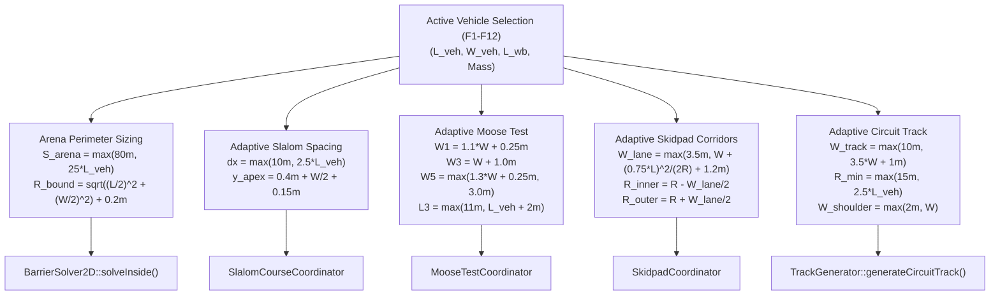

##### 4. Proving Ground State Flow Mermaid Diagram
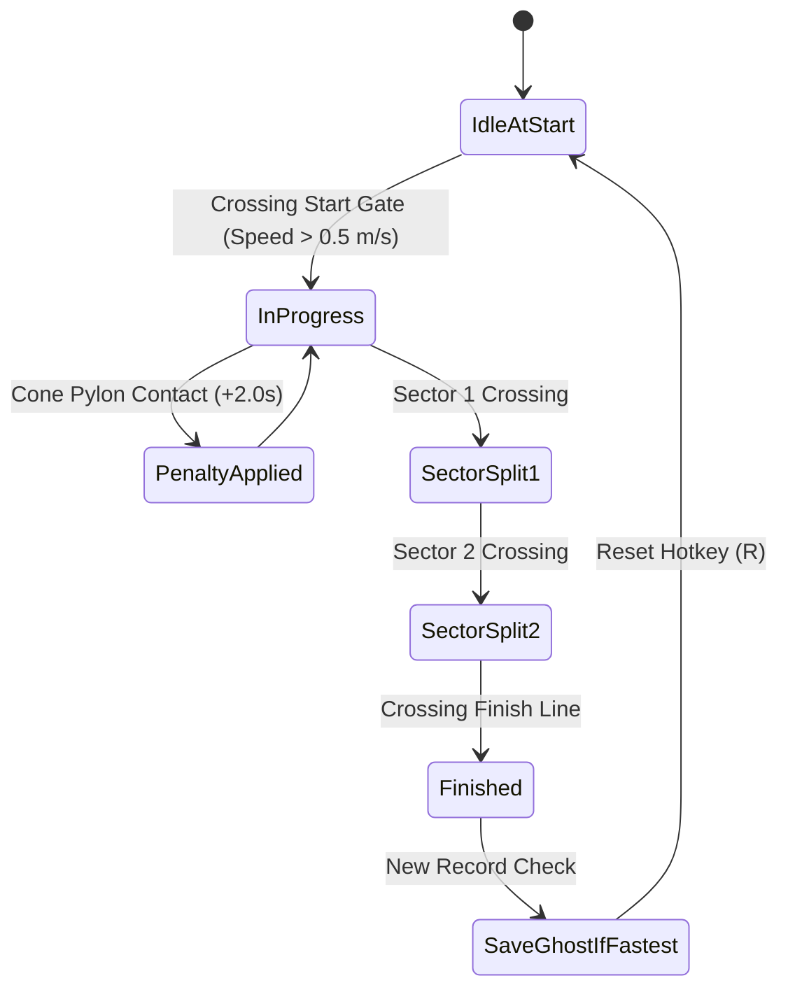

---

### 9.3 Vehicle Fleet Expansion

The fleet expands from the initial 6 vehicles to 12 distinct mechanical disciplines by integrating the existing models from [`libs/VehicleSimCore/dynamics`](../libs/VehicleSimCore/dynamics) (see dedicated [Vehicle Fleet Expansion Implementation Plan](MotionLabFleetExpansionImplementationPlan.md)).

#### 9.3.1 Extended Fleet Specifications

| Vehicle Model | Physics Class | Dimensions ($L \times W$) | Mass & Inertia | Signature Dynamics Features | Hotkey |
| :--- | :--- | :--- | :--- | :--- | :--- |
| **Classic Car** | [`MotionLabCarDynamics`](../libs/VehicleSimCore/dynamics/MotionLabCarDynamics.h) | $4.0\,\text{m} \times 2.0\,\text{m}$ | $1000\,\text{kg}$, $1667\,\text{kg}\cdot\text{m}^2$ | Pat Kerr 1996 decomposed tire slip, handbrake decay | `F1` |
| **Race Car** | [`RaceCarDynamics`](../libs/VehicleSimCore/dynamics/RaceCarDynamics.h) | $4.5\,\text{m} \times 1.8\,\text{m}$ | $750\,\text{kg}$, $1100\,\text{kg}\cdot\text{m}^2$ | Downforce aero, Drag Reduction System (DRS), slick grip | `F2` |
| **Space Rocket**| [`RocketDynamics`](../libs/VehicleSimCore/dynamics/RocketDynamics.h) | $6.0\,\text{m} \times 1.6\,\text{m}$ | $1200\,\text{kg}$, $3600\,\text{kg}\cdot\text{m}^2$ | Gimbaled vector thrust, RCS attitude thrusters, fuel mass | `F3` |
| **Helicopter** | [`HelicopterDynamics`](../libs/VehicleSimCore/dynamics/HelicopterDynamics.h) | $6.0\,\text{m} \times 2.4\,\text{m}$ | $1500\,\text{kg}$, $4800\,\text{kg}\cdot\text{m}^2$ | Main rotor collective, tail rotor yaw, ground effect | `F4` |
| **Hovercraft** | [`HovercraftDynamics`](../libs/VehicleSimCore/dynamics/HovercraftDynamics.h) | $4.0\,\text{m} \times 2.2\,\text{m}$ | $850\,\text{kg}$, $2084\,\text{kg}\cdot\text{m}^2$ | Air cushion, zero surface friction, vectored thrust rudder | `F5` |
| **Tracked Tank**| [`TrackedTankDynamics`](../libs/VehicleSimCore/dynamics/TrackedTankDynamics.h) | $5.0\,\text{m} \times 2.4\,\text{m}$ | $12000\,\text{kg}$, $30000\,\text{kg}\cdot\text{m}^2$ | Dual differential track steering, turret rotation, cannon recoil | `F6` |
| **Anti-Gravity**| [`AntiGravityRacerDynamics`](../libs/VehicleSimCore/dynamics/AntiGravityRacerDynamics.h)| $4.2\,\text{m} \times 1.9\,\text{m}$ | $600\,\text{kg}$, $950\,\text{kg}\cdot\text{m}^2$ | Repulsor altitude hover, left/right airbrakes, pitch bobbing | `F7` |
| **Drift Car** | [`DriftCarDynamics`](../libs/VehicleSimCore/dynamics/DriftCarDynamics.h) | $4.4\,\text{m} \times 1.85\,\text{m}$| $1150\,\text{kg}$, $1800\,\text{kg}\cdot\text{m}^2$ | Clutch-kick initiation, high steering lock ($65^\circ$), drift angle gauge | `F8` |
| **Monster Truck**| [`MonsterCarDynamics`](../libs/VehicleSimCore/dynamics/MonsterCarDynamics.h) | $5.2\,\text{m} \times 3.0\,\text{m}$ | $4500\,\text{kg}$, $12000\,\text{kg}\cdot\text{m}^2$ | 4-wheel independent steering, huge bouncy tires, long travel | `F9` |
| **Semi-Truck** | [`ArticulatedTruckDynamics`](../libs/VehicleSimCore/dynamics/ArticulatedTruckDynamics.h)| $12.0\,\text{m} \times 2.5\,\text{m}$| $16000\,\text{kg}$, $52000\,\text{kg}\cdot\text{m}^2$ | Tractor cab + semi-trailer, 5th-wheel hitch joint, jackknife angle | `F10` |
| **Forklift** | [`ForkliftDynamics`](../libs/VehicleSimCore/dynamics/ForkliftDynamics.h) | $2.8\,\text{m} \times 1.3\,\text{m}$ | $3200\,\text{kg}$, $4200\,\text{kg}\cdot\text{m}^2$ | Rear-wheel steering pivot, mast raise/lower, high center of mass | `F11` |
| **Drone (UAV)** | [`QuadcopterDroneDynamics`](../libs/VehicleSimCore/dynamics/QuadcopterDroneDynamics.h)| $1.2\,\text{m} \times 1.2\,\text{m}$ | $12\,\text{kg}$, $8.5\,\text{kg}\cdot\text{m}^2$ | 4 quad rotors, differential thrust pitch/roll, acrobatic tilt | `F12` |

#### 9.3.2 Vehicle Controls ASCII Diagram

```
+---------------------------------------------------------------------------------------------------+
|                                   Vehicle Control Dispatch                                         |
+---------------------------------------------------------------------------------------------------+
|  Standard Cars / Trucks:        Anti-Gravity Racer:               Helicopter / Quadcopter:        |
|    W / Up    : Throttle           W : Main Thrust                   W : Collective Up / Lift      |
|    S / Down  : Brake / Reverse    S : Reverse Thruster              S : Collective Down           |
|    A / Left  : Steer Left         A / D : Yaw Left / Right          A / D : Cyclic Tilt           |
|    D / Right : Steer Right        Q / E : Left / Right Airbrake     Space : Altitude Hold Toggle  |
|    Space     : Handbrake          Space : Boost Thruster                                          |
+---------------------------------------------------------------------------------------------------+
```

#### 9.3.3 Dynamics Step Dispatch Mermaid Diagram

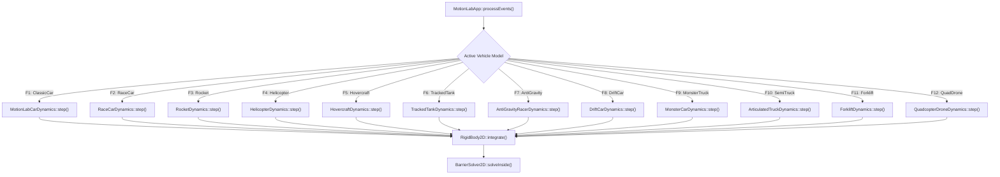

---

### 9.4 Advanced Telemetry HUD & Engineering Analytics

The telemetry HUD is expanded from basic numeric text into a professional automotive telemetry suite (see dedicated [Advanced Telemetry HUD & Engineering Analytics Implementation Plan](MotionLabTelemetryHudImplementationPlan.md)).

#### 9.4.1 Analytical Components

1. **Friction Circle ($G$-$G$ Diagram)**:
   - Polar coordinate plot in HUD corner showing instantaneous acceleration vector:
     $$\mathbf{a} = (a_x, a_y) = \left(\frac{F_{\text{long}}}{m}, \frac{F_{\text{lat}}}{m}\right)$$
   - Displays normalized traction limit circle:
     $$\left(\frac{a_x}{\mu_x g}\right)^2 + \left(\frac{a_y}{\mu_y g}\right)^2 \le 1.0$$
   - Color shifts from neon green ($< 70\%$ traction) to bright amber ($70\% - 95\%$) to red ($> 95\%$, skidding/loss of grip).
2. **4-Corner Weight Transfer Visualizer**:
   - Computes dynamic load shift during longitudinal and lateral acceleration:
     $$F_{z,\text{front}} = \frac{m g \cdot b - m a_x \cdot h}{L}, \quad F_{z,\text{rear}} = \frac{m g \cdot a + m a_x \cdot h}{L}$$
     $$\Delta F_{z,\text{lat}} = \frac{m a_y \cdot h}{t_w}$$
   - Four vertical bar graphs representing Front-Left, Front-Right, Rear-Left, and Rear-Right wheel loads.
3. **Live Oscilloscope Strip Charts**:
   - Rolling 200-sample graphical plots in the HUD for:
     - Speed ($\text{m/s}$ and $\text{mph}$).
     - Front vs Rear Tire Slip Angles ($\alpha_f, \alpha_r$).
     - Yaw rate ($\dot{\psi}$ in $\text{deg/s}$).
     - Engine RPM / Throttle percentage.
4. **CSV & KLV Telemetry Exporters**:
   - Pressing `F9` or `Ctrl+E` starts/stops recording simulation frames directly to disk using [`CsvTelemetryExporter`](../libs/VehicleSimCore/telemetry/CsvTelemetryExporter.h).
   - Timestamped output files written to `telemetry_run_YYYYMMDD_HHMMSS.csv` for post-run analysis.

#### 9.4.2 Telemetry HUD Visual Layout ASCII Diagram

```
+---------------------------------------------------------------------------------------------------+
| SPEED: 48.2 m/s (107.8 mph)   YAW: +0.12 rad/s   FPS: 60.0   DT: 8.33 ms   SURFACE: TARMAC (1.00) |
| VEHICLE: DRIFT CAR [F8]       DRIFT ANGLE: 28.5 deg   DRIFT SCORE: 14,280   RECORDING: [REC: 42s] |
+---------------------------------------------------------------------------------------------------+
|  [G-G FRICTION CIRCLE]            [WEIGHT TRANSFER]            [LIVE OSCILLOSCOPE (SPEED)]        |
|           +ay (Lateral L)          FL: [||||||||  ] FR: [||||]  60|       /----\                  |
|               |                    RL: [||||||||||] RR: [||  ]  40|  /---/      \---/             |
|        .-----.|-----.                                           20| /                             |
|       /       |      \            [INPUTS]                       0+-----------------              |
| -ax --+-------*------+-- +ax       [W: THR] [S: BRK]           [LIVE OSCILLOSCOPE (SLIP ANGLE)]   |
| (Brake\       |      /  (Accel)    [A: LFT] [D: RGT]            30|      /----\                   |
|        '-----'|-----'              [SPACE: HANDBRAKE]            0+-----/------\-----             |
|               |                                                -30|                               |
|           -ay (Lateral R)                                                                         |
+---------------------------------------------------------------------------------------------------+
```

#### 9.4.3 Telemetry Data Flow Mermaid Diagram

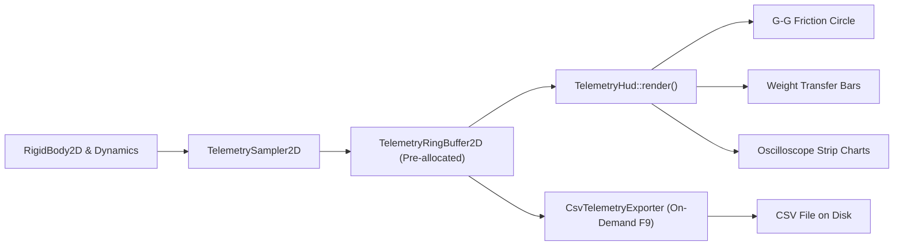

---

### 9.5 Lap Timing, Sector Splits & Ghost Car Playback

#### 9.5.1 System Functionality

1. **Gate Trigger System**:
   - Thin wireframe oriented lines spanning the track: Start/Finish Gate, Sector 1 Gate, Sector 2 Gate.
   - When the chassis center crosses a gate line segment, the system triggers the split time calculation.
2. **Ghost Car Recording & Playback**:
   - Uses [`TrajectoryTracker2D`](../libs/VehicleSimCore/dynamics/TrajectoryTracker2D.h) to record poses $(x, y, \theta, v)$ at $120\,\text{Hz}$.
   - Upon completing a lap faster than `mBestLapTime`, the recorded trajectory buffer becomes the active ghost.
   - The ghost is rendered as a semi-transparent, pulsing cyan wireframe car driving synchronously with the player.
3. **Instant Replay / 10-Second Rewind**:
   - Fixed pre-allocated ring buffer holding the most recent 1200 physics frames ($10.0\,\text{s}$ at $120\,\text{Hz}$).
   - Pressing `Backspace` rewinds simulation time backward; releasing resumes interactive driving seamlessly.

#### 9.5.2 Replay Ring Buffer ASCII Diagram

```
+---------------------------------------------------------------------------------------------------+
|                                 1200-Frame Fixed Replay Ring Buffer                               |
+---------------------------------------------------------------------------------------------------+
|  [0] | [1] | [2] | ... | [k-2] | [k-1] | [k: Current Frame] | [k+1: Oldest] | ... | [1199]        |
|                                                  ^                                                |
|                                       Write Head advances at 120 Hz                               |
|                                                                                                   |
|  Normal Mode  : Advance write head, overwrite oldest frame (Zero dynamic allocations)             |
|  Rewind Mode  : Decrement read head, restore RigidBody2D state, reverse particle/skid clocks      |
+---------------------------------------------------------------------------------------------------+
```

#### 9.5.3 Ghost Replay State Machine Mermaid Diagram

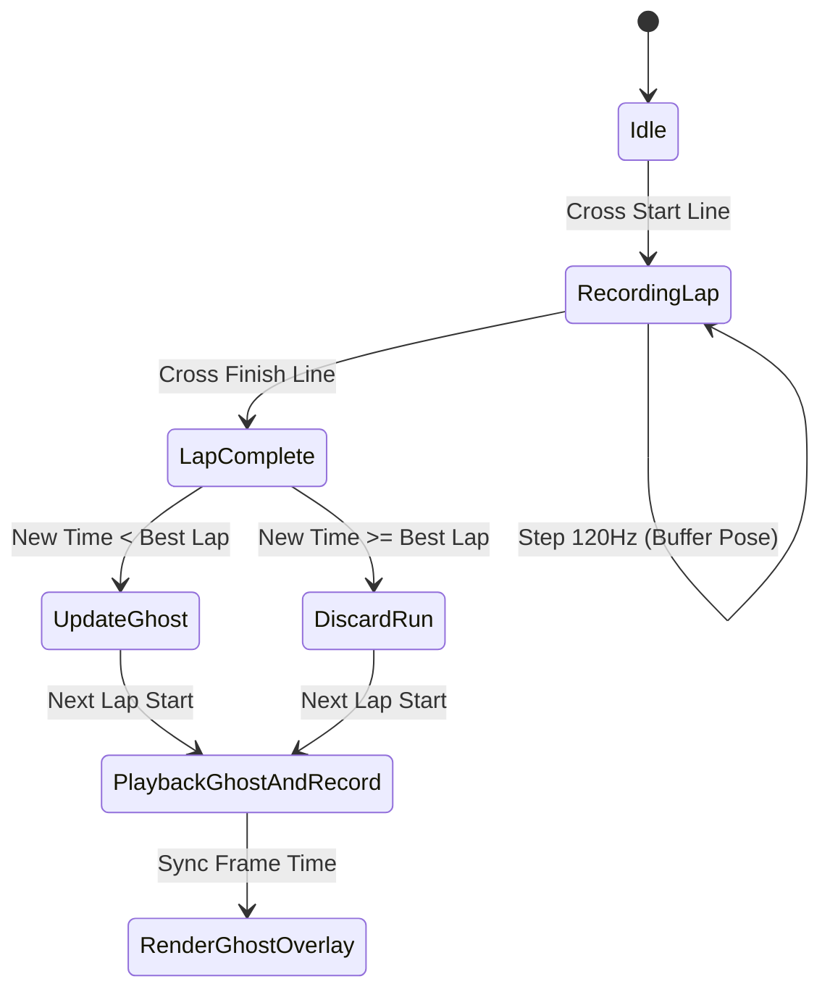

---

### 9.6 Environmental Physics & Simulation Controls

#### 9.6.1 Features & Physical Formulations

1. **Variable Time Scale**:
   - Hotkeys `[` (slow down) and `]` (speed up) adjust simulation time scaling factor $\lambda \in \{0.1, 0.25, 0.5, 1.0, 2.0, 4.0\}$.
   - Maintains fixed physics timestep $\Delta t = 8.333\,\text{ms}$ while altering accumulator advancement, preserving exact determinism.
2. **Dynamic Wind & Turbulence Vector** (see dedicated [Dynamic Wind & Turbulence Vector Implementation Plan](MotionLabDynamicWindImplementationPlan.md)):
   - Ambient wind vector $\mathbf{v}_{\text{wind}} = (w_x, w_y) + \mathbf{w}_{\text{gust}}(t)$ where gusts are modeled using Perlin noise from [`FractalNoise`](../libs/VehicleSimCore/terrain/FractalNoise.h).
   - Aerodynamic drag and downforce act on relative velocity:
     $$\mathbf{v}_{\text{rel}} = \mathbf{v}_{\text{body}} - \mathbf{v}_{\text{wind}}$$
     $$\mathbf{F}_{\text{aero}} = -\frac{1}{2} \rho C_d A \|\mathbf{v}_{\text{rel}}\| \mathbf{v}_{\text{rel}}$$
   - Light vehicles (Rocket, Helicopter, Hovercraft, Drone) visibly drift with crosswinds.
3. **Tire Thermal Model** (see dedicated [Tire Thermal Model Implementation Plan](MotionLabTireThermalImplementationPlan.md)):
   - Frictional energy dissipation increases tire surface temperature $T_{\text{tire}}$:
     $$\frac{dT_{\text{tire}}}{dt} = k_{\text{heat}} \cdot \|\mathbf{v}_{\text{slip}}\| \cdot \|\mathbf{F}_{\text{tire}}\| - k_{\text{cool}} (T_{\text{tire}} - T_{\text{ambient}})$$
   - Optimum grip peaks at $T \approx 85^\circ\text{C}$; overheating ($> 120^\circ\text{C}$) reduces friction by up to $35\%$, producing visual blue smoke particles.

#### 9.6.2 Environmental Physics ASCII Diagram

```
+---------------------------------------------------------------------------------------------------+
|                                  Environmental Vector Interaction                                 |
+---------------------------------------------------------------------------------------------------+
|                                                                                                   |
|                       Wind Vector w = (wx, wy) + Gust(t)                                          |
|                       =======>   =======>   =======>                                              |
|                                                                                                   |
|                     +-----------------------------+                                               |
|                     |     Vehicle RigidBody2D     |                                               |
|      v_body ======> |                             | ------> Resultant v_rel = v_body - w          |
|                     +-----------------------------+                                               |
|                               |                                                                   |
|                               v Tire Slip Friction Heat Dissipation                               |
|                     [T_tire = 92 deg C: Peak Grip] (Heat Up during Power Drift)                   |
|                                                                                                   |
+---------------------------------------------------------------------------------------------------+
```

#### 9.6.3 Environmental Pipeline Mermaid Diagram

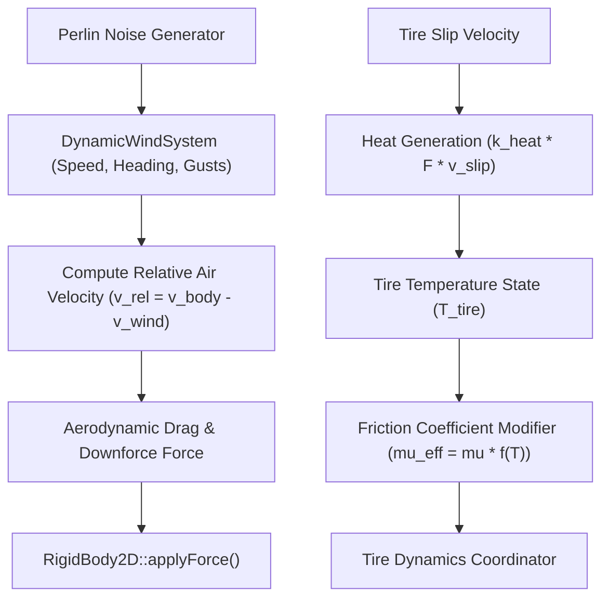

---

### 9.7 Procedural Retro Audio Synthesis

Motion Lab adheres to the zero-external-dependency rule by synthesizing retro audio waves via SDL2 audio callbacks (leveraging the audio synthesis architecture established in [`apps/EarthPatrol/AudioSystem.h`](../apps/EarthPatrol/AudioSystem.h); see dedicated [Synthesized Sound Channels Implementation Plan](MotionLabSoundChannelsImplementationPlan.md)).

#### 9.7.1 Synthesized Sound Channels

1. **Engine Combustion Synthesizer**:
   - Pitched sawtooth wave with variable frequency $f = f_{\text{idle}} + k_{\text{rpm}} \cdot \text{RPM}$.
   - Modulated low-pass filter opening under full throttle.
2. **Tire Squeal & Slip Noise**:
   - Band-pass filtered white noise generator whose amplitude scales proportionally with total tire scrub velocity:
     $$A_{\text{squeal}} = \text{clamp}\left(\frac{\|\mathbf{v}_{\text{slip}}\|}{v_{\text{slip,max}}}, 0.0, 1.0\right)$$
3. **Helicopter / Drone Rotor Chopping**:
   - Low-frequency square/sine amplitude modulation creating rhythmic rotor blade chop sounds.
4. **Rocket / Hovercraft Thruster Roar**:
   - Deep pink noise with exponential resonance filter.
5. **Impact Clangs**:
   - Damped metal sine ping triggered on [`BarrierSolver2D`](../libs/VehicleSimCore/physics/BarrierSolver2D.h) contact impulse magnitude.

#### 9.7.2 Audio Synthesis Pipeline ASCII Diagram

```
+---------------------------------------------------------------------------------------------------+
|                                 Procedural Audio Synthesis Graph                                  |
+---------------------------------------------------------------------------------------------------+
|                                                                                                   |
|  [RPM / Throttle]  ------>  Sawtooth Oscillator  ---\                                             |
|                                                      \                                            |
|  [Tire Slip Vel]   ------>  Bandpass White Noise  ----+----> Summer Buffer ----> SDL2 Audio Out   |
|                                                      /       (44.1 kHz, 16-bit)  (Headphones/Spk) |
|  [Barrier Impulse] ------>  Damped Sine Ping     ---/                                             |
|                                                                                                   |
+---------------------------------------------------------------------------------------------------+
```

#### 9.7.3 Audio Pipeline Mermaid Diagram

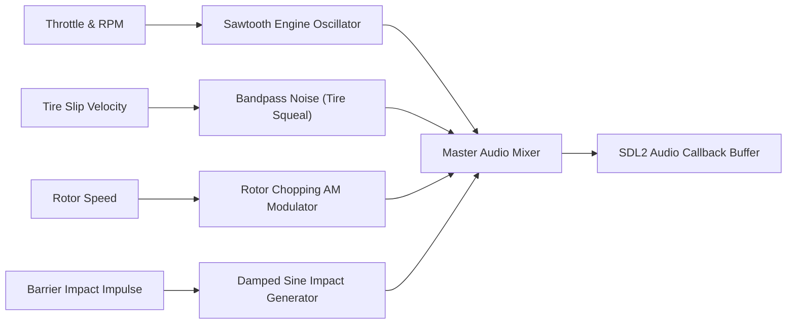

---

### 9.8 Interactive Physics Sandbox & Mouse Tools

#### 9.8.1 Sandbox Capabilities

1. **Elastic Spring-Tether Tool**:
   - Clicking and holding Left Mouse Button creates an elastic tether between mouse world coordinates $\mathbf{x}_{\text{mouse}}$ and the nearest chassis anchor $\mathbf{x}_{\text{anchor}}$.
   - Renders a spring line whose tension force obeys Hooke's law:
     $$\mathbf{F}_{\text{tether}} = -k_{\text{spring}} (\mathbf{x}_{\text{anchor}} - \mathbf{x}_{\text{mouse}}) - c_{\text{damp}} \mathbf{v}_{\text{anchor}}$$
2. **Dynamic Pylon Dropper**:
   - Right-clicking places interactive wireframe obstacle pylons or traffic cones under the cursor.
   - Pylons have mass $m_{\text{pylon}} = 5.0\,\text{kg}$ and collide dynamically with vehicles via [`BarrierSolver2D`](../libs/VehicleSimCore/physics/BarrierSolver2D.h).
3. **Middle Click Impulse Cannon**:
   - Middle-click launches a high-velocity physical probe ball towards the cursor to test vehicle collision stability.

#### 9.8.2 Mouse Tether ASCII Diagram

```
+---------------------------------------------------------------------------------------------------+
|                                    Elastic Mouse Spring Tether                                    |
+---------------------------------------------------------------------------------------------------+
|                                                                                                   |
|              (x_mouse, y_mouse)                                                                   |
|                     * [Mouse Cursor]                                                              |
|                      \                                                                            |
|                       \  Spring Force Vector F = -k * (x_anchor - x_mouse)                        |
|                        \ (Rendered as glowing cyan vector line)                                   |
|                         \                                                                         |
|                          + [Anchor Point]                                                         |
|                     +----+------------------------+                                               |
|                     |      Vehicle Chassis        |                                               |
|                     +-----------------------------+                                               |
|                                                                                                   |
+---------------------------------------------------------------------------------------------------+
```

#### 9.8.3 Mouse Tool Interaction Mermaid Diagram

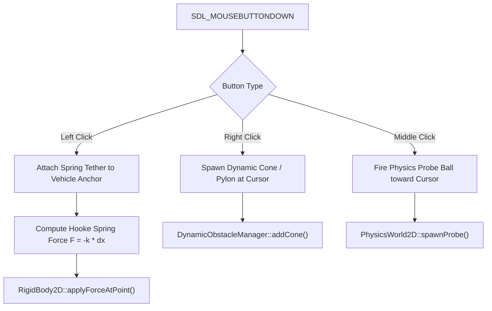

---

### 9.9 Software Architecture & Class Decomposition

All new classes strictly adhere to MISRA C++:2023, zero heap allocations on ticks, function names strictly less than 30 characters, relative paths, and full Doxygen documentation.

#### 9.9.1 Proving Ground Manager ([`ProvingGroundManager.h`](../apps/MotionLab/ProvingGroundManager.h))

```cpp
#pragma once

#include <vector>
#include <string_view>
#include "libs/VehicleSimCore/math/Vec2.h"
#include "libs/VehicleSimCore/physics/RigidBody2D.h"

namespace motion_lab {

/// @enum CourseType
/// @brief Available proving ground test course presets.
enum class CourseType {
    OpenField,    ///< Default open grid with optional perimeter walls.
    Slalom100m,   ///< 10-cone 100-meter handling slalom.
    MooseTest,    ///< ISO 3888-2 double lane change evasion course.
    Skidpad15m,   ///< 15m radius steady-state lateral grip circle.
    Skidpad30m,   ///< 30m radius standard automotive skidpad.
    CircuitTrack  ///< Procedural closed-loop racing circuit.
};

/// @struct CoursePylon
/// @brief Pylon cone obstacle in world coordinates.
struct CoursePylon {
    vehicle_sim::math::Vec2 position { 0.0, 0.0 }; ///< World coordinates in meters.
    double radius { 0.4 };                         ///< Collision radius in meters.
    bool wasHit { false };                         ///< Collision status flag.
};

/// @class ProvingGroundManager
/// @brief Coordinates proving ground course layouts, pylon collision, and timing gates.
class ProvingGroundManager {
public:
    /// @brief Default constructor.
    ProvingGroundManager() noexcept;

    /// @brief Selects active course preset.
    /// @param[in] type Target course layout.
    void setCourse(CourseType type) noexcept;

    /// @brief Gets active course preset.
    /// @return Active CourseType.
    [[nodiscard]] CourseType getCourse() const noexcept;

    /// @brief Sets vehicle dimensions for dynamic course scaling.
    /// @param[in] length Vehicle length in meters.
    /// @param[in] width Vehicle width in meters.
    void setVehicleDims(double length, double width) noexcept;

    /// @brief Gets active arena perimeter side length.
    /// @return Span in meters.
    [[nodiscard]] double getArenaSpan() const noexcept;

    /// @brief Gets adaptive slalom pylon longitudinal separation.
    /// @return Spacing delta x in meters.
    [[nodiscard]] double getSlalomSpacing() const noexcept;

    /// @brief Gets lateral apex clipping offset for slalom course.
    /// @return Lateral apex coordinate in meters.
    [[nodiscard]] double getSlalomApexOffset() const noexcept;

    /// @brief Gets adaptive Moose Test corridor lane width.
    /// @param[in] section Corridor section index (1, 3, or 5).
    /// @return Corridor width in meters.
    [[nodiscard]] double getMooseWidth(int section) const noexcept;

    /// @brief Gets adaptive Moose Test corridor section length.
    /// @param[in] section Corridor section index (1 through 5).
    /// @return Section length in meters.
    [[nodiscard]] double getMooseLength(int section) const noexcept;

    /// @brief Gets adaptive skidpad lane corridor width.
    /// @param[in] radius Circular track centerline radius in meters.
    /// @return Lane width in meters.
    [[nodiscard]] double getSkidpadLane(double radius) const noexcept;

    /// @brief Gets adaptive procedural track drivable ribbon width.
    /// @return Ribbon width in meters.
    [[nodiscard]] double getTrackRibbonWidth() const noexcept;

    /// @brief Gets minimum allowable curve radius of curvature.
    /// @return Minimum radius in meters.
    [[nodiscard]] double getTrackMinRadius() const noexcept;

    /// @brief Checks vehicle collision against all course pylons.
    /// @param[in,out] body Target vehicle rigid body.
    void checkPylonHits(vehicle_sim::physics::RigidBody2D& body) noexcept;

    /// @brief Gets list of active pylons.
    /// @return Const reference to pylon list.
    [[nodiscard]] const std::vector<CoursePylon>& getPylons() const noexcept;

    /// @brief Resets all hit flags and timers.
    void resetCourse() noexcept;

private:
    CourseType mCourse { CourseType::OpenField };
    double mVehLength { 4.0 };
    double mVehWidth { 2.0 };
    std::vector<CoursePylon> mPylons { };
};

} // namespace motion_lab
```

#### 9.9.2 Extended Telemetry Snapshot ([`ExtendedTelemetryTypes.h`](../apps/MotionLab/ExtendedTelemetryTypes.h))

```cpp
#pragma once

#include <string>
#include "libs/VehicleSimCore/math/Vec2.h"

namespace motion_lab {

/// @struct ExtendedTelemetryData
/// @brief Deep automotive engineering telemetry snapshot.
struct ExtendedTelemetryData {
    vehicle_sim::math::Vec2 accelG { 0.0, 0.0 }; ///< Accelerometer vector in G units.
    double maxG { 1.0 };                         ///< Traction limit in G units.
    double loadFL { 2500.0 };                    ///< Front-Left tire load in Newtons.
    double loadFR { 2500.0 };                    ///< Front-Right tire load in Newtons.
    double loadRL { 2500.0 };                    ///< Rear-Left tire load in Newtons.
    double loadRR { 2500.0 };                    ///< Rear-Right tire load in Newtons.
    double frontSlipAngle { 0.0 };               ///< Front tire slip angle in degrees.
    double rearSlipAngle { 0.0 };                ///< Rear tire slip angle in degrees.
    double driftAngle { 0.0 };                   ///< Vehicle chassis drift angle in degrees.
    double tireTempC { 20.0 };                   ///< Tire surface temperature in Celsius.
    double currentLapTime { 0.0 };               ///< Current run elapsed time in seconds.
    double bestLapTime { 0.0 };                  ///< Best run time in seconds.
    double timeScale { 1.0 };                    ///< Active simulation time scale.
    bool isRecordingCsv { false };               ///< Active CSV logging indicator.
};

} // namespace motion_lab
```

#### 9.9.3 Ghost Replay Buffer ([`GhostReplayBuffer.h`](../apps/MotionLab/GhostReplayBuffer.h))

```cpp
#pragma once

#include <array>
#include <cstddef>
#include "libs/VehicleSimCore/math/Vec2.h"
#include "libs/VehicleSimCore/physics/RigidBody2D.h"

namespace motion_lab {

/// @struct GhostPose
/// @brief Historical vehicle state at a single physics step.
struct GhostPose {
    vehicle_sim::math::Vec2 position { 0.0, 0.0 };
    double orientation { 0.0 };
    double speed { 0.0 };
};

/// @class GhostReplayBuffer
/// @brief Pre-allocated 1200-frame circular rewind buffer and best-lap ghost playback.
class GhostReplayBuffer {
public:
    static constexpr std::size_t kCapacity { 1200U }; ///< 10 seconds at 120 Hz.

    /// @brief Default constructor.
    GhostReplayBuffer() noexcept = default;

    /// @brief Appends current vehicle state to rewind buffer.
    /// @param[in] body Active chassis rigid body.
    void recordFrame(const vehicle_sim::physics::RigidBody2D& body) noexcept;

    /// @brief Rewinds vehicle state by one historical frame.
    /// @param[out] body Chassis rigid body to restore.
    /// @return True if state was restored, false if at beginning of buffer.
    [[nodiscard]] bool rewindFrame(vehicle_sim::physics::RigidBody2D& body) noexcept;

    /// @brief Commits recorded run as the new fastest ghost trajectory.
    void saveFastestRun() noexcept;

    /// @brief Samples ghost pose at current elapsed lap time.
    /// @param[in] lapTime Elapsed lap time in seconds.
    /// @param[out] outPose Output interpolated ghost pose.
    /// @return True if ghost data is available.
    [[nodiscard]] bool sampleGhost(double lapTime, GhostPose& outPose) const noexcept;

    /// @brief Clears rewind and ghost buffers.
    void clear() noexcept;

private:
    std::array<GhostPose, kCapacity> mRewindBuffer {{ }};
    std::size_t mWriteIndex { 0U };
    std::size_t mCount { 0U };
};

} // namespace motion_lab
```

---

### 9.10 Phased Implementation Roadmap & Verification Matrix

#### 9.10.1 Implementation Phases

| Phase | Milestone Name | Key Deliverables | Verification Target |
| :--- | :--- | :--- | :--- |
| **Phase 5** | Proving Grounds & Slaloms | [`ProvingGroundManager`](../apps/MotionLab/ProvingGroundManager.h), Slalom, Moose Test, Skidpad rendering | Unit test `ProvingGroundManagerTest`, verify pylon hit detection & course reset |
| **Phase 6** | Fleet Expansion | Add AntiGravity, Drift, Monster, Semi, Forklift, Drone models to selector & HUD | Unit test `MotionLabExtendedFleetTest`, verify dispatch & mass properties |
| **Phase 7** | Advanced Telemetry HUD | Friction circle ($G$-$G$), 4-corner load bars, oscilloscope, CSV export hotkey | Unit test `ExtendedTelemetryTest`, verify $G$-$G$ calculation & CSV export |
| **Phase 8** | Ghost Car & Replay Rewind | [`GhostReplayBuffer`](../apps/MotionLab/GhostReplayBuffer.h), start/finish timing gates, cyan ghost renderer | Unit test `GhostReplayBufferTest`, verify rewind & determinism |
| **Phase 9** | Environmental Controls | Time scaling (`0.1x`–`4x`), wind gust vectors, tire thermal buildup model | Unit test `EnvironmentalPhysicsTest`, verify aero drift & heat dissipation |
| **Phase 10**| Procedural Retro Audio | Engine synthesizer, tire slip noise, rotor chop, thruster roar, impact clangs | Audio verification test, zero allocation callback check |
| **Phase 11**| Mouse Sandbox Tools | Spring-tether cursor drag, right-click pylon dropper, middle-click probe | Interactive test in `apps/MotionLab`, verify spring stability |

#### 9.10.2 Extended Acceptance Criteria Matrix

| Feature | Acceptance Metric | Verification Strategy |
| :--- | :--- | :--- |
| **Course Accuracy** | ISO 3888-2 corridor dimensions match ISO specification within $\pm 0.05\,\text{m}$. | Unit Test `MooseTestDimensionsTest` |
| **G-G Circle Fidelity** | Friction circle acceleration vector matches rigid-body $(\ddot{x}, \ddot{y})$ within $10^{-4}\,\text{G}$. | Unit Test `FrictionCircleMathTest` |
| **Fleet Integrity** | All 12 vehicle types cycle without memory leaks or uninitialized member states. | Valgrind / AddressSanitizer CI build |
| **CSV Telemetry Export** | Output CSV rows have valid headers, matching timestamps, and numeric IEEE 754 values. | Integration Test `CsvExporterFidelityTest` |
| **Ghost Replay Time** | Ghost playback matches recorded run trajectory within $10^{-3}\,\text{m}$ Euclidean error. | Determinism Test `GhostReplayTrajectoryTest` |
| **Time Scale Determinism**| Trajectory at $0.25\times$ speed matches $1.0\times$ speed byte-for-byte upon tick completion. | Time Scaling Test `TimeScaleDeterminismTest` |
| **Audio Thread Safety** | Audio callback performs zero dynamic heap allocations and zero lock contention. | Memory & Real-Time Sanity Test |
| **Code Hardening** | Zero compiler warnings under MSVC `/W4 /WX` and GCC/Clang `-Wall -Wextra -pedantic -Werror`. | Automated CI pipeline build |

