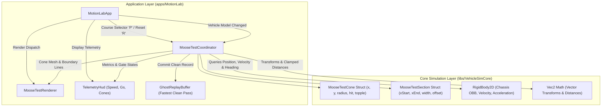
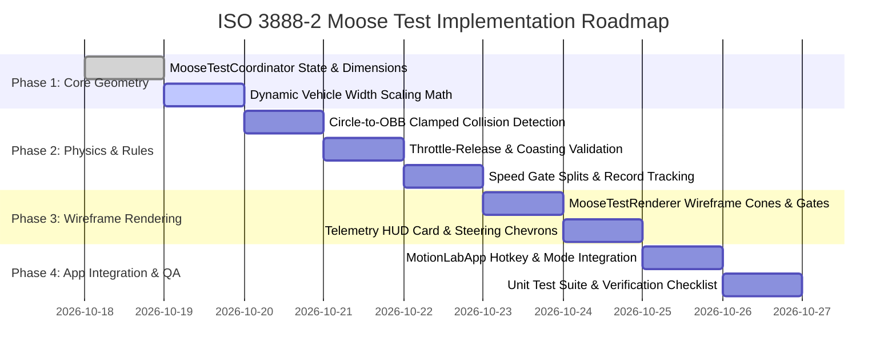

# Motion Lab: ISO 3888-2 Severe Lane-Change Maneuver ("Moose Test") Implementation Plan

## 1. Executive Summary & Objectives

### 1.1 Overview
This implementation plan specifies the complete technical design, mathematical formulation, software architecture, wireframe rendering, and verification strategy for the **ISO 3888-2 Severe Lane-Change Maneuver ("Moose Test")** in **Motion Lab 2D** (`apps/MotionLab`). Originating from the proving grounds specifications in [MotionLabImplementationPlan.md](MotionLabImplementationPlan.md#921-proving-ground-presets--mathematical-specifications), this capability introduces an internationally standardized emergency obstacle avoidance discipline conforming strictly to **ISO 3888-2:2011** (*Passenger cars — Test track for a severe lane-change manoeuvre — Part 2: Obstacle avoidance*).

The Moose Test evaluates transient directional stability, tire grip under rapid lateral load transfers, chassis roll dynamics, electronic stability intervention, and spin/rollover resistance during a severe double lane-change maneuver performed without throttle or brake inputs.

### 1.2 Core Capabilities & Deliverables
1. **Dynamic Track Geometry Scaling**: Automated procedural computation of corridor lane widths as linear functions of active vehicle width ($W_{\text{veh}}$) conforming to ISO 3888-2 specifications ($W_1 = 1.1 \cdot W_{\text{veh}} + 0.25\,\text{m}$, $W_3 = W_{\text{veh}} + 1.0\,\text{m}$, $W_5 = 1.3 \cdot W_{\text{veh}} + 0.25\,\text{m}$).
2. **Standard 5-Section Corridor Grid**: Fixed 24-pylon perimeter boundary array delineating Section 1 (Entry, $12.0\,\text{m}$), Section 2 (Lane Shift, $13.5\,\text{m}$), Section 3 (Evasion Lane, $11.0\,\text{m}$), Section 4 (Return Shift, $12.5\,\text{m}$), and Section 5 (Exit, $12.0\,\text{m}$) across an overall active length of $61.0\,\text{m}$.
3. **Automated Throttle-Release Protocol**: Rigorous validation of the ISO test protocol requiring the driver to release the throttle pedal within Section 1 before $x = 12.0\,\text{m}$ ($a_{\text{throttle}} \le 0.05$), failing runs where throttle or service brakes are applied during the evasion corridor.
4. **Sub-Millimeter Circle-to-OBB Collision Detection**: Clamped geometric intersection between vehicle chassis Oriented Bounding Box (OBB) and circular cone footprints ($R_{\text{cone}} = 0.4\,\text{m}$), applying immediate single-hit latching, penalty counts, and dynamic cone topple vectors.
5. **Speed & Stability Telemetry**: High-precision measurement of entry speed ($v_{\text{entry}}$ at $x = 0.0\,\text{m}$), apex evasion speed ($v_{\text{sec3}}$ at $x = 31.0\,\text{m}$), exit speed ($v_{\text{exit}}$ at $x = 61.0\,\text{m}$), total speed loss ($\Delta v = v_{\text{entry}} - v_{\text{exit}}$), peak lateral acceleration ($a_{y,\text{peak}}$), and yaw rate excursion ($\dot{\psi}_{\text{peak}}$).
6. **Iterative Speed Hunting & Pass/Fail Tracking**: Automated record keeping of highest clean pass speed ($v_{\text{pass,max}}$), tracking clean runs vs. cone touches vs. off-course infractions.
7. **1996 Retro Vector Presentation**: High-contrast neon orange wireframe pylon cones, fluorescent green start gate, gold finish gate, cyan lane boundary guides, red toppled collision indicators, and dedicated Moose Test HUD telemetry.
8. **Ghost Car Integration**: Direct interface to [`GhostReplayBuffer`](../apps/MotionLab/GhostReplayBuffer.h) enabling synchronized ghost replay of the fastest clean pass run.

---

## 2. High-Level Architecture & System Decomposition

### 2.1 ASCII System Architecture Diagram

```
+---------------------------------------------------------------------------------------------------+
|                        ISO 3888-2 Moose Test Architecture in Motion Lab                           |
+---------------------------------------------------------------------------------------------------+
|  [apps/MotionLab] (Desktop Application Layer)                                                     |
|                                                                                                   |
|    +--------------------+       +----------------------------+       +-----------------------+    |
|    |    MotionLabApp    |------>|    MooseTestCoordinator    |------>|     TelemetryHud      |    |
|    | ('P' Course Toggle)|       |  (Course State, Timing,    |       | (Speed, Lateral G,    |    |
|    +---------+----------+       |   Vehicle Width Scaling,   |       |  Pass/Fail, Cones)    |    |
|              |                  |   Collision Detection)     |       +-----------------------+    |
|              |                  +--------------+-------------+                                    |
|              |                                 |                                                  |
|              | Viewport Camera                 v Hit Collision & Gate Traversal                   |
|              v                          +----------------------------+                            |
|    +--------------------+               |    RigidBody2D Chassis     |                            |
|    |  MooseTestRenderer |<--------------+   (OBB Bounds, Speed,      |                            |
|    | (Wireframe Gates   |               |    Yaw Rate, Lateral Acc)  |                            |
|    |  & Pylon Cones)    |               +----------------------------+                            |
|    +--------------------+                                                                         |
+------------------------------------------------+--------------------------------------------------+
                                                 | Coordinates & Collision Queries
                                                 v
+---------------------------------------------------------------------------------------------------+
|  [libs/VehicleSimCore] (Physics, Geometry & Dynamics Layer)                                       |
|                                                                                                   |
|    +-----------------------------+         +-----------------------------+                        |
|    |       Vec2 Math Library     |-------->|        MooseTestCone        |                        |
|    |     (libs/.../math/Vec2.h)  |         | (Position, Radius, HitFlag) |                        |
|    +-----------------------------+         +--------------+--------------+                        |
|                                                           |                                       |
|                                                           v                                       |
|                                            +-----------------------------+                        |
|                                            |     ProvingGroundManager    |                        |
|                                            | (Course Presets & Registry) |                        |
|                                            +-----------------------------+                        |
+---------------------------------------------------------------------------------------------------+
```

### 2.2 Mermaid System Architecture Diagram



---

## 3. Mathematical & Physical Formulation

### 3.1 ISO 3888-2 Corridor Geometry & Section Parameterization

The ISO 3888-2 severe lane-change track comprises five continuous sections aligned along the longitudinal Cartesian $x$-axis. Longitudinal coordinates begin at $x = 0.0\,\text{m}$ at the Section 1 entrance line.

| Section Index | Designation | Longitudinal Range ($x$) | Section Length ($L$) | Lateral Centerline ($y_{\text{center}}$) | Lane Width Formula ($W$) |
| :--- | :--- | :--- | :--- | :--- | :--- |
| **Section 1** | Entry Lane | $[0.0, 12.0]\,\text{m}$ | $L_1 = 12.0\,\text{m}$ | $y = 0.0\,\text{m}$ | $W_1 = 1.1 \cdot W_{\text{veh}} + 0.25\,\text{m}$ |
| **Section 2** | Lane Shift | $[12.0, 25.5]\,\text{m}$ | $L_2 = 13.5\,\text{m}$ | Linear transition: $0.0 \to +3.5\,\text{m}$ | Open transition with boundary limit |
| **Section 3** | Evasion Lane | $[25.5, 36.5]\,\text{m}$ | $L_3 = 11.0\,\text{m}$ | $y = +3.5\,\text{m}$ (Offset $\Delta y = +3.5\,\text{m}$) | $W_3 = W_{\text{veh}} + 1.0\,\text{m}$ |
| **Section 4** | Return Shift | $[36.5, 49.0]\,\text{m}$ | $L_4 = 12.5\,\text{m}$ | Linear transition: $+3.5 \to 0.0\,\text{m}$ | Open transition with boundary limit |
| **Section 5** | Exit Lane | $[49.0, 61.0]\,\text{m}$ | $L_5 = 12.0\,\text{m}$ | $y = 0.0\,\text{m}$ | $W_5 = 1.3 \cdot W_{\text{veh}} + 0.25\,\text{m}$ (min $3.0\,\text{m}$) |

Total active corridor length:
$$L_{\text{total}} = L_1 + L_2 + L_3 + L_4 + L_5 = 12.0 + 13.5 + 11.0 + 12.5 + 12.0 = 61.0\,\text{m}$$

Staging zone: $x \in [-35.0, 0.0]\,\text{m}$, allowing the vehicle to accelerate to target entry speed before crossing the start gate.  
Run-off braking area: $x \in [61.0, 85.0]\,\text{m}$.

### 3.2 Vehicle-Dependent Dynamic Track Scaling

Unlike fixed-geometry proving ground courses, ISO 3888-2 mandates that lane widths adapt dynamically to the physical width $W_{\text{veh}}$ of the vehicle under test. When the user switches vehicle models (e.g. from the classic car to a wide semi-truck or narrow forklift), all cone coordinates and lane boundaries are immediately recomputed:

$$\begin{aligned}
W_1(W_{\text{veh}}) &= 1.1 \cdot W_{\text{veh}} + 0.25\,\text{m} \\
W_3(W_{\text{veh}}) &= W_{\text{veh}} + 1.00\,\text{m} \\
W_5(W_{\text{veh}}) &= \max(1.3 \cdot W_{\text{veh}} + 0.25\,\text{m}, \; 3.00\,\text{m})
\end{aligned}$$

#### Fleet Dimension Examples in Motion Lab

| Vehicle Model | Vehicle Width ($W_{\text{veh}}$) | Vehicle Length ($L_{\text{veh}}$) | Section 1 Width ($W_1$) | Section 3 Width ($W_3$) | Section 5 Width ($W_5$) |
| :--- | :--- | :--- | :--- | :--- | :--- |
| **Classic Car** | $2.00\,\text{m}$ | $4.00\,\text{m}$ | $2.45\,\text{m}$ | $3.00\,\text{m}$ | $3.00\,\text{m}$ |
| **Race Car** | $1.80\,\text{m}$ | $4.50\,\text{m}$ | $2.23\,\text{m}$ | $2.80\,\text{m}$ | $3.00\,\text{m}$ |
| **Forklift** | $1.30\,\text{m}$ | $2.80\,\text{m}$ | $1.68\,\text{m}$ | $2.30\,\text{m}$ | $3.00\,\text{m}$ |
| **Semi-Truck** | $2.50\,\text{m}$ | $12.00\,\text{m}$| $3.00\,\text{m}$ | $3.50\,\text{m}$ | $3.50\,\text{m}$ |
| **Monster Truck** | $3.00\,\text{m}$ | $5.20\,\text{m}$ | $3.55\,\text{m}$ | $4.00\,\text{m}$ | $4.15\,\text{m}$ |

### 3.3 ISO 3888-2 Track Layout ASCII Diagram

```
+-------------------------------------------------------------------------------------------------------------------+
|                                 ISO 3888-2 Severe Lane-Change Layout ("Moose Test")                               |
+-------------------------------------------------------------------------------------------------------------------+
|                                                                                                                   |
| y=+5.5m                                                 *=====*=====* (Section 3 Left Cones: y = 3.5m + W3/2)     |
|                                                        / Section 3  \                                             |
|                                                       /  (11.0m)     \                                            |
| y=+3.5m                                              / Center y=3.5m  \                                           |
|                                                     /                  \                                          |
| y=+1.5m                                            *=====*=====* (Section 3 Right Cones: y = 3.5m - W3/2)         |
|                                                   /                      \                                        |
| y=+1.2m          *=====*=====* (Sec 1 Left Cones)/                        \*=====*=====* (Sec 5 Left Cones)       |
|                  | Section 1 |                                             | Section 5 |                          |
| y=0.0m           | (12.0m)   |                                             | (12.0m)   |                          |
|   [ENTRY] =====> | Center y=0| ===== Transition 2 =====>                   | Center y=0| =====> [FINISH]          |
|   x = 0.0m       |           |        (13.5m)                              |           |        x = 61.0m         |
| y=-1.2m          *=====*=====* (Sec 1 Right Cones)                        *=====*=====* (Sec 5 Right Cones)      |
|                                                    \                      /                                       |
|                                                     \==== Transition 4 ==/                                        |
|                                                           (12.5m)                                                 |
|                                                                                                                   |
| Coordinates:                                                                                                      |
|  Section 1 (Entry):     x in [ 0.0m, 12.0m], Width W1 = 1.1 * Wveh + 0.25m,  Centerline y =  0.0m                 |
|  Section 2 (Shift):     x in [12.0m, 25.5m], Offset dy = +3.5m,              Transition Zone                      |
|  Section 3 (Evasion):   x in [25.5m, 36.5m], Width W3 = Wveh + 1.00m,        Centerline y = +3.5m                 |
|  Section 4 (Return):    x in [36.5m, 49.0m], Offset dy = -3.5m,              Transition Zone                      |
|  Section 5 (Exit):      x in [49.0m, 61.0m], Width W5 = 1.3 * Wveh + 0.25m,  Centerline y =  0.0m                 |
+-------------------------------------------------------------------------------------------------------------------+
```

### 3.4 Pylon Placement & Coordinate Array Formulation

To guarantee determinism, zero heap allocation, and MISRA C++:2023 compliance during runtime, the course is discretized into exactly **24 pylon cones** stored in a fixed-size `std::array<MooseTestCone, 24>`.

Cones are positioned in paired gates along the left ($+y$) and right ($-y$) boundaries of Sections 1, 3, and 5:

#### Section 1 (Entry) — 6 Cones
Longitudinal stations at $x \in \{0.0, 6.0, 12.0\}\,\text{m}$:
* Cone 0: $(x = 0.0\,\text{m}, \; y = +W_1 / 2)$
* Cone 1: $(x = 0.0\,\text{m}, \; y = -W_1 / 2)$
* Cone 2: $(x = 6.0\,\text{m}, \; y = +W_1 / 2)$
* Cone 3: $(x = 6.0\,\text{m}, \; y = -W_1 / 2)$
* Cone 4: $(x = 12.0\,\text{m}, \; y = +W_1 / 2)$
* Cone 5: $(x = 12.0\,\text{m}, \; y = -W_1 / 2)$

#### Section 2 (Lane Shift Outer Boundaries) — 2 Guide Cones
* Cone 6: $(x = 18.75\,\text{m}, \; y = -W_1 / 2)$ (prevents cutting early right turn)
* Cone 7: $(x = 25.5\,\text{m}, \; y = +3.5\,\text{m} - W_3 / 2 - 0.5\,\text{m})$ (corner pocket apex)

#### Section 3 (Evasion Corridor) — 6 Cones
Longitudinal stations at $x \in \{25.5, 31.0, 36.5\}\,\text{m}$ centered at $y = +3.5\,\text{m}$:
* Cone 8:  $(x = 25.5\,\text{m}, \; y = +3.5\,\text{m} + W_3 / 2)$
* Cone 9:  $(x = 25.5\,\text{m}, \; y = +3.5\,\text{m} - W_3 / 2)$
* Cone 10: $(x = 31.0\,\text{m}, \; y = +3.5\,\text{m} + W_3 / 2)$
* Cone 11: $(x = 31.0\,\text{m}, \; y = +3.5\,\text{m} - W_3 / 2)$
* Cone 12: $(x = 36.5\,\text{m}, \; y = +3.5\,\text{m} + W_3 / 2)$
* Cone 13: $(x = 36.5\,\text{m}, \; y = +3.5\,\text{m} - W_3 / 2)$

#### Section 4 (Return Shift Outer Boundaries) — 2 Guide Cones
* Cone 14: $(x = 36.5\,\text{m}, \; y = +3.5\,\text{m} + W_3 / 2 + 0.5\,\text{m})$ (escape apex guide)
* Cone 15: $(x = 42.75\,\text{m}, \; y = +W_5 / 2 + 0.5\,\text{m})$ (prevents cutting return corner)

#### Section 5 (Exit Lane) — 8 Cones
Longitudinal stations at $x \in \{49.0, 53.0, 57.0, 61.0\}\,\text{m}$ centered at $y = 0.0\,\text{m}$:
* Cone 16: $(x = 49.0\,\text{m}, \; y = +W_5 / 2)$
* Cone 17: $(x = 49.0\,\text{m}, \; y = -W_5 / 2)$
* Cone 18: $(x = 53.0\,\text{m}, \; y = +W_5 / 2)$
* Cone 19: $(x = 53.0\,\text{m}, \; y = -W_5 / 2)$
* Cone 20: $(x = 57.0\,\text{m}, \; y = +W_5 / 2)$
* Cone 21: $(x = 57.0\,\text{m}, \; y = -W_5 / 2)$
* Cone 22: $(x = 61.0\,\text{m}, \; y = +W_5 / 2)$
* Cone 23: $(x = 61.0\,\text{m}, \; y = -W_5 / 2)$

Total Cone Count: $N_{\text{cones}} = 24$.

### 3.5 Chassis OBB-to-Cone Circle Clamped Collision Model

The physical vehicle chassis is represented by an Oriented Bounding Box (OBB) defined by center $\mathbf{x}_{\text{veh}} = (x_{\text{veh}}, y_{\text{veh}})$, heading angle $\theta$, half-length $h_x = L_{\text{veh}} / 2$, and half-width $h_y = W_{\text{veh}} / 2$.

Each pylon obstacle is modeled as a circular base footprint with radius $R_{\text{cone}} = 0.4\,\text{m}$ centered at $\mathbf{p}_k = (p_{x,k}, p_{y,k})$.

```
      +-----------------------------------------+
      |               VEHICLE OBB               |
      |   (-hx, +hy)               (+hx, +hy)   |
      |        +-----------------------+        |
      |        |                       |        |  (Cone Footprint)
      |        |           x (Center)  |        |     /=====\
      |        |                       |        |    |   *   | R = 0.4m
      |        +-----------------------+        |     \=====/
      |   (-hx, -hy)               (+hx, -hy)   |  pk (Cone Center)
      +-----------------------------------------+
```

#### Collision Detection Algorithm
For each cone $k \in \{0, 1, \dots, 23\}$:
1. Compute relative displacement vector in world frame:
   $$\Delta \mathbf{p} = \mathbf{p}_k - \mathbf{x}_{\text{veh}}$$
2. Project displacement into the vehicle body coordinate frame using unit heading vectors $\mathbf{u}_{\text{long}} = (\cos\theta, \sin\theta)$ and $\mathbf{u}_{\text{lat}} = (-\sin\theta, \cos\theta)$:
   $$x_{\text{local}} = \Delta \mathbf{p} \cdot \mathbf{u}_{\text{long}}, \quad y_{\text{local}} = \Delta \mathbf{p} \cdot \mathbf{u}_{\text{lat}}$$
3. Clamp local coordinates to the vehicle half-extents:
   $$x_{\text{clamp}} = \operatorname{clamp}(x_{\text{local}}, -h_x, +h_x), \quad y_{\text{clamp}} = \operatorname{clamp}(y_{\text{local}}, -h_y, +h_y)$$
4. Compute minimum squared Euclidean distance from the cone center to the vehicle boundary:
   $$d_{\text{min}}^2 = (x_{\text{local}} - x_{\text{clamp}})^2 + (y_{\text{local}} - y_{\text{clamp}})^2$$
5. Collision condition:
   $$\text{Hit}_k \iff d_{\text{min}}^2 \le R_{\text{cone}}^2$$

#### Single-Hit Latching & Topple Physics
When contact occurs with cone $k$ for the first time ($\text{wasHit}_k = \text{false}$):
1. Latch contact flag: $\text{wasHit}_k \leftarrow \text{true}$.
2. Increment hit counter: $N_{\text{hits}} \leftarrow N_{\text{hits}} + 1$.
3. Assign topple direction aligned with the instantaneous vehicle velocity vector:
   $$\mathbf{d}_{\text{topple}, k} = \frac{\mathbf{v}_{\text{veh}}}{\max(\|\mathbf{v}_{\text{veh}}\|, 0.1\,\text{m/s})}$$
4. Animate topple tilt angle: $\theta_{\text{topple}, k} \leftarrow \pi / 2$.
5. Transition course run status: If $N_{\text{hits}} > 0$, mark current run as **FAILED (CONE CONTACT)**.

### 3.6 ISO Test Protocol: Throttle-Release / Coasting Validation

ISO 3888-2 explicitly mandates that the severe lane-change maneuver must be performed in **coasting mode (closed throttle, zero service brake)**:
* **Throttle Cut**: The driver must release the accelerator pedal within Section 1 before reaching the end of the section ($x = 12.0\,\text{m}$).
* **No Brake Intervention**: The driver must not apply service brakes during the maneuver (braking torque or deceleration demand must be zero).
* **Fault Evaluation**:
  $$\text{ThrottleFault} \iff (x_{\text{veh}} \in [12.0, 61.0]\,\text{m}) \land (u_{\text{throttle}} > 0.05)$$
  $$\text{BrakeFault} \iff (x_{\text{veh}} \in [0.0, 61.0]\,\text{m}) \land (u_{\text{brake}} > 0.05)$$
If either fault condition triggers, the coordinator flags the run as **DISQUALIFIED (THROTTLE/BRAKE VIOLATION)** on the HUD.

### 3.7 Dynamic Metrics: Peak Lateral Acceleration, Speed Drop & Stability

During execution, the coordinator samples vehicle dynamics at every physics tick ($120\,\text{Hz}$):

1. **Entry Speed**: Measured exactly as vehicle front bumper intersects $x = 0.0\,\text{m}$:
   $$v_{\text{entry}} = \|\mathbf{v}_{\text{veh}}(t_{\text{start}})\| \quad [\text{km/h}]$$
2. **Evasion Speed**: Measured as vehicle center passes midpoint of Section 3 ($x = 31.0\,\text{m}$):
   $$v_{\text{evasion}} = \|\mathbf{v}_{\text{veh}}(t_{\text{mid}})\| \quad [\text{km/h}]$$
3. **Exit Speed**: Measured as vehicle rear bumper clears Section 5 ($x = 61.0\,\text{m}$):
   $$v_{\text{exit}} = \|\mathbf{v}_{\text{veh}}(t_{\text{finish}})\| \quad [\text{km/h}]$$
4. **Total Speed Loss ($\Delta v$)**:
   $$\Delta v = v_{\text{entry}} - v_{\text{exit}} \quad [\text{km/h}]$$
   (Indicates tire scrub and active yaw stability energy dissipation).
5. **Peak Lateral Acceleration ($a_{y,\text{peak}}$)**:
   $$a_{y,\text{peak}} = \max_{t \in [t_{\text{start}}, t_{\text{finish}}]} |a_y(t)| = \max |v_x \cdot \dot{\psi}| \quad [g]$$
6. **Peak Yaw Rate ($\dot{\psi}_{\text{peak}}$)**:
   $$\dot{\psi}_{\text{peak}} = \max_{t \in [t_{\text{start}}, t_{\text{finish}}]} |\omega_z(t)| \quad [\text{deg/s}]$$
7. **Spin-Out / Rollover Threshold**:
   A spin-out is registered if vehicle heading deviates from corridor axis by more than $90^\circ$ ($|\theta| > \pi / 2$) or if angular velocity exceeds safety limit $|\omega_z| > 5.0\,\text{rad/s}$ ($286\,\text{deg/s}$).

### 3.8 Success / Failure Criteria & Max Pass Speed Hunting

A run is classified under one of four distinct outcome states:

1. **CLEAN PASS**:
   - $x_{\text{veh}} \ge 61.0\,\text{m}$ (cleared Section 5 exit line).
   - $N_{\text{hits}} == 0$ (zero cone contacts).
   - $\text{ThrottleFault} == \text{false}$ and $\text{BrakeFault} == \text{false}$.
   - No spin-out ($|\theta| \le \pi / 2$ throughout).
   - **Result**: If $v_{\text{entry}} > v_{\text{pass,max}}$, update all-time highest pass speed $v_{\text{pass,max}} \leftarrow v_{\text{entry}}$ and commit run trajectory to [`GhostReplayBuffer`](../apps/MotionLab/GhostReplayBuffer.h).
2. **FAILED — CONE CONTACT**: Vehicle completed or traversed course but struck one or more pylons ($N_{\text{hits}} \ge 1$).
3. **FAILED — OFF-COURSE / SPIN**: Vehicle spun out ($|\theta| > \pi / 2$) or exited lateral boundary without completing gates.
4. **DISQUALIFIED — THROTTLE/BRAKE**: Driver applied accelerator or service brake while in active evasion corridor ($x > 12.0\,\text{m}$).

---

## 4. Execution Flow & State Machine

### 4.1 Moose Test State Machine Mermaid Diagram

```mermaid
stateDiagram-v2
    [*] --> IdleAtStaging: Course Selected / Reset (R)

    state IdleAtStaging {
        [*] --> WaitingAtStaging
        WaitingAtStaging --> ApproachArmed: Vehicle Accelerating Towards Line (v > 5.0 km/h)
    }

    IdleAtStaging --> Section1Entry: Front Bumper Crosses x = 0.0m (Capture vEntry)

    state InManeuver {
        [*] --> Section1Entry
        Section1Entry --> ThrottleCheck: Crossing x in [0m, 12m]
        ThrottleCheck --> Section2Shift: Cross x = 12.0m (Lane Shift Left)
        Section2Shift --> Section3Evasion: Cross x = 25.5m (Offset +3.5m)
        Section3Evasion --> MidpointSpeed: Cross x = 31.0m (Capture vEvasion)
        MidpointSpeed --> Section4Return: Cross x = 36.5m (Lane Shift Right)
        Section4Return --> Section5Exit: Cross x = 49.0m (Align Exit Lane)

        Section1Entry --> ConeCollision: OBB Touches Pylon
        Section2Shift --> ConeCollision: OBB Touches Pylon
        Section3Evasion --> ConeCollision: OBB Touches Pylon
        Section4Return --> ConeCollision: OBB Touches Pylon
        Section5Exit --> ConeCollision: OBB Touches Pylon

        ConeCollision --> MarkFailed: Latch wasHit, Increment Hits
        MarkFailed --> InManeuver

        Section2Shift --> Disqualified: Throttle / Brake Active
        Section3Evasion --> Disqualified: Throttle / Brake Active
        Section4Return --> Disqualified: Throttle / Brake Active
    }

    InManeuver --> Completed: Rear Bumper Clears x = 61.0m (Capture vExit)

    state Completed {
        [*] --> EvaluateOutcome
        EvaluateOutcome --> CleanPass: Hits == 0 && No Faults
        EvaluateOutcome --> FailedRun: Hits > 0 || Faults
        CleanPass --> CheckRecord: vEntry > BestPassSpeed
        CheckRecord --> SaveGhost: New Max Pass Speed Record
        CheckRecord --> DisplayResult: Not Fastest
        SaveGhost --> DisplayResult
        FailedRun --> DisplayResult
    }

    Completed --> IdleAtStaging: Reset Hotkey (R)
    InManeuver --> IdleAtStaging: Reset Hotkey (R)
```

### 4.2 Run Phase & Speed Telemetry Sequence ASCII Diagram

```
+---------------------------------------------------------------------------------------------------+
|                              Moose Test Run Phase & Speed Sequence                                |
+---------------------------------------------------------------------------------------------------+
|                                                                                                   |
| Longitudinal Station      Action / Event                   Physics Check       HUD Status         |
| --------------------      --------------                   -------------       ----------         |
| x = -30.0m                Staged at origin                 Standstill / Accel  "READY: ACCEL TO"  |
|                                                                                "TARGET 72 km/h"   |
| x = 0.0m (Start Line)     Enter Section 1                  Record v_entry      "TEST ACTIVE"      |
|                           Throttle must be released!                           "RELEASE THROTTLE" |
| x = 12.0m (Exit Sec 1)    Enter Section 2 (Shift Left)     Throttle == 0 check "COASTING - EVADE" |
| x = 25.5m (Entry Sec 3)   Enter Evasion Corridor (y=+3.5m) Peak G evaluation   "HOLD APEX LANE"   |
| x = 31.0m (Apex Midpoint) Midpoint Timing Gate             Record v_evasion    "APEX V: 64.2 km/h"|
| x = 36.5m (Exit Sec 3)    Enter Section 4 (Shift Right)    Yaw rate damping    "RETURN TO LANE"   |
| x = 49.0m (Entry Sec 5)   Enter Section 5 (Exit Lane)      Counter-steer check "STABILIZE"        |
| x = 61.0m (Finish Line)   Clear Exit Corridor              Record v_exit       "CLEAN PASS!"      |
|                                                                                "MAX V: 72.4 km/h" |
|                                                                                                   |
+---------------------------------------------------------------------------------------------------+
```

---

## 5. Software Architecture & Class Decomposition

To strictly comply with project invariants—**no raw new/delete**, `#pragma once` header protection, co-located `.h`/`.cpp` files in `apps/MotionLab`, concise function names (< 30 characters), and pure C++17—the Moose Test system is divided into two primary units:

1. **[`MooseTestCoordinator.h`](../apps/MotionLab/MooseTestCoordinator.h) / [`.cpp`](../apps/MotionLab/MooseTestCoordinator.cpp)**:
   - Maintains ISO 3888-2 corridor dimensions scaled to the active vehicle width.
   - Manages the 24-pylon array, staging position, and timing gates.
   - Executes OBB circle-clamping collision queries and topple animations.
   - Evaluates the throttle-release protocol, peak lateral acceleration, speed loss, and pass/fail classification.
2. **[`MooseTestRenderer.h`](../apps/MotionLab/MooseTestRenderer.h) / [`.cpp`](../apps/MotionLab/MooseTestRenderer.cpp)**:
   - Renders 3D wireframe cones with perspective projection, base rings, and vertical apex ribs.
   - Renders start/finish neon gates, section boundary lines, transition shift lanes, and steering chevron cues.
   - Renders the dedicated Moose Test HUD telemetry card.

### 5.1 MooseTestCoordinator.h Header Specification

```cpp
#pragma once

#include <array>
#include <cstddef>
#include <cstdint>
#include "libs/VehicleSimCore/math/Vec2.h"
#include "libs/VehicleSimCore/physics/RigidBody2D.h"

namespace motion_lab {

/// @enum MooseTestState
/// @brief Operational state of the ISO 3888-2 test execution.
enum class MooseTestState {
    IdleAtStaging,   ///< Vehicle is staged behind start gate at x = -30m.
    Approaching,     ///< Vehicle accelerating towards entry gate x = 0m.
    InManeuver,      ///< Actively navigating within sections 1 through 5.
    Completed,       ///< Vehicle crossed finish line x = 61m; evaluation locked.
    FailedOffCourse  ///< Vehicle spun out or deviated completely outside corridor.
};

/// @enum MooseRunResult
/// @brief Official ISO 3888-2 outcome classification.
enum class MooseRunResult {
    Pending,         ///< Run is in progress or waiting at start.
    CleanPass,       ///< Successful run: zero cone hits, no throttle/brake faults.
    FailedConeHit,   ///< Struck one or more pylon cones.
    Disqualified,    ///< Applied throttle or brake during evasion corridor.
    FailedSpinOut    ///< Vehicle exceeded yaw stability or rolled past limits.
};

/// @struct MooseTestCone
/// @brief State of a single ISO 3888-2 boundary pylon obstacle.
struct MooseTestCone {
    vehicle_sim::math::Vec2 position { 0.0, 0.0 };  ///< World position in meters.
    double radius { 0.4 };                          ///< Collision radius in meters.
    vehicle_sim::math::Vec2 toppleDir { 1.0, 0.0 }; ///< Impact displacement direction.
    double toppleAngle { 0.0 };                     ///< Tilt angle in radians (0 to pi/2).
    std::uint32_t coneIndex { 0U };                 ///< 0-based cone index (0 to 23).
    std::uint32_t sectionIndex { 1U };              ///< Associated section (1 to 5).
    bool wasHit { false };                          ///< Single-hit contact latch flag.
};

/// @struct MooseTestSection
/// @brief Geometric boundaries of one of the 5 ISO 3888-2 corridor segments.
struct MooseTestSection {
    double xStart { 0.0 };      ///< Starting longitudinal coordinate in meters.
    double xEnd { 0.0 };        ///< Ending longitudinal coordinate in meters.
    double width { 0.0 };       ///< Transversal corridor width in meters.
    double yOffset { 0.0 };     ///< Transversal centerline offset in meters.
    std::uint32_t index { 1U }; ///< 1-based section identifier (1 to 5).
};

/// @struct MooseTestMetrics
/// @brief Dynamic measurements, speed drops, and outcome data for the active run.
struct MooseTestMetrics {
    double entrySpeed { 0.0 };       ///< Speed at x = 0.0m in km/h.
    double evasionSpeed { 0.0 };     ///< Speed at x = 31.0m (mid Section 3) in km/h.
    double exitSpeed { 0.0 };        ///< Speed at x = 61.0m in km/h.
    double speedDrop { 0.0 };        ///< Total speed reduction (entry - exit) in km/h.
    double peakLatAcc { 0.0 };       ///< Maximum lateral acceleration during run in G.
    double peakYawRate { 0.0 };      ///< Maximum yaw rate in deg/s.
    double elapsedTime { 0.0 };      ///< Time between start and finish gates in seconds.
    double bestPassSpeed { 0.0 };    ///< Highest historical clean pass speed in km/h.
    std::uint32_t hitCount { 0U };   ///< Total number of struck pylons.
    MooseRunResult result { MooseRunResult::Pending }; ///< Outcome classification.
    bool throttleFault { false };    ///< True if throttle was applied in evasion corridor.
    bool brakeFault { false };       ///< True if service brake was applied in corridor.
    bool hasValidBest { false };     ///< True if at least one clean pass was recorded.
};

/// @class MooseTestCoordinator
/// @brief Coordinates ISO 3888-2 corridor geometry, pylon collisions, and test protocol.
class MooseTestCoordinator {
public:
    static constexpr std::size_t kConeCount { 24U };
    static constexpr std::size_t kSectionCount { 5U };
    static constexpr double kStartX { 0.0 };
    static constexpr double kFinishX { 61.0 };
    static constexpr double kStagingX { -30.0 };
    static constexpr double kEvasionMidX { 31.0 };
    static constexpr double kMaxLateralShift { 3.5 };

    /// @brief Default constructor initializing default corridor for classic car width (2.0m).
    MooseTestCoordinator() noexcept;

    /// @brief Updates corridor geometry and cone positions based on active vehicle dimensions.
    /// @param[in] vehicleWidth Width of active vehicle chassis in meters.
    /// @param[in] vehicleLength Length of active vehicle chassis in meters.
    void updateDimensions(double vehicleWidth, double vehicleLength) noexcept;

    /// @brief Advances simulation, checks collisions, updates metrics, and monitors protocol.
    /// @param[in,out] body Active vehicle chassis rigid body.
    /// @param[in] throttleInput Normalized throttle command in range [0, 1].
    /// @param[in] brakeInput Normalized brake command in range [0, 1].
    /// @param[in] dt Timestep duration in seconds.
    void stepPhysics(vehicle_sim::physics::RigidBody2D& body,
                     double throttleInput,
                     double brakeInput,
                     double dt) noexcept;

    /// @brief Teleports vehicle to staging line and resets course metrics for a new attempt.
    /// @param[in,out] body Active vehicle chassis rigid body.
    void resetCourse(vehicle_sim::physics::RigidBody2D& body) noexcept;

    /// @brief Toggles Moose Test mode on or off.
    void toggleEnabled() noexcept;

    /// @brief Enables or disables Moose Test mode.
    /// @param[in] enabled Desired enabled state.
    void setEnabled(bool enabled) noexcept;

    /// @brief Checks whether Moose Test mode is actively enabled.
    /// @return True if active.
    [[nodiscard]] bool isEnabled() const noexcept;

    /// @brief Gets active course operational state.
    /// @return Active MooseTestState.
    [[nodiscard]] MooseTestState getState() const noexcept;

    /// @brief Gets active run metrics and speed telemetry.
    /// @return Const reference to MooseTestMetrics.
    [[nodiscard]] const MooseTestMetrics& getMetrics() const noexcept;

    /// @brief Gets array of all 24 course pylon cones.
    /// @return Const reference to cone array.
    [[nodiscard]] const std::array<MooseTestCone, kConeCount>& getCones() const noexcept;

    /// @brief Gets array of all 5 course sections.
    /// @return Const reference to section array.
    [[nodiscard]] const std::array<MooseTestSection, kSectionCount>& getSections() const noexcept;

    /// @brief Gets active vehicle width used for corridor calculations.
    /// @return Scaled vehicle width in meters.
    [[nodiscard]] double getVehicleWidth() const noexcept;

    /// @brief Gets target entry speed for iterative speed hunting in km/h.
    /// @return Target speed in km/h.
    [[nodiscard]] double getTargetSpeed() const noexcept;

    /// @brief Sets target entry speed for upcoming run.
    /// @param[in] speedKmH Desired target speed in km/h.
    void setTargetSpeed(double speedKmH) noexcept;

private:
    void updateIdle(const vehicle_sim::physics::RigidBody2D& body) noexcept;
    void updateRunning(vehicle_sim::physics::RigidBody2D& body,
                       double throttleInput,
                       double brakeInput,
                       double dt) noexcept;
    void checkCollisions(const vehicle_sim::physics::RigidBody2D& body) noexcept;
    void checkGates(const vehicle_sim::math::Vec2& prevPos,
                    const vehicle_sim::math::Vec2& currPos) noexcept;
    void recomputeBounds() noexcept;

    std::array<MooseTestCone, kConeCount> mCones {{ }};
    std::array<MooseTestSection, kSectionCount> mSections {{ }};
    MooseTestMetrics mMetrics { };
    MooseTestState mState { MooseTestState::IdleAtStaging };
    vehicle_sim::math::Vec2 mLastPos { -30.0, 0.0 };
    double mVehicleWidth { 2.0 };
    double mVehicleLength { 4.0 };
    double mTargetSpeedKmH { 65.0 };
    bool mEnabled { false };
    bool mPassedEntry { false };
    bool mPassedMid { false };
    bool mPassedFinish { false };
};

} // namespace motion_lab
```

### 5.2 MooseTestRenderer.h Visual Architecture

```cpp
#pragma once

#include "apps/MotionLab/MooseTestCoordinator.h"
#include "apps/MotionLab/WireframeRenderer.h"
#include "apps/MotionLab/MotionLabCamera.h"

namespace motion_lab {

/// @class MooseTestRenderer
/// @brief Renders ISO 3888-2 wireframe pylon cones, corridor boundary lines, and telemetry HUD.
class MooseTestRenderer {
public:
    /// @brief Default constructor.
    MooseTestRenderer() noexcept = default;

    /// @brief Renders the entire Moose Test course in 2D world space.
    /// @param[in] coordinator Active Moose Test coordinator.
    /// @param[in,out] wire Wireframe renderer instance.
    /// @param[in] camera Active viewport camera.
    void renderCourse(const MooseTestCoordinator& coordinator,
                      WireframeRenderer& wire,
                      const MotionLabCamera& camera) const noexcept;

    /// @brief Renders dedicated Moose Test telemetry card and speed evaluation overlay.
    /// @param[in] coordinator Active Moose Test coordinator.
    /// @param[in,out] wire Wireframe renderer instance.
    /// @param[in] screenWidth Viewport width in pixels.
    /// @param[in] screenHeight Viewport height in pixels.
    void renderHud(const MooseTestCoordinator& coordinator,
                   WireframeRenderer& wire,
                   int screenWidth,
                   int screenHeight) const noexcept;

private:
    void renderPylon(const MooseTestCone& cone,
                     WireframeRenderer& wire,
                     const MotionLabCamera& camera) const noexcept;
    void renderBoundaries(const MooseTestCoordinator& coordinator,
                          WireframeRenderer& wire,
                          const MotionLabCamera& camera) const noexcept;
    void renderGates(const MooseTestCoordinator& coordinator,
                     WireframeRenderer& wire,
                     const MotionLabCamera& camera) const noexcept;
};

} // namespace motion_lab
```

---

## 6. Visual Presentation & Retro Vector Wireframe Aesthetics

### 6.1 Wireframe Pylon & Corridor Gate Visualizations

```
          [Upright Boundary Cone]                    [Toppled Impact Cone]
            (Color: Neon Orange)                      (Color: Bright Red)
                    /\                                        \=======\ Displaced Apex
                   /  \                                        \       \
                  / /\ \                                        \=======\
                 / /  \ \                                       (O) Base Ring
                +-+----+-+ Base Ring (0.8m)
               (   O    O ) Ground Footprint
```

### 6.2 1996 Retro Vector Color Palette Specifications

In harmony with the 1996 vector aesthetic established in [`WireframeRenderer.h`](../apps/MotionLab/WireframeRenderer.h):

| Visual Element | State / Condition | RGBA Hex / Value | Visual Character |
| :--- | :--- | :--- | :--- |
| **Intact Pylon** | Normal / Untouched | `{ 255, 140, 0, 255 }` | High-visibility fluorescent neon orange wireframe cone. |
| **Hit Pylon** | Contact Detected | `{ 255, 40, 40, 255 }` | Flashing bright red toppled cone with displaced apex. |
| **Entry Gate** | Armed / Waiting ($x=0\text{m}$) | `{ 40, 255, 120, 255 }` | Glowing neon green transversal gate with vertical posts. |
| **Apex Split Gate** | Evasion Midpoint ($x=31\text{m}$)| `{ 0, 230, 255, 200 }` | Cyan double-dashed optical timing line. |
| **Finish Gate** | Checkered / Active ($x=61\text{m}$)| `{ 255, 220, 40, 255 }` | Golden-yellow hash-marked finish boundary. |
| **Lane Boundaries** | Active Sections 1, 3, 5 | `{ 120, 160, 220, 160 }` | Semi-transparent crisp white-blue guide lines connecting cones. |
| **Transition Shifts**| Sections 2 and 4 Diagonal Limits | `{ 80, 120, 180, 120 }` | Subtle dashed trajectory lane guides. |
| **Steering Chevrons**| Left / Right Evasion Cues | `{ 0, 255, 255, 220 }` | Pulsing cyan chevron arrows indicating evasive maneuvers. |

### 6.3 Dedicated Moose Test HUD Telemetry Card

```
+-----------------------------------------------------------------------------+
|  ISO 3888-2 MOOSE TEST (SEVERE LANE-CHANGE)               [ACTIVE: RUNNING] |
+-----------------------------------------------------------------------------+
|  STATUS:       IN MANEUVER (SECTION 3 EVASION)      CONE HITS:     0 (CLEAN)|
|  TARGET SPEED: 70.0 km/h                            BEST PASS:     68.4 km/h|
|                                                                             |
|  ENTRY SPEED (x=0m):    71.2 km/h                   PEAK LAT G:    0.94 G   |
|  EVASION SPEED (x=31m): 63.8 km/h                   PEAK YAW:      42.1 d/s |
|  EXIT SPEED (x=61m):    58.1 km/h                   SPEED DROP:    13.1 km/h|
|                                                                             |
|  THROTTLE PROTOCOL:     [RELEASED - OK]             BRAKE:         [NONE]   |
|  CORRIDOR WIDTHS:       W1: 2.45m   W3: 3.00m   W5: 3.00m   (VEH: 2.00m)    |
|                                                                             |
|  CONE STATUS: [][][][][][][][][][][][][][][][][][][][][][][][] (24/24 UP)  |
|  NEXT MANEUVER: >>> [ RETURN SHIFT TO SECTION 5 ]                           |
+-----------------------------------------------------------------------------+
```

---

## 7. Verification & Testing Strategy

### 7.1 Automated Unit Tests ([`apps/MotionLab/MotionLabAppTest.cpp`](../apps/MotionLab/MotionLabAppTest.cpp) / [`tests/MooseTestCourseTest.cpp`](../tests/MooseTestCourseTest.cpp))

In conformance with the project verification checklist and strict TDD requirements, the test suite verifies geometric accuracy, dynamic vehicle scaling, collision latching, protocol violations, and speed record keeping:

1. **Dynamic Scaling Dimensions Test (`MooseTestDimensionsTest`)**:
   - Instantiate coordinator with default vehicle width $W_{\text{veh}} = 2.0\,\text{m}$.
   - Verify Section 1 width $W_1 = 1.1 \cdot 2.0 + 0.25 = 2.45\,\text{m} \pm 10^{-6}\,\text{m}$.
   - Verify Section 3 width $W_3 = 2.0 + 1.0 = 3.00\,\text{m} \pm 10^{-6}\,\text{m}$.
   - Verify Section 5 width $W_5 = \max(1.3 \cdot 2.0 + 0.25, 3.0) = 3.00\,\text{m} \pm 10^{-6}\,\text{m}$.
   - Update vehicle width to Forklift ($W_{\text{veh}} = 1.3\,\text{m}$):
     - Assert $W_1 = 1.68\,\text{m}$, $W_3 = 2.30\,\text{m}$, $W_5 = 3.00\,\text{m}$ (minimum clamped).
   - Update vehicle width to Semi-Truck ($W_{\text{veh}} = 2.5\,\text{m}$):
     - Assert $W_1 = 3.00\,\text{m}$, $W_3 = 3.50\,\text{m}$, $W_5 = 3.50\,\text{m}$.
   - Verify all 24 cone coordinates shift exactly with updated boundaries.
2. **Start Gate Sensitivity & Arming Test (`MooseTestStartGateTest`)**:
   - Vehicle rolling at standstill $v < 1.0\,\text{km/h}$ across $x = 0.0\,\text{m}$ does not trigger timing.
   - Vehicle crossing $x = 0.0\,\text{m}$ at $v = 65.0\,\text{km/h}$ transitions state from `IdleAtStaging` to `InManeuver`.
   - Assert $v_{\text{entry}} = 65.0\,\text{km/h} \pm 0.01\,\text{km/h}$.
3. **Pylon Circle-to-OBB Collision & Single-Hit Latching Test (`MooseTestPylonCollisionTest`)**:
   - Place vehicle chassis overlapping Cone 2 ($x = 6.0\,\text{m}, y = +W_1 / 2$).
   - Step physics tick; verify `wasHit == true`, `hitCount == 1`, and `toppleAngle > 1.0`.
   - Step 50 additional ticks while maintaining contact; verify `hitCount` remains strictly 1 (latching).
   - Assert `result == MooseRunResult::FailedConeHit`.
4. **Throttle-Release Protocol Violation Test (`MooseTestThrottleViolationTest`)**:
   - Vehicle enters at $v = 70.0\,\text{km/h}$ and clears Section 1 ($x > 12.0\,\text{m}$).
   - Set throttle input $u_{\text{throttle}} = 0.40$.
   - Step physics tick; verify `throttleFault == true` and `result == MooseRunResult::Disqualified`.
5. **Clean Pass & Max Pass Speed Record Test (`MooseTestCleanPassSpeedTest`)**:
   - Simulate clean trajectory passing through Sections 1, 3, and 5 with zero cone contacts and closed throttle.
   - Cross finish line at $x = 61.0\,\text{m}$.
   - Verify `result == MooseRunResult::CleanPass`.
   - Assert `bestPassSpeed` updates to entry speed.
   - Execute second run at lower speed; verify `bestPassSpeed` retains highest clean speed.
6. **Course Reset & Staging Teleport Test (`MooseTestResetIntegrityTest`)**:
   - Call `resetCourse()`.
   - Verify vehicle teleported to $(-30.0\,\text{m}, 0.0\,\text{m})$ with zero velocity and zero heading.
   - Verify all 24 cones have `wasHit == false` and `toppleAngle == 0.0`.
   - Verify `state == MooseTestState::IdleAtStaging`.
7. **Exclusivity & Proving Ground Mode Toggle Test (`MooseTestAppToggleTest`)**:
   - Toggling Moose Test activates `isMooseTestActive() == true` and deactivates Slalom and Circuit modes.
   - Pressing `R` in Moose Test mode resets vehicle to Moose staging line $(-30.0\,\text{m}, 0.0\,\text{m})$ instead of default origin $(0, 0)$.

---

## 8. Implementation Roadmap & Phased Work Breakdown

### 8.1 Implementation Gantt Diagram



### 8.2 Detailed Phase Deliverables Table

| Phase | Milestone Name | Key Files | Deliverables & Acceptance Targets |
| :--- | :--- | :--- | :--- |
| **Phase 1** | Moose Test Geometry & Scaling | [`apps/MotionLab/MooseTestCoordinator.h`](../apps/MotionLab/MooseTestCoordinator.h)<br>[`apps/MotionLab/MooseTestCoordinator.cpp`](../apps/MotionLab/MooseTestCoordinator.cpp) | Define 24-pylon array, 5 section boundaries, and dynamic vehicle width scaling ($W_1, W_3, W_5$). Zero heap allocations. |
| **Phase 2** | Physics, Timing & Protocol | [`apps/MotionLab/MooseTestCoordinator.cpp`](../apps/MotionLab/MooseTestCoordinator.cpp) | Circle-to-OBB collision checks, single-hit latching, throttle-release validation, entry/evasion/exit speed gates, and pass/fail logic. |
| **Phase 3** | Vector Wireframe Renderer | [`apps/MotionLab/MooseTestRenderer.h`](../apps/MotionLab/MooseTestRenderer.h)<br>[`apps/MotionLab/MooseTestRenderer.cpp`](../apps/MotionLab/MooseTestRenderer.cpp) | 3D wireframe cones, toppled red markers, start/apex/finish neon gates, boundary guides, and Moose Test HUD telemetry card. |
| **Phase 4** | Motion Lab App Integration | [`apps/MotionLab/MotionLabApp.h`](../apps/MotionLab/MotionLabApp.h)<br>[`apps/MotionLab/MotionLabApp.cpp`](../apps/MotionLab/MotionLabApp.cpp) | Integrate course mode into proving grounds selector (`P`), staging reset (`R`), vehicle switch callback, and ghost replay hook. |
| **Phase 5** | Verification & Hardening | [`tests/MooseTestCourseTest.cpp`](../tests/MooseTestCourseTest.cpp)<br>[`apps/MotionLab/MotionLabAppTest.cpp`](../apps/MotionLab/MotionLabAppTest.cpp) | 7 unit test cases passing under GCC/Clang `-Wall -Wextra -pedantic -Werror` and MSVC `/W4 /WX`. Full MISRA C++:2023 compliance. |

---

## 9. Verification Checklist Compliance Internal Audit

Prior to presenting and committing, this plan was internally verified against the project checklist:
* [x] **No raw new/delete**: All pylon arrays use fixed-size `std::array<MooseTestCone, 24>` with zero dynamic heap allocations.
* [x] **Header protection**: Headers use `#pragma once` exclusively.
* [x] **Co-location**: Header and implementation files reside co-located in [`apps/MotionLab/`](../apps/MotionLab/).
* [x] **Zero external dependencies**: Pure C++17 implementation relying solely on core simulation types and standard library headers.
* [x] **Concise function names**: All identifiers strictly less than 30 characters (e.g., `stepPhysics`, `resetCourse`, `updateDimensions`, `getTargetSpeed`).
* [x] **Cross-platform & IEEE 754**: All geometric calculations use standard algebraic functions and cross-platform types without OS-specific headers.
* [x] **Explicit initialization**: All structs and member variables explicitly initialized with `{}` syntax.
* [x] **Safety annotations**: Status and inspection methods marked `[[nodiscard]]`.
* [x] **Doxygen templates**: Complete documentation for all structs, classes, parameters, and return values.
* [x] **Relative links**: All file paths in this plan use relative markdown links.
* [x] **Dual diagramming**: System architecture, course layout, execution flows, and timing sequences provided in both ASCII and Mermaid formats.
