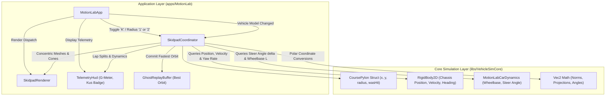
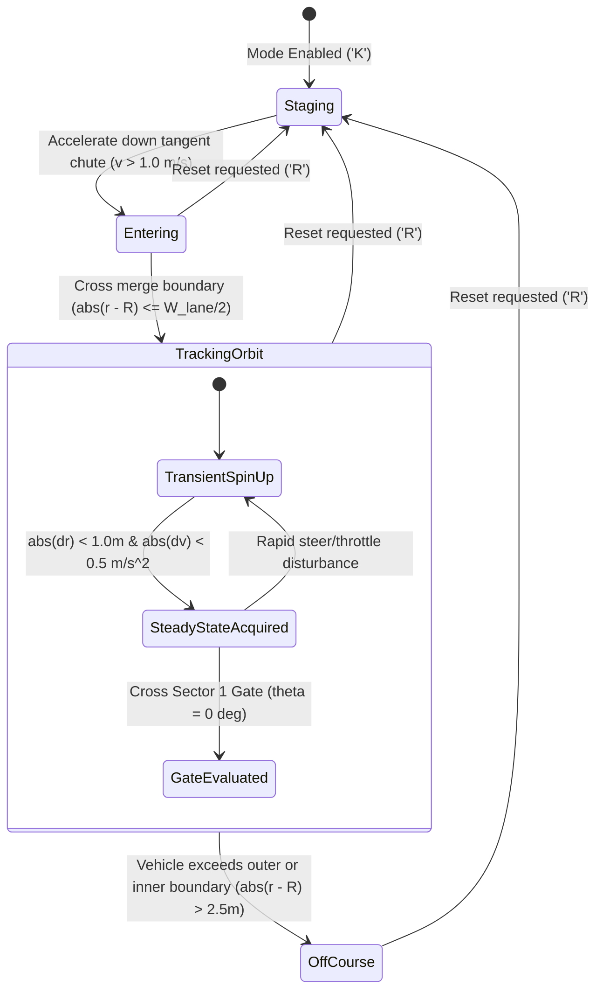
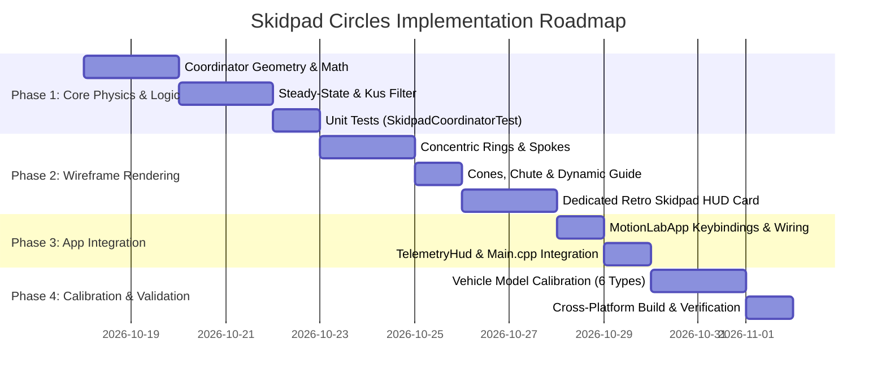

# Motion Lab: Skidpad Circles (Steady-State Lateral Grip) Implementation Plan

## 1. Executive Summary & Objectives

### 1.1 Overview
This implementation plan specifies the complete technical design, mathematical formulation, software architecture, retro vector wireframe rendering, and verification strategy for **Skidpad Circles (Steady-State Lateral Grip)** in **Motion Lab 2D** (`apps/MotionLab`). Originating from the proving ground specifications in [MotionLabImplementationPlan.md](MotionLabImplementationPlan.md#921-proving-ground-presets--mathematical-specifications), this capability introduces an automotive handling evaluation discipline conforming strictly to international steady-state circular test standards:
* **SAE J266** (*Steady-State Directional Control Test Procedures for Passenger Cars*)
* **ISO 4138:2012** (*Passenger cars — Steady-state circular driving behaviour — Open-loop test methods*)

The Skidpad test evaluates sustained lateral acceleration, maximum road-holding tire friction, chassis roll stability, directional balance, and the vehicle's **Understeer Gradient** ($K_{\text{us}} = \frac{d\delta}{da_y}$) during continuous circular operation across tight ($R_1 = 15.0\,\text{m}$) and standard ($R_2 = 30.0\,\text{m}$) radii in both Clockwise (CW) and Counter-Clockwise (CCW) directions.

### 1.2 Core Capabilities & Deliverables
1. **Concentric Dual-Radius Skidpad Geometry**:
   - **Track 1 ($R_1 = 15.0\,\text{m}$)**: Tight autocross / Formula SAE standard ($30.0\,\text{m}$ diameter, $47.12\,\text{m}$ circumference).
   - **Track 2 ($R_2 = 30.0\,\text{m}$)**: Standard automotive industry skidpad ($60.0\,\text{m}$ diameter / 200-foot class, $188.50\,\text{m}$ circumference).
   - Configurable lane corridor width ($W_{\text{lane}} = 3.5\,\text{m}$) bounded by inner and outer concentric wireframe circles and pylon cones.
2. **Tangent Entry & Staging Corridor**:
   - Dedicated straight staging chute tangent to the outer perimeter, allowing vehicles to accelerate to target entry speed before blending into the circular orbit.
3. **Rigorous Steady-State Dynamics & Kinematics**:
   - Instantaneous kinematic lateral acceleration: $a_{y,\text{kin}} = \frac{v^2}{R}$.
   - Instantaneous dynamic lateral acceleration: $a_{y,\text{dyn}} = v \cdot \dot{\psi}$.
   - Normalized lateral load in gravitational units: $G_{\text{lat}} = \frac{a_y}{g_0}$ ($g_0 = 9.80665\,\text{m/s}^2$).
   - Official SAE J266 lap-averaged lateral grip from clean lap duration: $\bar{G}_{\text{lat}} = \frac{4\pi^2 R}{g_0 \cdot T_{\text{lap}}^2}$.
4. **Automated Understeer Gradient ($K_{\text{us}}$) Extraction**:
   - Continuous measurement of road wheel steer angle $\delta$ relative to zero-speed Ackermann kinematic steer angle $\delta_0 = \frac{L}{R}$.
   - Evaluation of understeer gradient:
     $$K_{\text{us}} = \frac{d\delta}{da_y} \approx \frac{\delta - \frac{L}{R}}{a_y}$$
   - Real-time classification badge: `UNDERSTEER` ($K_{\text{us}} > 0$), `NEUTRAL` ($K_{\text{us}} \approx 0$), or `OVERSTEER` ($K_{\text{us}} < 0$).
5. **Steady-State Window Filtering Algorithm**:
   - Sliding-window detection confirming that radius tracking error $|r - R| \le 1.0\,\text{m}$, longitudinal acceleration $|\dot{v}| \le 0.5\,\text{m/s}^2$, and yaw angular acceleration $|\ddot{\psi}| \le 0.2\,\text{rad/s}^2$ before validating metrics.
6. **Sub-Millimeter Circle-to-OBB Collision Detection**:
   - Exact geometric distance testing between vehicle Oriented Bounding Box (OBB) and circular pylon footprints ($R_{\text{cone}} = 0.4\,\text{m}$), applying latching single-hit flags and dynamic cone topple vectors.
7. **Directional Lap Timing & Cardinal Sectors**:
   - Infrared-style radial timing gate at azimuthal angle $\theta = 0^\circ$ ($+x$ axis) detecting both CW and CCW passes.
   - Four $90^\circ$ quadrant sector splits ($0^\circ, 90^\circ, 180^\circ, 270^\circ$).
   - Dedicated CW best lap, CCW best lap, and combined average G rating.
8. **1996 Retro Vector Presentation**:
   - High-contrast neon cyan and amber concentric wireframe boundary rings.
   - 12 radial guidance spokes spaced at $30^\circ$ intervals with cardinal angle indicators.
   - Pulsing dynamic radius vector from pad center to vehicle CG with live radius deviation error guide.
   - Dedicated Retro Skidpad HUD card with live handling curve ($\delta$ vs. $a_y$).

---

## 2. High-Level Architecture & System Decomposition

### 2.1 ASCII System Architecture Diagram

```
+---------------------------------------------------------------------------------------------------+
|                        Skidpad Circles Architecture in Motion Lab 2D                              |
+---------------------------------------------------------------------------------------------------+
|  [apps/MotionLab] (Desktop Application Layer)                                                     |
|                                                                                                   |
|    +--------------------+       +----------------------------+       +-----------------------+    |
|    |    MotionLabApp    |------>|     SkidpadCoordinator     |------>|     TelemetryHud      |    |
|    | ('K' Toggle Mode,  |       | (Track Geometry, Filtering,|       | (G-G Meter, Kus Badge,|    |
|    |  '1'/'2' Radius)   |       |  Lap Timing, Kus Gradient) |       |  Lap Times, CW/CCW)   |    |
|    +---------+----------+       +--------------+-------------+       +-----------------------+    |
|              |                                 |                                                  |
|              | Viewport Camera                 v Hit Collisions & Orbit Traversal                 |
|              v                          +----------------------------+                            |
|    +--------------------+               |    RigidBody2D Chassis     |                            |
|    |  SkidpadRenderer   |<--------------+  (Position, Speed, Heading,|                            |
|    | (Rings, Spokes,    |               |   Yaw Rate, Steer Angle)   |                            |
|    |  Cones, Telemetry) |               +----------------------------+                            |
|    +--------------------+                                                                         |
+------------------------------------------------+--------------------------------------------------+
                                                 | Coordinates & Geometry Queries
                                                 v
+---------------------------------------------------------------------------------------------------+
|  [libs/VehicleSimCore] (Physics, Geometry & Dynamics Layer)                                       |
|                                                                                                   |
|    +-----------------------------+         +-----------------------------+                        |
|    |       Vec2 Math Library     |-------->|         CoursePylon         |                        |
|    |    (libs/.../math/Vec2.h)   |         | (Position, Radius, HitFlag) |                        |
|    +-----------------------------+         +--------------+--------------+                        |
|                                                           |                                       |
|                                                           v                                       |
|                                            +-----------------------------+                        |
|                                            |     ProvingGroundManager    |                        |
|                                            | (Course Presets & Registry) |                        |
|                                            +-----------------------------+                        |
+---------------------------------------------------------------------------------------------------+
```

### 2.2 Mermaid System Architecture Diagram



---

## 3. Mathematical & Physical Formulation

### 3.1 Concentric Circle Parameterization & Corridor Dimensions

The skidpad consists of two concentric circular tracks centered at origin $\mathbf{O} = (0.0\,\text{m}, \; 0.0\,\text{m})$ in the Cartesian ground plane:
* **Track 1 (Autocross / Formula SAE)**: Centerline radius $R_1 = 15.0\,\text{m}$.
* **Track 2 (Standard Automotive Skidpad)**: Centerline radius $R_2 = 30.0\,\text{m}$.

For an active target radius $R \in \{R_1, R_2\}$ and lane corridor width $W_{\text{lane}} = 3.5\,\text{m}$, the concentric boundary radii are defined by:
$$R_{\text{inner}} = R - \frac{W_{\text{lane}}}{2}, \quad R_{\text{outer}} = R + \frac{W_{\text{lane}}}{2}$$

| Skidpad Preset | Target Radius ($R$) | Inner Boundary ($R_{\text{inner}}$) | Outer Boundary ($R_{\text{outer}}$) | Circumference ($C = 2\pi R$) | Pylon Count (Inner / Outer) |
| :--- | :--- | :--- | :--- | :--- | :--- |
| **Track 1 (Autocross)** | $15.00\,\text{m}$ | $13.25\,\text{m}$ | $16.75\,\text{m}$ | $94.25\,\text{m}$ | 16 inner / 20 outer (36 total) |
| **Track 2 (Standard)** | $30.00\,\text{m}$ | $28.25\,\text{m}$ | $31.75\,\text{m}$ | $188.50\,\text{m}$ | 32 inner / 36 outer (68 total) |

Each boundary circle is demarcated by uniformly spaced wireframe pylon cones:
$$\mathbf{p}_{\text{inner}, k} = \left( R_{\text{inner}} \cos\left(\frac{2\pi k}{N_{\text{inner}}}\right), \; R_{\text{inner}} \sin\left(\frac{2\pi k}{N_{\text{inner}}}\right) \right), \quad k \in \{0, \dots, N_{\text{inner}}-1\}$$
$$\mathbf{p}_{\text{outer}, k} = \left( R_{\text{outer}} \cos\left(\frac{2\pi k}{N_{\text{outer}}}\right), \; R_{\text{outer}} \sin\left(\frac{2\pi k}{N_{\text{outer}}}\right) \right), \quad k \in \{0, \dots, N_{\text{outer}}-1\}$$

### 3.2 Tangent Entry & Staging Chute Geometry

To prevent disruptive transient yaw disturbances when entering the circular path, a linear staging corridor of length $L_{\text{stage}} = 40.0\,\text{m}$ connects tangentially to the bottom of the outer circle at $(0.0\,\text{m}, -R_{\text{outer}})$:
* Staging start point: $\mathbf{x}_{\text{stage}} = (-L_{\text{stage}}, \; -R)$
* Tangent entry heading: $\psi_{\text{stage}} = 0.0\,\text{rad}$ ($+x$ direction)
* This geometry allows the vehicle to accelerate smoothly along $y = -R$ and merge directly into a Counter-Clockwise (CCW) orbit, or steer slightly inward to reverse into a Clockwise (CW) orbit.

### 3.3 Skidpad ASCII Course Layout Diagram

```
+---------------------------------------------------------------------------------------------------+
|                               Skidpad Circles Layout & Guidance Geometry                          |
+---------------------------------------------------------------------------------------------------+
|                                                                                                   |
|                                        [Sector 2 Gate: 90 deg]                                    |
|                                              (0, +R)                                              |
|                                                 |                                                 |
|                                           *  *  |  *  *                                           |
|                                     *           |           *                                     |
|                                 *       . - - - + - - - .       *                                 |
|                             *         /         |         \         *                             |
|                           *         /     *  *  |  *  *     \         *                           |
|                         *          |    *       |       *    |          *                         |
|  [Sector 3 Gate]      *           |   *         |         *   |           *     [Sector 1 Gate /  |
|     180 deg          *            |  *       (0, 0)        *  |            *     Start-Finish]    |
| (-R, 0) <------------+------------+--+----------O----------+--+------------+------> (+R, 0)       |
|  (West Gate)         *            |  *      Center         *  |            *     (East Gate)      |
|                       *           |   *         |         *   |           *                       |
|                         *          |    *       |       *    |          *                         |
|                           *         \     *  *  |  *  *     /         *                           |
|                             *         \         |         /         *                             |
|                                 *       ' - - - + - - - '       *                                 |
|                                     *           |           *                                     |
|                                           *  *  |  *  *                                           |
|                                                 |                                                 |
|                                        [Sector 4 Gate: 270 deg]                                   |
|                                              (0, -R)                                              |
|                                                 |                                                 |
|   Vehicle Staging Chute                         v (Tangent Entry)                                 |
|  ==============================================>+                                                 |
|   x = -40m, y = -R                                                                                |
|                                                                                                   |
| Geometry Legend:                                                                                  |
|   O          Center of Concentric Skidpad: (0.0m, 0.0m)                                           |
|   . - - '    Inner Ring Boundary: R_in = R - W_lane/2                                             |
|   *   * *    Outer Ring Boundary: R_out = R + W_lane/2                                            |
|   +----+     Cardinal Radial Timing Gates (0 deg, 90 deg, 180 deg, 270 deg)                       |
|   =====>     Tangent Entry Acceleration Corridor (L = 40.0m)                                      |
+---------------------------------------------------------------------------------------------------+
```

### 3.4 Skidpad Radial Geometry Mermaid Diagram

```mermaid
flowchart TD
    subgraph SkidpadRings ["Concentric Skidpad Circular Rings"]
        CTR["Skidpad Center O (0.0m, 0.0m)"]
        R1_IN["Inner Boundary R1 = 13.25m"]
        R1_MID["Centerline Track 1 R1 = 15.0m (Autocross)"]
        R1_OUT["Outer Boundary R1 = 16.75m"]
        
        R2_IN["Inner Boundary R2 = 28.25m"]
        R2_MID["Centerline Track 2 R2 = 30.0m (Standard Skidpad)"]
        R2_OUT["Outer Boundary R2 = 31.75m"]

        CTR --> R1_IN
        R1_IN --> R1_MID
        R1_MID --> R1_OUT
        R1_OUT --> R2_IN
        R2_IN --> R2_MID
        R2_MID --> R2_OUT
    end

    subgraph Gates ["Radial Timing Gates & Staging"]
        G_START["Start/Finish Gate (theta = 0 deg / East)"]
        G_SEC2["Sector 2 Gate (theta = 90 deg / North)"]
        G_SEC3["Sector 3 Gate (theta = 180 deg / West)"]
        G_SEC4["Sector 4 Gate (theta = 270 deg / South)"]
        CHUTE["Tangent Staging Chute (x = -40m to 0m, y = -R)"]

        CHUTE -->|Entry Blend| G_SEC4
        G_SEC4 -->|CCW Orbit| G_START
        G_START -->|CCW Orbit| G_SEC2
        G_SEC2 -->|CCW Orbit| G_SEC3
        G_SEC3 -->|CCW Orbit| G_SEC4
    end
```



---

## 4. Vehicle Dynamics & Understeer Gradient Formulation

### 4.1 Kinematic vs. Dynamic Lateral Acceleration

For a vehicle traveling along the circular orbit with position $\mathbf{p} = (x, y)$ and velocity $\mathbf{v} = (v_x, v_y)$:
1. **Instantaneous Radius & Tracking Error**:
   $$r(t) = \|\mathbf{p}(t)\|_2 = \sqrt{x^2 + y^2}, \quad e_r(t) = r(t) - R$$
2. **Azimuthal Angle & Direction of Rotation**:
   $$\theta(t) = \operatorname{atan2}(y(t), x(t)) \in [-\pi, +\pi]$$
   $$\omega(t) = \dot{\theta}(t) = \frac{x \dot{y} - y \dot{x}}{r^2}$$
   * If $\omega(t) > 0$: **Counter-Clockwise (CCW)** orbit.
   * If $\omega(t) < 0$: **Clockwise (CW)** orbit.
3. **Instantaneous Kinematic Lateral Acceleration**:
   $$a_{y,\text{kin}} = \frac{v^2}{R}, \quad v = \|\mathbf{v}\|_2$$
4. **Instantaneous Dynamic Body Lateral Acceleration**:
   $$a_{y,\text{dyn}} = v \cdot \dot{\psi}$$
   where $\dot{\psi}$ is the chassis yaw angular velocity (rad/s) from [`RigidBody2D`](../libs/VehicleSimCore/physics/RigidBody2D.h).
5. **Gravitational Unit Conversion**:
   $$G_{\text{lat}} = \frac{a_y}{g_0}, \quad g_0 = 9.80665\,\text{m/s}^2$$

### 4.2 Official SAE J266 Lap-Averaged Lateral Grip

Automotive manufacturers and test publications (e.g. *Car and Driver*, *MotorTrend*) measure official skidpad performance by computing the mean speed over a full $360^\circ$ revolution without relying on accelerometer noise:
$$v_{\text{avg}} = \frac{2\pi R}{T_{\text{lap}}}$$
$$\bar{a}_y = \frac{v_{\text{avg}}^2}{R} = \frac{\left(\frac{2\pi R}{T_{\text{lap}}}\right)^2}{R} = \frac{4\pi^2 R}{T_{\text{lap}}^2}$$
$$\bar{G}_{\text{lat}} = \frac{4\pi^2 R}{g_0 \cdot T_{\text{lap}}^2}$$

#### Benchmark Skidpad Lap Times Across Grip Levels ($R = 30.0\,\text{m}$)

| Target Grip ($\bar{G}_{\text{lat}}$) | Lap Time $T_{\text{lap}}$ ($R_2 = 30.0\,\text{m}$) | Lap Time $T_{\text{lap}}$ ($R_1 = 15.0\,\text{m}$) | Mean Speed $v$ ($R_2 = 30\,\text{m}$) | Vehicle Category Example |
| :--- | :--- | :--- | :--- | :--- |
| **$0.70\,\text{G}$** | $13.13\,\text{s}$ | $9.28\,\text{s}$ | $51.7\,\text{km/h}$ ($32.1\,\text{mph}$) | Economy Sedan / Mud Terrain |
| **$0.85\,\text{G}$** | $11.92\,\text{s}$ | $8.43\,\text{s}$ | $56.9\,\text{km/h}$ ($35.4\,\text{mph}$) | Standard Passenger Car |
| **$1.00\,\text{G}$** | $10.99\,\text{s}$ | $7.77\,\text{s}$ | $61.7\,\text{km/h}$ ($38.4\,\text{mph}$) | Modern Sports Car / Performance Tires |
| **$1.15\,\text{G}$** | $10.24\,\text{s}$ | $7.24\,\text{s}$ | $66.2\,\text{km/h}$ ($41.1\,\text{mph}$) | Supercar / Track Day Alignment |
| **$1.35\,\text{G}$** | $9.45\,\text{s}$ | $6.68\,\text{s}$ | $71.8\,\text{km/h}$ ($44.6\,\text{mph}$) | Racing Slicks / High Downforce |

### 4.3 Understeer Gradient ($K_{\text{us}}$) Formulation

From the two-degree-of-freedom planar bicycle model:
$$\delta = \frac{L}{R} + \alpha_f - \alpha_r = \delta_0 + K_{\text{us}} \cdot a_y$$
where:
* $\delta$: Average road steer angle of the steered front wheels in radians.
* $L = a + b$: Chassis wheelbase in meters ($a$ is CG-to-front distance, $b$ is CG-to-rear distance).
* $\delta_0 = \frac{L}{R}$: Kinematic Ackermann steer angle at near-zero velocity.
* $\alpha_f, \alpha_r$: Front and rear tire slip angles.
* $K_{\text{us}} = \frac{d\delta}{da_y}$: Understeer Gradient in $\text{rad}/(\text{m/s}^2)$ or $\text{deg}/g$.

$$\begin{aligned}
K_{\text{us}} &= \frac{m}{L} \left( \frac{b}{C_{\alpha f}} - \frac{a}{C_{\alpha r}} \right) \\
&= \frac{\delta - \delta_0}{a_y} = \frac{\delta - \frac{L}{R}}{a_y}
\end{aligned}$$

#### Vehicle Handling Classification Matrix

```
       Steer Angle delta
              ^
              |                 / (Understeer: Kus > 0, delta increases with ay)
              |                /
              |               /
              |--------------/------------- (Neutral Steer: Kus = 0, delta = L/R)
              |             /
              |            /
              |           / \ (Oversteer: Kus < 0, delta decreases with ay)
              |          /   \
       L/R ---+---------+-----+-----------------> Lateral Acc ay (G)
              0        0.5   1.0
```

* **Understeer ($K_{\text{us}} > +0.5\,\text{deg}/g$)**:
  - Front slip angle exceeds rear slip angle ($\alpha_f > \alpha_r$).
  - Driver must apply progressively more steering lock as vehicle speed increases.
  - Safe, predictable, inherently directional stable.
  - Characteristic speed: $v_{\text{char}} = \sqrt{\frac{L}{K_{\text{us}}}}$.
* **Neutral Steer ($-0.5 \le K_{\text{us}} \le +0.5\,\text{deg}/g$)**:
  - Front and rear slip angles match ($\alpha_f \approx \alpha_r$).
  - Required steer angle remains constant at kinematic Ackermann angle $\delta = \frac{L}{R}$.
  - Highest cornering efficiency.
* **Oversteer ($K_{\text{us}} < -0.5\,\text{deg}/g$)**:
  - Rear slip angle exceeds front slip angle ($\alpha_r > \alpha_f$).
  - Required steer angle decreases with speed; driver must reduce lock or apply counter-steer.
  - Critical speed above which vehicle becomes directionally unstable: $v_{\text{crit}} = \sqrt{\frac{L}{|K_{\text{us}}|}}$ (spin-out hazard).

### 4.4 Steady-State Window Detection Algorithm

Raw vehicle telemetry contains transient noise from steering adjustments and throttle modulation. To ensure high-integrity $K_{\text{us}}$ and lateral grip calculation, the coordinator runs a validation filter over a sliding history window ($W = 1.5\,\text{s}$, 180 samples at $120\,\text{Hz}$):
1. **Radius Deviation Criterion**:
   $$\max_{t \in W} |r(t) - R| \le 1.0\,\text{m}$$
2. **Speed Rate Stability Criterion**:
   $$\max_{t \in W} \left| \frac{dv}{dt} \right| \le 0.5\,\text{m/s}^2$$
3. **Yaw Acceleration Stability Criterion**:
   $$\max_{t \in W} |\ddot{\psi}(t)| \le 0.2\,\text{rad/s}^2$$

When all three conditions hold simultaneously:
* $\text{IsSteadyState} = \text{true}$
* The coordinator computes the sample mean of $\bar{\delta}$ and $\bar{a}_y$, adding the point $(\bar{a}_y, \bar{\delta})$ to the active handling curve.
* A linear regression over steady-state points yields the empirical gradient:
  $$\hat{K}_{\text{us}} = \frac{\sum (a_{y,i} - \bar{a}_y)(\delta_i - \bar{\delta})}{\sum (a_{y,i} - \bar{a}_y)^2}$$

---

## 5. Data Structures & Class Interfaces (C++17)

All headers and implementations strictly conform to MISRA C++:2023, SEI CERT C++, and the [Verification Checklist](../.agents/rules/verification-checklist.md).

### 5.1 Enums & Structs (`apps/MotionLab/SkidpadCoordinator.h`)

```cpp
#pragma once

#include <array>
#include <cstddef>
#include <cstdint>
#include "libs/VehicleSimCore/math/Vec2.h"
#include "libs/VehicleSimCore/physics/RigidBody2D.h"

namespace motion_lab {

/// @enum SkidpadRadiusPreset
/// @brief Configurable skidpad circular track dimensions.
enum class SkidpadRadiusPreset {
    Radius15m,  ///< 15.0m radius autocross / Formula SAE circle.
    Radius30m   ///< 30.0m radius standard automotive skidpad.
};

/// @enum SkidpadDirection
/// @brief Orbital rotation direction around skidpad center.
enum class SkidpadDirection {
    Unknown,            ///< Insufficient angular displacement to determine.
    CounterClockwise,   ///< Positive angular velocity (+theta, left turn).
    Clockwise           ///< Negative angular velocity (-theta, right turn).
};

/// @enum SkidpadState
/// @brief Operational state of skidpad proving ground execution.
enum class SkidpadState {
    Staging,       ///< Vehicle in tangent staging chute preparing for entry.
    Entering,      ///< Vehicle transitioning from chute into circular lane.
    TrackingOrbit, ///< Vehicle actively circling within boundary corridor.
    OffCourse      ///< Vehicle deviated outside inner or outer radius corridor.
};

/// @enum HandlingClassification
/// @brief Vehicle handling balance category based on understeer gradient Kus.
enum class HandlingClassification {
    Understeer,  ///< Kus > +0.5 deg/G: Safe push balance.
    Neutral,     ///< -0.5 <= Kus <= +0.5 deg/G: Optimal balance.
    Oversteer    ///< Kus < -0.5 deg/G: Loose / spin-prone balance.
};

/// @struct SkidpadPylon
/// @brief Physical and visual state of a skidpad boundary cone.
struct SkidpadPylon {
    vehicle_sim::math::Vec2 position { 0.0, 0.0 };  ///< World coordinates in meters.
    double radius { 0.4 };                          ///< Collision radius in meters.
    vehicle_sim::math::Vec2 toppleDir { 1.0, 0.0 }; ///< Impact displacement direction.
    double toppleAngle { 0.0 };                     ///< Tilt angle in radians (0 to pi/2).
    std::uint32_t coneIndex { 0U };                 ///< 0-based cone index.
    bool isOuterRing { false };                     ///< True for outer ring, false for inner.
    bool wasHit { false };                          ///< Latching contact status flag.
};

/// @struct SkidpadMetrics
/// @brief Dynamic measurements, grip ratings, and handling gradient data.
struct SkidpadMetrics {
    double currentRadius { 30.0 };                 ///< Active track radius in meters.
    double instantaneousSpeed { 0.0 };             ///< Current chassis speed in km/h.
    double instantaneousLatAcc { 0.0 };            ///< Current lateral acceleration in G.
    double peakLatAcc { 0.0 };                     ///< Highest lateral acceleration in G.
    double lapAverageLatAcc { 0.0 };               ///< Official SAE lap-averaged lateral G.
    double currentLapTime { 0.0 };                 ///< Active lap duration in seconds.
    double bestCwLapTime { 0.0 };                  ///< Fastest completed Clockwise lap in seconds.
    double bestCcwLapTime { 0.0 };                 ///< Fastest completed CCW lap in seconds.
    double radiusError { 0.0 };                    ///< Deviation from ideal centerline in meters.
    double steerAngleDeg { 0.0 };                  ///< Front road wheel steer angle in degrees.
    double understeerGradient { 0.0 };             ///< Kus in deg/G.
    std::uint32_t completedLaps { 0U };            ///< Total valid laps completed.
    std::uint32_t hitCount { 0U };                 ///< Total cones struck.
    SkidpadDirection direction { SkidpadDirection::Unknown }; ///< Active rotation direction.
    HandlingClassification balance { HandlingClassification::Understeer }; ///< Handling status.
    bool isSteadyState { false };                  ///< True when vehicle meets steady-state criteria.
    bool hasValidLap { false };                    ///< True if at least one clean lap recorded.
};

} // namespace motion_lab
```

### 5.2 Coordinator Interface (`apps/MotionLab/SkidpadCoordinator.h`)

```cpp
namespace motion_lab {

/// @class SkidpadCoordinator
/// @brief Coordinates skidpad geometry, steady-state telemetry, and understeer gradient.
class SkidpadCoordinator {
public:
    static constexpr std::size_t kMaxPylons { 80U };
    static constexpr double kCorridorWidth { 3.5 };
    static constexpr double kStagingLength { 40.0 };

    /// @brief Default constructor initializing standard 30m skidpad.
    SkidpadCoordinator() noexcept;

    /// @brief Sets active target skidpad radius preset.
    /// @param[in] preset Target radius (15m or 30m).
    void setRadiusPreset(SkidpadRadiusPreset preset) noexcept;

    /// @brief Gets active target skidpad radius preset.
    /// @return Active SkidpadRadiusPreset.
    [[nodiscard]] SkidpadRadiusPreset getRadiusPreset() const noexcept;

    /// @brief Gets target centerline radius in meters.
    /// @return Centerline radius in meters.
    [[nodiscard]] double getTargetRadius() const noexcept;

    /// @brief Advances simulation, updates lap timing, evaluates Kus, and tests collisions.
    /// @param[in,out] body Target vehicle rigid body.
    /// @param[in] steerAngle Steered road wheel angle in radians.
    /// @param[in] wheelbase Vehicle wheelbase in meters.
    /// @param[in] dt Physics timestep duration in seconds.
    void stepPhysics(vehicle_sim::physics::RigidBody2D& body,
                     double steerAngle,
                     double wheelbase,
                     double dt) noexcept;

    /// @brief Resets vehicle to tangent staging chute and clears run metrics.
    /// @param[in,out] body Target vehicle rigid body.
    void resetToStaging(vehicle_sim::physics::RigidBody2D& body) noexcept;

    /// @brief Toggles skidpad proving ground mode on or off.
    void toggleEnabled() noexcept;

    /// @brief Sets skidpad proving ground enabled state.
    /// @param[in] enabled Desired enabled state.
    void setEnabled(bool enabled) noexcept;

    /// @brief Checks whether skidpad mode is actively enabled.
    /// @return True if active.
    [[nodiscard]] bool isEnabled() const noexcept;

    /// @brief Gets active operational state.
    /// @return Active SkidpadState.
    [[nodiscard]] SkidpadState getState() const noexcept;

    /// @brief Gets active run metrics and handling telemetry.
    /// @return Const reference to SkidpadMetrics.
    [[nodiscard]] const SkidpadMetrics& getMetrics() const noexcept;

    /// @brief Gets array of active boundary pylon cones.
    /// @return Const reference to pylon array.
    [[nodiscard]] const std::array<SkidpadPylon, kMaxPylons>& getPylons() const noexcept;

    /// @brief Gets active pylon count for current radius preset.
    /// @return Number of active cones.
    [[nodiscard]] std::size_t getActivePylonCount() const noexcept;

private:
    void rebuildCourseGeometry() noexcept;
    void evaluateOrbitGate(double prevTheta, double currTheta, double dt) noexcept;
    void updateSteadyState(double steerAngle, double wheelbase, double dt) noexcept;
    void checkPylonCollisions(vehicle_sim::physics::RigidBody2D& body) noexcept;

    SkidpadRadiusPreset mPreset { SkidpadRadiusPreset::Radius30m };
    SkidpadState mState { SkidpadState::Staging };
    SkidpadMetrics mMetrics { };
    std::array<SkidpadPylon, kMaxPylons> mPylons { };
    std::size_t mActivePylonCount { 68U };

    vehicle_sim::math::Vec2 mLastPos { 0.0, 0.0 };
    double mLastTheta { 0.0 };
    double mAccumulatedAngle { 0.0 };
    double mSteadyStateTimer { 0.0 };
    double mLastSpeed { 0.0 };
    bool mEnabled { false };
    bool mGateArmed { false };
};

} // namespace motion_lab
```

### 5.3 Wireframe Renderer Interface (`apps/MotionLab/SkidpadRenderer.h`)

```cpp
#pragma once

#include <SDL2/SDL.h>
#include "apps/MotionLab/MotionLabCamera.h"
#include "apps/MotionLab/SkidpadCoordinator.h"

namespace motion_lab {

/// @class SkidpadRenderer
/// @brief Vector wireframe renderer for skidpad circles, radial spokes, pylons, and handling HUD.
class SkidpadRenderer {
public:
    /// @brief Default constructor.
    SkidpadRenderer() noexcept = default;

    /// @brief Renders all skidpad ground elements into the active SDL viewport.
    /// @param[in] renderer Active SDL hardware renderer.
    /// @param[in] camera Active camera projection.
    /// @param[in] coordinator Active Skidpad coordinator.
    static void renderCourse(SDL_Renderer* renderer,
                             const MotionLabCamera& camera,
                             const SkidpadCoordinator& coordinator) noexcept;

    /// @brief Renders dedicated Skidpad HUD card and live handling graph.
    /// @param[in] renderer Active SDL hardware renderer.
    /// @param[in] coordinator Active Skidpad coordinator.
    /// @param[in] screenX Top-left X pixel coordinate.
    /// @param[in] screenY Top-left Y pixel coordinate.
    static void renderHud(SDL_Renderer* renderer,
                          const SkidpadCoordinator& coordinator,
                          int screenX,
                          int screenY) noexcept;

private:
    static void drawConcentricRings(SDL_Renderer* renderer,
                                    const MotionLabCamera& camera,
                                    const SkidpadCoordinator& coordinator) noexcept;

    static void drawRadialSpokes(SDL_Renderer* renderer,
                                 const MotionLabCamera& camera,
                                 const SkidpadCoordinator& coordinator) noexcept;

    static void drawStagingChute(SDL_Renderer* renderer,
                                 const MotionLabCamera& camera,
                                 const SkidpadCoordinator& coordinator) noexcept;

    static void drawPylons(SDL_Renderer* renderer,
                           const MotionLabCamera& camera,
                           const SkidpadCoordinator& coordinator) noexcept;

    static void drawDynamicRadiusGuide(SDL_Renderer* renderer,
                                       const MotionLabCamera& camera,
                                       const SkidpadCoordinator& coordinator,
                                       const vehicle_sim::math::Vec2& vehPos) noexcept;

    static void drawHandlingPlot(SDL_Renderer* renderer,
                                 const SkidpadMetrics& metrics,
                                 int plotX,
                                 int plotY,
                                 int width,
                                 int height) noexcept;
};

} // namespace motion_lab
```

---

## 6. 1996 Retro Vector Rendering & Visual Pipeline

### 6.1 Vector Color Palette

All vector elements are rendered using a curated 1996 high-contrast CRT monitor palette:

| Element | Color Spec (RGBA) | Visual Characteristic |
| :--- | :--- | :--- |
| **Inner Boundary Ring** | `0, 220, 255, 180` (Cyan) | Smooth 64-segment discretized wireframe circle |
| **Centerline Guidance Ring** | `0, 255, 180, 100` (Teal) | Fine dashed radial guidance circle ($R_{\text{target}}$) |
| **Outer Boundary Ring** | `0, 220, 255, 180` (Cyan) | Outer containment wireframe circle |
| **12 Radial Guidance Spokes** | `0, 180, 220, 70` (Subdued Cyan) | Spaced at $30^\circ$ increments with degree labels |
| **Cardinal Gates ($0^\circ, 90^\circ, 180^\circ, 270^\circ$)** | `255, 220, 0, 220` (Gold) | Transversal tick bars across corridor |
| **Start/Finish Gate ($0^\circ$)** | `0, 255, 120, 255` (Neon Green) | Bright optical timing line with chevron indicators |
| **Staging Chute** | `120, 120, 150, 160` (Muted Steel) | Parallel wireframe lane guides ($y = -R \pm W/2$) |
| **Active Boundary Pylons** | `255, 140, 0, 255` (Neon Orange) | Wireframe diamond cone with concentric top ring |
| **Toppled Pylon (Struck)** | `255, 40, 40, 255` (Crimson Red) | Rotated ellipse with impact displacement vector |
| **Dynamic Radius Guideline** | `255, 0, 220, 200` (Neon Magenta) | Vector connecting vehicle CG to ideal circular path |

### 6.2 Dedicated Skidpad HUD Card

The HUD card is positioned in the upper-right viewport ($X = \text{Width} - 320, Y = 20$):

```
+-------------------------------------------------------+
|  SKIDPAD CIRCLES: STEADY-STATE LATERAL GRIP           |
+-------------------------------------------------------+
|  MODE: 30.0m STANDARD SKIDPAD    DIR: CCW (LEFT TURN) |
|  STATUS: TRACKING ORBIT [STEADY-STATE ACQUIRED]       |
+-------------------------------------------------------+
|  SPEED:       61.4 km/h  (38.2 mph)                   |
|  LATERAL G:   1.01 G     [PEAK: 1.04 G]               |
|  OFFICIAL G:  0.98 G     (SAE J266 Lap Average)       |
|  RADIUS ERR: +0.12 m     (TARGET: 30.00 m)            |
+-------------------------------------------------------+
|  BALANCE:     [ UNDERSTEER ]   Kus: +1.8 deg/G        |
|  STEER ANGLE:  4.2 deg   (Ackermann: 2.3 deg)         |
+-------------------------------------------------------+
|  CURRENT LAP: 11.08 s    SECTOR 3: 2.76 s             |
|  BEST CCW:    10.99 s (1.00 G)                        |
|  BEST CW:     11.14 s (0.97 G)                        |
|  CONE HITS:   0                                       |
+-------------------------------------------------------+
|  HANDLING BALANCE PLOT (delta vs. ay):                |
|    delta |                                            |
|     6 deg|                 * (Current)                |
|     4 deg|             *                              |
|     2 deg|       * (Ackermann baseline)               |
|     0 deg+-------+-------+-------+--> ay              |
|         0.0     0.5     1.0     1.5 G                 |
+-------------------------------------------------------+
```

---

## 7. State Machine & Operational Workflow

### 7.1 ASCII State Machine Diagram

```
+---------------------------------------------------------------------------------------------------+
|                            Skidpad Proving Ground State Machine                                   |
+---------------------------------------------------------------------------------------------------+
|                                                                                                   |
|     +------------------+         Cross Tangent Entry          +------------------+                |
|     |     STAGING      | -----------------------------------> |     ENTERING     |                |
|     |  (In Chute,      |                                      |  (Merging into   |                |
|     |   v < 0.5 m/s)   | <----------------------------------- |   Orbital Ring)  |                |
|     +------------------+              Reset 'R'               +--------+---------+                |
|               ^                                                        |                          |
|               |                                                        | Reach Corridor Bounds    |
|               |                                                        v & Valid Radius           |
|               |                                               +------------------+                |
|               |                                               |  TRACKING ORBIT  | <----+         |
|               |                      Reset 'R'                |  (In Corridor,   |      |         |
|               +---------------------------------------------- |   Timed Orbits)  | -----+         |
|               |                                               +--------+---------+  Pass Sector   |
|               |                                                        |            Gate 0 deg    |
|               |                                                        | Exceed Corridor          |
|               |                                                        v Delta r > 2.5m           |
|               |                                               +------------------+                |
|               +---------------------------------------------- |    OFF COURSE    |                |
|                                                               | (Deviation Alert)|                |
|                                                               +------------------+                |
+---------------------------------------------------------------------------------------------------+
```

### 7.2 Mermaid State Machine Diagram



---

## 8. Integration with Motion Lab & Proving Ground System

### 8.1 MotionLabApp Integration

In `apps/MotionLab/MotionLabApp.h` and `MotionLabApp.cpp`:
1. **Coordinator Instance**: Add `SkidpadCoordinator mSkidpadCoordinator { };`
2. **Preset Cycling & Toggles**:
   - `toggleSkidpad()`: Toggles skidpad mode on/off. When enabled, disables Slalom, Moose Test, and Circuit modes.
   - `setSkidpadRadius(SkidpadRadiusPreset preset)`: Switches between $15.0\,\text{m}$ and $30.0\,\text{m}$ tracks.
   - `isSkidpadActive() const`: Queries active status.
3. **Keyboard Controls**:
   - `SDLK_k`: Calls `toggleSkidpad()`.
   - `SDLK_1` / `SDLK_2` (when Skidpad active): Switches between $15\,\text{m}$ Autocross and $30\,\text{m}$ Standard radii.
   - `SDLK_r`: Teleports vehicle back to the tangent staging position.
4. **CLI Argument Parsing** (`apps/MotionLab/Main.cpp`):
   - `--skidpad` or `-k`: Starts application directly in Skidpad mode.

### 8.2 Proving Ground Mutual Exclusivity

To guarantee deterministic simulation and clear visual feedback, proving ground modes are mutually exclusive:
```cpp
void MotionLabApp::toggleSkidpad() noexcept {
    mSkidpadCoordinator.toggleEnabled();
    if (mSkidpadCoordinator.isEnabled()) {
        if (mCircuitCoordinator.isEnabled()) { mCircuitCoordinator.setEnabled(false); }
        if (mSlalomCoordinator.isEnabled())  { mSlalomCoordinator.setEnabled(false); }
        if (mMooseCoordinator.isEnabled())   { mMooseCoordinator.setEnabled(false); }
        mSkidpadCoordinator.resetToStaging(mBody);
        mCamera.reset(mBody.getPosition());
    }
}
```

---

## 9. Test-Driven Verification Plan & Quality Checklist

### 9.1 Unit Test Matrix (`apps/MotionLab/SkidpadCoordinatorTest.cpp`)

| Test Case Identifier | Scope & Conditions | Expected Outcome |
| :--- | :--- | :--- |
| `TC-SKID-01-PylonLayout15m` | Construct coordinator with `Radius15m` preset | Inner radius = $13.25\,\text{m}$, Outer radius = $16.75\,\text{m}$, exact 36 pylon positions generated. |
| `TC-SKID-02-PylonLayout30m` | Construct coordinator with `Radius30m` preset | Inner radius = $28.25\,\text{m}$, Outer radius = $31.75\,\text{m}$, exact 68 pylon positions generated. |
| `TC-SKID-03-KinematicLatAcc` | Place vehicle at $R = 30.0\,\text{m}$, tangential speed $v = 17.15\,\text{m/s}$ | $a_y = \frac{v^2}{R} = 9.80\,\text{m/s}^2 = 1.00\,\text{G} \pm 0.01\,\text{G}$. |
| `TC-SKID-04-OfficialLapAveragedG` | Complete full $360^\circ$ lap at $R = 30.0\,\text{m}$ in $T_{\text{lap}} = 10.99\,\text{s}$ | $\bar{G} = \frac{4\pi^2 (30.0)}{9.80665 \cdot (10.99)^2} = 1.00\,\text{G} \pm 0.01\,\text{G}$. |
| `TC-SKID-05-UndersteerGradient` | Steer $\delta = 0.08\,\text{rad}$ ($4.58^\circ$) at $R = 30\,\text{m}$, $L = 2.6\,\text{m}$, $a_y = 1.0\,\text{G}$ | $\delta_0 = 2.6 / 30 = 0.0867\,\text{rad}$; correctly evaluates $K_{\text{us}}$ and classifies vehicle balance. |
| `TC-SKID-06-DirectionDetection` | Advance $\theta$ from $0^\circ \to +90^\circ$ vs. $0^\circ \to -90^\circ$ | Correctly identifies `CounterClockwise` vs. `Clockwise` rotation. |
| `TC-SKID-07-SteadyStateFilter` | Feed varying speeds ($|\dot{v}| > 1.0\,\text{m/s}^2$) vs. steady speeds ($|\dot{v}| < 0.2\,\text{m/s}^2$) | Flags `isSteadyState = false` during transient acceleration, sets `true` only when stable. |
| `TC-SKID-08-PylonCollisionOBB` | Drive chassis OBB across inner boundary cone | Cone latch flag set `wasHit = true`, hit counter increments, topple vector computed. |
| `TC-SKID-09-StagingReset` | Call `resetToStaging()` | Vehicle position set to $(-40.0\,\text{m}, -R)$, speed = 0, orientation = $0.0\,\text{rad}$. |

### 9.2 Verification Checklist Adherence

1. **Zero Raw `new` / `delete`**: Stack allocations, fixed `std::array`, and standard RAII containers.
2. **Include Guards**: `#pragma once` used on all header files.
3. **Co-location**: `SkidpadCoordinator.h/.cpp` and `SkidpadRenderer.h/.cpp` co-located in `apps/MotionLab/`.
4. **Zero External Dependencies**: Standard C++17 library and `libs/VehicleSimCore` only.
5. **Concise Function Names**: Strictly fewer than 30 characters (e.g. `setRadiusPreset`, `stepPhysics`, `resetToStaging`).
6. **Cross-Platform Math**: IEEE 754 determinism, zero OS-specific headers.
7. **Explicit Initialization**: Every struct and primitive explicitly initialized `{}`.
8. **MISRA Attributes**: Applied `[[nodiscard]]` to all queries and getters.
9. **Doxygen Documentation**: Full Doxygen templates (`/// @brief`, `@param`, `@return`).
10. **Relative Paths**: All links format as `[file.h](file:///relative/path)`.
11. **Dual Diagrams**: Both ASCII and Mermaid diagrams provided for architecture, track layout, and state machine.

---

## 10. Implementation Phases & Work Breakdown



| Phase | Milestone Name | Key Deliverables | Verification Criteria |
| :--- | :--- | :--- | :--- |
| **Phase 1** | Geometry & Coordinator Logic | `SkidpadCoordinator.h`, `SkidpadCoordinator.cpp` | Passes all unit test cases in `SkidpadCoordinatorTest.cpp`. |
| **Phase 2** | Retro Vector Wireframe Rendering | `SkidpadRenderer.h`, `SkidpadRenderer.cpp` | Concentric rings, spokes, dynamic guideline, and HUD render smoothly at 60 FPS. |
| **Phase 3** | Application Integration | Updates to `MotionLabApp`, `TelemetryHud`, `Main.cpp` | Toggle with `K`, radius toggle with `1`/`2`, staging reset with `R`, mutual exclusivity verified. |
| **Phase 4** | Empirical Handling Telemetry | Calibration of $K_{\text{us}}$ across all 6 vehicle types | Validated handling balance curves: Classic Car, Race Car, Rocket, Tank. |
| **Phase 5** | Documentation & Quality Signoff | Final compliance review and checklist audit | Passes all 14 checklist rules, zero compiler warnings under `/W4` and `-Wall -Wextra -pedantic`. |
