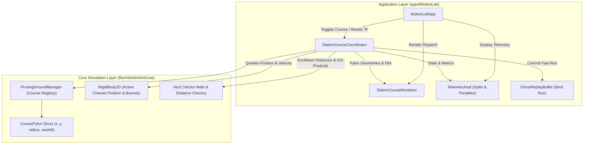
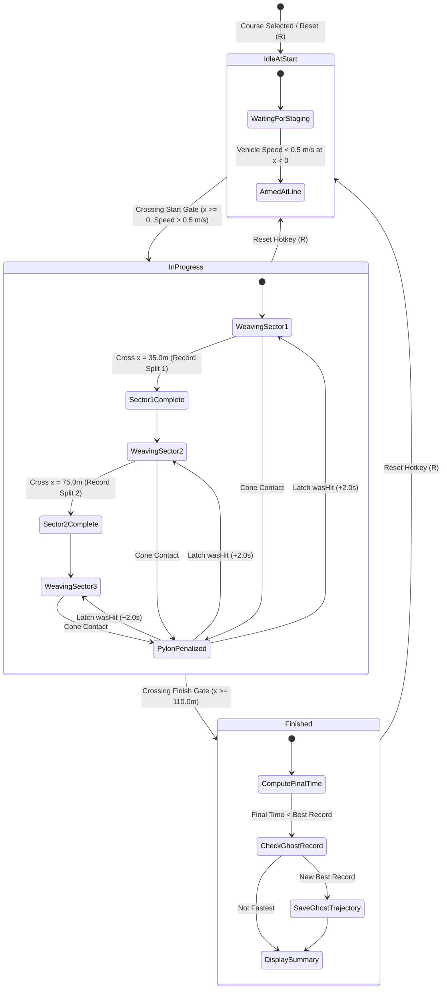
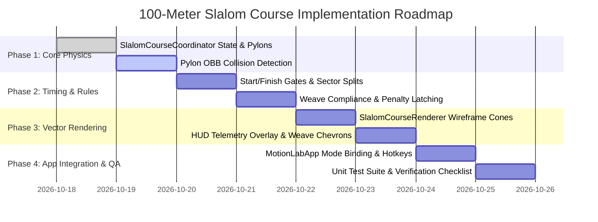

# Motion Lab: 100-Meter Slalom Course Implementation Plan

## 1. Executive Summary & Objectives

### 1.1 Overview
This implementation plan specifies the complete technical design, mathematical formulation, software architecture, wireframe rendering, and verification strategy for the **100-Meter Slalom Course** in **Motion Lab 2D** (`apps/MotionLab`). Originating from the proving grounds specifications in [MotionLabImplementationPlan.md](MotionLabImplementationPlan.md#921-proving-ground-presets--mathematical-specifications), this capability introduces an automotive handling evaluation discipline conforming to standard slalom testing protocols (e.g., SAE J266 / ISO handling tests).

The 100-Meter Slalom Course provides:
1. **Standardized Pylon Grid**: Ten wireframe pylon cones spaced longitudinally at exact intervals of $\Delta x = 10.0\,\text{m}$ along the centerline $y = 0.0\,\text{m}$, creating a $100\,\text{m}$ active weaving corridor.
2. **Precision Start & Finish Timing Gates**: Infrared-style optical start gate at $x = 0.0\,\text{m}$ with speed arming ($v > 0.5\,\text{m/s}$) and finish gate at $x = 110.0\,\text{m}$.
3. **Pylon Touch Detection & Penalty Tracking**: Real-time bounding collision between vehicle chassis and cone obstacles ($R_{\text{cone}} = 0.4\,\text{m}$), applying latching penalty seconds ($\Delta t_{\text{pen}} = +2.0\,\text{s}$ per touched cone) with visual topple physics.
4. **Dynamic Weave Trajectory Validation**: Continuous tracking of lateral displacements ensuring alternating left/right gate passages (Cone 1 left, Cone 2 right, etc.), flagging off-course or skipped cones.
5. **Sector Splits & Telemetry**: Sector 1 split after Cone 3 ($x = 35.0\,\text{m}$), Sector 2 split after Cone 7 ($x = 75.0\,\text{m}$), and final adjusted run time calculation.
6. **1996 Retro Vector Presentation**: High-contrast neon orange wireframe cones, downed pylon red alert states, directional weave chevron guides, and dedicated Slalom HUD telemetry.
7. **Ghost Car Integration**: Automated recording of fastest clean or penalized runs into [`GhostReplayBuffer`](../apps/MotionLab/GhostReplayBuffer.h) for real-time benchmark pacing.

---

## 2. High-Level Architecture & System Decomposition

### 2.1 ASCII System Architecture Diagram

```
+---------------------------------------------------------------------------------------------------+
|                            100-Meter Slalom Architecture in Motion Lab                            |
+---------------------------------------------------------------------------------------------------+
|  [apps/MotionLab] (Desktop Application Layer)                                                     |
|                                                                                                   |
|    +--------------------+       +----------------------------+       +-----------------------+    |
|    |    MotionLabApp    |------>|   SlalomCourseCoordinator  |------>|     TelemetryHud      |    |
|    |  ('P' Mode Toggle) |       |   (State, Timing, Penalties)|      | (Splits, Hits, Weave) |    |
|    +---------+----------+       +--------------+-------------+       +-----------------------+    |
|              |                                 |                                                  |
|              | Viewport Camera                 v Hit Collision & Gate Crossings                   |
|              v                          +----------------------------+                            |
|    +--------------------+               |    RigidBody2D Chassis     |                            |
|    |   SlalomCourse-    |<--------------+    (Vehicle Coordinates)   |                            |
|    |   Renderer         |               +----------------------------+                            |
|    +--------------------+                                                                         |
+------------------------------------------------+--------------------------------------------------+
                                                 | Coordinates & Collision Queries
                                                 v
+---------------------------------------------------------------------------------------------------+
|  [libs/VehicleSimCore] (Physics, Geometry & Dynamics Layer)                                       |
|                                                                                                   |
|    +-----------------------------+         +-----------------------------+                        |
|    |       Vec2 Math Library     |-------->|         CoursePylon         |                        |
|    |     (libs/.../math/Vec2.h)  |         | (Position, Radius, HitFlag) |                        |
|    +-----------------------------+         +--------------+--------------+                        |
|                                                           |                                       |
|                                                           v                                       |
|                                            +-----------------------------+                        |
|                                            |     ProvingGroundManager    |                        |
|                                            | (Course Presets & Registry) |                        |
|                                            +-----------------------------+                        |
+---------------------------------------------------------------------------------------------------+
```

### 2.2 Mermaid System Architecture Diagram



---

## 3. Mathematical & Physical Formulation

### 3.1 Course Layout & Coordinate Parameterization

The 100-meter slalom course is oriented along the longitudinal Cartesian $x$-axis with the centerline placed at $y = 0.0\,\text{m}$.

* **Staging Position**: $\mathbf{x}_{\text{start}} = (-15.0\,\text{m}, \; 0.0\,\text{m})$, heading $\theta = 0.0\,\text{rad}$ ($+x$ direction).
* **Start Timing Gate**: Transversal gate segment at $x = 0.0\,\text{m}$ extending from $y = -5.0\,\text{m}$ to $y = +5.0\,\text{m}$.
* **Pylon Array**: Exactly 10 cones positioned at fixed $10.0\,\text{m}$ longitudinal intervals:
  $$\mathbf{p}_k = (x_k, y_k) = (10.0 \cdot k, \; 0.0)\,\text{m}, \quad k \in \{1, 2, \dots, 10\}$$
* **Sector Split Gates**:
  * **Sector 1 Split**: Located at $x = 35.0\,\text{m}$ (midway between Cone 3 and Cone 4).
  * **Sector 2 Split**: Located at $x = 75.0\,\text{m}$ (midway between Cone 7 and Cone 8).
* **Finish Timing Gate**: Transversal gate segment at $x = 110.0\,\text{m}$ extending from $y = -5.0\,\text{m}$ to $y = +5.0\,\text{m}$ (placed $10.0\,\text{m}$ after the final pylon).

### 3.2 100-Meter Slalom Course Layout ASCII Diagram

```
+-------------------------------------------------------------------------------------------------------------------+
|                                            100-Meter Slalom Course Layout                                         |
+-------------------------------------------------------------------------------------------------------------------+
|                                                                                                                   |
| y=+5m  + + - - - - - - - - - - - - - - - - - - - - - - - - - - - - - - - - - - - - - - - - - - - - - - - - - + +  |
|        |                                                                                                     |    |
|        |           ^                   ^                   ^                   ^                   ^         |    |
|        |         /   \               /   \               /   \               /   \               /   \       |    |
|        |        /     \             /     \             /     \             /     \             /     \      |    |
| y=0m   |==>    *   (1) *           *   (3) *           *   (5) *           *   (7) *           *   (9) *     |==> |
|      [START]  /         \         /         \         /         \         /         \         /         \ [FINISH]|
|      x=0.0m  /           \       /           \       /           \       /           \       /           \x=110m|
|        |    /             \     /             \     /             \     /             \     /             \    |    |
|        |   v               \   v               \   v               \   v               \   v               \ |    |
|        |                    (2)                 (4)                 (6)                 (8)                (10)   |
|        |                   x=20m               x=40m               x=60m               x=80m              x=100m  |
| y=-5m  + + - - - - - - - - - - - - - - - - - - - - - - - - - - - - - - - - - - - - - - - - - - - - - - - - - + +  |
|                                                                                                                   |
| Vehicle Entry: x = -15.0m, y = 0.0m                                                                               |
| Sector 1 Split: x = 35.0m (After Cone 3)                                                                          |
| Sector 2 Split: x = 75.0m (After Cone 7)                                                                          |
| Penalty: +2.0 seconds per pylon contact                                                                           |
+-------------------------------------------------------------------------------------------------------------------+
```

### 3.3 Pylon Geometry & Contact Collision Physics

Each pylon is modeled as a circular base footprint in the 2D world plane:
$$\mathcal{P}_k = \{\mathbf{x} \in \mathbb{R}^2 \mid \|\mathbf{x} - \mathbf{p}_k\| \le R_{\text{cone}}\}, \quad R_{\text{cone}} = 0.4\,\text{m}$$

#### Vehicle Geometry Representation
The vehicle chassis is bounded by an Oriented Bounding Box (OBB) defined by length $L_{\text{veh}}$, width $W_{\text{veh}}$, center position $\mathbf{x}_{\text{veh}}$, and heading unit vectors $\mathbf{u}_{\text{long}} = (\cos\theta, \sin\theta)$ and $\mathbf{u}_{\text{lat}} = (-\sin\theta, \cos\theta)$.

To ensure high-frequency determinism and zero heap allocation during physics ticks, collision against pylon $k$ is evaluated via clamped circle-to-OBB distance:
1. Transform pylon position $\mathbf{p}_k$ into vehicle local coordinates:
   $$\Delta \mathbf{x} = \mathbf{p}_k - \mathbf{x}_{\text{veh}}$$
   $$x_{\text{local}} = \Delta \mathbf{x} \cdot \mathbf{u}_{\text{long}}, \quad y_{\text{local}} = \Delta \mathbf{x} \cdot \mathbf{u}_{\text{lat}}$$
2. Clamp local coordinates to the vehicle half-extents $(h_x = L_{\text{veh}}/2, \; h_y = W_{\text{veh}}/2)$:
   $$x_{\text{clamped}} = \operatorname{clamp}(x_{\text{local}}, -h_x, +h_x), \quad y_{\text{clamped}} = \operatorname{clamp}(y_{\text{local}}, -h_y, +h_y)$$
3. Compute minimum squared distance:
   $$d_{\text{min}}^2 = (x_{\text{local}} - x_{\text{clamped}})^2 + (y_{\text{local}} - y_{\text{clamped}})^2$$
4. Collision occurs when $d_{\text{min}}^2 \le R_{\text{cone}}^2$.

#### Latching Penalty & Topple Dynamics
* **Single-Penalty Latch**: When collision is detected with pylon $k$ and $\text{wasHit}_k = \text{false}$:
  $$\text{wasHit}_k \leftarrow \text{true}$$
  $$N_{\text{penalties}} \leftarrow N_{\text{penalties}} + 1$$
  $$\Delta t_{\text{penalty}} \leftarrow N_{\text{penalties}} \cdot 2.0\,\text{s}$$
* **Topple Vector**: Upon impact, pylon $k$ acquires a topple direction aligned with vehicle velocity $\mathbf{v}_{\text{veh}}$:
  $$\mathbf{d}_{\text{topple}, k} = \frac{\mathbf{v}_{\text{veh}}}{\|\mathbf{v}_{\text{veh}}\|}, \quad \theta_{\text{tilt}, k} = \frac{\pi}{2}$$
  The renderer transitions the pylon from an upright orange cone to a knocked-over, displaced red wireframe marker.

### 3.4 Weave Trajectory & Directional Rule Validation

A valid slalom run requires the vehicle to weave alternatively on opposing sides of each consecutive pylon:
$$\operatorname{sgn}(y_{\text{pass}, k}) = \begin{cases}
+1 \quad (\text{Left / Port side}) & \text{for } k \in \{1, 3, 5, 7, 9\} \\
-1 \quad (\text{Right / Starboard side}) & \text{for } k \in \{2, 4, 6, 8, 10\}
\end{cases}$$

#### Weave Evaluation Algorithm
When the vehicle passes the longitudinal plane $x = x_k$ of pylon $k$ (detected when $x_{\text{prev}} < x_k \le x_{\text{curr}}$):
1. Sample vehicle lateral coordinate $y_{\text{pass}} = y(x_k)$ via linear interpolation between $(x_{\text{prev}}, y_{\text{prev}})$ and $(x_{\text{curr}}, y_{\text{curr}})$.
2. Evaluate clearance:
   * If $|y_{\text{pass}}| < R_{\text{cone}}$, pylon contact occurs (penalized under collision rules).
   * If $\operatorname{sgn}(y_{\text{pass}}) \ne \operatorname{expectedSign}(k)$, the gate was missed or traversed on the incorrect side.
3. If missed, `missedGates` increments and a warning prompt (`"MISSED CONE - INCORRECT WEAVE"`) displays on the HUD.

### 3.5 Run Timing, Split Sectors & Final Score

The run timing model tracks high-resolution simulation timestamps:
* **Start Gate Trigger**: Armed when vehicle crosses $x = 0.0\,\text{m}$ in the forward direction ($v_x > 0.5\,\text{m/s}$):
  $$t_{\text{start}} = t_{\text{sim}}, \quad \text{state} \leftarrow \text{InProgress}$$
* **Sector 1 Split**: Triggered when $x_{\text{veh}} \ge 35.0\,\text{m}$:
  $$\Delta t_{\text{sec1}} = t_{\text{sim}} - t_{\text{start}}$$
* **Sector 2 Split**: Triggered when $x_{\text{veh}} \ge 75.0\,\text{m}$:
  $$\Delta t_{\text{sec2}} = t_{\text{sim}} - (t_{\text{start}} + \Delta t_{\text{sec1}})$$
* **Finish Gate Trigger**: Triggered when $x_{\text{veh}} \ge 110.0\,\text{m}$:
  $$\Delta t_{\text{sec3}} = t_{\text{sim}} - (t_{\text{start}} + \Delta t_{\text{sec1}} + \Delta t_{\text{sec2}})$$
  $$t_{\text{raw}} = t_{\text{sim}} - t_{\text{start}}$$
* **Adjusted Final Time**:
  $$t_{\text{final}} = t_{\text{raw}} + N_{\text{penalties}} \cdot 2.0\,\text{s}$$

---

## 4. Execution Flow & State Machine

### 4.1 Slalom Course State Flow Mermaid Diagram



### 4.2 State Transition & Timing Sequence ASCII Diagram

```
+---------------------------------------------------------------------------------------------------+
|                                 Slalom Course Timing Sequence                                     |
+---------------------------------------------------------------------------------------------------+
|                                                                                                   |
|  Time (s)     Vehicle Event                Course State            HUD Status Display             |
|  -------      -------------                ------------            ------------------             |
|   0.00s       Spawn at x = -15m            IdleAtStart             "READY - CROSS LINE TO START"  |
|   1.20s       Cross Start Gate (x = 0m)    InProgress (Sec 1)      "RUN ACTIVE  T: 0.00s  HITS: 0"|
|   3.15s       Weave Left Cone 1 (x=10m)    InProgress (Sec 1)      "NEXT: WEAVE RIGHT"            |
|   4.90s       Weave Right Cone 2 (x=20m)   InProgress (Sec 1)      "NEXT: WEAVE LEFT"             |
|   6.40s       Hit Cone 3 (x=30m)           InProgress (Sec 1)      "PENALTY +2.0s!  HITS: 1"      |
|   7.10s       Cross Split 1 (x=35m)        InProgress (Sec 2)      "SPLIT 1: 5.90s (+2.0s)"       |
|   8.70s       Weave Right Cone 4 (x=40m)   InProgress (Sec 2)      "NEXT: WEAVE LEFT"             |
|  14.20s       Cross Split 2 (x=75m)        InProgress (Sec 3)      "SPLIT 2: 13.00s (+2.0s)"      |
|  18.80s       Pass Cone 10 (x=100m)        InProgress (Sec 3)      "SPRINT TO FINISH!"            |
|  20.10s       Cross Finish Gate (x=110m)   Finished                "FINAL: 20.10s (+2.0s = 22.10s)"|
|                                                                                                   |
+---------------------------------------------------------------------------------------------------+
```

---

## 5. Software Architecture & Class Decomposition

To adhere strictly to project invariants—including **zero external engine dependencies** in core libraries, **no raw new/delete**, `#pragma once` header protection, co-located `.h`/`.cpp` files, and concise identifiers (< 30 characters)—the slalom functionality is decoupled into two co-located units under [`apps/MotionLab`](../apps/MotionLab):

1. **[`SlalomCourseCoordinator.h`](../apps/MotionLab/SlalomCourseCoordinator.h) / [`.cpp`](../apps/MotionLab/SlalomCourseCoordinator.cpp)**:
   - Maintains course geometry, 10 pylon definitions, gate coordinates, and run metrics.
   - Executes high-frequency collision checks against vehicle chassis OBB.
   - Computes split times, penalty additions, and weaving directional compliance.
2. **[`SlalomCourseRenderer.h`](../apps/MotionLab/SlalomCourseRenderer.h) / [`.cpp`](../apps/MotionLab/SlalomCourseRenderer.cpp)**:
   - Renders 3D wireframe cones with perspective projection, base rings, and vertical apex ribs.
   - Renders start/finish neon timing gates, corridor lane markers, and directional chevron breadcrumbs.
   - Renders the HUD Slalom telemetry card (current time, split deltas, cone hit badges).

### 5.1 SlalomCourseCoordinator.h

```cpp
#pragma once

#include <array>
#include <cstddef>
#include <cstdint>
#include "libs/VehicleSimCore/math/Vec2.h"
#include "libs/VehicleSimCore/physics/RigidBody2D.h"

namespace motion_lab {

/// @enum SlalomState
/// @brief Operational state of the slalom course execution.
enum class SlalomState {
    IdleAtStart,    ///< Vehicle is staged behind the start gate.
    InProgress,     ///< Run is actively timed between start and finish gates.
    Finished        ///< Vehicle crossed finish line; times are locked.
};

/// @struct SlalomPylon
/// @brief Physical and visual state of a single slalom pylon obstacle.
struct SlalomPylon {
    vehicle_sim::math::Vec2 position { 0.0, 0.0 };  ///< Center coordinates in world meters.
    double radius { 0.4 };                          ///< Collision radius in meters.
    vehicle_sim::math::Vec2 toppleDir { 1.0, 0.0 }; ///< Impact displacement direction vector.
    double toppleAngle { 0.0 };                     ///< Tilt angle in radians (0 = upright, pi/2 = toppled).
    std::uint32_t coneIndex { 0U };                 ///< 1-based index (1 to 10).
    bool wasHit { false };                          ///< Latching contact status flag.
    bool passed { false };                          ///< Traversed longitudinal threshold flag.
    bool correctSide { true };                      ///< Weave compliance flag.
};

/// @struct SlalomMetrics
/// @brief Timing splits, penalty tallies, and run metrics.
struct SlalomMetrics {
    double elapsedTime { 0.0 };     ///< Raw elapsed run duration in seconds.
    double penaltyTime { 0.0 };     ///< Accumulated penalty seconds (+2.0s per hit).
    double finalTime { 0.0 };       ///< Total adjusted duration (elapsed + penalty).
    double bestTime { 0.0 };        ///< All-time fastest adjusted run duration.
    double sector1Time { 0.0 };     ///< Split duration for cones 1-3 in seconds.
    double sector2Time { 0.0 };     ///< Split duration for cones 4-7 in seconds.
    double sector3Time { 0.0 };     ///< Split duration for cones 8-10 in seconds.
    std::uint32_t hitCount { 0U };  ///< Number of touched pylons.
    std::uint32_t missedGates { 0U };///< Number of skipped or wrong-side gates.
    bool hasValidBest { false };    ///< True if a completed run exists.
};

/// @class SlalomCourseCoordinator
/// @brief Coordinates 100-meter slalom course layout, pylon collision, and timing gates.
class SlalomCourseCoordinator {
public:
    static constexpr std::size_t kPylonCount { 10U };
    static constexpr double kPylonSpacing { 10.0 };
    static constexpr double kStartX { 0.0 };
    static constexpr double kFinishX { 110.0 };
    static constexpr double kSector1X { 35.0 };
    static constexpr double kSector2X { 75.0 };
    static constexpr double kPenaltyPerHit { 2.0 };

    /// @brief Default constructor initializing 10-cone layout.
    SlalomCourseCoordinator() noexcept;

    /// @brief Advances simulation, checks collisions, updates splits, and manages gates.
    /// @param[in,out] body Active vehicle chassis rigid body.
    /// @param[in] dt Timestep duration in seconds.
    void stepPhysics(vehicle_sim::physics::RigidBody2D& body, double dt) noexcept;

    /// @brief Resets vehicle to staging point and clears course state.
    /// @param[in,out] body Active vehicle chassis rigid body.
    void resetCourse(vehicle_sim::physics::RigidBody2D& body) noexcept;

    /// @brief Toggles slalom course mode on or off.
    void toggleEnabled() noexcept;

    /// @brief Enables or disables slalom course mode.
    /// @param[in] enabled Desired state.
    void setEnabled(bool enabled) noexcept;

    /// @brief Checks whether slalom mode is actively enabled.
    /// @return True if active.
    [[nodiscard]] bool isEnabled() const noexcept;

    /// @brief Gets active course operational state.
    /// @return Active SlalomState.
    [[nodiscard]] SlalomState getState() const noexcept;

    /// @brief Gets active run metrics and splits.
    /// @return Const reference to SlalomMetrics.
    [[nodiscard]] const SlalomMetrics& getMetrics() const noexcept;

    /// @brief Gets array of all 10 slalom pylons.
    /// @return Const reference to pylon array.
    [[nodiscard]] const std::array<SlalomPylon, kPylonCount>& getPylons() const noexcept;

    /// @brief Gets expected weaving sign (+1 for left, -1 for right) for next upcoming pylon.
    /// @return Expected sign of lateral offset.
    [[nodiscard]] double getNextWeaveSign() const noexcept;

private:
    void updateIdleState(const vehicle_sim::physics::RigidBody2D& body) noexcept;
    void updateRunningState(vehicle_sim::physics::RigidBody2D& body, double dt) noexcept;
    void checkCollisions(const vehicle_sim::physics::RigidBody2D& body) noexcept;
    void checkGates(const vehicle_sim::math::Vec2& prevPos,
                    const vehicle_sim::math::Vec2& currPos) noexcept;

    std::array<SlalomPylon, kPylonCount> mPylons {{ }};
    SlalomMetrics mMetrics { };
    SlalomState mState { SlalomState::IdleAtStart };
    vehicle_sim::math::Vec2 mLastPos { -15.0, 0.0 };
    std::size_t mNextConeIdx { 0U };
    bool mEnabled { false };
};

} // namespace motion_lab
```

### 5.2 SlalomCourseRenderer.h

```cpp
#pragma once

#include <SDL2/SDL.h>
#include "apps/MotionLab/MotionLabCamera.h"
#include "apps/MotionLab/SlalomCourseCoordinator.h"
#include "libs/VehicleSimCore/math/Vec2.h"

namespace motion_lab {

/// @class SlalomCourseRenderer
/// @brief Vector wireframe renderer for the 100-meter slalom course, pylons, and HUD.
class SlalomCourseRenderer {
public:
    /// @brief Default constructor.
    SlalomCourseRenderer() noexcept = default;

    /// @brief Renders all course elements into the active SDL viewport.
    /// @param[in] renderer Active SDL hardware renderer.
    /// @param[in] camera Active camera projection.
    /// @param[in] coordinator Active slalom course coordinator.
    static void renderCourse(SDL_Renderer* renderer,
                             const MotionLabCamera& camera,
                             const SlalomCourseCoordinator& coordinator) noexcept;

    /// @brief Renders the dedicated Slalom HUD card.
    /// @param[in] renderer Active SDL hardware renderer.
    /// @param[in] coordinator Active slalom course coordinator.
    /// @param[in] screenX Top-left X pixel coordinate.
    /// @param[in] screenY Top-left Y pixel coordinate.
    static void renderHud(SDL_Renderer* renderer,
                          const SlalomCourseCoordinator& coordinator,
                          int screenX,
                          int screenY) noexcept;

private:
    static void drawPylon(SDL_Renderer* renderer,
                          const MotionLabCamera& camera,
                          const SlalomPylon& pylon) noexcept;

    static void drawGates(SDL_Renderer* renderer,
                          const MotionLabCamera& camera,
                          const SlalomCourseCoordinator& coordinator) noexcept;

    static void drawWeaveGuides(SDL_Renderer* renderer,
                                const MotionLabCamera& camera,
                                const SlalomCourseCoordinator& coordinator) noexcept;
};

} // namespace motion_lab
```

---

## 6. Visual Presentation & Retro Wireframe Aesthetics

### 6.1 Wireframe Pylon Cone ASCII Diagram

```
       [Upright Intact Cone]                       [Toppled / Hit Cone]
          (Color: Neon Orange)                         (Color: Bright Red)

                 /\  Apex Tip (Z = +0.8m)
                /  \                                   \========\ Apex Displaced
               / /\ \  Rib Segments                     \        \
              / /  \ \                                   \========\
             / /    \ \                                  (O) Ground Base Ring
            / /      \ \
           +-+--------+-+ Base Ring (D = 0.8m)
          (   O        O   ) Ground Footprint
```

### 6.2 Color Palette Specifications
In harmony with the 1996 retro vector aesthetic established in [`WireframeRenderer.h`](../apps/MotionLab/WireframeRenderer.h):

| Visual Element | State / Condition | RGBA Hex / Value | Visual Character |
| :--- | :--- | :--- | :--- |
| **Intact Pylon** | Normal / Untouched | `{ 255, 140, 0, 255 }` | High-visibility fluorescent neon orange wireframe cone. |
| **Hit Pylon** | Contact Detected | `{ 255, 40, 40, 255 }` | Flashing bright red toppled cone with displaced apex. |
| **Start Gate** | Armed / Waiting | `{ 40, 255, 120, 255 }` | Neon green transversal gate line with vertical pylon posts. |
| **Finish Gate** | Checkered / Active | `{ 255, 220, 40, 255 }` | Golden-yellow alternating hash-marked finish boundary. |
| **Split Lines** | Sector 1 & Sector 2 | `{ 80, 180, 255, 140 }`| Semi-transparent cyan dashed timing tripwires. |
| **Weave Chevrons** | Directional Cue | `{ 0, 240, 255, 180 }` | Pulsing cyan chevron arrows pointing to required side. |
| **Corridor Bounds** | Outer Limits ($\pm 5\,\text{m}$) | `{ 100, 100, 120, 100 }`| Subtle gray dashed corridor guides. |

### 6.3 Dedicated Slalom HUD Telemetry Card

```
+-------------------------------------------------------------+
|  100-METER SLALOM COURSE                   [ACTIVE: RUNNING]|
+-------------------------------------------------------------+
|  TIME:      12.45s           PENALTIES:  +2.0s  (1 CONE HIT)|
|  ADJUSTED:  14.45s           BEST RUN:   13.82s  (-0.63s)   |
|                                                             |
|  SPLIT 1 (CONES 1-3):   4.85s                               |
|  SPLIT 2 (CONES 4-7):   5.20s                               |
|  SPLIT 3 (CONES 8-10):  --.--s                              |
|                                                             |
|  CONE PROGRESS: [X][X][X][!][ ][ ][ ][ ][ ][ ]   (CONE 5)   |
|  TARGET WEAVE:  <<< [ WEAVE LEFT ]                          |
+-------------------------------------------------------------+
```

---

## 7. Verification & Testing Strategy

### 7.1 Automated Unit Tests ([`tests/SlalomCourseTest.cpp`](../tests/SlalomCourseTest.cpp))

In conformance with the project verification checklist and TDD requirements, the test suite verifies mathematical accuracy, boundary conditions, and memory invariants:

1. **Geometry & Layout Test (`SlalomGeometryLayoutTest`)**:
   - Verify array contains exactly 10 pylons.
   - Assert $x_k = 10.0 \cdot k$ within $\pm 10^{-6}\,\text{m}$.
   - Assert $y_k = 0.0$ for all $k \in \{1, \dots, 10\}$.
   - Verify start gate at $x = 0.0\,\text{m}$ and finish gate at $x = 110.0\,\text{m}$.
2. **Start Gate Sensitivity Test (`SlalomStartGateTriggerTest`)**:
   - Vehicle rolling forward at $v = 0.3\,\text{m/s}$ across $x = 0.0\,\text{m}$ must **not** trigger timing (below $0.5\,\text{m/s}$ threshold).
   - Vehicle crossing at $v = 1.2\,\text{m/s}$ immediately transitions state from `IdleAtStart` to `InProgress` with $t_{\text{elapsed}} = 0.0\,\text{s}$.
3. **Pylon Collision & Single-Hit Latching Test (`SlalomPylonHitLatchingTest`)**:
   - Position vehicle chassis inside pylon 2 collision radius ($d = 0.2\,\text{m} < 0.4\,\text{m}$).
   - Step physics tick; verify `wasHit == true` and `hitCount == 1`.
   - Maintain contact for 50 additional ticks; verify `hitCount` remains strictly 1 (single-penalty latching).
   - Assert penalty accumulation equals exactly $2.0\,\text{s}$.
4. **Multiple Pylon Accumulation Test (`SlalomMultiPenaltyAccumulationTest`)**:
   - Simulate trajectory contacting Pylons 3 and 7.
   - Assert `hitCount == 2`, `penaltyTime == 4.0s`, and `finalTime == elapsedTime + 4.0s`.
5. **Weave Trajectory Validation Test (`SlalomWeaveComplianceTest`)**:
   - Weave vehicle with positive lateral offset ($y = +2.0\,\text{m}$) at Cone 1: assert `correctSide == true`.
   - Traverse Cone 2 with positive lateral offset ($y = +2.0\,\text{m}$ instead of expected negative): assert `correctSide == false` and `missedGates == 1`.
6. **Sector Split Timestamps Test (`SlalomSectorSplitsTest`)**:
   - Verify Sector 1 split recorded at $x \ge 35.0\,\text{m}$.
   - Verify Sector 2 split recorded at $x \ge 75.0\,\text{m}$.
   - Verify Finish gate triggers at $x \ge 110.0\,\text{m}$, locking `finalTime`.
7. **Course Reset Determinism Test (`SlalomResetIntegrityTest`)**:
   - Call `resetCourse()`.
   - Verify all 10 pylons have `wasHit == false`, `toppleAngle == 0.0`.
   - Verify vehicle teleported to $(-15.0\,\text{m}, 0.0\,\text{m})$ with zero velocity and zero heading.
   - Verify state returns to `IdleAtStart`.

---

## 8. Implementation Roadmap & Phased Work Breakdown



### 8.1 Detailed Task Breakdown

| Phase | Milestone Name | Key Files | Deliverables & Acceptance Targets |
| :--- | :--- | :--- | :--- |
| **Phase 1** | Slalom Coordinator & Geometry | [`apps/MotionLab/SlalomCourseCoordinator.h`](../apps/MotionLab/SlalomCourseCoordinator.h)<br>[`apps/MotionLab/SlalomCourseCoordinator.cpp`](../apps/MotionLab/SlalomCourseCoordinator.cpp) | Define 10-cone array, spacing ($\Delta x = 10\,\text{m}$), and OBB circle-clamping collision. Zero heap allocations during ticks. |
| **Phase 2** | Gate Crossing & Penalties | [`apps/MotionLab/SlalomCourseCoordinator.cpp`](../apps/MotionLab/SlalomCourseCoordinator.cpp) | Start arming ($v > 0.5\,\text{m/s}$), Sector 1 ($35\,\text{m}$), Sector 2 ($75\,\text{m}$), Finish ($110\,\text{m}$), $+2.0\,\text{s}$ penalty latching. |
| **Phase 3** | Vector Wireframe Renderer | [`apps/MotionLab/SlalomCourseRenderer.h`](../apps/MotionLab/SlalomCourseRenderer.h)<br>[`apps/MotionLab/SlalomCourseRenderer.cpp`](../apps/MotionLab/SlalomCourseRenderer.cpp) | Render upright fluorescent orange cones, toppled red hit pylons, start/finish neon gates, and HUD telemetry card. |
| **Phase 4** | Motion Lab App Integration | [`apps/MotionLab/MotionLabApp.h`](../apps/MotionLab/MotionLabApp.h)<br>[`apps/MotionLab/MotionLabApp.cpp`](../apps/MotionLab/MotionLabApp.cpp) | Bind course toggle hotkey (`P` to cycle Proving Ground modes), reset hotkey (`R`), camera tracking, and ghost playback hook. |
| **Phase 5** | Verification & Hardening | [`tests/SlalomCourseTest.cpp`](../tests/SlalomCourseTest.cpp) | 7 unit test cases passing under GCC/Clang `-Wall -Wextra -pedantic -Werror` and MSVC `/W4 /WX`. MISRA C++:2023 compliance. |

---

## 9. Verification Checklist Compliance Internal Audit

Prior to presenting and committing, this plan was internally verified against the project checklist:
* [x] **No raw new/delete**: All pylon arrays use fixed-size `std::array<SlalomPylon, 10>` with zero dynamic heap allocations.
* [x] **Header protection**: Headers use `#pragma once` exclusively.
* [x] **Co-location**: Header and implementation files reside co-located in [`apps/MotionLab/`](../apps/MotionLab/).
* [x] **Zero external dependencies**: Pure C++17 implementation relying solely on core simulation types and standard library headers.
* [x] **Concise function names**: All identifiers strictly less than 30 characters (e.g., `stepPhysics`, `resetCourse`, `getNextWeaveSign`).
* [x] **Cross-platform & IEEE 754**: All geometric calculations use standard algebraic functions and cross-platform types without OS-specific headers.
* [x] **Explicit initialization**: All structs and member variables explicitly initialized with `{}` syntax.
* [x] **Safety annotations**: Status and inspection methods marked `[[nodiscard]]`.
* [x] **Doxygen templates**: Complete documentation for all structs, classes, parameters, and return values.
* [x] **Relative links**: All file paths in this plan use relative markdown links.
* [x] **Dual diagramming**: System architecture, course layout, and execution flows provided in both ASCII and Mermaid formats.
