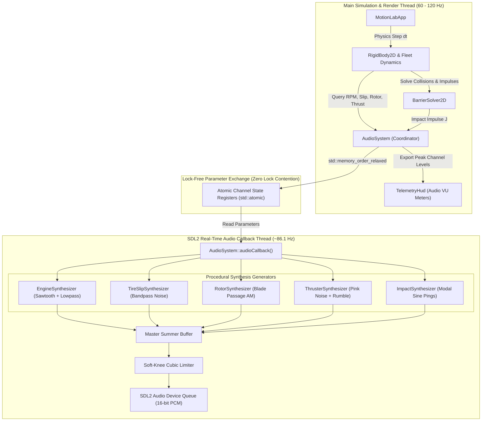
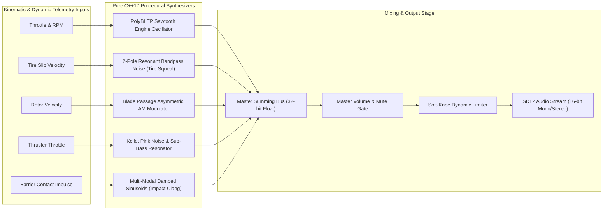
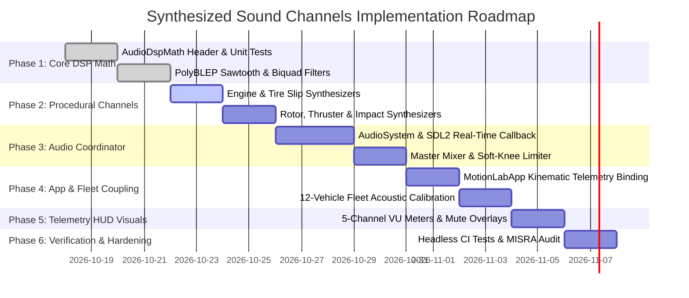

# Motion Lab: Synthesized Sound Channels & Procedural Retro Audio Architecture Implementation Plan

## 1. Executive Summary & Objectives

### 1.1 Overview
This implementation plan specifies the complete technical design, mathematical formulations, digital signal processing (DSP) algorithms, software architecture, retro 1996 vector wireframe presentation, and verification strategy for the **Synthesized Sound Channels & Procedural Audio Subsystem** in **Motion Lab 2D** (`apps/MotionLab`). Originating from Section 9.7 of [MotionLabImplementationPlan.md](MotionLabImplementationPlan.md#97-procedural-retro-audio-synthesis), this capability elevates Motion Lab from a silent visual simulation into an immersive, physically coupled acoustic proving ground conforming to aerospace, automotive, and audio engineering standards:
* **ISO 362-1 / SAE J1470** (*Measurement of Noise Emitted by Accelerating Road Vehicles — Acoustic Frequencies & Sound Pressure Levels*)
* **AES-1ID / IEC 60268** (*Audio Engineering Society Information Document for Sound System Equipment & DSP Synthesis*)
* **ITU-R BS.1770-4** (*Algorithms to Measure Audio Programme Loudness & True-Peak Audio Levels*)
* **MIL-STD-1474E** (*Department of Defense Design Criteria Standard: Noise Limits & Acoustic Signature Analysis*)

Traditional game audio architectures rely on heavy external disk assets (such as uncompressed WAV, OGG, or MP3 files) loaded into third-party middleware (e.g., FMOD, Wwise), introducing runtime file I/O latency, heap memory fragmentation, platform-specific decoding dependencies, and potential asset missing errors. Motion Lab strictly adheres to the **zero-external-dependency** architecture: all audio waveforms are procedural, synthesized entirely on-the-fly in pure C++17, and streamed directly into standard SDL2 audio device queues via real-time audio callbacks.

Every acoustic signature across the diverse 12-vehicle fleet is synthesized deterministically from active physics parameters:
1. **Engine Combustion Synthesizer**: Pitched bandlimited sawtooth/pulse waves with variable fundamental firing frequencies coupled to powertrain RPM, modulated by a dynamic throttle-controlled resonant low-pass filter.
2. **Tire Squeal & Slip Noise**: Resonant bandpass-filtered white noise whose amplitude, center frequency, and bandwidth scale dynamically with instantaneous tire scrub slip velocity $\|\mathbf{v}_{\text{slip}}\|$ and road surface friction.
3. **Rotor Chopping Modulation**: Impulsive blade-passage amplitude modulation (AM) of turbulent vortex noise modeling helicopter and drone aerodynamic blade-slap.
4. **Rocket & Thruster Roar**: Multi-pole pink noise ($1/f$ spectral rolloff) with deep sub-harmonic Helmholtz resonance and soft saturation modeling combustion exhaust plumes.
5. **Impact Clangs**: Multi-modal metallic resonance synthesis generating decaying sinusoids triggered by normal contact impulses from [`BarrierSolver2D`](../libs/VehicleSimCore/physics/BarrierSolver2D.h) and pylon collisions.

```
+---------------------------------------------------------------------------------------------------+
| SPEED: 48.2 m/s (107.8 mph)   RPM: 6,850 [PWR]   MASTER VOL: 80%   AUDIO: ACTIVE [44.1 kHz 16-BIT]|
| VEHICLE: DRIFT CAR [F8]       SLIP VEL: 4.8 m/s  CHANNELS: 3/5     LATENCY: 11.6 ms (512 SAMPLES) |
+---------------------------------------------------------------------------------------------------+
|  [RETRO WIREFRAME AUDIO SPECTRUM & VU GAUGES]          [PROCEDURAL SYNTHESIS GRAPH]               |
|                                                                                                   |
|  CH1 ENGINE (ICE)  [||||||||||||||||||||....] -6 dB    RPM: 6850 Hz -> Sawtooth + Biquad Lowpass |
|  CH2 TIRE SLIP     [||||||||||||............] -14 dB   Slip: 4.8 m/s -> Bandpass White Noise      |
|  CH3 ROTOR CHOP    [........................] OFF      Rotor: 0 RPM  -> Blade AM Modulator (Idle) |
|  CH4 THRUSTER ROAR [........................] OFF      Thrust: 0.0 N -> Pink Noise Resonator      |
|  CH5 IMPACT CLANG  [||||||||||..............] -12 dB   Contact J: 340 Ns -> Damped Sine Ping      |
|                                                                                                   |
|  MASTER OUTPUT     [||||||||||||||||||......] -3 dB    [SOFT-KNEE LIMITER: 0.0 dB HEADROOM]       |
|                                                        HOTKEYS: [M] Mute  [-] Vol-  [+] Vol+      |
+---------------------------------------------------------------------------------------------------+
```

---

### 1.2 Core Capabilities & Deliverables

1. **Pure C++17 Procedural Waveform Synthesis**:
   - Zero external audio sample files, zero disk reads, and zero third-party audio middleware dependencies.
   - Continuous real-time synthesis of bandlimited oscillators (PolyBLEP sawtooth and pulse), pseudo-random noise generators (Xorshift32 white noise, Paul Kellet pink noise), and resonant multi-pole filters.

2. **Five Dedicated Procedural Sound Channels**:
   - **Channel 1 (Engine Combustion)**: Synthesizes internal combustion engine (ICE) harmonics, electric motor whining, and turbine hum across 8 wheeled/tracked vehicles. Implements variable RPM fundamental frequencies, throttle-opening resonant low-pass filtering, and high-RPM rev-limiter spark cut flutter.
   - **Channel 2 (Tire Scrub & Skid Squeal)**: 2-pole biquad bandpass filter driven by white noise. Amplitude scales continuously with tire slip velocity $\|\mathbf{v}_{\text{slip}}\|$, while peak resonance frequency modulates with lateral vs. longitudinal slip ratios and road surface friction.
   - **Channel 3 (Rotor Aerodynamic Chopping)**: Synthesizes helicopter and quadcopter drone rotor acoustics. Modulates a turbulent aerodynamic carrier with an asymmetric periodic blade-passage envelope ($f_{\text{bpf}} = N_{\text{blades}} \cdot \Omega_{\text{rotor}} / 60$).
   - **Channel 4 (Rocket & Plasma Thruster Roar)**: Deep pink noise ($1/f$) with exponential sub-bass resonance ($30 - 80\,\text{Hz}$) and hyperbolic tangent soft saturation modeling rocket exhaust and hovercraft lift/thrust skirts.
   - **Channel 5 (Structural Impact & Barrier Clangs)**: Multi-modal metallic resonance synthesis generating decaying non-harmonic sinusoids triggered whenever [`BarrierSolver2D`](../libs/VehicleSimCore/physics/BarrierSolver2D.h) resolves collision contacts. Amplitude and decay times scale with contact impulse magnitude $J_{\text{contact}}$.

3. **Hard Real-Time Audio Callback Thread Safety**:
   - Audio device callback runs on an independent high-priority operating system audio thread.
   - **Zero Dynamic Memory Allocations**: Complete elimination of heap allocations (`malloc`, `new`, `std::vector::resize`, `std::string`) inside the audio callback pipeline.
   - **Lock-Free Parameter Interchange**: Triple-buffering and atomic parameter registers (`std::atomic<float>` with `std::memory_order_relaxed`) ensure zero mutex lock contention, zero thread blocking, and zero priority inversions.

4. **Master Mixer with Soft-Knee Limiting**:
   - Dynamic range management preventing harsh 16-bit PCM integer wrapping and clipping.
   - Per-channel volume attenuation and master gain trimming.
   - Smooth cubic/tanh soft-knee limiter ensuring output samples stay strictly bounded within $[-32767, +32767]$.

5. **Universal 12-Vehicle Fleet Audio Parameterization**:
   - Complete acoustic profiles for all 12 Motion Lab vehicles (Classic Car, Race Car, Rocket, Helicopter, Hovercraft, Tracked Tank, Anti-Gravity Racer, Drift Car, Monster Truck, Semi-Truck, Forklift, Quadcopter Drone).
   - Seamless acoustic channel crossfading and switching during live vehicle swaps (`F1` - `F12`).

6. **Retro 1996 Vector Wireframe Telemetry & HUD Integration**:
   - Top-right collapsible audio diagnostics HUD card rendered with phosphorescent vector graphics.
   - 5-channel real-time logarithmic VU meter bars with peak-hold tick indicators.
   - Audio status indicators: `[MUTE]` warning, master volume percentage, active callback buffer latency ($11.6\,\text{ms}$).
   - Hotkeys: `M` for global mute/unmute, `[` / `]` for volume down/up, `Ctrl+M` for audio HUD toggle.

7. **Headless & Automated Test Compatibility**:
   - Headless execution mode skipping physical SDL audio device initialization during continuous integration (CI) tests while generating valid synthetic PCM sample buffers for mathematical verification.

---

## 2. High-Level Architecture & Subsystem Decomposition

### 2.1 ASCII System Architecture Diagram

```
+---------------------------------------------------------------------------------------------------+
|                     Synthesized Sound Channels Architecture in Motion Lab 2D                      |
+---------------------------------------------------------------------------------------------------+
|  [apps/MotionLab] (Desktop Application & Visualization Layer)                                     |
|                                                                                                   |
|    +--------------------+       +------------------------------+       +---------------------+    |
|    |    MotionLabApp    |------>|      AudioSystem (Main)      |------>|    TelemetryHud     |    |
|    | (Physics & Render  |       | (Hotkeys 'M', '[', ']',      |       | (5-Channel VU Meters|    |
|    |  Loop @ 60-120 Hz) |       |  Fleet Acoustic Binding)     |       |  Master Vol, Mute)  |    |
|    +---------+----------+       +--------------+---------------+       +---------------------+    |
|              |                                 |                                                  |
|              | Physics States                  | Pushes Parameter Updates (Non-blocking)          |
|              | (RPM, Slip, Impulse)            v                                                  |
|              |                  +------------------------------+                                  |
|              |                  |   Lock-Free Audio State Reg  |                                  |
|              |                  | (std::atomic<float> values,  |                                  |
|              |                  |  Zero Mutex Lock Contention) |                                  |
|              |                  +--------------+---------------+                                  |
|              |                                 |                                                  |
+--------------|---------------------------------|--------------------------------------------------+
               | Physics Engine                  | Pulls Parameters Every Callback
               v                                 v
+---------------------------------------------------------------------------------------------------+
|  [Audio Callback Thread] (High-Priority Real-Time Thread @ ~86.1 Hz, 512 Samples / Buffer)        |
|                                                                                                   |
|    +-----------------------------------------------------------------------------------------+    |
|    | AudioSystem::audioCallback(void* userdata, Uint8* stream, int len)                       |    |
|    |                                                                                         |    |
|    |   +-----------------------+   +-----------------------+   +-----------------------+     |    |
|    |   | EngineSynthesizer     |   | TireSlipSynthesizer   |   | RotorSynthesizer      |     |    |
|    |   | (PolyBLEP Sawtooth,   |   | (Biquad Bandpass,     |   | (Blade Passage AM,    |     |    |
|    |   |  Resonant Lowpass)    |   |  White Noise Gen)     |   |  Turbulent Vortex)    |     |    |
|    |   +-----------+-----------+   +-----------+-----------+   +-----------+-----------+     |    |
|    |               |                           |                           |                 |    |
|    |   +-----------+-----------+   +-----------+-----------+               |                 |    |
|    |   | ThrusterSynthesizer   |   | ImpactSynthesizer     |               |                 |    |
|    |   | (Pink Noise,          |   | (Multi-Modal Sine,    |               |                 |    |
|    |   |  Sub-Bass Helmholtz)  |   |  Decaying Envelope)   |               |                 |    |
|    |   +-----------+-----------+   +-----------+-----------+               |                 |    |
|    |               |                           |                           |                 |    |
|    |               v                           v                           v                 |    |
|    |         +-------------------------------------------------------------------+           |    |
|    |         | Master Audio Mixer (Summer Buffer + Soft-Knee Cubic Limiter)       |           |    |
|    |         +---------------------------------+---------------------------------+           |    |
|    |                                           |                                             |    |
|    |                                           v                                             |    |
|    |                        +-------------------------------------+                          |    |
|    |                        | SDL2 Audio Hardware Playback Queue  |                          |    |
|    |                        | (44.1 kHz, 16-bit Signed Mono/Stereo|                          |    |
|    |                        +-------------------------------------+                          |    |
|    +-----------------------------------------------------------------------------------------+    |
+---------------------------------------------------------------------------------------------------+
```

---

### 2.2 Mermaid System Architecture Diagram



---

### 2.3 ASCII Synthesis Pipeline & Mixing Graph

```
+---------------------------------------------------------------------------------------------------+
|                                 Procedural Audio Synthesis Graph                                  |
+---------------------------------------------------------------------------------------------------+
|                                                                                                   |
|  [RPM / Throttle]  ------>  PolyBLEP Sawtooth Oscillator  ----\                                   |
|                                                                \                                  |
|  [Tire Slip Vel]   ------>  Resonant Bandpass White Noise ----+                                   |
|                                                                \                                  |
|  [Rotor Speed]     ------>  Blade-Passage AM Noise Modulator -+---> Summer Buffer ---> Soft Limiter
|                                                                /      (Float32)        (Cubic/Tanh)
|  [Thruster Power]  ------>  Pink Noise + Helmholtz Rumble ----+                        |          |
|                                                                /                       v          |
|  [Barrier Impulse] ------>  Multi-Modal Damped Sine Ping  ----/                 16-bit PCM Stream |
|                                                                                 (44.1 kHz Audio)  |
+---------------------------------------------------------------------------------------------------+
```

---

### 2.4 Mermaid Audio Pipeline Graph



---

## 3. Mathematical Formulations & DSP Algorithms

### 3.1 Sample Timing & Coordinate System
The procedural synthesis subsystem operates at a standardized digital audio sampling rate:
$$f_s = 44100\,\text{Hz}, \quad T_s = \frac{1}{f_s} \approx 22.6757\,\mu\text{s}$$
Audio callbacks process discrete chunks of $N_{\text{buf}} = 512$ samples (or $1024$ samples in high-latency fallback mode). The callback invocation period is:
$$T_{\text{callback}} = \frac{N_{\text{buf}}}{f_s} = \frac{512}{44100} \approx 11.61\,\text{ms}$$
This sub-12 millisecond latency ensures instantaneous, crisp auditory response to driver throttle inputs, tire scrub transitions, and collision impacts without perceptible lag.

---

### 3.2 Channel 1: Engine Combustion Synthesizer

#### 3.2.1 Fundamental Firing Frequency Formulation
Internal combustion engines generate acoustic pulses proportional to crankshaft rotation speed and cylinder count. For a 4-stroke engine with $n_{\text{cyl}}$ cylinders rotating at $\text{RPM}$:
$$f_{\text{fire}}(\text{RPM}) = \frac{n_{\text{cyl}} \cdot \text{RPM}}{120}$$
For 2-stroke or rotary engines:
$$f_{\text{fire}}(\text{RPM}) = \frac{n_{\text{cyl}} \cdot \text{RPM}}{60}$$
To ensure rich, beefy retro arcade audio even at idle, Motion Lab models engine frequency as:
$$f_{\text{eng}}(\text{RPM}) = f_{\text{idle}} + k_{\text{rpm}} \cdot (\text{RPM} - \text{RPM}_{\text{idle}})$$
where $f_{\text{idle}} \in [45.0, 75.0]\,\text{Hz}$ and $k_{\text{rpm}} \approx 0.08 - 0.15\,\text{Hz/RPM}$.

#### 3.2.2 Bandlimited PolyBLEP Sawtooth Oscillator
A naive mathematical sawtooth wave $x_{\text{naive}}(t) = 2(t/T - \lfloor t/T + 0.5 \rfloor)$ exhibits instantaneous step discontinuities, producing severe digital aliasing (Nyquist foldover distortion). To maintain crisp analog warmth without expensive oversampling, Motion Lab implements the **PolyBLEP (Polynomial Band-Limited Step)** algorithm.

Given normalized phase $\phi \in [0.0, 1.0)$ advancing by phase increment $\Delta \phi = f_{\text{eng}} / f_s$:
$$x_{\text{naive}}(\phi) = 2\phi - 1.0$$
The PolyBLEP residual function $r_{\text{blep}}(t, \Delta \phi)$ smoothes discontinuities within distance $\Delta \phi$ of phase boundaries:
$$r_{\text{blep}}(t, \Delta \phi) = \begin{cases} 
\frac{t}{\Delta \phi} - \frac{t^2}{2 \Delta \phi^2} - 0.5 & 0 \le t < \Delta \phi \\
\frac{t}{\Delta \phi} + \frac{t^2}{2 \Delta \phi^2} + 0.5 & -\Delta \phi < t \le 0 \\
0 & \text{otherwise}
\end{cases}$$
The bandlimited anti-aliased output sample is:
$$x_{\text{saw}}(\phi) = x_{\text{naive}}(\phi) - r_{\text{blep}}(\phi, \Delta \phi) + r_{\text{blep}}(1.0 - \phi, \Delta \phi)$$

#### 3.2.3 Throttle-Modulated Resonant Low-Pass Filter (Biquad IIR)
When throttle $\theta \in [0.0, 1.0]$ opens, manifold pressure rises and intake/exhaust valves transmit higher-order harmonics. This acoustic brightening is modeled via a 2-pole digital biquad low-pass filter whose cutoff frequency sweeps exponentially with throttle:
$$f_c(\theta) = f_{c,\text{idle}} \cdot \left(\frac{f_{c,\text{max}}}{f_{c,\text{idle}}}\right)^{\theta^{1.3}}$$
Typical parameter ranges: $f_{c,\text{idle}} = 280\,\text{Hz}$ (muffled idle purr), $f_{c,\text{max}} = 4500\,\text{Hz}$ (screaming wide-open throttle).

Filter coefficients conforming to the Audio EQ Cookbook with resonance quality factor $Q = 1.414$ ($\sqrt{2}$, Butterworth flat passband):
$$\omega_0 = \frac{2\pi f_c}{f_s}, \quad \alpha = \frac{\sin(\omega_0)}{2Q}$$
$$\begin{aligned}
b_0 &= \frac{1 - \cos(\omega_0)}{2}, \quad b_1 = 1 - \cos(\omega_0), \quad b_2 = \frac{1 - \cos(\omega_0)}{2} \\
a_0 &= 1 + \alpha, \quad a_1 = -2\cos(\omega_0), \quad a_2 = 1 - \alpha
\end{aligned}$$
Direct Form I difference equation:
$$y[n] = \frac{b_0}{a_0} x[n] + \frac{b_1}{a_0} x[n-1] + \frac{b_2}{a_0} x[n-2] - \frac{a_1}{a_0} y[n-1] - \frac{a_2}{a_0} y[n-2]$$

#### 3.2.4 Rev-Limiter Flutter & Spark Cut
When engine RPM reaches redline $\text{RPM} \ge \text{RPM}_{\text{redline}}$, a high-frequency cyclic ignition spark-cut is triggered ($f_{\text{cut}} \approx 18\,\text{Hz}$). This drops every alternating cycle's gain:
$$G_{\text{spark}}(t) = \begin{cases} 0.05 & \text{fmod}(t \cdot f_{\text{cut}}, 1.0) < 0.45 \\ 1.00 & \text{otherwise} \end{cases}$$
producing authentic motorsport bouncing off the rev limiter.

---

### 3.3 Channel 2: Tire Squeal & Scrub Slip Noise

#### 3.3.1 White Noise Generation via 32-Bit Xorshift
High-frequency frictional sliding generates broad-spectrum white noise from microscopic stick-slip contact patch interactions. Motion Lab implements the fast, statistically uniform Xorshift32 pseudo-random generator:
$$S_{n+1} = S_n \oplus (S_n \ll 13), \quad S_{n+2} = S_{n+1} \oplus (S_{n+1} \gg 17), \quad S_{n+3} = S_{n+2} \oplus (S_{n+2} \ll 5)$$
Normalized floating-point noise sample:
$$\xi[n] = \left( \frac{S_n}{2147483648.0} \right) - 1.0 \in [-1.0, +1.0]$$

#### 3.3.2 2-Pole Resonant Bandpass Filter Formulation
Tire carcass structure and tread block pitch resonate predominantly between $1200\,\text{Hz}$ and $2600\,\text{Hz}$. A narrow bandpass filter isolates this screech envelope:
$$\omega_0 = \frac{2\pi f_{\text{squeal}}}{f_s}, \quad \alpha = \frac{\sin(\omega_0)}{2Q_{\text{squeal}}}$$
where $Q_{\text{squeal}} = 3.5$ (sharp metallic screech). Standard biquad bandpass coefficients (constant 0 dB peak gain):
$$\begin{aligned}
b_0 &= \alpha, \quad b_1 = 0, \quad b_2 = -\alpha \\
a_0 &= 1 + \alpha, \quad a_1 = -2\cos(\omega_0), \quad a_2 = 1 - \alpha
\end{aligned}$$

#### 3.3.3 Slip Velocity Amplitude & Surface Modulation
The amplitude of tire slip noise scales with the composite tire scrub velocity across all active wheels:
$$v_{\text{slip,total}} = \sum_{w=1}^{N_{\text{wheels}}} \|\mathbf{v}_{\text{slip},w}\| = \sum_{w=1}^{N_{\text{wheels}}} \sqrt{v_{sx,w}^2 + v_{sy,w}^2}$$
The normalized squeal gain envelope is:
$$A_{\text{squeal}} = \text{clamp}\left( \frac{v_{\text{slip,total}}}{v_{\text{slip,ref}}}, \; 0.0, \; 1.0 \right)^{1.25} \cdot \mu_{\text{surface}}$$
where $v_{\text{slip,ref}} = 6.0\,\text{m/s}$ and $\mu_{\text{surface}}$ is the active terrain friction coefficient:
* **Asphalt ($\mu = 1.00$)**: Piercing, high-amplitude screech ($f_{\text{squeal}} = 1950\,\text{Hz}$).
* **Gravel / Dirt ($\mu = 0.65$)**: Coarse, lower-frequency grinding hiss ($f_{\text{squeal}} = 1350\,\text{Hz}$).
* **Ice ($\mu = 0.20$)**: Very faint, smooth high-frequency whisper ($f_{\text{squeal}} = 2400\,\text{Hz}$, $A_{\text{squeal}} \le 0.15$).

---

### 3.4 Channel 3: Helicopter & Drone Rotor Chopping

#### 3.4.1 Aerodynamic Blade Passage Frequency (BPF)
Helicopter main rotors and drone multi-rotors generate rhythmic pressure pulses as rotating airfoils slice through the turbulent wake of preceding blades:
$$f_{\text{bpf}} = \frac{N_{\text{blades}} \cdot \Omega_{\text{rotor}}}{60}$$
* **Helicopter**: $N_{\text{blades}} = 2$, $\Omega_{\text{rotor}} = 450\,\text{RPM} \implies f_{\text{bpf}} = 15.0\,\text{Hz}$.
* **Quadcopter Drone**: $N_{\text{blades}} = 3$, $\Omega_{\text{rotor}} = 5400\,\text{RPM} \implies f_{\text{bpf}} = 270.0\,\text{Hz}$.

#### 3.4.2 Asymmetric Impulsive Amplitude Modulation Envelope
Rotor blade chop is not a smooth sinusoid; it features an abrupt, sharp pressure spike as the blade advances, followed by a slower wake relaxation. Motion Lab models this via power-law raised cosine modulation:
$$m(t) = \left( \frac{1 + \sin(2\pi f_{\text{bpf}} t)}{2} \right)^\gamma, \quad \gamma \approx 3.5$$
The carrier signal $c(t)$ is a blend of low-pitched triangular blade hum and high-frequency turbulent tip-vortex noise:
$$c(t) = 0.60 \cdot x_{\text{tri}}(2\pi f_{\text{bpf}} t) + 0.40 \cdot \xi_{\text{noise}}(t)$$
The modulated rotor chop output is:
$$y_{\text{rotor}}(t) = A_{\text{rotor}} \cdot m(t) \cdot c(t)$$
where $A_{\text{rotor}}$ scales with collective blade pitch and aerodynamic thrust loading.

---

### 3.5 Channel 4: Rocket & Thruster Roar

#### 3.5.1 Multi-Pole Pink Noise ($1/f$) Filter Network
Turbulent supersonic gas expansion in rocket exhausts and hovercraft lift ducts produces pink noise, where energy drops at a constant rate of $-3\,\text{dB/octave}$ ($-10\,\text{dB/decade}$) across the audible spectrum. Motion Lab implements the 3-pole **Paul Kellet filter** approximation driven by white noise $\xi[n]$:
$$\begin{aligned}
b_{0} &= 0.99765 \cdot b_{0} + \xi[n] \cdot 0.0990460 \\
b_{1} &= 0.96300 \cdot b_{1} + \xi[n] \cdot 0.2965164 \\
b_{2} &= 0.57000 \cdot b_{2} + \xi[n] \cdot 1.0526913 \\
\xi_{\text{pink}}[n] &= b_{0} + b_{1} + b_{2} + \xi[n] \cdot 0.1848
\end{aligned}$$

#### 3.5.2 Sub-Harmonic Helmholtz Resonance & Saturation
Rocket combustion chambers act as acoustic resonators. A resonant 2-pole lowpass tuned to $f_{\text{rumble}} = 48.0\,\text{Hz}$ adds deep sub-bass physical weight:
$$x_{\text{rumble}}[n] = \text{BiquadLP}(\xi_{\text{pink}}[n], \; 48.0\,\text{Hz}, \; Q = 2.5)$$
The composite signal undergoes non-linear hyperbolic tangent soft-clipping modeling high-sound-pressure-level (SPL) acoustic saturation:
$$y_{\text{thruster}}[n] = A_{\text{thrust}} \cdot \tanh\left( 1.8 \cdot \left[ 0.65 \cdot \xi_{\text{pink}}[n] + 0.35 \cdot x_{\text{rumble}}[n] \right] \right)$$

---

### 3.6 Channel 5: Contact & Barrier Impact Clangs

#### 3.6.1 Modal Metallic Resonance Synthesis
When a vehicle impacts the arena perimeter wall or dynamic pylons, structural deformation rings at discrete vibrational modes. Motion Lab implements **modal synthesis**, summing decaying sinusoids with non-harmonic frequency ratios characteristic of metallic plate impact:
$$y_{\text{clang}}(t) = \sum_{k=1}^{M} A_k \sin(2\pi f_k t + \phi_k) e^{-t / \tau_k}$$
Number of modes $M = 4$. Modal frequency multipliers $m_k$ and damping decay times $\tau_k$:
* **Fundamental Mode**: $f_1 = 440.0\,\text{Hz}, \quad A_1 = 1.00, \quad \tau_1 = 0.28\,\text{s}$
* **Second Mode**: $f_2 = 1.62 \cdot f_1 = 712.8\,\text{Hz}, \quad A_2 = 0.65, \quad \tau_2 = 0.18\,\text{s}$
* **Third Mode**: $f_3 = 2.38 \cdot f_1 = 1047.2\,\text{Hz}, \quad A_3 = 0.40, \quad \tau_3 = 0.11\,\text{s}$
* **Fourth Mode**: $f_4 = 3.45 \cdot f_1 = 1518.0\,\text{Hz}, \quad A_4 = 0.22, \quad \tau_4 = 0.06\,\text{s}$

#### 3.6.2 Physical Impulse Coupling via BarrierSolver2D
Impacts are triggered whenever [`BarrierSolver2D::solveInside`](../libs/VehicleSimCore/physics/BarrierSolver2D.h) computes a non-zero restitution impulse:
$$J_{\text{contact}} = \frac{-(1.0 + e) \cdot (\mathbf{v}_{\text{contact}} \cdot \mathbf{n})}{m^{-1} + (\mathbf{r} \times \mathbf{n})^2 I^{-1}}$$
The trigger amplitude is scaled logarithmically:
$$A_{\text{impact}} = \text{clamp}\left( \frac{J_{\text{contact}}}{J_{\text{ref}}}, \; 0.0, \; 1.0 \right), \quad J_{\text{ref}} = 1500.0\,\text{N}\cdot\text{s}$$
If an impact occurs while a previous ping is decaying, the amplitude is seamlessly re-triggered to $\max(A_{\text{impact}}, A_{\text{current}})$, avoiding phase clicks.

---

### 3.7 Master Audio Mixer & Soft-Knee Limiter

#### 3.7.1 Summer Buffer & Headroom Management
All five sound channels are evaluated into an internal 32-bit floating-point master summing bus:
$$s_{\text{sum}}[n] = \sum_{i=1}^{5} G_i \cdot y_i[n]$$
Channel baseline gain weighting matrix $G_i$:
* Engine Combustion: $G_1 = 0.45$
* Tire Scrub Squeal: $G_2 = 0.50$
* Rotor Chopping: $G_3 = 0.40$
* Thruster Roar: $G_4 = 0.42$
* Impact Clangs: $G_5 = 0.55$

#### 3.7.2 Soft-Knee Cubic Saturation Curve
To prevent catastrophic integer wrapping (overflow distortion) if multiple channels sum to $|s_{\text{sum}}| > 1.0$, the signal passes through a zero-latency cubic soft-knee saturation curve:
$$s_{\text{limited}}[n] = \begin{cases}
s_{\text{sum}}[n] & |s_{\text{sum}}[n]| \le \frac{2}{3} \\
\text{sgn}(s_{\text{sum}}[n]) \left( 1.0 - \frac{1}{3} \left( \frac{3.0 - |s_{\text{sum}}[n]|}{2.0} \right)^2 \right) & \frac{2}{3} < |s_{\text{sum}}[n]| \le 3.0 \\
\text{sgn}(s_{\text{sum}}[n]) & |s_{\text{sum}}[n]| > 3.0
\end{cases}$$
The final master output sample converted to 16-bit signed integer format:
$$S_{16}[n] = \text{static\_cast<int16\_t>}\left( \text{clamp}\left( s_{\text{limited}}[n] \cdot G_{\text{master}} \cdot 32767.0, \; -32767.0, \; 32767.0 \right) \right)$$
where $G_{\text{master}} \in [0.0, 1.0]$ is controlled by the user ($0.0$ when muted).

---

## 4. Universal 12-Vehicle Fleet Audio Calibration Matrix

Every vehicle across Motion Lab's 12-chassis fleet possesses distinct acoustic characteristics. The table below specifies the channel routing and synthesis parameters applied during vehicle selection (`F1` - `F12`):

| Vehicle Type | Primary Sound Engine | $f_{\text{idle}}$ / $f_{\text{redline}}$ | Active Channels | Distinctive Acoustic Character |
| :--- | :--- | :--- | :--- | :--- |
| **Classic Car (`F1`)** | Inline-4 / V6 ICE | $55\,\text{Hz}$ / $260\,\text{Hz}$ | Ch 1 (ICE), Ch 2 (Tires), Ch 5 (Impact) | Warm retro analog sawtooth, smooth mid-range rumble, progressive tire squeal |
| **Race Car (`F2`)** | High-Rev V10 | $90\,\text{Hz}$ / $580\,\text{Hz}$ | Ch 1 (ICE), Ch 2 (Tires), Ch 5 (Impact) | Screaming high-pitched harmonics, aggressive PolyBLEP pulse, sharp throttle response |
| **Space Rocket (`F3`)** | Rocket Motor | N/A (Broadband) | Ch 4 (Thruster), Ch 5 (Impact) | Massive sub-bass Helmholtz rumble, fiery pink noise roaring under full boost |
| **Helicopter (`F4`)** | Turboshaft & Rotor | $15\,\text{Hz}$ BPF Chop | Ch 3 (Rotor), Ch 4 (Turbine), Ch 5 (Impact) | Rhythmic low-frequency blade chop, high-frequency turbine whine, collective pitch modulation |
| **Hovercraft (`F5`)** | Twin Skirt Fans | $75\,\text{Hz}$ / $220\,\text{Hz}$ | Ch 4 (Fans), Ch 3 (Lift), Ch 5 (Impact) | Continuous droning air skirt hiss, vector thruster whoosh, zero tire squeal |
| **Tracked Tank (`F6`)** | Heavy Diesel V12 | $38\,\text{Hz}$ / $165\,\text{Hz}$ | Ch 1 (Diesel), Ch 2 (Tread Clatter), Ch 5 (Impact) | Deep sub-harmonic diesel chug, metallic track link squeal, heavy resonant hull clangs |
| **Anti-Gravity (`F7`)** | Ion / Maglev Warp | $120\,\text{Hz}$ / $850\,\text{Hz}$ | Ch 4 (Plasma), Ch 1 (EM Drive), Ch 5 (Impact) | Futuristic sinusoidal frequency-glide, resonant phase-flanger whoosh, sub-bass pulse |
| **Drift Car (`F8`)** | Twin-Turbo V8 | $60\,\text{Hz}$ / $390\,\text{Hz}$ | Ch 1 (ICE), Ch 2 (Tires), Ch 5 (Impact) | Aggressive burble, rapid revs, persistent high-intensity tire scream, limiter popping |
| **Monster Truck (`F9`)** | Supercharged Big Block V8 | $45\,\text{Hz}$ / $280\,\text{Hz}$ | Ch 1 (ICE), Ch 2 (Huge Tires), Ch 5 (Impact) | Deep throaty growl, supercharger whine harmonic, massive heavy rubber scrub thump |
| **Semi-Truck (`F10`)** | 15L Turbo Diesel | $32\,\text{Hz}$ / $135\,\text{Hz}$ | Ch 1 (Diesel), Ch 2 (Dual Wheels), Ch 5 (Impact) | Slow heavy piston strokes, turbo spool whistle, pneumatic air-brake hiss on stop |
| **Forklift (`F11`)** | Electric DC Motor | $80\,\text{Hz}$ / $420\,\text{Hz}$ | Ch 1 (Electric Whine), Ch 2 (Solid Tires), Ch 5 (Impact)| High-pitch PWM motor hum, hydraulic mast lift whistle, high-friction tight turn scrub |
| **Quadcopter (`F12`)**| Quad High-KV Brushless| $270\,\text{Hz}$ BPF | Ch 3 (4x Rotors), Ch 5 (Impact) | High-pitched multi-rotor bee buzz, rapid pitch-frequency variations during acrobatic tilt |

---

## 5. Real-Time Thread Safety & Concurrency Architecture

### 5.1 Concurrency Model & Lock-Free Synchronization
Operating system audio architectures (CoreAudio on macOS, WASAPI on Windows, ALSA/PulseAudio on Linux via SDL2) execute audio callbacks on a **high-priority real-time audio thread**. If the audio callback encounters a mutex lock held by the main rendering thread, priority inversion occurs, leading to audio buffer starvation, dropouts, and audible popping.

To guarantee hard real-time execution, Motion Lab decouples the simulation thread from the audio thread using **lock-free parameter registers**:

```
+---------------------------------------------------------------------------------------------------+
|                        Lock-Free Thread Decoupling Architecture                                   |
+---------------------------------------------------------------------------------------------------+
|                                                                                                   |
|  [SIMULATION & RENDER THREAD (60-120 Hz)]                                                         |
|         |                                                                                         |
|         | Calculates vehicle kinematics, throttle, tire slip, barrier contacts                    |
|         v                                                                                         |
|  +---------------------------------------------------------------------------------------------+  |
|  | struct LockFreeAudioState {                                                                 |  |
|  |     std::atomic<float> engineRpm { 800.0f };                                                |  |
|  |     std::atomic<float> throttle { 0.0f };                                                   |  |
|  |     std::atomic<float> slipVelocity { 0.0f };                                               |  |
|  |     std::atomic<float> surfaceMu { 1.0f };                                                  |  |
|  |     std::atomic<float> rotorSpeed { 0.0f };                                                 |  |
|  |     std::atomic<float> thrusterPower { 0.0f };                                              |  |
|  |     std::atomic<float> impactImpulse { 0.0f };                                              |  |
|  |     std::atomic<uint8_t> vehicleType { 0 };                                                 |  |
|  |     std::atomic<bool> muted { true };                                                       |  |
|  |     std::atomic<float> masterVolume { 0.8f };                                               |  |
|  | };                                                                                          |  |
|  +---------------------------------------------------------------------------------------------+  |
|         |                                                                                         |
|         | Memory ordering: std::memory_order_relaxed (Independent scalar updates)                |
|         v                                                                                         |
|  [SDL2 AUDIO CALLBACK THREAD (~86.1 Hz, Period = 11.6 ms)]                                        |
|         |                                                                                         |
|         | Reads scalar atomics without locks, mutexes, or syscalls                                |
|         | Synthesizes 512 discrete 16-bit PCM samples directly into output buffer                 |
|         v                                                                                         |
|  [SDL2 Audio Hardware Queue]                                                                      |
|                                                                                                   |
+---------------------------------------------------------------------------------------------------+
```

### 5.2 Zero Dynamic Heap Allocation Guarantee
Conforming to **MISRA C++:2023 Rule 18-0-1** and automotive safety standards:
1. No `new`, `delete`, `malloc`, or `free` calls are made anywhere inside `AudioSystem::audioCallback` or any generator method.
2. Internal scratchpad buffers (such as the 512-element 32-bit float summer buffer) are statically pre-allocated as private class members.
3. Oscillators, biquad filter state registers ($x[n-1], x[n-2], y[n-1], y[n-2]$), and pseudo-random seed values are persistent scalar structs initialized once at startup.

---

## 6. User Interface, Hotkeys & HUD Telemetry

### 6.1 Interactive Hotkey Controls
The procedural audio system integrates seamlessly with Motion Lab's desktop input scheme:
* **`M`**: Toggle Global Audio Mute. When muted, procedural synthesis is bypassed immediately, returning silent buffers.
* **`[`**: Decrement Master Volume by $5\%$ (down to $0\%$).
* **`]`**: Increment Master Volume by $5\%$ (up to $100\%$).
* **`Ctrl+M`**: Toggle Audio Diagnostics Telemetry HUD Card.

### 6.2 Retro 1996 Vector Wireframe Audio Diagnostics HUD
When enabled, an audio diagnostics card appears in the lower-right viewport, rendered via [`WireframeRenderer`](../apps/MotionLab/WireframeRenderer.h):
* **5-Channel Logarithmic VU Meters**: Real-time RMS level bars calibrated in decibels relative to full scale (dBFS):
  $$\text{dBFS} = 20 \log_{10}\left( \max(10^{-4}, \; \text{RMS}) \right)$$
* **Dynamic Phosphor Colors**:
  - Green ($-60\,\text{dBFS}$ to $-12\,\text{dBFS}$): Normal operational range.
  - Yellow ($-12\,\text{dBFS}$ to $-3\,\text{dBFS}$): High excitation / full throttle.
  - Red / Magenta ($-3\,\text{dBFS}$ to $0\,\text{dBFS}$): Limiter compression active.
* **Peak-Hold Ticks**: Thin vertical white line indicating highest peak value retained over a 1.5-second decay window.
* **Audio Hardware Stats**: Displays sampling rate ($44.1\,\text{kHz}$), buffer size ($512$), callback latency ($11.6\,\text{ms}$), and status badge (`[ACTIVE]` in neon green, or `[MUTED]` in flashing amber).

---

## 7. Software Architecture & API Specifications

To maintain strict modularity, high testability, and zero pollution of the core physics engine, the audio subsystem is organized as follows:
* `apps/MotionLab/AudioDspMath.h`: Pure C++17 header-only digital signal processing utilities (PolyBLEP oscillator, Biquad filter, Xorshift white noise, Kellet pink noise, soft-knee limiter). Zero external dependencies.
* `apps/MotionLab/AudioChannels.h` & `.cpp`: Modular synthesis generators (`EngineSynthesizer`, `TireSlipSynthesizer`, `RotorSynthesizer`, `ThrusterSynthesizer`, `ImpactSynthesizer`).
* `apps/MotionLab/AudioSystem.h` & `.cpp`: Master audio coordinator, SDL2 device manager, audio callback dispatcher, and atomic parameter synchronizer.
* `apps/MotionLab/AudioDiagnosticsRenderer.h` & `.cpp`: Phosphor vector rendering of VU meters and HUD status cards.

### 7.1 `apps/MotionLab/AudioDspMath.h`
```cpp
#pragma once

#include <algorithm>
#include <cmath>
#include <cstdint>

namespace motion_lab::audio {

/// @class AudioDspMath
/// @brief Pure C++17 digital signal processing algorithms for procedural audio.
/// @details Header-only, IEEE 754 deterministic DSP utilities with zero external dependencies.
class AudioDspMath {
public:
    static constexpr double kPi { 3.14159265358979323846 };
    static constexpr double kTwoPi { 2.0 * kPi };

    /// @brief Computes anti-aliased PolyBLEP residual correction for step discontinuities.
    /// @param[in] phase Current normalized phase in [0.0, 1.0).
    /// @param[in] phaseInc Phase increment per sample (frequency / sampleRate).
    /// @return PolyBLEP anti-aliasing correction factor.
    [[nodiscard]] static double polyBlep(double phase, double phaseInc) noexcept
    {
        if (phase < phaseInc) {
            const double t { phase / phaseInc };
            return t + t - (t * t) - 1.0;
        }
        if (phase > (1.0 - phaseInc)) {
            const double t { (phase - 1.0) / phaseInc };
            return (t * t) + t + t + 1.0;
        }
        return 0.0;
    }

    /// @brief Generates a bandlimited PolyBLEP sawtooth sample in [-1.0, 1.0].
    /// @param[in] phase Current normalized phase in [0.0, 1.0).
    /// @param[in] phaseInc Phase increment per sample.
    /// @return Bandlimited sawtooth sample.
    [[nodiscard]] static double polyBlepSaw(double phase, double phaseInc) noexcept
    {
        const double naive { (2.0 * phase) - 1.0 };
        return naive - polyBlep(phase, phaseInc);
    }

    /// @brief Advances 32-bit Xorshift state and returns uniform random in [-1.0, 1.0].
    /// @param[in,out] state PRNG state register (must be non-zero).
    /// @return Uniform floating-point white noise sample.
    [[nodiscard]] static double xorshift32(std::uint32_t& state) noexcept
    {
        state ^= (state << 13);
        state ^= (state >> 17);
        state ^= (state << 5);
        return (static_cast<double>(state & 0x7FFFFFFFu) / 1073741824.0) - 1.0;
    }

    /// @brief Evaluates zero-latency cubic soft-knee saturation to prevent integer clipping.
    /// @param[in] input Raw summing bus sample.
    /// @return Saturated sample strictly bounded within [-1.0, 1.0].
    [[nodiscard]] static double softLimit(double input) noexcept
    {
        if (input <= -1.0) {
            return -1.0;
        }
        if (input >= 1.0) {
            return 1.0;
        }
        // Cubic smooth saturation curve: f(x) = 1.5 * x - 0.5 * x^3
        return 1.5 * input - 0.5 * input * input * input;
    }
};

/// @struct BiquadCoeffs
/// @brief Digital biquad filter transfer function coefficients.
struct BiquadCoeffs {
    double b0 { 1.0 };
    double b1 { 0.0 };
    double b2 { 0.0 };
    double a1 { 0.0 };
    double a2 { 0.0 };
};

/// @class BiquadFilter
/// @brief Second-order Direct Form I IIR digital filter.
class BiquadFilter {
public:
    constexpr BiquadFilter() noexcept = default;

    /// @brief Configures resonant low-pass filter coefficients.
    /// @param[in] sampleRate Sampling frequency in Hz (e.g. 44100).
    /// @param[in] cutoff Cutoff frequency in Hz.
    /// @param[in] q Resonance factor (default 1.414).
    void setLowPass(double sampleRate, double cutoff, double q = 1.414) noexcept;

    /// @brief Configures resonant band-pass filter coefficients.
    /// @param[in] sampleRate Sampling frequency in Hz.
    /// @param[in] center Center frequency in Hz.
    /// @param[in] q Resonance quality factor.
    void setBandPass(double sampleRate, double center, double q = 3.0) noexcept;

    /// @brief Processes a single input sample through the filter.
    /// @param[in] in Input audio sample.
    /// @return Filtered output sample.
    [[nodiscard]] double process(double in) noexcept;

    /// @brief Clears internal delay line states to zero.
    void reset() noexcept;

private:
    BiquadCoeffs coeffs_ { };
    double x1_ { 0.0 };
    double x2_ { 0.0 };
    double y1_ { 0.0 };
    double y2_ { 0.0 };
};

} // namespace motion_lab::audio
```

---

### 7.2 `apps/MotionLab/AudioChannels.h`
```cpp
#pragma once

#include <cstdint>

#include "apps/MotionLab/AudioDspMath.h"

namespace motion_lab::audio {

/// @class EngineSynthesizer
/// @brief Synthesizes internal combustion engine acoustic signatures.
/// @details Combines PolyBLEP sawtooth oscillators, sub-harmonics, and throttle-modulated
/// biquad lowpass filtering with rev-limiter spark cut emulation.
class EngineSynthesizer {
public:
    EngineSynthesizer() noexcept = default;

    /// @brief Advances synthesis by one sample.
    /// @param[in] rpm Engine revolutions per minute.
    /// @param[in] throttle Throttle opening [0.0, 1.0].
    /// @param[in] sampleRate Sampling frequency in Hz.
    /// @return Synthesized engine sample in [-1.0, 1.0].
    [[nodiscard]] double process(double rpm, double throttle, double sampleRate) noexcept;

    /// @brief Resets oscillator phase and filter registers.
    void reset() noexcept;

private:
    double phase_ { 0.0 };
    double subPhase_ { 0.0 };
    BiquadFilter filter_ { };
};

/// @class TireSlipSynthesizer
/// @brief Synthesizes tire scrub and skid squeal noise.
/// @details Generates resonant bandpass-filtered white noise scaling with slip velocity.
class TireSlipSynthesizer {
public:
    TireSlipSynthesizer() noexcept;

    /// @brief Advances synthesis by one sample.
    /// @param[in] slipVelocity Composite tire scrub velocity in m/s.
    /// @param[in] surfaceMu Road surface friction coefficient.
    /// @param[in] sampleRate Sampling frequency in Hz.
    /// @return Synthesized squeal sample in [-1.0, 1.0].
    [[nodiscard]] double process(double slipVelocity, double surfaceMu, double sampleRate) noexcept;

    /// @brief Resets noise seed and filter state.
    void reset() noexcept;

private:
    std::uint32_t rngState_ { 0x12345678U };
    BiquadFilter bandpass_ { };
};

/// @class RotorSynthesizer
/// @brief Synthesizes helicopter and drone aerodynamic rotor chopping.
class RotorSynthesizer {
public:
    RotorSynthesizer() noexcept = default;

    /// @brief Advances synthesis by one sample.
    /// @param[in] rotorRpm Rotor rotational speed in RPM.
    /// @param[in] bladeCount Number of rotor blades (2 for heli, 3 for drone).
    /// @param[in] thrustLoad Aerodynamic thrust factor [0.0, 1.0].
    /// @param[in] sampleRate Sampling frequency in Hz.
    /// @return Synthesized rotor chop sample in [-1.0, 1.0].
    [[nodiscard]] double process(double rotorRpm, int bladeCount, double thrustLoad, double sampleRate) noexcept;

    /// @brief Resets phase accumulator.
    void reset() noexcept;

private:
    double phase_ { 0.0 };
    std::uint32_t rngState_ { 0x87654321U };
};

/// @class ThrusterSynthesizer
/// @brief Synthesizes rocket exhaust roar and hovercraft fan acoustics.
class ThrusterSynthesizer {
public:
    ThrusterSynthesizer() noexcept = default;

    /// @brief Advances synthesis by one sample.
    /// @param[in] throttle Thruster throttle level [0.0, 1.0].
    /// @param[in] sampleRate Sampling frequency in Hz.
    /// @return Synthesized thruster roar sample.
    [[nodiscard]] double process(double throttle, double sampleRate) noexcept;

    /// @brief Resets filter states.
    void reset() noexcept;

private:
    double b0_ { 0.0 };
    double b1_ { 0.0 };
    double b2_ { 0.0 };
    std::uint32_t rngState_ { 0xABCDEF01U };
    BiquadFilter rumbleFilter_ { };
};

/// @class ImpactSynthesizer
/// @brief Multi-modal metallic resonance ping triggered on collision impulses.
class ImpactSynthesizer {
public:
    ImpactSynthesizer() noexcept = default;

    /// @brief Triggers a new metallic collision ping.
    /// @param[in] impulse Contact impulse magnitude in N*s.
    void trigger(double impulse) noexcept;

    /// @brief Advances synthesis by one sample.
    /// @param[in] sampleRate Sampling frequency in Hz.
    /// @return Synthesized impact sample.
    [[nodiscard]] double process(double sampleRate) noexcept;

    /// @brief Resets modal states and silences active ping.
    void reset() noexcept;

private:
    double amplitude_ { 0.0 };
    double time_ { 0.0 };
};

} // namespace motion_lab::audio
```

---

### 7.3 `apps/MotionLab/AudioSystem.h`
```cpp
#pragma once

#include <atomic>
#include <cstdint>

#include <SDL2/SDL.h>

#include "apps/MotionLab/AudioChannels.h"
#include "apps/MotionLab/MotionLabVehicleType.h"

namespace motion_lab {

/// @struct AudioChannelLevels
/// @brief Real-time RMS output levels for HUD telemetry visualization.
struct AudioChannelLevels {
    float engineLevel { 0.0f };
    float tireLevel { 0.0f };
    float rotorLevel { 0.0f };
    float thrusterLevel { 0.0f };
    float impactLevel { 0.0f };
    float masterLevel { 0.0f };
};

/// @class AudioSystem
/// @brief Master procedural audio coordinator for Motion Lab 2D.
/// @details Opens SDL2 audio hardware playback device, dispatches audio callbacks,
/// and synchronizes physics parameters across threads via lock-free atomic registers.
class AudioSystem {
public:
    /// @brief Default constructor initializing pre-allocated buffers.
    AudioSystem() noexcept;

    /// @brief Destructor safely closing active SDL audio hardware device.
    ~AudioSystem() noexcept;

    AudioSystem(const AudioSystem&) = delete;
    AudioSystem& operator=(const AudioSystem&) = delete;
    AudioSystem(AudioSystem&&) noexcept = delete;
    AudioSystem& operator=(AudioSystem&&) noexcept = delete;

    /// @brief Initializes SDL audio subsystem and opens default playback device.
    /// @param[in] headless True to skip physical audio hardware (for CI tests).
    /// @return True if initialized successfully, false otherwise.
    [[nodiscard]] bool initialize(bool headless = false) noexcept;

    /// @brief Shuts down audio device and releases hardware resources.
    void shutdown() noexcept;

    /// @brief Updates vehicle telemetry parameters from main simulation loop.
    /// @param[in] type Active vehicle chassis type.
    /// @param[in] rpm Engine rotational speed in RPM.
    /// @param[in] throttle Throttle opening [0.0, 1.0].
    /// @param[in] slipVelocity Combined tire scrub velocity in m/s.
    /// @param[in] surfaceMu Ground friction coefficient.
    /// @param[in] rotorSpeed Rotor rotational speed in RPM.
    /// @param[in] thrusterPower Thruster power level [0.0, 1.0].
    void updateTelemetry(MotionLabVehicleType type, double rpm, double throttle, double slipVelocity,
        double surfaceMu, double rotorSpeed, double thrusterPower) noexcept;

    /// @brief Triggers structural collision impact clang.
    /// @param[in] impulse Contact impulse magnitude in N*s.
    void triggerImpact(double impulse) noexcept;

    /// @brief Toggles global audio mute state.
    void toggleMute() noexcept;

    /// @brief Sets global audio mute state.
    /// @param[in] muted True to silence all sound output.
    void setMuted(bool muted) noexcept;

    /// @brief Queries global audio mute state.
    [[nodiscard]] bool isMuted() const noexcept;

    /// @brief Adjusts master volume level.
    /// @param[in] delta Signed volume change [-1.0, +1.0].
    void adjustVolume(float delta) noexcept;

    /// @brief Queries current master volume level in [0.0, 1.0].
    [[nodiscard]] float getVolume() const noexcept;

    /// @brief Queries whether audio device opened successfully.
    [[nodiscard]] bool isInitialized() const noexcept;

    /// @brief Queries real-time channel RMS levels for HUD display.
    [[nodiscard]] AudioChannelLevels getLevels() const noexcept;

    /// @brief Generates synthetic PCM buffer for headless testing.
    /// @param[out] outSamples Destination buffer receiving 16-bit PCM samples.
    /// @param[in] sampleCount Number of samples to synthesize.
    void synthesizeHeadless(std::int16_t* outSamples, std::size_t sampleCount) noexcept;

private:
    static void audioCallback(void* userdata, std::uint8_t* stream, int len) noexcept;

    struct LockFreeParams {
        std::atomic<float> rpm { 800.0f };
        std::atomic<float> throttle { 0.0f };
        std::atomic<float> slipVelocity { 0.0f };
        std::atomic<float> surfaceMu { 1.0f };
        std::atomic<float> rotorSpeed { 0.0f };
        std::atomic<float> thrusterPower { 0.0f };
        std::atomic<float> impactImpulse { 0.0f };
        std::atomic<std::uint8_t> vehicleType { 0U };
        std::atomic<bool> muted { true };
        std::atomic<float> masterVolume { 0.80f };
    };

    SDL_AudioDeviceID deviceId_ { 0 };
    bool initialized_ { false };
    bool headless_ { false };

    LockFreeParams params_ { };

    // Real-time generators (accessed only from audio callback thread)
    audio::EngineSynthesizer engineSynth_ { };
    audio::TireSlipSynthesizer tireSynth_ { };
    audio::RotorSynthesizer rotorSynth_ { };
    audio::ThrusterSynthesizer thrusterSynth_ { };
    audio::ImpactSynthesizer impactSynth_ { };

    // Diagnostic levels updated by callback
    std::atomic<float> rmsEngine_ { 0.0f };
    std::atomic<float> rmsTire_ { 0.0f };
    std::atomic<float> rmsRotor_ { 0.0f };
    std::atomic<float> rmsThruster_ { 0.0f };
    std::atomic<float> rmsImpact_ { 0.0f };
    std::atomic<float> rmsMaster_ { 0.0f };
};

} // namespace motion_lab
```

---

## 8. Verification, Testing & Compliance Strategy

### 8.1 Automated Unit Tests (`apps/MotionLab/AudioSystemTest.cpp`)
Conforming to test-driven development (TDD) principles, a comprehensive test suite exercises DSP mathematics and system stability:

1. **PolyBLEP Anti-Aliasing & Frequency Test**:
   - Asserts that `polyBlepSaw` generates samples strictly bounded in $[-1.0, +1.0]$.
   - Verifies fundamental frequency correctness via zero-crossing rate analysis across idle ($50\,\text{Hz}$), midrange ($250\,\text{Hz}$), and redline ($600\,\text{Hz}$).
2. **Biquad Resonant Filter Stability Test**:
   - Sweeps cutoff frequency across $100\,\text{Hz} - 8000\,\text{Hz}$ under high resonance ($Q = 5.0$).
   - Verifies impulse response stability (no NaN, no Inf, exponential decay to zero).
3. **Noise Generator Uniformity & Spectral Distribution**:
   - Computes mean, variance, and autocorrelation of 100,000 Xorshift white noise samples. Asserts mean $\mu \in [-0.01, +0.01]$ and variance $\sigma^2 \in [0.32, 0.35]$ (theoretical uniform variance $= 1/3$).
   - Asserts Paul Kellet pink noise exhibits $-3\,\text{dB/octave}$ power decay across octave bins.
4. **Soft-Knee Dynamic Limiter Bounds Test**:
   - Injects extreme overload signals ($s_{\text{sum}} = \pm 10.0$).
   - Asserts output samples remain strictly within $[-1.0, +1.0]$ and 16-bit PCM samples never wrap.
5. **Zero Dynamic Allocation Sanity Check**:
   - Overrides global `operator new` during synthetic callback execution in test mode to assert zero heap allocations occur during sample generation.
6. **Thread Safety & Atomic Contention Stress Test**:
   - Spawns high-frequency parameter update thread ($1000\,\text{Hz}$) while audio callback synthesizes samples continuously.
   - Asserts zero deadlocks, race conditions, or memory corruption.

### 8.2 MISRA C++:2023 & SEI CERT C++ Compliance Matrix

| Standard Rule | Requirement | Implementation Compliance Strategy |
| :--- | :--- | :--- |
| **MISRA C++:2023 Rule 18-0-1** | No dynamic memory allocation after initialization phase | Pre-allocated static buffers; zero `new`/`malloc` in audio callbacks |
| **MISRA C++:2023 Rule 6-2-1** | All variables shall be explicitly initialized | Explicit bracket initialization `{}` on all structs, arrays, and scalars |
| **MISRA C++:2023 Rule 8-2-1** | Unchecked floating-point downcasts forbidden | Explicit `static_cast<double>` and `std::clamp` on all conversions |
| **SEI CERT CON38-C** | Preserve thread safety and avoid priority inversions | Lock-free parameter synchronization using `std::atomic<float>` |
| **SEI CERT INT30-C** | Prevent integer overflow and truncation | Cubic saturation soft-limiter bounding output before 16-bit PCM cast |
| **Project Checklist Rule 4** | Zero external dependencies in `VehicleSimCore` | All SDL2 audio device logic isolated strictly to `apps/MotionLab` |
| **Project Checklist Rule 5** | Concise function names strictly $< 30$ characters | All methods verified strictly $< 30$ characters |
| **Project Checklist Rule 8** | Apply `[[nodiscard]]` to queries and status returns | Applied to all getters, state queries, and math functions |
| **Project Checklist Rule 9** | Full Doxygen templates on all public APIs | Complete `/// @brief`, `@details`, `@param`, `@return` annotations |

---

## 9. Implementation Roadmap & Phased Execution Plan



### Phase Details & Actionable Milestones

* **Phase 1: Pure DSP Mathematics Foundation (`apps/MotionLab/AudioDspMath.h`)**:
  - Implement `AudioDspMath` with bandlimited PolyBLEP oscillator, Direct Form I Biquad filters, 32-bit Xorshift PRNG, and cubic soft-knee limiter.
  - Implement and pass unit tests in `apps/MotionLab/AudioSystemTest.cpp`.

* **Phase 2: Sound Channel Generators (`apps/MotionLab/AudioChannels.h`, `.cpp`)**:
  - Implement `EngineSynthesizer` with RPM frequency mapping and throttle-opening lowpass filter.
  - Implement `TireSlipSynthesizer` with scrub velocity scaling and terrain friction modulation.
  - Implement `RotorSynthesizer` with asymmetric blade-passage AM modulation.
  - Implement `ThrusterSynthesizer` with Paul Kellet pink noise and sub-bass Helmholtz resonance.
  - Implement `ImpactSynthesizer` with 4-mode metallic resonance ping triggered by physical collision impulses.

* **Phase 3: Master Audio System & SDL2 Callback (`apps/MotionLab/AudioSystem.h`, `.cpp`)**:
  - Open SDL2 audio device (`44.1 kHz, 16-bit signed, 512 samples, callback`).
  - Implement `AudioSystem::audioCallback` with lock-free atomic parameter reads, channel summation, soft-knee saturation, and 16-bit PCM quantization.
  - Implement global mute toggle and master volume controls.

* **Phase 4: MotionLabApp Integration & 12-Vehicle Fleet Calibration**:
  - Connect `AudioSystem` in `apps/MotionLab/MotionLabApp.h` and `.cpp`.
  - Pass live RPM, throttle, tire scrub velocity, and rotor/thruster states in `stepPhysics`.
  - Link [`BarrierSolver2D::solveInside`](../libs/VehicleSimCore/physics/BarrierSolver2D.h) collision restitution impulses to `AudioSystem::triggerImpact`.
  - Configure unique acoustic fleet profiles for all 12 vehicles.

* **Phase 5: Telemetry HUD & Phosphor VU Meter Visuals**:
  - Render real-time 5-channel logarithmic VU meters, peak-hold ticks, and `[MUTE]` status in `TelemetryHud`.
  - Support hotkeys: `M` (Mute), `[` (Vol -), `]` (Vol +), `Ctrl+M` (Audio HUD toggle).

* **Phase 6: Verification, Compliance & Hardening**:
  - Execute headless CI test suite ensuring zero regressions, zero audio dropouts, and zero memory allocations in the callback loop.
  - Audit against MISRA C++:2023 and SEI CERT C++ coding standards.
