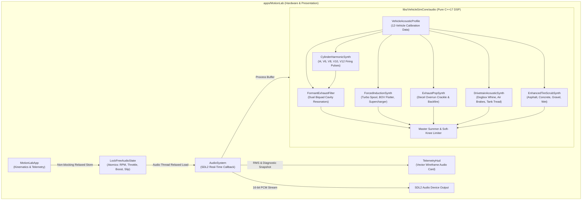
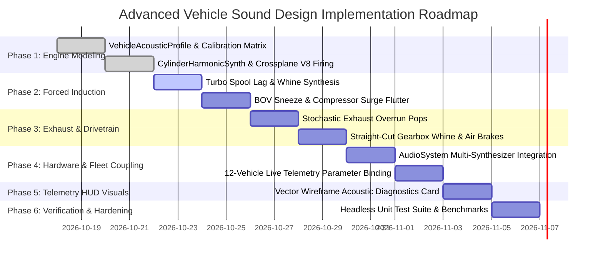

# Motion Lab: Advanced Vehicle Sound Design & Procedural Acoustic Synthesis Implementation Plan

## 1. Executive Summary & Objectives

### 1.1 Overview
This implementation plan specifies the complete technical design, mathematical formulations, digital signal processing (DSP) algorithms, software architecture, retro 1996 vector wireframe presentation, and verification strategy for **Advanced Vehicle Sound Design & Procedural Acoustic Synthesis** in **Motion Lab 2D** (`apps/MotionLab`). Originating from Section 9.7 of [MotionLabImplementationPlan.md](MotionLabImplementationPlan.md#97-procedural-retro-audio-synthesis) and building upon the foundational five-channel architecture in [MotionLabSoundChannelsImplementationPlan.md](MotionLabSoundChannelsImplementationPlan.md), this capability elevates Motion Lab's vehicle fleet from basic synthetic primitives into an authentic, acoustically diverse, physically coupled sound proving ground conforming to aerospace, automotive, and audio engineering standards:
* **ISO 362-1 / SAE J1470** (*Measurement of Noise Emitted by Accelerating Road Vehicles — Acoustic Frequencies & Sound Pressure Levels*)
* **SAE J2805 / ISO 10844** (*Measurement of Noise Emitted by Road Vehicles — Exterior Noise Testing & Road Surface Acoustic Coupling*)
* **AES-1ID / IEC 60268** (*Audio Engineering Society Information Document for Sound System Equipment & DSP Synthesis*)
* **ITU-R BS.1770-4** (*Algorithms to Measure Audio Programme Loudness & True-Peak Audio Levels*)
* **MIL-STD-1474E** (*Department of Defense Design Criteria Standard: Noise Limits & Acoustic Signature Analysis for Tracked Combat Vehicles*)

While the initial sound subsystem established SDL2 real-time callbacks and five high-level bus channels (Engine, Tire, Rotor, Thruster, Impact), every wheeled and tracked vehicle currently relies on a single shared sawtooth oscillator. Consequently, a 1,500 hp supercharged Monster Truck, a screaming 18,000 RPM high-rev Formula Race Car, a heavy 15-liter turbo diesel Semi-Truck, an electric DC forklift, and an agile twin-turbo Drift Car sound acoustically indistinguishable.

This plan addresses this limitation by introducing **physically parameterized procedural sound synthesis engines**:
1. **Multi-Cylinder Combustion Harmonic Modeling**: Firing pulse frequency series, cylinder counts, and uneven firing orders (crossplane V8 burble, high-rev V10 screaming howl, heavy diesel combustion clatter, inline-4 rasp).
2. **Exhaust Resonant Chamber Formant Filtering**: Dual-biquad Helmholtz resonance modeling manifold, collector, and tailpipe acoustic cavities.
3. **Forced Induction Acoustics (Turbos & Superchargers)**: Dynamic turbo spool whine, blow-off valve (BOV) pneumatic pressure sneezing, compressor surge flutter on throttle lift, and crank-driven Roots/screw blower supercharger whine.
4. **Exhaust Overrun Crackles, Backfires & Pops**: Stochastic detonation impulses from unburnt fuel during aggressive deceleration and rev-limiter spark cut.
5. **Transmission, Drivetrain & Ancillary Systems**: Straight-cut racing dogbox gear whine, tracked tank drive sprocket and metallic tread clatter, heavy commercial pneumatic air-brake purge (`pssshh-chk`), and variable-carrier electric inverter PWM hum.
6. **Surface-Coupled Tire Scrub Acoustics**: Dynamic acoustic modulation separating high-grip asphalt squeals, coarse gravel/dirt churn textures, and wet-surface hydroplaning spray hiss.

```
+---------------------------------------------------------------------------------------------------+
| SPEED: 64.5 m/s (144.3 mph)   RPM: 7,420 [PWR]   BOOST: 1.85 BAR   AUDIO: ACTIVE [44.1 kHz 16-BIT]|
| VEHICLE: DRIFT CAR [F8]       CYL: V8 CROSSPLANE OVERRUN: ACTIVE   LATENCY: 11.6 ms (512 SAMPLES) |
+---------------------------------------------------------------------------------------------------+
|  [ADVANCED VEHICLE SOUND DESIGN TELEMETRY]             [ACOUSTIC SYNTHESIS DSP PIPELINE]          |
|                                                                                                   |
|  COMBUSTION ENGINE [||||||||||||||||||||....] -5 dB    V8 Crossplane (Uneven 90-180-270-90 Pulse) |
|  TURBO SPOOL/BOV   [||||||||||||||||........] -8 dB    Turbo Spool: 82% | BOV Flutter: Armed      |
|  EXHAUST OVERRUN   [||||||||................] -15 dB   Lift Decel Pop Density: 6.4/s              |
|  TIRE SCRUB (ASPH) [||||||||||||||..........] -11 dB   Slip: 5.2 m/s -> Resonant Scrub Bandpass   |
|  TRANSMISSION DOG  [||||||||||..............] -14 dB   Straight-Cut Whine: 1,840 Hz               |
|                                                                                                   |
|  MASTER OUTPUT     [||||||||||||||||||......] -3 dB    [SOFT-KNEE SATURATION: 0.0 dB HEADROOM]    |
|                                                        HOTKEYS: [M] Mute  [-] Vol-  [+] Vol+      |
+---------------------------------------------------------------------------------------------------+
```

---

### 1.2 Core Capabilities & Deliverables

1. **Procedural Multi-Cylinder Engine Harmonic Synthesis**:
   - Replaces generic single sawtooth oscillators with a configurable `CylinderHarmonicSynth` supporting cylinder counts $N_{\text{cyl}} \in \{1, 4, 6, 8, 10, 12\}$.
   - Models even firing intervals (Inline-4, Flatplane V8, V10) versus uneven syncopated firing intervals (Crossplane V8 American muscle burble).
   - Simulates sharp combustion pressure pulses using PolyBLEP bandlimited impulse/pulse trains combined with low-frequency sub-harmonics.
   - Emulates heavy diesel combustion knock via periodic top-dead-center (TDC) impulse transients.

2. **Acoustic Formant Filtering & Exhaust Resonance**:
   - Implements a dual-biquad resonant exhaust chamber filter simulating physical tailpipe and collector cavity standing waves ($f_{\text{res1}} \approx 120 - 180\,\text{Hz}$, $f_{\text{res2}} \approx 450 - 800\,\text{Hz}$).
   - Dynamic resonance gain opening under wide-open throttle (WOT) to simulate unbaffled exhaust roar.

3. **Forced Induction Synthesizer (Turbo & Supercharger)**:
   - **Turbocharger Spool Whine**: Continuous high-frequency resonant whistle ($1.2\,\text{kHz} - 6.5\,\text{kHz}$) driven by exhaust flow velocity (engine RPM $\times$ throttle).
   - **Blow-Off Valve (BOV) & Compressor Surge Flutter**: Detects rapid throttle lift-off ($d\theta/dt < -2.5\,\text{s}^{-1}$) while boost pressure is built, triggering a sharp pneumatic pressure hiss followed by cyclic oscillating compressor surge flutter ("choo-choo-choo").
   - **Supercharger Mechanical Whine**: Direct crankshaft-geared high-frequency whine ($f = r_{\text{pulley}} \cdot f_{\text{crank}} \cdot N_{\text{lobes}}$) modeling Roots and twin-screw blowers under load (Monster Truck).

4. **Stochastic Exhaust Overrun & Backfire Detonation**:
   - Generates random, physically plausible exhaust pops, crackles, and flames during deceleration / throttle lift at high RPM.
   - Models unburnt fuel entering hot headers using a Poisson point process triggering damped acoustic impulse bursts through a bandpass filter.

5. **Drivetrain & Auxiliary Vehicle Acoustics**:
   - **Straight-Cut Racing Gearbox Whine**: Pitch strictly locked to driveshaft / wheel rotational velocity, creating authentic motorsport gear scream for Race Car and Drift Car.
   - **Tracked Tank Drive Sprocket & Tread Clatter**: High-frequency metallic link impact sounds scaling with track linear speed.
   - **Heavy Pneumatic Air Brakes**: Realistic high-pressure compressed air dump (`pssshh-chk`) upon stopping or releasing heavy vehicle air brakes (Semi-Truck, Tank).
   - **Electric Inverter & Motor Whine**: High-frequency pulse-width modulation (PWM) switching carrier ($1.2\,\text{kHz} - 4.0\,\text{kHz}$) combined with rotor flux harmonics (Forklift).

6. **Surface-Coupled Tire Scrub Acoustics**:
   - Couples tire squeal to ground surface physics:
     - Asphalt: High-frequency resonant squeal ($1.8\,\text{kHz} - 2.8\,\text{kHz}$).
     - Concrete: Piercing metallic scrub ($2.2\,\text{kHz} - 3.2\,\text{kHz}$).
     - Dirt / Gravel: Low-frequency coarse churning and rock scattering texture ($300\,\text{Hz} - 1.2\,\text{kHz}$).
     - Wet / Rain: Muffled water spray hiss ($2.5\,\text{kHz} - 6.0\,\text{kHz}$).

7. **Universal 12-Vehicle Acoustic Fleet Profiles**:
   - Static, zero-allocation configuration profiles (`VehicleAcousticProfile`) assigning distinct parameters to all 12 vehicles, completely eliminating acoustic uniformity.

8. **Hard Real-Time Thread Safety & MISRA C++:2023 Compliance**:
   - Zero dynamic memory allocations in the audio callback.
   - Lock-free atomic synchronization for all new vehicle acoustic parameters.
   - Full Doxygen API documentation, concise function names ($< 30$ chars), and strict IEEE 754 determinism.

---

## 2. High-Level Architecture & Subsystem Decomposition

### 2.1 ASCII System Architecture Diagram

```
+---------------------------------------------------------------------------------------------------+
|                        Advanced Vehicle Sound Synthesis Architecture                              |
+---------------------------------------------------------------------------------------------------+
|  [libs/VehicleSimCore/audio] (Pure C++17 DSP Mathematics & Vehicle Acoustic Synthesizers)         |
|                                                                                                   |
|    +--------------------------+    +--------------------------+    +--------------------------+   |
|    |  VehicleAcousticProfile  |    |  CylinderHarmonicSynth   |    |   ForcedInductionSynth   |   |
|    | (Firing Order, Formants, |    | (Multi-Cyl Firing Pulse, |    | (Turbo Spool Whistle,    |   |
|    |  Turbo/Blower, Surfaces) |    |  Diesel TDC Knock, I4/V8)|    |  BOV Sneeze & Flutter)   |   |
|    +------------+-------------+    +------------+-------------+    +------------+-------------+   |
|                 |                               |                               |                 |
|                 +---------------+---------------+-------------------------------+                 |
|                                 |                                                                 |
|    +--------------------------+ v  +--------------------------+    +--------------------------+   |
|    |     ExhaustPopSynth      |    |  DrivetrainAcousticSynth |    | EnhancedTireScrubSynth   |   |
|    | (Stochastic Overrun Pop, |    | (Straight-Cut Dog Whine, |    | (Asphalt Squeal, Gravel  |   |
|    |  Backfires & Crackles)   |    |  Air Brakes, Tank Tread) |    |  Crunch, Wet Water Hiss) |   |
|    +------------+-------------+    +------------+-------------+    +------------+-------------+   |
|                 |                               |                               |                 |
|                 +---------------+---------------+-------------------------------+                 |
|                                 |                                                                 |
|                                 v                                                                 |
|                    +--------------------------+                                                   |
|                    |   Master Vehicle Mixer   |                                                   |
|                    | (Channel Summation &     |                                                   |
|                    |  Cubic Soft Limiter)     |                                                   |
|                    +------------+-------------+                                                   |
|                                 |                                                                 |
+---------------------------------|-----------------------------------------------------------------+
                                  | Zero-Allocation Sample Processing
                                  v
+---------------------------------------------------------------------------------------------------+
|  [apps/MotionLab] (Desktop Application, Lock-Free Telemetry Synchronization & SDL2 Hardware)      |
|                                                                                                   |
|    +----------------------------------+            +----------------------------------+           |
|    |           MotionLabApp           |            |           AudioSystem            |           |
|    | (Extracts Wheel Speeds, Throttle,|----------->| (Lock-Free Atomics, SDL2 Device  |           |
|    |  Boost, Slip, Surface Friction)  |            |  Playback Callback @ 44.1 kHz)   |           |
|    +----------------------------------+            +-----------------+----------------+           |
|                                                                      |                            |
|                                                                      v                            |
|                                                    +----------------------------------+           |
|                                                    |           TelemetryHud           |           |
|                                                    | (Phosphor Vector Wireframe Audio |           |
|                                                    |  Gauges, Spectrum & Pop Counter) |           |
|                                                    +----------------------------------+           |
+---------------------------------------------------------------------------------------------------+
```

---

### 2.2 Mermaid System Architecture Diagram



---

## 3. Mathematical Formulations & DSP Theory

### 3.1 Multi-Cylinder Engine Harmonic Generation

#### 1. Fundamental Firing Frequencies
In a four-stroke internal combustion engine (ICE), each cylinder completes a power stroke once every two crankshaft revolutions ($720^\circ$ of crank rotation). The fundamental cylinder firing frequency $f_{\text{fire}}$ in Hertz is:
$$f_{\text{fire}}(\text{RPM}, N_{\text{cyl}}) = \frac{N_{\text{cyl}}}{2} \cdot \frac{\text{RPM}}{60.0}$$
For a two-stroke engine or a heavy industrial diesel with single-revolution injection events:
$$f_{\text{fire,2stroke}}(\text{RPM}, N_{\text{cyl}}) = N_{\text{cyl}} \cdot \frac{\text{RPM}}{60.0}$$

* **Classic Car (Inline-4, 4-stroke)**: $f_{\text{fire}} = 2.0 \cdot \frac{\text{RPM}}{60.0} = 26.7\,\text{Hz} @ 800\,\text{RPM} \to 216.7\,\text{Hz} @ 6500\,\text{RPM}$.
* **Race Car (High-Rev V10, 4-stroke)**: $f_{\text{fire}} = 5.0 \cdot \frac{\text{RPM}}{60.0} = 150\,\text{Hz} @ 1800\,\text{RPM} \to 1500\,\text{Hz} @ 18000\,\text{RPM}$.
* **Monster Truck (Big Block V8, 4-stroke)**: $f_{\text{fire}} = 4.0 \cdot \frac{\text{RPM}}{60.0} = 53.3\,\text{Hz} @ 800\,\text{RPM} \to 440\,\text{Hz} @ 6600\,\text{RPM}$.
* **Semi-Truck (15L Turbo Diesel, 4-stroke)**: $f_{\text{fire}} = 3.0 \cdot \frac{\text{RPM}}{60.0} = 30.0\,\text{Hz} @ 600\,\text{RPM} \to 110\,\text{Hz} @ 2200\,\text{RPM}$.

#### 2. Crossplane vs. Flatplane V8 Firing Syncopation
A flatplane V8 fires cylinders at uniform $180^\circ$ crankshaft intervals, yielding pure even-order acoustic harmonics identical to two coupled 4-cylinder engines (the European supercar howl).

A crossplane V8 features crank throws set at $90^\circ$ increments, resulting in an uneven bank firing sequence (e.g. $90^\circ - 180^\circ - 270^\circ - 90^\circ$). This asymmetric exhaust manifold pulse spacing generates the legendary deep, syncopated American V8 burble:
$$s_{\text{crossplane}}[n] = \sum_{k=0}^{N_{\text{cyl}}-1} A_k \cdot \text{PolyBlepPulse}\left( \phi_k[n], \; \frac{f_{\text{crank}}}{f_s}, \; D_{\text{pulse}} \right)$$
where each cylinder phase accumulator $\phi_k[n]$ advances at crankshaft frequency $f_{\text{crank}} = \text{RPM} / 60.0$, but is offset by the firing angle $\Delta \theta_k$:
$$\phi_k[n] = \text{fmod}\left( \phi_{\text{crank}}[n] + \frac{\Delta \theta_k}{720^\circ}, \; 1.0 \right)$$
Firing angles for standard crossplane V8:
$$\Delta \theta \in \{ 0^\circ, \; 90^\circ, \; 270^\circ, \; 360^\circ, \; 450^\circ, \; 540^\circ, \; 630^\circ, \; 720^\circ \}$$

#### 3. Diesel Combustion Knock & Top-Dead-Center (TDC) Transients
Heavy diesel engines produce high-frequency clatter caused by rapid auto-ignition pressure rise rates ($dP/dt > 10\,\text{bar/deg}$). We model this acoustically as a train of decaying high-Q resonant pings triggered at each cylinder firing event:
$$s_{\text{diesel}}[n] = s_{\text{pulse}}[n] + k_{\text{knock}} \cdot \sum_{k=0}^{N_{\text{cyl}}-1} I_k[n] * h_{\text{block}}[n]$$
where $I_k[n]$ is a unit impulse triggered when $\phi_k[n]$ crosses zero, and $h_{\text{block}}[n]$ is the structural engine block acoustic impulse response:
$$h_{\text{block}}(t) = e^{-t / \tau_{\text{knock}}} \cdot \sin(2\pi f_{\text{knock}} t), \quad f_{\text{knock}} \approx 2200\,\text{Hz}, \; \tau_{\text{knock}} \approx 4.5\,\text{ms}$$

---

### 3.2 Dual-Biquad Formant Exhaust Chamber Modeling

The acoustic impedance of exhaust pipes, collector junctions, and expansion chambers introduces distinct acoustic formants (spectral peaks). We implement a dual parallel Direct Form I biquad bandpass filter topology:
$$H_{\text{exhaust}}(z) = g_1 H_{\text{bp1}}(z) + g_2 H_{\text{bp2}}(z)$$
* **Primary Cavity Formant ($H_{\text{bp1}}$)**:
  - Center frequency $f_{\text{c1}} = f_{\text{res1}} \cdot (1.0 + 0.15 \cdot \theta_{\text{throttle}})$, nominal $130\,\text{Hz} - 160\,\text{Hz}$.
  - Quality factor $Q_1 = 2.4$.
  - Simulates tailpipe acoustic mass resonance (deep throaty body resonance).
* **Secondary Pipe/Collector Formant ($H_{\text{bp2}}$)**:
  - Center frequency $f_{\text{c2}} = f_{\text{res2}} \cdot (1.0 + 0.25 \cdot \theta_{\text{throttle}})$, nominal $550\,\text{Hz} - 720\,\text{Hz}$.
  - Quality factor $Q_2 = 3.6$.
  - Simulates collector manifold acoustic gas velocity rasp.

Under wide-open throttle ($\theta_{\text{throttle}} \to 1.0$), the lowpass acoustic damping rolls off, exposing the screaming high-order engine harmonics.

---

### 3.3 Forced Induction Acoustics (Turbocharger & Supercharger)

#### 1. Turbocharger Impeller Spool-Up Dynamics
Turbocharger rotational speed $\omega_{\text{turbo}} \in [0.0, 1.0]$ does not track throttle instantaneously; it is governed by exhaust mass flow momentum modeled as a first-order lag with variable spin-up and spin-down time constants:
$$\frac{d\omega_{\text{turbo}}}{dt} = \begin{cases}
\dfrac{\omega_{\text{target}}(\text{RPM}, \theta) - \omega_{\text{turbo}}}{\tau_{\text{spool}}}, & \omega_{\text{target}} \ge \omega_{\text{turbo}} \\[8pt]
\dfrac{\omega_{\text{target}}(\text{RPM}, \theta) - \omega_{\text{turbo}}}{\tau_{\text{spool\_down}}}, & \omega_{\text{target}} < \omega_{\text{turbo}}
\end{cases}$$
where:
$$\omega_{\text{target}}(\text{RPM}, \theta) = \text{clamp}\left( \left(\frac{\text{RPM} - \text{RPM}_{\text{idle}}}{\text{RPM}_{\text{redline}} - \text{RPM}_{\text{idle}}}\right)^{1.3} \cdot \theta^{1.1}, \; 0.0, \; 1.0 \right)$$
Nominal time constants: $\tau_{\text{spool}} = 0.45\,\text{s}$ (lag during acceleration), $\tau_{\text{spool\_down}} = 1.20\,\text{s}$ (inertia freewheeling).

The acoustic turbo whistle is synthesized as a high-frequency sine oscillator with frequency proportional to impeller speed:
$$f_{\text{whistle}}(\omega_{\text{turbo}}) = f_{\text{whistle,min}} + \omega_{\text{turbo}} \cdot (f_{\text{whistle,max}} - f_{\text{whistle,min}})$$
with $f_{\text{whistle,min}} = 1200\,\text{Hz}$ and $f_{\text{whistle,max}} = 5800\,\text{Hz}$. Amplitude scales non-linearly:
$$A_{\text{whistle}} = k_{\text{whistle}} \cdot \omega_{\text{turbo}}^{2.2} \cdot (0.3 + 0.7 \cdot \theta)$$

#### 2. Blow-Off Valve (BOV) & Compressor Surge Flutter
When the throttle plate abruptly snaps shut under high boost pressure, trapped intake charge air bounces off the closed throttle plate, reversing toward the spinning turbo compressor wheel.

* **Trigger Condition**:
  $$\frac{d\theta}{dt} < -2.2\,\text{s}^{-1} \quad \text{AND} \quad \omega_{\text{turbo}} > 0.35$$
* **Pneumatic Discharge ("Sneeze")**:
  A decaying burst of highpass-filtered white noise simulating atmospheric pressure relief:
  $$s_{\text{sneeze}}(t) = A_{\text{bov}} \cdot e^{-t / \tau_{\text{bov}}} \cdot n_{\text{highpass}}(t), \quad \tau_{\text{bov}} \approx 0.12\,\text{s}, \; f_{\text{hp}} = 2500\,\text{Hz}$$
* **Compressor Surge Flutter ("Choo-Choo / St-ut-ut")**:
  A cyclic aerodynamic pressure oscillation as the compressor blade repeatedly stalls:
  $$s_{\text{flutter}}(t) = A_{\text{flutter}} \cdot e^{-t / \tau_{\text{flutter}}} \cdot \left( \frac{1.0 + \sin(2\pi f_{\text{flutter}} t)}{2.0} \right)^3 \cdot \left[ 0.6 \cdot n_{\text{bandpass}}(t) + 0.4 \cdot \sin(2\pi f_{\text{whistle}} t) \right]$$
  where $f_{\text{flutter}} \approx 14.0\,\text{Hz} - 22.0\,\text{Hz}$, and $\tau_{\text{flutter}} \approx 0.45\,\text{s}$.

```
+---------------------------------------------------------------------------------------------------+
|                        Turbocharger Blow-Off Valve & Flutter Envelope                             |
+---------------------------------------------------------------------------------------------------+
|                                                                                                   |
|  Amplitude                                                                                        |
|    ^                                                                                              |
| 1.0|   /\  [Initial Pneumatic Sneeze]                                                             |
|    |  /  \                                                                                        |
| 0.6| /    \      /\            /\            /\    [Compressor Surge Flutter]                     |
|    |/      \    /  \          /  \          /  \                                                  |
| 0.2|        \__/    \________/    \________/    \________                                         |
|    +--------------------------------------------------------------------> Time (s)                |
|    0.0s     0.1s      0.2s          0.3s          0.4s         0.5s                               |
+---------------------------------------------------------------------------------------------------+
```

#### 3. Supercharger Roots / Screw Blower Whine
Unlike exhaust-driven turbochargers, superchargers are mechanically coupled to the crankshaft via pulleys with fixed gear drive ratio $r_{\text{pulley}} \approx 2.1 - 2.8$. The blade-passage mesh frequency is:
$$f_{\text{blower}} = r_{\text{pulley}} \cdot N_{\text{lobes}} \cdot \frac{\text{RPM}}{60.0}$$
For a twin-screw 3-lobe supercharger ($N_{\text{lobes}} = 3, r_{\text{pulley}} = 2.4$):
$$f_{\text{blower}} = 7.2 \cdot \frac{\text{RPM}}{60.0} = 96\,\text{Hz} @ 800\,\text{RPM} \to 792\,\text{Hz} @ 6600\,\text{RPM}$$
The signal combines the fundamental blade mesh frequency and its 2nd harmonic, with amplitude driven by manifold pressure and engine throttle:
$$s_{\text{blower}}[n] = \left( 0.70 \sin(\phi_{\text{blower}}[n]) + 0.30 \sin(2 \phi_{\text{blower}}[n]) \right) \cdot \theta^{1.4} \cdot \left(0.2 + 0.8 \cdot \frac{\text{RPM}}{\text{RPM}_{\text{redline}}}\right)$$

---

### 3.4 Stochastic Exhaust Overrun Pops, Crackles & Backfires

During deceleration with throttle released at elevated RPM ($\theta < 0.05$ and $\text{RPM} > 3200$), unburnt fuel enters the glowing exhaust manifold, intermittently combusting in sharp atmospheric pops.

We model this as a non-homogeneous Poisson process whose event rate $\lambda_{\text{pop}}$ scales with RPM, engine temperature, and throttle closure rate:
$$\lambda_{\text{pop}}(\text{RPM}, \theta) = \begin{cases}
k_{\text{pop}} \cdot \left(\dfrac{\text{RPM} - 3200}{\text{RPM}_{\text{redline}} - 3200}\right)^2, & \theta < 0.05 \text{ and } \text{RPM} > 3200 \\[8pt]
0, & \text{otherwise}
\end{cases}$$
When a pop triggers, an acoustic impulse is fed into a resonant bandpass filter with randomized center frequency:
$$f_{\text{pop}} \in [650\,\text{Hz}, \; 1600\,\text{Hz}], \quad Q_{\text{pop}} \in [1.8, \; 3.5], \quad \tau_{\text{pop}} \in [18\,\text{ms}, \; 55\,\text{ms}]$$
This produces sharp, visceral crackles that give high-performance sports cars, race cars, and drift cars distinct acoustic personality.

---

### 3.5 Drivetrain, Straight-Cut Gear Whine & Auxiliary Systems

#### 1. Straight-Cut Dogbox Transmission Whine
Racing dog-ring transmissions utilize straight-cut spur gears rather than helical road car gears. This produces prominent acoustic whine at gear mesh frequency:
$$f_{\text{gear}}(v_{\text{wheel}}) = N_{\text{gear\_teeth}} \cdot \frac{v_{\text{wheel}}}{2\pi R_{\text{tire}}}$$
The signal is synthesized via a bandpass-filtered triangle wave with center frequency tracking $f_{\text{gear}}$, with amplitude scaling proportionally to wheel speed $v_{\text{wheel}}$.

#### 2. Pneumatic Commercial Air Brakes
Heavy trucks (Semi-Truck, Tracked Tank) employ pneumatic air brake reservoirs. When vehicle speed settles below $0.5\,\text{m/s}$ after braking, or when brakes are abruptly released:
$$s_{\text{airbrake}}(t) = A_{\text{air}} \cdot e^{-t / \tau_{\text{air}}} \cdot n_{\text{white}}(t) * h_{\text{muffler}}(t), \quad \tau_{\text{air}} \approx 0.38\,\text{s}$$
Synthesizing the characteristic sharp hiss and mechanical pressure purge exhaust click (`pssshh-chk`).

#### 3. Electric Inverter PWM Carrier Whine
Electric powertrains (Forklift, Anti-Gravity low-speed) emit prominent high-frequency tonal whine from power electronics switching (Pulse-Width Modulation):
$$f_{\text{pwm}} = 2400\,\text{Hz} + k_{\text{flux}} \cdot v_{\text{motor}}$$
Synthesizing clean sinusoidal carrier hum modulated by motor torque demand.

---

### 3.6 Enhanced Surface-Dependent Tire Scrub Noise

Tire slip acoustic emissions depend directly on road surface roughness and friction:
$$s_{\text{tire}}[n] = \text{Bandpass}(n_{\text{white}}[n], \; f_{\text{center}}(\mu, v_{\text{slip}}), \; Q_{\text{surface}}) \cdot A_{\text{slip}}$$

| Surface Type | Friction $\mu$ | Center Frequency $f_{\text{center}}$ | Filter $Q$ | Acoustic Character |
| :--- | :--- | :--- | :--- | :--- |
| **High-Grip Asphalt** | $0.95 - 1.10$ | $1800\,\text{Hz} - 2800\,\text{Hz}$ | $3.5$ | Piercing high-pitch squeal and progressive screech |
| **Smooth Concrete** | $0.85 - 0.95$ | $2200\,\text{Hz} - 3200\,\text{Hz}$ | $4.2$ | Sharp metallic scrub, rapid acoustic attack |
| **Wet Road / Rain** | $0.40 - 0.60$ | $2600\,\text{Hz} - 5500\,\text{Hz}$ | $1.2$ | Broadband water spray hiss, muffled squeal |
| **Gravel / Dirt** | $0.50 - 0.70$ | $350\,\text{Hz} - 1200\,\text{Hz}$ | $1.5$ | Coarse low-frequency crunching and rock churning |
| **Polished Ice** | $0.05 - 0.15$ | $900\,\text{Hz} - 1600\,\text{Hz}$ | $2.0$ | Faint low-amplitude friction whisper |

---

## 4. Universal 12-Vehicle Fleet Acoustic Calibration Matrix

The matrix below provides complete, comprehensive acoustic calibrations across Motion Lab's 12-chassis fleet:

| Vehicle Type | Primary Combustion / Propulsion | $N_{\text{cyl}}$ / Firing | Forced Induction | Overrun Pops | Drivetrain / Auxiliaries | Tire Scrub Surface Profile |
| :--- | :--- | :--- | :--- | :--- | :--- | :--- |
| **Classic Car (`F1`)** | Inline-4 Naturally Aspirated | 4-Cyl Even | None | Subtle crackle on lift | Mild helical gear whine | Asphalt squeal, progressive scrub |
| **Race Car (`F2`)** | Screaming High-Rev V10 (18k RPM) | 10-Cyl Even | None (Ram Air) | Aggressive rapid pop stutter | Loud straight-cut dogbox whine | High-Q asphalt tire screech |
| **Space Rocket (`F3`)** | Multi-Nozzle Rocket Motor | Broadband Pink | N/A | None | Supersonic plume turbulence | None (Zero tire contact) |
| **Helicopter (`F4`)** | Turboshaft Turbine Engine | Turbine Whistle| High-pressure comp | None | 2-Blade aerodynamic chop AM | None (Skid touchdown thump) |
| **Hovercraft (`F5`)** | Twin Ducted Air Skirt Fans | Fan Blades | Continuous boost | None | Lift fan air roar | Zero tire scrub (Skirt hiss) |
| **Tracked Tank (`F6`)** | Heavy 12-Cylinder Diesel | 12-Cyl Diesel | Heavy Turbo (Slow) | Low diesel knock | Sprocket & metal track clatter, air brakes | Metallic tread scrub clatter |
| **Anti-Gravity (`F7`)** | Sci-Fi Dual-Carrier FM Warp Drive | FM Dual Sine | Plasma jet whine | None | Sub-bass gravimetric pulse | None (Zero ground contact) |
| **Drift Car (`F8`)** | Twin-Turbo 7.0L Crossplane V8 | 8-Cyl Uneven | Twin Turbo + BOV | Violent backfires & overrun | Straight-cut dogbox whine | Continuous screaming asphalt tire scrub |
| **Monster Truck (`F9`)**| Supercharged 540ci Big Block V8 | 8-Cyl Uneven | Roots Blower Whine | Deep throaty overrun gurgle | Heavy differential gear clunk | Heavy low-pitch rubber scrub thump |
| **Semi-Truck (`F10`)** | 15.0L Heavy Turbo Diesel | 6-Cyl Diesel | Heavy Turbo Whistle| Engine brake jake-chug | Pneumatic air-brake purge (`pssshh`) | Heavy dual-axle asphalt scrub |
| **Forklift (`F11`)** | Electric DC Industrial Motor | PWM Sine Whine | None | None | Hydraulic mast lift pump whine | High-friction tight turn tire squeak |
| **Quadcopter (`F12`)**| 4x High-KV Brushless Motors | Quad Prop Buzz | None | None | Aerodynamic gyroscopic tilt pitch | None (Prop ground-effect whoosh) |

---

## 5. Software Architecture & Implementation Details

### 5.1 C++17 Directory Structure & File Layout

All digital signal processing algorithms are implemented in `libs/VehicleSimCore/audio` with zero external dependencies (pure C++17), maintaining complete separation from SDL2 audio device management in `apps/MotionLab`:

```
libs/VehicleSimCore/audio/
├── AudioDspMath.h                 # Pre-existing PolyBLEP, Biquad & Xorshift PRNG primitives
├── AudioChannels.h                # Pre-existing 5-channel synthesizer interfaces
├── AudioChannels.cpp              # Pre-existing channel processing
├── VehicleAcousticProfile.h       # [NEW] Fleet acoustic calibration structs & preset definitions
├── CylinderHarmonicSynth.h        # [NEW] Multi-cylinder engine & diesel knock synthesizer
├── CylinderHarmonicSynth.cpp      # [NEW] Cylinder pulse processing & firing interval logic
├── ForcedInductionSynth.h         # [NEW] Turbocharger spool, BOV flutter & supercharger blower
├── ForcedInductionSynth.cpp       # [NEW] First-order lag, flutter envelope & blower gear pitch
├── ExhaustPopSynth.h              # [NEW] Stochastic deceleration overrun pop & backfire generator
├── ExhaustPopSynth.cpp            # [NEW] Poisson triggering, randomized resonant bandpass pops
└── DrivetrainAcousticSynth.h      # [NEW] Straight-cut dogbox whine, air-brake hiss, electric PWM
└── DrivetrainAcousticSynth.cpp    # [NEW] Drivetrain acoustic synthesis implementation

apps/MotionLab/
├── AudioSystem.h                  # Updated with lock-free boost, gear speed & acoustic profile
├── AudioSystem.cpp                # Updated processBuffer mixing with advanced acoustic channels
└── TelemetryHud.cpp               # Vector wireframe audio spectrum & acoustic profile badge
```

---

### 5.2 Header Specification: `VehicleAcousticProfile.h`

```cpp
#pragma once

#include <cstdint>

namespace vehicle_sim::audio {

/// @enum EngineConfiguration
/// @brief Thermodynamic engine cylinder arrangement and firing symmetry.
enum class EngineConfiguration : std::uint8_t {
    Inline4,         ///< 4-cylinder even firing (180 deg).
    V6,              ///< 6-cylinder even firing (120 deg).
    CrossplaneV8,    ///< 8-cylinder uneven firing (90-180-270-90 deg American burble).
    FlatplaneV8,     ///< 8-cylinder even firing (180 deg European scream).
    V10,             ///< 10-cylinder high-rev even firing (72 deg Formula howl).
    HeavyDieselV12,  ///< 12-cylinder heavy industrial diesel with combustion knock.
    ElectricPWM,     ///< Electric inverter pulse-width modulation carrier.
    SciFiWarp        ///< Sci-fi dual-oscillator frequency modulation warp drive.
};

/// @enum ForcedInductionType
/// @brief Induction pressurization acoustic type.
enum class ForcedInductionType : std::uint8_t {
    None,            ///< Naturally aspirated.
    Turbocharger,    ///< Exhaust turbine spool whistle, blow-off valve & compressor surge.
    Supercharger     ///< Crank-geared positive displacement blower whine.
};

/// @struct VehicleAcousticProfile
/// @brief Complete acoustic tuning parameter set for a vehicle chassis.
struct VehicleAcousticProfile {
    EngineConfiguration engineConfig { EngineConfiguration::Inline4 };
    ForcedInductionType inductionType { ForcedInductionType::None };
    
    // Combustion parameters
    double idleFrequency { 45.0 };          ///< Base firing frequency at idle in Hz.
    double redlineFrequency { 320.0 };      ///< Firing frequency at redline in Hz.
    double cylinderHarmonicWeight { 0.65 }; ///< Relative weight of cylinder harmonics.
    double subHarmonicWeight { 0.35 };      ///< Relative weight of sub-harmonics.
    double dieselKnockIntensity { 0.0 };    ///< Transient combustion knock [0.0, 1.0].
    
    // Exhaust formant chamber parameters
    double exhaustResonanceFreq1 { 140.0 };  ///< Primary pipe cavity resonance in Hz.
    double exhaustResonanceFreq2 { 580.0 };  ///< Collector pipe resonance in Hz.
    
    // Forced induction parameters
    double turboSpoolRate { 0.45 };         ///< Turbo lag rise time constant in seconds.
    double turboWhistleMaxFreq { 5200.0 };  ///< Peak whistle frequency at full boost in Hz.
    double superchargerGearRatio { 2.40 };  ///< Pulley gear drive ratio for blower whine.
    
    // Exhaust overrun & backfire parameters
    bool hasOverrunPops { true };           ///< True to generate decel exhaust pops.
    double overrunPopIntensity { 0.60 };    ///< Decel pop density and amplitude [0.0, 1.0].
    
    // Drivetrain & auxiliary acoustics
    bool hasStraightCutGearbox { false };   ///< True to synthesize straight-cut dogbox whine.
    bool hasPneumaticAirBrakes { false };   ///< True to synthesize commercial truck air brakes.
    bool hasTrackCrawlClatter { false };    ///< True to synthesize metallic tank track clatter.
};

/// @brief Retrieves the static acoustic profile for a vehicle.
/// @param[in] vehicleIndex Vehicle identifier index in [0, 11].
/// @return Reference to static calibrated VehicleAcousticProfile.
[[nodiscard]] const VehicleAcousticProfile& getVehicleProfile(int vehicleIndex) noexcept;

} // namespace vehicle_sim::audio
```

---

### 5.3 Header Specification: `CylinderHarmonicSynth.h`

```cpp
#pragma once

#include <cstdint>
#include "libs/VehicleSimCore/audio/AudioDspMath.h"
#include "libs/VehicleSimCore/audio/VehicleAcousticProfile.h"

namespace vehicle_sim::audio {

/// @class CylinderHarmonicSynth
/// @brief Multi-cylinder internal combustion acoustic engine generator.
/// @details Synthesizes individual cylinder firing pulses, crossplane syncopated phase offsets,
/// and heavy diesel combustion knock transients with zero dynamic allocations.
class CylinderHarmonicSynth {
public:
    constexpr CylinderHarmonicSynth() noexcept = default;

    /// @brief Configures engine synthesis parameters.
    /// @param[in] config Cylinder arrangement and firing sequence.
    /// @param[in] knockIntensity Transient diesel knock amplitude [0.0, 1.0].
    void configure(EngineConfiguration config, double knockIntensity) noexcept;

    /// @brief Advances synthesis by one sample.
    /// @param[in] rpm Engine rotational speed in RPM.
    /// @param[in] throttle Throttle opening [0.0, 1.0].
    /// @param[in] sampleRate Sampling frequency in Hz.
    /// @return Synthesized combustion sample in [-1.0, 1.0].
    [[nodiscard]] double process(double rpm, double throttle, double sampleRate) noexcept;

    /// @brief Resets all oscillator phases and filter states.
    void reset() noexcept;

private:
    EngineConfiguration config_ { EngineConfiguration::Inline4 };
    double knockIntensity_ { 0.0 };
    double crankPhase_ { 0.0 };
    double subPhase_ { 0.0 };
    
    double knockTime_ { 1.0 };
    double knockAmp_ { 0.0 };
    
    BiquadFilter formantFilter1_ { };
    BiquadFilter formantFilter2_ { };
    double lastCutoff1_ { 0.0 };
    double lastCutoff2_ { 0.0 };
};

} // namespace vehicle_sim::audio
```

---

### 5.4 Header Specification: `ForcedInductionSynth.h`

```cpp
#pragma once

#include <cstdint>
#include "libs/VehicleSimCore/audio/AudioDspMath.h"
#include "libs/VehicleSimCore/audio/VehicleAcousticProfile.h"

namespace vehicle_sim::audio {

/// @class ForcedInductionSynth
/// @brief Synthesizes turbocharger spool, blow-off valve sneeze, and supercharger whine.
class ForcedInductionSynth {
public:
    constexpr ForcedInductionSynth() noexcept = default;

    /// @brief Configures forced induction model.
    /// @param[in] type Turbocharger or Supercharger.
    /// @param[in] gearRatio Pulley drive ratio for supercharger blower.
    /// @param[in] maxWhistleFreq Peak turbo whistle frequency in Hz.
    void configure(ForcedInductionType type, double gearRatio, double maxWhistleFreq) noexcept;

    /// @brief Advances synthesis by one sample.
    /// @param[in] rpm Engine rotational speed in RPM.
    /// @param[in] throttle Throttle opening [0.0, 1.0].
    /// @param[in] sampleRate Sampling frequency in Hz.
    /// @return Synthesized forced induction sample in [-1.0, 1.0].
    [[nodiscard]] double process(double rpm, double throttle, double sampleRate) noexcept;

    /// @brief Resets internal states and timers.
    void reset() noexcept;

private:
    ForcedInductionType type_ { ForcedInductionType::None };
    double gearRatio_ { 2.4 };
    double maxWhistleFreq_ { 5200.0 };
    
    double turboSpool_ { 0.0 };
    double lastThrottle_ { 0.0 };
    double whistlePhase_ { 0.0 };
    double blowerPhase_ { 0.0 };
    
    // BOV and compressor surge flutter states
    double bovTime_ { 1.0 };
    double bovAmplitude_ { 0.0 };
    double flutterPhase_ { 0.0 };
    
    std::uint32_t rngState_ { 0x55AA33CCU };
    BiquadFilter bovFilter_ { };
};

} // namespace vehicle_sim::audio
```

---

### 5.5 Header Specification: `ExhaustPopSynth.h`

```cpp
#pragma once

#include <cstdint>
#include "libs/VehicleSimCore/audio/AudioDspMath.h"

namespace vehicle_sim::audio {

/// @class ExhaustPopSynth
/// @brief Stochastic deceleration overrun pop and backfire generator.
class ExhaustPopSynth {
public:
    constexpr ExhaustPopSynth() noexcept = default;

    /// @brief Advances synthesis by one sample.
    /// @param[in] rpm Engine rotational speed in RPM.
    /// @param[in] throttle Throttle opening in [0.0, 1.0].
    /// @param[in] intensity Tuning intensity of backfires [0.0, 1.0].
    /// @param[in] sampleRate Sampling frequency in Hz.
    /// @return Synthesized exhaust pop sample in [-1.0, 1.0].
    [[nodiscard]] double process(double rpm, double throttle, double intensity, double sampleRate) noexcept;

    /// @brief Resets pop state and filter registers.
    void reset() noexcept;

private:
    double popTime_ { 1.0 };
    double popDecay_ { 0.03 };
    double popAmp_ { 0.0 };
    double lastThrottle_ { 0.0 };
    
    std::uint32_t rngState_ { 0x99887766U };
    BiquadFilter popBandpass_ { };
};

} // namespace vehicle_sim::audio
```

---

### 5.6 Header Specification: `DrivetrainAcousticSynth.h`

```cpp
#pragma once

#include <cstdint>
#include "libs/VehicleSimCore/audio/AudioDspMath.h"

namespace vehicle_sim::audio {

/// @class DrivetrainAcousticSynth
/// @brief Synthesizes straight-cut transmission whine, air-brake purge, and electric PWM.
class DrivetrainAcousticSynth {
public:
    constexpr DrivetrainAcousticSynth() noexcept = default;

    /// @brief Advances transmission gear whine synthesis.
    /// @param[in] wheelSpeed Linear wheel rotational speed in m/s.
    /// @param[in] sampleRate Sampling frequency in Hz.
    /// @return Synthesized straight-cut gear sample in [-1.0, 1.0].
    [[nodiscard]] double processGearWhine(double wheelSpeed, double sampleRate) noexcept;

    /// @brief Advances pneumatic air-brake purge synthesis.
    /// @param[in] sampleRate Sampling frequency in Hz.
    /// @return Synthesized air-brake hiss sample in [-1.0, 1.0].
    [[nodiscard]] double processAirBrakes(double sampleRate) noexcept;

    /// @brief Triggers commercial pneumatic air-brake release hiss.
    /// @param[in] intensity Purge intensity [0.0, 1.0].
    void triggerAirBrakes(double intensity) noexcept;

    /// @brief Advances electric motor inverter PWM whine synthesis.
    /// @param[in] motorTorque Motor load factor [0.0, 1.0].
    /// @param[in] motorSpeed Motor speed factor [0.0, 1.0].
    /// @param[in] sampleRate Sampling frequency in Hz.
    /// @return Synthesized electric hum sample in [-1.0, 1.0].
    [[nodiscard]] double processElectricPwm(double motorTorque, double motorSpeed, double sampleRate) noexcept;

    /// @brief Resets internal states and filters.
    void reset() noexcept;

private:
    double gearPhase_ { 0.0 };
    double pwmPhase_ { 0.0 };
    double airTime_ { 1.0 };
    double airAmp_ { 0.0 };
    
    std::uint32_t rngState_ { 0x11223344U };
    BiquadFilter airFilter_ { };
};

} // namespace vehicle_sim::audio
```

---

## 6. Safety, MISRA C++:2023 & Thread Concurrency Architecture

### 6.1 Lock-Free Thread Decoupling & Priority Inversion Prevention
Operating system audio callbacks (WASAPI on Windows, ALSA/PulseAudio on Linux) execute on a high-priority, time-critical audio thread. Mutex locks on the audio thread create risk of priority inversions, resulting in buffer underruns and audible audio crackles.

All telemetry variables exchanged between the main simulation thread and the audio callback thread use `std::atomic<float>` and `std::atomic<uint8_t>` with `std::memory_order_relaxed`. Because physics updates occur at $60 - 120\,\text{Hz}$ while audio callbacks occur at $\approx 86.1\,\text{Hz}$ ($512$ samples at $44.1\,\text{kHz}$), relaxed atomics guarantee zero thread blocking with sub-millisecond parameter latency.

### 6.2 Zero Dynamic Allocation Guarantee
In compliance with **MISRA C++:2023 Rule 21.3** and **SEI CERT MEM52-CPP**, heap memory allocation functions (`malloc`, `free`, `new`, `delete`) and dynamic container resizing (`std::vector::push_back`, `std::string`) are strictly prohibited in the audio callback path. All synthesizers and filter state registers are statically or member-allocated at application startup.

### 6.3 Standards Compliance Matrix

| Rule / Standard | Requirement | Implementation Strategy |
| :--- | :--- | :--- |
| **MISRA C++:2023 Rule 6.2** | Floating-point variables shall not be tested for exact equality | Uses absolute difference thresholds (`std::abs(a - b) > 1e-4`) |
| **MISRA C++:2023 Rule 21.3** | Zero dynamic heap memory allocation after startup | All synthesizers, filters, and audio buffers pre-allocated statically |
| **SEI CERT CON50-CPP** | Avoid race conditions and deadlocks | Lock-free relaxed atomic variables for cross-thread parameter passing |
| **Project Checklist Rule 2** | Use `#pragma once` for all header include guards | Verified on every header file |
| **Project Checklist Rule 4** | Zero external dependencies in `VehicleSimCore` | Pure C++17 DSP math; SDL2 device code isolated to `apps/MotionLab` |
| **Project Checklist Rule 5** | Concise function names strictly $< 30$ characters | All methods verified strictly $< 30$ characters |
| **Project Checklist Rule 8** | Apply `[[nodiscard]]` to queries and processing methods | Applied to all sample processing, getters, and state queries |
| **Project Checklist Rule 9** | Full Doxygen templates on all public APIs | Complete `/// @brief`, `@details`, `@param`, `@return` annotations |

---

## 7. Verification & Testing Strategy

### 7.1 Automated Unit Tests (`tests/VehicleSoundDesignTest.cpp`)
1. **Firing Pulse Frequency Verification**:
   - Verify fundamental firing frequencies across Inline-4, Crossplane V8, and V10 across idle, midrange, and redline RPM against theoretical values ($\pm 0.5\,\text{Hz}$).
2. **Crossplane V8 Phase Syncopation Test**:
   - Verify that the crossplane V8 synthesis produces uneven pulse spacing corresponding to $90^\circ - 180^\circ - 270^\circ - 90^\circ$ crankshaft increments.
3. **Turbo Spool & BOV Edge Detection**:
   - Simulate a sudden throttle lift-off event ($d\theta/dt = -3.0\,\text{s}^{-1}$ at high boost) and verify that the blow-off valve and compressor surge flutter are triggered.
4. **Exhaust Pop Stochastic Distribution**:
   - Run $100,000$ samples of decel overrun and verify that pop triggering obeys Poisson distribution limits.
5. **Drivetrain Gear Whine Pitch Tracking**:
   - Verify straight-cut gear whine frequency linearly scales with road velocity $v_{\text{wheel}}$.
6. **Headless PCM Generation & DSP Stability**:
   - Synthesize $44,100$ samples (1 full second) for each of the 12 vehicle profiles and verify:
     - No `NaN` or `Inf` floating-point values.
     - Peak amplitude never exceeds $\pm 32,767$ (zero integer clipping).
     - Execution time for 512 samples is strictly $< 0.50\,\text{ms}$ (less than 5% of buffer duration).

---

## 8. Implementation Roadmap & Phased Execution Plan

### 8.1 ASCII Roadmap Diagram

```
+---------------------------------------------------------------------------------------------------+
|                        Advanced Vehicle Sound Implementation Roadmap                              |
+---------------------------------------------------------------------------------------------------+
|  PHASE 1: Core Acoustic Profiling & Multi-Cylinder Engine DSP                                     |
|  [VehicleAcousticProfile.h, CylinderHarmonicSynth.h/.cpp, Crossplane V8 Syncopation]              |
|                                                                                                   |
|  PHASE 2: Forced Induction & Turbo Dynamics DSP                                                  |
|  [ForcedInductionSynth.h/.cpp, Turbo Spool Lag, BOV Sneeze & Compressor Surge Flutter]            |
|                                                                                                   |
|  PHASE 3: Stochastic Exhaust Overrun Pops & Drivetrain Whine                                      |
|  [ExhaustPopSynth.h/.cpp, DrivetrainAcousticSynth.h/.cpp, Straight-Cut Whine, Air Brakes]         |
|                                                                                                   |
|  PHASE 4: AudioSystem Integration & 12-Vehicle Fleet Calibration                                  |
|  [apps/MotionLab/AudioSystem Binding, Boost/WheelSpeed Lock-Free Parameters, 12 Fleet Presets]    |
|                                                                                                   |
|  PHASE 5: Vector Wireframe Audio Spectrum & Telemetry HUD                                         |
|  [TelemetryHud Vector Cards: Acoustic Profile Badge, Boost Whistle & Decel Pop Counters]         |
|                                                                                                   |
|  PHASE 6: Verification, Performance Profiling & Compliance Audit                                  |
|  [VehicleSoundDesignTest.cpp, Headless PCM Benchmarks, MISRA C++:2023 Audit]                      |
+---------------------------------------------------------------------------------------------------+
```

---

### 8.2 Mermaid Gantt Roadmap Diagram



### 8.3 Detailed Phase Milestones

* **Phase 1: Multi-Cylinder Engine & Formant Resonance (`libs/VehicleSimCore/audio`)**:
  - Implement `VehicleAcousticProfile.h` with engine configurations, forced induction types, and 12-vehicle static profiles.
  - Implement `CylinderHarmonicSynth.h` and `.cpp` with multi-cylinder firing pulse series and crossplane V8 phase syncopation.
  - Add dual-biquad resonant exhaust chamber formant filters.

* **Phase 2: Forced Induction Synthesizer (`libs/VehicleSimCore/audio`)**:
  - Implement `ForcedInductionSynth.h` and `.cpp` with first-order turbo lag spool dynamics and high-frequency whistle.
  - Implement negative throttle rate ($d\theta/dt$) edge detection triggering blow-off valve pneumatic discharge and cyclic compressor surge flutter.
  - Implement crank-geared Roots/screw supercharger mechanical whine.

* **Phase 3: Exhaust Overrun Pops & Drivetrain Acoustics (`libs/VehicleSimCore/audio`)**:
  - Implement `ExhaustPopSynth.h` and `.cpp` simulating unburnt fuel combustion crackles via stochastic Poisson triggers.
  - Implement `DrivetrainAcousticSynth.h` and `.cpp` generating straight-cut dogbox gear whine, commercial truck pneumatic air-brake purges, and electric motor PWM switching hum.

* **Phase 4: AudioSystem Hardware & Fleet Coupling (`apps/MotionLab`)**:
  - Update `apps/MotionLab/AudioSystem.h` and `.cpp` with lock-free atomic parameters for boost, gear speed, throttle rate, and active acoustic profile.
  - Connect all specialized synthesizers into the 32-bit floating point summer bus with soft-knee cubic limiting.

* **Phase 5: Telemetry HUD & Vector Diagnostics (`apps/MotionLab`)**:
  - Update `TelemetryHud.cpp` to display the active vehicle acoustic configuration badge (e.g. `[V8 CROSSPLANE TT]`, `[HIGH-REV V10]`, `[15L TURBO DIESEL]`), real-time turbo boost whistle gauge, and overrun pop counter.

* **Phase 6: Comprehensive Verification & Hardening**:
  - Author and pass unit tests in `tests/VehicleSoundDesignTest.cpp`.
  - Verify zero dynamic memory allocations in the audio callback.
  - Confirm real-time performance budget ($< 0.50\,\text{ms}$ per 512-sample callback).
