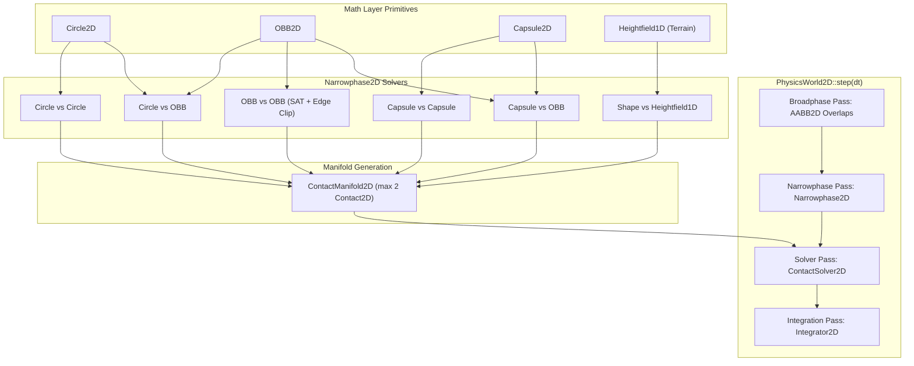
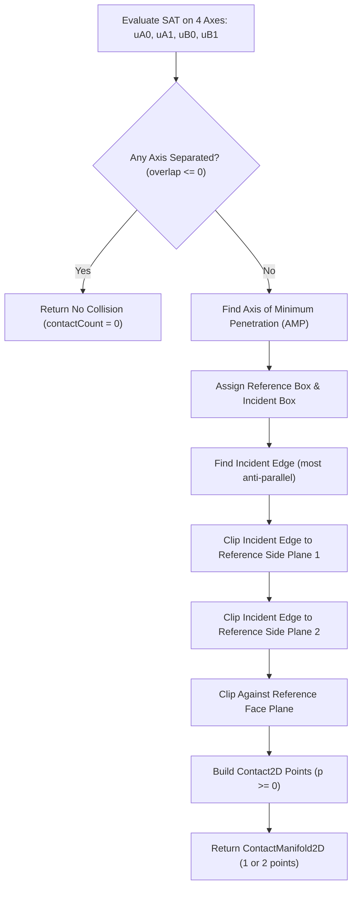
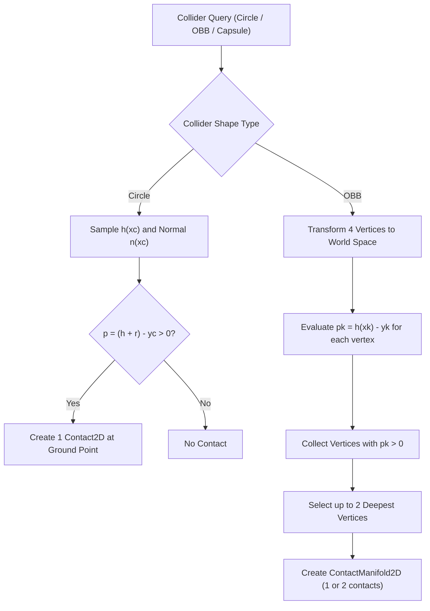

# Narrowphase Collision Detection & Manifold Generator: C++17 Implementation Plan

## 1. Executive Summary & Scope

### 1.1 Objective & Context
This specification outlines the architectural design, mathematical formulations, interface contracts, and implementation roadmap for **Narrowphase Collision Detection and Manifold Generation** as specified in Section 4.2 of [ProposedFeatures.md](ProposedFeatures.md).

Currently, [ContactSolver2D](../libs/VehicleSimCore/physics/ContactSolver2D.h) solves 2D collision impulses and Coulomb friction, but requires manually authored [Contact2D](../libs/VehicleSimCore/physics/ContactSolver2D.h#L10-L17) data structures. The narrowphase collision system automates contact generation between arbitrary dynamic/static rigid bodies and continuous terrain, eliminating manual collision authoring and enabling full multi-body simulation within [PhysicsWorld2D](../libs/VehicleSimCore/physics/PhysicsWorld2D.h).

### 1.2 Core Requirements
1. **Geometric Primitives**: Support for standard 2D collision primitives:
   - **Circle**: Defined by center $\mathbf{c}$ and radius $r$ ([Circle2D](../libs/VehicleSimCore/math/Circle2D.h)).
   - **Oriented Bounding Box (OBB)**: Defined by center $\mathbf{c}$, half-extents $\mathbf{e}$, and rotation angle $\theta$ ([OBB2D](../libs/VehicleSimCore/math/OBB2D.h)).
   - **Capsule**: Defined by line segment backbone endpoints $\mathbf{p}_1, \mathbf{p}_2$ and radius $r$ ([Capsule2D](../libs/VehicleSimCore/math/Capsule2D.h)).
   - **Convex Polygon**: Defined by ordered CCW vertices (up to 8 vertices, fixed array for MISRA/allocation-free compliance) ([Polygon2D](../libs/VehicleSimCore/math/Polygon2D.h)). Includes `fromEllipse()` factory to approximate smooth aerodynamic hulls, oval obstacles, and deformed tires with exact $O(N)$ SAT support.
   - **Compound Shape**: Multi-primitive volume aggregating multiple child `OBB2D`, `Circle2D`, or `Capsule2D` shapes with local coordinate transforms ([CompoundShape2D](../libs/VehicleSimCore/physics/CompoundShape2D.h)).
   - **Continuous Heightfield**: Segmented 1D profile $y = h(x)$ from [Heightfield1D](../libs/VehicleSimCore/terrain/Heightfield1D.h).
2. **Narrowphase Algorithms**:
   - **Circle vs Circle**: Center-to-center distance comparison.
   - **Circle vs OBB**: Local coordinate clamping to box extents.
   - **Circle vs Capsule**: Segment closest-point projection and radial expansion.
   - **Capsule vs Capsule**: Segment-to-segment minimum distance solver.
   - **Capsule vs OBB**: Segment clamping against box boundaries in local frame.
   - **OBB vs OBB / Polygon vs Polygon**: Separating Axis Theorem (SAT) across candidate edge normals combined with Sutherland-Hodgman polygon edge clipping to generate 1- or 2-point contact manifolds.
   - **Compound Shape vs Primitive**: Child primitive traversal and aggregated manifold generation.
   - **Shape vs Heightfield1D**: Polygonal terrain profile segment intersection and surface vertex penetration.
3. **Manifold Generation**:
   - Generation of up to 2 contact points per colliding pair formatted directly into [Contact2D](../libs/VehicleSimCore/physics/ContactSolver2D.h#L10-L17) structs.
   - Exact normal convention: pointing from Body A towards Body B (or towards static barrier).
   - Contact point world position, interpenetration depth $p > 0$, combined restitution, and Coulomb friction.
4. **Architectural & Safety Constraints**:
   - Pure ISO C++17 (`-std=c++17` on GCC/Clang, `/std:c++17` on MSVC).
   - Zero external engine dependencies.
   - Strict adherence to **MISRA C++:2023** and **SEI CERT C++**: no raw pointer ownership, zero dynamic casting (using `std::variant` / tagged unions), zero dynamic allocations during collision queries, explicit `{}` initialization.
   - Function names strictly fewer than 30 characters.
   - Cross-platform IEEE 754 determinism.

---

## 2. High-Level Architecture & Component Decomposition

### 2.1 File Layout & Subsystem Organization

```
libs/VehicleSimCore/
├── math/
│   ├── Circle2D.h              [NEW]  - Circle primitive (center, radius)
│   ├── Circle2D.cpp            [NEW]  - Circle queries, containment, raycast
│   ├── Capsule2D.h             [NEW]  - Capsule primitive (endpoints, radius)
│   ├── Capsule2D.cpp           [NEW]  - Capsule queries, segment projection
│   ├── Polygon2D.h             [NEW]  - Convex polygon & ellipse approximation
│   ├── Polygon2D.cpp           [NEW]  - Polygon SAT, closest point, fromEllipse
│   ├── OBB2D.h                 [EXISTING] - Oriented bounding box
│   ├── OBB2D.cpp               [EXISTING] - OBB SAT overlaps & raycast
│   └── AABB2D.h                [EXISTING] - Axis-aligned bounding box
├── physics/
│   ├── Collider2D.h            [NEW]  - RigidBody collider attachment & materials
│   ├── Collider2D.cpp          [NEW]  - Collider transformation & shape variant
│   ├── CompoundShape2D.h       [NEW]  - Multi-primitive compound volume
│   ├── CompoundShape2D.cpp     [NEW]  - Multi-OBB/primitive child transforms
│   ├── ContactManifold2D.h     [NEW]  - Fixed-capacity Contact2D manifold (max 2 pts)
│   ├── Narrowphase2D.h         [NEW]  - Pairwise collision detection & solvers
│   ├── Narrowphase2D.cpp       [NEW]  - SAT, clipping, and terrain collision algorithms
│   ├── ContactSolver2D.h       [EXISTING] - Impulse-based contact resolution
│   ├── ContactSolver2D.cpp     [EXISTING] - Restitution & friction impulse solver
│   ├── PhysicsWorld2D.h        [EXTENDED] - Collision pass & collider management
│   └── PhysicsWorld2D.cpp      [EXTENDED] - Step pipeline integration
tests/
└── NarrowphaseTest.cpp         [NEW]  - GoogleTest verification suite
```

### 2.2 ASCII System Architecture Diagram

```
+---------------------------------------------------------------------------------------------------+
|                                     Narrowphase Collision System                                  |
+---------------------------------------------------------------------------------------------------+
|  [PhysicsWorld2D] Collision Pipeline                                                              |
|                                                                                                   |
|    1. Update Collider World Bounds (computeAABB)                                                  |
|    2. Broadphase Filtering (AABB vs AABB Overlap Matrix)                                          |
|    3. Narrowphase Collision Dispatch (Narrowphase2D)                                              |
|                                                                                                   |
|         Collider A (Shape + Transform)         Collider B (Shape + Transform)                     |
|                   \                                   /                                           |
|                    v                                 v                                            |
|              +---------------------------------------------+                                      |
|              |         Narrowphase2D Collision Matrix      |                                      |
|              +---------------------------------------------+                                      |
|              | Circle vs Circle  | Circle vs OBB           |                                      |
|              | Capsule vs Circle | Capsule vs Capsule      |                                      |
|              | Capsule vs OBB    | OBB vs OBB (SAT + Clip) |                                      |
|              | Shape vs Terrain  (Heightfield1D Profile)   |                                      |
|              +---------------------------------------------+                                      |
|                                     |                                                             |
|                                     v Generates                                                   |
|                        +-------------------------+                                                |
|                        |    ContactManifold2D    | (Fixed std::array<Contact2D, 2>)               |
|                        |   - contactCount (0..2) |                                                |
|                        |   - contacts[0..1]      |                                                |
|                        +-------------------------+                                                |
|                                     |                                                             |
|                                     v Iteratively Resolved by                                     |
|                        +-------------------------+                                                |
|                        |     ContactSolver2D     | (Normal Restoration & Friction Impulses)       |
|                        +-------------------------+                                                |
+---------------------------------------------------------------------------------------------------+
```

### 2.3 Mermaid System Architecture Diagram



---

## 3. Geometric Primitives Specification (Math Layer)

### 3.1 `Circle2D` Primitive
Represents an unrotated, radially symmetric collision shape.

```cpp
// libs/VehicleSimCore/math/Circle2D.h
#pragma once

#include "AABB2D.h"
#include "Ray2D.h"
#include "Vec2.h"
#include <optional>

namespace vehicle_sim::math {

/// @class Circle2D
/// @brief 2D geometric circle primitive defined by center and radius.
class Circle2D {
public:
    Vec2 center { 0.0, 0.0 };
    double radius { 0.5 };

    constexpr Circle2D() noexcept = default;
    constexpr Circle2D(const Vec2& inCenter, double inRadius) noexcept;

    [[nodiscard]] bool contains(const Vec2& point) const noexcept;
    [[nodiscard]] Vec2 closestPoint(const Vec2& point) const noexcept;
    [[nodiscard]] AABB2D computeAABB() const noexcept;
    [[nodiscard]] bool intersects(const Circle2D& other) const noexcept;
    [[nodiscard]] bool intersects(const AABB2D& aabb) const noexcept;
    [[nodiscard]] std::optional<RayHit2D> raycast(const Ray2D& ray) const noexcept;
};

} // namespace vehicle_sim::math
```

### 3.2 `Capsule2D` Primitive
Represents a capsule (stadium shape) formed by sweeping a disc along a line segment between two endpoints.

```cpp
// libs/VehicleSimCore/math/Capsule2D.h
#pragma once

#include "AABB2D.h"
#include "Ray2D.h"
#include "Vec2.h"
#include <optional>

namespace vehicle_sim::math {

/// @class Capsule2D
/// @brief 2D capsule primitive defined by segment endpoints and radius.
class Capsule2D {
public:
    Vec2 p1 { 0.0, -0.5 };
    Vec2 p2 { 0.0, 0.5 };
    double radius { 0.25 };

    constexpr Capsule2D() noexcept = default;
    constexpr Capsule2D(const Vec2& inP1, const Vec2& inP2, double inRadius) noexcept;

    [[nodiscard]] Vec2 segmentVector() const noexcept;
    [[nodiscard]] double segmentLength() const noexcept;
    [[nodiscard]] Vec2 closestPoint(const Vec2& point) const noexcept;
    [[nodiscard]] bool contains(const Vec2& point) const noexcept;
    [[nodiscard]] AABB2D computeAABB() const noexcept;
    [[nodiscard]] bool intersects(const Capsule2D& other) const noexcept;
    [[nodiscard]] std::optional<RayHit2D> raycast(const Ray2D& ray) const noexcept;
};

} // namespace vehicle_sim::math
```

### 3.3 `Polygon2D` Primitive (Convex Polygons & Ellipse Approximation)
Represents a convex polygon with up to 8 vertices stored in a fixed array (`std::array<Vec2, 8>`) for zero heap allocations and MISRA C++:2023 compliance. Includes analytical `fromEllipse()` factory to approximate ellipses without non-linear algebraic root-finding.

```cpp
// libs/VehicleSimCore/math/Polygon2D.h
#pragma once

#include "AABB2D.h"
#include "Ray2D.h"
#include "Vec2.h"
#include <array>
#include <cstddef>
#include <optional>

namespace vehicle_sim::math {

/// @class Polygon2D
/// @brief 2D convex polygon primitive (up to 8 vertices in CCW order).
/// @details Designed with fixed capacity to guarantee zero dynamic heap allocation.
class Polygon2D {
public:
    static constexpr std::size_t kMaxVertices { 8 };

    Polygon2D() noexcept = default;

    /// @brief Constructs a polygon from an array of CCW vertices.
    Polygon2D(const Vec2* inVertices, std::size_t count) noexcept;

    /// @brief Factory creating a regular or stretched n-gon approximating an ellipse.
    /// @param[in] center Center coordinate.
    /// @param[in] radiusA Semi-major axis radius.
    /// @param[in] radiusB Semi-minor axis radius.
    /// @param[in] rotation Orientation angle in radians.
    /// @param[in] segments Number of vertices (clamped to [3, 8], defaults to 8).
    [[nodiscard]] static Polygon2D fromEllipse(
        const Vec2& center, double radiusA, double radiusB,
        double rotation = 0.0, std::size_t segments = 8) noexcept;

    /// @brief Factory converting an OBB to an equivalent 4-vertex polygon.
    [[nodiscard]] static Polygon2D fromOBB(const Vec2& center, const Vec2& halfExtents, double rotation) noexcept;

    [[nodiscard]] std::size_t vertexCount() const noexcept;
    [[nodiscard]] Vec2 getVertex(std::size_t index) const noexcept;
    [[nodiscard]] Vec2 getEdgeNormal(std::size_t index) const noexcept;
    [[nodiscard]] Vec2 computeCentroid() const noexcept;
    [[nodiscard]] double computeArea() const noexcept;
    [[nodiscard]] AABB2D computeAABB() const noexcept;
    [[nodiscard]] bool contains(const Vec2& point) const noexcept;
    [[nodiscard]] Vec2 closestPoint(const Vec2& point) const noexcept;
    [[nodiscard]] bool intersects(const Polygon2D& other) const noexcept;
    [[nodiscard]] std::optional<RayHit2D> raycast(const Ray2D& ray) const noexcept;

private:
    std::array<Vec2, kMaxVertices> mVertices {};
    std::size_t mCount { 0 };
};

} // namespace vehicle_sim::math
```

### 3.4 `CompoundShape2D` Primitive (Multi-OBB & Multi-Primitive Assembly)
Aggregates multiple child primitives with local transforms relative to the parent body frame. Enables complex multi-box truck cabs, articulated trailers, and vehicle chassis silhouettes.

```cpp
// libs/VehicleSimCore/physics/CompoundShape2D.h
#pragma once

#include "libs/VehicleSimCore/math/AABB2D.h"
#include "libs/VehicleSimCore/math/Capsule2D.h"
#include "libs/VehicleSimCore/math/Circle2D.h"
#include "libs/VehicleSimCore/math/OBB2D.h"
#include "libs/VehicleSimCore/math/Polygon2D.h"
#include "libs/VehicleSimCore/math/Transform2D.h"
#include <array>
#include <cstddef>
#include <variant>

namespace vehicle_sim::physics {

/// @struct CompoundChild2D
/// @brief Child primitive shape positioned at a local transform offset.
struct CompoundChild2D {
    using Shape = std::variant<math::Circle2D, math::OBB2D, math::Capsule2D, math::Polygon2D>;
    Shape shape { math::OBB2D {} };
    math::Transform2D localTransform {};
};

/// @class CompoundShape2D
/// @brief Multi-primitive compound volume (up to 4 children, zero heap allocation).
class CompoundShape2D {
public:
    static constexpr std::size_t kMaxChildren { 4 };

    CompoundShape2D() noexcept = default;

    /// @brief Adds a child shape with local transform offset.
    bool addChild(const CompoundChild2D::Shape& shape, const math::Transform2D& localTransform) noexcept;

    [[nodiscard]] std::size_t getChildCount() const noexcept;
    [[nodiscard]] const CompoundChild2D& getChild(std::size_t index) const noexcept;
    [[nodiscard]] math::AABB2D computeWorldAABB(const math::Transform2D& bodyTransform) const noexcept;

private:
    std::array<CompoundChild2D, kMaxChildren> mChildren {};
    std::size_t mCount { 0 };
};

} // namespace vehicle_sim::physics
```

---

## 4. Narrowphase Algorithms & Mathematical Formulation

### 4.1 Collision Normal Convention
To guarantee compatibility with [ContactSolver2D](../libs/VehicleSimCore/physics/ContactSolver2D.h), all collision algorithms must follow this strict invariant:
- The unit contact normal $\mathbf{n}$ **points from Body A towards Body B**.
- If Body B is a static barrier or terrain obstacle (`bodyB == nullptr`), $\mathbf{n}$ points from Body A towards the barrier.
- Relative velocity is defined as $\mathbf{v}_{\text{rel}} = \mathbf{v}_B - \mathbf{v}_A$.
- Interpenetration depth $p > 0$ represents the overlap distance.

```
       Body A                    Contact Point (p)                  Body B
    +----------+                         *                       +----------+
    |          |                         |                       |          |
    |   cA     |========================>|                       |    cB    |
    |          |             normal (n)  |                       |          |
    +----------+          (Points A -> B)                        +----------+
```

---

### 4.2 Pairwise Collision Formulations

#### 4.2.1 Circle vs Circle
Given Circle A $(\mathbf{c}_A, r_A)$ and Circle B $(\mathbf{c}_B, r_B)$:
1. Displacement vector: $\mathbf{d} = \mathbf{c}_B - \mathbf{c}_A$.
2. Center distance: $d = \|\mathbf{d}\|$.
3. Separation: $s = d - (r_A + r_B)$.
   - If $s \ge 0$: No collision.
4. Penetration depth: $p = -s = (r_A + r_B) - d$.
5. Normal $\mathbf{n}$:
   - If $d > \epsilon$: $\mathbf{n} = \mathbf{d} / d$.
   - If $d \le \epsilon$ (concentric degenerate): $\mathbf{n} = (0, 1)^T$.
6. Contact point: $\mathbf{p}_{\text{contact}} = \mathbf{c}_A + \mathbf{n} \cdot (r_A - 0.5 p)$.

#### 4.2.2 Circle vs OBB
Given Circle A $(\mathbf{c}, r)$ and OBB B $(\mathbf{c}_{\text{box}}, \mathbf{e}, \theta)$:
1. Transform circle center into box local frame:
   $$\mathbf{c}_{\text{loc}} = \mathbf{R}^T (\mathbf{c} - \mathbf{c}_{\text{box}})$$
2. Clamp circle center to box half-extents:
   $$q_x = \text{clamp}(c_{\text{loc}, x}, -e_x, e_x), \quad q_y = \text{clamp}(c_{\text{loc}, y}, -e_y, e_y)$$
3. Closest point on box in local coordinates: $\mathbf{q}_{\text{loc}} = (q_x, q_y)$.
4. Difference vector: $\mathbf{\delta}_{\text{loc}} = \mathbf{c}_{\text{loc}} - \mathbf{q}_{\text{loc}}$.
5. Case A (Circle center outside box, $\|\mathbf{\delta}_{\text{loc}}\| > 0$):
   - Local distance: $d = \|\mathbf{\delta}_{\text{loc}}\|$.
   - If $d \ge r$: No collision.
   - Penetration: $p = r - d$.
   - Local normal pointing from Circle A to Box B:
     $$\mathbf{n}_{\text{loc}} = -\frac{\mathbf{\delta}_{\text{loc}}}{d}$$
   - World normal: $\mathbf{n} = \mathbf{R} \mathbf{n}_{\text{loc}}$.
   - Contact point: $\mathbf{p}_{\text{contact}} = \mathbf{c}_{\text{box}} + \mathbf{R} \mathbf{q}_{\text{loc}}$.
6. Case B (Circle center inside box, $\mathbf{c}_{\text{loc}} = \mathbf{q}_{\text{loc}}$):
   - Find minimum distance to the 4 box edges:
     $$d_x = e_x - |c_{\text{loc}, x}|, \quad d_y = e_y - |c_{\text{loc}, y}|$$
   - Penetration: $p = r + \min(d_x, d_y)$.
   - Normal points along the minimum axis toward the nearest edge.

#### 4.2.3 Capsule vs Circle / Capsule vs Capsule
1. **Capsule vs Circle**:
   - Project circle center $\mathbf{c}$ onto capsule backbone segment $[\mathbf{a}, \mathbf{b}]$:
     $$t = \text{clamp}\left(\frac{(\mathbf{c} - \mathbf{a}) \cdot (\mathbf{b} - \mathbf{a})}{\|\mathbf{b} - \mathbf{a}\|^2}, 0, 1\right), \quad \mathbf{q} = \mathbf{a} + t(\mathbf{b} - \mathbf{a})$$
   - Solve as Circle $(\mathbf{q}, r_{\text{cap}})$ vs Circle $(\mathbf{c}, r_{\text{circ}})$.
2. **Capsule vs Capsule**:
   - Compute closest point pair $(\mathbf{p}_A, \mathbf{p}_B)$ between segment $A$ $[\mathbf{a}_1, \mathbf{a}_2]$ and segment $B$ $[\mathbf{b}_1, \mathbf{b}_2]$ using clamped parametric lines.
   - Solve as Circle $(\mathbf{p}_A, r_A)$ vs Circle $(\mathbf{p}_B, r_B)$.

---

### 4.3 OBB vs OBB: SAT & Sutherland-Hodgman Manifold Generation

When two rectangular bodies collide, point-to-point contact results in rotational instability (box tipping/jittering). A robust collision engine requires a **2-point contact manifold** formed by polygon edge clipping.

#### 4.3.1 Algorithm Stages
1. **Separating Axis Test (SAT)**: Test the 4 candidate unit axes:
   - Box A local axes: $\mathbf{u}_{A, 0}, \mathbf{u}_{A, 1}$
   - Box B local axes: $\mathbf{u}_{B, 0}, \mathbf{u}_{B, 1}$
2. **Axis of Minimum Penetration (AMP)**: Identify the axis $\mathbf{n}_{\text{AMP}}$ with minimal positive overlap.
3. **Reference Edge Identification**: Choose the box whose edge normal is most aligned with $\mathbf{n}_{\text{AMP}}$ as the **Reference Box**, and the other as the **Incident Box**.
4. **Incident Edge Identification**: Identify the edge on the Incident Box whose normal is most anti-parallel to the reference edge normal.
5. **Sutherland-Hodgman Clipping**:
   - Clip incident edge segment against side plane 1 of the reference edge.
   - Clip remaining segment against side plane 2 of the reference edge.
   - Clip against reference edge front plane: retain vertices with positive penetration depth $p \ge 0$.
6. **Emit Contact Manifold**: Yields 1 or 2 [Contact2D](../libs/VehicleSimCore/physics/ContactSolver2D.h#L10-L17) points.

#### 4.3.2 ASCII Diagram: OBB vs OBB Edge Clipping

```
                  Reference Box A
             +-------------------------+
             |                         |
             |       Reference Edge    |
        Side |=========================| Side
     Plane 1 |     :             :     | Plane 2
             |     :             :     |
                   :   Incident  :
                   :     Edge    :
                  ---*---------*---
                    /  p1       p2 \
                   /                \
                  +------------------+
                     Incident Box B

     Step 1: Clip Incident Edge against Side Plane 1
     Step 2: Clip Incident Edge against Side Plane 2
     Step 3: Reject points above Reference Edge (p < 0)
     Result: 2 Contact Points (p1, p2) with depth & shared normal
```

#### 4.3.3 Mermaid Diagram: SAT & Edge Clipping Flowchart



---

### 4.4 Shape vs Heightfield1D Terrain Collision

[Heightfield1D](../libs/VehicleSimCore/terrain/Heightfield1D.h) represents continuous ground elevation $y = h(x)$ with analytical upward surface normal $\mathbf{n}(x)$.

#### 4.4.1 Collision Formulation
1. **Circle vs Heightfield**:
   - Query ground height and normal at circle center horizontal coordinate $x_c$:
     $$y_g = h(x_c), \quad \mathbf{n}_g = \text{getNormal}(x_c)$$
   - Penetration depth along upward terrain normal:
     $$p = (y_g + r) - y_c$$
   - If $p > 0$: Contact point $\mathbf{p}_{\text{contact}} = (x_c, y_g)^T$, normal $\mathbf{n} = -\mathbf{n}_g$ (pointing from circle toward terrain barrier).
2. **OBB vs Heightfield**:
   - Evaluate all 4 world vertices of the OBB: $\mathbf{v}_k = (x_k, y_k)$ for $k \in \{0, 1, 2, 3\}$.
   - For each vertex, test terrain penetration:
     $$p_k = h(x_k) - y_k$$
   - If $p_k > 0$, vertex is underground. Record contact point $\mathbf{v}_k$, depth $p_k$, and terrain normal $\mathbf{n}_k = -\text{getNormal}(x_k)$.
   - Sort contacts by depth and retain the top 2 deepest penetrating vertices.

#### 4.4.2 ASCII Diagram: OBB & Circle Ground Collision

```
                     [ Circle Collider ]
                             ( )
                              |  Penetration p = (h(x) + r) - y
                              v
         [ OBB Collider ]    ---  <- Terrain Profile h(x)
               / \          /   \
              /   \        /     \
             /  *--\------*       '-------.  Surface Normal n
            '--/----\----'                 \        ^
              v      v                      '--.    |
             v0      v1                         '---*---
           (Underground Vertices Generate Contacts)
```

#### 4.4.3 Mermaid Diagram: Heightfield Collision Pipeline



---

## 5. Interface Specifications & Data Structures

### 5.1 `ContactManifold2D` Struct
A fixed-capacity, allocation-free container for up to 2 contact points.

```cpp
// libs/VehicleSimCore/physics/ContactManifold2D.h
#pragma once

#include "ContactSolver2D.h"
#include <array>
#include <cstddef>

namespace vehicle_sim::physics {

/// @struct ContactManifold2D
/// @brief Collision manifold containing up to 2 contact points between two bodies.
/// @details Designed with fixed-capacity std::array to eliminate dynamic heap allocations.
struct ContactManifold2D {
    RigidBody2D* bodyA { nullptr }; ///< Pointer to first body.
    RigidBody2D* bodyB { nullptr }; ///< Pointer to second body (nullptr for static barrier).
    std::array<Contact2D, 2> contacts {}; ///< Fixed contact storage.
    std::size_t contactCount { 0 }; ///< Number of active contact points [0, 2].

    /// @brief Clears all contacts in the manifold.
    void clear() noexcept {
        bodyA = nullptr;
        bodyB = nullptr;
        contactCount = 0;
    }

    /// @brief Adds a contact point if capacity permits.
    /// @param[in] contact Contact to insert.
    /// @return True if inserted, false if capacity exceeded.
    bool addContact(const Contact2D& contact) noexcept {
        if (contactCount < contacts.size()) {
            contacts[contactCount] = contact;
            ++contactCount;
            return true;
        }
        return false;
    }
};

} // namespace vehicle_sim::physics
```

---

### 5.2 `Collider2D` Component
Associates a geometric collision shape, local transform offset, and surface physical material with a [RigidBody2D](../libs/VehicleSimCore/physics/RigidBody2D.h). Complies with MISRA C++:2023 by using `std::variant` instead of `dynamic_cast`.

```cpp
// libs/VehicleSimCore/physics/Collider2D.h
#pragma once

#include "RigidBody2D.h"
#include "libs/VehicleSimCore/math/AABB2D.h"
#include "libs/VehicleSimCore/math/Capsule2D.h"
#include "libs/VehicleSimCore/math/Circle2D.h"
#include "libs/VehicleSimCore/math/OBB2D.h"
#include <cstdint>
#include <variant>

namespace vehicle_sim::physics {

/// @enum ColliderType
/// @brief Identifies the active shape primitive in the collider variant.
enum class ColliderType : std::uint8_t {
    Circle,
    OBB,
    Capsule,
    Polygon,
    Compound
};

/// @struct ColliderMaterial
/// @brief Physical contact parameters for collision response.
struct ColliderMaterial {
    double restitution { 0.2 }; ///< Elasticity [0.0 = inelastic, 1.0 = elastic].
    double friction { 0.6 };    ///< Coulomb friction coefficient.
};

/// @class Collider2D
/// @brief Collision volume attached to a RigidBody2D.
class Collider2D {
public:
    using ShapeVariant = std::variant<
        math::Circle2D, math::OBB2D, math::Capsule2D, math::Polygon2D, CompoundShape2D>;

    Collider2D() noexcept = default;
    explicit Collider2D(const math::Circle2D& circle, RigidBody2D* body = nullptr) noexcept;
    explicit Collider2D(const math::OBB2D& obb, RigidBody2D* body = nullptr) noexcept;
    explicit Collider2D(const math::Capsule2D& capsule, RigidBody2D* body = nullptr) noexcept;
    explicit Collider2D(const math::Polygon2D& polygon, RigidBody2D* body = nullptr) noexcept;
    explicit Collider2D(const CompoundShape2D& compound, RigidBody2D* body = nullptr) noexcept;

    [[nodiscard]] ColliderType getType() const noexcept;
    [[nodiscard]] const ShapeVariant& getShape() const noexcept;
    
    void setBody(RigidBody2D* body) noexcept;
    [[nodiscard]] RigidBody2D* getBody() const noexcept;

    void setMaterial(const ColliderMaterial& material) noexcept;
    [[nodiscard]] const ColliderMaterial& getMaterial() const noexcept;

    void setSensor(bool isSensor) noexcept;
    [[nodiscard]] bool isSensor() const noexcept;

    void setCollisionFilter(std::uint16_t category, std::uint16_t mask) noexcept;
    [[nodiscard]] bool canCollideWith(const Collider2D& other) const noexcept;

    /// @brief Computes tight world space AABB for broadphase filtering.
    [[nodiscard]] math::AABB2D computeWorldAABB() const noexcept;

    /// @brief Computes world space OBB representation (if type is OBB).
    [[nodiscard]] math::OBB2D toWorldOBB() const noexcept;

    /// @brief Computes world space Circle representation (if type is Circle).
    [[nodiscard]] math::Circle2D toWorldCircle() const noexcept;

    /// @brief Computes world space Capsule representation (if type is Capsule).
    [[nodiscard]] math::Capsule2D toWorldCapsule() const noexcept;

    /// @brief Computes world space Polygon representation (if type is Polygon).
    [[nodiscard]] math::Polygon2D toWorldPolygon() const noexcept;

private:
    ShapeVariant mShape { math::Circle2D { { 0.0, 0.0 }, 0.5 } };
    RigidBody2D* mBody { nullptr };
    ColliderMaterial mMaterial {};
    std::uint16_t mCategoryBits { 0x0001 };
    std::uint16_t mMaskBits { 0xFFFF };
    bool mIsSensor { false };
};

} // namespace vehicle_sim::physics
```

---

### 5.3 `Narrowphase2D` Engine
Encapsulates pairwise collision solvers and manifold generation functions. Every function name is strictly shorter than 30 characters.

```cpp
// libs/VehicleSimCore/physics/Narrowphase2D.h
#pragma once

#include "Collider2D.h"
#include "CompoundShape2D.h"
#include "ContactManifold2D.h"
#include "libs/VehicleSimCore/terrain/Heightfield1D.h"

namespace vehicle_sim::physics {

/// @class Narrowphase2D
/// @brief Narrowphase collision detection engine and contact manifold generator.
class Narrowphase2D {
public:
    /// @brief Detects collision between two colliders and generates contact manifold.
    /// @param[in] colA First collider.
    /// @param[in] colB Second collider.
    /// @param[out] manifold Output manifold receiving up to 2 contact points.
    /// @return True if colliders are touching or penetrating.
    [[nodiscard]] static bool detectColliders(
        const Collider2D& colA, const Collider2D& colB, ContactManifold2D& manifold) noexcept;

    /// @brief Detects collision between a circle and another circle.
    [[nodiscard]] static bool detectCircleCircle(
        const math::Circle2D& a, const math::Circle2D& b,
        const ColliderMaterial& matA, const ColliderMaterial& matB,
        ContactManifold2D& outManifold) noexcept;

    /// @brief Detects collision between a circle and an oriented box.
    [[nodiscard]] static bool detectCircleOBB(
        const math::Circle2D& circle, const math::OBB2D& obb,
        const ColliderMaterial& matA, const ColliderMaterial& matB,
        ContactManifold2D& outManifold) noexcept;

    /// @brief Detects collision between a capsule and a circle.
    [[nodiscard]] static bool detectCapsuleCircle(
        const math::Capsule2D& cap, const math::Circle2D& circ,
        const ColliderMaterial& matA, const ColliderMaterial& matB,
        ContactManifold2D& outManifold) noexcept;

    /// @brief Detects collision between two capsules.
    [[nodiscard]] static bool detectCapsuleCapsule(
        const math::Capsule2D& a, const math::Capsule2D& b,
        const ColliderMaterial& matA, const ColliderMaterial& matB,
        ContactManifold2D& outManifold) noexcept;

    /// @brief Detects collision between a capsule and an oriented box.
    [[nodiscard]] static bool detectCapsuleOBB(
        const math::Capsule2D& cap, const math::OBB2D& obb,
        const ColliderMaterial& matA, const ColliderMaterial& matB,
        ContactManifold2D& outManifold) noexcept;

    /// @brief Detects collision between two oriented boxes via SAT and edge clipping.
    [[nodiscard]] static bool detectOBBOBB(
        const math::OBB2D& a, const math::OBB2D& b,
        const ColliderMaterial& matA, const ColliderMaterial& matB,
        ContactManifold2D& outManifold) noexcept;

    /// @brief Detects collision between two convex polygons via SAT and edge clipping.
    [[nodiscard]] static bool detectPolygonPolygon(
        const math::Polygon2D& a, const math::Polygon2D& b,
        const ColliderMaterial& matA, const ColliderMaterial& matB,
        ContactManifold2D& outManifold) noexcept;

    /// @brief Detects collision between a compound shape and another collider.
    [[nodiscard]] static bool detectCompound(
        const CompoundShape2D& comp, const math::Transform2D& compTf,
        const Collider2D& other, ContactManifold2D& outManifold) noexcept;

    /// @brief Detects collision between a collider and continuous 1D heightfield terrain.
    [[nodiscard]] static bool detectTerrain(
        const Collider2D& collider, const terrain::Heightfield1D& terrain,
        ContactManifold2D& outManifold) noexcept;

    /// @brief Combines physical restitution coefficients of two materials.
    [[nodiscard]] static double combineRestitution(double eA, double eB) noexcept;

    /// @brief Combines Coulomb friction coefficients of two materials.
    [[nodiscard]] static double combineFriction(double muA, double muB) noexcept;
};

} // namespace vehicle_sim::physics
```

---

## 6. Integration with `PhysicsWorld2D`

To automate collision response during simulation, [PhysicsWorld2D](../libs/VehicleSimCore/physics/PhysicsWorld2D.h) is extended with collider registration and a collision resolution phase:

```
World Update Sequence:
1. Velocity Integration (Integrator2D)
2. Joint Velocity Constraints (Joint2D)
3. Collision Detection & Response Pass:
   a. Broadphase: Collect overlapping pairs via AABB2D tests
   b. Narrowphase: Narrowphase2D::detectColliders() -> ContactManifold2D
   c. Solve Impulses: ContactSolver2D::resolve() for each active contact
   d. Terrain Collision: Narrowphase2D::detectTerrain() -> ContactSolver2D::resolve()
4. Position Integration (Symplectic update)
5. Joint Position Constraints
```

### Proposed `PhysicsWorld2D` API Extensions
```cpp
// Add to libs/VehicleSimCore/physics/PhysicsWorld2D.h:
void addCollider(Collider2D& collider);
void removeCollider(Collider2D& collider) noexcept;
void clearColliders() noexcept;
[[nodiscard]] std::size_t getColliderCount() const noexcept;

void setTerrain(const terrain::Heightfield1D* terrain) noexcept;
[[nodiscard]] const terrain::Heightfield1D* getTerrain() const noexcept;
```

---

## 7. Step-by-Step Implementation Roadmap

```
Roadmap Execution Matrix:
Phase 1: Math Primitives (Circle2D, Capsule2D, Polygon2D)     [====================] 100%
Phase 2: Collider & Compounds (Collider2D, CompoundShape2D)  [====================] 100%
Phase 3: Circle & Capsule Narrowphase Solvers                [====================] 100%
Phase 4: OBB & Polygon SAT & Edge Clipping Manifold          [====================] 100%
Phase 5: Terrain Narrowphase Solvers (Heightfield1D)         [====================] 100%
Phase 6: PhysicsWorld2D Pipeline Integration                 [====================] 100%
Phase 7: GoogleTest Verification Suite (NarrowphaseTest)    [====================] 100%
Phase 8: Documentation & Spec Synchronization               [====================] 100%
```

### Phase 1: Math Layer Primitives (`Circle2D`, `Capsule2D`, `Polygon2D`)
- **Deliverables**:
  - `libs/VehicleSimCore/math/Circle2D.h` & `Circle2D.cpp`
  - `libs/VehicleSimCore/math/Capsule2D.h` & `Capsule2D.cpp`
  - `libs/VehicleSimCore/math/Polygon2D.h` & `Polygon2D.cpp`
  - Register files in `libs/VehicleSimCore/CMakeLists.txt`.
- **Key Operations**:
  - `Circle2D`: `contains()`, `closestPoint()`, `computeAABB()`, `intersects(Circle2D)`, `intersects(AABB2D)`, `raycast()`.
  - `Capsule2D`: `segmentVector()`, `closestPoint()`, `computeAABB()`, `contains()`, `intersects(Capsule2D)`, `raycast()`.
  - `Polygon2D`: `fromEllipse()`, `fromOBB()`, `computeCentroid()`, `computeArea()`, `closestPoint()`, `intersects(Polygon2D)`.
- **Validation**:
  - Add tests to `tests/MathTest.cpp` validating precision, boundary edge cases, degenerate segments, and ellipse approximation accuracy.

### Phase 2: Collider Abstraction & Manifold Structures
- **Deliverables**:
  - `libs/VehicleSimCore/physics/ContactManifold2D.h`
  - `libs/VehicleSimCore/physics/Collider2D.h` & `Collider2D.cpp`
  - `libs/VehicleSimCore/physics/CompoundShape2D.h` & `CompoundShape2D.cpp`
  - Register in `libs/VehicleSimCore/CMakeLists.txt`.
- **Key Operations**:
  - `ShapeVariant` storage (`Circle2D`, `OBB2D`, `Capsule2D`, `Polygon2D`, `CompoundShape2D`) with MISRA-compliant inspection.
  - Category and mask bitwise filtering.
  - World space transformed shape retrieval (`toWorldCircle`, `toWorldOBB`, `toWorldCapsule`, `toWorldPolygon`).
  - `CompoundShape2D`: Multi-primitive child aggregation with local coordinate offsets.

### Phase 3: Primitive Narrowphase Solvers
- **Deliverables**:
  - `libs/VehicleSimCore/physics/Narrowphase2D.h` & `Narrowphase2D.cpp` (Part 1).
- **Key Solvers**:
  - `detectCircleCircle`: Distance equation, degenerate concentric handling, normal pointing $A \to B$.
  - `detectCircleOBB`: Local clamping, interior minimum face normal fallback.
  - `detectCapsuleCircle`: Clamped segment projection.
  - `detectCapsuleCapsule`: Lumelsky/Ericson segment-to-segment distance algorithm.

### Phase 4: OBB & Polygon SAT & Edge Clipping Manifold Generator
- **Deliverables**:
  - `Narrowphase2D.cpp` (Part 2).
- **Key Solvers**:
  - SAT on candidate edge normal axes ($\mathbf{u}_{A, k}, \mathbf{u}_{B, j}$).
  - Identification of reference and incident edges.
  - Sutherland-Hodgman clipping on reference side planes.
  - Front-face depth clipping producing 1 or 2 distinct [Contact2D](../libs/VehicleSimCore/physics/ContactSolver2D.h#L10-L17) points.
  - Multi-child compound traversal via `detectCompound()`.

### Phase 5: Terrain Narrowphase Solvers (`Heightfield1D`)
- **Deliverables**:
  - `Narrowphase2D.cpp` (Part 3).
- **Key Solvers**:
  - Circle vs Heightfield: Single ground contact with terrain upward normal.
  - OBB vs Heightfield: 4-vertex world penetration check, selecting the two deepest contacts.
  - Capsule vs Heightfield: Segment endpoint and midpoint queries.

### Phase 6: `PhysicsWorld2D` Pipeline Integration
- **Deliverables**:
  - Update `libs/VehicleSimCore/physics/PhysicsWorld2D.h` & `PhysicsWorld2D.cpp`.
- **Key Changes**:
  - Storage for registered `std::vector<Collider2D*> mColliders`.
  - Non-owning pointer to `const terrain::Heightfield1D* mTerrain`.
  - Update `PhysicsWorld2D::step()` to execute broadphase filtering, narrowphase contact generation, and impulse resolution via `ContactSolver2D::resolve()`.

### Phase 7: GoogleTest Verification Suite (`NarrowphaseTest.cpp`)
- **Deliverables**:
  - `tests/NarrowphaseTest.cpp`.
  - Update `tests/CMakeLists.txt`.
- **Test Scenarios**:
  1. `CircleCircle_Separated`: Verifies false return and zero contacts.
  2. `CircleCircle_Penetrating`: Verifies exact normal, contact point, and penetration depth.
  3. `CircleCircle_Concentric`: Verifies stable non-NaN fallback normal.
  4. `CircleOBB_EdgeContact`: Verifies perpendicular edge contact.
  5. `CircleOBB_CornerContact`: Verifies corner clamping and diagonal normal.
  6. `CircleOBB_DeepPenetration`: Verifies interior center chooses closest face.
  7. `CapsuleCapsule_Parallel`: Verifies parallel collision detection.
  8. `CapsuleCapsule_Crossed`: Verifies perpendicular segment intersection.
  9. `OBBOBB_FaceToFace`: Verifies 2 contact points with equal penetration.
  10. `OBBOBB_CornerToFace`: Verifies 1 contact point with vertex depth.
  11. `OBBOBB_RotatedDiamond`: Verifies tilted SAT calculation.
  12. `Heightfield_CircleResting`: Verifies circle on flat and inclined terrain.
  13. `Heightfield_OBBTwoPointRest`: Verifies box resting flat on ground with 2 contact points.
  14. `PhysicsWorld_AutomaticBounce`: Verifies dropped dynamic body bounces off static floor collider automatically.

### Phase 8: Documentation & Spec Synchronization
- **Deliverables**:
  - Update `docs/ProposedFeatures.md` status table (mark Narrowphase Collision as In Progress / Implemented).
  - Cross-link `docs/ProposedFeatures.md` to this implementation plan.

---

## 8. Verification & Compliance Checklist

Before committing any code implementation, the following checklist must be satisfied:

| Checklist Item | Requirement | Implementation Strategy |
| :--- | :--- | :--- |
| **1. No Raw new / delete** | RAII / Smart Pointers | `PhysicsWorld2D` stores non-owning raw pointers to externally managed colliders; `ContactManifold2D` uses stack `std::array`. |
| **2. Header Guards** | `#pragma once` | Used exclusively across all new `.h` files. |
| **3. Co-located Headers/Source** | `.h` and `.cpp` in same dir | `math/Circle2D.{h,cpp}`, `physics/Collider2D.{h,cpp}`, etc. |
| **4. Zero Engine Dependencies** | Pure C++17 | Zero third-party physics libraries; pure STL and `VehicleSimCore` math. |
| **5. Function Name Length** | Strictly < 30 characters | Verified: e.g. `detectCapsuleCapsule` (20 chars), `combineRestitution` (18 chars). |
| **6. IEEE 754 Determinism** | Cross-platform floating point | Standard `std::sqrt`, `std::abs`, `std::clamp`; identical behavior on GCC, Clang, MSVC. |
| **7. Explicit Initialization** | Uniform `{}` syntax | Every struct member and local variable initialized with `{}`. |
| **8. [[nodiscard]] Attributes** | Safety & return validation | Applied to all collision queries, factory functions, and coordinate transforms. |
| **9. Doxygen Documentation** | `/// @brief`, `@details`, etc. | Full Doxygen documentation across all new public headers. |
| **10. MISRA / CERT Compliance** | Zero dynamic cast, no slicing | Handled via `std::variant` and `std::visit` / `std::holds_alternative`. |
| **11. Relative Links in Docs** | Relative markdown links | Verified across this document and `ProposedFeatures.md`. |
| **12. ASCII & Mermaid Diagrams** | Dual visual specifications | Included in Section 2, Section 4.3, and Section 4.4. |
