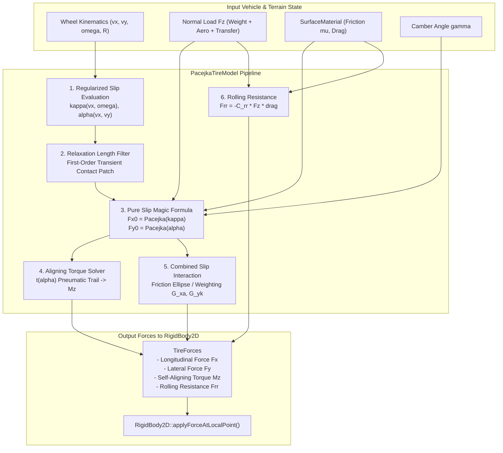
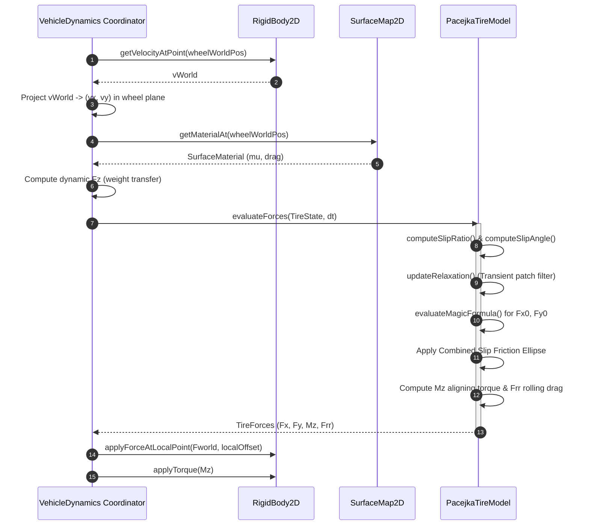

# Pacejka 'Magic Formula' Tire Model: C++17 Implementation Plan

## 1. Executive Summary & Scope

### 1.1 Objective & Context
This specification outlines the architectural design, mathematical formulations, interface contracts, and implementation roadmap for the **Semi-Empirical Pacejka 'Magic Formula' Tire Model** as proposed in Section 4.3 of [ProposedFeatures.md](ProposedFeatures.md).

Currently, wheeled vehicle dynamics in `VehicleSimCore` ([ArcadeCarDynamics](../libs/VehicleSimCore/dynamics/ArcadeCarDynamics.h), [MonsterCarDynamics](../libs/VehicleSimCore/dynamics/MonsterCarDynamics.h), [ArticulatedTruckDynamics](../libs/VehicleSimCore/dynamics/ArticulatedTruckDynamics.h)) rely on simplified linear cornering stiffness models ($F_y = -C_\alpha \alpha$) capped by circular friction clamps. While computationally simple, linear models fail to reproduce critical real-world tire dynamics:
1. **Slip Saturation & Post-Peak Drop-Off**: Real pneumatic tires exhibit non-linear stiffness where lateral force peaks at slip angles $\alpha \approx 6^\circ - 10^\circ$ and then decreases smoothly (negative stiffness zone), causing authentic oversteer/understeer characteristics.
2. **Combined Slip Coupling**: Applying longitudinal drive/braking torque depletes available lateral cornering force according to the friction ellipse / Pacejka combined slip formulation.
3. **Load Sensitivity (De-cambering & Non-Linear $F_z$)**: Tire peak grip coefficient $\mu$ decreases with increasing vertical load $F_z$, enabling authentic chassis balance tuning via anti-roll bars and weight distribution.
4. **Self-Aligning Torque ($M_z$) & Pneumatic Trail**: Ground reaction forces act behind the physical wheel center at small slip angles, creating stabilizing steering torque that collapses at breakaway.
5. **Transient Relaxation Length Dynamics**: Contact patch compliance introduces first-order lag, eliminating numerical jitter and infinite force spikes at low speeds and sudden steering inputs.

The goal is to deliver an industrial-grade, zero-dependency, MISRA C++:2023 compliant C++17 Pacejka Magic Formula subsystem in [libs/VehicleSimCore/dynamics/PacejkaTireModel.h](../libs/VehicleSimCore/dynamics/PacejkaTireModel.h) that seamlessly couples with [SurfaceMaterial](../libs/VehicleSimCore/terrain/SurfaceMaterial.h) and upgrades existing vehicle dynamics coordinators.

---

### 1.2 Core Requirements
1. **Mathematical Magic Formula (Pacejka '89/'93/'97 Foundation)**:
   - Full evaluation of the 4-parameter transcendental equation:
     $$F(\sigma) = D \sin\left(C \arctan\left(B\sigma - E(B\sigma - \arctan(B\sigma))\right)\right)$$
   - Longitudinal traction/braking curve $F_{x0}(\kappa)$ parameterized by $(B_x, C_x, D_x, E_x)$.
   - Lateral cornering curve $F_{y0}(\alpha)$ parameterized by $(B_y, C_y, D_y, E_y)$.
   - Horizontal and vertical shift offsets ($S_h, S_v$) supporting camber thrust and ply-steer effects.
2. **Combined Slip Formulations**:
   - **Method A (Elliptical Friction Scaling)**: Strict Coulomb / Kamm friction ellipse clamping:
     $$\left(\frac{F_x}{D_x}\right)^2 + \left(\frac{F_y}{D_y}\right)^2 \le 1.0$$
   - **Method B (Pacejka Weighting Functions $G_{x\alpha}, G_{y\kappa}$)**: Trigonometric interaction terms modeling simultaneous hard acceleration and cornering.
3. **Pneumatic Trail & Self-Aligning Torque ($M_z$)**:
   - Pneumatic trail $t(\alpha)$ evaluation producing authentic steering caster restoring moments.
4. **Transient Contact Patch Relaxation**:
   - First-order differential lag filtering on effective slip ratio $\kappa_{\text{eff}}$ and slip angle $\alpha_{\text{eff}}$ using carcass relaxation lengths ($\sigma_{\text{long}}, \sigma_{\text{lat}} \approx 0.15 - 0.30\,\text{m}$).
5. **Numerical Stability & Low-Speed Regularization**:
   - Singularity-free slip ratio and slip angle calculation as forward velocity $v_x \to 0$ via smooth blending functions $\eta(v)$, ensuring IEEE 754 determinism with zero NaNs or division-by-zero errors.
6. **Integration with `VehicleSimCore` Subsystems**:
   - Direct integration with [SurfaceMaterial](../libs/VehicleSimCore/terrain/SurfaceMaterial.h) presets (`Tarmac`, `Gravel`, `Ice`, `Mud`, etc.), dynamically scaling peak friction $D = \mu_{\text{nominal}} \mu_{\text{surface}} F_z$ and rolling drag.
   - Drop-in upgrade path for [ArcadeCarDynamics](../libs/VehicleSimCore/dynamics/ArcadeCarDynamics.h), [MonsterCarDynamics](../libs/VehicleSimCore/dynamics/MonsterCarDynamics.h), and [ArticulatedTruckDynamics](../libs/VehicleSimCore/dynamics/ArticulatedTruckDynamics.h).
7. **Compliance & Performance Constraints**:
   - Pure ISO C++17, zero external dependencies.
   - Strict adherence to **MISRA C++:2023** and **SEI CERT C++**: zero dynamic allocations, uniform brace initialization `{}`, `[[nodiscard]]` on all query/computation methods, function names strictly $< 30$ characters.
   - Fully optimized $O(1)$ evaluation per tire step.

---

## 2. High-Level Architecture & Subsystem Organization

### 2.1 File Layout

```
libs/VehicleSimCore/
├── dynamics/
│   ├── PacejkaTireModel.h       [NEW]      - Core Pacejka Magic Formula evaluator and state container
│   ├── PacejkaTireModel.cpp     [NEW]      - Mathematical solvers, relaxation filters, and presets
│   ├── ArcadeCarDynamics.h      [EXTENDED] - Optional Pacejka mode integration for top-down arcade racer
│   ├── ArcadeCarDynamics.cpp    [EXTENDED] - Wheel force dispatch through Pacejka tire solver
│   ├── MonsterCarDynamics.h     [EXTENDED] - Pacejka tire configuration integration
│   └── MonsterCarDynamics.cpp   [EXTENDED] - Non-linear cornering and combined slip evaluation
├── terrain/
│   ├── SurfaceMaterial.h        [EXISTING] - Friction, rolling drag, and restitution presets
│   └── SurfaceMaterial.cpp      [EXISTING] - Material property lookup
tests/
└── TireModelTest.cpp            [NEW]      - GoogleTest suite covering pure/combined slip and stability
```

---

### 2.2 ASCII System Architecture Diagram

```
+-------------------------------------------------------------------------------------------------------+
|                                    Pacejka Tire Simulation Architecture                              |
+-------------------------------------------------------------------------------------------------------+
|                                                                                                       |
|   Vehicle Dynamics Coordinator (ArcadeCarDynamics / MonsterCarDynamics / ArticulatedTruckDynamics)    |
|                                                                                                       |
|      1. Wheel Kinematics: Forward Velocity (vx), Lateral Velocity (vy), Wheel Angular Velocity (omega)|
|      2. Normal Load: Vertical Reaction Force Fz (Static Distribution + Pitch/Roll Dynamic Transfer)   |
|      3. Surface Sampling: SurfaceMaterial friction multiplier (mu_surface) & rolling drag modifier    |
|                                                                                                       |
|                                     |                                                                 |
|                                     v Evaluates Wheel State                                           |
|                                                                                                       |
|             +---------------------------------------------------------------+                         |
|             |             PacejkaTireModel (libs/VehicleSimCore)            |                         |
|             +---------------------------------------------------------------+                         |
|             | 1. Kinematic Slip Calculation:                                |                         |
|             |    - Longitudinal Slip Ratio:  kappa = (omega*R - vx) / |vx|  |                         |
|             |    - Lateral Slip Angle:      alpha = -atan2(vy, |vx|)       |                         |
|             |    - Low-Speed Regularization Blending: eta(v) -> [0, 1]      |                         |
|             +---------------------------------------------------------------+                         |
|             | 2. Transient Relaxation Filter:                               |                         |
|             |    - d(kappa_eff)/dt = (|vx| / sigma_x) * (kappa - kappa_eff) |                         |
|             |    - d(alpha_eff)/dt = (|vx| / sigma_y) * (alpha - alpha_eff) |                         |
|             +---------------------------------------------------------------+                         |
|             | 3. Pure Force Evaluation:                                     |                         |
|             |    - Fx0 = Dx * sin(Cx * atan(Bx*kappa - Ex*(...)))           |                         |
|             |    - Fy0 = Dy * sin(Cy * atan(By*alpha - Ey*(...)))           |                         |
|             |    - Pneumatic Trail t(alpha) & Aligning Torque Mz            |                         |
|             +---------------------------------------------------------------+                         |
|             | 4. Combined Slip Coupling:                                    |                         |
|             |    - Friction Ellipse Scaling / Pacejka Cosine Weighting      |                         |
|             |    - Rolling Resistance Force: Frr = -crr * Fz * sgn(vx)      |                         |
|             +---------------------------------------------------------------+                         |
|                                     |                                                                 |
|                                     v Outputs TireForces { Fx, Fy, Mz, Frr }                          |
|                                                                                                       |
|   RigidBody2D::applyForceAtLocalPoint(wheelForceWorld, wheelOffset)                                   |
|   RigidBody2D::applyTorque(Mz)                                                                        |
|                                                                                                       |
+-------------------------------------------------------------------------------------------------------+
```

---

### 2.3 Mermaid System Architecture Diagram



---

## 3. Mathematical & Theoretical Foundations

### 3.1 Kinematic Slip Definitions & Low-Speed Regularization

#### 3.1.1 Longitudinal Slip Ratio ($\kappa$)
Let $v_x$ be the forward velocity of the wheel hub projected along the wheel heading vector, $R_w$ be the effective rolling radius, and $\omega$ be the wheel angular rotational velocity:
$$\kappa = \frac{R_w \omega - v_x}{\max(|v_x|, v_{\text{cutoff}})}$$
- **Pure Free Rolling**: $R_w \omega = v_x \implies \kappa = 0$.
- **Hard Acceleration (Spinning Wheel)**: $R_w \omega > v_x \implies \kappa > 0$.
- **Braking / Locked Wheel**: $\omega = 0 \implies \kappa = -1.0$.

#### 3.1.2 Lateral Slip Angle ($\alpha$)
The slip angle $\alpha$ is the angle between the wheel plane forward vector and the wheel contact velocity vector:
$$\alpha = -\arctan\left(\frac{v_y}{|v_x| + \epsilon}\right)$$
In vehicle dynamics conventions:
- A positive lateral slip angle produces a restoring lateral force in the negative direction: $F_y \propto -\alpha$.

#### 3.1.3 Low-Speed Regularization & Zero Singularity Handling
At zero or near-zero forward speeds ($|v_x| < 0.2\,\text{m/s}$), calculating $\kappa$ and $\alpha$ creates a division-by-zero singularity that induces violent numerical oscillations.
To guarantee stable, smooth transitions at dead stops, a smooth cubic Hermite blending factor $\eta(v)$ is applied:
$$\eta(v) = \begin{cases} 
0, & |v| \le v_0 \\
3 \left(\frac{|v| - v_0}{v_1 - v_0}\right)^2 - 2 \left(\frac{|v| - v_0}{v_1 - v_0}\right)^3, & v_0 < |v| < v_1 \\
1, & |v| \ge v_1
\end{cases}$$
where default thresholds are $v_0 = 0.05\,\text{m/s}$ and $v_1 = 0.50\,\text{m/s}$. At speeds below $v_0$, the tire model blends to linear micro-damping:
$$F_x = -c_{\text{stop}} (v_x - R_w \omega), \quad F_y = -c_{\text{stop}} v_y$$

---

### 3.2 Transient Contact Patch Relaxation Length

Pneumatic tires do not generate forces instantaneously; tire carcass and tread elements flex over a distance known as the **relaxation length** $\sigma_{\text{relax}} \in [0.12, 0.35]\,\text{m}$.
The dynamic evolution of effective slip values is governed by first-order differential equations:
$$\frac{d\kappa_{\text{eff}}}{dt} = \frac{|v_x| + v_{\text{min}}}{\sigma_{\text{long}}} (\kappa_{\text{geom}} - \kappa_{\text{eff}})$$
$$\frac{d\alpha_{\text{eff}}}{dt} = \frac{|v_x| + v_{\text{min}}}{\sigma_{\text{lat}}} (\alpha_{\text{geom}} - \alpha_{\text{eff}})$$

Integrating analytically over timestep $\Delta t$:
$$\tau_x = \frac{\sigma_{\text{long}}}{|v_x| + v_{\text{min}}}, \quad \kappa_{\text{eff}}(t + \Delta t) = \kappa_{\text{geom}} + (\kappa_{\text{eff}}(t) - \kappa_{\text{geom}}) \exp\left(-\frac{\Delta t}{\tau_x}\right)$$
This eliminates high-frequency chatter in numerical integration and enables authentic tire carcass flex.

---

### 3.3 The Pacejka 'Magic Formula' (Pure Slip)

#### 3.3.1 General Transcendental Formulation
For any slip variable $\sigma \in \{\kappa, \alpha\}$:
$$F_0(\sigma) = D \sin\left(C \arctan\left(B \sigma_1 - E(B \sigma_1 - \arctan(B \sigma_1))\right)\right) + S_v$$
where:
$$\sigma_1 = \sigma + S_h$$

#### 3.3.2 Physical Significance of the 4 Primary Coefficients:
1. **$D$ (Peak Force Factor)**:
   $$D = \mu_{\text{eff}} \cdot F_z$$
   where $\mu_{\text{eff}} = \mu_{\text{nominal}} \cdot \mu_{\text{surface}} \cdot \left(1.0 - \lambda_{\mu} \frac{F_z - F_{z0}}{F_{z0}}\right)$.
   $\lambda_{\mu} \in [0.08, 0.15]$ accounts for tire load sensitivity (tire coefficient of friction decreases slightly under heavier normal loads).
2. **$C$ (Shape Factor)**:
   Determines the asymptotic shape and limits the range of the sine curve:
   - Longitudinal: $C_x \approx 1.55 - 1.65$.
   - Lateral: $C_y \approx 1.30 - 1.45$.
3. **$B$ (Stiffness Factor)**:
   Related to the initial slope $K_0 = \left.\frac{dF}{d\sigma}\right|_{\sigma = 0}$ (cornering stiffness $C_\alpha$ or slip stiffness $C_\kappa$):
   $$K_0 = B C D \implies B = \frac{K_0}{C D}$$
4. **$E$ (Curvature Factor)**:
   Controls the sharpness of the peak and the post-peak negative stiffness fall-off:
   - $E \le 1.0$, typically $E_x \approx -0.1$ to $0.5$ and $E_y \approx -0.8$ to $0.2$.
   - Negative $E$ produces a smoother transition; positive $E$ produces a sharper breakaway peak.
5. **$S_h, S_v$ (Horizontal & Vertical Shifts)**:
   - $S_h = S_{h0} + C_\gamma \gamma$ (accounts for camber angle $\gamma$ in radians).
   - $S_v = S_{v0} + D_\gamma \gamma F_z$ (camber thrust lateral force).

---

### 3.4 Self-Aligning Torque ($M_z$) & Pneumatic Trail

The lateral force resultant acts behind the contact patch center by a distance known as the **pneumatic trail** $t(\alpha)$:
$$t(\alpha) = D_t \cos\left(C_t \arctan\left(B_t \alpha\right)\right)$$
where $D_t$ is the initial pneumatic trail at zero slip ($D_t \approx 0.02 - 0.04\,\text{m}$ for passenger car tires).

The self-aligning torque $M_z$ about the vertical steering kingpin axis is:
$$M_z = -t(\alpha) \cdot F_{y0}(\alpha) + M_{zr}$$
where $M_{zr}$ is the residual torque due to carcass shear and tire width.
- At small slip angles ($|\alpha| < 4^\circ$), $t(\alpha) > 0$ and $F_{y0}$ is increasing, yielding a strong restoring steering torque $M_z$ that centers the wheels.
- Near peak grip ($|\alpha| \approx 8^\circ - 12^\circ$), $t(\alpha) \to 0$, causing steering resistance to suddenly "lighten up" — precisely matching real-world race driver telemetry before breakaway!

---

### 3.5 Combined Slip Interaction Models

When a tire corners while accelerating or braking, longitudinal and lateral forces share the same friction patch contact limit.

#### 3.5.1 Combined Slip Method 1: Normalized Friction Ellipse Clamping
Let $F_{x0}(\kappa)$ and $F_{y0}(\alpha)$ be the independent pure-slip forces evaluated via the Magic Formula.
The combined friction demand ratio $\rho$ is:
$$\rho = \sqrt{\left(\frac{F_{x0}}{D_x}\right)^2 + \left(\frac{F_{y0}}{D_y}\right)^2}$$
If $\rho > 1.0$ (demand exceeds tire contact limit):
$$F_x = \frac{F_{x0}}{\rho}, \quad F_y = \frac{F_{y0}}{\rho}$$
Otherwise, $(F_x, F_y) = (F_{x0}, F_{y0})$.

#### 3.5.2 Combined Slip Method 2: Pacejka Trigonometric Weighting Functions
Alternatively, the Pacejka '97 formulation modifies each pure force by an interaction multiplier:
$$G_{x\alpha}(\kappa, \alpha) = \cos\left(C_{x\alpha} \arctan\left(B_{x\alpha} \alpha\right)\right)$$
$$G_{y\kappa}(\kappa, \alpha) = \cos\left(C_{y\kappa} \arctan\left(B_{y\kappa} \kappa\right)\right)$$
$$F_x = F_{x0}(\kappa) \cdot G_{x\alpha}(\kappa, \alpha)$$
$$F_y = F_{y0}(\alpha) \cdot G_{y\kappa}(\kappa, \alpha)$$

Both methods will be supported via a clean configuration enum `CombinedSlipMethod`.

---

## 4. Component Specifications & Interface Contracts

### 4.1 `PacejkaTireModel.h` Specification

```cpp
// libs/VehicleSimCore/dynamics/PacejkaTireModel.h
#pragma once

#include <cmath>
#include <string_view>

#include "libs/VehicleSimCore/math/Vec2.h"
#include "libs/VehicleSimCore/terrain/SurfaceMaterial.h"

namespace vehicle_sim::dynamics {

/// @enum CombinedSlipMethod
/// @brief Mathematical method for evaluating combined longitudinal and lateral force coupling.
enum class CombinedSlipMethod {
    FrictionEllipse, ///< Clamps pure forces to the normalized Kamm/Coulomb friction ellipse.
    PacejkaWeighting ///< Applies Pacejka trigonometric weighting factors G_xa and G_yk.
};

/// @enum TirePresetType
/// @brief Standard physical tire parameter presets.
enum class TirePresetType {
    StandardRoad,    ///< Passenger car radial tire (smooth breakaway, moderate grip).
    RacingSlick,     ///< High-grip racing slick (sharp peak, high stiffness, rapid drop-off).
    OffRoadKnobby,   ///< Deep-tread dirt/mud tire (high compliance, wide plateau).
    LowGripVintage   ///< Cross-ply bias tire (low stiffness, early progressive slide).
};

/// @struct PacejkaCoeffs
/// @brief Raw Magic Formula parameters for a single slip axis (longitudinal or lateral).
struct PacejkaCoeffs {
    double B { 10.0 };  ///< Stiffness factor.
    double C { 1.60 };  ///< Shape factor.
    double D { 1.00 };  ///< Peak friction multiplier (scales with normal load Fz).
    double E { -0.5 };  ///< Curvature factor governing post-peak drop-off.
    double Sh { 0.0 };  ///< Horizontal shift (ply-steer / camber offset).
    double Sv { 0.0 };  ///< Vertical shift (camber thrust offset).
};

/// @struct PacejkaConfig
/// @brief Full mechanical, geometrical, and empirical configuration for a Pacejka tire.
struct PacejkaConfig {
    double wheelRadius { 0.32 };             ///< Effective rolling radius in meters.
    double nominalLoadFz { 4000.0 };          ///< Baseline reference normal load Fz0 in Newtons.
    double loadSensitivity { 0.10 };         ///< Load sensitivity factor lambda_mu (diminishing grip at high load).
    
    PacejkaCoeffs longitudinal { };          ///< Longitudinal pure slip parameters.
    PacejkaCoeffs lateral { };               ///< Lateral pure cornering parameters.
    
    double initialTrailDt { 0.035 };          ///< Peak pneumatic trail in meters for aligning torque.
    double trailStiffnessBt { 12.0 };         ///< Pneumatic trail decay stiffness.
    double trailShapeCt { 1.4 };             ///< Pneumatic trail shape factor.
    
    double relaxationLong { 0.20 };          ///< Longitudinal carcass relaxation length in meters.
    double relaxationLat { 0.25 };           ///< Lateral carcass relaxation length in meters.
    
    double rollingResistanceCoeff { 0.015 }; ///< Rolling resistance coefficient Crr.
    
    CombinedSlipMethod combinedMethod { CombinedSlipMethod::FrictionEllipse }; ///< Combined slip coupling solver.
};

/// @struct TireState
/// @brief Dynamic kinematic inputs required for tire force evaluation.
struct TireState {
    double forwardSpeed { 0.0 };    ///< Hub longitudinal velocity vx in wheel frame (m/s).
    double lateralSpeed { 0.0 };    ///< Hub lateral velocity vy in wheel frame (m/s).
    double angularVelocity { 0.0 };  ///< Wheel rotational speed omega (rad/s).
    double normalLoad { 4000.0 };   ///< Vertical normal load Fz (Newtons, must be >= 0).
    double camberAngle { 0.0 };     ///< Wheel camber inclination angle gamma in radians.
    double surfaceFriction { 1.0 }; ///< Ground material friction multiplier (from SurfaceMaterial).
    double surfaceDrag { 1.0 };     ///< Ground material rolling drag multiplier.
};

/// @struct TireForces
/// @brief Resulting ground reaction forces and moments generated by the tire contact patch.
struct TireForces {
    double fLong { 0.0 };           ///< Net longitudinal tractive/braking force in Newtons.
    double fLat { 0.0 };            ///< Net lateral cornering force in Newtons.
    double alignTorque { 0.0 };     ///< Self-aligning torque Mz about vertical axis in N*m.
    double rollingDrag { 0.0 };     ///< Opposing rolling resistance force in Newtons.
    double slipRatio { 0.0 };       ///< Instantaneous regularized longitudinal slip ratio kappa.
    double slipAngle { 0.0 };       ///< Instantaneous regularized lateral slip angle alpha (rad).
    double effSlipRatio { 0.0 };    ///< Filtered transient effective slip ratio.
    double effSlipAngle { 0.0 };    ///< Filtered transient effective slip angle (rad).
    bool isSaturated { false };     ///< True if combined friction demand reached peak limit.
};

/// @class PacejkaTireModel
/// @brief Industrial-grade Pacejka Magic Formula tire evaluator.
/// @details Evaluates non-linear tire slip forces, pneumatic trail, combined slip,
/// relaxation length transients, and ground material interactions.
class PacejkaTireModel {
public:
    /// @brief Default constructor initializing standard road tire parameters.
    constexpr PacejkaTireModel() noexcept = default;

    /// @brief Parameterized constructor.
    /// @param[in] config Tire physical and empirical parameters.
    explicit PacejkaTireModel(const PacejkaConfig& config) noexcept;

    /// @brief Configures tire parameters from a recognized preset.
    /// @param[in] preset Target preset classification.
    void loadPreset(TirePresetType preset) noexcept;

    /// @brief Retrieves preset configuration parameters.
    /// @param[in] preset Target preset classification.
    /// @return Configured PacejkaConfig struct.
    [[nodiscard]] static PacejkaConfig getPreset(TirePresetType preset) noexcept;

    /// @brief Evaluates pure Magic Formula scalar force for an arbitrary slip variable.
    /// @param[in] slip Slip variable (ratio kappa or angle alpha).
    /// @param[in] coeffs Pacejka empirical coefficients.
    /// @param[in] peakForce Peak force D = mu * Fz.
    /// @return Scalar tractive force in Newtons.
    [[nodiscard]] static double evaluateMagicFormula(double slip,
                                                     const PacejkaCoeffs& coeffs,
                                                     double peakForce) noexcept;

    /// @brief Evaluates regularized kinematic slip ratio without numerical singularities.
    /// @param[in] vx Longitudinal velocity in m/s.
    /// @param[in] omega Angular rotational speed in rad/s.
    /// @param[in] radius Effective rolling radius in meters.
    /// @return Regularized slip ratio kappa.
    [[nodiscard]] static double computeSlipRatio(double vx,
                                                 double omega,
                                                 double radius) noexcept;

    /// @brief Evaluates regularized kinematic slip angle without numerical singularities.
    /// @param[in] vx Longitudinal velocity in m/s.
    /// @param[in] vy Lateral velocity in m/s.
    /// @return Regularized slip angle alpha in radians.
    [[nodiscard]] static double computeSlipAngle(double vx, double vy) noexcept;

    /// @brief Advances relaxation length filter across timestep dt.
    /// @param[in] dt Integration timestep in seconds.
    /// @param[in] vx Hub longitudinal velocity in m/s.
    /// @param[in] targetKappa Geometric target slip ratio.
    /// @param[in] targetAlpha Geometric target slip angle in radians.
    void updateRelaxation(double dt,
                          double vx,
                          double targetKappa,
                          double targetAlpha) noexcept;

    /// @brief Evaluates complete tire forces, aligning torque, and rolling resistance.
    /// @param[in] state Current kinematic, normal load, and terrain conditions.
    /// @param[in] dt Integration timestep in seconds (for transient relaxation).
    /// @return Comprehensive TireForces struct.
    [[nodiscard]] TireForces evaluateForces(const TireState& state, double dt) noexcept;

    /// @brief Resets internal transient relaxation states to zero.
    void reset() noexcept;

    /// @brief Gets active tire configuration.
    /// @return Reference to current PacejkaConfig.
    [[nodiscard]] const PacejkaConfig& getConfig() const noexcept;

    /// @brief Sets active tire configuration.
    /// @param[in] config New tire configuration.
    void setConfig(const PacejkaConfig& config) noexcept;

private:
    PacejkaConfig mConfig { };
    double mEffectiveKappa { 0.0 };
    double mEffectiveAlpha { 0.0 };
};

} // namespace vehicle_sim::dynamics
```

---

## 5. Vehicle Dynamics Integration & Workflow

### 5.1 Top-Down Vehicle Wheel Force Assembly

For each wheel on a multi-wheel chassis ([ArcadeCarDynamics](../libs/VehicleSimCore/dynamics/ArcadeCarDynamics.h), [MonsterCarDynamics](../libs/VehicleSimCore/dynamics/MonsterCarDynamics.h)):
1. **Kinematics Resolution**:
   Transform chassis velocity $\mathbf{v}_{\text{hub}} = \mathbf{v}_{\text{body}} + \boldsymbol{\omega} \times \mathbf{r}_{\text{wheel}}$ into the wheel plane coordinates rotated by steer angle $\delta$:
   $$\mathbf{u}_{\text{long}} = (\cos\delta, \sin\delta), \quad \mathbf{u}_{\text{lat}} = (-\sin\delta, \cos\delta)$$
   $$v_x = \mathbf{v}_{\text{hub}} \cdot \mathbf{u}_{\text{long}}, \quad v_y = \mathbf{v}_{\text{hub}} \cdot \mathbf{u}_{\text{lat}}$$
2. **Normal Load $F_z$ Evaluation**:
   Compute dynamic normal reaction taking into account chassis acceleration $a_x, a_y$:
   $$F_{z, \text{static}} = \frac{m g \cdot L_{\text{opp}}}{L_{\text{wheelbase}} \cdot 2}$$
   $$F_z = \max\left(0.0, F_{z, \text{static}} + \Delta F_{z, \text{pitch}} + \Delta F_{z, \text{roll}}\right)$$
3. **Surface Material Sampling**:
   Sample [SurfaceMaterial](../libs/VehicleSimCore/terrain/SurfaceMaterial.h) at the contact point $(x_{\text{world}}, y_{\text{world}})$:
   $$\mu_{\text{surf}} = \text{material.friction}, \quad C_{\text{drag}} = \text{material.rollingDrag}$$
4. **Pacejka Evaluation**:
   Execute `tire.evaluateForces(state, dt)` returning $F_x, F_y, M_z, F_{rr}$.
5. **Chassis Force Application**:
   Synthesize world force vector:
   $$\mathbf{F}_{\text{world}} = (F_x - F_{rr}) \mathbf{u}_{\text{long, world}} + F_y \mathbf{u}_{\text{lat, world}}$$
   Apply force to [RigidBody2D](../libs/VehicleSimCore/physics/RigidBody2D.h):
   `body.applyForceAtLocalPoint(F_world, wheelLocalOffset)`
   Apply aligning torque to chassis:
   `body.applyTorque(Mz)`

---

### 5.2 ASCII Diagram: Wheel Frame & Force Resolution

```
                        Wheel Forward Axis (u_long)
                                     ^
                                     |  +Fx (Traction)
                                     |
                       +-------------|-------------+
                       |             |             |
                       |       +-----+-----+       |
                       |       |   Wheel   |       |
  Wheel Lateral Axis <-+-------+   Hub     +-------+->
   (u_lat)                     |   (vx, vy)|
       +Fy (Cornering)         +-----+-----+       |
                       |             |             |
                       |             | -Frr (Drag) |
                       +-------------|-------------+
                                     |
                                     v
                                -Fx (Braking)
```

---

### 5.3 Mermaid Integration Sequence Diagram



---

## 6. Numerical Stability, Edge Cases & IEEE 754 Determinism

| Edge Case / Condition | Failure Mode / Risk | Mitigation Strategy |
| :--- | :--- | :--- |
| **Zero Forward Velocity ($v_x = 0, \omega = 0$)** | Division by zero in $\kappa = \frac{R\omega - v_x}{|v_x|}$; `NaN` / `Inf`. | Clamping denominator with regularized velocity cutoff $v_{\text{cutoff}} = 0.15\,\text{m/s}$ combined with cubic Hermite blending $\eta(v)$ to smooth viscous damping. |
| **Airborne Wheel ($F_z \le 0$)** | Negative peak force $D$, inverted grip direction. | Strict clamping: if $F_z \le 0$, force outputs immediately return $F_x = 0, F_y = 0, M_z = 0, F_{rr} = 0$, bypassing transcendental math. |
| **Locked Wheel Braking ($v_x > 0, \omega = 0$)** | Slip ratio saturation $\kappa = -1.0$. | Valid physical state; $\kappa$ evaluates cleanly to $-1.0$. Magic Formula evaluates post-peak sliding friction cleanly. |
| **Spinning Burnout Wheel ($v_x \approx 0, \omega \gg 0$)** | $\kappa \to +\infty$. | Strict clamping of $\kappa \in [-1.5, 1.5]$ and $\alpha \in [-\pi/2, \pi/2]$. |
| **Curvature Factor $E > 1.0$** | Inversion in Pacejka curve (self-intersecting loops). | Strict validation: clamp $E \in [-2.0, 1.0]$. |
| **Friction Ellipse Zero Denominator** | $D_x \to 0$ or $D_y \to 0$ producing zero division. | If $D_x < \epsilon$ or $D_y < \epsilon$, set forces directly to zero without division. |
| **Cross-Platform Determinism** | MSVC vs GCC transcendental discrepancies. | Strict use of standard `<cmath>` functions (`std::atan`, `std::sin`, `std::cos`, `std::hypot`) under IEEE 754 floating-point standard. |

---

## 7. Implementation Roadmap & Execution Phases

```
Roadmap Execution Matrix:
Phase 1: Pacejka Math Core & Coefficients Structs              [====================] Planned
Phase 2: Kinematic Slip & Low-Speed Regularization             [====================] Planned
Phase 3: Relaxation Length Filter Implementation               [====================] Planned
Phase 4: Combined Slip Ellipse & Aligning Torque Solvers       [====================] Planned
Phase 5: Presets & SurfaceMaterial Integration                 [====================] Planned
Phase 6: Coordinator Integration (ArcadeCar & MonsterCar)      [====================] Planned
Phase 7: GoogleTest Verification Suite (TireModelTest)         [====================] Planned
Phase 8: Documentation & Spec Synchronization                  [====================] Planned
```

### Phase 1: Pacejka Math Core & Data Structures
- **Files**: `libs/VehicleSimCore/dynamics/PacejkaTireModel.h` and `PacejkaTireModel.cpp`.
- Implement `PacejkaCoeffs`, `PacejkaConfig`, `TireState`, `TireForces`.
- Implement static `evaluateMagicFormula()` with full Doxygen templates and unit tests.
- Register new files in `libs/VehicleSimCore/CMakeLists.txt`.

### Phase 2: Slip Ratio, Slip Angle & Regularization
- Implement `computeSlipRatio()` and `computeSlipAngle()`.
- Add cubic Hermite low-speed blending to prevent zero-speed jitter.
- Test for $v_x = 0$, $v_x \to 0^+$, and reverse motion $v_x < 0$.

### Phase 3: Transient Relaxation Length Filter
- Implement `updateRelaxation(dt, vx, targetKappa, targetAlpha)`.
- Verify analytical exponential decay stability under varying timesteps ($\Delta t \in [0.001, 0.05]\,\text{s}$).

### Phase 4: Combined Slip & Aligning Torque
- Implement `CombinedSlipMethod::FrictionEllipse` and `CombinedSlipMethod::PacejkaWeighting`.
- Implement pneumatic trail $t(\alpha)$ and self-aligning torque $M_z$.
- Implement rolling resistance force $F_{rr}$.

### Phase 5: Presets & Surface Material Integration
- Provide factory presets: `StandardRoad`, `RacingSlick`, `OffRoadKnobby`, `LowGripVintage`.
- Verify coupling with `SurfaceMaterial::getPreset(MaterialType::Ice)`, `Tarmac`, `Mud`, etc.

### Phase 6: Vehicle Coordinator Integration
- Provide optional Pacejka mode in [ArcadeCarDynamics](../libs/VehicleSimCore/dynamics/ArcadeCarDynamics.h) and [MonsterCarDynamics](../libs/VehicleSimCore/dynamics/MonsterCarDynamics.h).
- Expose telemetry (`TireForces`, `slipRatio`, `slipAngle`, `isSaturated`) for telemetry widgets and HUD display.

### Phase 7: GoogleTest Verification Suite (`TireModelTest.cpp`)
- Create `tests/TireModelTest.cpp` and register in `tests/CMakeLists.txt`.
- Build comprehensive test suite verifying all physics regimes and edge cases.

### Phase 8: Documentation & Specification Synchronization
- Update [docs/ProposedFeatures.md](ProposedFeatures.md) marking Pacejka Tire Model as In Progress / Implemented with relative link to this plan.

---

## 8. Verification, Test Matrix & GoogleTest Specification

A dedicated test file `tests/TireModelTest.cpp` will execute the following verification scenarios:

```cpp
// tests/TireModelTest.cpp outline
TEST(PacejkaTireModelTest, PureLongitudinal_ZeroSlip_ZeroForce)
TEST(PacejkaTireModelTest, PureLongitudinal_PositiveAccelerationPeak)
TEST(PacejkaTireModelTest, PureLongitudinal_LockedWheelBraking)
TEST(PacejkaTireModelTest, PureLateral_ZeroAngle_ZeroForce)
TEST(PacejkaTireModelTest, PureLateral_PeakSlipAngleSaturation)
TEST(PacejkaTireModelTest, PureLateral_PostPeakDropOff)
TEST(PacejkaTireModelTest, CombinedSlip_FrictionEllipseClamping)
TEST(PacejkaTireModelTest, SelfAligningTorque_PneumaticTrailReversal)
TEST(PacejkaTireModelTest, ZeroSpeed_NumericalStability_ZeroNaN)
TEST(PacejkaTireModelTest, ZeroNormalLoad_AirborneZeroForce)
TEST(PacejkaTireModelTest, SurfaceMaterialCoupling_IceVsTarmac)
TEST(PacejkaTireModelTest, RelaxationFilter_TransientStepResponse)
TEST(PacejkaTireModelTest, Presets_ValidCoefficients)
```

### Detailed Scenario Descriptions:
1. **`PureLongitudinal_PositiveAccelerationPeak`**: Verifies that tractive force increases linearly with small $\kappa$, reaches peak $D_x = \mu F_z$ at $\kappa \approx 0.12 - 0.15$, and drops off slightly at $\kappa = 1.0$.
2. **`PureLateral_PeakSlipAngleSaturation`**: Verifies that lateral force peaks at slip angle $\alpha \approx 6^\circ - 10^\circ$ and exhibits non-linear saturation.
3. **`CombinedSlip_FrictionEllipseClamping`**: Asserts that under simultaneous maximum acceleration and maximum cornering demand, $\left(\frac{F_x}{D_x}\right)^2 + \left(\frac{F_y}{D_y}\right)^2 \le 1.0001$.
4. **`SelfAligningTorque_PneumaticTrailReversal`**: Confirms that $M_z$ increases to a peak at $\sim 4^\circ$, crosses zero, and falls toward zero at extreme slip angles ($\sim 15^\circ$).
5. **`ZeroSpeed_NumericalStability_ZeroNaN`**: Runs $10^5$ iterations of randomly distributed near-zero hub velocities ($v_x \in [-1e-7, 1e-7]$) and verifies zero `NaN`, `Inf`, or abnormal values.
6. **`RelaxationFilter_TransientStepResponse`**: Applies an instantaneous step steer input $\alpha = 0.1\,\text{rad}$ and checks that effective slip follows an authentic exponential curve governed by carcass relaxation length.

---

## 9. Verification & Compliance Checklist

Before committing any C++17 implementation code, the following checklist must be satisfied:

| Checklist Item | Standard / Rule | Implementation Strategy |
| :--- | :--- | :--- |
| **1. No Raw `new` / `delete`** | RAII / Smart Pointers | All tire instances stack-allocated or embedded as value members within dynamics coordinators. |
| **2. Header Guards** | `#pragma once` | Exclusively used across all `.h` files; zero `#ifndef` guards. |
| **3. Co-located Headers/Source** | Project Standard | `libs/VehicleSimCore/dynamics/PacejkaTireModel.h` and `.cpp` co-located in same directory. |
| **4. Zero Engine Dependencies** | Pure ISO C++17 | Zero external physics engines or third-party math libraries; pure C++ standard library `<cmath>`. |
| **5. Function Name Length** | Strictly $< 30$ characters | Verified: e.g. `computeSlipRatio` (16), `computeSlipAngle` (16), `evaluateMagicFormula` (20), `updateRelaxation` (16), `evaluateForces` (14). |
| **6. IEEE 754 Determinism** | Linux / Windows | OS-agnostic math using standard floating point; identical behavior across GCC, Clang, MSVC. |
| **7. Explicit Initialization** | Uniform `{}` Syntax | Every struct field, numeric primitive, and array initialized with explicit `{}`. |
| **8. `[[nodiscard]]` Attributes** | Safety & Auditability | Applied to all force evaluation, slip calculation, preset lookup, and configuration getters. |
| **9. Full Doxygen Documentation** | `/// @brief`, `@param`, `@return` | Complete Doxygen documentation on all classes, structs, enums, and public methods. |
| **10. MISRA C++:2023 & CERT** | Safety Standards | No dynamic casting, no memory leaks, explicit types, static constants, no undefined behavior. |
| **11. Relative Links in Docs** | Relative paths | All links in documentation use relative paths (e.g. `[SurfaceMaterial](../libs/VehicleSimCore/terrain/SurfaceMaterial.h)`). |
| **12. ASCII & Mermaid Diagrams** | Dual Visual Specs | Complete ASCII and Mermaid diagrams provided in Section 2, Section 5.2, and Section 5.3. |
