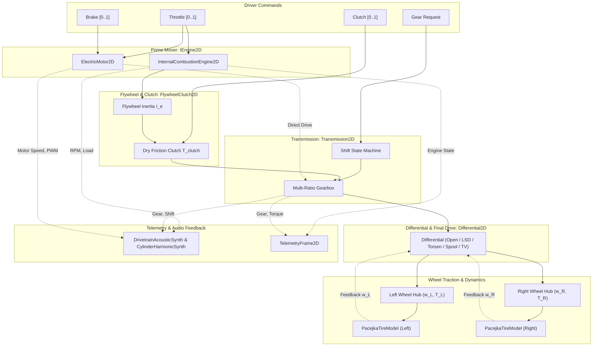
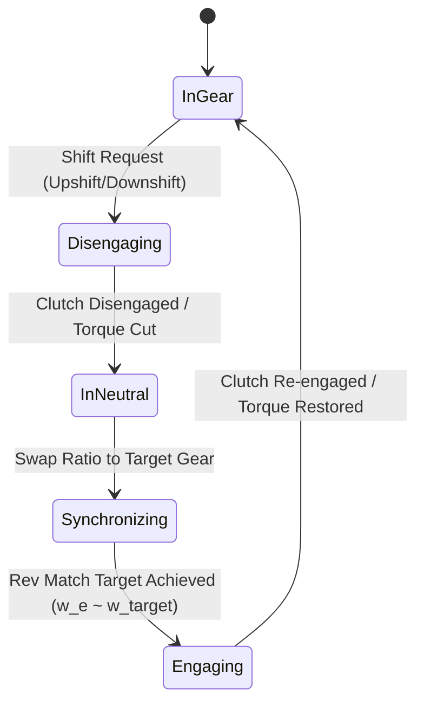
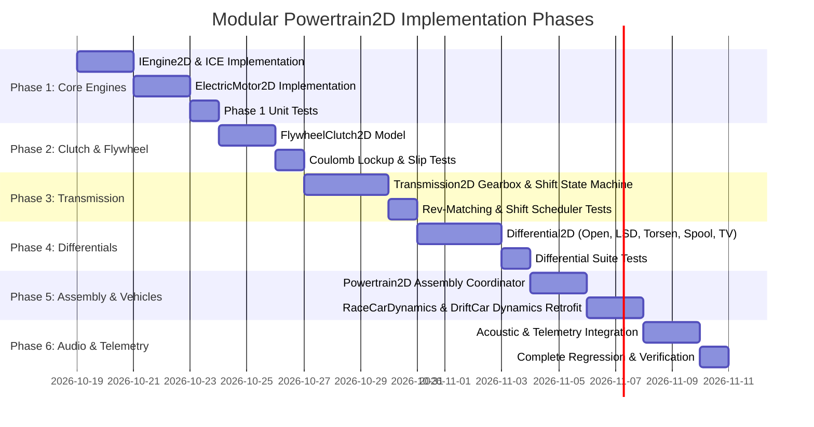

# Modular Internal Combustion Engine and Electric Powertrain (`Powertrain2D`): C++17 Implementation Plan

## 1. Executive Summary & Scope

### 1.1 Objective & Context
This specification details the mathematical formulations, physical derivations, architectural design, C++17 class interfaces, and implementation roadmap for the **Modular Internal Combustion Engine and Electric Powertrain (`Powertrain2D`)** subsystem, as proposed in Section 5.1 of [docs/ProposedFeatures.md](ProposedFeatures.md).

Currently in `VehicleSimCore`, wheeled vehicles approximate propulsion through simplified wheel torque scaling:
- [ArcadeCarDynamics](../libs/VehicleSimCore/dynamics/ArcadeCarDynamics.h) and [SideViewCarDynamics](../libs/VehicleSimCore/dynamics/SideViewCarDynamics.h) apply tractive force directly to wheels as linear fractions of driver throttle ($F_x = \text{throttle} \cdot F_{\text{max}}$).
- [RaceCarDynamics](../libs/VehicleSimCore/dynamics/RaceCarDynamics.h) and [DriftCarDynamics](../libs/VehicleSimCore/dynamics/DriftCarDynamics.h) couple tractive force into [PacejkaTireModel](../libs/VehicleSimCore/dynamics/PacejkaTireModel.h) via an estimated lumped torque, lacking rotational engine inertia, clutch slip, and differential mechanics.
- [MonsterCarDynamics](../libs/VehicleSimCore/dynamics/MonsterCarDynamics.h) contains an early kinematic engine approximation where engine RPM is locked directly to wheel rotational speed ($\omega_e = \omega_w \cdot R_{\text{gear}} \cdot R_{\text{diff}}$), lacking flywheel inertia, clutch disconnect, idle governors, and stalling behavior.

To elevate vehicle simulation realism across motorsport, street driving, drifting, heavy commercial machinery, and electric vehicles, `Powertrain2D` introduces a modular, physics-based drivetrain hierarchy:
1. **Engine Models (`IEngine2D`)**:
   - **Internal Combustion Engine (`InternalCombustionEngine2D`)**: Non-linear torque curve via cubic polynomials or multi-point lookup tables, idle RPM governor, throttle intake lag, fuel cut redline governor, mechanical friction/pumping losses, and stall threshold.
   - **Electric Motor (`ElectricMotor2D`)**: Dual-region torque curve (constant-torque below base speed $\omega_{\text{base}}$, constant-power above base speed), regenerative braking with battery charge limits, sub-millisecond throttle response lag, and bidirectional rotation without mechanical reverse gears.
2. **Flywheel & Clutch Assembly (`FlywheelClutch2D`)**:
   - Rotational flywheel inertia ($I_e \frac{d\omega_e}{dt} = T_e - T_{\text{clutch}} - T_{\text{friction}}$).
   - Coulomb dry friction clutch model capturing dynamic slip, pedal modulation, and static lockup.
   - Clutch-kick disengagement and sudden release for drift initiation and race launch control.
3. **Multi-Ratio Transmission (`Transmission2D`)**:
   - Configurable forward gear ratios $\{R_1, \dots, R_N\}$, reverse $R_{\text{rev}}$, neutral ($R_0 = 0$), and final drive reduction $R_{\text{final}}$.
   - Multi-state shift machine (`InGear`, `Disengaging`, `InNeutral`, `Synchronizing`, `Engaging`).
   - Configurable shift duration with torque cut and automatic rev-matching throttle blips on downshifts.
   - Manual, sequential paddle, and fully automatic shift modes.
4. **Differential & Torque Vectoring (`Differential2D`)**:
   - **Open Differential**: Even torque split ($T_L = T_R = \frac{1}{2} T_{\text{prop}}$) with unconstrained wheel slip.
   - **Limited-Slip Differential (LSD)**: Viscous speed-sensing coupling or Salisbury clutch-pack with asymmetric drive/coast ramp angles (1-way, 1.5-way, 2-way).
   - **Torsen Differential**: Inherent worm-gear friction providing a fixed torque bias ratio ($B_{\text{ratio}} = T_{\text{high}} / T_{\text{low}}$).
   - **Locked Spool Differential**: Rigid axle locking wheel angular velocities ($\omega_L = \omega_R$) for drag racing, off-road crawlers, and sprint karts ([GoKartDynamics](../libs/VehicleSimCore/dynamics/GoKartDynamics.h)).
   - **Active Electronic Torque Vectoring**: Dynamic left/right yaw-assist torque bias.
5. **Multi-Axle Drivetrain Topologies**:
   - Front-Wheel Drive (FWD), Rear-Wheel Drive (RWD), and All-Wheel Drive (AWD) with center differential or transfer case.
6. **Subsystem Integration**:
   - Drives [PacejkaTireModel](../libs/VehicleSimCore/dynamics/PacejkaTireModel.h) slip ratios and [WheelJoint2D](../libs/VehicleSimCore/physics/WheelJoint2D.h) hub drives.
   - Feeds engine RPM, load, and shift events into [DrivetrainAcousticSynth](../libs/VehicleSimCore/audio/DrivetrainAcousticSynth.h) and [CylinderHarmonicSynth](../libs/VehicleSimCore/audio/CylinderHarmonicSynth.h).
   - Exports engine RPM, gear, torque, and slip telemetry to [TelemetryFrame2D](../libs/VehicleSimCore/telemetry/TelemetryFrame2D.h).

```
  ASCII Diagram: Modular Powertrain Architecture & Torque Flow

  +-----------------------------------------------------------------------------------+
  |                                   Driver Inputs                                   |
  |             Throttle [0..1]    Brake [0..1]    Clutch [0..1]    Gear [-1..N]      |
  +-----------------------------------------+-----------------------------------------+
                                            |
                                            v
  +-----------------------------------------------------------------------------------+
  |                        Engine / Motor Layer (IEngine2D)                           |
  |  +-----------------------------------+    +------------------------------------+  |
  |  | InternalCombustionEngine2D (ICE)  |    |        ElectricMotor2D (EV)        |  |
  |  |  * Torque Curve T_e(RPM)          |    |  * Constant Torque / Power Regions |  |
  |  |  * Idle Governor & Redline Cut    |    |  * Regenerative Braking            |  |
  |  |  * Throttle Lag & Engine Braking  |    |  * Bidirectional Inverter Drive    |  |
  |  +-----------------+-----------------+    +-----------------+------------------+  |
  +--------------------|----------------------------------------|---------------------+
                       | Engine Torque T_e, Flywheel Speed w_e  |
                       v                                        |
  +--------------------------------------------------+          |
  |          Flywheel & Clutch (FlywheelClutch2D)    |          |
  |  * Flywheel Inertia: I_e * d(w_e)/dt             |          | Direct Rotor
  |  * Coulomb Dry Friction Torque: T_clutch         |          | Coupling
  |  * Slip vs. Static Lockup Solver                 |          |
  +--------------------+-----------------------------+          |
                       | Clutch Output Torque T_clutch          |
                       v                                        |
  +--------------------------------------------------+          |
  |             Transmission (Transmission2D)        |<---------+
  |  * Discrete Ratios {R_1 .. R_N}, Reverse, Neutral|
  |  * Shift State Machine & Torque Cut              |
  |  * Rev-Matching Blip & Auto Shift Scheduler      |
  +--------------------+-----------------------------+
                       | Propeller Shaft Torque T_prop = T_clutch * R_gear * R_final
                       v
  +-----------------------------------------------------------------------------------+
  |                       Differential Layer (Differential2D)                         |
  |  +---------------+  +----------------+  +---------------+  +-------------------+  |
  |  |   Open Diff   |  |  Salisbury LSD |  |  Torsen Diff  |  | Locked Spool / TV |  |
  |  +-------+-------+  +-------+--------+  +-------+-------+  +---------+---------+  |
  +----------|------------------|-------------------|--------------------|------------+
             +------------------+---------+---------+--------------------+
                                          |
                     +--------------------+--------------------+
                     |                                         |
                     v                                         v
         [ Left Wheel Drive Axle ]                 [ Right Wheel Drive Axle ]
           Wheel Torque T_L                          Wheel Torque T_R
           Wheel Speed  w_L                          Wheel Speed  w_R
                     |                                         |
                     v                                         v
         +-----------------------+                 +-----------------------+
         |   PacejkaTireModel    |                 |   PacejkaTireModel    |
         |    (Slip Ratio k_L)   |                 |    (Slip Ratio k_R)   |
         +-----------------------+                 +-----------------------+
```



---

### 1.2 Core Architectural Requirements
1. **Zero Dynamic Allocation**:
   - Gear ratio arrays, torque table points, clutch state variables, and differential caches reside in fixed-capacity stack storage.
   - Zero heap allocation (`malloc`, `new`) during simulation steps (`step()`).
2. **Strict IEEE 754 Determinism**:
   - Fully deterministic cross-platform behavior on Linux (GCC, Clang) and Windows (MSVC, Clang).
   - Zero OS-dependent headers (`windows.h`, `unistd.h`), zero non-deterministic reassociations.
3. **Numerical Stability under Stiff Transitions**:
   - Friction clutch transitions between kinetic slip and static lockup utilize regularized Coulomb models and analytical sticking thresholds to avoid high-frequency chatter.
   - Idle governors and rev-limiters use bounded anti-windup integration.
4. **Modular & Composable Design**:
   - `IEngine2D` polymorphic contract allows swapping ICE, EV, or hybrid power units seamlessly.
   - `Differential2D` modular policy supports Open, Viscous, Salisbury, Torsen, Spool, and Active Torque Vectoring.
   - Drop-in compatibility with [RaceCarDynamics](../libs/VehicleSimCore/dynamics/RaceCarDynamics.h), [DriftCarDynamics](../libs/VehicleSimCore/dynamics/DriftCarDynamics.h), [MonsterCarDynamics](../libs/VehicleSimCore/dynamics/MonsterCarDynamics.h), and [GoKartDynamics](../libs/VehicleSimCore/dynamics/GoKartDynamics.h).
5. **Coding & Safety Standards**:
   - 100% compliant with **MISRA C++:2023** and **SEI CERT C++**.
   - All variables and struct members explicitly braced `{}` initialized.
   - All query and solver methods marked `[[nodiscard]]`.
   - All function identifiers strictly less than 30 characters.
   - Triple-slash `///` Doxygen blocks with `@brief`, `@details`, `@param`, `@return`.

---

## 2. Mathematical Formulations & Physical Derivations

### 2.1 Internal Combustion Engine (ICE) Model

#### 2.1.1 Torque-RPM Relationship
The indicated engine torque $T_{\text{ind}}(\omega_e)$ generated at wide-open throttle (WOT) is modeled via a normalized cubic polynomial or multi-point cubic Hermite spline interpolation:
$$T_{\text{WOT}}(\omega_e) = T_{\text{peak}} \cdot \left[ a_0 + a_1 \left(\frac{\omega_e}{\omega_{\text{peak}}}\right) + a_2 \left(\frac{\omega_e}{\omega_{\text{peak}}}\right)^2 + a_3 \left(\frac{\omega_e}{\omega_{\text{peak}}}\right)^3 \right]$$
where:
- $\omega_e$ is the instantaneous crankshaft rotational speed in rad/s ($N_{\text{rpm}} = \omega_e \cdot \frac{60}{2\pi}$).
- $\omega_{\text{peak}}$ is the crankshaft speed at peak engine torque $T_{\text{peak}}$.
- $a_0, a_1, a_2, a_3$ are dimensionless polynomial coefficients normalized such that $T_{\text{WOT}}(\omega_{\text{peak}}) = T_{\text{peak}}$.
  - Canonical naturally-aspirated profile: $a_0 = 0.35, a_1 = 1.30, a_2 = -0.65, a_3 = 0.00$.
  - Turbocharged profile (broad torque plateau): $a_0 = 0.50, a_1 = 1.60, a_2 = -1.30, a_3 = 0.20$.

#### 2.1.2 Mechanical Friction & Pumping Losses
Internal mechanical losses (piston ring drag, valve train friction, pumping losses) resist crankshaft rotation and provide natural engine braking when throttle is released:
$$T_{\text{friction}}(\omega_e) = T_{\text{f0}} + c_{\text{f1}} \omega_e + c_{\text{f2}} \omega_e^2$$
where:
- $T_{\text{f0}}$ is static Coulomb boundary friction (N*m).
- $c_{\text{f1}}$ is viscous hydrodynamic oil friction coefficient (N*m*s/rad).
- $c_{\text{f2}}$ is turbulent aerodynamic pumping resistance coefficient (N*m*s$^2$/rad$^2$).

#### 2.1.3 Throttle Intake Dynamics & Lag
Airflow into the intake manifold does not change instantaneously upon pedal actuation. Intake manifold filling is governed by a first-order low-pass differential equation:
$$\tau_{\text{intake}} \frac{d\theta_{\text{eff}}}{dt} = \theta_{\text{demand}} - \theta_{\text{eff}}$$
where $\tau_{\text{intake}}$ is the intake lag time constant (typically $0.05\,\text{s}$ to $0.15\,\text{s}$ for naturally aspirated, up to $0.30\,\text{s}$ for turbocharged engines simulating boost lag). The gross combustion torque is:
$$T_{\text{gross}} = \theta_{\text{eff}} \cdot T_{\text{WOT}}(\omega_e)$$

#### 2.1.4 Closed-Loop Idle Governor
To prevent engine stall when the clutch is disengaged or vehicle is idling in neutral, an idle PI governor regulates minimum engine speed:
$$e_{\text{idle}} = \omega_{\text{idle}} - \omega_e$$
$$T_{\text{idle}} = \max\left(0.0, K_{p,\text{idle}} \cdot e_{\text{idle}} + K_{i,\text{idle}} \int e_{\text{idle}} \, dt\right)$$
The integral accumulator is clamped to $[0, T_{\text{idle,max}}]$ to prevent windup.

#### 2.1.5 Redline Fuel Cut & Stall Mechanics
- **Redline Rev Limiter**:
  - Hard cut: If $\omega_e \ge \omega_{\text{redline}}$, fuel injection cuts completely ($T_{\text{gross}} = 0$) until $\omega_e \le \omega_{\text{redline}} - \Delta\omega_{\text{hysteresis}}$.
  - Soft cut: If $\omega_e \in [\omega_{\text{soft}}, \omega_{\text{redline}}]$, torque smoothly attenuates via a cosine taper factor $\eta_{\text{cut}} = \frac{1}{2}\left(1 + \cos\left(\pi \frac{\omega_e - \omega_{\text{soft}}}{\omega_{\text{redline}} - \omega_{\text{soft}}}\right)\right)$.
- **Stall Threshold**: If $\omega_e < \omega_{\text{stall}}$ (typically $\sim 400\,\text{RPM}$), combustion halts permanently until restarted via the starter motor.

The net crankshaft output torque before flywheel coupling is:
$$T_e = \max(0.0, T_{\text{gross}} + T_{\text{idle}}) - T_{\text{friction}}(\omega_e)$$

```
  ASCII Diagram: ICE Torque-RPM & Friction Curves

   Torque (N*m)
        ^
  T_peak|                   .---*---.  Torque Curve T_WOT(RPM)
        |                 /           \
        |               /               \
        |     .-------'                   \
        |    /                              \   Soft Redline Taper
  T_idle|---*                                 '-------+
        |   | Idle RPM                                | Hard Cut
        |   v                                         v
       0+---+-----------------------------------------+------> Engine RPM
        |  w_idle                                  w_redline
        |
        |              Pumping & Friction Loss T_friction(RPM)
        |       ...........................................
        v
```

---

### 2.2 Electric Motor (EV) Propulsion Model

#### 2.2.1 Dual-Region Torque-Speed Characteristic
Permanent-magnet synchronous motors (PMSM) and AC induction motors exhibit two distinct operating regimes dictated by inverter voltage and current saturation:
1. **Constant-Torque Region ($\omega_m \le \omega_{\text{base}}$)**:
   Inverter current limits maximum electromagnetic torque:
   $$T_{\text{max}}(\omega_m) = T_{\text{stall}}$$
2. **Constant-Power / Field-Weakening Region ($\omega_{\text{base}} < \omega_m \le \omega_{\text{max}}$)**:
   Back-electromotive force (BEMF) reaches supply rail voltage; torque decays inversely with angular velocity to maintain maximum mechanical power $P_{\text{max}} = T_{\text{stall}} \cdot \omega_{\text{base}}$:
   $$T_{\text{max}}(\omega_m) = \frac{P_{\text{max}}}{\omega_m} = T_{\text{stall}} \cdot \frac{\omega_{\text{base}}}{\omega_m}$$
3. **High-Speed Cutoff ($\omega_m > \omega_{\text{max}}$)**:
   Torque rapidly tapers to zero beyond structural rotor limit $\omega_{\text{max}}$.

```
  ASCII Diagram: Electric Motor Torque & Power Characteristics

   Torque T_m (N*m)                                 Power P_m (kW)
        ^                                                ^
  T_max |==================.                       P_max |            .=================
        |  Constant-Torque  \                            |           /  Constant-Power
        |      Region        \                           |          /      Region
        |                     \  Constant-Power          |         /
        |                      \     Region              |        /
        |                       '-------.                |       /
        |                                \ Cutoff        |      /
       0+---------------------------------+-----> w_m   0+-----+------------------------> w_m
        0                             w_base  w_max      0   w_base                   w_max
```

#### 2.2.2 Regenerative Braking & Inverter Dynamics
- When driver commands negative throttle or applies service brakes, the motor controller commands negative (generator) torque $T_{\text{regen}} < 0$.
- Regenerative torque is constrained by battery maximum state-of-charge (SoC) charging power $P_{\text{charge,max}}$ and motor thermal limits:
  $$|T_{\text{regen}}| \le \min\left(T_{\text{max}}(\omega_m), \frac{P_{\text{charge,max}}}{\omega_m + \epsilon}\right)$$
- Inverter response time is modeled via a sub-millisecond electrical time constant $\tau_{\text{motor}} \approx 0.010\,\text{s}$:
  $$\tau_{\text{motor}} \frac{dT_m}{dt} = T_{\text{cmd}} - T_m$$
- Bidirectional capability: Reversing the sign of driver throttle commands operates the vehicle in reverse without requiring mechanical gear engagement.

---

### 2.3 Flywheel Dynamics & Coulomb Friction Clutch

#### 2.3.1 Flywheel Equations of Motion
The engine crankshaft and flywheel rotate with moment of inertia $I_e$. Its angular acceleration is driven by net combustion torque $T_e$ and opposed by clutch transfer torque $T_{\text{clutch}}$:
$$I_e \frac{d\omega_e}{dt} = T_e - T_{\text{clutch}}$$

The transmission input shaft rotates at angular velocity $\omega_{\text{trans}}$ with effective inertia $I_{\text{trans,eff}}$ (combining gearbox input shaft inertia and reflected wheel inertia):
$$I_{\text{trans,eff}} \frac{d\omega_{\text{trans}}}{dt} = T_{\text{clutch}} - T_{\text{load}}$$

#### 2.3.2 Coulomb Dry Friction Clutch Model
The clutch disc is compressed between the flywheel and pressure plate. The maximum torque capacity $T_{\text{cap}}$ that the clutch can transmit depends on the clutch pedal position $c_{\text{pedal}} \in [0.0, 1.0]$ ($0 = \text{fully engaged}$, $1 = \text{fully depressed/disengaged}$):
$$\gamma = 1.0 - c_{\text{pedal}}$$
$$T_{\text{cap}} = \gamma \cdot \mu_c \cdot F_N \cdot R_{\text{eff}} = \gamma \cdot T_{\text{clutch,max}}$$
where $\mu_c$ is the friction coefficient, $F_N$ is the clamping spring force, and $R_{\text{eff}} = \frac{2}{3} \frac{R_o^3 - R_i^3}{R_o^2 - R_i^2}$ is the effective friction radius.

#### 2.3.3 Slip vs. Static Lockup Detection
The relative slip velocity across the clutch plates is:
$$\Delta\omega_{\text{clutch}} = \omega_e - \omega_{\text{trans}}$$

The clutch solver operates in two distinct physical states:
1. **Slipping State ($|\Delta\omega_{\text{clutch}}| > \epsilon_\omega$ or $|T_{\text{stick}}| > T_{\text{cap}}$)**:
   Dynamic friction torque acts in opposition to relative slip:
   $$T_{\text{clutch}} = T_{\text{cap}} \cdot \tanh\left(\frac{\Delta\omega_{\text{clutch}}}{\epsilon_\omega}\right)$$
   (where $\tanh$ provides a smooth $C^1$ approximation to the discontinuous signum function, avoiding numerical chatter around zero slip).
2. **Locked / Sticking State ($|\Delta\omega_{\text{clutch}}| \le \epsilon_\omega$ and $|T_{\text{stick}}| \le T_{\text{cap}}$)**:
   The plates stick together, enforcing kinematic synchronism:
   $$\omega_e = \omega_{\text{trans}} = \omega_{\text{sync}}$$
   Combining the two inertial equations yields the common angular acceleration:
   $$\frac{d\omega_{\text{sync}}}{dt} = \frac{T_e - T_{\text{load}}}{I_e + I_{\text{trans,eff}}}$$
   The constraint torque required to maintain lockup is:
   $$T_{\text{stick}} = \frac{I_{\text{trans,eff}} T_e + I_e T_{\text{load}}}{I_e + I_{\text{trans,eff}}}$$
   If $|T_{\text{stick}}| > T_{\text{cap}}$, the static friction limit is exceeded, and the clutch immediately transitions back to the slipping state.

```
  ASCII Diagram: Clutch Slip-to-Lock Transition & Inertial Coupling

    Crankshaft & Flywheel (I_e)               Transmission Input Shaft (I_trans)
    [ Engine Torque T_e ]                      [ Reflected Load Torque T_load ]
              |                                              |
              v                                              v
      (==== Flywheel ====)                        (==== Clutch Disc ====)
          Speed w_e                                   Speed w_trans
              \                                             /
               '------------[ Friction Interface ]---------'
                                    |
                    Slip Velocity: Delta_w = w_e - w_trans
                    Normal Clamping Force: F_N * (1 - c_pedal)
                    Torque Capacity: T_cap = gamma * T_clutch,max
```

---

### 2.4 Multi-Ratio Transmission Mechanics

#### 2.4.1 Kinematic Gear Ratios
The transmission provides discrete forward ratios $\{R_1, R_2, \dots, R_N\}$, a reverse ratio $R_{\text{rev}} < 0$, and a neutral state $R_0 = 0$. Including the final drive differential reduction ratio $R_{\text{final}}$, the total powertrain reduction in gear $g$ is:
$$R_{\text{total}} = R_g \cdot R_{\text{final}}$$

- Input shaft speed kinematics:
  $$\omega_{\text{trans}} = \omega_{\text{prop}} \cdot R_g = \omega_{\text{diff}} \cdot R_{\text{total}}$$
- Propeller shaft drive torque:
  $$T_{\text{prop}} = T_{\text{clutch}} \cdot R_g \cdot \eta_{\text{trans}}$$
  where $\eta_{\text{trans}} \in [0.90, 0.98]$ represents mechanical gear meshing efficiency. In neutral ($R_0 = 0$), $T_{\text{prop}} = 0$ and the input shaft is decoupled from the wheels.

#### 2.4.2 Shift State Machine & Torque Interruption
Gear changes require a discrete finite duration $t_{\text{shift}}$ to decouple dogs/synchros, change ratios, and re-engage. The transition is governed by a deterministic 5-phase state machine:

```
  ASCII Diagram: Transmission Shift State Machine

  +------------+   Upshift / Downshift   +-----------------+
  |  InGear    | ----------------------> |   Disengaging   | (Torque ramps to 0)
  +------------+                         +--------+--------+
        ^                                         |
        | Re-engagement complete                  v
  +-----+------+                         +-----------------+
  |  Engaging  | <---------------------- |   InNeutral     | (Gear ratio swaps to R_target)
  +------------+      Synchronized       +--------+--------+
        ^                                         |
        |                                         v
        |                                +-----------------+
        '------------------------------- |  Synchronizing  | (Throttle blip rev-matching)
                                         +-----------------+
```



1. **`InGear`**: Normal drive state. Full drive torque transmitted.
2. **`Disengaging`** ($t \in [0, t_{\text{disengage}}]$): Clutch disengages or ignition cut triggers; drive torque linearly ramps to zero.
3. **`InNeutral`** ($t \in [0, t_{\text{neutral}}]$): Gearbox disengages from source ratio. Input shaft is free from drivetrain.
4. **`Synchronizing`** ($t \in [0, t_{\text{sync}}]$): Target ratio $R_{\text{new}}$ is selected. If downshifting, an automatic throttle blip fires to rev-match engine speed to $\omega_{\text{target}} = \omega_{\text{diff}} \cdot R_{\text{new}} \cdot R_{\text{final}}$.
5. **`Engaging`** ($t \in [0, t_{\text{engage}}]$): Clutch re-clamps and torque ramps back to 100%.

#### 2.4.3 Automatic Shift Scheduling
In automatic mode, upshifts and downshifts are evaluated based on engine RPM and throttle kickdown:
- **Upshift condition**: $N_{\text{rpm}} \ge N_{\text{upshift}}(\theta)$ and gear $< N_{\text{gears}}$ and not shifting.
- **Downshift condition**: $N_{\text{rpm}} \le N_{\text{downshift}}(\theta)$ and gear $> 1$ and not shifting.
- Hysteresis band ($N_{\text{upshift}} - N_{\text{downshift}} \ge 1200\,\text{RPM}$) prevents gear hunting.

---

### 2.5 Differential & Torque Vectoring Models

The differential splits propeller shaft drive torque $T_{\text{prop}}$ between left and right drive wheels while accommodating differing wheel speeds in turns.

#### 2.5.1 Differential Kinematics
Given left and right wheel angular velocities $\omega_L$ and $\omega_R$, the differential carrier speed is:
$$\omega_{\text{diff}} = \frac{\omega_L + \omega_R}{2}$$
The wheel speed difference across the axle is:
$$\Delta\omega_{\text{axle}} = \omega_L - \omega_R$$

#### 2.5.2 Open Differential
The open differential distributes drive torque equally between both wheels regardless of relative wheel speed:
$$T_L = \frac{1}{2} T_{\text{prop}}, \quad T_R = \frac{1}{2} T_{\text{prop}}$$
- **Traction Limitation**: If one wheel loses grip and spins at traction limit $T_{\text{traction,slip}}$, the maximum total delivered drive torque is constrained to $2 \cdot T_{\text{traction,slip}}$.

#### 2.5.3 Limited-Slip Differential (LSD)
1. **Viscous LSD (Speed-Sensing)**:
   A shear-dilatant silicone fluid transfers locking torque proportional to wheel speed difference:
   $$\Delta T_{\text{lock}} = k_{\text{viscous}} \cdot \Delta\omega_{\text{axle}}$$
   $$T_L = \frac{1}{2} T_{\text{prop}} - \Delta T_{\text{lock}}, \quad T_R = \frac{1}{2} T_{\text{prop}} + \Delta T_{\text{lock}}$$
2. **Salisbury Clutch-Pack LSD (Torque-Sensing)**:
   Internal clutch packs are compressed by cross-pin ramps acting on spider gear shafts. The locking torque is governed by static preload and ramp expansion under torque:
   $$\Delta T_{\text{lock}} = T_{\text{preload}} + K_{\text{ramp}} \cdot |T_{\text{prop}}|$$
   where $K_{\text{ramp}}$ depends on drive/coast ramp angles:
   - **1-Way LSD**: Locking on acceleration ($K_{\text{drive}} > 0$), open on overrun/braking ($K_{\text{coast}} = 0$). Ideal for front-wheel drive to prevent turn-in understeer.
   - **1.5-Way LSD**: Strong lockup on acceleration ($K_{\text{drive}} \approx 0.6$), moderate lockup on braking ($K_{\text{coast}} \approx 0.3$) for high-speed braking stability. Ideal for track and GT racing.
   - **2-Way LSD**: Equal lockup on acceleration and braking ($K_{\text{drive}} = K_{\text{coast}} \approx 0.8$). Ideal for drift cars ([DriftCarDynamics](../libs/VehicleSimCore/dynamics/DriftCarDynamics.h)) to maintain continuous slip through transitions.
   The torque transfer is capped by available friction capacity:
   $$T_L = \frac{1}{2} T_{\text{prop}} - \text{clamp}\left(\frac{\Delta\omega_{\text{axle}}}{\epsilon_\omega}, -1.0, 1.0\right) \cdot \Delta T_{\text{lock}}$$
   $$T_R = \frac{1}{2} T_{\text{prop}} + \text{clamp}\left(\frac{\Delta\omega_{\text{axle}}}{\epsilon_\omega}, -1.0, 1.0\right) \cdot \Delta T_{\text{lock}}$$

#### 2.5.4 Torsen (Type A / Type B) Differential
Torsen differentials use crossed-axis helical worm gears. Gear tooth friction creates an inherent thrust force that resists relative wheel motion, yielding a constant **Torque Bias Ratio (TBR)**:
$$B_{\text{ratio}} = \frac{T_{\text{high}}}{T_{\text{low}}} \in [2.5, 5.0]$$
- If wheel $L$ has lower traction than wheel $R$, wheel $R$ can receive up to $B_{\text{ratio}} \cdot T_L$:
  $$T_L = \frac{1}{1 + B_{\text{ratio}}} T_{\text{prop}}, \quad T_R = \frac{B_{\text{ratio}}}{1 + B_{\text{ratio}}} T_{\text{prop}}$$
- Torsen delivers instant, progressive torque biasing with zero clutch wear or chatter. If one wheel becomes airborne ($T_{\text{low}} = 0$), torque transfer drops to zero unless gentle brake bias is applied.

#### 2.5.5 Locked Spool Differential
A solid spool locks left and right drive axles together rigidly:
$$\omega_L = \omega_R = \omega_{\text{diff}}$$
Torque is partitioned according to instantaneous ground traction demands:
$$T_L + T_R = T_{\text{prop}}$$
Essential for sprint go-karts ([GoKartDynamics](../libs/VehicleSimCore/dynamics/GoKartDynamics.h)), tractor pulls, and extreme drag racing.

#### 2.5.6 Active Electronic Torque Vectoring (ATV)
Electronically controlled clutch packs or dual drive motors inject an active yaw moment $\tau_{\text{yaw}}$ into the vehicle chassis:
$$T_L = \frac{1}{2} T_{\text{prop}} - \frac{\tau_{\text{yaw}} \cdot R_{\text{wheel}}}{T_{\text{track}}}, \quad T_R = \frac{1}{2} T_{\text{prop}} + \frac{\tau_{\text{yaw}} \cdot R_{\text{wheel}}}{T_{\text{track}}}$$
where $T_{\text{track}}$ is vehicle axle track width.

---

### 2.6 Multi-Axle Drivetrain Topologies (FWD, RWD, AWD)

1. **Rear-Wheel Drive (RWD)**:
   $T_{\text{prop}}$ feeds rear axle differential; front wheels are unpowered.
2. **Front-Wheel Drive (FWD)**:
   $T_{\text{prop}}$ feeds front transaxle differential; rear wheels are unpowered.
3. **All-Wheel Drive (AWD)**:
   Transmission output feeds a center differential (or viscous transfer case) splitting torque between front and rear prop shafts:
   $$T_{\text{prop,front}} = \gamma_{\text{front}} \cdot T_{\text{trans}}, \quad T_{\text{prop,rear}} = (1.0 - \gamma_{\text{front}}) \cdot T_{\text{trans}}$$
   (e.g., $\gamma_{\text{front}} = 0.40$ for rear-biased sports AWD, or $0.50$ for symmetrical AWD). Each axle then distributes torque through its respective front and rear differentials.

---

## 3. High-Level Architecture & Component Decomposition

### 3.1 File Organization and Co-Location
All powertrain classes and headers are co-located in `libs/VehicleSimCore/dynamics/`:

```
libs/VehicleSimCore/
└── dynamics/
    ├── IEngine2D.h                    [NEW] - Abstract prime mover interface & engine states
    ├── InternalCombustionEngine2D.h   [NEW] - ICE configuration, polynomial torque, idle/redline governors
    ├── InternalCombustionEngine2D.cpp [NEW] - ICE implementation
    ├── ElectricMotor2D.h              [NEW] - EV configuration, dual-region torque curve, regeneration
    ├── ElectricMotor2D.cpp            [NEW] - EV implementation
    ├── FlywheelClutch2D.h             [NEW] - Rotational flywheel inertia, dry friction clutch & lockup solver
    ├── FlywheelClutch2D.cpp           [NEW] - Clutch implementation
    ├── Transmission2D.h               [NEW] - Multi-ratio gearbox, shift state machine & rev matching
    ├── Transmission2D.cpp             [NEW] - Transmission implementation
    ├── Differential2D.h               [NEW] - Open, Viscous LSD, Salisbury LSD, Torsen, Spool, Torque Vectoring
    ├── Differential2D.cpp             [NEW] - Differential implementation
    ├── Powertrain2D.h                 [NEW] - Unified modular powertrain assembly coordinator
    ├── Powertrain2D.cpp               [NEW] - Powertrain implementation
    ├── RaceCarDynamics.h              [MODIFIED] - Optional integration with Powertrain2D
    ├── RaceCarDynamics.cpp            [MODIFIED] - Route drive torque via Powertrain2D
    ├── DriftCarDynamics.h             [MODIFIED] - Clutch-kick and 2-way LSD integration
    └── DriftCarDynamics.cpp           [MODIFIED] - Route drive torque via Powertrain2D
```

---

## 4. C++17 Class Definitions & API Design

### 4.1 Prime Mover Interface: `IEngine2D.h`

```cpp
#pragma once

#include <cstdint>

namespace vehicle_sim::dynamics {

/// @enum EngineType
/// @brief Prime mover propulsion technology classification.
enum class EngineType : std::uint8_t {
    InternalCombustion = 0U, ///< Fuel-burning piston or rotary engine.
    ElectricMotor = 1U       ///< Pure electric inverter-driven motor.
};

/// @struct EngineOutput
/// @brief Dynamic instantaneous output metrics from a prime mover.
struct EngineOutput {
    double torque { 0.0 }; ///< Crankshaft / rotor output torque in N*m.
    double power { 0.0 }; ///< Mechanical power in Watts.
    double angularVelocity { 0.0 }; ///< Shaft speed in rad/s.
    double rpm { 0.0 }; ///< Shaft speed in revolutions per minute.
    double throttleLagged { 0.0 }; ///< Effective internal throttle position in [0, 1].
    bool isRedline { false }; ///< True if engine is at or above rev limit.
    bool isStalled { false }; ///< True if engine has dropped below stall threshold.
};

/// @class IEngine2D
/// @brief Abstract interface for vehicle propulsion prime movers.
class IEngine2D {
public:
    virtual ~IEngine2D() noexcept = default;

    /// @brief Computes generated torque and advances internal engine state.
    /// @param[in] throttle Normalized throttle command in range [0.0, 1.0].
    /// @param[in] shaftSpeed Shaft rotational speed in rad/s.
    /// @param[in] dt Timestep duration in seconds.
    /// @return Evaluated engine output state.
    [[nodiscard]] virtual EngineOutput step(double throttle, double shaftSpeed, double dt) noexcept = 0;

    /// @brief Resets engine states to initial idle conditions.
    virtual void reset() noexcept = 0;

    /// @brief Starts the engine from a resting or stalled state.
    virtual void start() noexcept = 0;

    /// @brief Cuts ignition or disables inverter.
    virtual void stop() noexcept = 0;

    /// @brief Queries engine technology classification.
    /// @return EngineType classification enum.
    [[nodiscard]] virtual EngineType getEngineType() const noexcept = 0;

    /// @brief Queries whether engine is currently running.
    /// @return True if running and not stalled.
    [[nodiscard]] virtual bool isRunning() const noexcept = 0;

    /// @brief Queries maximum rated torque.
    /// @return Peak torque in N*m.
    [[nodiscard]] virtual double getPeakTorque() const noexcept = 0;

    /// @brief Queries maximum rated speed.
    /// @return Redline speed in RPM.
    [[nodiscard]] virtual double getRedlineRpm() const noexcept = 0;
};

} // namespace vehicle_sim::dynamics
```

---

### 4.2 Internal Combustion Engine: `InternalCombustionEngine2D.h`

```cpp
#pragma once

#include <array>
#include <cstddef>
#include "libs/VehicleSimCore/dynamics/IEngine2D.h"

namespace vehicle_sim::dynamics {

/// @struct ICEConfig
/// @brief Physical, thermodynamic, and mechanical parameters for an ICE.
struct ICEConfig {
    double peakTorque { 450.0 }; ///< Peak engine torque in N*m.
    double peakTorqueRpm { 4800.0 }; ///< RPM at which peak torque occurs.
    double idleRpm { 900.0 }; ///< Target idle governor speed in RPM.
    double stallRpm { 450.0 }; ///< Engine stall threshold in RPM.
    double redlineRpm { 7200.0 }; ///< Fuel-cut rev limit in RPM.
    double softCutRpm { 7000.0 }; ///< Soft limiter onset in RPM.
    double hysteresisRpm { 200.0 }; ///< Fuel re-engagement hysteresis in RPM.
    double inertia { 0.22 }; ///< Flywheel and crankshaft rotational inertia in kg*m^2.
    double intakeLag { 0.08 }; ///< Throttle response lag time constant in seconds.
    double frictionCoeff0 { 15.0 }; ///< Coulomb engine friction in N*m.
    double frictionCoeff1 { 0.035 }; ///< Viscous friction in N*m*s/rad.
    double frictionCoeff2 { 0.0001 }; ///< Aerodynamic pumping loss in N*m*s^2/rad^2.
    double idleKp { 0.4 }; ///< Idle governor proportional gain.
    double idleKi { 0.15 }; ///< Idle governor integral gain.
    std::array<double, 4> torquePoly { 0.35, 1.30, -0.65, 0.00 }; ///< Normalized cubic curve.
};

/// @class InternalCombustionEngine2D
/// @brief Detailed 2D simulation of a piston or rotary combustion engine.
class InternalCombustionEngine2D final : public IEngine2D {
public:
    InternalCombustionEngine2D() noexcept;
    explicit InternalCombustionEngine2D(const ICEConfig& config) noexcept;
    ~InternalCombustionEngine2D() noexcept override = default;

    [[nodiscard]] EngineOutput step(double throttle, double shaftSpeed, double dt) noexcept override;
    void reset() noexcept override;
    void start() noexcept override;
    void stop() noexcept override;

    [[nodiscard]] EngineType getEngineType() const noexcept override;
    [[nodiscard]] bool isRunning() const noexcept override;
    [[nodiscard]] double getPeakTorque() const noexcept override;
    [[nodiscard]] double getRedlineRpm() const noexcept override;

    /// @brief Computes wide-open throttle indicated torque at a given RPM.
    /// @param[in] rpm Engine speed in revolutions per minute.
    /// @return Gross combustion torque in N*m.
    [[nodiscard]] double computeWotTorque(double rpm) const noexcept;

    /// @brief Computes mechanical and pumping friction losses at a given speed.
    /// @param[in] angVel Angular velocity in rad/s.
    /// @return Resisting friction torque in N*m.
    [[nodiscard]] double computeFriction(double angVel) const noexcept;

private:
    ICEConfig config_ {};
    double currentRpm_ { 900.0 };
    double currentAngVel_ { 94.24778 };
    double effectiveThrottle_ { 0.0 };
    double idleIntegral_ { 0.0 };
    bool isRunning_ { true };
    bool isStalled_ { false };
    bool isFuelCut_ { false };
};

} // namespace vehicle_sim::dynamics
```

---

### 4.3 Electric Motor: `ElectricMotor2D.h`

```cpp
#pragma once

#include "libs/VehicleSimCore/dynamics/IEngine2D.h"

namespace vehicle_sim::dynamics {

/// @struct ElectricMotorConfig
/// @brief Electromagnetic and inverter parameters for an electric traction motor.
struct ElectricMotorConfig {
    double maxTorque { 600.0 }; ///< Maximum constant torque in N*m.
    double baseSpeedRpm { 4500.0 }; ///< Base speed transitioning to constant power.
    double maxSpeedRpm { 16000.0 }; ///< Maximum operating rotor speed in RPM.
    double maxPower { 280000.0 }; ///< Maximum continuous power in Watts (280 kW).
    double maxRegenTorque { 350.0 }; ///< Maximum regenerative braking counter-torque in N*m.
    double regenEfficiency { 0.88 }; ///< Kinetic to electrical recovery efficiency.
    double electricalLag { 0.012 }; ///< Inverter current response lag in seconds.
    double rotorInertia { 0.065 }; ///< Rotor moment of inertia in kg*m^2.
};

/// @class ElectricMotor2D
/// @brief Simulation of permanent-magnet or AC induction vehicle traction motor.
class ElectricMotor2D final : public IEngine2D {
public:
    ElectricMotor2D() noexcept;
    explicit ElectricMotor2D(const ElectricMotorConfig& config) noexcept;
    ~ElectricMotor2D() noexcept override = default;

    [[nodiscard]] EngineOutput step(double throttle, double shaftSpeed, double dt) noexcept override;
    void reset() noexcept override;
    void start() noexcept override;
    void stop() noexcept override;

    [[nodiscard]] EngineType getEngineType() const noexcept override;
    [[nodiscard]] bool isRunning() const noexcept override;
    [[nodiscard]] double getPeakTorque() const noexcept override;
    [[nodiscard]] double getRedlineRpm() const noexcept override;

    /// @brief Computes maximum motor torque available at given speed.
    /// @param[in] rpm Rotor speed in revolutions per minute.
    /// @return Maximum forward motor torque in N*m.
    [[nodiscard]] double computeMaxTorque(double rpm) const noexcept;

    /// @brief Computes available regenerative braking torque.
    /// @param[in] rpm Rotor speed in revolutions per minute.
    /// @param[in] brakeCmd Driver brake pedal demand [0, 1].
    /// @return Regenerative counter-torque in N*m.
    [[nodiscard]] double computeRegen(double rpm, double brakeCmd) const noexcept;

private:
    ElectricMotorConfig config_ {};
    double currentTorque_ { 0.0 };
    double currentSpeed_ { 0.0 };
    bool isEnabled_ { true };
};

} // namespace vehicle_sim::dynamics
```

---

### 4.4 Flywheel & Clutch Assembly: `FlywheelClutch2D.h`

```cpp
#pragma once

namespace vehicle_sim::dynamics {

/// @struct ClutchConfig
/// @brief Mechanical friction and inertia parameters for clutch assembly.
struct ClutchConfig {
    double maxClutchTorque { 750.0 }; ///< Maximum static friction holding capacity in N*m.
    double slipThreshold { 1.5 }; ///< Angular velocity difference threshold for lockup in rad/s.
    double engagementRate { 10.0 }; ///< Clutch pedal actuation slew rate limit in 1/s.
};

/// @struct ClutchState
/// @brief Dynamic instantaneous metrics from the clutch interface.
struct ClutchState {
    double transferredTorque { 0.0 }; ///< Net torque transmitted to transmission input in N*m.
    double slipVelocity { 0.0 }; ///< Angular velocity difference (w_engine - w_trans) in rad/s.
    double clutchPedal { 0.0 }; ///< Filtered clutch pedal position [0 = engaged, 1 = disengaged].
    double lockRatio { 0.0 }; ///< Clamping engagement factor in [0, 1].
    bool isLocked { false }; ///< True if clutch plates are statically locked together.
    bool isSlipping { false }; ///< True if clutch plates are dynamically slipping.
};

/// @class FlywheelClutch2D
/// @brief Models flywheel rotational dynamics and Coulomb dry friction clutch.
class FlywheelClutch2D {
public:
    FlywheelClutch2D() noexcept;
    explicit FlywheelClutch2D(const ClutchConfig& config) noexcept;

    /// @brief Advances flywheel and clutch solver.
    /// @param[in] engineTorque Net torque delivered by prime mover in N*m.
    /// @param[in] loadTorque Reflected resistance torque from gearbox input in N*m.
    /// @param[in] engineInertia Flywheel/engine rotational inertia in kg*m^2.
    /// @param[in] transInertia Gearbox input reflected inertia in kg*m^2.
    /// @param[in] pedalCommand Driver clutch pedal input [0 = engaged, 1 = disengaged].
    /// @param[in] dt Timestep duration in seconds.
    /// @return Evaluated clutch output metrics.
    [[nodiscard]] ClutchState step(double engineTorque,
                                   double loadTorque,
                                   double engineInertia,
                                   double transInertia,
                                   double pedalCommand,
                                   double dt) noexcept;

    /// @brief Resets clutch state and rotational speeds.
    /// @param[in] initialEngineRpm Initial engine RPM.
    void reset(double initialEngineRpm) noexcept;

    /// @brief Queries instantaneous engine angular velocity.
    /// @return Crankshaft speed in rad/s.
    [[nodiscard]] double getEngineSpeed() const noexcept;

    /// @brief Queries instantaneous transmission input angular velocity.
    /// @return Transmission input speed in rad/s.
    [[nodiscard]] double getTransSpeed() const noexcept;

    /// @brief Forces transmission input speed (e.g. from direct wheel lock).
    /// @param[in] speed New transmission input speed in rad/s.
    void setTransSpeed(double speed) noexcept;

private:
    ClutchConfig config_ {};
    double engineAngVel_ { 94.24778 }; ///< Initial 900 RPM.
    double transAngVel_ { 0.0 };
    double currentPedal_ { 0.0 };
    ClutchState lastState_ {};
};

} // namespace vehicle_sim::dynamics
```

---

### 4.5 Multi-Ratio Transmission: `Transmission2D.h`

```cpp
#pragma once

#include <array>
#include <cstddef>
#include <cstdint>

namespace vehicle_sim::dynamics {

/// @enum TransmissionMode
/// @brief Operating mode for gear change control.
enum class TransmissionMode : std::uint8_t {
    Manual = 0U,    ///< Driver controls gear selection and clutch pedal directly.
    Sequential = 1U,///< Paddle up/down with automated clutch disengagement and torque cut.
    Automatic = 2U  ///< Fully automated shift scheduler based on speed and throttle.
};

/// @enum ShiftState
/// @brief Phase state during a gear change transition.
enum class ShiftState : std::uint8_t {
    InGear = 0U,       ///< Normal power transmission.
    Disengaging = 1U,  ///< Torque ramping down prior to ratio change.
    InNeutral = 2U,    ///< Ratio disengaged; gearbox in neutral.
    Synchronizing = 3U,///< Throttle blip rev-matching active.
    Engaging = 4U      ///< Torque ramping back to 100%.
};

/// @struct TransmissionConfig
/// @brief Gear ratios, shift durations, and shift thresholds.
struct TransmissionConfig {
    static constexpr std::size_t kMaxGears { 8 };

    std::size_t forwardGears { 6 }; ///< Number of forward gears (<= kMaxGears).
    std::array<double, kMaxGears> gearRatios { 3.62, 2.19, 1.52, 1.18, 0.95, 0.78, 0.0, 0.0 };
    double reverseRatio { -3.45 }; ///< Reverse gear ratio.
    double finalDriveRatio { 3.73 }; ///< Differential final drive ratio.
    double efficiency { 0.96 }; ///< Mechanical gear meshing efficiency.
    double shiftDuration { 0.12 }; ///< Total shift time in seconds.
    double upshiftRpm { 6200.0 }; ///< Automatic upshift RPM threshold.
    double downshiftRpm { 2400.0 }; ///< Automatic downshift RPM threshold.
    TransmissionMode mode { TransmissionMode::Sequential }; ///< Default mode.
};

/// @struct TransmissionOutput
/// @brief Instantaneous state of transmission and propeller shaft.
struct TransmissionOutput {
    double propTorque { 0.0 }; ///< Output torque to differential in N*m.
    double inputSpeed { 0.0 }; ///< Transmission input shaft speed in rad/s.
    double currentRatio { 0.0 }; ///< Active mechanical ratio.
    std::int32_t activeGear { 1 }; ///< Engaged gear index (-1 = Rev, 0 = N, 1..N = Fwd).
    ShiftState shiftPhase { ShiftState::InGear }; ///< Current shift phase.
    double shiftProgress { 1.0 }; ///< Shift progression [0.0 = start, 1.0 = done].
    bool isTorqueCut { false }; ///< True if ignition/fuel cut should be asserted.
    bool isRevBlip { false }; ///< True if throttle blip should be asserted.
};

/// @class Transmission2D
/// @brief Models multi-ratio mechanical or automated vehicle transmission.
class Transmission2D {
public:
    Transmission2D() noexcept;
    explicit Transmission2D(const TransmissionConfig& config) noexcept;

    /// @brief Advances transmission simulation step.
    /// @param[in] clutchTorque Input torque from clutch in N*m.
    /// @param[in] propShaftSpeed Output propeller shaft speed in rad/s.
    /// @param[in] throttle Normalized throttle command in [0, 1].
    /// @param[in] dt Timestep duration in seconds.
    /// @return Evaluated transmission output state.
    [[nodiscard]] TransmissionOutput step(double clutchTorque,
                                          double propShaftSpeed,
                                          double throttle,
                                          double dt) noexcept;

    /// @brief Resets transmission to initial state.
    /// @param[in] initialGear Starting gear index (default 1).
    void reset(std::int32_t initialGear = 1) noexcept;

    /// @brief Requests a sequential upshift.
    /// @return True if upshift sequence commenced.
    bool shiftUp() noexcept;

    /// @brief Requests a sequential downshift.
    /// @return True if downshift sequence commenced.
    bool shiftDown() noexcept;

    /// @brief Selects a specific target gear directly.
    /// @param[in] gear Target gear index (-1 to forwardGears).
    /// @return True if shift accepted.
    bool selectGear(std::int32_t gear) noexcept;

    /// @brief Sets transmission operating mode.
    /// @param[in] mode Operating mode enum.
    void setMode(TransmissionMode mode) noexcept;

    /// @brief Queries current active gear index.
    /// @return Active gear (-1 = Rev, 0 = N, 1..N = Fwd).
    [[nodiscard]] std::int32_t getGear() const noexcept;

    /// @brief Queries whether a shift transition is currently executing.
    /// @return True if shifting.
    [[nodiscard]] bool isShifting() const noexcept;

private:
    TransmissionConfig config_ {};
    std::int32_t currentGear_ { 1 };
    std::int32_t targetGear_ { 1 };
    ShiftState shiftState_ { ShiftState::InGear };
    double shiftTimer_ { 0.0 };
};

} // namespace vehicle_sim::dynamics
```

---

### 4.6 Differential & Torque Vectoring: `Differential2D.h`

```cpp
#pragma once

#include <cstdint>

namespace vehicle_sim::dynamics {

/// @enum DifferentialType
/// @brief Differential mechanical locking policy.
enum class DifferentialType : std::uint8_t {
    Open = 0U,                   ///< Unconstrained wheel speeds; 50/50 torque split.
    LimitedSlipViscous = 1U,     ///< Viscous coupling transfer proportional to delta w.
    LimitedSlipSalisbury = 2U,   ///< Clutch-pack LSD with asymmetric drive/coast ramps.
    Torsen = 3U,                 ///< Crossed-axis helical gear torque-biasing ratio.
    LockedSpool = 4U,            ///< Rigid 1:1 axle locking both wheel speeds together.
    ActiveTorqueVectoring = 5U   ///< Electronically commanded yaw-moment bias.
};

/// @struct DifferentialConfig
/// @brief Mechanical parameters for differential models.
struct DifferentialConfig {
    DifferentialType type { DifferentialType::LimitedSlipSalisbury };
    double preloadTorque { 40.0 }; ///< Salisbury static preload in N*m.
    double driveRampRatio { 0.65 }; ///< Salisbury drive lock coefficient [0..1].
    double coastRampRatio { 0.35 }; ///< Salisbury coast/overrun lock coefficient [0..1].
    double viscousStiffness { 12.0 }; ///< Viscous coupling stiffness in N*m*s/rad.
    double torsenBiasRatio { 3.5 }; ///< Torsen torque bias ratio (T_high / T_low).
    double finalDriveEfficiency { 0.98 }; ///< Final drive hypoid gear efficiency.
};

/// @struct DifferentialOutput
/// @brief Torque distribution delivered to left and right drive wheels.
struct DifferentialOutput {
    double leftTorque { 0.0 }; ///< Net drive torque delivered to left wheel in N*m.
    double rightTorque { 0.0 }; ///< Net drive torque delivered to right wheel in N*m.
    double carrierSpeed { 0.0 }; ///< Differential carrier angular velocity in rad/s.
    double deltaSpeed { 0.0 }; ///< Speed difference (w_left - w_right) in rad/s.
    double lockingTorque { 0.0 }; ///< Transferred cross-axle locking torque in N*m.
};

/// @class Differential2D
/// @brief Models axle and center differentials with multiple locking mechanisms.
class Differential2D {
public:
    Differential2D() noexcept;
    explicit Differential2D(const DifferentialConfig& config) noexcept;

    /// @brief Computes torque distribution across left and right wheels.
    /// @param[in] inputTorque Propeller shaft input torque in N*m.
    /// @param[in] leftSpeed Left wheel hub angular velocity in rad/s.
    /// @param[in] rightSpeed Right wheel hub angular velocity in rad/s.
    /// @param[in] yawBiasCommand Optional active torque vectoring bias [-1.0, 1.0].
    /// @return Evaluated differential torque distribution.
    [[nodiscard]] DifferentialOutput step(double inputTorque,
                                          double leftSpeed,
                                          double rightSpeed,
                                          double yawBiasCommand = 0.0) const noexcept;

    /// @brief Sets differential locking policy type.
    /// @param[in] type DifferentialType enum.
    void setType(DifferentialType type) noexcept;

    /// @brief Queries current differential type.
    /// @return Active DifferentialType.
    [[nodiscard]] DifferentialType getType() const noexcept;

private:
    DifferentialConfig config_ {};
};

} // namespace vehicle_sim::dynamics
```

---

### 4.7 Integrated Powertrain Coordinator: `Powertrain2D.h`

```cpp
#pragma once

#include <memory>
#include "libs/VehicleSimCore/dynamics/Differential2D.h"
#include "libs/VehicleSimCore/dynamics/FlywheelClutch2D.h"
#include "libs/VehicleSimCore/dynamics/IEngine2D.h"
#include "libs/VehicleSimCore/dynamics/Transmission2D.h"

namespace vehicle_sim::dynamics {

/// @enum DrivetrainLayout
/// @brief Driven wheel arrangement topology.
enum class DrivetrainLayout : std::uint8_t {
    FrontWheelDrive = 0U, ///< Engine drives front wheels only.
    RearWheelDrive = 1U,  ///< Engine drives rear wheels only.
    AllWheelDrive = 2U    ///< Engine drives all four wheels via center split.
};

/// @struct PowertrainConfig
/// @brief Master configuration struct assembling all powertrain subsystems.
struct PowertrainConfig {
    DrivetrainLayout layout { DrivetrainLayout::RearWheelDrive };
    double centerSplitFront { 0.40 }; ///< Front torque split fraction for AWD [0..1].
    double wheelRadius { 0.33 }; ///< Nominal tire rolling radius in meters.
};

/// @struct PowertrainState
/// @brief Complete snapshot of dynamic powertrain variables for telemetry/audio.
struct PowertrainState {
    double engineRpm { 0.0 }; ///< Crankshaft / rotor speed in RPM.
    double engineTorque { 0.0 }; ///< Prime mover gross output in N*m.
    double clutchTorque { 0.0 }; ///< Torque transmitted through clutch in N*m.
    double propTorque { 0.0 }; ///< Propeller shaft torque in N*m.
    double leftWheelTorque { 0.0 }; ///< Left drive wheel torque in N*m.
    double rightWheelTorque { 0.0 }; ///< Right drive wheel torque in N*m.
    double leftWheelSpeed { 0.0 }; ///< Left wheel speed in rad/s.
    double rightWheelSpeed { 0.0 }; ///< Right wheel speed in rad/s.
    std::int32_t activeGear { 1 }; ///< Engaged transmission gear.
    bool isShifting { false }; ///< True during gear changes.
    bool isRedline { false }; ///< True if engine is rev-limiting.
    bool isStalled { false }; ///< True if ICE has stalled.
    bool isClutchLocked { false }; ///< True if clutch plates are statically locked.
};

/// @class Powertrain2D
/// @brief Unified modular vehicle powertrain assembling engine, clutch, transmission, and differential.
class Powertrain2D {
public:
    /// @brief Constructs default powertrain with internal combustion engine and Salisbury LSD.
    Powertrain2D() noexcept;

    /// @brief Parameterized constructor accepting modular subsystem instances.
    Powertrain2D(std::unique_ptr<IEngine2D> engine,
                 const ClutchConfig& clutchConfig,
                 const TransmissionConfig& transConfig,
                 const DifferentialConfig& diffConfig,
                 const PowertrainConfig& powertrainConfig) noexcept;

    /// @brief Advances complete powertrain simulation step.
    /// @param[in] throttle Driver throttle input in [0.0, 1.0].
    /// @param[in] brake Driver service brake input in [0.0, 1.0].
    /// @param[in] clutchPedal Driver clutch pedal in [0.0, 1.0] (0 = engaged).
    /// @param[in] leftWheelSpeed Left drive wheel angular velocity in rad/s.
    /// @param[in] rightWheelSpeed Right drive wheel angular velocity in rad/s.
    /// @param[in] dt Timestep duration in seconds.
    /// @return Evaluated powertrain state snapshot.
    [[nodiscard]] PowertrainState step(double throttle,
                                       double brake,
                                       double clutchPedal,
                                       double leftWheelSpeed,
                                       double rightWheelSpeed,
                                       double dt) noexcept;

    /// @brief Resets all powertrain subsystems.
    void reset() noexcept;

    /// @brief Requests a sequential upshift.
    /// @return True if upshift initiated.
    bool shiftUp() noexcept;

    /// @brief Requests a sequential downshift.
    /// @return True if downshift initiated.
    bool shiftDown() noexcept;

    /// @brief Selects a specific transmission gear directly.
    /// @param[in] gear Target gear index (-1 = Rev, 0 = N, 1..N = Fwd).
    /// @return True if shift accepted.
    bool selectGear(std::int32_t gear) noexcept;

    /// @brief Swaps active prime mover dynamically (e.g., ICE to EV).
    /// @param[in] newEngine Unique pointer to new IEngine2D implementation.
    void setEngine(std::unique_ptr<IEngine2D> newEngine) noexcept;

    /// @brief Accesses underlying prime mover.
    /// @return Reference to active IEngine2D.
    [[nodiscard]] IEngine2D& getEngine() noexcept;

    /// @brief Accesses underlying transmission.
    /// @return Reference to Transmission2D.
    [[nodiscard]] Transmission2D& getTransmission() noexcept;

    /// @brief Accesses underlying differential.
    /// @return Reference to Differential2D.
    [[nodiscard]] Differential2D& getDifferential() noexcept;

    /// @brief Queries current powertrain state snapshot.
    /// @return Cached PowertrainState.
    [[nodiscard]] const PowertrainState& getState() const noexcept;

private:
    std::unique_ptr<IEngine2D> engine_;
    FlywheelClutch2D clutch_;
    Transmission2D transmission_;
    Differential2D differential_;
    PowertrainConfig config_ {};
    PowertrainState lastState_ {};
};

} // namespace vehicle_sim::dynamics
```

---

## 5. Subsystem Coupling & Vehicle Dynamics Integration

### 5.1 Coupling with Wheel Traction (`PacejkaTireModel`)
In existing vehicle dynamics coordinators (e.g. `RaceCarDynamics`, `DriftCarDynamics`), longitudinal tire force $F_x$ is evaluated by calculating longitudinal slip ratio $\kappa$:
$$\kappa = \frac{\omega_w R_w - v_x}{\max(|v_x|, \epsilon)}$$
With `Powertrain2D`:
1. Each drive wheel hub receives drive torque $T_{\text{drive}, i}$ from `Powertrain2D`.
2. Dynamic wheel rotational acceleration is governed by wheel inertia $I_w$ and ground reaction torque:
   $$I_w \frac{d\omega_{w,i}}{dt} = T_{\text{drive}, i} - T_{\text{brake}, i} - F_{x,i} R_w$$
3. Resulting wheel angular velocities $\omega_{w, L}, \omega_{w, R}$ are passed back to `Powertrain2D::step()` in the subsequent tick, closing the loop.

### 5.2 Audio Synthesis Coupling (`audio/DrivetrainAcousticSynth.h`)
The existing acoustic engine in `VehicleSimCore` already includes specialized synthesizers:
- [CylinderHarmonicSynth](../libs/VehicleSimCore/audio/CylinderHarmonicSynth.h): Generates multi-cylinder engine harmonic audio.
- [DrivetrainAcousticSynth](../libs/VehicleSimCore/audio/DrivetrainAcousticSynth.h): Generates straight-cut dog-box gear whine (`processGearWhine()`) and electric inverter PWM switching hum (`processElectricPwm()`).
- [ExhaustPopSynth](../libs/VehicleSimCore/audio/ExhaustPopSynth.h): Generates backfire combustion pops during sudden throttle lift-off or gear shifts.

`Powertrain2D` provides exact inputs to drive these synthesizers:
- During shifts (`isTorqueCut == true`), trigger `ExhaustPopSynth::triggerPop()`.
- During EV driving, feed `engineRpm / maxSpeedRpm` into `processElectricPwm()`.
- Pass transmission input shaft speed and wheel speed into `processGearWhine()`.

### 5.3 Telemetry Coupling (`telemetry/TelemetryFrame2D.h`)
`TelemetryFrame2D` already includes dedicated fields:
- `engineRpm = powertrainState.engineRpm;`
- `activeGear = powertrainState.activeGear;`
- `driveTorque = powertrainState.propTorque;`
Auxiliary telemetry channels can record clutch slip velocity, lock ratio, and differential locking torque for detailed MoTeC/CSV data logging.

---

## 6. Verification Plan & Test Suite Specification

A dedicated unit test file `tests/Powertrain2DTest.cpp` will be implemented and registered in [tests/CMakeLists.txt](../tests/CMakeLists.txt), covering 12 exhaustive test scenarios:

### 6.1 Test Matrix

| Test Identifier | Tested Component | Test Conditions & Verification Criteria |
| :--- | :--- | :--- |
| `ICETorqueCurveWOT` | `InternalCombustionEngine2D` | Verify torque output matches cubic polynomial at idle, peak torque RPM (within $\pm 1\,\text{N}\cdot\text{m}$), and tapers towards redline. |
| `ICEIdleGovernor` | `InternalCombustionEngine2D` | With zero throttle and speed dropping below idle RPM, verify closed-loop PI governor applies restoring torque and holds RPM at idle without stall. |
| `ICERedlineFuelCut` | `InternalCombustionEngine2D` | Accelerate engine beyond redline RPM; verify hard fuel cut triggers, gross torque drops to zero, and soft limiter tapers torque smoothly. |
| `ICEStallBehavior` | `InternalCombustionEngine2D` | Pull crankshaft speed below $450\,\text{RPM}$; verify engine flags stall and requires explicit `start()` to reignite. |
| `EVDualRegionCurve` | `ElectricMotor2D` | Verify constant torque output below base speed $\omega_{\text{base}}$ and constant power decay ($T \propto 1/\omega$) above base speed. |
| `EVRegenerativeBraking`| `ElectricMotor2D` | Assert negative throttle / service brake; verify negative counter-torque generation bounded by power limit $P_{\text{charge,max}}$. |
| `ClutchCoulombSlipLock`| `FlywheelClutch2D` | Verify dynamic friction torque during slip matches capacity $T_{\text{cap}}$; verify clean transition to static lockup when $\Delta\omega < \epsilon_\omega$ without high-frequency chattering. |
| `TransmissionRatio` | `Transmission2D` | Verify output propeller shaft torque equals $T_{\text{clutch}} \cdot R_g \cdot \eta$ across all 6 forward gears and reverse. |
| `TransmissionShiftSeq` | `Transmission2D` | Command upshift; verify transition sequence: `InGear` $\to$ `Disengaging` $\to$ `InNeutral` $\to$ `Synchronizing` $\to$ `Engaging` $\to$ `InGear` with torque cut. |
| `DifferentialOpenSplit`| `Differential2D` | Under open differential configuration, spin left wheel at $50\,\text{rad/s}$ and right wheel at $10\,\text{rad/s}$; verify torque splits exactly $50/50$. |
| `DifferentialSalisbury`| `Differential2D` | Under Salisbury LSD configuration with wheel speed delta, verify cross-axle locking torque transfers drive torque to slower wheel proportional to ramp ratio. |
| `PowertrainFullAssembly`| `Powertrain2D` | Full end-to-end integration: Driver applies 100% throttle, shifts 1st to 2nd to 3rd; verify vehicle accelerates, engine RPM traces realistic sawtooth trace, and no memory leaks or NaNs occur. |

---

## 7. Step-by-Step Implementation Roadmap



### Phase 1: Core Engine Models (`IEngine2D`, `InternalCombustionEngine2D`, `ElectricMotor2D`)
- Implement [IEngine2D.h](../libs/VehicleSimCore/dynamics/IEngine2D.h) base interface.
- Implement [InternalCombustionEngine2D.h](../libs/VehicleSimCore/dynamics/InternalCombustionEngine2D.h) and `.cpp` with cubic torque curve, friction losses, intake lag, and idle/rev-limit governors.
- Implement [ElectricMotor2D.h](../libs/VehicleSimCore/dynamics/ElectricMotor2D.h) and `.cpp` with dual-region torque curve, regeneration, and sub-millisecond electrical lag.
- Write unit tests for both engines in `tests/Powertrain2DTest.cpp`.

### Phase 2: Flywheel & Coulomb Dry Friction Clutch (`FlywheelClutch2D`)
- Implement [FlywheelClutch2D.h](../libs/VehicleSimCore/dynamics/FlywheelClutch2D.h) and `.cpp`.
- Formulate the 2-body inertial coupling solver with regularized Coulomb friction and sticking threshold.
- Add slip vs. lockup unit tests verifying smooth transitions without numerical chattering.

### Phase 3: Multi-Ratio Transmission (`Transmission2D`)
- Implement [Transmission2D.h](../libs/VehicleSimCore/dynamics/Transmission2D.h) and `.cpp`.
- Implement the 5-phase shift state machine, torque interruption flag, and automatic rev-matching throttle blip.
- Implement automatic shift scheduler with RPM hysteresis.
- Add unit tests verifying gear ratio torque multiplication, shift sequence timing, and rev-matching.

### Phase 4: Modular Differential Suite (`Differential2D`)
- Implement [Differential2D.h](../libs/VehicleSimCore/dynamics/Differential2D.h) and `.cpp`.
- Support all 6 modes: Open, Viscous LSD, Salisbury 1/1.5/2-Way LSD, Torsen Type A/B, Locked Spool, and Active Electronic Torque Vectoring.
- Add unit tests verifying cross-axle torque distribution for each differential type.

### Phase 5: Unified Powertrain Coordinator & Vehicle Retrofit (`Powertrain2D`)
- Implement [Powertrain2D.h](../libs/VehicleSimCore/dynamics/Powertrain2D.h) and `.cpp`.
- Coordinate engine, clutch, transmission, and differential into an end-to-end `step()` pipeline.
- Retrofit [RaceCarDynamics](../libs/VehicleSimCore/dynamics/RaceCarDynamics.h) and [DriftCarDynamics](../libs/VehicleSimCore/dynamics/DriftCarDynamics.h) to optionally use `Powertrain2D`.
- Add full powertrain integration tests.

### Phase 6: Audio, Telemetry & Final Compliance
- Hook `Powertrain2D` shift events and engine states into [DrivetrainAcousticSynth](../libs/VehicleSimCore/audio/DrivetrainAcousticSynth.h) and [CylinderHarmonicSynth](../libs/VehicleSimCore/audio/CylinderHarmonicSynth.h).
- Route powertrain telemetry into [TelemetryFrame2D](../libs/VehicleSimCore/telemetry/TelemetryFrame2D.h).
- Register new files in [libs/VehicleSimCore/CMakeLists.txt](../libs/VehicleSimCore/CMakeLists.txt) and [tests/CMakeLists.txt](../tests/CMakeLists.txt).
- Verify 100% test pass under MSVC and GCC/Clang with zero warnings (`/W4`, `-Wall -Wextra -pedantic -Werror`).

---

## 8. MISRA C++:2023 and SEI CERT C++ Compliance Matrix

| Rule / Directive | Description | Powertrain2D Implementation Compliance Strategy |
| :--- | :--- | :--- |
| **MISRA Rule 5.1.1** | Identifiers must be distinct | All class, struct, and method names are uniquely qualified under `vehicle_sim::dynamics::`. |
| **MISRA Rule 6.2.1** | Bitwise operators shall only be applied to operands of unsigned underlying type | Bitwise operations are restricted strictly to unsigned enums (`std::uint8_t`) with explicit typing. |
| **MISRA Rule 8.2.1** | Functions shall have prototype declarations | All public APIs declared in headers with full signatures before implementation in `.cpp`. |
| **MISRA Rule 8.4.2** | Member variables must be explicitly initialized | All member variables are explicitly initialized using `{}` defaults. |
| **MISRA Rule 10.1.1** | Implicit type conversions between signed/unsigned or float/int prohibited | All numeric casts use explicit `static_cast<double>()` or `static_cast<std::size_t>()`. |
| **MISRA Rule 15.3.1** | Array bounds must be checked | All gear ratio arrays utilize `std::array` with compile-time or runtime bounds clamping (`kMaxGears`). |
| **MISRA Rule 18.0.1** | Dynamic memory allocation after startup prohibited | No `new`, `malloc`, or dynamic vector resizing in simulation `step()` loops; fixed capacity arrays throughout. |
| **MISRA Rule 21.1.1** | Headers must contain `#pragma once` | All powertrain headers begin with `#pragma once` without old-style `#ifndef` guards. |
| **CERT MEM50-CPP** | Do not access freed memory | Zero raw pointers used for resource management; unique pointers manage engine lifetime safely. |
| **CERT INT31-C** | Ensure that integer conversions do not result in lost or misinterpreted data | Gear indexing bounded strictly in `[-1, forwardGears]`; casts guarded. |
| **CERT FLP30-C** | Do not use floating-point variables as loop counters | All loops use `std::size_t` integer indices. |
| **CERT FLP34-C** | Ensure that floating-point operations do not yield undefined behavior | Denominators in divisions guarded with `+ 1e-6` or explicit non-zero clamping to prevent divide-by-zero. |
