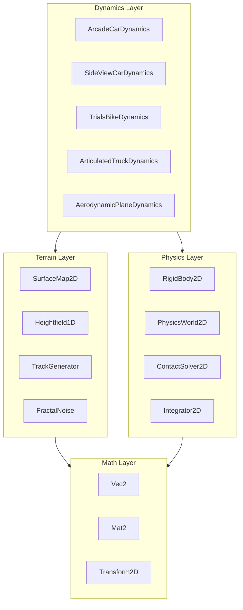
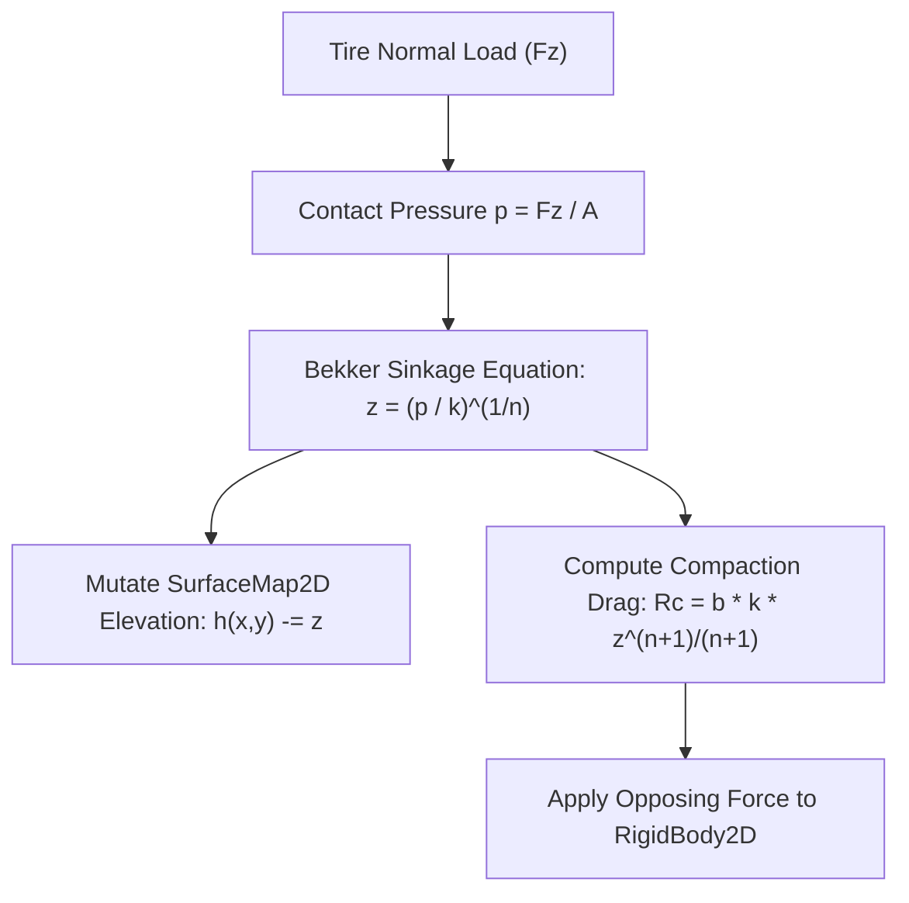
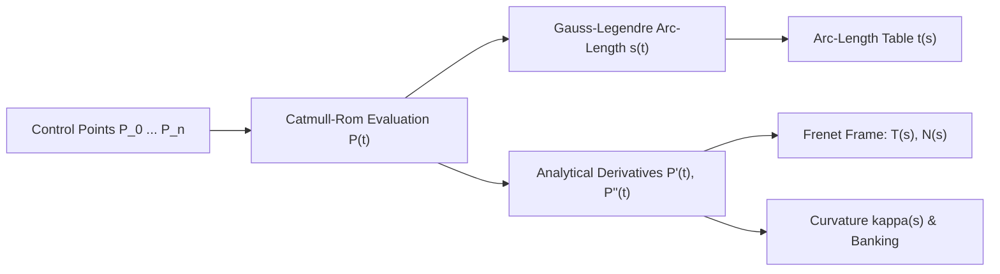
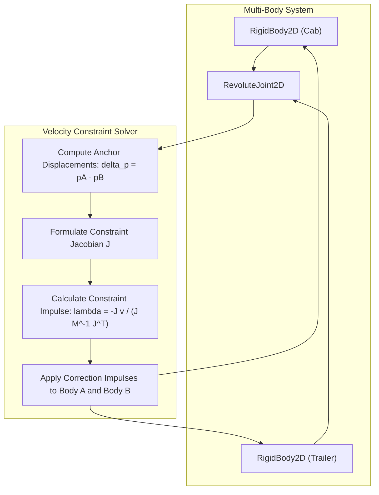

# VehicleSimCore - Proposed Features Specification

## 1. Overview and Architecture Context

`VehicleSimCore` is a standalone, deterministic 2D vehicle simulation engine implemented in pure C++17. It maintains zero external physics engine dependencies and targets cross-platform portability (Linux and Windows) with strict IEEE 754 floating-point compliance.

The library is organized into four modular layers:
- **Math Layer**: Linear algebra, spatial transforms, and vector primitives ([libs/VehicleSimCore/math/Vec2.h](../libs/VehicleSimCore/math/Vec2.h), [libs/VehicleSimCore/math/Mat2.h](../libs/VehicleSimCore/math/Mat2.h), [libs/VehicleSimCore/math/Transform2D.h](../libs/VehicleSimCore/math/Transform2D.h)).
- **Physics Layer**: Rigid body dynamics, Symplectic Euler integration, and impulse-based contact response ([libs/VehicleSimCore/physics/RigidBody2D.h](../libs/VehicleSimCore/physics/RigidBody2D.h), [libs/VehicleSimCore/physics/Integrator2D.h](../libs/VehicleSimCore/physics/Integrator2D.h), [libs/VehicleSimCore/physics/ContactSolver2D.h](../libs/VehicleSimCore/physics/ContactSolver2D.h), [libs/VehicleSimCore/physics/PhysicsWorld2D.h](../libs/VehicleSimCore/physics/PhysicsWorld2D.h)).
- **Terrain Layer**: Continuous 1D heightfields, 2D elevation/material maps, procedural multi-octave gradient and fractal noise, and procedural course synthesizers ([libs/VehicleSimCore/terrain/Heightfield1D.h](../libs/VehicleSimCore/terrain/Heightfield1D.h), [libs/VehicleSimCore/terrain/SurfaceMap2D.h](../libs/VehicleSimCore/terrain/SurfaceMap2D.h), [libs/VehicleSimCore/terrain/TrackGenerator.h](../libs/VehicleSimCore/terrain/TrackGenerator.h)).
- **Dynamics Layer**: Specialized vehicle dynamics coordinators implementing [IVehicleDynamics](../libs/VehicleSimCore/dynamics/IVehicleDynamics.h) for top-down, side-view, marine, and aeronautical vehicles.

```
+-----------------------------------------------------------------------------------------------+
|                                  VehicleSimCore Architecture                                  |
+-----------------------------------------------------------------------------------------------+
|                                       Dynamics Layer                                          |
|  ArcadeCar | SideViewCar | TrialsBike | ArticulatedTruck | Tank | Plane | Helicopter | Sub ...|
+-------------------------------+-------------------------------+-------------------------------+
|         Physics Layer         |         Terrain Layer         |          Math Layer           |
|  RigidBody2D                  |  SurfaceMap2D                 |  Vec2                         |
|  Integrator2D                 |  Heightfield1D                |  Mat2                         |
|  ContactSolver2D              |  TrackGenerator               |  Transform2D                  |
|  PhysicsWorld2D               |  FractalNoise / GradientNoise  |  (IEEE 754 Determinism)       |
+-------------------------------+-------------------------------+-------------------------------+
```



This specification details proposed architectural and algorithmic enhancements across **Terrain**, **Mathematics**, and **Physics**.

---

## 2. Terrain Systems

### 2.1 Soil Mechanics and Deformable Surface Rutting (Bekker-Wong Model)

#### Objective
Enable physical plastic and elastic deformation of deformable terrain (mud, sand, soft dirt, snow) caused by tire contact forces, leaving permanent or viscoelastic wheel ruts.

#### Technical Formulation
- **Sinkage Model**: Based on the semi-empirical Bekker pressure-sinkage relationship:
  $$p = \left( \frac{k_c}{b} + k_\phi \right) z^n$$
  where:
  - $p$: Ground contact pressure ($F_z / A$).
  - $b$: Wheel contact patch smaller dimension (width).
  - $k_c, k_\phi, n$: Moduli of soil cohesion and friction deformation.
  - $z$: Wheel penetration/sinkage depth into soil.
- **Rut Drag Force**: Soil compaction resistance force opposing vehicle motion:
  $$R_c = b \left( \frac{k_c}{b} + k_\phi \right) \frac{z^{n+1}}{n+1}$$
- **Terrain Elevation Mutation**:
  - In [SurfaceMap2D](../libs/VehicleSimCore/terrain/SurfaceMap2D.h), wheel positions depress the grid height at $(x, y)$ while slightly mounding adjacent cells (soil displacement conservation).
  - Integrates with [SurfaceMaterial](../libs/VehicleSimCore/terrain/SurfaceMaterial.h) via new properties: `compactionModulus`, `sinkageExponent`, and `maxPlasticDeformation`.

```
  ASCII Diagram: Tire Sinkage and Soil Rut Formation
  
          Tire Vertical Load (Fz)
                   |
                   v
              .---------.
             /     |     \
            |    [Hub]    |
             \     |     /
           ---'----+----'---  <- Original Surface Elevation h0
           \               /
            \  Rut Depth  /   <- Depressed Elevation h = h0 - z
             '-----------'
             ======|======    <- Compacted Soil Layer (Resisting Force Rc)
```



---

### 2.2 Cambered / Banked Tracks and Superelevation

#### Objective
Add transversal road banking (superelevation) to [TrackGenerator](../libs/VehicleSimCore/terrain/TrackGenerator.h) and [SurfaceMap2D](../libs/VehicleSimCore/terrain/SurfaceMap2D.h) along curved ribbon sections.

#### Technical Formulation
- **Theoretical Superelevation**:
  $$\tan(\theta_{\text{design}}) = \frac{v_{\text{design}}^2}{g \cdot R}$$
  where $R$ is track curve radius of curvature ($1 / \kappa$) and $v_{\text{design}}$ is target cornering velocity.
- **Cross-Section Profile**:
  Given centerline coordinate $\mathbf{C}(s)$ and unit lateral normal $\mathbf{n}_{\text{lat}}(s)$, the elevation at lateral offset $w \in [-W/2, W/2]$ becomes:
  $$h(s, w) = h_{\text{center}}(s) + w \cdot \sin(\theta(s))$$
- **Surface Normal Update**: Tilts the 3D upward surface normal $\mathbf{N} = (n_x, n_y, n_z)$ inward towards the curve apex, naturally balancing centripetal acceleration and preventing vehicle slide.

---

### 2.3 Dynamic Shallow Water and Wave Propagation (1D/2D)

#### Objective
Provide a real-time wave height perturbation simulation for watercraft, amphibious hovercraft, and submarine surface interactions.

#### Technical Formulation
- **Wave PDE (Discrete 2D Wave Grid)**:
  $$\frac{\partial^2 h}{\partial t^2} = c^2 \left( \frac{\partial^2 h}{\partial x^2} + \frac{\partial^2 h}{\partial y^2} \right) - \gamma \frac{\partial h}{\partial t}$$
  where $c$ is shallow water wave speed ($\sqrt{g \cdot d}$) and $\gamma$ is viscous damping.
- **Two-Way Coupling**:
  - Vehicle wakes deposit vertical momentum impulses: $\Delta v_z \propto \text{displacement} \cdot v_{\text{hull}}$.
  - Dynamic fluid pressure exerts buoyant and tilting torques on floating [RigidBody2D](../libs/VehicleSimCore/physics/RigidBody2D.h) instances.

---

### 2.4 Deterministic Object and Hazard Scattering (Blue-Noise / Poisson Disk)

#### Objective
Deterministically seed track hazards (rocks, oil patches, boost pads, puddles, cones) along course segments without spatial collisions or unnatural clustering.

#### Technical Formulation
- **Bridson Poisson-Disk Algorithm**:
  - Enforces minimum spacing $r_{\text{min}}$ between adjacent scattered obstacles.
  - Generates candidates in an annular ring $[r_{\text{min}}, 2r_{\text{min}}]$ around existing samples.
  - Spatial hash grid lookup guarantees $O(N)$ execution time.
- **Track-Aware Seeding**:
  - Restricts obstacle placement to drivable ribbon or runoff shoulders using distance-to-centerline metrics from [CircuitTrack2D](../libs/VehicleSimCore/terrain/TrackGenerator.h#L138-L167).

---

## 3. Mathematics and Geometric Computing

### 3.1 Parametric Spline Curves (`Spline2D` / `CatmullRom2D`)

#### Objective
Replace piecewise linear track approximations with continuous, analytically differentiable $C^1$ and $C^2$ 2D parametric curves.

#### Technical Features
1. **Centripetal Catmull-Rom Splines**:
   - Knot parameterization $t_{i+1} = t_i + \|\mathbf{P}_{i+1} - \mathbf{P}_i\|^\alpha$ with $\alpha = 0.5$ to eliminate cusps and self-intersections.
2. **Arc-Length Parameterization**:
   - Numerical integration via Legendre-Gauss quadrature to construct a monotonic arc-length lookup table $s(t)$.
   - Inverse mapping $t(s)$ allows constant-speed path traversal and milestone checkpoint placement.
3. **Frenet-Serret Frame and Curvature**:
   - Tangent: $\mathbf{T}(t) = \frac{\mathbf{P}'(t)}{\|\mathbf{P}'(t)\|}$
   - Normal: $\mathbf{N}(t) = \mathbf{T}(t)^\perp = (-T_y, T_x)$
   - Curvature:
     $$\kappa(t) = \frac{x'(t)y''(t) - y'(t)x''(t)}{(x'(t)^2 + y'(t)^2)^{3/2}}$$

```
  ASCII Diagram: Frenet-Serret Frame and Curvature on Spline2D
  
                ^ Unit Normal N(s)
                |
                |   .---* P(s) ---.
                |  /               \
                | /                 \
    ------------+'--------------------> Unit Tangent T(s)
                 \
                  \  Radius of Curvature R = 1 / kappa
                   ' -> [ Center of Curvature ]
```



---

### 3.2 2D Geometric Primitives and Intersection Solvers

#### Objective
Provide standard bounding volumes and primitive collision queries for broadphase filtering and shape queries.

#### Proposed Primitives
- `AABB2D`: Min/max corner axis-aligned bounding box.
  - Operations: `contains(Vec2)`, `intersects(AABB2D)`, `expand(double)`, `raycast(Ray2D)`.
- `OrientedBox2D` (OBB): Center, half-extents, and orientation angle.
  - Operations: Separating Axis Theorem (SAT) collision queries, closest point projection.
- `Capsule2D`: Line segment backbone defined by two endpoints and radius $r$.
  - Ideal for vehicle chassis approximations and rounded tire bounds.
- `Ray2D`: Origin point $\mathbf{o}$, unit direction $\mathbf{d}$, and maximum range $L$.
  - Returns `RayHit2D` containing hit distance, intersection coordinate, and unit normal.

---

### 3.3 Angle and Trigonometric Library (`Angle2D`)

#### Objective
Eliminate redundant, error-prone manual angle wrapping and quadrant tests throughout vehicle controllers.

#### Key Functions
- `normalizeRad(double angle)`: Normalizes angle to $[-\pi, \pi)$ with IEEE 754 precision.
- `deltaAngle(double from, double to)`: Computes minimal signed difference in $[-\pi, \pi)$.
- `lerpAngle(double a, double b, double t)`: Performs shortest-path angular linear interpolation.
- `slerp2D(const Vec2& a, const Vec2& b, double t)`: Spherical vector interpolation.

---

### 3.4 Control Theory and Signal Processing Utilities (Implemented)

#### Objective
Standardize feedback control, sensor filtering, and optimal kinematic state estimation for vehicle dynamics and autopilots.

#### Implemented Classes
- [PIDController](../libs/VehicleSimCore/math/PIDController.h):
  - Proportional, Integral, and Derivative gains ($K_p, K_i, K_d$).
  - Anti-windup clamping on the integral accumulator and conditional integration under output saturation.
  - Low-pass derivative filtering with configurable time constant $T_f$.
  - Derivative-on-measurement mode to eliminate setpoint step derivative kicks.
  - Ideal for cruise control, lane centering, and helicopter altitude holding.
- [SlewRateLimiter](../libs/VehicleSimCore/math/SlewRateLimiter.h):
  - Limits maximum rate of change ($|dx/dt| \le R_{\text{max}}$) for steering wheels, rudders, and throttles.
  - Supports symmetric and asymmetric rising/falling rate limits.
- [LowPassFilter](../libs/VehicleSimCore/math/LowPassFilter.h):
  - First-order discrete exponential filter ($y_k = \alpha x_k + (1-\alpha) y_{k-1}$) for smoothing noisy inputs.
  - Parameterized by physical -3 dB cutoff frequency in Hertz.
- [KalmanFilter1D](../libs/VehicleSimCore/math/KalmanFilter1D.h):
  - 2-state linear kinematic Kalman observer estimating position and velocity ($\mathbf{x} = [x, v]^T$).
  - Closed-form Bayesian covariance propagation and updates with zero dynamic allocations.
  - Ideal for synthetic sensor fusion, zero-lag derivative estimation, and dead reckoning during sensor dropouts.

---

## 4. Physics and Simulation Mechanics

### 4.1 Rigid Body Joints and Multi-Body Constraints

#### Objective
Equip [PhysicsWorld2D](../libs/VehicleSimCore/physics/PhysicsWorld2D.h) with an impulse-based constraint solver to support multi-body vehicle assemblies (trailers, suspension swingarms, chassis linkages).

#### Proposed Constraint Types
1. `RevoluteJoint2D` (Pin / Hinge):
   - Constrains two anchor points on distinct bodies to coincide: $\mathbf{x}_A + \mathbf{R}_A \mathbf{r}_A = \mathbf{x}_B + \mathbf{R}_B \mathbf{r}_B$.
   - Optional angular motor and joint angle limits $[\theta_{\text{min}}, \theta_{\text{max}}]$.
   - Direct fit for [ArticulatedTruckDynamics](../libs/VehicleSimCore/dynamics/ArticulatedTruckDynamics.h) fifth-wheel kingpin coupling.
2. `DistanceJoint2D`:
   - Enforces fixed distance between two body anchor points ($L_{\text{target}}$).
3. `PrismaticJoint2D` (Slider):
   - Allows translation along a designated axis while locking relative rotation.
   - Ideal for telescopic suspension struts.
4. `SpringDamperJoint2D`:
   - Linear Kelvin-Voigt model: $F = -k (x - x_0) - c \dot{x}$.

```
  ASCII Diagram: Revolute Joint Coupling in PhysicsWorld2D
  
   +-----------------------+                    +-----------------------+
   |      RigidBody A      |                    |      RigidBody B      |
   |      (Tractor Cab)    |    RevoluteJoint   |      (Cargo Trailer)  |
   |                       |                    |                       |
   |         Anchor A (rA) *====[ Pin Hinge ]===* Anchor B (rB)         |
   +-----------------------+                    +-----------------------+
```



---

### 4.2 Narrowphase Collision Detection and Manifold Generator

#### Objective
Automate contact generation between rigid bodies and terrain, directly driving [ContactSolver2D](../libs/VehicleSimCore/physics/ContactSolver2D.h).

#### Implementation Details
- **Shape Support**: Circle, OBB, Capsule.
- **Narrowphase Algorithms**:
  - `Circle` vs `Circle`: Distance comparison between center positions.
  - `Circle` vs `OBB`: Clamp circle center to box half-extents in local frame.
  - `OBB` vs `OBB`: Separating Axis Theorem (4 candidate axes) with edge-clipping manifold generation.
  - `Body` vs `Heightfield1D`: Segment intersection tests against terrain polygonal profile.
- Output formats directly into [Contact2D](../libs/VehicleSimCore/physics/ContactSolver2D.h#L8-L17) structs (contact point, unit normal, penetration depth, combined friction/restitution).

---

### 4.3 Semi-Empirical Pacejka 'Magic Formula' Tire Model

#### Objective
Upgrade vehicle traction models from linear cornering stiffness to non-linear tire slip saturation.

#### Mathematical Model
$$F(\sigma) = D \sin\left(C \arctan\left(B\sigma - E(B\sigma - \arctan(B\sigma))\right)\right)$$
where:
- $\sigma$: Slip parameter (longitudinal slip ratio $\kappa$ or lateral slip angle $\alpha$).
- $B$: Stiffness factor.
- $C$: Shape factor.
- $D = \mu \cdot F_z$: Peak friction force scaling with vertical load $F_z$.
- $E$: Curvature factor governing post-peak drop-off.
- **Combined Slip Ellipse**: Couples longitudinal acceleration and lateral cornering demand:
  $$\left(\frac{F_x}{F_{x,\text{max}}}\right)^2 + \left(\frac{F_y}{F_{y,\text{max}}}\right)^2 \le 1.0$$

---

### 4.4 Environmental Fluid Vector Fields (Wind and Ocean Currents)

#### Objective
Model environmental forces across airspace and waterways affecting planes, rockets, trucks, and watercraft.

#### Features
- **Spatial Field Representation**:
  $$\mathbf{V}_{\text{fluid}}(x, y, t) = \mathbf{V}_{\text{ambient}} + \mathbf{V}_{\text{gust}}(x, y, t)$$
- **Aerodynamic Relative Velocity**:
  $$\mathbf{V}_{\text{rel}} = \mathbf{V}_{\text{body}} - \mathbf{V}_{\text{fluid}}(x, y)$$
  Computes crosswind side force and yaw torque on high-profile vehicles ([ArticulatedTruckDynamics](../libs/VehicleSimCore/dynamics/ArticulatedTruckDynamics.h), [AerodynamicPlaneDynamics](../libs/VehicleSimCore/dynamics/AerodynamicPlaneDynamics.h)).

---

## 5. Architectural Roadmap and Priority Matrix

| Feature | Subsystem | Complexity | Dependencies | Primary Use Cases |
| :--- | :--- | :--- | :--- | :--- |
| **Angle2D & Math Utilities** | Math | Low | None | All Dynamics coordinators |
| **Spline2D & Catmull-Rom** | Math | Medium | `Vec2`, `Mat2` | `CircuitTrack2D`, Waypoint navigation |
| **AABB2D, Ray2D, OBB2D** | Math | Medium | `Vec2`, `Transform2D` | Broadphase and collision detection |
| **PIDController, Filters & Kalman** | Math | Low | None | Autopilots, cruise control, sensor fusion, dead reckoning |
| **Revolute & Distance Joints** | Physics | High | `RigidBody2D`, `PhysicsWorld2D` | `ArticulatedTruckDynamics`, suspensions |
| **Narrowphase Collision** | Physics | High | `AABB2D`, `OBB2D`, `Contact2D` | Automated body and terrain collisions |
| **Pacejka Tire Model** | Dynamics / Physics | Medium | `SurfaceMaterial` | Realistic wheeled dynamics (`ArcadeCar`, etc.) |
| **Deformable Rutting** | Terrain | Medium | `SurfaceMap2D`, `SurfaceMaterial` | Off-road tanks, monster trucks in mud/snow |
| **Banked / Cambered Tracks** | Terrain | Medium | `TrackGenerator`, `SurfaceMap2D` | High-speed racing circuits |
| **Environmental Wind / Water** | Physics | Low | `Vec2` | Planes, rockets, trucks, boats, subs |

---

## 6. Compliance and Coding Standards

All future implementations must comply with:
- **Language Standard**: Pure ISO C++17 (`-std=c++17` on GCC/Clang, `/std:c++17` on MSVC).
- **Zero External Dependencies**: Zero third-party physics engines; all algorithms self-contained in `VehicleSimCore`.
- **MISRA C++:2023 & SEI CERT C++**: No raw pointer memory ownership, RAII throughout, zero dynamic casts, explicit braces `{}` initialization.
- **Floating-Point Determinism**: IEEE 754 compliance across Linux and Windows platforms.
- **Documentation**: Triple-slash `///` Doxygen blocks with `@brief`, `@details`, `@param`, `@return` on all public APIs.
