# VehicleSimCore - Proposed Features Specification

## 1. Overview and Architecture Context

`VehicleSimCore` is a standalone, deterministic 2D vehicle simulation engine implemented in pure C++17. It maintains zero external physics engine dependencies and targets cross-platform portability (Linux and Windows) with strict IEEE 754 floating-point compliance.

The library is organized into four modular layers:
- **Math Layer**: Linear algebra, spatial transforms, and vector primitives ([libs/VehicleSimCore/math/Vec2.h](../libs/VehicleSimCore/math/Vec2.h), [libs/VehicleSimCore/math/Mat2.h](../libs/VehicleSimCore/math/Mat2.h), [libs/VehicleSimCore/math/Transform2D.h](../libs/VehicleSimCore/math/Transform2D.h)).
- **Physics Layer**: Rigid body dynamics, Symplectic Euler integration, and impulse-based contact response ([libs/VehicleSimCore/physics/RigidBody2D.h](../libs/VehicleSimCore/physics/RigidBody2D.h), [libs/VehicleSimCore/physics/Integrator2D.h](../libs/VehicleSimCore/physics/Integrator2D.h), [libs/VehicleSimCore/physics/ContactSolver2D.h](../libs/VehicleSimCore/physics/ContactSolver2D.h), [libs/VehicleSimCore/physics/PhysicsWorld2D.h](../libs/VehicleSimCore/physics/PhysicsWorld2D.h)).
- **Terrain Layer**: Continuous 1D heightfields, 2D elevation/material maps, procedural multi-octave gradient and fractal noise, and procedural course synthesizers ([libs/VehicleSimCore/terrain/Heightfield1D.h](../libs/VehicleSimCore/terrain/Heightfield1D.h), [libs/VehicleSimCore/terrain/SurfaceMap2D.h](../libs/VehicleSimCore/terrain/SurfaceMap2D.h), [libs/VehicleSimCore/terrain/TrackGenerator.h](../libs/VehicleSimCore/terrain/TrackGenerator.h)).
- **Dynamics Layer**: Specialized vehicle dynamics coordinators implementing [IVehicleDynamics](../libs/VehicleSimCore/dynamics/IVehicleDynamics.h) for top-down, side-view, marine, and aeronautical vehicles.

```
+-----------------------------------------------------------------------------------------------+
|                                  VehicleSimCore Architecture                                  |
+-----------------------------------------------------------------------------------------------+
|                                       Dynamics Layer                                          |
|  ArcadeCar | SideViewCar | TrialsBike | ArticulatedTruck | Tank | Plane | Helicopter | Sub ...|
+-------------------------------+-------------------------------+-------------------------------+
|         Physics Layer         |         Terrain Layer         |          Math Layer           |
|  RigidBody2D                  |  SurfaceMap2D                 |  Vec2                         |
|  Integrator2D                 |  Heightfield1D                |  Mat2                         |
|  ContactSolver2D              |  TrackGenerator               |  Transform2D                  |
|  PhysicsWorld2D               |  FractalNoise / GradientNoise  |  (IEEE 754 Determinism)       |
+-------------------------------+-------------------------------+-------------------------------+
```

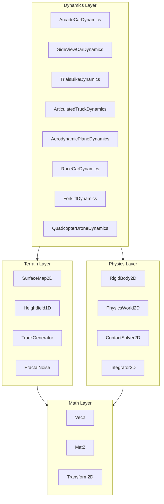

This specification details proposed architectural and algorithmic enhancements across **Terrain**, **Mathematics**, and **Physics**.

---

## 2. Terrain Systems

### 2.1 Soil Mechanics and Deformable Surface Rutting (Bekker-Wong Model) (Implemented)

#### Objective
Enable physical plastic and elastic deformation of deformable terrain (mud, sand, soft dirt, snow) caused by tire contact forces, leaving permanent or viscoelastic wheel ruts. Detailed architectural and terramechanics design specification: [Deformable Rutting Plan](DeformableRuttingImplementationPlan.md).

#### Technical Formulation
- **Sinkage Model**: Based on the semi-empirical Bekker pressure-sinkage relationship:
  $$p = \left( \frac{k_c}{b} + k_\phi \right) z^n$$
  where:
  - $p$: Ground contact pressure ($F_z / A$).
  - $b$: Wheel contact patch smaller dimension (width).
  - $k_c, k_\phi, n$: Moduli of soil cohesion and friction deformation.
  - $z$: Wheel penetration/sinkage depth into soil.
- **Rut Drag Force**: Soil compaction resistance force opposing vehicle motion:
  $$R_c = b \left( \frac{k_c}{b} + k_\phi \right) \frac{z^{n+1}}{n+1}$$
- **Terrain Elevation Mutation**:
  - In [SurfaceMap2D](../libs/VehicleSimCore/terrain/SurfaceMap2D.h), wheel positions depress the grid height at $(x, y)$ while slightly mounding adjacent cells (soil displacement conservation).
  - Integrates with [SurfaceMaterial](../libs/VehicleSimCore/terrain/SurfaceMaterial.h) via new properties: `compactionModulus`, `sinkageExponent`, and `maxPlasticDeformation`.

```
  ASCII Diagram: Tire Sinkage and Soil Rut Formation
  
          Tire Vertical Load (Fz)
                   |
                   v
              .---------.
             /     |     \
            |    [Hub]    |
             \     |     /
           ---'----+----'---  <- Original Surface Elevation h0
           \               /
            \  Rut Depth  /   <- Depressed Elevation h = h0 - z
             '-----------'
             ======|======    <- Compacted Soil Layer (Resisting Force Rc)
```

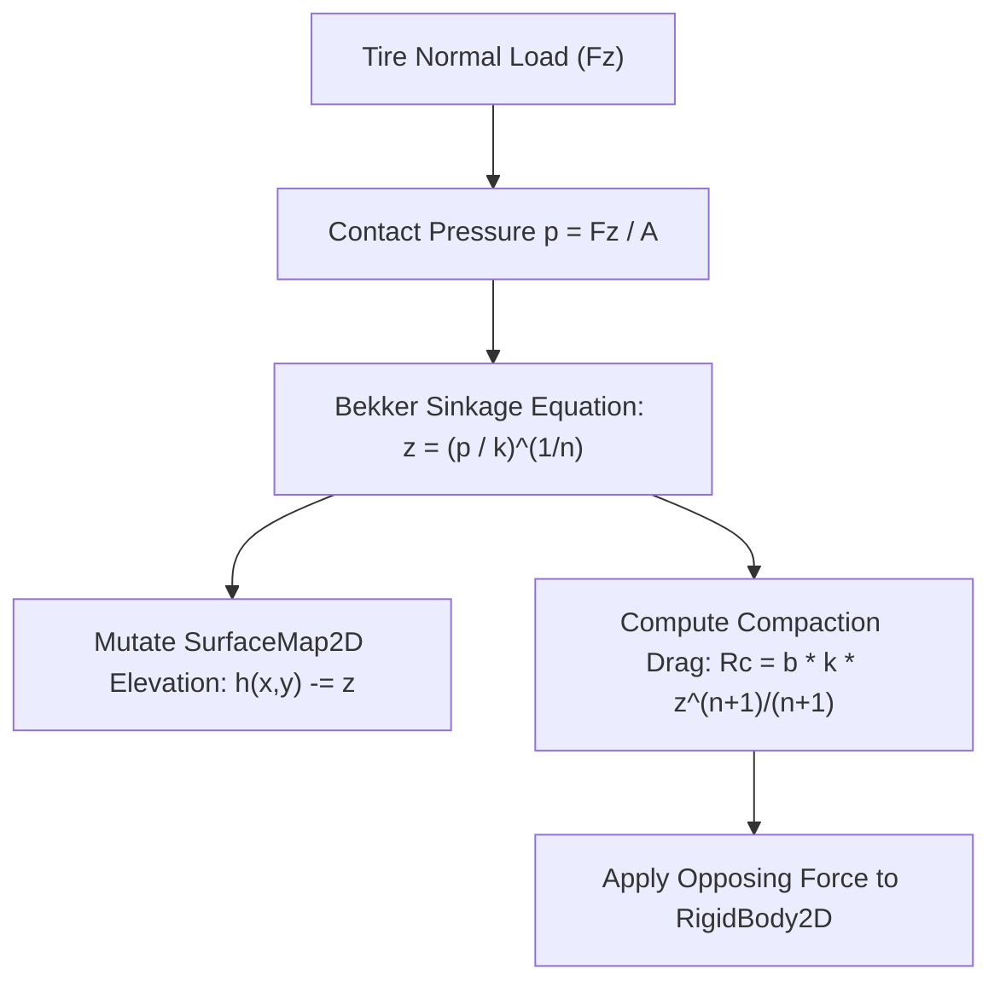

---

### 2.2 Cambered / Banked Tracks and Superelevation (Implemented)

#### Objective
Add transversal road banking (superelevation) to [TrackGenerator](../libs/VehicleSimCore/terrain/TrackGenerator.h) and [SurfaceMap2D](../libs/VehicleSimCore/terrain/SurfaceMap2D.h) along curved ribbon sections. Implemented via [BankedTrack.h](../libs/VehicleSimCore/terrain/BankedTrack.h) and [BankedTrackProfile](../libs/VehicleSimCore/terrain/BankedTrack.h).

#### Technical Formulation
- **Theoretical Superelevation**:
  $$\tan(\theta_{\text{design}}) = \frac{v_{\text{design}}^2}{g \cdot R}$$
  where $R$ is track curve radius of curvature ($1 / \kappa$) and $v_{\text{design}}$ is target cornering velocity.
- **Cross-Section Profile**:
  Given centerline coordinate $\mathbf{C}(s)$ and unit lateral normal $\mathbf{n}_{\text{lat}}(s)$, the elevation at lateral offset $w \in [-W/2, W/2]$ becomes:
  $$h(s, w) = h_{\text{center}}(s) + w \cdot \sin(\theta(s))$$
- **Surface Normal Update**: Tilts the 3D upward surface normal $\mathbf{N} = (n_x, n_y, n_z)$ inward towards the curve apex, naturally balancing centripetal acceleration and preventing vehicle slide.

```
  ASCII Diagram: Banked Track Cross-Section & Force Equilibrium

                     Outer Retaining Wall
                             .-----------------------+
                            /                       /|
                           /  Outer Edge           / |
                          /                       /  |
                         /       [Vehicle]       /   |
                        /         /  |          /    |
                       /    F_N  /   | F_g     /     |   Road Ribbon Width W
                      /         v    v        /      |
                     /                       /       |
                    /       Centerline C(s) /        |
                   /               *       /         |
                  /                       /          |
                 /  Inner Edge           /           |
                +-----------------------+            |
   -------------+------------------------------------+---------------------> Lateral Axis (w)
               -W/2                     0           +W/2
```

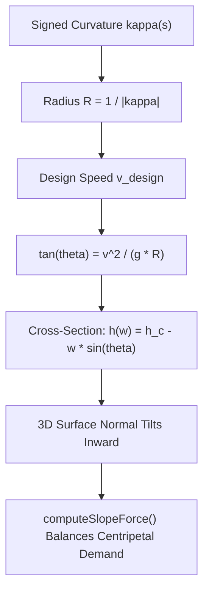

---

### 2.3 Dynamic Shallow Water and Wave Propagation (1D/2D)

#### Objective
Provide a real-time wave height perturbation simulation for watercraft, amphibious hovercraft, and submarine surface interactions. Detailed architectural and hydrodynamic wave design specification: [Shallow Water Wave Plan](ShallowWaterWaveImplementationPlan.md).

#### Technical Formulation
- **Wave PDE (Discrete 2D Wave Grid)**:
  $$\frac{\partial^2 h}{\partial t^2} = c^2 \left( \frac{\partial^2 h}{\partial x^2} + \frac{\partial^2 h}{\partial y^2} \right) - \gamma \frac{\partial h}{\partial t}$$
  where $c$ is shallow water wave speed ($\sqrt{g \cdot d}$) and $\gamma$ is viscous damping.
- **Two-Way Coupling**:
  - Vehicle wakes deposit vertical momentum impulses: $\Delta v_z \propto \text{displacement} \cdot v_{\text{hull}}$.
  - Dynamic fluid pressure exerts buoyant and tilting torques on floating [RigidBody2D](../libs/VehicleSimCore/physics/RigidBody2D.h) instances.

```
  ASCII Diagram: Dynamic Shallow Water Surface Perturbation & Hull Wake

               Hull Displacement (v_hull)
                     \_______/
     ~~~~~~~~~~~~~~~~~~\   /~~~~~~~~~~~~~~~~~~   <- Undisturbed Waterline (y_water)
    /                   \_/                   \
   /  Traveling Wave             Reflected Wave \  h(x, t) Grid Perturbation
  +----------------------------------------------+
```

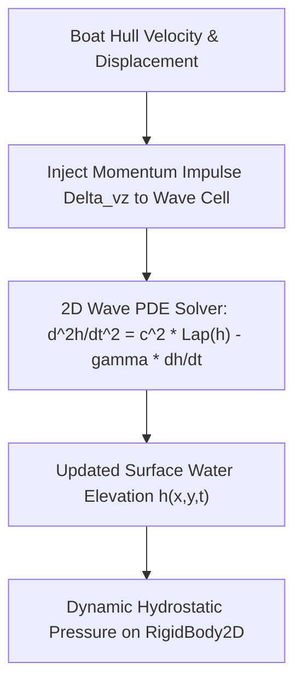

---

### 2.4 Deterministic Object and Hazard Scattering (Blue-Noise / Poisson Disk)

#### Objective
Deterministically seed track hazards (rocks, oil patches, boost pads, puddles, cones) along course segments without spatial collisions or unnatural clustering. Detailed architectural and procedural design specification: [Deterministic Hazard Scattering Plan](DeterministicHazardScatteringImplementationPlan.md).

#### Technical Formulation
- **Bridson Poisson-Disk Algorithm**:
  - Enforces minimum spacing $r_{\text{min}}$ between adjacent scattered obstacles.
  - Generates candidates in an annular ring $[r_{\text{min}}, 2r_{\text{min}}]$ around existing samples.
  - Spatial hash grid lookup guarantees $O(N)$ execution time.
- **Track-Aware Seeding**:
  - Restricts obstacle placement to drivable ribbon or runoff shoulders using distance-to-centerline metrics from [CircuitTrack2D](../libs/VehicleSimCore/terrain/TrackGenerator.h#L138-L167).

```
  ASCII Diagram: Track-Corridor Blue-Noise Poisson Disk Scattering

     Outer Track Boundary
    --------------------------------------------------------------
       ( ) r_min        (x) Oil Slick            ( ) Empty Annulus
            \          /                              /
             *--------*                 *------------*
            /          \               /
     (x) Cone          (x) Rock      (x) Hazard
    --------------------------------------------------------------
     Inner Track Boundary
```

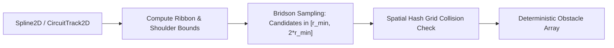

---

### 2.5 Multi-Layer Stratified Soil and Hydroplaning Model (Implemented)

#### Objective
Extend terramechanics in [DeformableTerrain](../libs/VehicleSimCore/terrain/DeformableTerrain.h) from homogeneous ground to vertically stratified layers (e.g., mud/snow layer over bedrock or asphalt) and simulate wet-weather dynamic tire hydroplaning. Detailed architectural and physics design specification: [Stratified Soil & Hydroplaning Plan](StratifiedSoilHydroplaningImplementationPlan.md).

#### Technical Formulation
- **Stratified Soil Depth ($d_{\text{top}}$)**:
  - Upper loose soil layer has finite depth $d_{\text{top}}(x, y)$ characterized by moduli $(k_c, k_\phi, n)_{\text{top}}$.
  - When wheel sinkage $z \ge d_{\text{top}}$, sinkage depth is clamped, and normal contact stiffness sharply increases toward the rigid substrate bedrock:
    $$k_{\text{eff}} = k_{\text{top}} + (k_{\text{bedrock}} - k_{\text{top}}) \cdot \sigma\left(\frac{z - d_{\text{top}}}{\epsilon}\right)$$
- **Dynamic Hydroplaning Model**:
  - Evaluates standing surface water film thickness $d_w(x, y)$ against tire tread grooving depth $d_{\text{tread}}$.
  - NASA critical dynamic hydroplaning speed formula:
    $$v_{\text{hydro}} = 6.36 \sqrt{p_{\text{tire,psi}}} \quad [\text{m/s}]$$
  - Friction scaling factor $\eta_{\text{wet}} \in [0.05, 1.0]$ decays sharply when forward velocity $v_x > v_{\text{hydro}}$ and $d_w > d_{\text{tread}}$, capturing catastrophic loss of steering and braking traction.

```
  ASCII Diagram: Multi-Layer Soil Stratification & Hydroplaning Wedge

          Tire Patch (Load Fz)            Water Film Wedge (dw > dtread)
              .---------.                          \
             /     |     \                       ---'---\
            |    [Hub]    |                      ====\   \=== Hydroplaning Lift
     -------'----+--------'---------------------------'---'--- Surface
     Soft Mud / Snow Layer (d_top)      | Sinkage z <= d_top
     ===================================|=====================
     Hard Substrate / Bedrock Base      | Infinite Stiffness Barrier
```

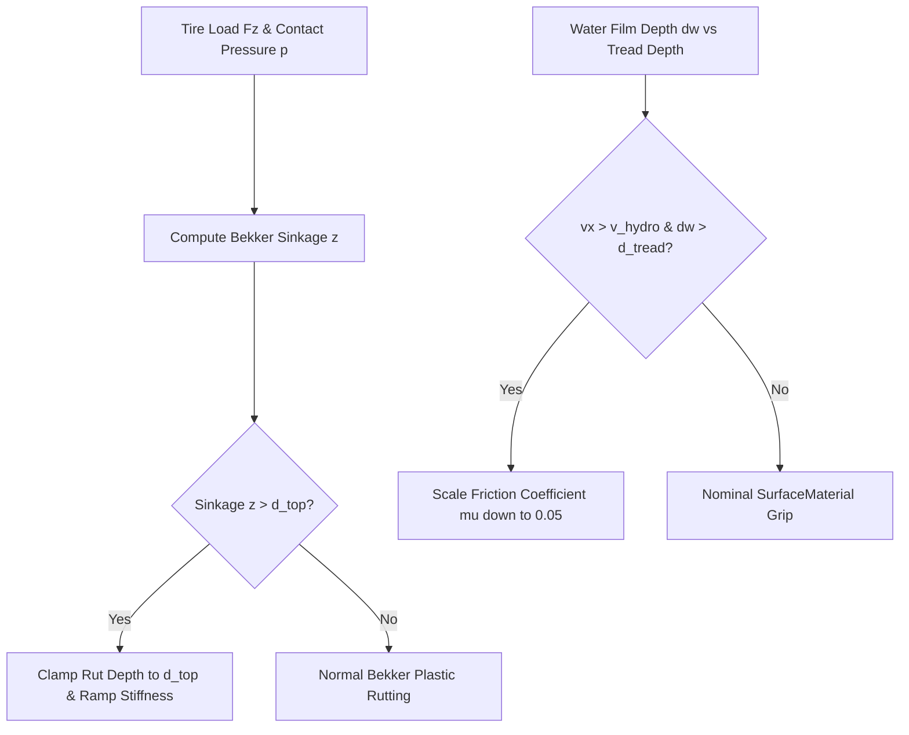

---

## 3. Mathematics and Geometric Computing

### 3.1 Parametric Spline Curves (`Spline2D` / `CatmullRom2D`) (Implemented)

#### Objective
Replace piecewise linear track approximations with continuous, analytically differentiable $C^1$ and $C^2$ 2D parametric curves.

#### Implementation Details
Implemented via [Spline2D.h](../libs/VehicleSimCore/math/Spline2D.h) and [Spline2D.cpp](../libs/VehicleSimCore/math/Spline2D.cpp):
1. **Centripetal Catmull-Rom Splines**:
   - Knot parameterization $t_{i+1} = t_i + \|\mathbf{P}_{i+1} - \mathbf{P}_i\|^\alpha$ with `SplineKnotMode`:
     - `SplineKnotMode::Centripetal` ($\alpha = 0.5$) to eliminate cusps and self-intersections.
     - `SplineKnotMode::Uniform` ($\alpha = 0.0$) and `SplineKnotMode::Chordal` ($\alpha = 1.0$) for specialized interpolation needs.
   - Supports both open and closed continuous loops.
2. **Arc-Length Parameterization**:
   - Monotonic cumulative arc-length lookup table $s(t)$ evaluated via 5-point Gauss-Legendre numerical quadrature per segment.
   - Fast inverse mapping $t(s)$ via binary search and linear interpolation allows constant-speed vehicle path traversal and exact milestone checkpoint placement.
   - Sample by distance query via `sampleByDistance(double distance)`.
3. **Frenet-Serret Frame and Curvature**:
   - Analytical first derivative $\mathbf{P}'(t)$ (`velocity`) and second derivative $\mathbf{P}''(t)$ (`acceleration`).
   - Unit forward tangent: $\mathbf{T}(t) = \frac{\mathbf{P}'(t)}{\|\mathbf{P}'(t)\|}$.
   - Unit upward/lateral normal: $\mathbf{N}(t) = \mathbf{T}(t)^\perp = (-T_y, T_x)$.
   - Signed curvature:
     $$\kappa(t) = \frac{x'(t)y''(t) - y'(t)x''(t)}{(x'(t)^2 + y'(t)^2)^{3/2}}$$
4. **Closest Point Projection**:
   - `getClosestPoint(const Vec2& point)` computes closest point on curve, orthogonal distance, arc-length, parameter $t$, and signed lateral offset (left/right).
   - Results returned in [SplineSample2D](../libs/VehicleSimCore/math/Spline2D.h#L22-L30) and [SplineClosestPoint](../libs/VehicleSimCore/math/Spline2D.h#L34-L40) structs.
- Verified in [Spline2DTest.cpp](../tests/Spline2DTest.cpp).

```
  ASCII Diagram: Frenet-Serret Frame and Curvature on Spline2D
  
                ^ Unit Normal N(s)
                |
                |   .---* P(s) ---.
                |  /               \
                | /                 \
    ------------+'--------------------> Unit Tangent T(s)
                 \
                  \  Radius of Curvature R = 1 / kappa
                   ' -> [ Center of Curvature ]
```

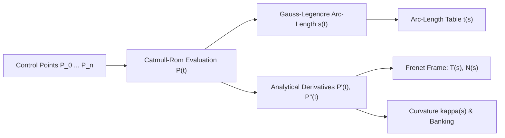

---

### 3.2 2D Geometric Primitives and Intersection Solvers (Implemented)

#### Objective
Provide standard bounding volumes and primitive collision queries for broadphase filtering, shape queries, and narrowphase contact generation.

#### Implemented Primitives
- [AABB2D](../libs/VehicleSimCore/math/AABB2D.h) / [AABB2D.cpp](../libs/VehicleSimCore/math/AABB2D.cpp):
  - Axis-aligned bounding box defined by `min` and `max` corner vectors.
  - Operations: `contains(Vec2)`, `intersects(AABB2D)`, `expand(double)`, `merge(AABB2D)`, `raycast(Ray2D)`.
- [OBB2D](../libs/VehicleSimCore/math/OBB2D.h) / [OBB2D.cpp](../libs/VehicleSimCore/math/OBB2D.cpp):
  - Oriented bounding box defined by `center`, `halfExtents`, and orientation `rotation` angle.
  - Operations: 4 world-space corners evaluation, Separating Axis Theorem (SAT) 1D axis projections, `contains(Vec2)`, `closestPoint(Vec2)`, `toAABB()`.
- [Circle2D](../libs/VehicleSimCore/math/Circle2D.h) / [Circle2D.cpp](../libs/VehicleSimCore/math/Circle2D.cpp):
  - 2D circle primitive defined by `center` position and `radius`.
  - Operations: `contains(Vec2)`, `closestPoint(Vec2)`, `distanceTo(Vec2)`, `toAABB()`.
- [Capsule2D](../libs/VehicleSimCore/math/Capsule2D.h) / [Capsule2D.cpp](../libs/VehicleSimCore/math/Capsule2D.cpp):
  - Line segment backbone defined by endpoints `pointA`, `pointB`, and `radius`.
  - Operations: segment closest-point projection, `contains(Vec2)`, `distanceTo(Vec2)`, `toAABB()`.
  - Ideal for vehicle chassis approximations and rounded tire bounds.
- [Polygon2D](../libs/VehicleSimCore/math/Polygon2D.h) / [Polygon2D.cpp](../libs/VehicleSimCore/math/Polygon2D.cpp):
  - Convex polygon defined by counter-clockwise ordered vertices with fixed-capacity MISRA-compliant storage (up to 8 vertices) or dynamic vector.
  - Operations: SAT edge normal projections, point containment, closest point projection, centroid, signed area, and transformed vertices.
  - Factory: `fromEllipse(Vec2 center, double a, double b, double rotation, std::size_t segments)` to approximate aerodynamic hulls, oval obstacles, and deformed tires with exact $O(N)$ SAT support.
- [CompoundShape2D](../libs/VehicleSimCore/physics/CompoundShape2D.h) / [CompoundShape2D.cpp](../libs/VehicleSimCore/physics/CompoundShape2D.cpp):
  - Multi-primitive compound volume aggregating multiple child primitives (`OBB2D`, `Circle2D`, `Capsule2D`) with relative local transforms (`Transform2D`).
  - Enables complex vehicle body hulls (e.g., stepped truck cabs, trailers with wheel wells, articulated hulls) via multi-box decomposition and unified bounding AABB computation.
- [Ray2D](../libs/VehicleSimCore/math/Ray2D.h) / [Ray2D.cpp](../libs/VehicleSimCore/math/Ray2D.cpp):
  - Origin point $\mathbf{o}$, unit direction $\mathbf{d}$, and maximum range $L$.
  - Returns `RayHit2D` containing hit status, distance, hit coordinates, and unit normal.
- Verified in [MathTest.cpp](../tests/MathTest.cpp) and [NarrowphaseTest.cpp](../tests/NarrowphaseTest.cpp).

```
  ASCII Diagram: Ellipse Approximation via Polygon2D & Multi-OBB Compound
  
         Polygon2D (8-Vertex Ellipse Approximation)           CompoundShape2D (Multi-OBB Chassis)
                        v2       v3                                    +-----------------------+
                     .---*-------*---.                                 |      Cab OBB (Box 1)  |
                 v1 /                 \ v4                             +-----------------------+
                   *                   *                               |      Main Bed OBB     |
                   |      Center       |               ===>            |      (Box 2)          |
                   *                   *                               +-----------------------+
                 v0 \                 / v5                             | Sub-chassis   (Box 3) |
                     '---*-------*---'                                 +-----------------------+
                        v7       v6
```

```mermaid
graph TD
    subgraph EllipseApproximation ["Ellipse Approximation Pipeline"]
        Param["Ellipse Parameters: center, a, b, theta, N segments"] --> Sampling["Sample Vertices: p_k = center + R * (a*cos(t_k), b*sin(t_k))"]
        Sampling --> Poly["Polygon2D (Convex Hull / n-gon)"]
        Poly --> SAT["SAT Overlap & Edge-Clipping Manifold"]
    end

    subgraph CompoundAssembly ["CompoundShape2D Pipeline"]
        SubShapes["Child Primitives: std::vector<OBB2D> with local transforms"] --> TransformWorld["Transform Children: T_world = T_body * T_local"]
        TransformWorld --> PairwiseCollision["Pairwise Child Narrowphase Checks"]
        PairwiseCollision --> AggregatedManifold["Merge into ContactManifold2D"]
    end
```

---

### 3.3 Angle and Trigonometric Library (`Angle2D`) (Implemented)

#### Objective
Eliminate redundant, error-prone manual angle wrapping and quadrant tests throughout vehicle controllers and physics coordinators.

#### Implementation Details
Implemented via [Angle2D.h](../libs/VehicleSimCore/math/Angle2D.h) and [Angle2D.cpp](../libs/VehicleSimCore/math/Angle2D.cpp):
- Represents planar angles in radians normalized to the IEEE 754 principal domain $[-\pi, \pi)$ via branchless arithmetic.
- **Factory Constructors**:
  - `Angle2D::fromRadians(double radians)`: Wraps input radians to $[-\pi, \pi)$.
  - `Angle2D::fromDegrees(double degrees)`: Converts degrees to radians and normalizes.
  - `Angle2D::fromVector(const Vec2& vec)`: Computes atan2 $(y, x)$ direction angle.
  - `Angle2D::zero()` and `Angle2D::pi()`: Canonical constant instances.
- **Trigonometric & Interpolation Utilities**:
  - `normalizeRad(double angle)`: Normalizes arbitrary angle to $[-\pi, \pi)$.
  - `deltaAngle(double from, double to)`: Computes minimal signed difference in $[-\pi, \pi)$.
  - `lerpAngle(double a, double b, double t)`: Performs shortest-path circular linear interpolation.
  - `slerp2D(const Vec2& a, const Vec2& b, double t)`: Spherical vector interpolation.
  - `headingToVector()`: Computes unit direction vector $(\cos(\theta), \sin(\theta))$.
- Fully verified under [MathTest.cpp](../tests/MathTest.cpp).

---

### 3.4 Control Theory and Signal Processing Utilities (Implemented)

#### Objective
Standardize feedback control, sensor filtering, and optimal kinematic state estimation for vehicle dynamics and autopilots.

#### Implemented Classes
- [PIDController](../libs/VehicleSimCore/math/PIDController.h):
  - Proportional, Integral, and Derivative gains ($K_p, K_i, K_d$).
  - Anti-windup clamping on the integral accumulator and conditional integration under output saturation.
  - Low-pass derivative filtering with configurable time constant $T_f$.
  - Derivative-on-measurement mode to eliminate setpoint step derivative kicks.
  - Ideal for cruise control, lane centering, and helicopter altitude holding.
- [SlewRateLimiter](../libs/VehicleSimCore/math/SlewRateLimiter.h):
  - Limits maximum rate of change ($|dx/dt| \le R_{\text{max}}$) for steering wheels, rudders, and throttles.
  - Supports symmetric and asymmetric rising/falling rate limits.
- [LowPassFilter](../libs/VehicleSimCore/math/LowPassFilter.h):
  - First-order discrete exponential filter ($y_k = \alpha x_k + (1-\alpha) y_{k-1}$) for smoothing noisy inputs.
  - Parameterized by physical -3 dB cutoff frequency in Hertz.
- [KalmanFilter1D](../libs/VehicleSimCore/math/KalmanFilter1D.h):
  - 2-state linear kinematic Kalman observer estimating position and velocity ($\mathbf{x} = [x, v]^T$).
  - Closed-form Bayesian covariance propagation and updates with zero dynamic allocations.
  - Ideal for synthetic sensor fusion, zero-lag derivative estimation, and dead reckoning during sensor dropouts.

---

### 3.5 Autonomous Path Following and Speed Profiler (`StanleyController`, `SpeedProfiler2D`) (Implemented)

#### Objective
Equip vehicle controllers with robust, non-linear geometric trajectory tracking along [Spline2D](../libs/VehicleSimCore/math/Spline2D.h) reference paths, combined with curvature-constrained optimal braking and acceleration speed profiling. Detailed specification and design: [Stanley Path Following Implementation Plan](StanleyPathFollowingImplementationPlan.md). Implemented via [StanleyController.h](../libs/VehicleSimCore/math/StanleyController.h), [SpeedProfiler2D.h](../libs/VehicleSimCore/math/SpeedProfiler2D.h), and [TrajectoryTracker2D.h](../libs/VehicleSimCore/dynamics/TrajectoryTracker2D.h).

#### Technical Formulation
- **Stanley Steering Control Law**:
  - Evaluated at the front axle reference point $\mathbf{x}_f = \mathbf{x}_{\text{cog}} + L_f \hat{\mathbf{u}}_{\text{heading}}$.
  - Computes orthogonal projection onto [Spline2D](../libs/VehicleSimCore/math/Spline2D.h) yielding closest Frenet point $\mathbf{p}(s)$, unit tangent $\mathbf{T}(s)$, unit normal $\mathbf{N}(s)$, and path heading $\psi_{\text{path}}$.
  - Heading error: $\theta_e = \text{deltaAngle}(\psi_{\text{vehicle}}, \psi_{\text{path}})$.
  - Signed cross-track error: $e_y = (\mathbf{x}_f - \mathbf{p}(s)) \cdot \mathbf{N}(s)$.
  - Non-linear steering angle control law:
    $$\delta(t) = \theta_e(t) + \arctan\left(\frac{k_e \cdot e_y(t)}{v_x(t) + \epsilon}\right) + k_d \cdot \dot{e}_y(t)$$
  - Steering saturation clamped to $[-\delta_{\text{max}}, \delta_{\text{max}}]$ and smoothed with [SlewRateLimiter](../libs/VehicleSimCore/math/SlewRateLimiter.h).
- **Curvature-Constrained Speed Profiler ([SpeedProfiler2D](../libs/VehicleSimCore/math/SpeedProfiler2D.h))**:
  - Maximum safe cornering speed at curvature $\kappa(s)$:
    $$v_{\text{lat,max}}(s) = \sqrt{\frac{a_{y,\text{max}}}{|\kappa(s)| + \epsilon}} = \sqrt{\frac{\mu g}{|\kappa(s)| + \epsilon}}$$
  - Two-pass dynamic programming:
    - Backward pass (deceleration/braking limit): $v_i \le \sqrt{v_{i+1}^2 + 2 a_{\text{brake}} \Delta s}$.
    - Forward pass (traction acceleration limit): $v_{i+1} \le \sqrt{v_i^2 + 2 a_{\text{accel}} \Delta s}$.
  - Closed-loop speed tracking driving throttle and braking via [PIDController](../libs/VehicleSimCore/math/PIDController.h).

```
  ASCII Diagram: Stanley Front-Axle Steering Geometry on Spline2D

                          Heading Error theta_e
                                  \   ^ Front Wheel Steering (delta)
                                   \ /
                            [ Front Axle x_f ]
                                   /    \
                                  /      \  Cross-track error e_y
       Spline Centerline P(s)    /        \
   -----+-----------------------*----------+--------------------> Tangent T(s)
       /                        ^ Closest Point
      / Unit Normal N(s)
```

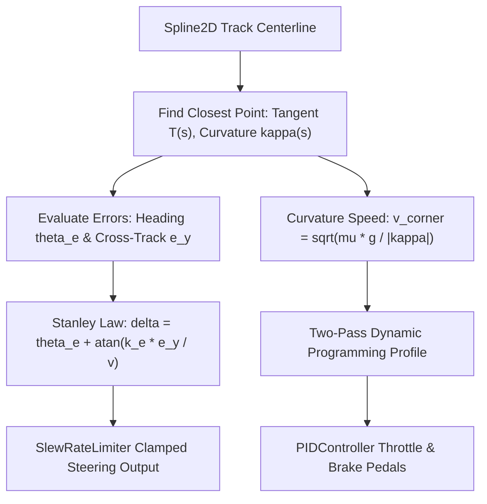

---

## 4. Physics and Simulation Mechanics

### 4.1 Rigid Body Joints and Multi-Body Constraints (Implemented)

#### Objective
Equip [PhysicsWorld2D](../libs/VehicleSimCore/physics/PhysicsWorld2D.h) with an impulse-based constraint solver to support multi-body vehicle assemblies (trailers, suspension swingarms, chassis linkages).

#### Implementation Details
Implemented via [Joint2D.h](../libs/VehicleSimCore/physics/Joint2D.h), [RevoluteJoint2D.h](../libs/VehicleSimCore/physics/RevoluteJoint2D.h), and [DistanceJoint2D.h](../libs/VehicleSimCore/physics/DistanceJoint2D.h):
1. **[RevoluteJoint2D](../libs/VehicleSimCore/physics/RevoluteJoint2D.h) (Pin / Hinge)**:
   - Constrains two anchor points on distinct bodies to coincide: $\mathbf{x}_A + \mathbf{R}_A \mathbf{r}_A = \mathbf{x}_B + \mathbf{R}_B \mathbf{r}_B$.
   - Enforces 2-DOF translational coincidence using an analytical $2 \times 2$ effective mass matrix:
     $$\mathbf{K} = (m_A^{-1} + m_B^{-1})\mathbf{I}_2 - \mathbf{r}_A^\perp I_A^{-1} (\mathbf{r}_A^\perp)^T - \mathbf{r}_B^\perp I_B^{-1} (\mathbf{r}_B^\perp)^T$$
   - Optional angular motor and joint angle limits $[\theta_{\text{min}}, \theta_{\text{max}}]$ with clamping and accumulated limit impulses.
   - Direct fit for [ArticulatedTruckDynamics](../libs/VehicleSimCore/dynamics/ArticulatedTruckDynamics.h) fifth-wheel kingpin coupling.
2. **[DistanceJoint2D](../libs/VehicleSimCore/physics/DistanceJoint2D.h)**:
   - Enforces fixed distance between two body anchor points ($L_{\text{target}}$).
   - Computes effective scalar mass along unit separation axis $\mathbf{u} = (\mathbf{p}_B - \mathbf{p}_A) / \|\mathbf{p}_B - \mathbf{p}_A\|$.
   - Enforces bilateral velocity and position constraint correction.
3. **Solver Integration in [PhysicsWorld2D](../libs/VehicleSimCore/physics/PhysicsWorld2D.h)**:
   - Solved in three distinct phases per simulation step:
     - `initVelocityConstraints()`: Updates rotation matrices, anchor offsets, effective mass inverses, and applies warm-starting impulses.
     - `solveVelocityConstraints()`: Solves velocity correction impulses iteratively for joints and contact manifolds.
     - `solvePositionConstraints()`: Non-linear position correction to eliminate Baumgarte numerical drift without adding artificial kinetic energy.
- Prospective extensions (`PrismaticJoint2D`, `SpringDamperJoint2D`) can inherit from `Joint2D` without modifying the core solver loop.
- Fully verified in [JointTest.cpp](../tests/JointTest.cpp).

```
  ASCII Diagram: Revolute Joint Coupling in PhysicsWorld2D
  
   +-----------------------+                    +-----------------------+
   |      RigidBody A      |                    |      RigidBody B      |
   |      (Tractor Cab)    |    RevoluteJoint   |      (Cargo Trailer)  |
   |                       |                    |                       |
   |         Anchor A (rA) *====[ Pin Hinge ]===* Anchor B (rB)         |
   +-----------------------+                    +-----------------------+
```

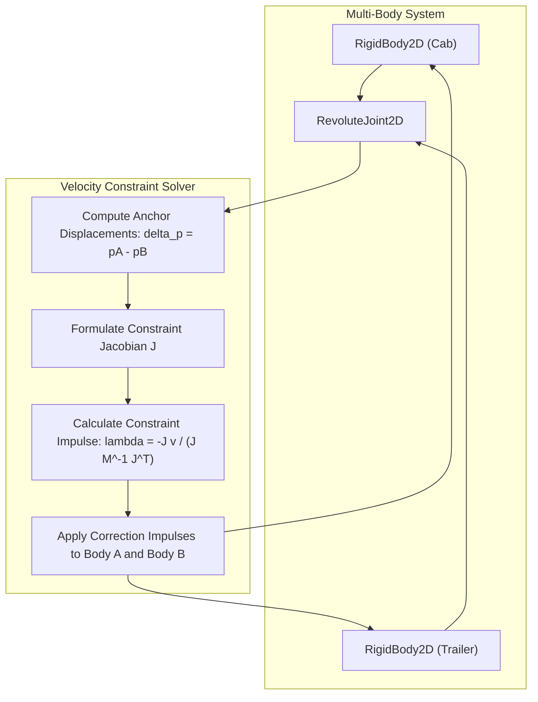

---

### 4.2 Narrowphase Collision Detection and Manifold Generator (Implemented)

#### Objective
Automate contact generation between rigid bodies and terrain, directly driving [ContactSolver2D](../libs/VehicleSimCore/physics/ContactSolver2D.h).

#### Implementation Details
- **Shape Support**: Circle, OBB, Capsule, Convex Polygon (`Polygon2D`), and Compound Volumes (`CompoundShape2D` / Multi-OBB compounds).
- **Narrowphase Algorithms**:
  - `Circle` vs `Circle`: Distance comparison between center positions.
  - `Circle` vs `OBB`: Clamp circle center to box half-extents in local frame.
  - `OBB` vs `OBB` / `Polygon2D` vs `Polygon2D`: Separating Axis Theorem (SAT) with edge-clipping manifold generation.
  - `CompoundShape2D`: Child primitive traversal and aggregated contact manifold generation.
  - `Body` vs `Heightfield1D`: Segment intersection tests against terrain polygonal profile.
- Output formats directly into [Contact2D](../libs/VehicleSimCore/physics/ContactSolver2D.h#L8-L17) structs (contact point, unit normal, penetration depth, combined friction/restitution).
- Detailed specification and architecture: [Narrowphase Implementation Plan](NarrowphaseImplementationPlan.md).

---

### 4.3 Semi-Empirical Pacejka 'Magic Formula' Tire Model (Implemented)

#### Objective
Upgrade vehicle traction models from linear cornering stiffness to non-linear tire slip saturation.

#### Mathematical Model
$$F(\sigma) = D \sin\left(C \arctan\left(B\sigma - E(B\sigma - \arctan(B\sigma))\right)\right)$$
where:
- $\sigma$: Slip parameter (longitudinal slip ratio $\kappa$ or lateral slip angle $\alpha$).
- $B$: Stiffness factor.
- $C$: Shape factor.
- $D = \mu \cdot F_z$: Peak friction force scaling with vertical load $F_z$.
- $E$: Curvature factor governing post-peak drop-off.
- **Combined Slip Ellipse**: Couples longitudinal acceleration and lateral cornering demand:
  $$\left(\frac{F_x}{F_{x,\text{max}}}\right)^2 + \left(\frac{F_y}{F_{y,\text{max}}}\right)^2 \le 1.0$$
- Implemented in [PacejkaTireModel.h](../libs/VehicleSimCore/dynamics/PacejkaTireModel.h) and verified in [TireModelTest.cpp](../tests/TireModelTest.cpp).
- Detailed specification and architecture: [Pacejka Tire Implementation Plan](PacejkaTireImplementationPlan.md).

---

### 4.4 Environmental Fluid Vector Fields (Wind and Ocean Currents) (Implemented)

#### Objective
Model environmental aerodynamic and hydrodynamic forces across airspace and waterways affecting planes, rockets, trucks, and watercraft.

#### Implementation Details
Implemented via [FluidField2D.h](../libs/VehicleSimCore/physics/FluidField2D.h) and [FluidDrag2D.h](../libs/VehicleSimCore/physics/FluidDrag2D.h):
1. **Spatial Environmental Field ([FluidField2D](../libs/VehicleSimCore/physics/FluidField2D.h))**:
   - Continuous vector field $\mathbf{V}_{\text{fluid}}(x, y, t) = \mathbf{V}_{\text{ambient}} + \mathbf{V}_{\text{shear}}(y) + \mathbf{V}_{\text{gust}}(x, y, t)$.
   - Configurable waterline boundary $y_{\text{water}}$ separating gaseous atmosphere ($\rho_{\text{air}} = 1.225\,\text{kg/m}^3$) and water domain ($\rho_{\text{water}} = 1025.0\,\text{kg/m}^3$).
   - Atmospheric power-law wind shear profile:
     $$v_x(y) = v_{\text{ambient}} \left(\frac{y}{y_{\text{ref}}}\right)^\alpha \quad (y > 0)$$
   - Subsurface ocean current depth decay:
     $$v_x(y) = v_{\text{surface}} \exp\left(\frac{y - y_{\text{water}}}{D_{\text{decay}}}\right) \quad (y \le y_{\text{water}})$$
   - Deterministic transient 1-cosine discrete gust pulses ([DiscreteGust2D](../libs/VehicleSimCore/physics/FluidField2D.h#L27-L35)) conforming to FAA/MIL standards:
     $$\Delta v(t) = \frac{A}{2} \left(1 - \cos\left(\frac{2\pi (t - t_0)}{T}\right)\right)$$
   - Harmonic turbulence wave superpositions ([HarmonicGust2D](../libs/VehicleSimCore/physics/FluidField2D.h#L37-L44)).
2. **Aerodynamic & Hydrodynamic Force Evaluator ([FluidDrag2D](../libs/VehicleSimCore/physics/FluidDrag2D.h))**:
   - Evaluates relative velocity: $\mathbf{V}_{\text{rel}} = \mathbf{V}_{\text{body}} - \mathbf{V}_{\text{fluid}}(x, y, t)$.
   - Quadratic form drag:
     $$\mathbf{F}_{\text{drag}} = -\frac{1}{2}\rho C_d A \|\mathbf{V}_{\text{rel}}\| \mathbf{V}_{\text{rel}}$$
   - Crosswind lateral side forces and overturning moments on high-profile vehicles ([ArticulatedTruckDynamics](../libs/VehicleSimCore/dynamics/ArticulatedTruckDynamics.h), [AerodynamicPlaneDynamics](../libs/VehicleSimCore/dynamics/AerodynamicPlaneDynamics.h)) computed via body-frame projection and center-of-pressure offset:
     $$\tau_{\text{yaw}} = F_{\text{side}} \cdot d_{\text{cp}}$$
- Fully verified in [FluidFieldTest.cpp](../tests/FluidFieldTest.cpp).

---

### 4.5 Dynamic Bounding Volume Hierarchy Broadphase (`DynamicBVH2D`) (Implemented)

#### Objective
Accelerate collision pair generation in [PhysicsWorld2D](../libs/VehicleSimCore/physics/PhysicsWorld2D.h) from $O(N^2)$ brute force to $O(N \log N)$ or $O(N)$, allowing high-density simulation with hundreds of rigid bodies, track debris, and obstacle colliders. Detailed architectural and broadphase design specification: [DynamicBVH Plan](DynamicBVHImplementationPlan.md).

#### Technical Formulation
- **Self-Balancing AABB Tree**:
  - Fat bounding boxes $\mathbf{B}_{\text{fat}} = \text{AABB}(\mathbf{p}_t, \mathbf{p}_t + \mathbf{v}\Delta t) + \Delta_{\text{margin}}$ enclose bodies and their predicted linear trajectories.
  - Surface Area Heuristic (SAH) or minimal perimeter increase determines optimal leaf node insertion.
  - Fast query primitives:
    - Raycast traversal: `raycast(const Ray2D& ray, RayCallback callback)`.
    - Area overlap queries: `query(const AABB2D& aabb, OverlapCallback callback)`.
    - Pair manager filtering out broadphase duplicates and non-colliding layer masks before narrowphase evaluation.

```
  ASCII Diagram: Dynamic AABB Tree & Broadphase Query

                  [ Root AABB: Node 0 ]
                     /              \
         [ Branch: Node 1 ]      [ Branch: Node 2 ]
            /          \            /          \
       [ Leaf A ]  [ Leaf B ]  [ Leaf C ]  [ Leaf D ]
       (Vehicle 1) (Trailer 1) (Rock #12)  (Tire Stack)
```

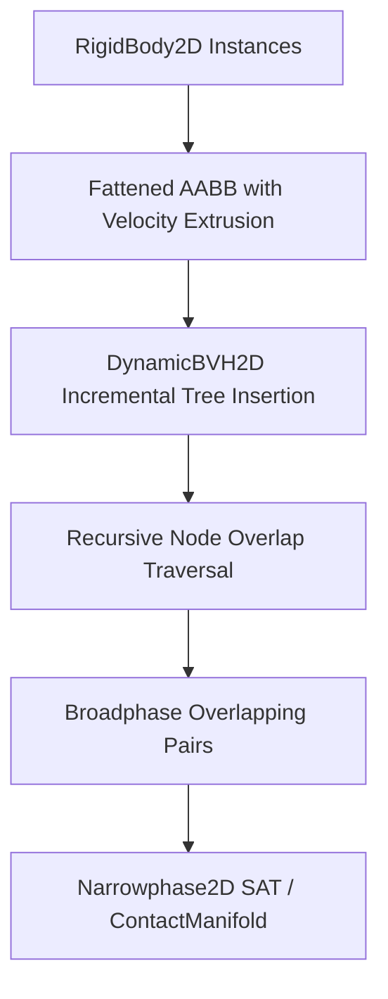

---

### 4.6 Continuous Collision Detection (CCD) & Speculative Contacts (Implemented)

#### Objective
Prevent high-speed vehicles (such as [AntiGravityRacerDynamics](../libs/VehicleSimCore/dynamics/AntiGravityRacerDynamics.h), [RocketDynamics](../libs/VehicleSimCore/dynamics/RocketDynamics.h), or high-speed racing cars) from tunneling through thin track barriers or terrain edges during large simulation time steps $\Delta t$. Detailed architectural and anti-tunneling design specification: [Continuous Collision Detection Plan](ContinuousCollisionDetectionImplementationPlan.md).

#### Technical Formulation
- **Time-of-Impact (TOI) Root Finding**:
  - Solves for separation distance $d(t) = \min_{\mathbf{x}_A \in A, \mathbf{x}_B \in B} \|\mathbf{x}_A(t) - \mathbf{x}_B(t)\|$ over $t \in [0, \Delta t]$.
  - Solves the earliest contact time $t^* \in [0, \Delta t]$ using Conservative Advancement or swept-shape raycasting.
- **Speculative Contacts**:
  - Creates virtual contacts prior to intersection with negative separation distance $d_0$.
  - Limits normal closing velocity $\mathbf{v}_{\text{rel}} \cdot \mathbf{n} \le d_0 / \Delta t$ to halt penetration exactly at the surface boundary.

```
  ASCII Diagram: Continuous Collision Detection & Swept Volume

     Body Position t = 0                        Body Position t = Delta t
        (   A   ) ===========================> (   A   )
                     Swept Hull Volume               |
        ------------------------------------*--------+-------- Thin Wall Obstacle
                                            ^ Impact Time t* (TOI)
```

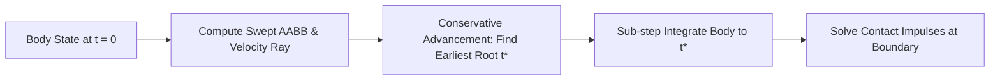

---

### 4.7 Extended Constraint Joints (`PrismaticJoint2D`, `WheelJoint2D`, `WeldJoint2D`)

#### Objective
Expand the multi-body constraint system ([Joint2D](../libs/VehicleSimCore/physics/Joint2D.h)) to support telescopic suspension struts, hydraulic rams, steering linkages, and breakable structural attachments.

#### Technical Formulation
1. **`PrismaticJoint2D` (Slider / Piston)**:
   - Constrains relative rotation to zero and relative translation to a 1D linear axis $\mathbf{u}$.
   - Includes linear spring-damper limits $[s_{\text{min}}, s_{\text{max}}]$ and optional powered motor.
2. **`WheelJoint2D` (Suspension Strut)**:
   - Constrains linear translation along suspension axis $\mathbf{u}$ with soft spring stiffness $k_s$ and damping $c_s$.
   - Allows unconstrained 1-DOF rotation of the attached wheel hub body.
3. **`WeldJoint2D` (Fixed Structural Bond)**:
   - Constrains all 3 planar degrees of freedom (2 translation, 1 rotation) between bodies.
   - Monitors constraint impulse $J$; if $\|J\| > J_{\text{break}}$, the joint ruptures for simulated structural damage.

```
  ASCII Diagram: WheelJoint2D Suspension Geometry

          +-----------------------+
          |      Chassis Body     |
          |       Anchor A        |
          +-----------*-----------+
                      |
                      |  Suspension Axis (u)
                      v  [Spring k_s / Damper c_s]
                      |
               [==== Hub B ====]   <-- Rotational DOF (Wheel Spin)
```

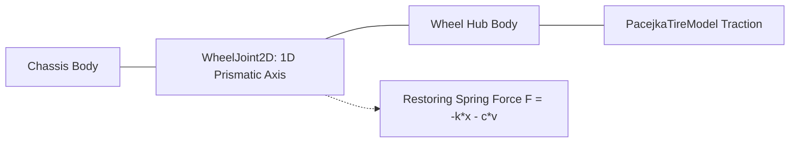

---

### 4.8 Submerged Hydrostatic Buoyancy & Hull Slicing (`Buoyancy2D`)

#### Objective
Provide realistic hydrostatic and hydrodynamic simulation for watercraft ([WatercraftDynamics](../libs/VehicleSimCore/dynamics/WatercraftDynamics.h)) and submarines ([SubmarineDynamics](../libs/VehicleSimCore/dynamics/SubmarineDynamics.h)) by coupling vehicle geometries with dynamic waterlines.

#### Technical Formulation
- **Polygon Hull Waterline Clipping**:
  - Slices [Polygon2D](../libs/VehicleSimCore/math/Polygon2D.h) against water elevation $y_{\text{water}}(x)$ via Sutherland-Hodgman polygon clipping.
- **Center of Buoyancy $\mathbf{C}_b$ & Hydrostatic Force**:
  - Evaluates submerged area $A_{\text{sub}}$ and geometric centroid $\mathbf{C}_b$.
  - Generates upward buoyant force: $\mathbf{F}_{\text{buoyant}} = \rho_{\text{water}} A_{\text{sub}} g \hat{\mathbf{j}}$.
  - Restoring righting torque: $\tau = (\mathbf{C}_b - \mathbf{X}_{\text{cog}}) \times \mathbf{F}_{\text{buoyant}}$.
- **Hydrodynamic Form Drag**:
  - Submerged hull skin friction drag: $\mathbf{F}_{\text{drag}} = -\frac{1}{2} \rho C_d A_{\text{sub}} \|\mathbf{v}\| \mathbf{v}$.

```
  ASCII Diagram: Submerged Polygon Hull Slicing & Buoyancy

     ~~~~~~~~~~~~~~~~~~~~ Waterline y_water ~~~~~~~~~~~~~~~~~~~~
        \                                                     /
         \   Submerged Polygon Area (A_sub)                  /
          \              * Center of Buoyancy (C_b)         /
           \             | F_buoyant                       /
            '------------+--------------------------------'
```

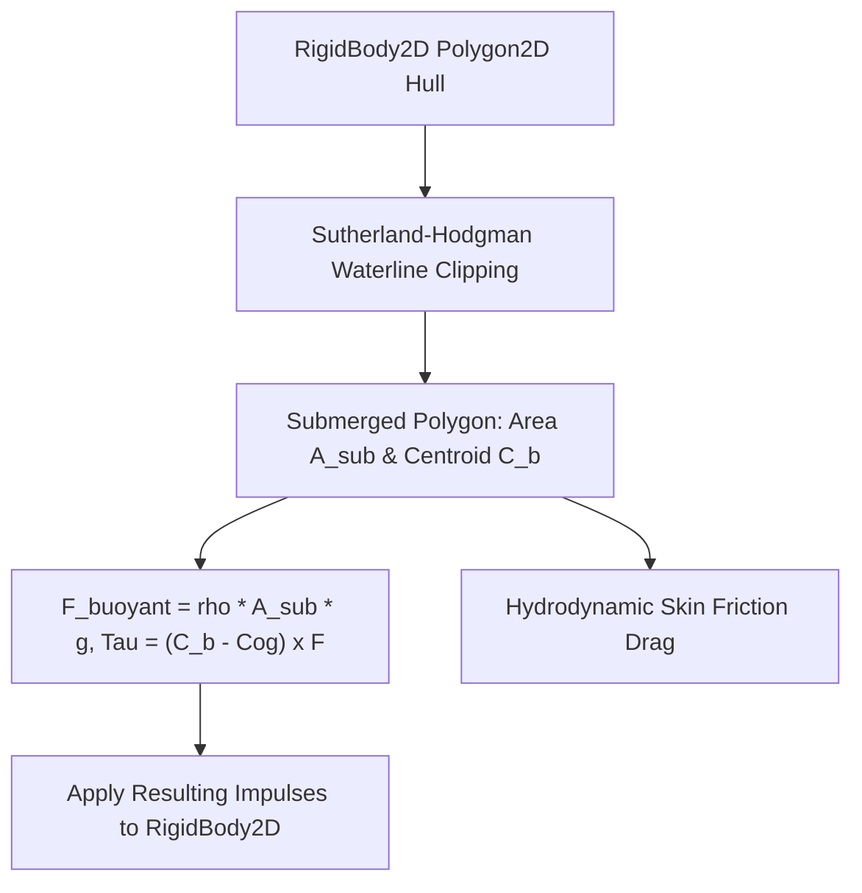

---

## 5. Vehicle Dynamics and Powertrain Systems

### 5.1 Modular Internal Combustion Engine and Electric Powertrain (`Powertrain2D`)

#### Objective
Replace simplified wheel torque scaling in wheeled vehicles with realistic internal combustion and electric propulsion models, multi-gear transmissions, and differential torque vectoring.

#### Technical Formulation
1. **Engine Model**:
   - Internal Combustion: Cubic polynomial or lookup table torque curve $T_e(\omega_e)$, idle RPM governor, throttle lag, and redline fuel cut.
   - Electric Motor: Constant-torque below base speed, constant-power above base speed, and regenerative braking torque.
2. **Flywheel & Clutch**:
   - Rotational flywheel inertia: $I_e \frac{d\omega_e}{dt} = T_e - T_{\text{clutch}}$.
   - Coulomb dry friction clutch with lockup detection.
3. **Multi-Ratio Transmission**:
   - Discrete gear ratios $\{R_1, R_2, \dots, R_N\}$ and reverse $R_{\text{rev}}$.
   - Configurable shift duration with torque interruption and rev matching.
4. **Differential Models**:
   - **Open Differential**: $T_L = T_R = \frac{1}{2} T_{\text{prop}}$, unconstrained relative wheel speed.
   - **Limited-Slip Differential (LSD)**: Clutch pack or viscous coupling transferring torque across $\Delta \omega$.
   - **Torsen Differential**: Torque-biasing ratio $B_{\text{ratio}} = T_{\text{high}} / T_{\text{low}}$.
   - **Locked Spool**: Enforces $\omega_L = \omega_R$.

```
  ASCII Diagram: Modular Powertrain Torque Flow

  [ Engine / Motor ] 
          | Torque T_e, Flywheel RPM
          v
  [ Clutch / Flywheel ]
          | T_clutch
          v
  [ Transmission Box ] (Gears 1..6, Reverse)
          | T_trans = T_clutch * R_gear
          v
  [ Final Drive & Differential ] (Open / LSD / Torsen / Spool)
         /              \
        v                v
  [ Left Axle ]    [ Right Axle ]
   (Wheel #1)       (Wheel #2)
```

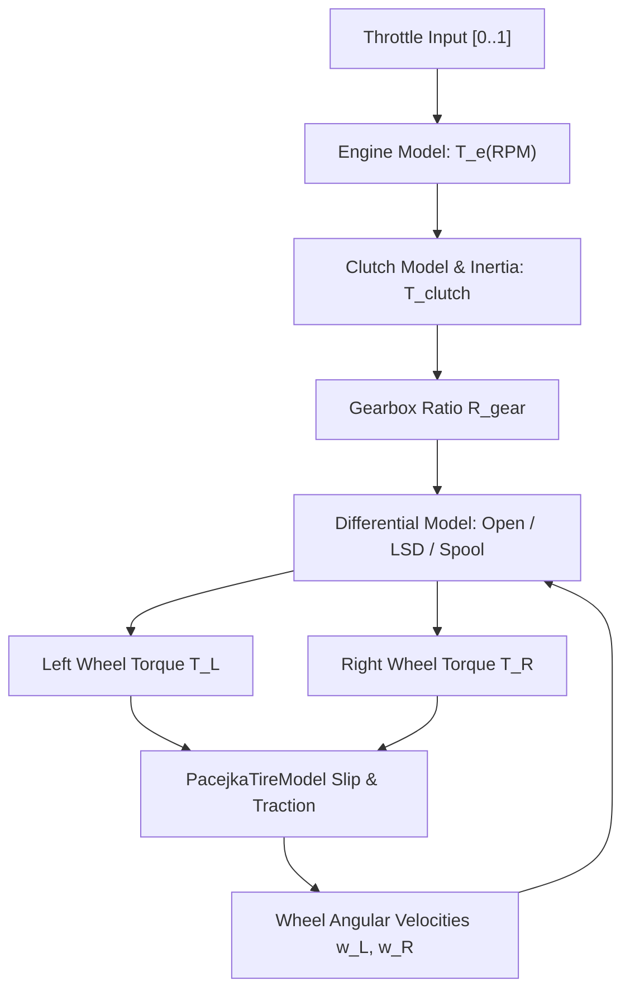

---

### 5.2 Ground Effect Downforce and Active DRS Flaps (Implemented)

#### Objective
Model realistic aerodynamic ground effects and active drag reduction flaps for formula cars, hypercars, and anti-gravity racing vehicles. Detailed architectural and aerodynamic design specification: [Ground Effect & Active DRS Plan](GroundEffectDrsImplementationPlan.md).

#### Technical Formulation
- **Underbody Venturi Downforce**:
  - Downforce scales non-linearly with ground clearance $h_{\text{ride}}$:
    $$F_{\text{downforce}} = \frac{1}{2}\rho v^2 C_{L0} \left(1 + \frac{k_{\text{venturi}}}{h_{\text{ride}} + \epsilon}\right)$$
  - Aerodynamic stall when ride height drops below critical threshold $h_{\text{stall}}$ (bottoming out inducing sudden downforce collapse).
- **Active DRS (Drag Reduction System)**:
  - Actuated flap angle $\theta_{\text{flap}} \in [0^\circ, 25^\circ]$ reducing drag coefficient $C_d$ by up to $30\%$, smoothed with [SlewRateLimiter](../libs/VehicleSimCore/math/SlewRateLimiter.h).

```
  ASCII Diagram: Ground Effect Airflow & Underbody Suction

                    Active Rear Wing / DRS Flap [=====]
                             \                       /
                 .------------+---------------------+------------.
                /                                                 \
               [                   Vehicle Body                    ]
                \                                                 /
   Front Wing    '---=========================================---'
      \                 \___ Underbody Diffuser Venturi ___/
  ======                 ---------------------------------
  ------------------------------------------------------------------- Ground
                           Ride Height (h_ride)
```

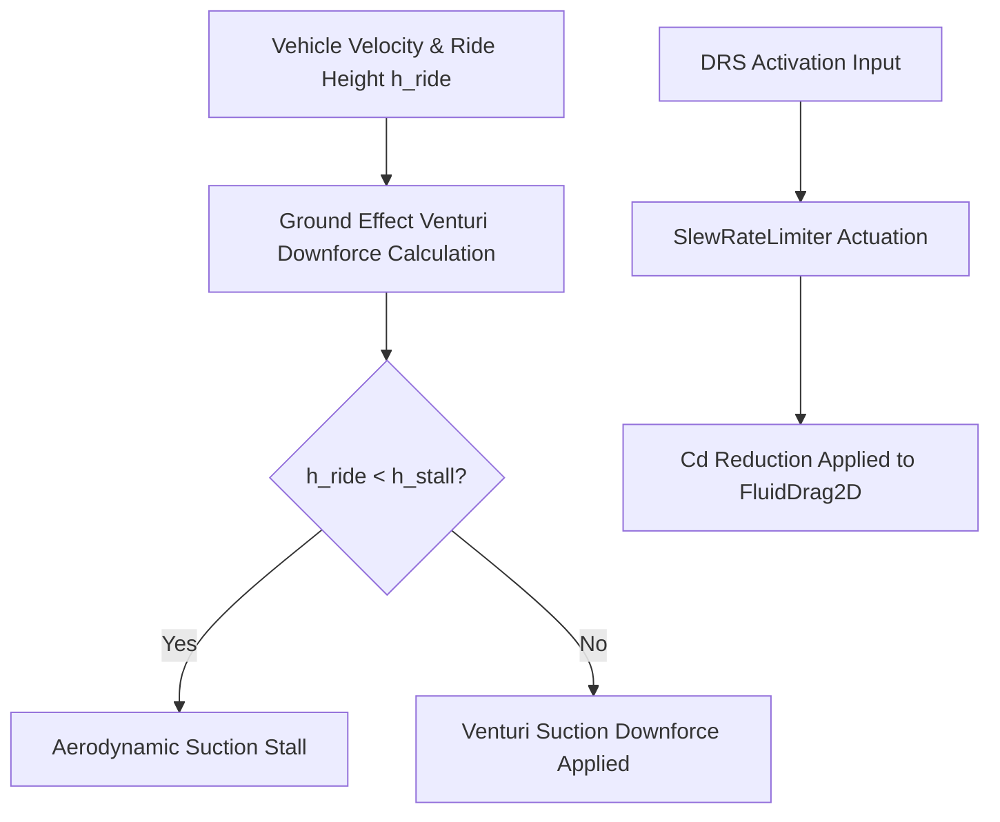

---

### 5.3 High-Performance Track and Motorsport Dynamics

#### 5.3.1 Full-Vehicle 4-Wheel Race Car Dynamics (`RaceCarDynamics`) (Implemented)

##### Objective
Deliver a dedicated high-performance motorsport vehicle dynamics model featuring dynamic 4-wheel load transfer, combined slip tire traction, aerodynamic downforce coupling, and cockpit brake balance adjustments. Detailed architectural and engineering specification: [Race Car Implementation Plan](RaceCarImplementationPlan.md).

##### Technical Formulation
1. **Dynamic 4-Wheel Normal Load Transfer**:
   - Computes dynamic vertical normal forces $F_{z,\text{FL}}, F_{z,\text{FR}}, F_{z,\text{RL}}, F_{z,\text{RR}}$ by coupling static weight distribution with longitudinal acceleration load transfer ($\Delta F_{z,x} = m a_x \frac{h}{L}$), lateral load transfer partitioned across front/rear anti-roll bars ($\Delta F_{z,y} = m a_y \frac{h}{T}$), and aerodynamic downforce.
2. **Pacejka Combined Slip Friction Ellipse**:
   - Couples longitudinal traction slip ratio $\kappa_i$ with lateral cornering slip angle $\alpha_i$ (Ackermann steering geometry) using [PacejkaTireModel.h](../libs/VehicleSimCore/dynamics/PacejkaTireModel.h).
3. **Aerodynamic Coupling**:
   - Direct integration with [GroundEffectAero2D.h](../libs/VehicleSimCore/dynamics/GroundEffectAero2D.h) for underbody Venturi downforce, stall limits, and active DRS flap drag reduction.

```
  ASCII Diagram: RaceCarDynamics 4-Wheel Load Transfer & Forces

     [FL Wheel: F_z,FL, delta_FL] ======== [FR Wheel: F_z,FR, delta_FR]
                  \                              /
                   \   Front Wing & Underbody   /
                    \   Aero Center of Pressure/
                     \           [COG]        /
                      \   (ax, ay Load Shift)/
                       \                    /
     [RL Wheel: F_z,RL] ================== [RR Wheel: F_z,RR]
                    Rear Wing & DRS Flap
```

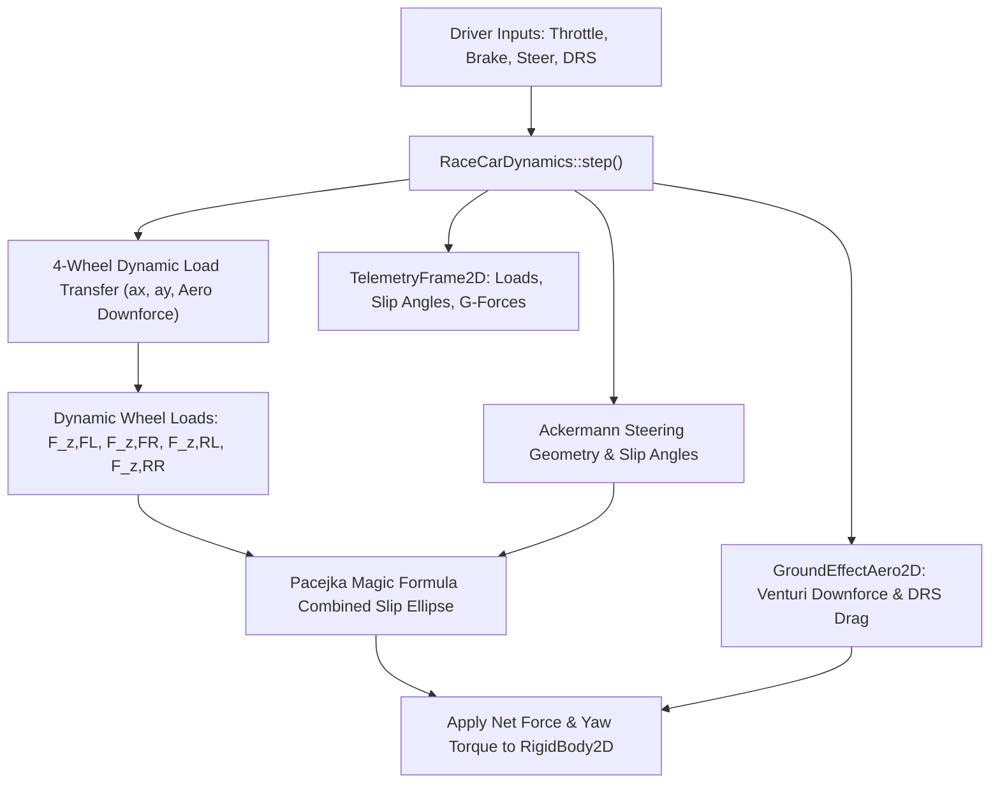

---

#### 5.3.2 Drift Car Dynamics (`DriftCarDynamics`) (Implemented)

##### Objective
Simulate extreme slip-angle vehicle handling, progressive oversteer transitions, self-aligning counter-steering torque feedback, and tire thermal friction drop. Detailed architectural and engineering specification: [Drift Car & Go-Kart Implementation Plan](DriftCarGoKartImplementationPlan.md).

##### Technical Formulation
- **Inertia Drift Equilibrium**:
  - Balances rear tire traction loss against lateral momentum, enabling sustained yaw slip angles $\beta_{\text{body}} \in [20^\circ, 65^\circ]$.
- **Counter-Steer Torque Feedback**:
  - Front pneumatic trail produces caster self-aligning torque $\tau_{\text{align}}$ steering into the skid.
- **Clutch Kick & Handbrake Disconnect**:
  - Instantaneous rear wheel lockup command breaking rear static adhesion, coupled with throttle surge breaking longitudinal traction.
- **Dynamic Thermal Friction Degradation**:
  - Friction coefficient decays under prolonged high slip velocity $v_{\text{slip}}$: $\mu_{\text{effective}} = \mu_{\text{cold}} \left(1 - \lambda \tanh(T_{\text{tire}} / T_0)\right)$.

```
  ASCII Diagram: Drift Car Yaw Slip & Counter-Steer Balance

                    Heading Velocity Vector V
                           ^
                          /
                         /  Yaw Slip Angle Beta
                        /
           [FL Wheel]--/---------[FR Wheel] (Counter-Steer Angle Delta)
               |      /              |
               |     /               |
               |    * (COG)          |
               |                     |
           [RL Wheel]-----------[RR Wheel] (High Slip Spin, Smoke/Wear)
```

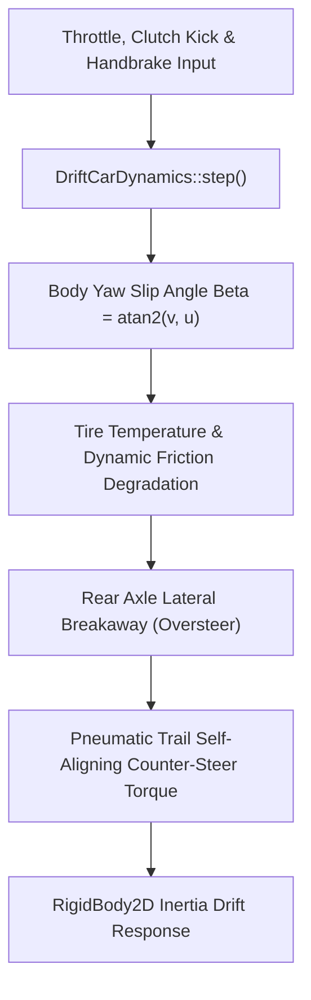

---

#### 5.3.3 Kart Racing Dynamics (`GoKartDynamics`) (Implemented)

##### Objective
Model lightweight sprint go-karts characterized by a spool solid rear axle (no differential), direct 1:1 steering ratio, and frame-flex tripod cornering mechanics. Detailed architectural and engineering specification: [Drift Car & Go-Kart Implementation Plan](DriftCarGoKartImplementationPlan.md).

##### Technical Formulation
- **Spool Solid Rear Axle Kinematics**:
  - Left and right rear wheels are locked together on a common solid drive shaft ($\omega_{\text{RL}} = \omega_{\text{RR}}$), causing continuous tire scrub unless inside tire lifts.
- **Frame Flex & Inside Wheel Lift**:
  - Front steering geometry with aggressive kingpin inclination and caster forces the inside rear wheel to unweight and lift off the track surface:
    $$\Delta F_{z,\text{jack}} = k_{\text{flex}} \cdot \theta_{\text{steer}} \cdot v_x$$
    When $\Delta F_{z,\text{jack}} \ge F_{z,\text{static,inner}}$, the inside rear wheel fully unweights, eliminating axle binding and allowing agile cornering.
- **Direct 1:1 Steering Response**:
  - Steering column connects directly via tie rods to front spindles with zero steering box backlash or ratio reduction.

```
  ASCII Diagram: Go-Kart Chassis Flex & Inside Rear Wheel Lift

      [Front-Left] ============================ [Front-Right]
           \                                         /
            \                                       /
             \            Chassis Frame Flex       /
              \           Caster Jacking Effect   /
               \                                 /
     (LIFTED)  [ O ]                           [ O ] (LOADED)
     Rear-Left Unweighted                     Rear-Right Takes 100% Rear Load
            ======================================= Solid Spool Axle
```

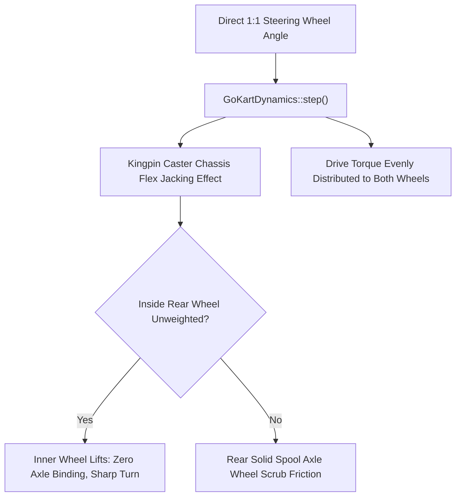

---

### 5.4 Utility, Heavy Industry, and Guided Rail Dynamics

#### 5.4.1 Rear-Steer Industrial Forklift Dynamics (`ForkliftDynamics`) (Implemented)

##### Objective
Simulate counterbalanced industrial warehouse forklifts featuring rear-wheel pivot steering up to $\pm 90^\circ$ (zero-radius pivot), dynamic mast elevation, and stability triangle rollover boundaries. Detailed architectural and engineering specification: [Forklift Implementation Plan](ForkliftImplementationPlan.md).

##### Technical Formulation
1. **Rear-Wheel Steer Kinematics**:
   - Instantaneous center of rotation (ICR) collinear with the front drive axle: $R_{\text{icr}} = L / \tan(\delta_{\text{rear}})$. At $\delta = \pm 90^\circ$, vehicle spins in place around front axle midpoint.
2. **Dynamic Center of Gravity & Mast Lift Kinematics**:
   - Dynamic payload mass $m_{\text{load}}$ at mast height $h_{\text{mast}}$ shifts composite vehicle Center of Gravity $(x_{\text{cog}}, h_{\text{cog}})$.
3. **Stability Triangle Rollover Margin**:
   - 3-point stability base evaluated between front drive wheels and rear steer axle pivot pin. Dynamic rollover index $I_{\text{rollover}} = |a_y| h_{\text{cog}} / (g \cdot w_{\text{eff}})$.

```
  ASCII Diagram: Forklift 3-Point Stability Triangle & Rear Pivot

                  Front Drive & Service Brake Axle
             [Front-Left] ================= [Front-Right]
                   \                               /
                    \     Stability Triangle      /
                     \                           /
                      \    * (x_cog, h_cog)     /
                       \   [Shifts with Mast]  /
                        \                     /
                         \                   /
                          \                 /
                           \               /
                            \             /
                             [    (O)    ] Rear Steer Pivot (+/- 90 deg)
```

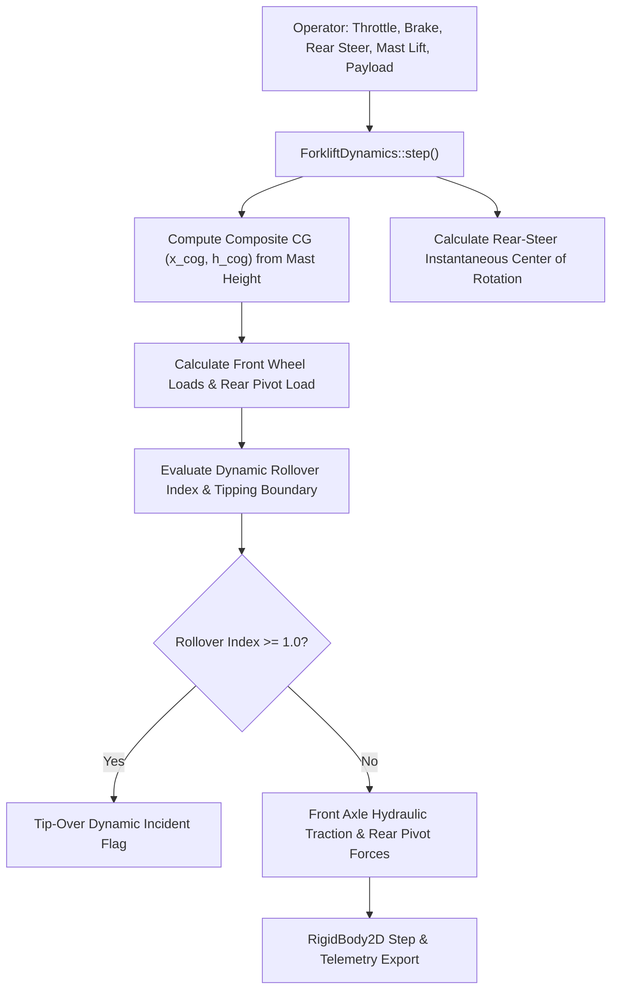

---

#### 5.4.2 Guided Track and Railway Dynamics (`TrainRailDynamics`) (Implemented)

##### Objective
Provide rail vehicle kinematics and dynamics constrained to 1D curvilinear coordinates along parametric [Spline2D](../libs/VehicleSimCore/math/Spline2D.h) railway tracks, featuring wheel flange hunting oscillations, adhesion limits, and multi-car coupler slack action. Detailed specification and design: [TrainRail & Excavator Dynamics Implementation Plan](TrainRailExcavatorImplementationPlan.md).

##### Technical Formulation
- **Curvilinear Track Constraint ($s, \dot{s}, \ddot{s}$)**:
  - Motion parameterization along track centerline arc-length $s$, mapping curve radius $R(s)$ and cant/superelevation angle $\theta_{\text{cant}}(s)$ directly into normal and lateral load distributions.
- **Wheel-Rail Creep & Adhesion Limits**:
  - Kalker linear creep theory for longitudinal tractive creepage and flange contact reaction forces. Sander injection increases adhesion coefficient $\mu_{\text{rail}}$ from $0.15$ (wet/greasy rail) to $0.40$.
- **Coupler Slack Action & Draft Gear**:
  - Non-linear spring-damper coupling with deadband slack space $[-\delta_{\text{slack}}, \delta_{\text{slack}}]$ between linked rail cars.

```
  ASCII Diagram: Rail Bogie & Flange Friction Mechanics

                 Rail Flange Clearance
            |<- delta_gap ->|
      [Wheel Flange]       |       [Wheel Flange]
        |    \             |             /    |
        |     \________    |    ________/     |
        |              \   |   /              |
     ====== Rail Head =====+===== Rail Head ======
```

```mermaid
graph TD
    TrackSpline["Spline2D Track Centerline & Superelevation"] --> RailCar["TrainRailDynamics::step()"]
    RailCar --> ArcLength["Arc-Length Kinematic Projection s(t)"]
    ArcLength --> FlangeForces["Flange Reaction & Hunting Damping Forces"]
    RailCar --> CreepCalc["Wheel-Rail Longitudinal Creep & Adhesion Limit"]
    CreepCalc --> Coupler["Multi-Car Coupler Draft Gear & Slack Action"]
    Coupler --> RailDispatch["Advance Train Consist State on Track"]
```

---

#### 5.4.3 Dual-Track Hydraulic Excavator Dynamics (`ExcavatorDynamics`) (Implemented)

##### Objective
Simulate heavy construction equipment featuring a dual-track crawler undercarriage with skid-steer kinematics, a $360^\circ$ continuous rotating upper superstructure (slew ring), and multi-link articulated hydraulic excavator arm kinematics. Detailed specification and design: [TrainRail & Excavator Dynamics Implementation Plan](TrainRailExcavatorImplementationPlan.md).

##### Technical Formulation
- **Dual-Track Skid-Steer Undercarriage**:
  - Independent left and right continuous crawler track speeds ($v_L, v_R$), generating high ground contact friction and turning moments through ground shearing.
- **Superstructure Slew Ring Bearing**:
  - Continuous rotating upper cabin driven by a hydraulic slew motor:
    $$I_{\text{upper}} \ddot{\theta}_{\text{slew}} = \tau_{\text{slew}} - c_{\text{slew}} \dot{\theta}_{\text{slew}}$$
- **Articulated Multi-Link Arm Kinematics**:
  - Planar kinematic chain representing Boom ($\theta_1$), Arm/Stick ($\theta_2$), and Bucket ($\theta_3$) with hydraulic cylinder extension constraints and digging reaction force vectors.

```
  ASCII Diagram: Excavator Multi-Link Arm & Continuous Slew Ring

                       Stick / Arm (theta_2)
                           o==============o Bucket (theta_3)
                          /                \   /
                         /                  \_/ Digging Force F_dig
         Boom (theta_1) /
                       o
                      /
     [ Upper Cabin ] /
     =============== Slew Ring Bearing (360 deg Continuous Rotation)
     [ Left Track  ] ================= [ Right Track ] (Skid Steer)
```

```mermaid
graph TD
    OperatorInput["Track Drive, Slew Ring Motor, Boom/Stick/Bucket Cylinders"] --> Excavator["ExcavatorDynamics::step()"]
    Excavator --> Undercarriage["Dual-Track Skid-Steer Ground Interaction"]
    Excavator --> SlewRing["Slew Ring Inertia & Rotational Torque tau_slew"]
    Excavator --> ArmKinematics["Forward Kinematics: Boom, Stick, Bucket Tool Center Point"]
    ArmKinematics --> DigReaction["Ground Resistance & Soil Digging Force Resolution"]
    Undercarriage --> ForceAccum["Sum Undercarriage & Dig Forces into RigidBody2D"]
    DigReaction --> ForceAccum
```

---

### 5.5 Specialized All-Terrain and Single-Track Dynamics (Implemented)

Detailed architectural and engineering specification: [Snowmobile, Bicycle & QuadBike Implementation Plan](SnowmobileBicycleQuadBikeImplementationPlan.md). Implemented via [SnowmobileDynamics.h](../libs/VehicleSimCore/dynamics/SnowmobileDynamics.h), [BicycleDynamics.h](../libs/VehicleSimCore/dynamics/BicycleDynamics.h), and [QuadBikeDynamics.h](../libs/VehicleSimCore/dynamics/QuadBikeDynamics.h).

#### 5.5.1 Dual-Ski and Track Snowmobile Dynamics (`SnowmobileDynamics`) (Implemented)

##### Objective
Model winter powersport snowmobiles with dual front steerable skis carving into packed snow/ice, a rear continuous propulsion rubber track, and rider dynamic body weight roll leaning.

##### Technical Formulation
- **Steerable Ski Carving Mechanics**:
  - Lateral ski force modeled as a combination of surface friction and ski edge angle carving resistance $\beta_{\text{edge}}$:
    $$F_{y,\text{ski}} = F_{z,\text{ski}} \left(\mu_{\text{snow}} \sin(\alpha) + k_{\text{edge}} \tan(\theta_{\text{roll}})\right)$$
- **Rear Drive Track Propulsion**:
  - Continuous rubber track with paddles displacing snow, coupling track drive speed $\omega_{\text{track}} R$ with slip sinkage drag.
- **Rider Body Lean Coupling**:
  - Dynamic lateral weight shift alters chassis roll moment and front ski normal load balance during aggressive counter-leaning in deep powder.

```
  ASCII Diagram: Snowmobile Front Ski & Drive Track Configuration

     [ Left Steer Ski ] =============== [ Right Steer Ski ]
              \                                 /
               \         Chassis Frame         /
                \     (Rider Roll Leaning)    /
                 \                           /
                  [ Rear Continuous Track  ] (Paddle Drive Traction)
```

```mermaid
graph TD
    Controls["Throttle, Brake, Handlebar Steer, Rider Body Lean"] --> Snowmobile["SnowmobileDynamics::step()"]
    Snowmobile --> SkiForces["Front Ski Edge-Carving & Steering Lateral Resistance"]
    Snowmobile --> TrackDrive["Rear Paddle Track Drive Force & Snow Sinkage"]
    Snowmobile --> RiderLean["Rider Roll Mass Shift & Anti-Roll Moment"]
    SkiForces --> BodyStep["Accumulate Forces & Update RigidBody2D Position"]
    TrackDrive --> BodyStep
```

---

#### 5.5.2 Single-Track Whipple Bicycle Dynamics (`BicycleDynamics`) (Implemented)

##### Objective
Implement the benchmark Whipple single-track bicycle model, featuring roll-steer kinematic coupling, counter-steering initiation, and front wheel gyroscopic self-stability above critical forward speed.

##### Technical Formulation
- **Dynamic Degrees of Freedom**:
  - Lean/roll angle $\phi$, steering angle $\delta$, and forward speed $v_x$.
- **Counter-Steering Dynamics**:
  - Steering momentarily away from the turn ($\delta < 0$) produces a lateral tire force at the contact patch that initiates vehicle roll torque into the desired cornering direction ($\ddot{\phi} > 0$).
- **Gyroscopic & Trail Self-Stabilization**:
  - Front wheel angular momentum $I_{\text{wheel}} \omega_{\text{wheel}}$ and positive mechanical caster trail $c_{\text{trail}}$ provide self-righting stability when forward velocity exceeds critical speed $v_{\text{crit}} \approx \sqrt{g L / \tan(\theta_{\text{head}})}$.

```
  ASCII Diagram: Bicycle Steering Geometry & Mechanical Trail

          Handlebars
              |
              | Fork (Head Tube Angle theta)
              |
              o Front Wheel Hub
             / \
            /   \
           /     \
    ======*=======+================ Ground Plane
       Contact  Projected
        Patch     Axis
       |<- Trail ->|
```

```mermaid
graph TD
    RiderSteer["Rider Steer Torque & Body Lean Command"] --> Bike["BicycleDynamics::step()"]
    Bike --> CounterSteer["Counter-Steer Initiation (Roll Acceleration)"]
    Bike --> Gyroscopic["Front Wheel Gyroscopic Precession & Caster Trail"]
    CounterSteer --> DynamicEquilibrium["2-DOF Roll-Steer Dynamic Equilibrium"]
    Gyroscopic --> DynamicEquilibrium
    DynamicEquilibrium --> TirePatches["Front & Rear Single-Track Contact Patch Forces"]
    TirePatches --> RigidBodyUpdate["RigidBody2D Kinematics Update"]
```

---

#### 5.5.3 All-Terrain Vehicle Quad Bike Dynamics (`QuadBikeDynamics`) (Implemented)

##### Objective
Simulate 4-wheel all-terrain vehicles (ATVs) featuring low-pressure compliant balloon tires, a solid rear drive axle, independent front double-wishbone suspension, and dynamic rider active mass displacement.

##### Technical Formulation
- **Low-Pressure Balloon Tire Compliance**:
  - Large tire carcass deflection acting as a secondary series spring-damper system over uneven terrain: $F_{z,\text{tire}} = k_{\text{tire}} \Delta z_{\text{tire}} + c_{\text{tire}} \Delta \dot{z}_{\text{tire}}$.
- **Solid Rear Axle with Open/Locked Differential**:
  - High ground clearance solid swingarm rear axle maintaining constant track width under terrain vertical articulation.
- **Rider Active Weight Shifting**:
  - Dynamic pitch and roll shifts of the rider's upper torso repositioning the Center of Gravity to prevent rollover on steep hill climbs and high-speed off-camber sweeps.

```
  ASCII Diagram: ATV Quad Bike Suspension & Compliant Balloon Tires

     [Front-Left Balloon] ===== (A-Arms) ===== [Front-Right Balloon]
             \                                      /
              \           Rider Torso Mass         /
               \         (Pitch/Roll Shift)       /
                \                                /
     [Rear-Left Balloon] ===== (Solid Axle) ===== [Rear-Right Balloon]
```

```mermaid
graph TD
    ATVInputs["Throttle, Front/Rear Brakes, Handlebars, Rider Torso Lean"] --> QuadBike["QuadBikeDynamics::step()"]
    QuadBike --> BalloonTires["Balloon Tire Carcass Deflection & Soft Soil Grip"]
    QuadBike --> SolidAxle["Solid Rear Swingarm Axle Articulation"]
    QuadBike --> RiderShift["Active Rider CG Shift (Hill Climb & Off-Camber Stability)"]
    BalloonTires --> TerrainForces["Wheel Forces Dispatched to RigidBody2D"]
    SolidAxle --> TerrainForces
```

---

### 5.6 Aerial and Multi-Rotor Advanced Systems

#### 5.6.1 Four-Rotor Quadcopter Drone Dynamics (`QuadcopterDroneDynamics`) (Implemented)

##### Objective
Simulate multi-rotor aerial drones utilizing an 'X' frame configuration with four independent motors, motor spool time constants, gyroscopic anti-torque cancellation, and cascaded attitude/altitude PID flight stabilization. Detailed architectural and engineering specification: [Quadcopter Drone Implementation Plan](QuadcopterDroneImplementationPlan.md).

##### Technical Formulation
1. **Rotor Thrust & Torque**:
   - Individual thrust $T_i = k_t \omega_i^2$ and reactionary aerodynamic drag torque $Q_i = k_q \omega_i^2$. Alternating CW/CCW motor pairs cancel yaw reactionary torque in hover.
2. **Motor Mixer Matrix**:
   - Resolves total collective lift, pitch moment, and yaw torque into individual target motor speeds $\omega_{\text{cmd},i}$. First-order ESC motor lag filters speed updates.
3. **Cascaded Flight Stabilization**:
   - Integrates [PIDController.h](../libs/VehicleSimCore/math/PIDController.h) for rate/attitude stabilization and vertical altitude climb-rate hold.

```
  ASCII Diagram: Quadcopter 'X' Configuration Rotor Layout

        Front
    (1) CW \       / (2) CCW      Total Thrust: T = sum(T_i)
            \     /                Pitch Torque: tau_pitch = L * (T_rear - T_front)
             [COG]                 Yaw Torque:   tau_yaw = sum(sigma_i * Q_i)
            /     \
   (3) CCW /       \ (4) CW
        Rear
```

```mermaid
graph TD
    Commands["Autopilot/Pilot Commands: Throttle, Pitch, Roll, Yaw"] --> Drone["QuadcopterDroneDynamics::step()"]
    Drone --> CascadedPID["Cascaded PID: Attitude & Altitude Stabilizer"]
    CascadedPID --> Mixer["4-Rotor Differential Thrust Mixer Matrix"]
    Mixer --> ESCLag["ESC First-Order Response Lag d(omega_i)/dt"]
    ESCLag --> MotorForces["Compute Thrust T_i and Drag Torque Q_i (FL, FR, RL, RR)"]
    MotorForces --> NetForces["Sum Net Thrust & Aerodynamic Control Torques"]
    NetForces --> RigidBody["RigidBody2D Step & Telemetry Export"]
```

---

#### 5.6.2 Tilt-Rotor VTOL Aircraft Dynamics (`VTOLTiltRotorDynamics`)

##### Objective
Model vertical takeoff and landing (VTOL) tilt-rotor aircraft featuring rotatable nacelles transitioning smoothly between hover helicopter mode and fixed-wing aerodynamic cruising flight.

##### Technical Formulation
- **Nacelle Tilt Kinematics ($\theta_{\text{nacelle}} \in [0^\circ, 90^\circ]$)**:
  - $\theta_{\text{nacelle}} = 90^\circ$: Vertical hover mode (pure rotor vertical lift, cyclic pitch control).
  - $\theta_{\text{nacelle}} = 0^\circ$: Forward cruise mode (horizontal tractor propulsion, aerodynamic wing lift $L_{\text{wing}} = \frac{1}{2}\rho v^2 S C_L$).
- **Conversion Corridor Envelope**:
  - Smooth tilt rate limiter transitioning aerodynamic lift from rotor thrust to fixed wing surfaces as forward airspeed $v_x$ surpasses wing stall speed $v_{\text{stall}}$.

```
  ASCII Diagram: Tilt-Rotor Nacelle Transition Corridor

      Hover Mode (theta = 90 deg)            Cruise Mode (theta = 0 deg)
               ^ Vertical Thrust                       ===> Forward Thrust
               |                                      [Rotor]
            [Rotor]                                      |
               |                                   +-----+-----+
           +---+---+                               |   Wing    |
           | Wing  |                               +-----+-----+
```

```mermaid
graph TD
    PilotTransition["Pilot Commands: Thrust, Tilt Transition Input, Pitch/Elevator"] --> VTOL["VTOLTiltRotorDynamics::step()"]
    VTOL --> NacelleTilt["Nacelle Angle Slew-Rate Limiter (0 deg to 90 deg)"]
    NacelleTilt --> RotorThrust["Vector Rotor Thrust: T * [-cos(theta), sin(theta)]"]
    VTOL --> WingAero["Wing Aerodynamic Lift & Induced Drag Calculation (v_x)"]
    RotorThrust --> NetVTOL["Blend Rotor Lift with Wing Aerodynamic Lift"]
    WingAero --> NetVTOL
    NetVTOL --> BodyDispatch["Apply Net Forces to RigidBody2D"]
```

---

## 6. Simulation Telemetry and Deterministic Serialization

### 6.1 Bit-Exact State Snapshotting and Rollback Netcode (`SimulationSnapshot2D`)

#### Objective
Support GGPO-style rollback netcode, rewind mechanics, and differential regression testing via IEEE 754 bit-exact simulation snapshots.

#### Technical Formulation
- **Complete World State Serialization**:
  - Rigid body position, velocity, orientation, angular velocity, and sleep state.
  - Joint warm-starting constraint impulses and internal limit states.
  - Active [DeformableTerrain](../libs/VehicleSimCore/terrain/DeformableTerrain.h) elevation delta sparse grids.
- **Rollback API**:
  - `SimulationSnapshot2D snapshot = world.captureSnapshot();`
  - `world.restoreSnapshot(snapshot);`
  - Guaranteed $O(N)$ execution time and zero heap allocations during gameplay ticks.

```
  ASCII Diagram: Deterministic Simulation Snapshot & Rewind Pipeline

       Simulation Tick:  T0       T1       T2       T3 (Rollback Event)
                          |        |        |        |
       World State:     [S0] ---> [S1] ---> [S2]    ===
                          |                           | Restore [S0]
                          +---------------------------+ Re-simulate to T3
```

```mermaid
graph LR
    WorldState["PhysicsWorld2D Active State"] --> Capture["captureSnapshot() -> SimulationSnapshot2D"]
    Capture --> FrameRing["Fixed-Capacity Frame Ring Buffer"]
    NetworkRollback["Network Desync / Rewind Request"] --> Restore["restoreSnapshot(snapshot)"]
    Restore --> ReSimulate["Deterministically Resimulate Ahead"]
```

---

### 6.2 Synchronous Telemetry Ring-Buffer (`TelemetryRecorder2D`) (Implemented)

#### Implementation Plan
Detailed technical specifications, mathematical derivations, C++17 interfaces, and MISRA compliance mappings are defined in the [Telemetry Implementation Plan](TelemetryRingBufferImplementationPlan.md). Implemented via [TelemetryFrame2D.h](../libs/VehicleSimCore/telemetry/TelemetryFrame2D.h), [TelemetryRingBuffer2D.h](../libs/VehicleSimCore/telemetry/TelemetryRingBuffer2D.h), [TelemetrySampler2D.h](../libs/VehicleSimCore/telemetry/TelemetrySampler2D.h), [CsvTelemetryExporter.h](../libs/VehicleSimCore/telemetry/CsvTelemetryExporter.h), and [KlvTelemetryExporter.h](../libs/VehicleSimCore/telemetry/KlvTelemetryExporter.h).

#### Objective
Capture high-rate flight/driving telemetry for offline analysis, HUD displays, or synthetic sensor streaming.

#### Technical Formulation
- **Fixed-Capacity Circular Buffer**:
  - Zero dynamic heap allocations during simulation steps.
  - Records per-frame metrics: speed, $G$-forces, tire slip angles, slip ratios, suspension travel, engine RPM, steering angle.
- **Exporters**:
  - CSV export for standard telemetry software (e.g., MoTeC, PlotJuggler).
  - Synthetic sensor streaming (MISB / KLV compatible) for aerospace payloads.

```
  ASCII Diagram: Telemetry Ring Buffer

     [ Channel 0: Time / Pos ]
     [ Channel 1: Velocity / G ]   ====> Fixed Capacity Circular Ring ====> CSV / Telemetry Stream
     [ Channel 2: Tire Slips   ]
     [ Channel 3: Powertrain   ]
```

```mermaid
graph TD
    DynamicsCoordinator["Vehicle Dynamics Step"] --> Sample["Sample Telemetry Channels (Slips, G-Forces, RPM)"]
    Sample --> RingBuffer["TelemetryRecorder2D Ring Buffer (MISRA Compliant)"]
    RingBuffer --> CSVExport["Export CSV / Data Log"]
    RingBuffer --> SensorStream["Synthetic Telemetry Stream"]
```

---

## 7. Architectural Roadmap and Priority Matrix

| Feature | Subsystem | Complexity | Dependencies | Primary Use Cases |
| :--- | :--- | :--- | :--- | :--- |
| **Angle2D & Math Utilities (Implemented)** | Math | Low | None | All Dynamics coordinators ([Angle2D.h](../libs/VehicleSimCore/math/Angle2D.h)) |
| **Spline2D & Catmull-Rom (Implemented)** | Math | Medium | `Vec2`, `Mat2` | `CircuitTrack2D`, Waypoint navigation ([Spline2D.h](../libs/VehicleSimCore/math/Spline2D.h)) |
| **AABB2D, Ray2D, OBB2D, Polygon2D (Implemented)** | Math | Medium | `Vec2`, `Transform2D` | Broadphase and collision detection ([Polygon2D.h](../libs/VehicleSimCore/math/Polygon2D.h)) |
| **PIDController, Filters & Kalman (Implemented)** | Math | Low | None | Autopilots, cruise control, sensor fusion ([PIDController.h](../libs/VehicleSimCore/math/PIDController.h)) |
| **Revolute & Distance Joints (Implemented)** | Physics | High | `RigidBody2D`, `PhysicsWorld2D` | `ArticulatedTruckDynamics`, suspensions ([RevoluteJoint2D.h](../libs/VehicleSimCore/physics/RevoluteJoint2D.h)) |
| **Narrowphase Collision (Implemented)** | Physics | High | `AABB2D`, `OBB2D`, `Polygon2D`, `Contact2D` | [Narrowphase Plan](NarrowphaseImplementationPlan.md) - Automated body & terrain collisions |
| **Pacejka Tire Model (Implemented)** | Dynamics / Physics | Medium | `SurfaceMaterial` | [Pacejka Tire Plan](PacejkaTireImplementationPlan.md) - Realistic wheeled dynamics ([PacejkaTireModel.h](../libs/VehicleSimCore/dynamics/PacejkaTireModel.h), [MonsterCarDynamics.h](../libs/VehicleSimCore/dynamics/MonsterCarDynamics.h)) |
| **Deformable Rutting (Implemented)** | Terrain | Medium | `SurfaceMap2D`, `SurfaceMaterial` | [Deformable Rutting Plan](DeformableRuttingImplementationPlan.md) - Soil sinkage, permanent ruts, compaction drag ([DeformableTerrain.h](../libs/VehicleSimCore/terrain/DeformableTerrain.h)) |
| **Banked / Cambered Tracks (Implemented)** | Terrain | Medium | `TrackGenerator`, `SurfaceMap2D` | High-speed racing circuits ([BankedTrack.h](../libs/VehicleSimCore/terrain/BankedTrack.h)) |
| **Environmental Wind / Water (Implemented)** | Physics | Low | `Vec2` | Planes, rockets, trucks, boats, subs ([FluidField2D.h](../libs/VehicleSimCore/physics/FluidField2D.h)) |
| **Earth Patrol (3-Axle Rover & SDL Game) (Implemented)** | Dynamics / App | Medium | `EarthRoverDynamics`, `Heightfield1D`, SDL2 | [Earth Patrol Plan](EarthPatrolImplementationPlan.md) - Moon Patrol style side-scroller on Earth ([apps/EarthPatrol](../apps/EarthPatrol)) |
| **Stanley Path Following & Speed Profiler (Implemented)** | Math / Dynamics | Low-Med | [Spline2D](../libs/VehicleSimCore/math/Spline2D.h), [PIDController](../libs/VehicleSimCore/math/PIDController.h) | [Stanley Path Plan](StanleyPathFollowingImplementationPlan.md) - Racing AI, trajectory navigation, autopilot ([StanleyController.h](../libs/VehicleSimCore/math/StanleyController.h)) |
| **DynamicBVH2D Broadphase (Implemented)** | Physics | Medium | [AABB2D](../libs/VehicleSimCore/math/AABB2D.h), [Ray2D](../libs/VehicleSimCore/math/Ray2D.h) | [DynamicBVH Plan](DynamicBVHImplementationPlan.md) - Multi-car collision, scaling to 100+ bodies & obstacles ([DynamicBVH2D.h](../libs/VehicleSimCore/physics/DynamicBVH2D.h)) |
| **Extended Joints (`Wheel`, `Prismatic`, `Weld`)** | Physics | Medium | [Joint2D](../libs/VehicleSimCore/physics/Joint2D.h), [PhysicsWorld2D](../libs/VehicleSimCore/physics/PhysicsWorld2D.h) | Suspension struts, breakable parts, hydraulic linkages |
| **Modular Powertrain & Differentials** | Dynamics | High | [MathUtils](../libs/VehicleSimCore/math/MathUtils.h), [PacejkaTireModel](../libs/VehicleSimCore/dynamics/PacejkaTireModel.h) | Realistic engine RPM, gearboxes, LSD / Torsen handling |
| **Poisson-Disk Object Scattering** | Terrain | Medium | [Spline2D](../libs/VehicleSimCore/math/Spline2D.h), [TrackGenerator](../libs/VehicleSimCore/terrain/TrackGenerator.h) | Procedural track hazards, cones, obstacles |
| **Continuous Collision Detection (CCD)** | Physics | High | [Narrowphase2D](../libs/VehicleSimCore/physics/Narrowphase2D.h), [Ray2D](../libs/VehicleSimCore/math/Ray2D.h) | Anti-tunneling for high-speed craft (AntiGravity, rockets) |
| **Dynamic Shallow Water PDE** | Terrain / Physics | Med-High | [SurfaceMap2D](../libs/VehicleSimCore/terrain/SurfaceMap2D.h), [RigidBody2D](../libs/VehicleSimCore/physics/RigidBody2D.h) | Watercraft wakes, boat bobbing, wave forces |
| **Hydrostatic Buoyancy & Hull Slicing** | Physics | Medium | [Polygon2D](../libs/VehicleSimCore/math/Polygon2D.h), [FluidField2D](../libs/VehicleSimCore/physics/FluidField2D.h) | Boat flotation, righting moments, submarines |
| **Ground Effect & Active DRS (Implemented)** | Dynamics | Low-Med | [RigidBody2D](../libs/VehicleSimCore/physics/RigidBody2D.h), [SlewRateLimiter](../libs/VehicleSimCore/math/SlewRateLimiter.h) | [Ground Effect & DRS Plan](GroundEffectDrsImplementationPlan.md) - High-speed downforce, aerodynamic stalling, DRS flaps ([GroundEffectAero2D.h](../libs/VehicleSimCore/dynamics/GroundEffectAero2D.h)) |
| **Deterministic Snapshotting & Rollback** | Physics / Core | Medium | [PhysicsWorld2D](../libs/VehicleSimCore/physics/PhysicsWorld2D.h) | Rewind mechanics, GGPO rollback netcode, testing |
| **Stratified Terramechanics & Hydroplaning** | Terrain | Medium | [DeformableTerrain](../libs/VehicleSimCore/terrain/DeformableTerrain.h), [SurfaceMaterial](../libs/VehicleSimCore/terrain/SurfaceMaterial.h) | Snow over bedrock, standing water aquaplaning loss of grip |
| **Telemetry Ring-Buffer & Exporters (Implemented)** | Core / Diagnostic | Low | None | [Telemetry Plan](TelemetryRingBufferImplementationPlan.md) - Telemetry analysis, CSV logging, sensor streaming ([TelemetryRingBuffer2D.h](../libs/VehicleSimCore/telemetry/TelemetryRingBuffer2D.h)) |
| **RaceCarDynamics (Motorsport) (Implemented)** | Dynamics | Medium | [PacejkaTireModel](../libs/VehicleSimCore/dynamics/PacejkaTireModel.h), [GroundEffectAero2D](../libs/VehicleSimCore/dynamics/GroundEffectAero2D.h) | [Race Car Plan](RaceCarImplementationPlan.md) - Closed-circuit racing, 4-wheel load transfer, Pacejka slip, DRS ([RaceCarDynamics.h](../libs/VehicleSimCore/dynamics/RaceCarDynamics.h)) |
| **ForkliftDynamics (Rear-Steer Industrial) (Implemented)** | Dynamics | Medium | [RigidBody2D](../libs/VehicleSimCore/physics/RigidBody2D.h) | [Forklift Plan](ForkliftImplementationPlan.md) - Rear-wheel pivot steering, mast height CG shift, rollover index ([ForkliftDynamics.h](../libs/VehicleSimCore/dynamics/ForkliftDynamics.h)) |
| **QuadcopterDroneDynamics (4-Rotor Aerial) (Implemented)** | Dynamics | Medium | [PIDController](../libs/VehicleSimCore/math/PIDController.h), [RigidBody2D](../libs/VehicleSimCore/physics/RigidBody2D.h) | [Quadcopter Plan](QuadcopterDroneImplementationPlan.md) - 4-rotor thrust mixer, attitude PID, aerial robotics ([QuadcopterDroneDynamics.h](../libs/VehicleSimCore/dynamics/QuadcopterDroneDynamics.h)) |
| **DriftCarDynamics & GoKartDynamics (Implemented)** | Dynamics | Low-Med | [PacejkaTireModel](../libs/VehicleSimCore/dynamics/PacejkaTireModel.h) | [Drift & Go-Kart Plan](DriftCarGoKartImplementationPlan.md) - Oversteer slip-angle balance, solid rear axle spool cornering ([DriftCarDynamics.h](../libs/VehicleSimCore/dynamics/DriftCarDynamics.h), [GoKartDynamics.h](../libs/VehicleSimCore/dynamics/GoKartDynamics.h)) |
| **TrainRailDynamics & ExcavatorDynamics (Implemented)** | Dynamics | Med-High | [Spline2D](../libs/VehicleSimCore/math/Spline2D.h), [Joint2D](../libs/VehicleSimCore/physics/Joint2D.h) | [TrainRail & Excavator Plan](TrainRailExcavatorImplementationPlan.md) - Guided track railway adhesion, dual-track excavator slew ring & multi-link arm ([TrainRailDynamics.h](../libs/VehicleSimCore/dynamics/TrainRailDynamics.h), [ExcavatorDynamics.h](../libs/VehicleSimCore/dynamics/ExcavatorDynamics.h)) |
| **Snowmobile, Bicycle & QuadBike Dynamics (Implemented)** | Dynamics | Medium | [RigidBody2D](../libs/VehicleSimCore/physics/RigidBody2D.h), [SurfaceMaterial](../libs/VehicleSimCore/terrain/SurfaceMaterial.h) | [Snowmobile, Bicycle & QuadBike Plan](SnowmobileBicycleQuadBikeImplementationPlan.md) - Ski carving, single-track Whipple counter-steering, balloon tire ATV ([SnowmobileDynamics.h](../libs/VehicleSimCore/dynamics/SnowmobileDynamics.h), [BicycleDynamics.h](../libs/VehicleSimCore/dynamics/BicycleDynamics.h), [QuadBikeDynamics.h](../libs/VehicleSimCore/dynamics/QuadBikeDynamics.h)) |
| **VTOLTiltRotorDynamics** | Dynamics | Medium | [AerodynamicPlaneDynamics](../libs/VehicleSimCore/dynamics/AerodynamicPlaneDynamics.h), [HelicopterDynamics](../libs/VehicleSimCore/dynamics/HelicopterDynamics.h) | Tilt-rotor transition corridor between vertical hover and fixed-wing cruise |

---

## 8. Compliance and Coding Standards

All future implementations must comply with:
- **Language Standard**: Pure ISO C++17 (`-std=c++17` on GCC/Clang, `/std:c++17` on MSVC).
- **Zero External Dependencies**: Zero third-party physics engines; all algorithms self-contained in `VehicleSimCore`.
- **MISRA C++:2023 & SEI CERT C++**: No raw pointer memory ownership, RAII throughout, zero dynamic casts, explicit braces `{}` initialization.
- **Floating-Point Determinism**: IEEE 754 compliance across Linux and Windows platforms.
- **Documentation**: Triple-slash `///` Doxygen blocks with `@brief`, `@details`, `@param`, `@return` on all public APIs.
