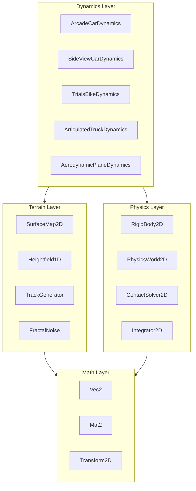
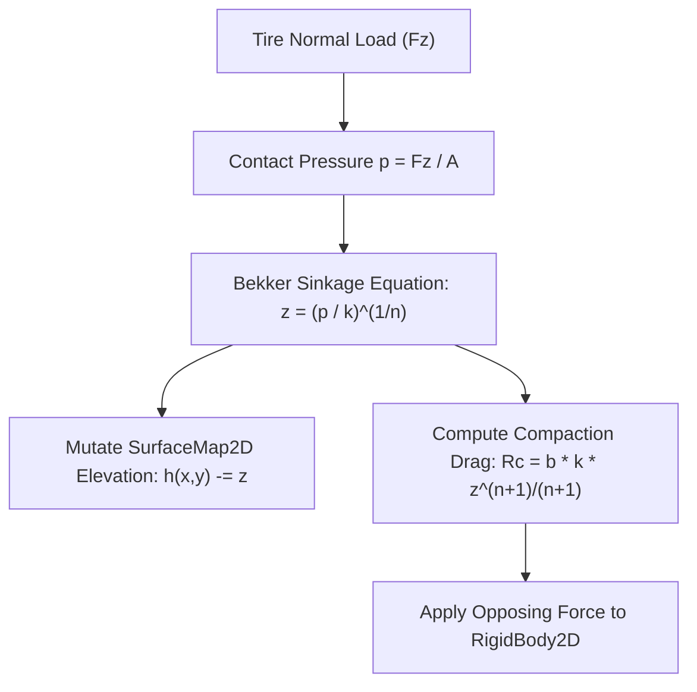
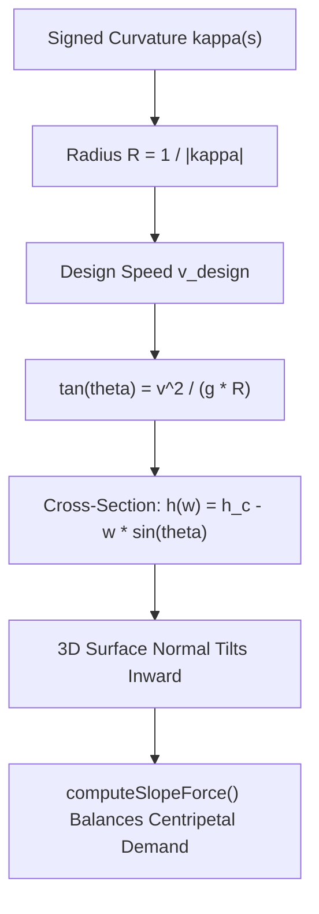
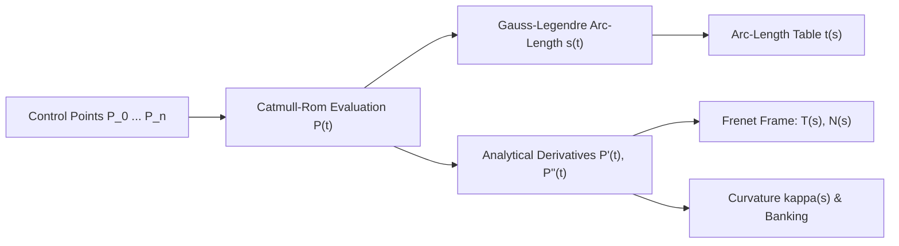
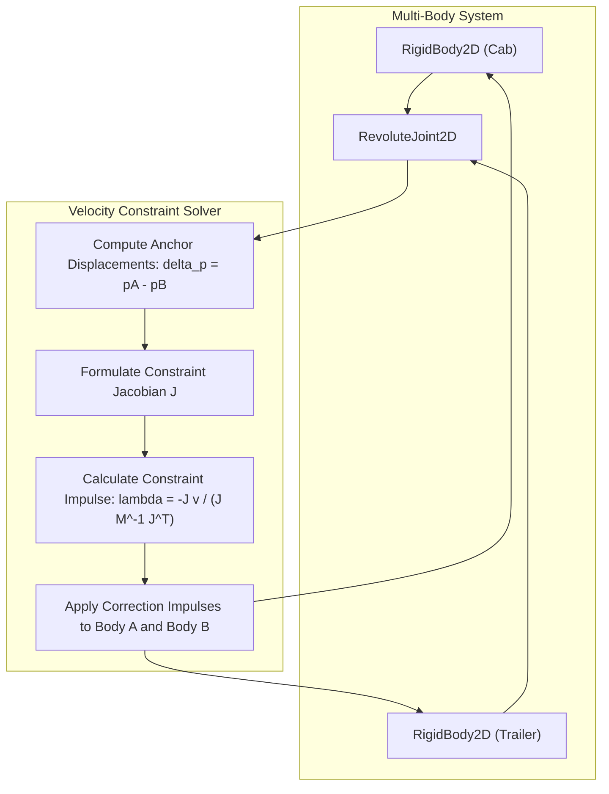

# VehicleSimCore - Proposed Features Specification

## 1. Overview and Architecture Context

`VehicleSimCore` is a standalone, deterministic 2D vehicle simulation engine implemented in pure C++17. It maintains zero external physics engine dependencies and targets cross-platform portability (Linux and Windows) with strict IEEE 754 floating-point compliance.

The library is organized into four modular layers:
- **Math Layer**: Linear algebra, spatial transforms, and vector primitives ([libs/VehicleSimCore/math/Vec2.h](../libs/VehicleSimCore/math/Vec2.h), [libs/VehicleSimCore/math/Mat2.h](../libs/VehicleSimCore/math/Mat2.h), [libs/VehicleSimCore/math/Transform2D.h](../libs/VehicleSimCore/math/Transform2D.h)).
- **Physics Layer**: Rigid body dynamics, Symplectic Euler integration, and impulse-based contact response ([libs/VehicleSimCore/physics/RigidBody2D.h](../libs/VehicleSimCore/physics/RigidBody2D.h), [libs/VehicleSimCore/physics/Integrator2D.h](../libs/VehicleSimCore/physics/Integrator2D.h), [libs/VehicleSimCore/physics/ContactSolver2D.h](../libs/VehicleSimCore/physics/ContactSolver2D.h), [libs/VehicleSimCore/physics/PhysicsWorld2D.h](../libs/VehicleSimCore/physics/PhysicsWorld2D.h)).
- **Terrain Layer**: Continuous 1D heightfields, 2D elevation/material maps, procedural multi-octave gradient and fractal noise, and procedural course synthesizers ([libs/VehicleSimCore/terrain/Heightfield1D.h](../libs/VehicleSimCore/terrain/Heightfield1D.h), [libs/VehicleSimCore/terrain/SurfaceMap2D.h](../libs/VehicleSimCore/terrain/SurfaceMap2D.h), [libs/VehicleSimCore/terrain/TrackGenerator.h](../libs/VehicleSimCore/terrain/TrackGenerator.h)).
- **Dynamics Layer**: Specialized vehicle dynamics coordinators implementing [IVehicleDynamics](../libs/VehicleSimCore/dynamics/IVehicleDynamics.h) for top-down, side-view, marine, and aeronautical vehicles.

```
+-----------------------------------------------------------------------------------------------+
|                                  VehicleSimCore Architecture                                  |
+-----------------------------------------------------------------------------------------------+
|                                       Dynamics Layer                                          |
|  ArcadeCar | SideViewCar | TrialsBike | ArticulatedTruck | Tank | Plane | Helicopter | Sub ...|
+-------------------------------+-------------------------------+-------------------------------+
|         Physics Layer         |         Terrain Layer         |          Math Layer           |
|  RigidBody2D                  |  SurfaceMap2D                 |  Vec2                         |
|  Integrator2D                 |  Heightfield1D                |  Mat2                         |
|  ContactSolver2D              |  TrackGenerator               |  Transform2D                  |
|  PhysicsWorld2D               |  FractalNoise / GradientNoise  |  (IEEE 754 Determinism)       |
+-------------------------------+-------------------------------+-------------------------------+
```



This specification details proposed architectural and algorithmic enhancements across **Terrain**, **Mathematics**, and **Physics**.

---

## 2. Terrain Systems

### 2.1 Soil Mechanics and Deformable Surface Rutting (Bekker-Wong Model)

#### Objective
Enable physical plastic and elastic deformation of deformable terrain (mud, sand, soft dirt, snow) caused by tire contact forces, leaving permanent or viscoelastic wheel ruts.

#### Technical Formulation
- **Sinkage Model**: Based on the semi-empirical Bekker pressure-sinkage relationship:
  $$p = \left( \frac{k_c}{b} + k_\phi \right) z^n$$
  where:
  - $p$: Ground contact pressure ($F_z / A$).
  - $b$: Wheel contact patch smaller dimension (width).
  - $k_c, k_\phi, n$: Moduli of soil cohesion and friction deformation.
  - $z$: Wheel penetration/sinkage depth into soil.
- **Rut Drag Force**: Soil compaction resistance force opposing vehicle motion:
  $$R_c = b \left( \frac{k_c}{b} + k_\phi \right) \frac{z^{n+1}}{n+1}$$
- **Terrain Elevation Mutation**:
  - In [SurfaceMap2D](../libs/VehicleSimCore/terrain/SurfaceMap2D.h), wheel positions depress the grid height at $(x, y)$ while slightly mounding adjacent cells (soil displacement conservation).
  - Integrates with [SurfaceMaterial](../libs/VehicleSimCore/terrain/SurfaceMaterial.h) via new properties: `compactionModulus`, `sinkageExponent`, and `maxPlasticDeformation`.

```
  ASCII Diagram: Tire Sinkage and Soil Rut Formation
  
          Tire Vertical Load (Fz)
                   |
                   v
              .---------.
             /     |     \
            |    [Hub]    |
             \     |     /
           ---'----+----'---  <- Original Surface Elevation h0
           \               /
            \  Rut Depth  /   <- Depressed Elevation h = h0 - z
             '-----------'
             ======|======    <- Compacted Soil Layer (Resisting Force Rc)
```



---

### 2.2 Cambered / Banked Tracks and Superelevation (Implemented)

#### Objective
Add transversal road banking (superelevation) to [TrackGenerator](../libs/VehicleSimCore/terrain/TrackGenerator.h) and [SurfaceMap2D](../libs/VehicleSimCore/terrain/SurfaceMap2D.h) along curved ribbon sections. Implemented via [BankedTrack.h](../libs/VehicleSimCore/terrain/BankedTrack.h) and [BankedTrackProfile](../libs/VehicleSimCore/terrain/BankedTrack.h).

#### Technical Formulation
- **Theoretical Superelevation**:
  $$\tan(\theta_{\text{design}}) = \frac{v_{\text{design}}^2}{g \cdot R}$$
  where $R$ is track curve radius of curvature ($1 / \kappa$) and $v_{\text{design}}$ is target cornering velocity.
- **Cross-Section Profile**:
  Given centerline coordinate $\mathbf{C}(s)$ and unit lateral normal $\mathbf{n}_{\text{lat}}(s)$, the elevation at lateral offset $w \in [-W/2, W/2]$ becomes:
  $$h(s, w) = h_{\text{center}}(s) + w \cdot \sin(\theta(s))$$
- **Surface Normal Update**: Tilts the 3D upward surface normal $\mathbf{N} = (n_x, n_y, n_z)$ inward towards the curve apex, naturally balancing centripetal acceleration and preventing vehicle slide.

```
  ASCII Diagram: Banked Track Cross-Section & Force Equilibrium

                     Outer Retaining Wall
                             .-----------------------+
                            /                       /|
                           /  Outer Edge           / |
                          /                       /  |
                         /       [Vehicle]       /   |
                        /         /  |          /    |
                       /    F_N  /   | F_g     /     |   Road Ribbon Width W
                      /         v    v        /      |
                     /                       /       |
                    /       Centerline C(s) /        |
                   /               *       /         |
                  /                       /          |
                 /  Inner Edge           /           |
                +-----------------------+            |
   -------------+------------------------------------+---------------------> Lateral Axis (w)
               -W/2                     0           +W/2
```



---

### 2.3 Dynamic Shallow Water and Wave Propagation (1D/2D)

#### Objective
Provide a real-time wave height perturbation simulation for watercraft, amphibious hovercraft, and submarine surface interactions.

#### Technical Formulation
- **Wave PDE (Discrete 2D Wave Grid)**:
  $$\frac{\partial^2 h}{\partial t^2} = c^2 \left( \frac{\partial^2 h}{\partial x^2} + \frac{\partial^2 h}{\partial y^2} \right) - \gamma \frac{\partial h}{\partial t}$$
  where $c$ is shallow water wave speed ($\sqrt{g \cdot d}$) and $\gamma$ is viscous damping.
- **Two-Way Coupling**:
  - Vehicle wakes deposit vertical momentum impulses: $\Delta v_z \propto \text{displacement} \cdot v_{\text{hull}}$.
  - Dynamic fluid pressure exerts buoyant and tilting torques on floating [RigidBody2D](../libs/VehicleSimCore/physics/RigidBody2D.h) instances.

---

### 2.4 Deterministic Object and Hazard Scattering (Blue-Noise / Poisson Disk)

#### Objective
Deterministically seed track hazards (rocks, oil patches, boost pads, puddles, cones) along course segments without spatial collisions or unnatural clustering.

#### Technical Formulation
- **Bridson Poisson-Disk Algorithm**:
  - Enforces minimum spacing $r_{\text{min}}$ between adjacent scattered obstacles.
  - Generates candidates in an annular ring $[r_{\text{min}}, 2r_{\text{min}}]$ around existing samples.
  - Spatial hash grid lookup guarantees $O(N)$ execution time.
- **Track-Aware Seeding**:
  - Restricts obstacle placement to drivable ribbon or runoff shoulders using distance-to-centerline metrics from [CircuitTrack2D](../libs/VehicleSimCore/terrain/TrackGenerator.h#L138-L167).

---

## 3. Mathematics and Geometric Computing

### 3.1 Parametric Spline Curves (`Spline2D` / `CatmullRom2D`) (Implemented)

#### Objective
Replace piecewise linear track approximations with continuous, analytically differentiable $C^1$ and $C^2$ 2D parametric curves.

#### Implementation Details
Implemented via [Spline2D.h](../libs/VehicleSimCore/math/Spline2D.h) and [Spline2D.cpp](../libs/VehicleSimCore/math/Spline2D.cpp):
1. **Centripetal Catmull-Rom Splines**:
   - Knot parameterization $t_{i+1} = t_i + \|\mathbf{P}_{i+1} - \mathbf{P}_i\|^\alpha$ with `SplineKnotMode`:
     - `SplineKnotMode::Centripetal` ($\alpha = 0.5$) to eliminate cusps and self-intersections.
     - `SplineKnotMode::Uniform` ($\alpha = 0.0$) and `SplineKnotMode::Chordal` ($\alpha = 1.0$) for specialized interpolation needs.
   - Supports both open and closed continuous loops.
2. **Arc-Length Parameterization**:
   - Monotonic cumulative arc-length lookup table $s(t)$ evaluated via 5-point Gauss-Legendre numerical quadrature per segment.
   - Fast inverse mapping $t(s)$ via binary search and linear interpolation allows constant-speed vehicle path traversal and exact milestone checkpoint placement.
   - Sample by distance query via `sampleByDistance(double distance)`.
3. **Frenet-Serret Frame and Curvature**:
   - Analytical first derivative $\mathbf{P}'(t)$ (`velocity`) and second derivative $\mathbf{P}''(t)$ (`acceleration`).
   - Unit forward tangent: $\mathbf{T}(t) = \frac{\mathbf{P}'(t)}{\|\mathbf{P}'(t)\|}$.
   - Unit upward/lateral normal: $\mathbf{N}(t) = \mathbf{T}(t)^\perp = (-T_y, T_x)$.
   - Signed curvature:
     $$\kappa(t) = \frac{x'(t)y''(t) - y'(t)x''(t)}{(x'(t)^2 + y'(t)^2)^{3/2}}$$
4. **Closest Point Projection**:
   - `getClosestPoint(const Vec2& point)` computes closest point on curve, orthogonal distance, arc-length, parameter $t$, and signed lateral offset (left/right).
   - Results returned in [SplineSample2D](../libs/VehicleSimCore/math/Spline2D.h#L22-L30) and [SplineClosestPoint](../libs/VehicleSimCore/math/Spline2D.h#L34-L40) structs.
- Verified in [Spline2DTest.cpp](../tests/Spline2DTest.cpp).

```
  ASCII Diagram: Frenet-Serret Frame and Curvature on Spline2D
  
                ^ Unit Normal N(s)
                |
                |   .---* P(s) ---.
                |  /               \
                | /                 \
    ------------+'--------------------> Unit Tangent T(s)
                 \
                  \  Radius of Curvature R = 1 / kappa
                   ' -> [ Center of Curvature ]
```



---

### 3.2 2D Geometric Primitives and Intersection Solvers (Implemented)

#### Objective
Provide standard bounding volumes and primitive collision queries for broadphase filtering, shape queries, and narrowphase contact generation.

#### Implemented Primitives
- [AABB2D](../libs/VehicleSimCore/math/AABB2D.h) / [AABB2D.cpp](../libs/VehicleSimCore/math/AABB2D.cpp):
  - Axis-aligned bounding box defined by `min` and `max` corner vectors.
  - Operations: `contains(Vec2)`, `intersects(AABB2D)`, `expand(double)`, `merge(AABB2D)`, `raycast(Ray2D)`.
- [OBB2D](../libs/VehicleSimCore/math/OBB2D.h) / [OBB2D.cpp](../libs/VehicleSimCore/math/OBB2D.cpp):
  - Oriented bounding box defined by `center`, `halfExtents`, and orientation `rotation` angle.
  - Operations: 4 world-space corners evaluation, Separating Axis Theorem (SAT) 1D axis projections, `contains(Vec2)`, `closestPoint(Vec2)`, `toAABB()`.
- [Circle2D](../libs/VehicleSimCore/math/Circle2D.h) / [Circle2D.cpp](../libs/VehicleSimCore/math/Circle2D.cpp):
  - 2D circle primitive defined by `center` position and `radius`.
  - Operations: `contains(Vec2)`, `closestPoint(Vec2)`, `distanceTo(Vec2)`, `toAABB()`.
- [Capsule2D](../libs/VehicleSimCore/math/Capsule2D.h) / [Capsule2D.cpp](../libs/VehicleSimCore/math/Capsule2D.cpp):
  - Line segment backbone defined by endpoints `pointA`, `pointB`, and `radius`.
  - Operations: segment closest-point projection, `contains(Vec2)`, `distanceTo(Vec2)`, `toAABB()`.
  - Ideal for vehicle chassis approximations and rounded tire bounds.
- [Polygon2D](../libs/VehicleSimCore/math/Polygon2D.h) / [Polygon2D.cpp](../libs/VehicleSimCore/math/Polygon2D.cpp):
  - Convex polygon defined by counter-clockwise ordered vertices with fixed-capacity MISRA-compliant storage (up to 8 vertices) or dynamic vector.
  - Operations: SAT edge normal projections, point containment, closest point projection, centroid, signed area, and transformed vertices.
  - Factory: `fromEllipse(Vec2 center, double a, double b, double rotation, std::size_t segments)` to approximate aerodynamic hulls, oval obstacles, and deformed tires with exact $O(N)$ SAT support.
- [CompoundShape2D](../libs/VehicleSimCore/physics/CompoundShape2D.h) / [CompoundShape2D.cpp](../libs/VehicleSimCore/physics/CompoundShape2D.cpp):
  - Multi-primitive compound volume aggregating multiple child primitives (`OBB2D`, `Circle2D`, `Capsule2D`) with relative local transforms (`Transform2D`).
  - Enables complex vehicle body hulls (e.g., stepped truck cabs, trailers with wheel wells, articulated hulls) via multi-box decomposition and unified bounding AABB computation.
- [Ray2D](../libs/VehicleSimCore/math/Ray2D.h) / [Ray2D.cpp](../libs/VehicleSimCore/math/Ray2D.cpp):
  - Origin point $\mathbf{o}$, unit direction $\mathbf{d}$, and maximum range $L$.
  - Returns `RayHit2D` containing hit status, distance, hit coordinates, and unit normal.
- Verified in [MathTest.cpp](../tests/MathTest.cpp) and [NarrowphaseTest.cpp](../tests/NarrowphaseTest.cpp).

```
  ASCII Diagram: Ellipse Approximation via Polygon2D & Multi-OBB Compound
  
         Polygon2D (8-Vertex Ellipse Approximation)           CompoundShape2D (Multi-OBB Chassis)
                        v2       v3                                    +-----------------------+
                     .---*-------*---.                                 |      Cab OBB (Box 1)  |
                 v1 /                 \ v4                             +-----------------------+
                   *                   *                               |      Main Bed OBB     |
                   |      Center       |               ===>            |      (Box 2)          |
                   *                   *                               +-----------------------+
                 v0 \                 / v5                             | Sub-chassis   (Box 3) |
                     '---*-------*---'                                 +-----------------------+
                        v7       v6
```


---

### 3.3 Angle and Trigonometric Library (`Angle2D`) (Implemented)

#### Objective
Eliminate redundant, error-prone manual angle wrapping and quadrant tests throughout vehicle controllers and physics coordinators.

#### Implementation Details
Implemented via [Angle2D.h](../libs/VehicleSimCore/math/Angle2D.h) and [Angle2D.cpp](../libs/VehicleSimCore/math/Angle2D.cpp):
- Represents planar angles in radians normalized to the IEEE 754 principal domain $[-\pi, \pi)$ via branchless arithmetic.
- **Factory Constructors**:
  - `Angle2D::fromRadians(double radians)`: Wraps input radians to $[-\pi, \pi)$.
  - `Angle2D::fromDegrees(double degrees)`: Converts degrees to radians and normalizes.
  - `Angle2D::fromVector(const Vec2& vec)`: Computes atan2 $(y, x)$ direction angle.
  - `Angle2D::zero()` and `Angle2D::pi()`: Canonical constant instances.
- **Trigonometric & Interpolation Utilities**:
  - `normalizeRad(double angle)`: Normalizes arbitrary angle to $[-\pi, \pi)$.
  - `deltaAngle(double from, double to)`: Computes minimal signed difference in $[-\pi, \pi)$.
  - `lerpAngle(double a, double b, double t)`: Performs shortest-path circular linear interpolation.
  - `slerp2D(const Vec2& a, const Vec2& b, double t)`: Spherical vector interpolation.
  - `headingToVector()`: Computes unit direction vector $(\cos(\theta), \sin(\theta))$.
- Fully verified under [MathTest.cpp](../tests/MathTest.cpp).

---

### 3.4 Control Theory and Signal Processing Utilities (Implemented)

#### Objective
Standardize feedback control, sensor filtering, and optimal kinematic state estimation for vehicle dynamics and autopilots.

#### Implemented Classes
- [PIDController](../libs/VehicleSimCore/math/PIDController.h):
  - Proportional, Integral, and Derivative gains ($K_p, K_i, K_d$).
  - Anti-windup clamping on the integral accumulator and conditional integration under output saturation.
  - Low-pass derivative filtering with configurable time constant $T_f$.
  - Derivative-on-measurement mode to eliminate setpoint step derivative kicks.
  - Ideal for cruise control, lane centering, and helicopter altitude holding.
- [SlewRateLimiter](../libs/VehicleSimCore/math/SlewRateLimiter.h):
  - Limits maximum rate of change ($|dx/dt| \le R_{\text{max}}$) for steering wheels, rudders, and throttles.
  - Supports symmetric and asymmetric rising/falling rate limits.
- [LowPassFilter](../libs/VehicleSimCore/math/LowPassFilter.h):
  - First-order discrete exponential filter ($y_k = \alpha x_k + (1-\alpha) y_{k-1}$) for smoothing noisy inputs.
  - Parameterized by physical -3 dB cutoff frequency in Hertz.
- [KalmanFilter1D](../libs/VehicleSimCore/math/KalmanFilter1D.h):
  - 2-state linear kinematic Kalman observer estimating position and velocity ($\mathbf{x} = [x, v]^T$).
  - Closed-form Bayesian covariance propagation and updates with zero dynamic allocations.
  - Ideal for synthetic sensor fusion, zero-lag derivative estimation, and dead reckoning during sensor dropouts.

---

## 4. Physics and Simulation Mechanics

### 4.1 Rigid Body Joints and Multi-Body Constraints (Implemented)

#### Objective
Equip [PhysicsWorld2D](../libs/VehicleSimCore/physics/PhysicsWorld2D.h) with an impulse-based constraint solver to support multi-body vehicle assemblies (trailers, suspension swingarms, chassis linkages).

#### Implementation Details
Implemented via [Joint2D.h](../libs/VehicleSimCore/physics/Joint2D.h), [RevoluteJoint2D.h](../libs/VehicleSimCore/physics/RevoluteJoint2D.h), and [DistanceJoint2D.h](../libs/VehicleSimCore/physics/DistanceJoint2D.h):
1. **[RevoluteJoint2D](../libs/VehicleSimCore/physics/RevoluteJoint2D.h) (Pin / Hinge)**:
   - Constrains two anchor points on distinct bodies to coincide: $\mathbf{x}_A + \mathbf{R}_A \mathbf{r}_A = \mathbf{x}_B + \mathbf{R}_B \mathbf{r}_B$.
   - Enforces 2-DOF translational coincidence using an analytical $2 \times 2$ effective mass matrix:
     $$\mathbf{K} = (m_A^{-1} + m_B^{-1})\mathbf{I}_2 - \mathbf{r}_A^\perp I_A^{-1} (\mathbf{r}_A^\perp)^T - \mathbf{r}_B^\perp I_B^{-1} (\mathbf{r}_B^\perp)^T$$
   - Optional angular motor and joint angle limits $[\theta_{\text{min}}, \theta_{\text{max}}]$ with clamping and accumulated limit impulses.
   - Direct fit for [ArticulatedTruckDynamics](../libs/VehicleSimCore/dynamics/ArticulatedTruckDynamics.h) fifth-wheel kingpin coupling.
2. **[DistanceJoint2D](../libs/VehicleSimCore/physics/DistanceJoint2D.h)**:
   - Enforces fixed distance between two body anchor points ($L_{\text{target}}$).
   - Computes effective scalar mass along unit separation axis $\mathbf{u} = (\mathbf{p}_B - \mathbf{p}_A) / \|\mathbf{p}_B - \mathbf{p}_A\|$.
   - Enforces bilateral velocity and position constraint correction.
3. **Solver Integration in [PhysicsWorld2D](../libs/VehicleSimCore/physics/PhysicsWorld2D.h)**:
   - Solved in three distinct phases per simulation step:
     - `initVelocityConstraints()`: Updates rotation matrices, anchor offsets, effective mass inverses, and applies warm-starting impulses.
     - `solveVelocityConstraints()`: Solves velocity correction impulses iteratively for joints and contact manifolds.
     - `solvePositionConstraints()`: Non-linear position correction to eliminate Baumgarte numerical drift without adding artificial kinetic energy.
- Prospective extensions (`PrismaticJoint2D`, `SpringDamperJoint2D`) can inherit from `Joint2D` without modifying the core solver loop.
- Fully verified in [JointTest.cpp](../tests/JointTest.cpp).

```
  ASCII Diagram: Revolute Joint Coupling in PhysicsWorld2D
  
   +-----------------------+                    +-----------------------+
   |      RigidBody A      |                    |      RigidBody B      |
   |      (Tractor Cab)    |    RevoluteJoint   |      (Cargo Trailer)  |
   |                       |                    |                       |
   |         Anchor A (rA) *====[ Pin Hinge ]===* Anchor B (rB)         |
   +-----------------------+                    +-----------------------+
```



---

### 4.2 Narrowphase Collision Detection and Manifold Generator (Implemented)

#### Objective
Automate contact generation between rigid bodies and terrain, directly driving [ContactSolver2D](../libs/VehicleSimCore/physics/ContactSolver2D.h).

#### Implementation Details
- **Shape Support**: Circle, OBB, Capsule, Convex Polygon (`Polygon2D`), and Compound Volumes (`CompoundShape2D` / Multi-OBB compounds).
- **Narrowphase Algorithms**:
  - `Circle` vs `Circle`: Distance comparison between center positions.
  - `Circle` vs `OBB`: Clamp circle center to box half-extents in local frame.
  - `OBB` vs `OBB` / `Polygon2D` vs `Polygon2D`: Separating Axis Theorem (SAT) with edge-clipping manifold generation.
  - `CompoundShape2D`: Child primitive traversal and aggregated contact manifold generation.
  - `Body` vs `Heightfield1D`: Segment intersection tests against terrain polygonal profile.
- Output formats directly into [Contact2D](../libs/VehicleSimCore/physics/ContactSolver2D.h#L8-L17) structs (contact point, unit normal, penetration depth, combined friction/restitution).
- Detailed specification and architecture: [Narrowphase Implementation Plan](NarrowphaseImplementationPlan.md).

---

### 4.3 Semi-Empirical Pacejka 'Magic Formula' Tire Model

#### Objective
Upgrade vehicle traction models from linear cornering stiffness to non-linear tire slip saturation.

#### Mathematical Model
$$F(\sigma) = D \sin\left(C \arctan\left(B\sigma - E(B\sigma - \arctan(B\sigma))\right)\right)$$
where:
- $\sigma$: Slip parameter (longitudinal slip ratio $\kappa$ or lateral slip angle $\alpha$).
- $B$: Stiffness factor.
- $C$: Shape factor.
- $D = \mu \cdot F_z$: Peak friction force scaling with vertical load $F_z$.
- $E$: Curvature factor governing post-peak drop-off.
- **Combined Slip Ellipse**: Couples longitudinal acceleration and lateral cornering demand:
  $$\left(\frac{F_x}{F_{x,\text{max}}}\right)^2 + \left(\frac{F_y}{F_{y,\text{max}}}\right)^2 \le 1.0$$

---

### 4.4 Environmental Fluid Vector Fields (Wind and Ocean Currents) (Implemented)

#### Objective
Model environmental aerodynamic and hydrodynamic forces across airspace and waterways affecting planes, rockets, trucks, and watercraft.

#### Implementation Details
Implemented via [FluidField2D.h](../libs/VehicleSimCore/physics/FluidField2D.h) and [FluidDrag2D.h](../libs/VehicleSimCore/physics/FluidDrag2D.h):
1. **Spatial Environmental Field ([FluidField2D](../libs/VehicleSimCore/physics/FluidField2D.h))**:
   - Continuous vector field $\mathbf{V}_{\text{fluid}}(x, y, t) = \mathbf{V}_{\text{ambient}} + \mathbf{V}_{\text{shear}}(y) + \mathbf{V}_{\text{gust}}(x, y, t)$.
   - Configurable waterline boundary $y_{\text{water}}$ separating gaseous atmosphere ($\rho_{\text{air}} = 1.225\,\text{kg/m}^3$) and water domain ($\rho_{\text{water}} = 1025.0\,\text{kg/m}^3$).
   - Atmospheric power-law wind shear profile:
     $$v_x(y) = v_{\text{ambient}} \left(\frac{y}{y_{\text{ref}}}\right)^\alpha \quad (y > 0)$$
   - Subsurface ocean current depth decay:
     $$v_x(y) = v_{\text{surface}} \exp\left(\frac{y - y_{\text{water}}}{D_{\text{decay}}}\right) \quad (y \le y_{\text{water}})$$
   - Deterministic transient 1-cosine discrete gust pulses ([DiscreteGust2D](../libs/VehicleSimCore/physics/FluidField2D.h#L27-L35)) conforming to FAA/MIL standards:
     $$\Delta v(t) = \frac{A}{2} \left(1 - \cos\left(\frac{2\pi (t - t_0)}{T}\right)\right)$$
   - Harmonic turbulence wave superpositions ([HarmonicGust2D](../libs/VehicleSimCore/physics/FluidField2D.h#L37-L44)).
2. **Aerodynamic & Hydrodynamic Force Evaluator ([FluidDrag2D](../libs/VehicleSimCore/physics/FluidDrag2D.h))**:
   - Evaluates relative velocity: $\mathbf{V}_{\text{rel}} = \mathbf{V}_{\text{body}} - \mathbf{V}_{\text{fluid}}(x, y, t)$.
   - Quadratic form drag:
     $$\mathbf{F}_{\text{drag}} = -\frac{1}{2}\rho C_d A \|\mathbf{V}_{\text{rel}}\| \mathbf{V}_{\text{rel}}$$
   - Crosswind lateral side forces and overturning moments on high-profile vehicles ([ArticulatedTruckDynamics](../libs/VehicleSimCore/dynamics/ArticulatedTruckDynamics.h), [AerodynamicPlaneDynamics](../libs/VehicleSimCore/dynamics/AerodynamicPlaneDynamics.h)) computed via body-frame projection and center-of-pressure offset:
     $$\tau_{\text{yaw}} = F_{\text{side}} \cdot d_{\text{cp}}$$
- Fully verified in [FluidFieldTest.cpp](../tests/FluidFieldTest.cpp).

---

## 5. Architectural Roadmap and Priority Matrix

| Feature | Subsystem | Complexity | Dependencies | Primary Use Cases |
| :--- | :--- | :--- | :--- | :--- |
| **Angle2D & Math Utilities (Implemented)** | Math | Low | None | All Dynamics coordinators ([Angle2D.h](../libs/VehicleSimCore/math/Angle2D.h)) |
| **Spline2D & Catmull-Rom (Implemented)** | Math | Medium | `Vec2`, `Mat2` | `CircuitTrack2D`, Waypoint navigation ([Spline2D.h](../libs/VehicleSimCore/math/Spline2D.h)) |
| **AABB2D, Ray2D, OBB2D, Polygon2D (Implemented)** | Math | Medium | `Vec2`, `Transform2D` | Broadphase and collision detection ([Polygon2D.h](../libs/VehicleSimCore/math/Polygon2D.h)) |
| **PIDController, Filters & Kalman (Implemented)** | Math | Low | None | Autopilots, cruise control, sensor fusion ([PIDController.h](../libs/VehicleSimCore/math/PIDController.h)) |
| **Revolute & Distance Joints (Implemented)** | Physics | High | `RigidBody2D`, `PhysicsWorld2D` | `ArticulatedTruckDynamics`, suspensions ([RevoluteJoint2D.h](../libs/VehicleSimCore/physics/RevoluteJoint2D.h)) |
| **Narrowphase Collision (Implemented)** | Physics | High | `AABB2D`, `OBB2D`, `Polygon2D`, `Contact2D` | [Narrowphase Plan](NarrowphaseImplementationPlan.md) - Automated body & terrain collisions |
| **Pacejka Tire Model** | Dynamics / Physics | Medium | `SurfaceMaterial` | Realistic wheeled dynamics (`ArcadeCar`, etc.) |
| **Deformable Rutting** | Terrain | Medium | `SurfaceMap2D`, `SurfaceMaterial` | Off-road tanks, monster trucks in mud/snow |
| **Banked / Cambered Tracks (Implemented)** | Terrain | Medium | `TrackGenerator`, `SurfaceMap2D` | High-speed racing circuits ([BankedTrack.h](../libs/VehicleSimCore/terrain/BankedTrack.h)) |
| **Environmental Wind / Water (Implemented)** | Physics | Low | `Vec2` | Planes, rockets, trucks, boats, subs ([FluidField2D.h](../libs/VehicleSimCore/physics/FluidField2D.h)) |
| **Earth Patrol (3-Axle Rover & SDL Game) (Implemented)** | Dynamics / App | Medium | `EarthRoverDynamics`, `Heightfield1D`, SDL2 | [Earth Patrol Plan](EarthPatrolImplementationPlan.md) - Moon Patrol style side-scroller on Earth ([apps/EarthPatrol](../apps/EarthPatrol)) |

---

## 6. Compliance and Coding Standards

All future implementations must comply with:
- **Language Standard**: Pure ISO C++17 (`-std=c++17` on GCC/Clang, `/std:c++17` on MSVC).
- **Zero External Dependencies**: Zero third-party physics engines; all algorithms self-contained in `VehicleSimCore`.
- **MISRA C++:2023 & SEI CERT C++**: No raw pointer memory ownership, RAII throughout, zero dynamic casts, explicit braces `{}` initialization.
- **Floating-Point Determinism**: IEEE 754 compliance across Linux and Windows platforms.
- **Documentation**: Triple-slash `///` Doxygen blocks with `@brief`, `@details`, `@param`, `@return` on all public APIs.
