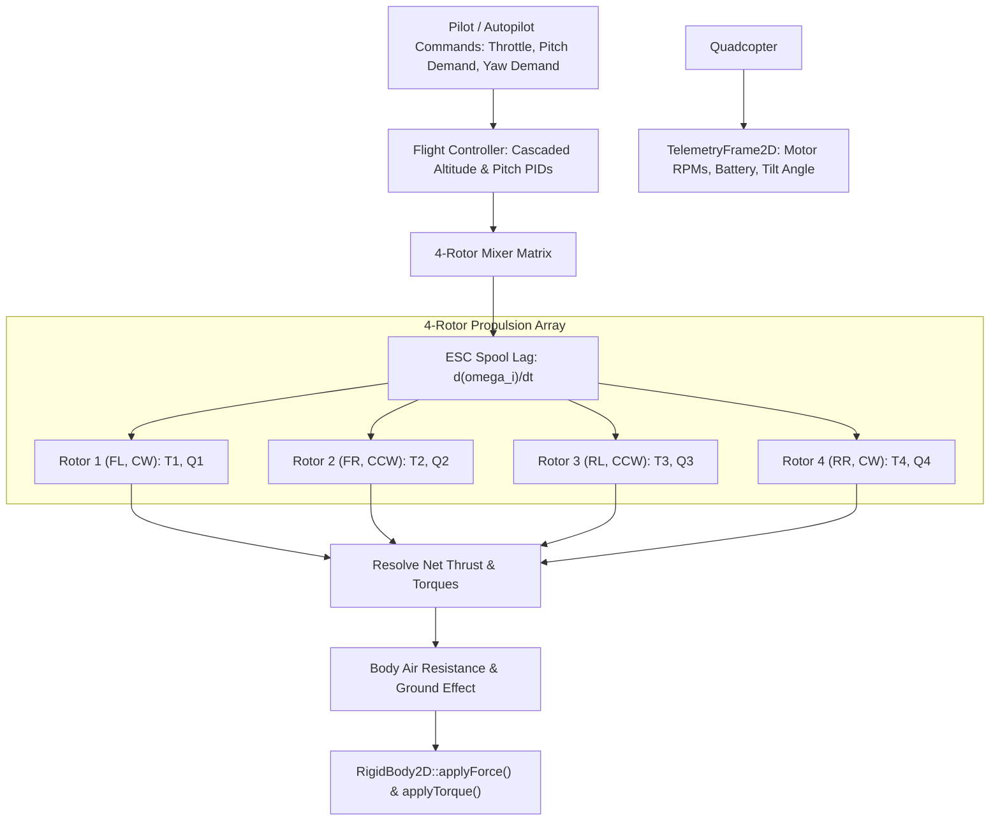

# QuadcopterDroneDynamics: C++17 Implementation Plan

## 1. Executive Summary & Scope

### 1.1 Objective & Context
This specification establishes the mathematical foundations, software architecture, data contracts, and verification procedures for **`QuadcopterDroneDynamics`** in `VehicleSimCore`.

While `VehicleSimCore` supports fixed-wing aircraft in [AerodynamicPlaneDynamics](../libs/VehicleSimCore/dynamics/AerodynamicPlaneDynamics.h) and single-main-rotor helicopters in [HelicopterDynamics](../libs/VehicleSimCore/dynamics/HelicopterDynamics.h), it currently lacks a dedicated **multi-rotor aerial robotics model**.

Multi-rotor quadcopters differ fundamentally from conventional aircraft:
1. **Four-Rotor Differential Thrust Mixer**: Thrust and attitude moments are generated solely by differential rotor speeds ($\omega_1, \omega_2, \omega_3, \omega_4$). There are no aerodynamic control surfaces (ailerons/rudders).
2. **Gyroscopic & Anti-Torque Cancellation**: Alternating clockwise (CW) and counter-clockwise (CCW) motor pairs cancel aerodynamic drag torque in hover. Yaw rotation is achieved by spooling up CW motors while throttling down CCW motors (or vice-versa), preserving net lift while producing a net reactionary torque.
3. **Cascaded Closed-Loop Flight Stabilization**: Quadcopters are inherently open-loop unstable. Real-world flight controllers execute high-frequency inner rate loops coupled with outer angle/attitude loops (utilizing [PIDController](../libs/VehicleSimCore/math/PIDController.h)).
4. **Aerodynamic Drag & Blade Flapping**: Translational flight experiences induced drag and aerodynamic resistance proportional to body airspeed.

`QuadcopterDroneDynamics` implements [IVehicleDynamics](../libs/VehicleSimCore/dynamics/IVehicleDynamics.h) with pure C++17, deterministic IEEE 754 arithmetic, and zero runtime heap allocations.

---

### 1.2 Mathematical Formulation

#### 1. Rotor Thrust and Torque Models
For each motor $i \in \{1, 2, 3, 4\}$ with angular speed $\omega_i \in [0, \omega_{\text{max}}]$:
- Individual Thrust Force:
  $$T_i = k_t \cdot \omega_i^2$$
  where $k_t$ is the rotor thrust coefficient ($[\text{N} / (\text{rad/s})^2]$).
- Individual Aerodynamic Drag Torque:
  $$Q_i = k_q \cdot \omega_i^2$$
  where $k_q$ is the rotor torque coefficient ($[\text{N}\cdot\text{m} / (\text{rad/s})^2]$).

Motor spin directions:
- Rotors 1 (Front-Left) and 4 (Rear-Right): Clockwise (CW), spin direction $\sigma_i = +1$.
- Rotors 2 (Front-Right) and 3 (Rear-Left): Counter-Clockwise (CCW), spin direction $\sigma_i = -1$.

#### 2. Quadcopter 'X' Configuration Mixer Matrix
Let $d$ be the arm length from the center of gravity to each rotor center. In the standard quadcopter 'X' configuration:
- Rotor 1 (Front-Left): position $(+d/\sqrt{2}, -d/\sqrt{2})$, CW
- Rotor 2 (Front-Right): position $(+d/\sqrt{2}, +d/\sqrt{2})$, CCW
- Rotor 3 (Rear-Left): position $(-d/\sqrt{2}, -d/\sqrt{2})$, CCW
- Rotor 4 (Rear-Right): position $(-d/\sqrt{2}, +d/\sqrt{2})$, CW

The total thrust and generalized control moments are governed by:
$$\begin{bmatrix} T_{\text{total}} \\ \tau_{\text{roll}} \\ \tau_{\text{pitch}} \\ \tau_{\text{yaw}} \end{bmatrix} = \begin{bmatrix} 1 & 1 & 1 & 1 \\ \frac{d}{\sqrt{2}} & -\frac{d}{\sqrt{2}} & \frac{d}{\sqrt{2}} & -\frac{d}{\sqrt{2}} \\ -\frac{d}{\sqrt{2}} & -\frac{d}{\sqrt{2}} & \frac{d}{\sqrt{2}} & \frac{d}{\sqrt{2}} \\ k_q/k_t & -k_q/k_t & -k_q/k_t & k_q/k_t \end{bmatrix} \begin{bmatrix} T_1 \\ T_2 \\ T_3 \\ T_4 \end{bmatrix}$$

In 2D vehicle simulation (pitch and vertical altitude motion):
$$\mathbf{F}_{\text{thrust}} = T_{\text{total}} \begin{bmatrix} -\sin(\theta) \\ \cos(\theta) \end{bmatrix}$$
$$\tau_{\text{pitch}} = \frac{d}{\sqrt{2}} (T_3 + T_4 - T_1 - T_2)$$

#### 3. Motor Dynamics & Time Constant
Motors exhibit physical inertia and Electronic Speed Controller (ESC) lag. Motor target speeds $\omega_{\text{cmd},i}$ are filtered using a first-order lag with time constant $\tau_{\text{esc}}$:
$$\frac{d\omega_i}{dt} = \frac{\omega_{\text{cmd},i} - \omega_i}{\tau_{\text{esc}}}$$

#### 4. Cascaded Attitude & Altitude Flight Control
The drone flight controller employs cascaded PID loops:
1. **Altitude Controller**: Compares desired climb rate $\dot{z}_{\text{cmd}}$ against current climb rate to compute baseline collective throttle demand $U_{\text{thrust}}$.
2. **Attitude Controller**: Compares pilot tilt angle command $\theta_{\text{cmd}}$ with current body angle $\theta$ to produce desired pitch rate $\dot{\theta}_{\text{des}}$.
3. **Rate Controller**: Evaluates error $(\dot{\theta}_{\text{des}} - \omega)$ to compute pitch torque demand $U_{\text{pitch}}$.

---

## 2. Architecture & Design

### 2.1 Component Structure

```
libs/VehicleSimCore/
└── dynamics/
    ├── QuadcopterDroneDynamics.h   [NEW] - Multi-rotor coordinator header
    ├── QuadcopterDroneDynamics.cpp [NEW] - 4-rotor thrust mixer & flight controller
    ├── IVehicleDynamics.h          [REFERENCED] - Base interface contract
    └── math/
        └── PIDController.h         [REFERENCED] - Attitude and altitude feedback
tests/
└── QuadcopterDroneDynamicsTest.cpp [NEW] - GoogleTest suite validating hover & controls
```

### 2.2 System Architecture Diagrams

```
  ASCII Diagram: Quadcopter 'X' Configuration & Control Flow

         Front
  (1) CW  \       /  (2) CCW       Thrust: T_total = sum(T_i)
           \     /                 Pitch Moment: tau = L * (T_rear - T_front)
            [COG]                  Yaw Torque: tau_z = sum(sigma_i * Q_i)
           /     \
  (3) CCW /       \  (4) CW
          Rear
```



---

## 3. C++17 Header Design

```cpp
#pragma once

#include "IVehicleDynamics.h"
#include "../math/PIDController.h"
#include "../math/Vec2.h"
#include <array>

namespace vehicle_sim::dynamics {

/// @struct QuadcopterConfig
/// @brief Physical configuration for QuadcopterDroneDynamics.
struct QuadcopterConfig {
    double mass{1.5};                ///< All-up drone mass including battery in kg.
    double inertia{0.025};           ///< Moment of inertia in kg*m^2.
    double armLength{0.225};         ///< Distance d from COG to each motor center in m.
    double thrustCoeff{2.9e-5};      ///< Rotor thrust coefficient k_t in N/(rad/s)^2.
    double torqueCoeff{1.1e-6};      ///< Rotor drag torque coefficient k_q in N*m/(rad/s)^2.
    double maxMotorSpeed{2400.0};    ///< Maximum motor angular velocity in rad/s (~23,000 RPM).
    double motorTimeConstant{0.02};  ///< ESC/motor spool-up time constant tau in seconds.
    double linearDragCoeff{0.18};    ///< Translational air resistance coefficient in N/(m/s)^2.
    math::PIDConfig pitchPid{4.5, 0.1, 0.35, -1.0, 1.0};   ///< Pitch attitude PID gains.
    math::PIDConfig altitudePid{2.0, 0.05, 0.8, 0.0, 1.0};  ///< Altitude / climb PID gains.
};

/// @class QuadcopterDroneDynamics
/// @brief 4-rotor multi-copter drone dynamics coordinator.
/// @details Implements differential thrust mixing, aerodynamic rotor drag torque
/// cancellation, ESC response lag, and closed-loop attitude stabilization.
class QuadcopterDroneDynamics final : public IVehicleDynamics {
public:
    /// @brief Constructs QuadcopterDroneDynamics with physical parameters.
    /// @param[in] config Drone physical dimensions, motor constants, and PID gains.
    explicit QuadcopterDroneDynamics(const QuadcopterConfig& config = {}) noexcept;

    /// @brief Advances simulation step, applying thrust and aerodynamic forces.
    /// @param[in,out] body Target rigid body representing the drone frame.
    /// @param[in] dt Timestep duration in seconds.
    void step(physics::RigidBody2D& body, double dt) noexcept override;

    /// @brief Resets PID integrators, motor speeds, and target commands.
    void reset() noexcept override;

    /// @brief Queries whether the drone is currently airborne.
    /// @return True if drone altitude is above ground clearance threshold.
    [[nodiscard]] bool isAirborne() const noexcept override;

    /// @brief Sets normalized collective throttle input.
    /// @param[in] throttle Normalized throttle in range [0.0, 1.0].
    void setThrottle(double throttle) noexcept;

    /// @brief Sets commanded target pitch angle in radians.
    /// @param[in] pitch Target pitch angle (-forward, +backward).
    void setPitchAngle(double pitch) noexcept;

    /// @brief Sets motor arming state.
    /// @param[in] armed True to spin up rotors to idle speed.
    void setArmed(bool armed) noexcept;

    /// @brief Retrieves current angular velocities for all 4 motors.
    /// @return Array of motor speeds in rad/s [FL, FR, RL, RR].
    [[nodiscard]] const std::array<double, 4>& getMotorSpeeds() const noexcept;

    /// @brief Retrieves total current aerodynamic thrust in Newtons.
    [[nodiscard]] double getTotalThrust() const noexcept;

    /// @brief Queries current pitch attitude error from PID controller.
    [[nodiscard]] double getPitchError() const noexcept;

private:
    QuadcopterConfig m_config{};
    math::PIDController m_pitchController;
    math::PIDController m_altitudeController;
    std::array<double, 4> m_motorSpeeds{};
    std::array<double, 4> m_targetSpeeds{};
    double m_throttle{0.0};
    double m_targetPitch{0.0};
    double m_totalThrust{0.0};
    bool m_armed{false};
    bool m_isAirborne{false};

    void updateMotorSpeeds(double dt) noexcept;
    void evaluateMixer(double thrustDemand, double pitchDemand) noexcept;
};

} // namespace vehicle_sim::dynamics
```

---

## 4. Implementation Steps & Verification Plan

### 4.1 Implementation Milestones
1. **Milestone 1**: Implement `QuadcopterConfig` and constructor with PID controllers in `QuadcopterDroneDynamics.h` and `QuadcopterDroneDynamics.cpp`.
2. **Milestone 2**: Implement ESC first-order filter updating rotor angular speeds $\omega_i$.
3. **Milestone 3**: Implement differential thrust mixer matrix translating collective throttle and pitch demand into target rotor speeds.
4. **Milestone 4**: Implement closed-loop PID attitude stabilizer and body-frame thrust resolution.
5. **Milestone 5**: Implement GoogleTest suite in `tests/QuadcopterDroneDynamicsTest.cpp`.

### 4.2 Test Coverage Matrix
- `HoverEquilibrium`: Verifies that at hover throttle $T_{\text{total}} = m \cdot g$, the drone maintains steady vertical altitude with zero vertical acceleration.
- `TorqueCancellation`: Verifies that with symmetric motor speeds, net yaw reaction torque is identically zero due to CW/CCW pair cancellation.
- `PitchMomentGeneration`: Verifies that commanding forward pitch tilts the drone by increasing rear rotor speeds ($T_3, T_4$) and reducing front rotor speeds ($T_1, T_2$).
- `DisarmedState`: Verifies that when disarmed, motor speeds remain at zero and zero thrust is generated.
- `EscLagResponse`: Verifies that step inputs in throttle result in smooth exponential motor spool-up rather than instantaneous jumps.
