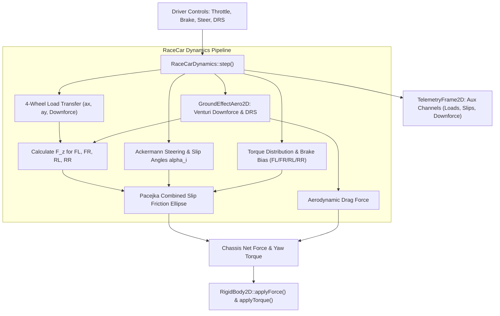

# RaceCarDynamics: C++17 Implementation Plan

## 1. Executive Summary & Scope

### 1.1 Objective & Context
This specification outlines the mathematical modeling, software architecture, data contracts, and verification roadmap for **`RaceCarDynamics`** in `VehicleSimCore`.

Currently, `VehicleSimCore` provides:
- [ArcadeCarDynamics](../libs/VehicleSimCore/dynamics/ArcadeCarDynamics.h): Simplified top-down arcade vehicle handling with artificial drift damping.
- [SideViewCarDynamics](../libs/VehicleSimCore/dynamics/SideViewCarDynamics.h): 2D side-scrolling vehicle physics.
- [MonsterCarDynamics](../libs/VehicleSimCore/dynamics/MonsterCarDynamics.h): Dual-axle monster truck physics with large compliance tires.
- [PacejkaTireModel](../libs/VehicleSimCore/dynamics/PacejkaTireModel.h): Non-linear Magic Formula tire friction modeling.
- [GroundEffectAero2D](../libs/VehicleSimCore/dynamics/GroundEffectAero2D.h): High-speed downforce and active DRS drag reduction.

However, the engine lacks a dedicated **high-performance closed-circuit motorsport dynamics coordinator** that realistically couples:
1. **Four-Wheel Dynamic Load Transfer**: Longitudinal load shifting under acceleration and braking ($a_x$), coupled with lateral load transfer under cornering ($a_y$), computing accurate normal loads $F_{z,i}$ for each wheel.
2. **Pacejka Magic Formula Combined Slip**: Friction ellipse calculation coupling simultaneous longitudinal tractive slip ($\kappa_i$) and lateral cornering slip angle ($\alpha_i$).
3. **Aerodynamic Coupling**: Dynamic downforce and pitch center-of-pressure migration provided by [GroundEffectAero2D](../libs/VehicleSimCore/dynamics/GroundEffectAero2D.h).
4. **Race Cockpit Controls**: Front/rear adjustable brake bias ratio ($\beta_{\text{brake}}$), limited-slip differential torque distribution, and active DRS actuation.

`RaceCarDynamics` implements [IVehicleDynamics](../libs/VehicleSimCore/dynamics/IVehicleDynamics.h) with pure C++17, zero dynamic memory allocations in the simulation loop, and full telemetry export into [TelemetryFrame2D](../libs/VehicleSimCore/telemetry/TelemetryFrame2D.h).

---

### 1.2 Mathematical Formulation

#### 1. Dynamic Four-Wheel Normal Load Transfer ($F_{z,i}$)
Let vehicle mass be $m$, total weight $W = m \cdot g$, wheelbase $L = a + b$ (where $a$ is distance from Center of Gravity (COG) to front axle, and $b$ is distance to rear axle), track width $T$, and COG height $h$.

The static normal loads are:
$$F_{z,\text{front,static}} = W \frac{b}{L}, \quad F_{z,\text{rear,static}} = W \frac{a}{L}$$

Under longitudinal acceleration $a_x$ and lateral acceleration $a_y$, dynamic weight transfer occurs:
- **Longitudinal Load Transfer**:
  $$\Delta F_{z,x} = m \cdot a_x \frac{h}{L}$$
- **Lateral Load Transfer** (partitioned by front/rear anti-roll stiffness distribution $\gamma_{\text{arb}} \in [0, 1]$):
  $$\Delta F_{z,y,\text{front}} = \gamma_{\text{arb}} \cdot m \cdot a_y \frac{h}{T}, \quad \Delta F_{z,y,\text{rear}} = (1 - \gamma_{\text{arb}}) \cdot m \cdot a_y \frac{h}{T}$$

The four individual tire normal loads (Front-Left, Front-Right, Rear-Left, Rear-Right) with aerodynamic downforce $F_{\text{downforce,front}}$ and $F_{\text{downforce,rear}}$ are:
$$F_{z,\text{FL}} = \max\left(0, \frac{1}{2} F_{z,\text{front,static}} - \frac{1}{2} \Delta F_{z,x} - \Delta F_{z,y,\text{front}} + \frac{1}{2} F_{\text{downforce,front}}\right)$$
$$F_{z,\text{FR}} = \max\left(0, \frac{1}{2} F_{z,\text{front,static}} - \frac{1}{2} \Delta F_{z,x} + \Delta F_{z,y,\text{front}} + \frac{1}{2} F_{\text{downforce,front}}\right)$$
$$F_{z,\text{RL}} = \max\left(0, \frac{1}{2} F_{z,\text{rear,static}} + \frac{1}{2} \Delta F_{z,x} - \Delta F_{z,y,\text{rear}} + \frac{1}{2} F_{\text{downforce,rear}}\right)$$
$$F_{z,\text{RR}} = \max\left(0, \frac{1}{2} F_{z,\text{rear,static}} + \frac{1}{2} \Delta F_{z,x} + \Delta F_{z,y,\text{rear}} + \frac{1}{2} F_{\text{downforce,rear}}\right)$$

#### 2. Kinematic Tire Slip & Ackermann Geometry
Given forward speed $u$, lateral speed $v$, and yaw rate $\omega$ in the vehicle body frame:
- **Front Steered Angles** with Ackermann geometry for steering input $\delta$:
  $$\delta_{\text{inner}} = \arctan\left(\frac{L}{\frac{L}{\tan(\delta)} - \frac{T}{2}}\right), \quad \delta_{\text{outer}} = \arctan\left(\frac{L}{\frac{L}{\tan(\delta)} + \frac{T}{2}}\right)$$
- **Tire Cornering Slip Angles ($\alpha_i$)**:
  $$\alpha_{\text{FL}} = \delta_{\text{FL}} - \arctan\left(\frac{v + a \omega}{u - \frac{T}{2} \omega}\right), \quad \alpha_{\text{FR}} = \delta_{\text{FR}} - \arctan\left(\frac{v + a \omega}{u + \frac{T}{2} \omega}\right)$$
  $$\alpha_{\text{RL}} = -\arctan\left(\frac{v - b \omega}{u - \frac{T}{2} \omega}\right), \quad \alpha_{\text{RR}} = -\arctan\left(\frac{v - b \omega}{u + \frac{T}{2} \omega}\right)$$

#### 3. Combined Slip Friction Ellipse
Using [PacejkaTireModel](../libs/VehicleSimCore/dynamics/PacejkaTireModel.h), pure longitudinal force $F_{x0,i}(\kappa_i, F_{z,i})$ and pure lateral force $F_{y0,i}(\alpha_i, F_{z,i})$ are evaluated. The combined slip forces satisfy the friction ellipse:
$$\beta_i = \sqrt{\left(\frac{\kappa_i}{\kappa_{\text{peak}}}\right)^2 + \left(\frac{\alpha_i}{\alpha_{\text{peak}}}\right)^2}$$
$$F_{x,i} = \frac{\frac{\kappa_i}{\kappa_{\text{peak}}}}{\max(1.0, \beta_i)} F_{x0,i}, \quad F_{y,i} = \frac{\frac{\alpha_i}{\alpha_{\text{peak}}}}{\max(1.0, \beta_i)} F_{y0,i}$$

#### 4. Body Force & Torque Accumulation
Transforming each wheel force into the chassis frame:
$$\mathbf{F}_{\text{total}} = \sum_{i=1}^4 \mathbf{R}(\delta_i) \begin{bmatrix} F_{x,i} \\ F_{y,i} \end{bmatrix} + \mathbf{F}_{\text{aero}} + \mathbf{F}_{\text{drag}}$$
$$\tau_{\text{total}} = \sum_{i=1}^4 \left( \mathbf{r}_i \times \mathbf{F}_{\text{wheel},i} \right) + \tau_{\text{aero}}$$

---

## 2. Architecture & Design

### 2.1 Component Structure

```
libs/VehicleSimCore/
└── dynamics/
    ├── RaceCarDynamics.h      [NEW] - 4-wheel motorsport coordinator header
    ├── RaceCarDynamics.cpp    [NEW] - Implementation with load transfer & Pacejka
    ├── PacejkaTireModel.h     [REFERENCED] - Magic Formula evaluations
    ├── GroundEffectAero2D.h   [REFERENCED] - Downforce & DRS flaps
    └── IVehicleDynamics.h     [REFERENCED] - Base interface contract
tests/
└── RaceCarDynamicsTest.cpp    [NEW] - GoogleTest suite validating physics & telemetry
```

### 2.2 System Architecture Diagrams

```
  ASCII Diagram: RaceCarDynamics Architecture

    [ Driver Inputs ]
     - Throttle [0..1]
     - Brake [0..1]
     - Steer [-1..1]
     - DRS Request
           |
           v
  +-------------------------------------------------------------------------+
  |                          RaceCarDynamics                                |
  |                                                                         |
  |  1. Kinematics: Wheel velocities (u_i, v_i) from body (u, v, omega)     |
  |  2. Load Transfer: Dynamic F_z calculation (accel, cornering, downforce)|
  |  3. Slips: Long slip kappa_i & lateral slip angle alpha_i (Ackermann)   |
  |  4. Tire Forces: Pacejka combined slip friction ellipse                 |
  |  5. Aero Coupling: GroundEffectAero2D Venturi downforce & DRS flaps     |
  |  6. Powertrain & Brakes: Limited-slip diff + adjustable brake bias      |
  |  7. RigidBody Force Dispatch: Summed forces & yaw moment tau            |
  +-------------------------------------------------------------------------+
           |                                                      |
           v                                                      v
    [ RigidBody2D ]                                     [ TelemetryFrame2D ]
     Accumulate forces                                   Live telemetry:
     Symplectic Euler step                               - 4x tire loads F_z
                                                         - Slip angles & ratios
                                                         - Downforce & G-forces
```



---

## 3. C++17 Header Design

```cpp
#pragma once

#include "IVehicleDynamics.h"
#include "PacejkaTireModel.h"
#include "GroundEffectAero2D.h"
#include "../math/Vec2.h"
#include <array>

namespace vehicle_sim::dynamics {

/// @struct RaceCarConfig
/// @brief Physical configuration parameters for RaceCarDynamics.
struct RaceCarConfig {
    double mass{750.0};              ///< Chassis mass in kg (e.g. Formula car).
    double inertia{900.0};           ///< Moment of inertia in kg*m^2.
    double wheelbase{3.2};           ///< Total wheelbase L in meters.
    double cogDistFront{1.7};        ///< Distance a from COG to front axle in meters.
    double trackWidth{1.6};          ///< Track width T in meters.
    double cogHeight{0.32};          ///< Center of gravity height above ground in meters.
    double rollStiffnessFront{0.55}; ///< Front anti-roll bar distribution ratio [0..1].
    double brakeBiasFront{0.58};     ///< Front brake torque bias ratio [0..1].
    double maxDriveTorque{2400.0};   ///< Maximum total drive torque in N*m.
    double maxBrakeTorque{5000.0};   ///< Maximum total braking torque in N*m.
    double maxSteerAngle{0.45};      ///< Maximum front wheel steering angle in radians.
    PacejkaTireParameters tireParams{}; ///< Magic Formula tire coefficients.
    GroundEffectAeroConfig aeroConfig{};///< Underbody aerodynamics configuration.
};

/// @struct RaceCarWheelState
/// @brief Telemetry and physical state for an individual racecar wheel.
struct RaceCarWheelState {
    double normalLoad{0.0};          ///< Dynamic vertical normal force F_z in N.
    double slipRatio{0.0};           ///< Longitudinal tire slip ratio kappa.
    double slipAngle{0.0};           ///< Lateral tire slip angle alpha in radians.
    double tractiveForce{0.0};       ///< Longitudinal force F_x in wheel heading frame in N.
    double lateralForce{0.0};        ///< Lateral force F_y in wheel lateral frame in N.
    double steerAngle{0.0};          ///< Wheel steer angle delta in radians.
};

/// @class RaceCarDynamics
/// @brief High-performance motorsport vehicle dynamics coordinator.
/// @details Implements 4-wheel dynamic load transfer, Ackermann steering, Pacejka
/// combined slip tire mechanics, and aerodynamic ground effect downforce.
class RaceCarDynamics final : public IVehicleDynamics {
public:
    /// @brief Constructs RaceCarDynamics with vehicle configuration.
    /// @param[in] config Vehicle mass, geometric, and aerodynamic parameters.
    explicit RaceCarDynamics(const RaceCarConfig& config = {}) noexcept;

    /// @brief Advances simulation tick, accumulating forces into body.
    /// @param[in,out] body Target rigid body receiving forces.
    /// @param[in] dt Simulation timestep in seconds.
    void step(physics::RigidBody2D& body, double dt) noexcept override;

    /// @brief Resets transient states, speeds, and controllers.
    void reset() noexcept override;

    /// @brief Checks if vehicle is airborne (loss of ground contact).
    /// @return True if all four wheels have zero vertical contact load.
    [[nodiscard]] bool isAirborne() const noexcept override;

    /// @brief Sets driver throttle input.
    /// @param[in] throttle Normalized throttle in range [0.0, 1.0].
    void setThrottle(double throttle) noexcept;

    /// @brief Sets driver brake input.
    /// @param[in] brake Normalized brake in range [0.0, 1.0].
    void setBrake(double brake) noexcept;

    /// @brief Sets driver steering command.
    /// @param[in] steer Normalized steering command in range [-1.0, 1.0].
    void setSteer(double steer) noexcept;

    /// @brief Requests DRS flap activation.
    /// @param[in] active True to open DRS flap on high-speed straightaways.
    void setDrsActive(bool active) noexcept;

    /// @brief Sets ground clearance beneath the underbody venturi tunnels.
    /// @param[in] height Ground clearance in meters.
    void setRideHeight(double height) noexcept;

    /// @brief Retrieves state of all four wheels (FL, FR, RL, RR).
    /// @return Array of four wheel state structures.
    [[nodiscard]] const std::array<RaceCarWheelState, 4>& getWheelStates() const noexcept;

    /// @brief Retrieves current total aerodynamic downforce in Newtons.
    [[nodiscard]] double getDownforce() const noexcept;

    /// @brief Queries current DRS flap opening angle in radians.
    [[nodiscard]] double getDrsAngle() const noexcept;

private:
    RaceCarConfig m_config{};
    GroundEffectAero2D m_aero{};
    std::array<RaceCarWheelState, 4> m_wheels{};
    double m_throttle{0.0};
    double m_brake{0.0};
    double m_steer{0.0};
    double m_rideHeight{0.05};
    bool m_drsRequested{false};
    bool m_isAirborne{false};

    void computeLoadTransfer(double ax, double ay, double downforce) noexcept;
    void computeTireForces(const math::Vec2& localVel, double yawRate) noexcept;
};

} // namespace vehicle_sim::dynamics
```

---

## 4. Implementation Steps & Verification Plan

### 4.1 Implementation Milestones
1. **Milestone 1**: Implement `RaceCarConfig` and constructor in `RaceCarDynamics.h` and `RaceCarDynamics.cpp`.
2. **Milestone 2**: Implement 4-wheel normal load calculation incorporating longitudinal ($a_x$), lateral ($a_y$), and aerodynamic downforce distributions.
3. **Milestone 3**: Implement Ackermann steering angles and Pacejka combined slip calculations for FL, FR, RL, and RR tires.
4. **Milestone 4**: Integrate [GroundEffectAero2D](../libs/VehicleSimCore/dynamics/GroundEffectAero2D.h) for active DRS and Venturi suction.
5. **Milestone 5**: Implement GoogleTest suite in `tests/RaceCarDynamicsTest.cpp`.

### 4.2 Test Coverage Matrix
- `StraightLineAcceleration`: Verifies longitudinal load transfer from front to rear ($F_{z,\text{rear}} > F_{z,\text{front}}$).
- `HighSpeedBraking`: Verifies forward weight transfer and front brake bias preventing rear lockup.
- `HighSpeedCornering`: Verifies lateral load transfer to outside wheels and cornering grip generation.
- `AeroDownforceScaling`: Verifies that total normal load $F_z$ increases quadratically with forward speed $v^2$.
- `DrsReduction`: Verifies drag reduction and downforce shedding when DRS is opened on straightaways.
- `AirborneSafety`: Verifies fail-safe DRS deactivation and zero tire force generation when airborne.
