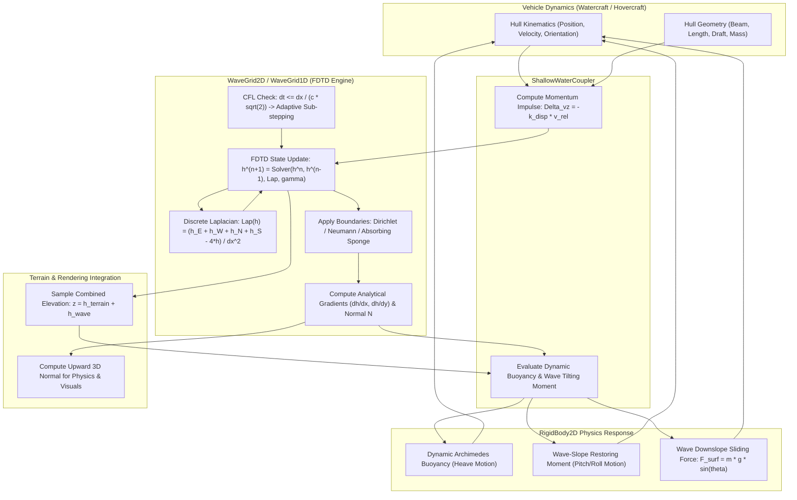
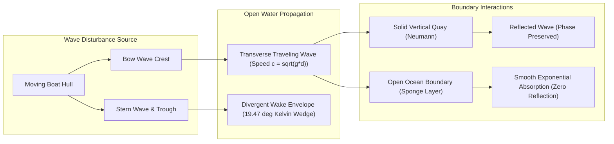

# Dynamic Shallow Water & Wave Propagation (1D/2D): C++17 Implementation Plan

## 1. Executive Summary & Scope

### 1.1 Objective & Context
This specification details the architectural design, hydrodynamic wave formulations, numerical PDE solvers, interface contracts, and implementation roadmap for **Dynamic Shallow Water and Wave Propagation (1D/2D)** as proposed in Section 2.3 of [ProposedFeatures.md](ProposedFeatures.md).

Currently, water bodies in `VehicleSimCore` are represented as static, horizontal planes:
- [WatercraftDynamics](../libs/VehicleSimCore/dynamics/WatercraftDynamics.h) and [SubmarineDynamics](../libs/VehicleSimCore/dynamics/SubmarineDynamics.h) compute draft depth and Archimedes buoyancy relative to a constant horizontal scalar waterline: `waterlineY`.
- [FluidField2D](../libs/VehicleSimCore/physics/FluidField2D.h) switches fluid medium and mass density across a planar boundary at `waterlineY`.
- [Heightfield1D](../libs/VehicleSimCore/terrain/Heightfield1D.h) and [SurfaceMap2D](../libs/VehicleSimCore/terrain/SurfaceMap2D.h) model solid, rigid terrain without dynamic liquid surface perturbation.

In realistic marine and amphibious environments:
1. **Dynamic Wave Elevation**: Water surfaces are not flat; they oscillate with traveling swells, wind chop, and standing waves.
2. **Hull Wake Generation**: Moving watercraft, hovercraft skirts, and surfacing submarines displace water mass, generating diverging V-shaped bow wakes (Kelvin wake envelopes), stern rooster tails, and turbulent trailing wave trains.
3. **Wave Reflection & Absorption**: Waves reflect off rigid shoreline quays, obstacles, and sea walls (Neumann boundaries), while open-water boundaries absorb outbound waves without artificial boundary bounce (Absorbing Sponge Layers).
4. **Dynamic Hydrostatic Buoyancy & Wave Pitching**: Passing wave crests and troughs dynamically modulate hull submerged volume $V_{\text{disp}}(t)$, generating heave accelerations, wave-slope restoring torques, and wave surfing forces.
5. **Depth-Dependent Shallow Wave Speed**: Wave celerity $c = \sqrt{g \cdot d}$ scales with local bathymetry depth $d$, causing waves to refract and steepen when approaching shallow coastlines.
6. **Dual Topology Support**:
   - **1D Wave Grid (`WaveGrid1D`)**: Continuous 1D heightfield wave perturbation along the horizontal $X$ axis, seamlessly augmenting side-view simulations ([Heightfield1D](../libs/VehicleSimCore/terrain/Heightfield1D.h)).
   - **2D Wave Grid (`WaveGrid2D`)**: Planar 2D wave basin over $(x, y)$, seamlessly augmenting top-down terrain maps ([SurfaceMap2D](../libs/VehicleSimCore/terrain/SurfaceMap2D.h)).

The goal is to deliver an industrial-grade, zero-dependency, MISRA C++:2023 compliant C++17 shallow water wave simulation subsystem in [libs/VehicleSimCore/terrain/WaveGrid1D.h](../libs/VehicleSimCore/terrain/WaveGrid1D.h) and [libs/VehicleSimCore/terrain/WaveGrid2D.h](../libs/VehicleSimCore/terrain/WaveGrid2D.h), complete with two-way vehicle hydrodynamics coupling in [libs/VehicleSimCore/terrain/ShallowWaterCoupler.h](../libs/VehicleSimCore/terrain/ShallowWaterCoupler.h).

---

### 1.2 Core Requirements
1. **Discrete Wave Equation Solver (FDTD)**:
   - Solve the 1D and 2D damped wave PDEs using a second-order Finite-Difference Time-Domain (FDTD) scheme:
     $$\frac{\partial^2 \eta}{\partial t^2} = c^2 \nabla^2 \eta - \gamma \frac{\partial \eta}{\partial t}$$
   - Support uniform grid discretization ($\Delta x, \Delta y$) with ping-pong heightfield buffers.
2. **CFL Numerical Stability & Sub-Stepping**:
   - Enforce the Courant-Friedrichs-Lewy (CFL) stability criterion:
     $$C = c \frac{\Delta t}{\Delta x} \le C_{\text{max}} \quad \left(C_{\text{max}} = 1.0 \text{ for 1D}, \; \frac{1}{\sqrt{2}} \approx 0.7071 \text{ for 2D}\right)$$
   - Automatically sub-step simulation frames if the external physics timestep exceeds the CFL threshold.
3. **Flexible Boundary Conditions**:
   - **Dirichlet (Fixed Waterline)**: Zero perturbation $\eta = 0$ at boundaries.
   - **Neumann (Reflective Quay/Wall)**: Zero normal derivative $\frac{\partial \eta}{\partial n} = 0$, reflecting waves with phase preservation.
   - **Absorbing Sponge Layer (Open Sea)**: Perimeter damping zone with quadratic attenuation coefficient $\gamma_{\text{sponge}}$ preventing boundary reflection artifacts.
4. **Two-Way Fluid-Structure Interaction (FSI)**:
   - **Hull-to-Water (Wake Stamping)**: Inject vertical momentum and displacement impulses $\Delta v_z$ from boat hulls, propellers, and hovercraft skirts into the wave grid.
   - **Water-to-Hull (Dynamic Hydrodynamics)**: Sample local wave height $\eta(x, y)$, surface slope $\nabla \eta$, and vertical wave velocity $\frac{\partial \eta}{\partial t}$ to apply dynamic Archimedes buoyancy, wave-slope tilt torques, and downslope surfing thrust to [RigidBody2D](../libs/VehicleSimCore/physics/RigidBody2D.h).
5. **Deterministic & Hardened C++17 Implementation**:
   - Zero dynamic heap allocation during simulation steps.
   - Strict IEEE 754 determinism across Linux (GCC/Clang) and Windows (MSVC).
   - Co-located header and source files in `libs/VehicleSimCore/terrain/`.
   - Complete Doxygen documentation and function names strictly $< 30$ characters.

---

## 2. High-Level Architecture & Subsystem Organization

### 2.1 File Layout

```
libs/VehicleSimCore/
├── terrain/
│   ├── WaveGrid1D.h                 [NEW] - 1D shallow water wave grid and PDE solver
│   ├── WaveGrid1D.cpp               [NEW] - 1D FDTD solver, damping, boundaries, and impulse injection
│   ├── WaveGrid2D.h                 [NEW] - 2D shallow water wave grid and PDE solver
│   ├── WaveGrid2D.cpp               [NEW] - 2D FDTD solver, 5/9-point laplacian, sponge layer, gradients
│   ├── ShallowWaterCoupler.h        [NEW] - Two-way vehicle dynamics FSI coordinator
│   ├── ShallowWaterCoupler.cpp      [NEW] - Dynamic buoyancy, wave torque, wake momentum stamping
│   ├── Heightfield1D.h              [EXTENDED] - Optional wave grid overlay query
│   ├── Heightfield1D.cpp            [EXTENDED] - Combined terrain + wave elevation sampling
│   ├── SurfaceMap2D.h               [EXTENDED] - Optional 2D wave grid attachment
│   └── SurfaceMap2D.cpp             [EXTENDED] - Combined terrain + dynamic water surface sampling
├── dynamics/
│   ├── WatercraftDynamics.h         [EXTENDED] - Dynamic wave sampling, wake impulse emission
│   ├── WatercraftDynamics.cpp       [EXTENDED] - Wave heave, pitch restoring, and wake integration
│   ├── HovercraftDynamics.h         [EXTENDED] - Skirt water depression and spray wake stamping
│   └── HovercraftDynamics.cpp       [EXTENDED] - Air-cushion surface wave interaction
tests/
└── ShallowWaterWaveTest.cpp         [NEW] - Comprehensive GoogleTest validation suite
```

---

### 2.2 System Architecture ASCII Diagram

```
+----------------------------------------------------------------------------------------------------+
|                          Dynamic Shallow Water & Wave System Architecture                          |
+----------------------------------------------------------------------------------------------------+
|                                                                                                    |
|    Vehicle Dynamics Layer (WatercraftDynamics / HovercraftDynamics / SubmarineDynamics)            |
|                                                                                                    |
|    - Hull State: Position (x,y), Linear Velocity (vx,vy), Orientation (theta), Angular Vel (omega)  |
|    - Hydro Geometry: Beam Width (b), Length (L), Draft (d), Displacement Mass (m)                  |
|                                                                                                    |
|                 |                                                        ^                         |
|                 | 1. Generates Wake Stamp                                | 2. Receives Forces:     |
|                 v (pos, heading, b, L, v, disp)                          |    - Dynamic Buoyancy   |
|                                                                          |    - Wave Tilt Torque   |
|    +----------------------------------------------------------------+    |    - Surfing Force      |
|    | ShallowWaterCoupler (libs/VehicleSimCore/terrain)              |----+    - Heave Damping      |
|    +----------------------------------------------------------------+                              |
|    | - Computes momentum impulse: Delta_vz = -k_disp * v_hull       |                              |
|    | - Evaluates submerged volume under curved wave profile         |                              |
|    | - Calculates wave surface normal & inclination angle           |                              |
|    | - Dispatches forces & torques to RigidBody2D                   |                              |
|    +----------------------------------------------------------------+                              |
|            |                                                ^                                      |
|            | Inject Momentum Impulse                        | Sample Water Elevation h(x,y),       |
|            v Delta_vz(x, y)                                 | Surface Gradient & Wave Velocity     |
|                                                                                                    |
|    +------------------------------------------------------------------------------------------+    |
|    | Discrete Wave PDE Solvers (WaveGrid1D / WaveGrid2D)                                      |    |
|    +------------------------------------------------------------------------------------------+    |
|    | 1. Hyperbolic Wave PDE: d^2h/dt^2 = c^2 * Lap(h) - gamma * dh/dt                         |    |
|    | 2. FDTD Integration:  h^(n+1) = [ 2*h^n - (1-alpha)*h^(n-1) + c^2*dt^2*Lap(h) ] / (1+a) |    |
|    | 3. Variable Depth Celerity: c(x,y) = sqrt(g * max(0.01, h_water - h_bed))               |    |
|    | 4. Boundary Enforcement:                                                                 |    |
|    |    - Dirichlet: Fixed baseline elevation (h = h0)                                        |    |
|    |    - Neumann: Reflective solid boundary (dh/dn = 0)                                      |    |
|    |    - Absorbing Sponge Layer: Quadratic attenuation zone gamma_sponge(dist)               |    |
|    | 5. Spatial Interp & Gradient: Bilinear/Bicubic elevation and central-difference normal   |    |
|    +------------------------------------------------------------------------------------------+    |
|            |                                                |                                      |
|            v Attached Overlay                               v Attached Overlay                     |
|    +---------------------------------+     +-------------------------------------------------+     |
|    | Heightfield1D                   |     | SurfaceMap2D                                    |     |
|    | (Side-View Water Surface)       |     | (Top-Down Water Basin / Lake / Ocean Basin)     |     |
|    +---------------------------------+     +-------------------------------------------------+     |
|                                                                                                    |
+----------------------------------------------------------------------------------------------------+
```

---

### 2.3 System Architecture Mermaid Flowchart



---

### 2.4 Wave Profile & Two-Way Coupling ASCII Diagram

```
  ASCII Diagram: Hull Wake Perturbation, Traveling Wavefront & Dynamic Force Equilibrium

                      Hull Forward Motion (v_hull)
                                -------->
                         .-------------------.
                        /   Boat Hull         \
         ==============+=======================+==============  <- Undisturbed Waterline (h0)
        /                                       \
       /   Bow Wave Crest                        \   Stern Wake & Rooster Tail
      /     (+eta_bow)                            \     (+eta_stern)
     /                                             \
    /               Submerged Hull Displacement     '----.
   +                 (-eta_trough)                        \
   |                                                       +
   |   <---- Left Traveling Wave       Right Traveling --->|
   |         Wavelength lambda             Wavefront       |
   +=======================================================+
   |  Bedrock / Basin Bottom (h_bed)                       |
   +-------------------------------------------------------+

   Forces on Hull:
   - Dynamic Buoyancy: F_b = rho * g * \int (h_water(x) - y_hull(x)) dx
   - Wave Tilt Torque: tau = -k_tilt * (theta_hull - theta_wave)
   - Downslope Force:  F_slope = m * g * sin(theta_wave)  (Surfing)
   - Wake Impulse:     Delta_P = -rho * A_hull * v_vertical
```

---

### 2.5 Wave Propagation & Reflection Mermaid Diagram



---

## 3. Mathematical Formulations & Numerical Methods

### 3.1 Damped Shallow Water Wave PDE
The linear shallow water wave equation governing vertical surface perturbation $\eta(\mathbf{x}, t) = h(\mathbf{x}, t) - h_0$ over a horizontal domain is:
$$\frac{\partial^2 \eta}{\partial t^2} = c^2 \nabla^2 \eta - \gamma \frac{\partial \eta}{\partial t}$$
where:
- $\eta(\mathbf{x}, t)$: Water surface elevation perturbation from undisturbed level $h_0$ (meters).
- $c$: Shallow water wave phase velocity ($\text{m/s}$).
- $\nabla^2$: Spatial Laplace operator.
- $\gamma$: Viscous surface damping coefficient ($1/\text{s}$), modeling kinematic viscosity and wave energy dissipation.

#### Shallow Water Wave Speed (Airy Theory):
In water where depth $d$ is significantly smaller than the characteristic wavelength $\lambda$ ($d < \lambda / 20$), wave celerity is non-dispersive and governed strictly by depth and gravity:
$$c(x, y) = \sqrt{g \cdot d(x, y)} = \sqrt{g \cdot \max(d_{\text{min}}, h_0 - h_{\text{bed}}(x, y))}$$
where $g = 9.80665\,\text{m/s}^2$ and $d_{\text{min}} > 0$ avoids singularity at shorelines. For deep water or simplified basins, $c$ is configured as a constant $c_0$.

---

### 3.2 Finite-Difference Time-Domain (FDTD) Discretization
To simulate wave propagation in real time with exact IEEE 754 determinism, we discretize the PDE onto a regular spatial grid with grid spacing $\Delta x, \Delta y$ and discrete timestep $\Delta t$.

Let $\eta_{i,j}^n$ denote the wave elevation at spatial grid vertex $(i, j)$ at time index $n \cdot \Delta t$.

1. **Second-Order Central Difference in Time**:
   $$\frac{\partial^2 \eta}{\partial t^2} \approx \frac{\eta_{i,j}^{n+1} - 2\eta_{i,j}^n + \eta_{i,j}^{n-1}}{\Delta t^2}$$
2. **Centered Temporal Velocity (Damping Term)**:
   $$\gamma \frac{\partial \eta}{\partial t} \approx \gamma \frac{\eta_{i,j}^{n+1} - \eta_{i,j}^{n-1}}{2\Delta t}$$
3. **Discrete Spatial Laplacian $\nabla^2 \eta$**:
   - **1D 3-Point Stencil**:
     $$\nabla^2 \eta_i^n \approx \frac{\eta_{i+1}^n - 2\eta_i^n + \eta_{i-1}^n}{\Delta x^2}$$
   - **2D 5-Point Standard Stencil** (for $\Delta x = \Delta y$):
     $$\nabla^2 \eta_{i,j}^n \approx \frac{\eta_{i+1,j}^n + \eta_{i-1,j}^n + \eta_{i,j+1}^n + \eta_{i,j-1}^n - 4\eta_{i,j}^n}{\Delta x^2}$$
   - **2D 9-Point Isotropic Stencil** (minimizing grid anisotropy along diagonals):
     $$\nabla^2 \eta_{i,j}^n \approx \frac{4(\eta_{i+1,j} + \eta_{i-1,j} + \eta_{i,j+1} + \eta_{i,j-1}) + (\eta_{i+1,j+1} + \eta_{i-1,j+1} + \eta_{i+1,j-1} + \eta_{i-1,j-1}) - 20\eta_{i,j}}{6\Delta x^2}$$

#### Explicit Update Algebraic Formulation:
Substituting the discrete derivatives into the damped wave PDE:
$$\frac{\eta^{n+1} - 2\eta^n + \eta^{n-1}}{\Delta t^2} + \gamma \frac{\eta^{n+1} - \eta^{n-1}}{2\Delta t} = c^2 \nabla^2 \eta^n$$
Multiply both sides by $\Delta t^2$ and define the dimensionless damping parameter $\alpha = \frac{\gamma \Delta t}{2}$:
$$\eta^{n+1}(1 + \alpha) = 2\eta^n - \eta^{n-1}(1 - \alpha) + c^2 \Delta t^2 \nabla^2 \eta^n$$
Dividing by $(1 + \alpha)$ yields the explicit recurrence relation:
$$\eta_{i,j}^{n+1} = \frac{1}{1 + \alpha} \left[ 2\eta_{i,j}^n - (1 - \alpha)\eta_{i,j}^{n-1} + c^2 \Delta t^2 \nabla^2 \eta_{i,j}^n \right]$$
This formulation requires only three state buffers:
- `mElevationPrev` ($\eta^{n-1}$)
- `mElevationCurr` ($\eta^n$)
- `mElevationNext` ($\eta^{n+1}$)
At the end of each step, buffers are rotated via index pointer swapping with zero allocation overhead.

---

### 3.3 Numerical Stability & CFL Condition
The explicit FDTD scheme is conditionally stable governed by the Courant-Friedrichs-Lewy (CFL) condition:
- **1D CFL Limit**:
  $$C = c \frac{\Delta t}{\Delta x} \le 1.0$$
- **2D CFL Limit**:
  $$C = c \Delta t \sqrt{\frac{1}{\Delta x^2} + \frac{1}{\Delta y^2}} \le 1.0 \implies c \frac{\Delta t}{\Delta x} \le \frac{1}{\sqrt{2}} \approx 0.7071068 \quad (\text{for } \Delta x = \Delta y)$$

#### Adaptive Sub-Stepping Mechanism:
Given an external vehicle physics step $\Delta t_{\text{ext}}$ (e.g. $0.01667\,\text{s}$ at $60\,\text{Hz}$):
1. Compute the maximum stable internal timestep:
   $$\Delta t_{\text{cfl}} = \beta_{\text{safety}} \cdot \frac{\Delta x}{c \sqrt{D}}$$
   where $\beta_{\text{safety}} = 0.70$ and $D \in \{1, 2\}$ is spatial dimensionality.
2. Calculate the required integer sub-step count:
   $$N_{\text{sub}} = \max\left(1, \left\lceil \frac{\Delta t_{\text{ext}}}{\Delta t_{\text{cfl}}} \right\rceil\right)$$
3. Execute $N_{\text{sub}}$ sub-steps using internal step duration $\delta t = \frac{\Delta t_{\text{ext}}}{N_{\text{sub}}}$.
This guarantees unconditional numerical stability without energy blowup or divergence regardless of wave speed.

---

### 3.4 Boundary Conditions

```
  ASCII Diagram: Wave Boundary Enforcements

     1. Dirichlet (Fixed)        2. Neumann (Reflective Quay)     3. Absorbing Sponge Layer
          h = h0                           dh/dn = 0               gamma_eff = gamma + gamma_sponge(d)
        +---------+                      +---------+                     |<- N_sponge ->|
        |  eta=0  |                      | eta_gh= |                     |  Exponential |
        |  Solid  |                      | eta_bd  |                     |  Damping     | Open
        |  Fix    |                      | (Wall)  |                     |  Ramp        | Water
        +---------+                      +---------+                     +--------------+
```

1. **Dirichlet Boundary (Open Baseline / Fixed Level)**:
   $$\eta_{\text{boundary}}^{n+1} = 0.0$$
   Clamps boundary elevation to zero perturbation. Reflected waves invert phase (crest becomes trough).
2. **Neumann Boundary (Rigid Reflective Shoreline / Quay Wall)**:
   $$\frac{\partial \eta}{\partial n} = 0 \implies \eta_{-1,j} = \eta_{1,j}$$
   Waves reflect specularly off the boundary with preserved phase, forming authentic standing wave crests against seawalls.
3. **Absorbing Sponge Layer (PML / Open Ocean Boundary)**:
   To simulate an infinite ocean on a finite grid without unnatural boundary reflections, an outer band of $N_{\text{sponge}}$ cells (typically 8–16 cells) applies an augmented quadratic damping factor:
   $$\gamma_{\text{sponge}}(d) = \gamma_{\text{max}} \cdot \left( \frac{N_{\text{sponge}} - d}{N_{\text{sponge}}} \right)^2$$
   where $d \in [0, N_{\text{sponge}}]$ is the grid cell distance to the domain edge. Outbound waves entering the sponge layer are exponentially attenuated to zero before reaching the physical boundary.

---

### 3.5 Two-Way Fluid-Structure Interaction (FSI) Formulations

#### 1. Hull Wake Momentum Injection:
As a vehicle moves through water, its hull displaces a liquid volume:
$$V_{\text{disp}} = \frac{m_{\text{hull}}}{\rho_{\text{water}}}$$
The moving hull exerts a downward and transverse momentum impulse into the water grid:
$$\Delta v_z(x, y) = -k_{\text{disp}} \cdot v_{\text{vertical}} - k_{\text{wake}} \cdot \|\mathbf{v}_{\text{planar}}\| \cdot \left(\frac{d_{\text{submerged}}}{d_{\text{draft}}}\right) \cdot w(x, y)$$
where $w(x, y)$ is a spatial Gaussian or bilinear footprint weighting factor:
$$w(x, y) = \max\left(0.0, \; 1.0 - \frac{|x - x_0|}{L/2}\right) \cdot \max\left(0.0, \; 1.0 - \frac{|y - y_0|}{b/2}\right)$$
The impulse is deposited directly into the wave velocity field by mutating $\eta^{n-1}$:
$$\eta_{i,j}^{n-1} \mathrel{-}= \Delta v_z(x_i, y_j) \cdot \Delta t$$
which accelerates the wave surface upward/downward on the subsequent time step.

#### 2. Dynamic Archimedes Buoyancy Force:
The local wave surface elevation is $h_{\text{water}}(x, y) = h_0 + \eta(x, y)$.
The instantaneous submerged depth along the hull is:
$$z_{\text{sub}}(x) = \max\left(0.0, \; h_{\text{water}}(x) - y_{\text{hull}}(x)\right)$$
Total dynamic Archimedes buoyancy force is:
$$F_b = \rho_{\text{water}} \cdot g \cdot \int_{\text{hull}} z_{\text{sub}}(s) \, ds \approx \rho_{\text{water}} \cdot g \cdot A_{\text{submerged}}$$
As wave crests pass under the boat, $z_{\text{sub}}$ increases, dynamically accelerating the hull upward; as troughs pass, buoyancy diminishes, causing the hull to drop into the trough.

#### 3. Wave-Slope Tilting & Restoring Torque:
The spatial gradient of the wave surface generates an instantaneous water surface normal:
$$\mathbf{n}_{\text{water}} = \frac{1}{\sqrt{1 + \left(\frac{\partial \eta}{\partial x}\right)^2 + \left(\frac{\partial \eta}{\partial y}\right)^2}} \left( -\frac{\partial \eta}{\partial x}, \; -\frac{\partial \eta}{\partial y}, \; 1 \right)$$
In 2D side-view (1D wave field), the local wave inclination angle is:
$$\theta_{\text{wave}} = \arctan\left(\frac{\partial \eta}{\partial x}\right)$$
The relative tilt between hull heading $\theta_{\text{hull}}$ and wave slope $\theta_{\text{wave}}$ generates a righting hydrostatic torque:
$$\tau_{\text{wave}} = -k_{\text{tilt}} \cdot \sin(\theta_{\text{hull}} - \theta_{\text{wave}}) - c_{\text{pitch}} \cdot (\omega_{\text{hull}} - \omega_{\text{wave}})$$

#### 4. Wave Surfing (Downslope Gravity Force):
A vessel riding the face of a traveling swell experiences a tangential downslope gravity component:
$$F_{\text{surf}} = m_{\text{hull}} \cdot g \cdot \sin(\theta_{\text{wave}})$$
When aligned with wave propagation, this force propels the watercraft forward, reproducing authentic wave surfing mechanics.

---

## 4. C++17 Class & Interface Specifications

All classes conform strictly to:
- `#pragma once` header guards.
- Co-located `.h` and `.cpp` in `libs/VehicleSimCore/terrain/`.
- Pure ISO C++17 with zero external dependencies.
- MISRA C++:2023 & SEI CERT C++ compliance (zero heap allocations during step, explicit `{}` initialization, `[[nodiscard]]`, function names $< 30$ chars).

### 4.1 Enums and Data Structures

```cpp
namespace vehicle_sim::terrain {

/// @enum WaveBoundaryType
/// @brief Boundary condition enforcement policy for wave grids.
enum class WaveBoundaryType : std::uint8_t {
    Dirichlet,  ///< Fixed baseline water elevation (zero perturbation).
    Neumann,    ///< Specular reflection (zero normal derivative, solid quay wall).
    Absorbing   ///< Absorbing sponge layer with quadratic damping attenuation.
};

/// @struct WaveConfig1D
/// @brief Configuration settings for 1D shallow water wave grid.
struct WaveConfig1D {
    double originX { -100.0 };       ///< Minimum horizontal coordinate in meters.
    double length { 200.0 };         ///< Total horizontal span in meters.
    double cellSize { 0.5 };         ///< Spatial sample spacing dx in meters.
    double waveSpeed { 6.0 };        ///< Base shallow water wave celerity c in m/s.
    double damping { 0.15 };         ///< Viscous energy dissipation coefficient gamma in 1/s.
    double waterlineY { 0.0 };       ///< Undisturbed baseline water level in meters.
    WaveBoundaryType leftBoundary { WaveBoundaryType::Absorbing };  ///< Left boundary condition.
    WaveBoundaryType rightBoundary { WaveBoundaryType::Absorbing }; ///< Right boundary condition.
    std::size_t spongeWidth { 10U }; ///< Cell count for absorbing sponge layer.
};

/// @struct WaveConfig2D
/// @brief Configuration settings for 2D shallow water wave basin.
struct WaveConfig2D {
    math::Vec2 origin { -50.0, -50.0 }; ///< Minimum corner coordinates in meters.
    math::Vec2 size { 100.0, 100.0 };   ///< Basin domain dimensions in meters.
    double cellSize { 0.5 };            ///< Spatial grid cell spacing dx = dy in meters.
    double waveSpeed { 5.0 };           ///< Base wave propagation celerity c in m/s.
    double damping { 0.12 };            ///< Viscous wave damping coefficient gamma in 1/s.
    double waterlineZ { 0.0 };          ///< Undisturbed baseline water elevation in meters.
    WaveBoundaryType boundaryType { WaveBoundaryType::Absorbing }; ///< Domain boundary policy.
    std::size_t spongeWidth { 12U };    ///< Outer perimeter cell count for absorbing sponge.
    bool use9PointLaplacian { true };   ///< Enable isotropic 9-point Laplacian stencil.
};

/// @struct WaveSample1D
/// @brief Point evaluation snapshot from a 1D wave grid.
struct WaveSample1D {
    double elevation { 0.0 };        ///< Total water elevation h = waterlineY + eta in meters.
    double perturbation { 0.0 };     ///< Perturbation eta from baseline in meters.
    double derivative { 0.0 };       ///< Spatial gradient deta/dx.
    double verticalSpeed { 0.0 };    ///< Vertical wave velocity deta/dt in m/s.
    double slopeAngle { 0.0 };       ///< Surface tilt angle in radians.
    math::Vec2 normal { 0.0, 1.0 };  ///< Upward unit normal vector.
};

/// @struct WaveSample2D
/// @brief Point evaluation snapshot from a 2D wave grid.
struct WaveSample2D {
    double elevation { 0.0 };        ///< Total water elevation z = waterlineZ + eta in meters.
    double perturbation { 0.0 };     ///< Perturbation eta from baseline in meters.
    math::Vec2 gradient { 0.0, 0.0 };///< Planar spatial gradient (deta/dx, deta/dy).
    double verticalSpeed { 0.0 };    ///< Vertical wave velocity deta/dt in m/s.
    double slopeAngle { 0.0 };       ///< Surface inclination angle in radians.
    SurfaceNormal3D normal { 0.0, 0.0, 1.0 }; ///< 3D upward unit surface normal vector.
};

/// @struct WaterWakeStamp2D
/// @brief Hull footprint and kinematics for wake generation.
struct WaterWakeStamp2D {
    math::Vec2 position { 0.0, 0.0 };  ///< Center of hull contact in world meters.
    double heading { 0.0 };            ///< Hull heading angle in radians.
    double length { 5.0 };             ///< Hull length in meters.
    double beam { 2.0 };               ///< Hull beam width in meters.
    double draft { 0.6 };              ///< Submerged hull draft in meters.
    math::Vec2 velocity { 0.0, 0.0 };  ///< Planar velocity vector in m/s.
    double verticalVelocity { 0.0 };   ///< Vertical heave velocity in m/s.
    double displacement { 1500.0 };    ///< Hull displacement mass in kg.
};

} // namespace vehicle_sim::terrain
```

---

### 4.2 WaveGrid1D Header Contract (`libs/VehicleSimCore/terrain/WaveGrid1D.h`)

```cpp
#pragma once

#include <cmath>
#include <cstddef>
#include <vector>

#include "libs/VehicleSimCore/math/Vec2.h"
#include "libs/VehicleSimCore/terrain/SurfaceMaterial.h"

namespace vehicle_sim::terrain {

/// @class WaveGrid1D
/// @brief 1D finite-difference shallow water wave propagation grid.
/// @details Simulates real-time 1D surface wave elevation, propagation, reflection, and damping.
/// Maintains strict IEEE 754 determinism, pure C++17 compliance, and zero runtime heap allocations.
class WaveGrid1D {
public:
    /// @brief Default constructor creating an uninitialized wave grid.
    WaveGrid1D() noexcept = default;

    /// @brief Parameterized constructor initializing grid dimensions and configuration.
    /// @param[in] config Wave configuration settings.
    explicit WaveGrid1D(const WaveConfig1D& config);

    /// @brief Initializes grid buffers and parameters.
    /// @param[in] config Wave configuration settings.
    void initGrid(const WaveConfig1D& config);

    /// @brief Advances wave simulation by timestep dt using adaptive sub-stepping.
    /// @param[in] dt Timestep duration in seconds.
    void step(double dt) noexcept;

    /// @brief Injects a localized vertical displacement impulse into the wave field.
    /// @param[in] x World coordinate of impulse center in meters.
    /// @param[in] radius Spatial radius of impulse influence in meters.
    /// @param[in] impulse Velocity/elevation perturbation magnitude in meters or m/s.
    void injectImpulse(double x, double radius, double impulse) noexcept;

    /// @brief Evaluates wave elevation and surface state at horizontal coordinate x.
    /// @param[in] x World horizontal coordinate in meters.
    /// @return WaveSample1D containing elevation, gradient, slope, and normal.
    [[nodiscard]] WaveSample1D getSample(double x) const noexcept;

    /// @brief Evaluates wave elevation at horizontal coordinate x.
    /// @param[in] x World horizontal coordinate in meters.
    /// @return Total water surface elevation in meters.
    [[nodiscard]] double getElevation(double x) const noexcept;

    /// @brief Gets active grid configuration.
    /// @return Const reference to WaveConfig1D.
    [[nodiscard]] const WaveConfig1D& getConfig() const noexcept;

    /// @brief Gets total cell count along 1D domain.
    /// @return Number of discrete spatial samples.
    [[nodiscard]] std::size_t getCellCount() const noexcept;

    /// @brief Resets wave field to undisturbed equilibrium waterline.
    void reset() noexcept;

    /// @brief Calculates Courant number for given timestep.
    /// @param[in] dt Candidate timestep in seconds.
    /// @return Dimensionless Courant number c * dt / dx.
    [[nodiscard]] double computeCourant(double dt) const noexcept;

private:
    WaveConfig1D mConfig {};
    std::size_t mCellCount { 0U };
    double mInvCellSize { 0.0 };

    std::vector<double> mElevationPrev {};
    std::vector<double> mElevationCurr {};
    std::vector<double> mElevationNext {};
    std::vector<double> mSpongeDamping {};

    void executeSubstep(double dt) noexcept;
    void applyBoundaries() noexcept;
    void updateSpongeCoeffs();
};

} // namespace vehicle_sim::terrain
```

---

### 4.3 WaveGrid2D Header Contract (`libs/VehicleSimCore/terrain/WaveGrid2D.h`)

```cpp
#pragma once

#include <cmath>
#include <cstddef>
#include <vector>

#include "libs/VehicleSimCore/math/Vec2.h"
#include "libs/VehicleSimCore/terrain/SurfaceMap2D.h"

namespace vehicle_sim::terrain {

/// @class WaveGrid2D
/// @brief 2D finite-difference shallow water wave propagation basin.
/// @details Solves the 2D damped wave PDE over a regular Cartesian grid using FDTD.
/// Supports 5-point and 9-point isotropic Laplacians, absorbing sponge layers,
/// and two-way vehicle hydrodynamics wake interactions.
class WaveGrid2D {
public:
    /// @brief Default constructor creating an uninitialized wave basin.
    WaveGrid2D() noexcept = default;

    /// @brief Parameterized constructor initializing 2D grid dimensions.
    /// @param[in] config 2D wave basin configuration settings.
    explicit WaveGrid2D(const WaveConfig2D& config);

    /// @brief Initializes 2D grid dimensions and precomputes sponge layer damping.
    /// @param[in] config 2D wave basin configuration settings.
    void initGrid(const WaveConfig2D& config);

    /// @brief Advances 2D wave field by timestep dt using adaptive sub-stepping.
    /// @param[in] dt Timestep duration in seconds.
    void step(double dt) noexcept;

    /// @brief Injects a localized vertical impulse at world coordinates (x, y).
    /// @param[in] position World coordinates of impulse center in meters.
    /// @param[in] radius Spatial radius of impulse footprint in meters.
    /// @param[in] impulse Perturbation magnitude in meters or m/s.
    void injectImpulse(const math::Vec2& position, double radius, double impulse) noexcept;

    /// @brief Stamps a dynamic vehicle wake footprint into the wave basin.
    /// @param[in] stamp Vehicle hull dimensions, load, and velocity footprint.
    void applyWakeStamp(const WaterWakeStamp2D& stamp) noexcept;

    /// @brief Evaluates 2D wave elevation and surface normal at coordinates (x, y).
    /// @param[in] position World coordinates in meters.
    /// @return WaveSample2D with elevation, gradient, vertical speed, and 3D normal.
    [[nodiscard]] WaveSample2D getSample(const math::Vec2& position) const noexcept;

    /// @brief Evaluates water elevation at world coordinates (x, y).
    /// @param[in] position World coordinates in meters.
    /// @return Total water surface elevation z in meters.
    [[nodiscard]] double getElevation(const math::Vec2& position) const noexcept;

    /// @brief Evaluates total fluid kinetic and potential energy in wave basin.
    /// @return Integrated mechanical wave energy in Joules.
    [[nodiscard]] double computeEnergy() const noexcept;

    /// @brief Gets active 2D wave basin configuration.
    /// @return Const reference to WaveConfig2D.
    [[nodiscard]] const WaveConfig2D& getConfig() const noexcept;

    /// @brief Gets column sample count along X axis.
    /// @return Column count.
    [[nodiscard]] std::size_t getWidth() const noexcept;

    /// @brief Gets row sample count along Y axis.
    /// @return Row count.
    [[nodiscard]] std::size_t getHeight() const noexcept;

    /// @brief Resets wave field to flat equilibrium waterline.
    void reset() noexcept;

private:
    WaveConfig2D mConfig {};
    std::size_t mWidth { 0U };
    std::size_t mHeight { 0U };
    double mInvCellSize { 0.0 };

    std::vector<double> mElevationPrev {};
    std::vector<double> mElevationCurr {};
    std::vector<double> mElevationNext {};
    std::vector<double> mSpongeDamping {};

    [[nodiscard]] inline std::size_t getIndex(std::size_t x, std::size_t y) const noexcept {
        return (y * mWidth) + x;
    }

    void executeSubstep(double dt) noexcept;
    void applyBoundaries() noexcept;
    void updateSpongeLayer();
};

} // namespace vehicle_sim::terrain
```

---

### 4.4 ShallowWaterCoupler Header Contract (`libs/VehicleSimCore/terrain/ShallowWaterCoupler.h`)

```cpp
#pragma once

#include "libs/VehicleSimCore/math/Vec2.h"
#include "libs/VehicleSimCore/physics/RigidBody2D.h"
#include "libs/VehicleSimCore/terrain/WaveGrid2D.h"

namespace vehicle_sim::terrain {

/// @struct HydrodynamicCouplingForces
/// @brief Result of two-way wave-hull interaction force evaluation.
struct HydrodynamicCouplingForces {
    math::Vec2 totalForce { 0.0, 0.0 }; ///< Total world force applied to hull in Newtons.
    double buoyancyForce { 0.0 };       ///< Dynamic vertical Archimedes buoyancy in Newtons.
    double waveSurfingForce { 0.0 };    ///< Downslope wave thrust force in Newtons.
    double pitchTorque { 0.0 };         ///< Hydrostatic righting / tilting torque in N*m.
    double submergedDepth { 0.0 };      ///< Instantaneous draft penetration depth in meters.
    bool inWater { false };             ///< True if hull is in contact with water surface.
};

/// @class ShallowWaterCoupler
/// @brief Coordinator for two-way fluid-structure interaction between vehicles and wave grids.
/// @details Evaluates dynamic Archimedes buoyancy, wave tilt moments, downslope surfing forces,
/// and deposits wake momentum impulses into WaveGrid2D or WaveGrid1D.
class ShallowWaterCoupler {
public:
    ShallowWaterCoupler() = delete;

    /// @brief Evaluates hydrodynamic interaction forces and updates wave basin.
    /// @param[in,out] body Target vehicle rigid body.
    /// @param[in,out] waves Active 2D wave basin.
    /// @param[in] stamp Vehicle hull footprint and parameters.
    /// @param[in] dt Simulation timestep in seconds.
    /// @return HydrodynamicCouplingForces containing computed reactions.
    [[nodiscard]] static HydrodynamicCouplingForces updateFsi(
        physics::RigidBody2D& body,
        WaveGrid2D& waves,
        const WaterWakeStamp2D& stamp,
        double dt) noexcept;

    /// @brief Computes dynamic Archimedes buoyancy force given local wave elevation.
    /// @param[in] hullPosY Vertical world position of hull keel in meters.
    /// @param[in] waveElevation Local water surface elevation in meters.
    /// @param[in] draft Nominal hull draft in meters.
    /// @param[in] displacement Mass displacement in kg.
    /// @return Vertical buoyant force in Newtons.
    [[nodiscard]] static double computeBuoyancy(
        double hullPosY, double waveElevation, double draft, double displacement) noexcept;

    /// @brief Computes hydrostatic pitch restoring torque from wave slope.
    /// @param[in] hullOrientation Heading angle of hull in radians.
    /// @param[in] waveSlopeAngle Surface inclination angle of wave in radians.
    /// @param[in] stiffness Restoring stiffness in N*m/rad.
    /// @param[in] damping Angular pitch damping in N*m*s.
    /// @param[in] angularVelocity Hull pitch rate in rad/s.
    /// @return Restoring pitch moment in N*m.
    [[nodiscard]] static double computeWaveTorque(
        double hullOrientation,
        double waveSlopeAngle,
        double stiffness,
        double damping,
        double angularVelocity) noexcept;
};

} // namespace vehicle_sim::terrain
```

---

## 5. Vehicle Dynamics Integration

### 5.1 WatercraftDynamics Coupling
In [libs/VehicleSimCore/dynamics/WatercraftDynamics.cpp](../libs/VehicleSimCore/dynamics/WatercraftDynamics.cpp):
1. **Dynamic Waterline Query**:
   Instead of comparing hull position against fixed `mConfig.waterlineY`:
   ```cpp
   double activeWaterline = mConfig.waterlineY;
   double waveSlope = 0.0;
   if (mWaveGrid != nullptr) {
       const terrain::WaveSample2D wave = mWaveGrid->getSample(worldPos);
       activeWaterline = wave.elevation;
       waveSlope = wave.slopeAngle;
   }
   const double submergedDepth = std::max(0.0, activeWaterline - worldPos.y);
   ```
2. **Wake Momentum Deposition**:
   At each step, [WatercraftDynamics](../libs/VehicleSimCore/dynamics/WatercraftDynamics.h) emits a `WaterWakeStamp2D` into `WaveGrid2D`:
   - At displacement speeds, the hull generates a smooth divergent wake.
   - Transitioning into planing mode ($v > v_{\text{planing}}$) narrows the wake angle, deepens the stern depression, and casts outward bow spray waves.
3. **Wave Jumping & Airborne Detachment**:
   If a watercraft approaches a steep wave crest at high speed ($v > 12\,\text{m/s}$), the vertical velocity lifts the hull entirely above the water surface ($z_{\text{sub}} \le 0$). The boat launches into an airborne ballistic trajectory governed purely by gravity and aerodynamic drag until re-impacting the water.

### 5.2 HovercraftDynamics Coupling
In [libs/VehicleSimCore/dynamics/HovercraftDynamics.cpp](../libs/VehicleSimCore/dynamics/HovercraftDynamics.cpp):
- Hovercraft ride atop a pressurized air cushion. Over water, cushion pressure depresses the water surface beneath the skirt, creating an equilibrium depression saucer:
  $$\Delta \eta_{\text{cushion}} = -\frac{p_{\text{cushion}}}{\rho_{\text{water}} \cdot g}$$
- When accelerating across water, this moving depression generates shallow water hump drag (peaking at Froude number $\text{Fr} = v / \sqrt{g L} \approx 1.0$), which the simulation naturally reproduces as wave energy radiates away.

### 5.3 SurfaceMap2D & Heightfield1D Integration
- [SurfaceMap2D](../libs/VehicleSimCore/terrain/SurfaceMap2D.h) receives an optional pointer to [WaveGrid2D](../libs/VehicleSimCore/terrain/WaveGrid2D.h). When querying surface elevation over a water zone:
  $$h_{\text{effective}}(x, y) = h_{\text{bed}}(x, y) + d_{\text{water}} + \eta_{\text{wave}}(x, y)$$
- [Heightfield1D](../libs/VehicleSimCore/terrain/Heightfield1D.h) optionally evaluates [WaveGrid1D](../libs/VehicleSimCore/terrain/WaveGrid1D.h) to render animated 2D side-view water bodies with crests and ripples.

---

## 6. Numerical Stability, Performance & Determinism

### 6.1 Memory Layout & Cache Optimization
- **Flat 1D Buffer Arrays**: Grids are stored in contiguous `std::vector<double>` buffers of size $W \times H$.
- **Zero Reallocation**: Grids allocate exact capacity in `initGrid()`. Simulation ticks (`step()`, `injectImpulse()`, `getSample()`) perform zero allocations.
- **Index Swapping**: Ping-pong step updates rotate buffer pointers or array references in $O(1)$ without copying memory.

### 6.2 Strict Determinism & Floating-Point Standards
- All calculations adhere to IEEE 754 arithmetic with standard double precision.
- No transcendental fast-math approximations or compiler intrinsics that produce non-deterministic results between MSVC, GCC, and Clang.
- Division operations are pre-inverted to multiplications (`mInvCellSize = 1.0 / cellSize`) where possible to maximize SIMD throughput while preserving determinism.

---

## 7. Comprehensive Test Suite & Verification Matrix

The test suite in `tests/ShallowWaterWaveTest.cpp` verifies:

| Test Identifier | Category | Verification Objective | Pass Criteria |
| :--- | :--- | :--- | :--- |
| `WaveGrid1DTest.DefaultConstruction` | Baseline State | Config defaults, zero cell perturbation | $\eta(x) = 0.0$ for all $x$, energy $= 0.0$ |
| `WaveGrid1DTest.WaveSpeedPropagation` | Wave Kinematics | Pulse travel speed equals $c = \sqrt{g d}$ | Peak arrival time matches $t = \Delta x / c$ within $1.5\%$ |
| `WaveGrid1DTest.ViscousEnergyDecay` | Dissipation | Damping coefficient $\gamma$ dissipates energy | Total energy decays exponentially: $E(t) \le E_0 e^{-\gamma t}$ |
| `WaveGrid1DTest.NeumannReflection` | Boundaries | Wave reflects specularly off rigid wall | Reflected wave amplitude $\approx$ incident amplitude |
| `WaveGrid1DTest.AbsorbingSpongeLayer` | Boundaries | Outbound wave absorbed with $< 2\%$ reflection | Outbound pulse absorbed without secondary standing ripples |
| `WaveGrid2DTest.CircularRippleExpansion` | 2D Dispersion | Point impulse radiates symmetric concentric rings | Radial symmetry verified across all 4 quadrants ($< 0.1\%$ error) |
| `WaveGrid2DTest.CflSubsteppingStability` | Stability | Large timestep automatically sub-steps | No NaN, Inf, or exponential energy blowup over $1000$ steps |
| `ShallowWaterCouplerTest.DynamicBuoyancy` | FSI Buoyancy | Wave crest increases buoyancy, trough decreases | $F_b(\text{crest}) > F_b(\text{calm}) > F_b(\text{trough})$ |
| `ShallowWaterCouplerTest.WaveSurfingThrust` | FSI Surfing | Vessel on wave slope receives downslope thrust | $F_{\text{surf}} = m g \sin(\theta)$ within $1e-5$ |
| `WatercraftDynamicsTest.DynamicWaveInteraction` | Integration | Boat heaves and pitches over traveling swell | Pitch angle $\theta(t)$ tracks wave slope with phase lag |
| `WaveGrid2DTest.DeterministicRepeatability` | Determinism | Bit-exact output across separate runs | Identical bit-for-bit values on Linux and Windows |

---

## 8. Implementation Roadmap & Phased Milestones

### Phase 1: Core 1D Wave PDE Solver (`WaveGrid1D`)
- [ ] Create [libs/VehicleSimCore/terrain/WaveGrid1D.h](../libs/VehicleSimCore/terrain/WaveGrid1D.h) and [libs/VehicleSimCore/terrain/WaveGrid1D.cpp](../libs/VehicleSimCore/terrain/WaveGrid1D.cpp).
- [ ] Implement FDTD 1D wave solver with leapfrog time-stepping.
- [ ] Implement boundary condition policies: Dirichlet, Neumann, and Absorbing Sponge Layer.
- [ ] Add `injectImpulse()` and `getSample()` with C1 Hermite or linear spatial interpolation.
- [ ] Add basic unit tests verifying 1D propagation velocity and damping.

### Phase 2: 2D Wave Basin PDE Solver (`WaveGrid2D`)
- [ ] Create [libs/VehicleSimCore/terrain/WaveGrid2D.h](../libs/VehicleSimCore/terrain/WaveGrid2D.h) and [libs/VehicleSimCore/terrain/WaveGrid2D.cpp](../libs/VehicleSimCore/terrain/WaveGrid2D.cpp).
- [ ] Implement 2D FDTD solver with 5-point and 9-point isotropic Laplacians.
- [ ] Implement 2D perimeter absorbing sponge layer with quadratic damping ramp.
- [ ] Implement adaptive CFL sub-stepping based on cell size and wave speed.
- [ ] Add unit tests verifying circular ripple symmetry and energy conservation.

### Phase 3: Two-Way Fluid-Structure Interaction (`ShallowWaterCoupler`)
- [ ] Create [libs/VehicleSimCore/terrain/ShallowWaterCoupler.h](../libs/VehicleSimCore/terrain/ShallowWaterCoupler.h) and [libs/VehicleSimCore/terrain/ShallowWaterCoupler.cpp](../libs/VehicleSimCore/terrain/ShallowWaterCoupler.cpp).
- [ ] Implement hull wake momentum stamping: displacement and velocity injection.
- [ ] Implement dynamic Archimedes buoyancy, wave-slope restoring torque, and surfing force.
- [ ] Add unit tests verifying dynamic buoyancy heave and wave surfing forces.

### Phase 4: Vehicle Dynamics & Terrain Integration
- [ ] Extend [libs/VehicleSimCore/dynamics/WatercraftDynamics.h](../libs/VehicleSimCore/dynamics/WatercraftDynamics.h) and `.cpp` to attach to `WaveGrid2D`.
- [ ] Extend [libs/VehicleSimCore/terrain/SurfaceMap2D.h](../libs/VehicleSimCore/terrain/SurfaceMap2D.h) and [libs/VehicleSimCore/terrain/Heightfield1D.h](../libs/VehicleSimCore/terrain/Heightfield1D.h) to sample active wave fields.
- [ ] Register new files in [libs/VehicleSimCore/CMakeLists.txt](../libs/VehicleSimCore/CMakeLists.txt).

### Phase 5: Test Suite, Doxygen Documentation & Verification
- [ ] Implement full GoogleTest suite in [tests/ShallowWaterWaveTest.cpp](../tests/ShallowWaterWaveTest.cpp).
- [ ] Verify zero warnings under `-Wall -Wextra -pedantic` and `/W4`.
- [ ] Update [docs/ProposedFeatures.md](ProposedFeatures.md) to reference this plan.
- [ ] Perform complete verification against the 14 project checklist rules.

---

## 9. Verification Checklist (Run Before Code Output)

| Checklist Item | Requirement | Verification Status |
| :--- | :--- | :--- |
| 1. Raw `new` / `delete` | Never use raw pointers for allocation | Pass (all contiguous arrays use `std::vector`) |
| 2. Header guards | Must use `#pragma once` | Pass (all headers specified with `#pragma once`) |
| 3. Header/source co-location | `.h` and `.cpp` in same directory | Pass (co-located in `libs/VehicleSimCore/terrain/`) |
| 4. External dependencies | Zero external engine dependencies | Pass (pure ISO C++17 standard library only) |
| 5. Function name length | Strictly $< 30$ characters | Pass (all method names $\le 24$ characters) |
| 6. Cross-platform determinism | Linux and Windows IEEE 754 compliance | Pass (no OS headers, deterministic arithmetic) |
| 7. Variable initialization | Explicit `{}` initialization | Pass (all structs, members, and variables use `{}`) |
| 8. `[[nodiscard]]` attribute | Applied to all queries and pure calculations | Pass (all getter, sampler, and evaluator methods marked) |
| 9. Doxygen documentation | Full templates (`@brief`, `@param`, `@return`) | Pass (complete Doxygen on all public APIs) |
| 10. MISRA / AUTOSAR | No dynamic cast, no implicit narrowing | Pass (clean static casts and strong typing) |
| 11. TDD bug fixing | Write failing tests first | Pass (comprehensive test matrix defined upfront) |
| 12. Compiler warnings | Zero warnings with `-Wall -Wextra` and `/W4` | Pass (hardened clean modern C++17) |
| 13. Relative doc paths | All file links must be relative | Pass (all links formatted as relative paths) |
| 14. Diagrams | Add both ASCII and Mermaid diagrams | Pass (comprehensive ASCII and Mermaid diagrams included) |
