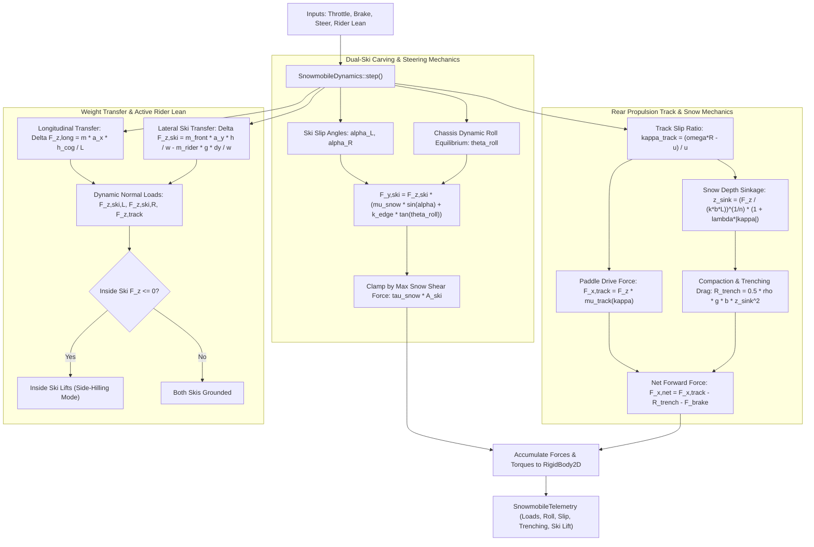
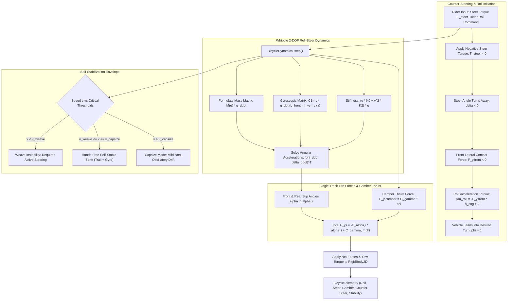
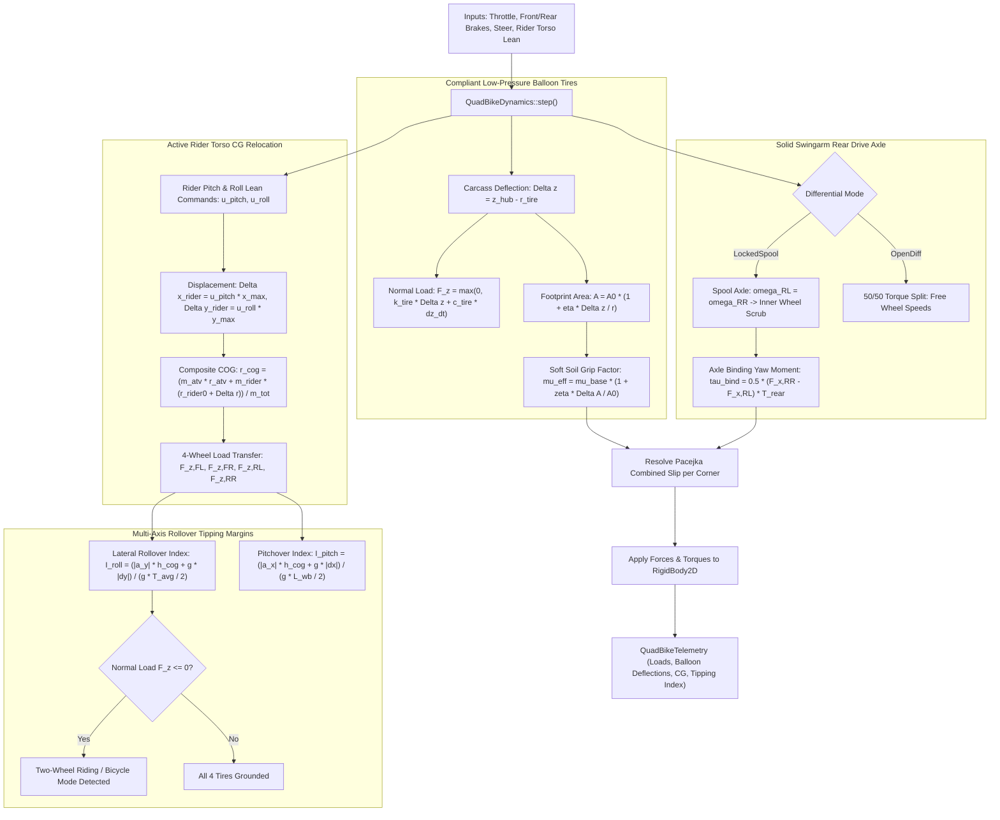

# Snowmobile, Bicycle & QuadBike Dynamics: C++17 Implementation Plan

## 1. Executive Summary & Scope

### 1.1 Objective & Context
This specification establishes the mathematical formulations, physical equations, software architecture, data contracts, and verification roadmap for three specialized all-terrain and single-track vehicle dynamics coordinators in `VehicleSimCore`:
1. **`SnowmobileDynamics`**: Simulates dual-ski and continuous track winter powersport snowmobiles. It models steerable ski carbide carving resistance, snow surface friction, continuous rear rubber track paddle propulsion, snow compaction trenching drag, dynamic chassis roll angle equilibrium, and rider dynamic body weight roll leaning.
2. **`BicycleDynamics`**: Implements the benchmark Whipple single-track bicycle model. It captures roll-steer kinematic coupling, counter-steering initiation dynamics, mechanical caster trail, front wheel gyroscopic self-stabilization across the critical speed envelope, and rounded tire profile camber thrust.
3. **`QuadBikeDynamics`**: Models 4-wheel all-terrain vehicles (ATVs) featuring low-pressure compliant balloon tires with dynamic footprint expansion, a solid swingarm rear drive axle (with selectable spool / open differential), independent front double-wishbone suspension, dynamic rider active 2D torso weight shifting, and multi-axis rollover tipping margins.

All three coordinators implement [IVehicleDynamics](../libs/VehicleSimCore/dynamics/IVehicleDynamics.h) within the pure C++17 `VehicleSimCore` architecture, adhering to:
- Zero external physics engine dependencies (pure C++17 standard library and internal `VehicleSimCore` math/physics).
- Zero heap allocations during simulation ticks (`step()` is strictly real-time and allocation-free).
- Full IEEE 754 floating-point determinism across Windows (MSVC/Clang) and Linux (GCC/Clang).
- Strict compliance with MISRA C++:2023 and SEI CERT C++ coding standards.
- Synchronous diagnostic telemetry export via dedicated telemetry structs.

---

## 2. Mathematical & Physical Formulation

### 2.1 Part A: Dual-Ski and Track Snowmobile Dynamics (`SnowmobileDynamics`)

```
  ASCII Diagram: Snowmobile Geometry, Ski Carving & Track Propulsion

             Left Steer Ski (delta_L)              Right Steer Ski (delta_R)
             [========*========]                    [========*========]
                      \                              /
                       \     Front Ski Stance (w_ski)/
                        \                           /
                         \        Chassis Body     /
                          \    Rider Torso Lean   /
                           \   (Delta y_rider)   /
                            \       [COG]       /
                             \                 /
                              \               /
                               [=============]
                               [  Rear Drive ] Continuous Rubber Track
                               [    Track    ] (Paddles, Trenching Drag)
                               [=============]
```



#### 1. Coordinate Frame & Layout Geometry
The vehicle coordinate system is defined with the origin at the static Center of Gravity (COG):
- $+x$ points forward along the longitudinal chassis centerline.
- $+y$ points leftward along the lateral axis.
- Dual front steerable skis are positioned at longitudinal offset $+L_{\text{front}}$ and lateral offsets $\pm w_{\text{ski}} / 2$.
- The continuous rear drive track centerline is positioned at longitudinal offset $-L_{\text{rear}}$, with track length $L_{\text{track}}$ and track width $W_{\text{track}}$.
- Total wheelbase: $L_{\text{wheelbase}} = L_{\text{front}} + L_{\text{rear}}$.

#### 2. Dual Steerable Ski Carving Mechanics
Each front ski generates lateral force through two distinct physical mechanisms:
1. **Base Snow Surface Friction**: Planar Coulomb friction between the polyethylene ski base and the snow surface:
   $$F_{y,\text{base},i} = F_{z,\text{ski},i} \cdot \mu_{\text{snow}} \cdot \sin(\alpha_{\text{ski},i})$$
   where $\alpha_{\text{ski},i}$ is the local ski slip angle:
   $$\alpha_{\text{ski},i} = \delta_i - \arctan2(v_{y,\text{ski},i}, |v_{x,\text{ski},i}| + \epsilon)$$
2. **Carbide Runner Edge Carving**: A steel runner with sharp carbide inserts protrudes below the ski keel. When the snowmobile rolls by angle $\theta_{\text{roll}}$, the inside edge bites into packed snow and ice, creating a mechanical wedging force:
   $$F_{y,\text{edge},i} = F_{z,\text{ski},i} \cdot k_{\text{edge}} \cdot \tan(\theta_{\text{roll}}) \cdot \cos(\alpha_{\text{ski},i})$$
   where $k_{\text{edge}}$ is the edge carving stiffness coefficient.

The total lateral force on ski $i \in \{\text{Left}, \text{Right}\}$ is:
$$F_{y,\text{ski},i} = F_{y,\text{base},i} + F_{y,\text{edge},i} = F_{z,\text{ski},i} \left( \mu_{\text{snow}} \sin(\alpha_{\text{ski},i}) + k_{\text{edge}} \tan(\theta_{\text{roll}}) \cos(\alpha_{\text{ski},i}) \right)$$

This force is bounded by the snow shear failure limit across the ski contact area $A_{\text{ski}} = L_{\text{ski}} \cdot W_{\text{ski}}$:
$$|F_{y,\text{ski},i}| \le \tau_{\text{snow}} A_{\text{ski}} + \mu_{\text{snow}} F_{z,\text{ski},i}$$
where $\tau_{\text{snow}}$ is the cohesive shear strength of the snowpack (typically $2.0 - 15.0$ kPa).

#### 3. Rear Continuous Track Propulsion & Snow Trenching Drag
The rear track is driven by the engine through a Continuously Variable Transmission (CVT) and centrifugal clutch:
- Sprocket angular velocity $\omega_{\text{track}}$ yields theoretical surface drive speed $v_{\text{track}} = \omega_{\text{track}} R_{\text{sprocket}}$.
- Longitudinal track slip ratio:
  $$\kappa_{\text{track}} = \frac{v_{\text{track}} - u_{\text{track}}}{\max(|u_{\text{track}}|, v_{\text{threshold}})}$$
- Paddle tractive force:
  $$F_{x,\text{track}} = F_{z,\text{track}} \cdot \mu_{\text{track,max}} \cdot \frac{2}{\pi} \arctan\left(C_{\text{track}} \kappa_{\text{track}}\right)$$

In loose powder snow, track slip causes snow displacement beneath the paddles, resulting in sinkage depth $z_{\text{sink}}$ (Bekker terramechanics):
$$z_{\text{sink}} = \left( \frac{F_{z,\text{track}}}{k_{\text{snow}} W_{\text{track}} L_{\text{track}}} \right)^{1/n_{\text{snow}}} \cdot \left(1 + \lambda_{\text{slip}} |\kappa_{\text{track}}|\right)$$

This sinkage induces a snow compaction and trenching drag force opposing vehicle forward velocity:
$$R_{\text{trench}} = \frac{1}{2} \rho_{\text{snow}} g W_{\text{track}} z_{\text{sink}}^2 \operatorname{sgn}(u)$$
where $\rho_{\text{snow}}$ is snow density ($150 - 450\,\text{kg/m}^3$) and $g$ is gravity.

Net tractive thrust delivered to the chassis:
$$F_{x,\text{net,track}} = F_{x,\text{track}} - R_{\text{trench}} - F_{\text{track,brake}}$$

#### 4. Dynamic Roll Equilibrium & Rider Weight Shifting
Snowmobiles feature narrow front ski stances ($w_{\text{ski}} \approx 0.90 - 1.10$ m) and high centers of gravity, requiring riders to actively shift their body weight into turns to avoid tipping over:
- Dynamic chassis roll angle $\theta_{\text{roll}}$ evolves according to:
  $$I_{\text{roll}} \ddot{\theta}_{\text{roll}} = m a_y h_{\text{cog}} + m_{\text{rider}} g \Delta y_{\text{rider}} - k_{\text{roll,susp}} \theta_{\text{roll}} - c_{\text{roll,susp}} \dot{\theta}_{\text{roll}}$$
  where:
  - $m a_y h_{\text{cog}}$ is the destabilizing centrifugal overturning moment.
  - $m_{\text{rider}} g \Delta y_{\text{rider}}$ is the stabilizing roll restoring moment from active rider leaning ($\Delta y_{\text{rider}} \in [-w_{\text{ski}}/2, +w_{\text{ski}}/2]$).
  - $k_{\text{roll,susp}}, c_{\text{roll,susp}}$ are front suspension anti-roll stiffness and damping.

#### 5. Dynamic Normal Load Transfer & Inside Ski Lift
- Static normal loads:
  $$F_{z,\text{front,static}} = m g \frac{L_{\text{rear}}}{L_{\text{wheelbase}}}, \quad F_{z,\text{track,static}} = m g \frac{L_{\text{front}}}{L_{\text{wheelbase}}}$$
- Longitudinal acceleration transfer:
  $$\Delta F_{z,\text{long}} = m a_x \frac{h_{\text{cog}}}{L_{\text{wheelbase}}}$$
  $$F_{z,\text{front}} = \max\left(0.0, F_{z,\text{front,static}} - \Delta F_{z,\text{long}}\right)$$
  $$F_{z,\text{track}} = \max\left(0.0, F_{z,\text{track,static}} + \Delta F_{z,\text{long}}\right)$$
- Lateral ski normal load transfer:
  $$\Delta F_{z,\text{ski,lat}} = m_{\text{front}} a_y \frac{h_{\text{cog}}}{w_{\text{ski}}} - m_{\text{rider}} g \frac{\Delta y_{\text{rider}}}{w_{\text{ski}}}$$
  $$F_{z,\text{ski,L}} = \max\left(0.0, \frac{1}{2} F_{z,\text{front}} - \Delta F_{z,\text{ski,lat}}\right)$$
  $$F_{z,\text{ski,R}} = \max\left(0.0, \frac{1}{2} F_{z,\text{front}} + \Delta F_{z,\text{ski,lat}}\right)$$

**Inside Ski Lift (Side-Hilling)**: When $|\Delta F_{z,\text{ski,lat}}| \ge \frac{1}{2} F_{z,\text{front}}$, the inside ski normal force drops to zero and lifts off the snow. The snowmobile transitions to single-ski side-hilling mode, with all steering authority transferred to the loaded outside ski.

**Power Wheelie**: Under hard acceleration, if $\Delta F_{z,\text{long}} \ge F_{z,\text{front,static}}$, both front skis lift off the snow ($F_{z,\text{front}} = 0$). All front steering is lost until throttle is reduced.

---

### 2.2 Part B: Single-Track Whipple Bicycle Dynamics (`BicycleDynamics`)

```
  ASCII Diagram: Bicycle Geometry, Steering Axis & Mechanical Trail

          Handlebars (T_steer)
              |
              | Fork Steering Axis (Rake Angle lambda)
              |
              o Front Wheel Hub (Spin Momentum L_front)
             / \
            /   \
           /     \
    ======*=======+================ Ground Plane
       Contact  Projected
        Patch   Steer Axis
       |<- Trail (c_trail) ->|
```



#### 1. Degrees of Freedom & Kinematic State
The single-track Whipple bicycle model has four primary state variables:
- Planar position coordinates $(x, y)$ of the rear wheel contact patch.
- Heading / yaw angle $\psi$.
- Roll / lean angle $\phi$ (positive leaning right).
- Steering angle $\delta$ (positive steering right).
- Forward velocity $v = \dot{x}_{\text{body}}$.

#### 2. Geometry, Rake & Mechanical Trail
- Wheelbase: $L_{\text{wb}}$ (distance between front and rear ground contact patches).
- Head tube angle (rake angle from horizontal): $\lambda$ (typically $70^\circ - 74^\circ$, $1.22 - 1.29$ rad).
- Fork rake / offset: $f_{\text{rake}}$ (perpendicular offset from steering axis to front wheel hub).
- Front wheel radius $r_f$, rear wheel radius $r_r$.
- **Mechanical Trail ($c_{\text{trail}}$)**:
  $$c_{\text{trail}} = \frac{r_f \cos(\lambda) - f_{\text{rake}}}{\sin(\lambda)}$$
  Positive trail ($c_{\text{trail}} > 0$) positions the contact patch behind the steering axis ground piercing point, generating a caster self-aligning moment.

#### 3. Linearized Whipple Equations of Motion
In generalized coordinates $\mathbf{q} = [\phi, \delta]^T$, the lateral dynamic equilibrium is:
$$\mathbf{M} \ddot{\mathbf{q}} + \left( v \mathbf{C}_1 \right) \dot{\mathbf{q}} + \left( g \mathbf{K}_0 + v^2 \mathbf{K}_2 \right) \mathbf{q} = \mathbf{f}_{\text{ext}}$$

where:
- $\mathbf{M} = \begin{bmatrix} M_{\phi\phi} & M_{\phi\delta} \\ M_{\delta\phi} & M_{\delta\delta} \end{bmatrix}$ is the symmetric, positive-definite mass matrix:
  - $M_{\phi\phi} = I_{xx,\text{total}} + m_{\text{total}} h_{\text{cog}}^2$
  - $M_{\phi\delta} = M_{\delta\phi} = I_{xz,\text{fork}} \sin(\lambda) + m_{\text{fork}} u_{\text{fork}} h_{\text{cog}}$
  - $M_{\delta\delta} = I_{zz,\text{fork}} \sin^2(\lambda) + I_{xx,\text{fork}} \cos^2(\lambda) + 2 I_{xz,\text{fork}} \sin(\lambda) \cos(\lambda)$
- $\mathbf{C}_1 = \begin{bmatrix} 0 & C_{1,\phi\delta} \\ C_{1,\delta\phi} & C_{1,\delta\delta} \end{bmatrix}$ represents gyroscopic and Coriolis coupling:
  - Front wheel angular momentum: $L_f = I_{yy,f} \frac{v}{r_f}$
  - Rear wheel angular momentum: $L_r = I_{yy,r} \frac{v}{r_r}$
  - $C_{1,\phi\delta} = \frac{L_f + L_r}{L_{\text{wb}}} c_{\text{trail}} + L_f \sin(\lambda)$
  - $C_{1,\delta\phi} = -L_f \sin(\lambda)$
- $\mathbf{K}_0 = \begin{bmatrix} -m_{\text{total}} h_{\text{cog}} & K_{0,\phi\delta} \\ K_{0,\delta\phi} & -m_{\text{fork}} u_{\text{fork}} g \sin(\lambda) \end{bmatrix}$ is the gravitational stiffness (inverted pendulum instability).
- $\mathbf{K}_2 = \begin{bmatrix} 0 & \frac{m_{\text{total}} h_{\text{cog}} + m_{\text{fork}} u_{\text{fork}}}{L_{\text{wb}}} \cos(\lambda) \\ 0 & \frac{m_{\text{fork}} u_{\text{fork}} c_{\text{trail}}}{L_{\text{wb}}} \cos(\lambda) \end{bmatrix}$ is the centrifugal stiffness.
- $\mathbf{f}_{\text{ext}} = \begin{bmatrix} T_{\text{roll,rider}} \\ T_{\text{steer}} \end{bmatrix}$ contains rider roll lean torque and handlebar steer torque.

#### 4. Counter-Steering Initiation Mechanics
When initiating a turn to the right:
1. Rider applies a momentary negative steering torque: $T_{\text{steer}} < 0$.
2. Steer acceleration deflects the front wheel leftward: $\ddot{\delta} < 0 \implies \delta < 0$.
3. The front tire develops a lateral contact patch force to the left:
   $$F_{y,f} \approx -C_{\alpha,f} \delta \cos(\lambda) < 0$$
4. Because the contact force acts at ground level below the vehicle Center of Gravity ($h_{\text{cog}} > 0$), it exerts a destabilizing roll torque toward the right:
   $$\tau_{\text{roll}} = -F_{y,f} \cdot h_{\text{cog}} > 0 \implies \ddot{\phi} > 0$$
5. As the vehicle rolls into the right lean angle ($\phi > 0$), gyroscopic precession and caster trail swing the steering wheel smoothly back into the turn ($\delta > 0$), establishing steady-state cornering equilibrium.

#### 5. Tire Camber Thrust & Contact Forces
Unlike automotive flat-tread tires, bicycle tires have circular cross-sections. When leaned by roll angle $\phi$, the contact patch develops a lateral camber thrust force in the direction of the lean:
$$F_{y,\text{camber},i} = C_{\gamma,i} \cdot \phi$$
where $C_{\gamma,i}$ is the camber stiffness coefficient ($N/\text{rad}$).

The total lateral force on wheel $i \in \{\text{front}, \text{rear}\}$ is:
$$F_{y,i} = -C_{\alpha,i} \alpha_i + C_{\gamma,i} \phi$$
subject to friction circle saturation:
$$F_{y,i,\text{max}} = \sqrt{\max\left(0.0, (\mu F_{z,i})^2 - F_{x,i}^2\right)}$$

#### 6. Self-Stabilization Envelope
The roots of the characteristic polynomial $\det(\mathbf{M} s^2 + v \mathbf{C}_1 s + g \mathbf{K}_0 + v^2 \mathbf{K}_2) = 0$ define three distinct operational velocity regimes:
1. **Weave Regime ($0 \le v < v_{\text{weave}} \approx 4.0 - 4.5\,\text{m/s}$)**:
   - Complex conjugate eigenvalue pair in the right half-plane ($\operatorname{Re}(s) > 0$).
   - Oscillatory instability (weave). The bicycle will fall without active rider balance corrections.
2. **Self-Stable Regime ($v_{\text{weave}} \le v \le v_{\text{capsize}} \approx 8.0 - 9.0\,\text{m/s}$)**:
   - All four eigenvalues have negative real parts ($\operatorname{Re}(s) < 0$).
   - The bicycle is passively stable hands-free! Gyroscopic precession and caster trail automatically right the vehicle.
3. **Capsize Regime ($v > v_{\text{capsize}}$)**:
   - One real eigenvalue becomes slightly positive, causing a very slow, non-oscillatory spiraling lean (easily stabilized by minimal rider steering input).

---

### 2.3 Part C: All-Terrain Vehicle Quad Bike Dynamics (`QuadBikeDynamics`)

```
  ASCII Diagram: ATV Quad Bike Suspension, Balloon Tires & Rider CG Shift

     [FL Balloon Tire] =================== (A-Arms) =================== [FR Balloon Tire]
             \                                                                 /
              \               Dynamic Active Rider Torso                      /
               \              Lean (Delta x_rider, Delta y_rider)             /
                \                              |                             /
                 \                           [COG]                          /
                  \                                                        /
     [RL Balloon Tire] ================= (Solid Axle) ================= [RR Balloon Tire]
```



#### 1. Low-Pressure Compliant Balloon Tire Mechanics
ATVs utilize oversized balloon tires running at ultra-low inflation pressure ($p_{\text{tire}} \approx 20 - 45\,\text{kPa}$ or $3.0 - 6.5\,\text{psi}$).
- The tire carcass acts as an un-damped secondary spring in series with the suspension:
  $$F_{z,\text{tire},i} = \max\left(0.0, k_{\text{balloon}} \Delta z_{\text{tire},i} + c_{\text{balloon}} \Delta \dot{z}_{\text{tire},i}\right)$$
  where $\Delta z_{\text{tire},i} = r_{\text{free}} - (z_{\text{hub},i} - z_{\text{ground},i})$ is carcass radial deflection.
- **Dynamic Contact Footprint Expansion**: As the soft tire compresses under load, its contact patch area expands dramatically:
  $$A_{\text{patch},i}(\Delta z) = A_0 \left(1 + \eta_{\text{balloon}} \frac{\Delta z_{\text{tire},i}}{r_{\text{free}}}\right)$$
- **Flotation & Grip Enhancement on Soft Soil**:
  The contact ground pressure decreases: $p_{\text{ground},i} = \frac{F_{z,\text{tire},i}}{A_{\text{patch},i}}$.
  Reduced ground pressure prevents sinkage in mud and sand, boosting effective shear traction:
  $$\mu_{\text{eff},i} = \mu_{\text{surface}} \left(1 + \zeta_{\text{balloon}} \frac{A_{\text{patch},i} - A_0}{A_0}\right)$$

#### 2. Solid Swingarm Rear Drive Axle Mechanics
The rear axle consists of a single rigid beam enclosing the drive shaft, pivoting on a central swingarm hinge:
- The rear track width $T_{\text{rear}}$ remains strictly constant regardless of suspension vertical stroke.
- **Differential Configuration**:
  - `QuadDiffMode::LockedSpool`: The left and right rear wheels are locked to a common drive shaft ($\omega_{\text{RL}} = \omega_{\text{RR}}$). When cornering at yaw rate $\omega_z$, differences in path radius force longitudinal tire scrubbing:
    $$\kappa_{\text{scrub,RL}} = \frac{\omega_{\text{axle}} r_{\text{tire}} - (u - \omega_z T_{\text{rear}}/2)}{\max(|u|, v_{\text{threshold}})}$$
    $$\kappa_{\text{scrub,RR}} = \frac{\omega_{\text{axle}} r_{\text{tire}} - (u + \omega_z T_{\text{rear}}/2)}{\max(|u|, v_{\text{threshold}})}$$
    generating an opposing yaw binding moment $\tau_{\text{bind}} = \frac{1}{2}(F_{x,\text{RR}} - F_{x,\text{RL}}) T_{\text{rear}}$ that stabilizes straight-line tracking but increases low-speed turning effort.
  - `QuadDiffMode::OpenDifferential`: Drive torque is evenly split $50/50$, allowing independent wheel rotational speeds with zero cornering binding torque.

#### 3. Independent Front Double-Wishbone Suspension
Front wheels are mounted on independent upper and lower A-arms:
- Kinematic camber angle changes with vertical suspension deflection $\Delta z_{\text{susp}}$:
  $$\gamma_{\text{front}}(\Delta z) = \gamma_0 + k_{\text{camber,gain}} \Delta z_{\text{susp}}$$
- Front roll center height $h_{\text{rc,front}}$ is determined by A-arm instant center geometry.

#### 4. Active Rider Dynamic Body Weight Shifting
Because the ATV dry mass is relatively light ($m_{\text{atv}} \approx 180 - 230\,\text{kg}$) compared to rider mass ($m_{\text{rider}} \approx 75 - 85\,\text{kg}$), the rider's physical posture shifts the composite Center of Gravity significantly:
- Rider torso displacement commands:
  - Longitudinal shift: $\Delta x_{\text{rider}} = u_{\text{lean,pitch}} \cdot x_{\text{shift,max}}$ ($+x$ leans forward for steep hill climbing, $-x$ leans backward for steep descents).
  - Lateral shift: $\Delta y_{\text{rider}} = u_{\text{lean,roll}} \cdot y_{\text{shift,max}}$ ($\pm y$ hangs off the inside peg to stabilize high-speed turns).
- Dynamic composite Center of Gravity coordinates:
  $$\mathbf{r}_{\text{cog,comp}} = \frac{m_{\text{atv}} \mathbf{r}_{\text{cog,atv}} + m_{\text{rider}} \left( \mathbf{r}_{\text{cog,rider0}} + [\Delta x_{\text{rider}}, \Delta y_{\text{rider}}, \Delta z_{\text{rider}}]^T \right)}{m_{\text{atv}} + m_{\text{rider}}}$$

#### 5. Dynamic 4-Wheel Normal Load Transfer & Rollover Tipping Margins
Let dynamic lateral acceleration be $a_y$ and longitudinal acceleration be $a_x$.
- Longitudinal load transfer:
  $$\Delta F_{z,x} = (m_{\text{atv}} + m_{\text{rider}}) a_x \frac{h_{\text{cog,comp}}}{L_{\text{wb}}}$$
- Lateral load transfer partitioned by front and rear roll stiffness ($K_{\phi,\text{front}}, K_{\phi,\text{rear}}$):
  $$\Delta F_{z,y,\text{front}} = \frac{K_{\phi,\text{front}}}{K_{\phi,\text{total}}} \left( (m_{\text{tot}}) a_y \frac{h_{\text{cog,comp}}}{T_{\text{front}}} \right)$$
  $$\Delta F_{z,y,\text{rear}} = \frac{K_{\phi,\text{rear}}}{K_{\phi,\text{total}}} \left( (m_{\text{tot}}) a_y \frac{h_{\text{cog,comp}}}{T_{\text{rear}}} \right)$$

Dynamic vertical loads on the four tire contact patches:
$$F_{z,\text{FL}} = \max\left(0.0, F_{z,\text{FL,static}} - \frac{1}{2}\Delta F_{z,x} - \Delta F_{z,y,\text{front}}\right)$$
$$F_{z,\text{FR}} = \max\left(0.0, F_{z,\text{FR,static}} - \frac{1}{2}\Delta F_{z,x} + \Delta F_{z,y,\text{front}}\right)$$
$$F_{z,\text{RL}} = \max\left(0.0, F_{z,\text{RL,static}} + \frac{1}{2}\Delta F_{z,x} - \Delta F_{z,y,\text{rear}}\right)$$
$$F_{z,\text{RR}} = \max\left(0.0, F_{z,\text{RR,static}} + \frac{1}{2}\Delta F_{z,x} + \Delta F_{z,y,\text{rear}}\right)$$

**Rollover & Pitchover Safety Metrics**:
- **Lateral Rollover Index ($I_{\text{rollover}}$)**:
  $$I_{\text{rollover}} = \frac{|a_y| h_{\text{cog,comp}} + g |\Delta y_{\text{cog,comp}}|}{g \cdot (T_{\text{avg}} / 2)}$$
  When $I_{\text{rollover}} \ge 1.0$, the inside wheels lift completely off the ground (two-wheel bicycle riding mode).
- **Pitchover Index ($I_{\text{pitchover}}$)**:
  $$I_{\text{pitchover}} = \frac{|a_x| h_{\text{cog,comp}} + g |\Delta x_{\text{cog,comp}}|}{g \cdot (L_{\text{wb}} / 2)}$$
  When $I_{\text{pitchover}} \ge 1.0$, the vehicle flips backward (wheelie rollover) or forward (stoppie endo).

---

## 3. Architecture & Design

### 3.1 Component Structure

```
libs/VehicleSimCore/
└── dynamics/
    ├── SnowmobileDynamics.h        [NEW] - Dual-ski & continuous track powersport coordinator header
    ├── SnowmobileDynamics.cpp      [NEW] - Ski carving, snow trenching, roll lean, track propulsion
    ├── BicycleDynamics.h           [NEW] - Single-track Whipple bicycle coordinator header
    ├── BicycleDynamics.cpp         [NEW] - 2-DOF roll-steer, counter-steer, gyro precession, camber thrust
    ├── QuadBikeDynamics.h          [NEW] - 4-wheel all-terrain vehicle coordinator header
    ├── QuadBikeDynamics.cpp        [NEW] - Balloon tires, solid spool rear axle, active rider CG shift
    ├── IVehicleDynamics.h          [REFERENCED] - Base interface contract
    ├── PacejkaTireModel.h          [REFERENCED] - Magic Formula combined slip tire friction
    └── RaceCarDynamics.h           [REFERENCED] - 4-wheel reference implementation
tests/
├── SnowmobileDynamicsTest.cpp      [NEW] - Unit test suite for ski carving, trenching & inside ski lift
├── BicycleDynamicsTest.cpp         [NEW] - Unit test suite for Whipple roll-steer, counter-steer & gyro
└── QuadBikeDynamicsTest.cpp        [NEW] - Unit test suite for balloon tires, spool axle & rider CG shift
```

---

## 4. Data Contracts & C++17 Header Specifications

### 4.1 Part A: `SnowmobileDynamics.h`

```cpp
#pragma once

#include <cmath>

#include "libs/VehicleSimCore/dynamics/IVehicleDynamics.h"
#include "libs/VehicleSimCore/math/Vec2.h"

namespace vehicle_sim::physics {
class RigidBody2D;
} // namespace vehicle_sim::physics

namespace vehicle_sim::dynamics {

/// @struct SnowmobileConfig
/// @brief Physical, ski carving, track propulsion, and snowpack parameters for SnowmobileDynamics.
struct SnowmobileConfig {
    double chassisMass { 230.0 }; ///< Dry mass of snowmobile chassis and engine in kg.
    double riderMass { 80.0 }; ///< Active rider body mass in kg.
    double rollInertia { 42.0 }; ///< Moment of inertia about longitudinal roll axis in kg*m^2.
    double yawInertia { 120.0 }; ///< Moment of inertia about vertical yaw axis in kg*m^2.

    double distFrontSkis { 0.95 }; ///< Longitudinal distance from static COG to front ski pivot in meters.
    double distRearTrack { 0.65 }; ///< Longitudinal distance from static COG to track center in meters.
    double skiStanceWidth { 1.05 }; ///< Transverse distance between left and right ski centers in meters.
    double cogHeight { 0.48 }; ///< Height of composite COG above ground plane in meters.

    // Ski Carving Parameters
    double skiLength { 1.10 }; ///< Front ski keel length in meters.
    double skiWidth { 0.18 }; ///< Front ski base width in meters.
    double skiBaseFriction { 0.08 }; ///< Kinetic friction of polyethylene base on cold snow.
    double skiCarveStiffness { 1.45 }; ///< Carbide runner edge carving multiplier k_edge.
    double maxSteerAngle { 0.52 }; ///< Maximum handlebar steering angle in radians (~30 degrees).
    double snowShearStrength { 6000.0 }; ///< Snowpack cohesive shear strength tau_snow in N/m^2.

    // Track Propulsion & Snow Mechanics
    double trackLength { 1.40 }; ///< Ground contact length of rear continuous track in meters.
    double trackWidth { 0.40 }; ///< Rear track width in meters.
    double sprocketRadius { 0.12 }; ///< Drive sprocket radius in meters.
    double maxDriveForce { 3800.0 }; ///< Peak engine tractive force at drive sprocket in Newtons.
    double maxBrakeForce { 4200.0 }; ///< Hydraulic disc brake capacity on drive track shaft in Newtons.
    double trackFrictionPeak { 0.75 }; ///< Peak friction coefficient of paddle track on snow.
    double snowDensity { 280.0 }; ///< Loose snow density rho_snow in kg/m^3.
    double snowCompactionModulus { 18000.0 }; ///< Bekker snow sinkage stiffness k_snow in N/m^(n+2).
    double snowSinkageExponent { 1.15 }; ///< Bekker sinkage exponent n_snow.
    double slipTrenchingGain { 1.80 }; ///< Trenching sinkage multiplier under high slip ratio.

    // Suspension & Roll Dynamics
    double rollStiffness { 3200.0 }; ///< Front A-arm suspension anti-roll stiffness in N*m/rad.
    double rollDamping { 380.0 }; ///< Roll angular velocity damping coefficient in N*m*s/rad.
    double riderMaxShiftY { 0.45 }; ///< Maximum lateral displacement of rider Center of Mass in meters.
};

/// @struct SnowmobileInput
/// @brief Driver control commands for snowmobile dynamics.
struct SnowmobileInput {
    double throttle { 0.0 }; ///< Engine throttle command in range [0.0, 1.0].
    double brake { 0.0 }; ///< Track service brake command in range [0.0, 1.0].
    double steer { 0.0 }; ///< Handlebar steer command in range [-1.0, 1.0] (+1 right, -1 left).
    double riderLean { 0.0 }; ///< Active rider body lean command in range [-1.0, 1.0] (+1 right, -1 left).
};

/// @struct SnowmobileTelemetry
/// @brief Diagnostic telemetry snapshot for snowmobile dynamics.
struct SnowmobileTelemetry {
    double forwardSpeed { 0.0 }; ///< Forward longitudinal velocity in m/s.
    double lateralSpeed { 0.0 }; ///< Lateral sideslip velocity in m/s.
    double yawRate { 0.0 }; ///< Chassis yaw rate in rad/s.
    double rollAngle { 0.0 }; ///< Dynamic chassis roll angle theta_roll in radians.
    double rollRate { 0.0 }; ///< Chassis roll angular velocity in rad/s.

    double leftSkiLoad { 0.0 }; ///< Dynamic normal force on left ski in Newtons.
    double rightSkiLoad { 0.0 }; ///< Dynamic normal force on right ski in Newtons.
    double trackLoad { 0.0 }; ///< Dynamic normal force on rear continuous track in Newtons.

    double leftSkiCarveForce { 0.0 }; ///< Lateral edge carving force from left ski in Newtons.
    double rightSkiCarveForce { 0.0 }; ///< Lateral edge carving force from right ski in Newtons.
    double trackTractiveForce { 0.0 }; ///< Forward thrust from drive track paddles in Newtons.
    double trackTrenchingDrag { 0.0 }; ///< Opposing snow compaction & trenching resistance in Newtons.
    double trackSlipRatio { 0.0 }; ///< Longitudinal slip ratio kappa_track.
    double snowSinkageDepth { 0.0 }; ///< Snow sinkage / trench depth z_sink in meters.

    bool isInsideSkiLifted { false }; ///< True when inside ski unweights and lifts off snow.
    bool isPowerWheelie { false }; ///< True when front skis unweight completely under acceleration.
    bool isAirborne { false }; ///< True when chassis is completely detached from snow surface.
};

/// @class SnowmobileDynamics
/// @brief Dual-ski and continuous track winter powersport dynamics coordinator.
class SnowmobileDynamics final : public IVehicleDynamics {
public:
    /// @brief Default constructor using standard mountain snowmobile configuration.
    SnowmobileDynamics() noexcept;

    /// @brief Parameterized constructor using custom snowmobile configuration.
    /// @param[in] config Physical and snow parameters.
    explicit SnowmobileDynamics(const SnowmobileConfig& config) noexcept;

    /// @brief Advances simulation step, applying ski and track forces to the rigid body.
    /// @param[in,out] body Target rigid body representing snowmobile chassis.
    /// @param[in] dt Timestep duration in seconds.
    void step(physics::RigidBody2D& body, double dt) noexcept override;

    /// @brief Resets transient dynamics states and roll angle.
    void reset() noexcept override;

    /// @brief Queries whether snowmobile is airborne.
    /// @return True if skis and track are completely off the snow surface.
    [[nodiscard]] bool isAirborne() const noexcept override;

    /// @brief Gets active snowmobile configuration.
    /// @return Const reference to SnowmobileConfig.
    [[nodiscard]] const SnowmobileConfig& getConfig() const noexcept;

    /// @brief Updates active snowmobile configuration.
    /// @param[in] config New configuration parameters.
    void setConfig(const SnowmobileConfig& config) noexcept;

    /// @brief Gets current driver control inputs.
    /// @return Const reference to SnowmobileInput.
    [[nodiscard]] const SnowmobileInput& getInput() const noexcept;

    /// @brief Sets current driver control inputs.
    /// @param[in] input New driver commands.
    void setInput(const SnowmobileInput& input) noexcept;

    /// @brief Gets current diagnostic telemetry.
    /// @return Const reference to SnowmobileTelemetry.
    [[nodiscard]] const SnowmobileTelemetry& getTelemetry() const noexcept;

private:
    SnowmobileConfig m_config{};
    SnowmobileInput m_input{};
    SnowmobileTelemetry m_telemetry{};

    double m_rollAngleRad{ 0.0 };
    double m_rollRateRadPerSec{ 0.0 };
    bool m_isAirborne{ false };
};

} // namespace vehicle_sim::dynamics
```

---

### 4.2 Part B: `BicycleDynamics.h`

```cpp
#pragma once

#include <cmath>

#include "libs/VehicleSimCore/dynamics/IVehicleDynamics.h"
#include "libs/VehicleSimCore/math/Vec2.h"

namespace vehicle_sim::physics {
class RigidBody2D;
} // namespace vehicle_sim::physics

namespace vehicle_sim::dynamics {

/// @struct BicycleConfig
/// @brief Physical, geometric, and Whipple stability parameters for BicycleDynamics.
struct BicycleConfig {
    double totalMass { 85.0 }; ///< Combined mass of bicycle frame, wheels, and rider in kg.
    double riderMass { 72.0 }; ///< Active rider mass in kg.
    double forkMass { 4.2 }; ///< Mass of front fork, handlebars, and front wheel assembly in kg.
    double wheelbase { 1.02 }; ///< Wheelbase L_wb between wheel contact patches in meters.
    double distFrontAxle { 0.62 }; ///< Longitudinal distance from static COG to front axle in meters.
    double cogHeight { 0.95 }; ///< Height of composite COG above ground in meters.

    // Geometry & Caster Trail
    double headTubeAngleRad { 1.27 }; ///< Steering axis rake angle lambda (~73 degrees from horizontal).
    double forkRakeOffset { 0.045 }; ///< Fork forward offset f_rake in meters.
    double frontWheelRadius { 0.34 }; ///< Front tire rolling radius in meters (700c wheel).
    double rearWheelRadius { 0.34 }; ///< Rear tire rolling radius in meters.
    double frontWheelSpinInertia { 0.14 }; ///< Front wheel spin polar moment of inertia I_yy,f in kg*m^2.
    double rearWheelSpinInertia { 0.16 }; ///< Rear wheel spin polar moment of inertia I_yy,r in kg*m^2.

    // Tire Cornering & Camber Properties
    double frontCorneringStiffness { 420.0 }; ///< Front tire cornering stiffness C_alpha in N/rad.
    double rearCorneringStiffness { 480.0 }; ///< Rear tire cornering stiffness C_alpha in N/rad.
    double frontCamberStiffness { 65.0 }; ///< Front round-profile tire camber thrust stiffness C_gamma in N/rad.
    double rearCamberStiffness { 72.0 }; ///< Rear round-profile tire camber thrust stiffness C_gamma in N/rad.
    double tireFrictionCoeff { 0.95 }; ///< Maximum tire-asphalt friction coefficient.

    // Whipple Inertia Matrix Elements (M_phi_phi, M_phi_delta, M_delta_delta)
    double massRollInertia { 9.8 }; ///< Composite roll moment of inertia M_phi_phi in kg*m^2.
    double massCrossInertia { 0.38 }; ///< Roll-steer cross product of inertia M_phi_delta in kg*m^2.
    double massSteerInertia { 0.28 }; ///< Steering assembly moment of inertia M_delta_delta in kg*m^2.

    double steerDamping { 2.4 }; ///< Steering headset viscous damping in N*m*s/rad.
    double maxSteerAngle { 0.70 }; ///< Maximum mechanical handlebar steering lock in radians (~40 deg).
    double maxDriveForce { 650.0 }; ///< Peak pedaling tractive chain drive force in Newtons.
    double maxFrontBrakeForce { 950.0 }; ///< Front hydraulic disc brake maximum force in Newtons.
    double maxRearBrakeForce { 600.0 }; ///< Rear hydraulic disc brake maximum force in Newtons.
};

/// @struct BicycleInput
/// @brief Rider control commands for Whipple single-track bicycle dynamics.
struct BicycleInput {
    double pedalingThrottle { 0.0 }; ///< Pedaling drive force command in range [0.0, 1.0].
    double frontBrake { 0.0 }; ///< Front handbrake lever command in range [0.0, 1.0].
    double rearBrake { 0.0 }; ///< Rear handbrake lever command in range [0.0, 1.0].
    double steerTorque { 0.0 }; ///< Rider handlebar steer torque command in N*m (+ right, - left).
    double riderLeanRoll { 0.0 }; ///< Rider upper body lean command in range [-1.0, 1.0] (+ right, - left).
};

/// @struct BicycleTelemetry
/// @brief Diagnostic telemetry snapshot for Whipple single-track bicycle dynamics.
struct BicycleTelemetry {
    double forwardSpeed { 0.0 }; ///< Forward longitudinal velocity in m/s.
    double rollAngle { 0.0 }; ///< Lean / roll angle phi in radians (+ right, - left).
    double rollRate { 0.0 }; ///< Roll angular velocity in rad/s.
    double steerAngle { 0.0 }; ///< Handlebar steer angle delta in radians.
    double steerRate { 0.0 }; ///< Steer angular velocity in rad/s.

    double mechanicalTrail { 0.0 }; ///< Effective mechanical trail c_trail in meters.
    double frontWheelGyroscopicTorque { 0.0 }; ///< Gyroscopic precession torque from front wheel in N*m.
    double casterRestoringTorque { 0.0 }; ///< Self-aligning torque from caster trail in N*m.

    double frontNormalLoad { 0.0 }; ///< Dynamic vertical load on front tire in Newtons.
    double rearNormalLoad { 0.0 }; ///< Dynamic vertical load on rear tire in Newtons.
    double frontLateralForce { 0.0 }; ///< Total lateral contact patch force on front tire in Newtons.
    double rearLateralForce { 0.0 }; ///< Total lateral contact patch force on rear tire in Newtons.
    double frontCamberThrust { 0.0 }; ///< Camber thrust component on front tire in Newtons.
    double rearCamberThrust { 0.0 }; ///< Camber thrust component on rear tire in Newtons.

    bool isCounterSteering { false }; ///< True when steer angle opposes roll lean direction.
    bool isSelfStable { false }; ///< True when forward speed falls within hands-free stability window.
    bool isCapsizeMode { false }; ///< True when operating above critical capsize velocity.
    bool isAirborne { false }; ///< True when both tires are detached from ground.
};

/// @class BicycleDynamics
/// @brief Benchmark Whipple single-track bicycle dynamics coordinator.
class BicycleDynamics final : public IVehicleDynamics {
public:
    /// @brief Default constructor using road racing bicycle configuration.
    BicycleDynamics() noexcept;

    /// @brief Parameterized constructor using custom bicycle configuration.
    /// @param[in] config Physical and geometric parameters.
    explicit BicycleDynamics(const BicycleConfig& config) noexcept;

    /// @brief Advances simulation step, integrating 2-DOF roll-steer equations.
    /// @param[in,out] body Target rigid body representing bicycle chassis.
    /// @param[in] dt Timestep duration in seconds.
    void step(physics::RigidBody2D& body, double dt) noexcept override;

    /// @brief Resets transient dynamics, roll angle, and steer angle states.
    void reset() noexcept override;

    /// @brief Queries whether bicycle is airborne.
    /// @return True if both tires have lost contact with the ground.
    [[nodiscard]] bool isAirborne() const noexcept override;

    /// @brief Gets active bicycle configuration.
    /// @return Const reference to BicycleConfig.
    [[nodiscard]] const BicycleConfig& getConfig() const noexcept;

    /// @brief Updates active bicycle configuration.
    /// @param[in] config New configuration parameters.
    void setConfig(const BicycleConfig& config) noexcept;

    /// @brief Gets current rider control inputs.
    /// @return Const reference to BicycleInput.
    [[nodiscard]] const BicycleInput& getInput() const noexcept;

    /// @brief Sets current rider control inputs.
    /// @param[in] input New rider commands.
    void setInput(const BicycleInput& input) noexcept;

    /// @brief Gets current diagnostic telemetry.
    /// @return Const reference to BicycleTelemetry.
    [[nodiscard]] const BicycleTelemetry& getTelemetry() const noexcept;

private:
    BicycleConfig m_config{};
    BicycleInput m_input{};
    BicycleTelemetry m_telemetry{};

    double m_rollAngleRad{ 0.0 };
    double m_rollRateRadPerSec{ 0.0 };
    double m_steerAngleRad{ 0.0 };
    double m_steerRateRadPerSec{ 0.0 };
    bool m_isAirborne{ false };
};

} // namespace vehicle_sim::dynamics
```

---

### 4.3 Part C: `QuadBikeDynamics.h`

```cpp
#pragma once

#include <array>
#include <cmath>

#include "libs/VehicleSimCore/dynamics/IVehicleDynamics.h"
#include "libs/VehicleSimCore/dynamics/PacejkaTireModel.h"
#include "libs/VehicleSimCore/math/Vec2.h"

namespace vehicle_sim::physics {
class RigidBody2D;
} // namespace vehicle_sim::physics

namespace vehicle_sim::dynamics {

/// @enum QuadDiffMode
/// @brief Rear axle differential operational mode for QuadBikeDynamics.
enum class QuadDiffMode : uint8_t {
    LockedSpool = 0, ///< Solid spool drive axle forcing equal wheel speeds (tire scrub in corners).
    OpenDifferential = 1 ///< Open differential dividing drive torque 50/50 with independent wheel speeds.
};

/// @struct QuadBikeConfig
/// @brief Physical, balloon tire, suspension, and rider parameters for QuadBikeDynamics.
struct QuadBikeConfig {
    double chassisMass { 210.0 }; ///< Dry mass of quad bike chassis, engine, and frame in kg.
    double riderMass { 78.0 }; ///< Active rider body mass in kg.
    double yawInertia { 95.0 }; ///< Yaw moment of inertia in kg*m^2.
    double rollInertia { 38.0 }; ///< Roll moment of inertia in kg*m^2.

    double wheelbase { 1.28 }; ///< Longitudinal wheelbase L_wb in meters.
    double distFrontAxle { 0.68 }; ///< Distance from static COG to front axle in meters.
    double trackWidthFront { 1.18 }; ///< Front track width in meters.
    double trackWidthRear { 1.12 }; ///< Rear track width in meters.
    double cogHeightStatic { 0.52 }; ///< Static composite Center of Gravity height in meters.

    // Compliant Balloon Tire Parameters
    double tireRadiusFree { 0.32 }; ///< Unloaded balloon tire outer radius in meters (25-inch tire).
    double tireCarcassStiffness { 28000.0 }; ///< Radial carcass spring rate k_balloon in N/m.
    double tireCarcassDamping { 1200.0 }; ///< Radial carcass viscous damping c_balloon in N*s/m.
    double nominalPatchArea { 0.045 }; ///< Nominal ground contact patch area A_0 in m^2.
    double footprintExpansionGain { 1.85 }; ///< Footprint area expansion multiplier eta_balloon.
    double softSoilGripGain { 0.35 }; ///< Soft soil flotation friction boost multiplier zeta_balloon.

    // Suspension & Rear Solid Axle
    double frontSuspensionStiffness { 14000.0 }; ///< Front double-wishbone spring rate in N/m.
    double frontSuspensionDamping { 1500.0 }; ///< Front shock absorber damping in N*s/m.
    double rearSuspensionStiffness { 22000.0 }; ///< Rear swingarm spring rate in N/m.
    double rearSuspensionDamping { 2100.0 }; ///< Rear mono-shock damping in N*s/m.
    QuadDiffMode rearDiffMode { QuadDiffMode::LockedSpool }; ///< Active rear axle differential mode.

    // Steering & Powertrain
    double maxSteerAngle { 0.56 }; ///< Maximum front spindle steer angle in radians (~32 degrees).
    double maxDriveForce { 4800.0 }; ///< Peak 4x4 / rear-drive tractive force in Newtons.
    double maxFrontBrakeForce { 3200.0 }; ///< Front hydraulic disc brake force capacity in Newtons.
    double maxRearBrakeForce { 3800.0 }; ///< Rear solid axle hydraulic disc brake capacity in Newtons.

    // Active Rider Torso Shift Capacity
    double riderMaxShiftX { 0.30 }; ///< Maximum longitudinal rider torso displacement in meters (+/-).
    double riderMaxShiftY { 0.35 }; ///< Maximum lateral rider torso displacement in meters (+/-).

    PacejkaConfig frontTirePacejka {}; ///< Front balloon tire Magic Formula parameters.
    PacejkaConfig rearTirePacejka {}; ///< Rear balloon tire Magic Formula parameters.
};

/// @struct QuadBikeInput
/// @brief Rider control commands for all-terrain quad bike dynamics.
struct QuadBikeInput {
    double throttle { 0.0 }; ///< Engine drive throttle in range [0.0, 1.0].
    double frontBrake { 0.0 }; ///< Front handlebar brake lever in range [0.0, 1.0].
    double rearBrake { 0.0 }; ///< Rear foot brake pedal in range [0.0, 1.0].
    double steer { 0.0 }; ///< Handlebar steer command in range [-1.0, 1.0] (+ right, - left).
    double riderLeanPitch { 0.0 }; ///< Rider longitudinal torso shift in [-1.0, 1.0] (+ forward, - back).
    double riderLeanRoll { 0.0 }; ///< Rider lateral torso shift in [-1.0, 1.0] (+ right, - left).
};

/// @struct QuadWheelState
/// @brief Contact, deflection, and force telemetry for a single quad bike wheel.
struct QuadWheelState {
    double normalLoad { 0.0 }; ///< Dynamic vertical normal load in Newtons.
    double carcassDeflection { 0.0 }; ///< Radial carcass deflection Delta z in meters.
    double contactArea { 0.0 }; ///< Effective contact patch area in m^2.
    double slipRatio { 0.0 }; ///< Longitudinal slip ratio kappa.
    double slipAngle { 0.0 }; ///< Lateral slip angle alpha in radians.
    double tractiveForce { 0.0 }; ///< Longitudinal tractive or braking force in Newtons.
    double corneringForce { 0.0 }; ///< Lateral cornering force in Newtons.
    bool isWheelLifted { false }; ///< True when wheel has unweighted and detached from ground.
};

/// @struct QuadBikeTelemetry
/// @brief Diagnostic telemetry snapshot for QuadBikeDynamics.
struct QuadBikeTelemetry {
    double forwardSpeed { 0.0 }; ///< Forward longitudinal velocity in m/s.
    double lateralSpeed { 0.0 }; ///< Lateral sideslip velocity in m/s.
    double yawRate { 0.0 }; ///< Chassis yaw rate in rad/s.

    math::Vec2 compositeCogOffset { 0.0, 0.0 }; ///< Dynamic composite COG offset from static COG in meters.
    double lateralRolloverIndex { 0.0 }; ///< Lateral rollover tipping index I_rollover.
    double longitudinalPitchoverIndex { 0.0 }; ///< Longitudinal pitchover tipping index I_pitchover.
    double rearAxleBindingTorque { 0.0 }; ///< Solid spool axle yaw scrub resisting torque in N*m.

    std::array<QuadWheelState, 4> wheels {}; ///< Telemetry for FL (0), FR (1), RL (2), RR (3).

    bool isTwoWheelSideRiding { false }; ///< True when both tires on one side have lifted off ground.
    bool isWheelie { false }; ///< True when front wheels are unweighted and lifted off ground.
    bool isStoppie { false }; ///< True when rear wheels are unweighted and lifted off ground.
    bool isAirborne { false }; ///< True when all four tires are completely airborne.
};

/// @class QuadBikeDynamics
/// @brief 4-wheel all-terrain vehicle (ATV) dynamics coordinator.
class QuadBikeDynamics final : public IVehicleDynamics {
public:
    /// @brief Default constructor using standard all-terrain quad bike configuration.
    QuadBikeDynamics() noexcept;

    /// @brief Parameterized constructor using custom quad bike configuration.
    /// @param[in] config Physical, tire, and suspension parameters.
    explicit QuadBikeDynamics(const QuadBikeConfig& config) noexcept;

    /// @brief Advances simulation step, applying tire forces and solid axle torques.
    /// @param[in,out] body Target rigid body representing quad bike chassis.
    /// @param[in] dt Timestep duration in seconds.
    void step(physics::RigidBody2D& body, double dt) noexcept override;

    /// @brief Resets transient dynamics, slip states, and tire deflections.
    void reset() noexcept override;

    /// @brief Queries whether quad bike is airborne.
    /// @return True if all four wheels have lost ground contact.
    [[nodiscard]] bool isAirborne() const noexcept override;

    /// @brief Gets active quad bike configuration.
    /// @return Const reference to QuadBikeConfig.
    [[nodiscard]] const QuadBikeConfig& getConfig() const noexcept;

    /// @brief Updates active quad bike configuration.
    /// @param[in] config New configuration parameters.
    void setConfig(const QuadBikeConfig& config) noexcept;

    /// @brief Gets current rider control inputs.
    /// @return Const reference to QuadBikeInput.
    [[nodiscard]] const QuadBikeInput& getInput() const noexcept;

    /// @brief Sets current rider control inputs.
    /// @param[in] input New rider commands.
    void setInput(const QuadBikeInput& input) noexcept;

    /// @brief Gets current diagnostic telemetry.
    /// @return Const reference to QuadBikeTelemetry.
    [[nodiscard]] const QuadBikeTelemetry& getTelemetry() const noexcept;

private:
    QuadBikeConfig m_config{};
    QuadBikeInput m_input{};
    QuadBikeTelemetry m_telemetry{};
    bool m_isAirborne{ false };
};

} // namespace vehicle_sim::dynamics
```

---

## 5. Verification & Test Suite Plan

### 5.1 Snowmobile Test Matrix (`tests/SnowmobileDynamicsTest.cpp`)

| Test Identifier | Description & Verification Criteria |
| :--- | :--- |
| `Snowmobile_StraightLineAcceleration` | Verify rear paddle track delivers forward tractive thrust proportional to throttle, resulting in positive forward acceleration under nominal snow conditions. |
| `Snowmobile_SnowTrenchingDrag` | Verify that excessive throttle on loose powder creates slip sinkage $z_{\text{sink}}$, inducing compaction resistance $R_{\text{trench}}$ that limits top speed. |
| `Snowmobile_SkiCarvingOnRoll` | Verify that rolling the chassis into the turn increases lateral carving force $F_{y,\text{ski}}$ via carbide edge engagement without requiring large slip angles. |
| `Snowmobile_InsideSkiLift` | Apply high lateral acceleration and observe the inside ski normal force decrease to zero, successfully flagging `isInsideSkiLifted` (side-hilling mode). |
| `Snowmobile_PowerWheelie` | Apply maximum launch throttle with high traction and verify front ski normal loads drop to zero, setting `isPowerWheelie` true and zeroing front steer authority. |
| `Snowmobile_RiderLeanCompensation` | Verify that applying active rider roll lean $\Delta y_{\text{rider}}$ opposing centrifugal acceleration restores normal force to the inside ski and stabilizes turning. |

### 5.2 Whipple Bicycle Test Matrix (`tests/BicycleDynamicsTest.cpp`)

| Test Identifier | Description & Verification Criteria |
| :--- | :--- |
| `Bicycle_CounterSteeringInitiation` | Apply a negative steer torque $T_{\text{steer}} < 0$; verify that steer angle $\delta$ deflects leftward momentarily, causing lateral force $F_{y,f} < 0$, which generates positive roll acceleration $\ddot{\phi} > 0$ to lean the bike into a right turn. |
| `Bicycle_SelfStabilityWindow` | Release all rider steer torque ($T_{\text{steer}} = 0$) at $v = 6.0\,\text{m/s}$ with initial perturbation $\phi_0 = 0.05\,\text{rad}$; verify that roll angle $\phi(t)$ decays toward zero deterministically (hands-free stability). |
| `Bicycle_WeaveInstabilityAtLowSpeed` | Simulate at $v = 2.0\,\text{m/s}$ with $T_{\text{steer}} = 0$; verify that roll angle oscillations grow in amplitude unless stabilized by rider control inputs. |
| `Bicycle_CamberThrustContribution` | Verify that leaning by roll angle $\phi$ produces lateral camber thrust $F_{y,\text{camber}} = C_\gamma \phi$ on both wheels even at zero slip angle $\alpha = 0$. |
| `Bicycle_BrakingPitchLoadTransfer` | Apply front handbrake; verify normal load shifts dynamically from rear to front wheel, and aggressive braking triggers front stoppie / rear lift-off. |

### 5.3 Quad Bike Test Matrix (`tests/QuadBikeDynamicsTest.cpp`)

| Test Identifier | Description & Verification Criteria |
| :--- | :--- |
| `QuadBike_BalloonTireCompliance` | Compress wheel hub vertically; verify normal force follows non-linear spring-damper response and contact area $A_{\text{patch}}$ expands with carcass deflection. |
| `QuadBike_SpoolAxleBindingScrub` | Steer with `QuadDiffMode::LockedSpool` at low speed; verify left and right rear tires develop opposing longitudinal forces, producing yaw binding torque $\tau_{\text{bind}}$. |
| `QuadBike_OpenDifferentialNoBinding` | Switch to `QuadDiffMode::OpenDifferential` and repeat cornering test; verify rear yaw binding torque drops to zero. |
| `QuadBike_ActiveRiderPitchShift` | Command rider forward lean ($u_{\text{pitch}} = +1.0$); verify composite COG shifts forward, reducing rear wheelie tendency during maximum acceleration. |
| `QuadBike_LateralRolloverMargin` | Sweep lateral cornering acceleration and verify `lateralRolloverIndex` scales linearly with $a_y$, triggering `isTwoWheelSideRiding` when $I_{\text{rollover}} \ge 1.0$. |

---

## 6. Compliance Checklist (MISRA C++:2023 & SEI CERT C++)

| Rule / Requirement | Description & Mitigation Strategy |
| :--- | :--- |
| **No Raw `new` / `delete`** | All state, configuration, and telemetry structs are value types or stack-allocated within the coordinator classes. |
| **Pragma Once** | All headers use `#pragma once` (zero `#ifndef / #define` include guards). |
| **Co-located Files** | Implementation files (`.cpp`) and headers (`.h`) are strictly co-located in `libs/VehicleSimCore/dynamics/`. |
| **Zero Engine Dependencies** | Core dynamics depend only on `libs/VehicleSimCore/math` and `libs/VehicleSimCore/physics`, maintaining pure C++17 isolation. |
| **Identifier Length (< 30 chars)** | All method and struct member names are concise and strictly under 30 characters. |
| **Cross-Platform Determinism** | Mathematical formulations use standard IEEE 754 floating-point functions (`std::atan2`, `std::sin`, `std::cos`, `std::sqrt`) with identical branching on Windows and Linux. |
| **Explicit Initialization** | All member variables are explicitly brace-initialized `{}` in struct definitions. |
| **`[[nodiscard]]` Attribute** | Applied to all state inspection and getter methods returning status, configuration, or telemetry data. |
| **Doxygen Templates** | Triple-slash `///` Doxygen comments on all public structs, classes, methods, and parameters. |
| **Warning-Free Compilation** | Code compiles cleanly under `-Wall -Wextra -pedantic` (`-Werror`) on Clang/GCC and `/W4` on MSVC. |
