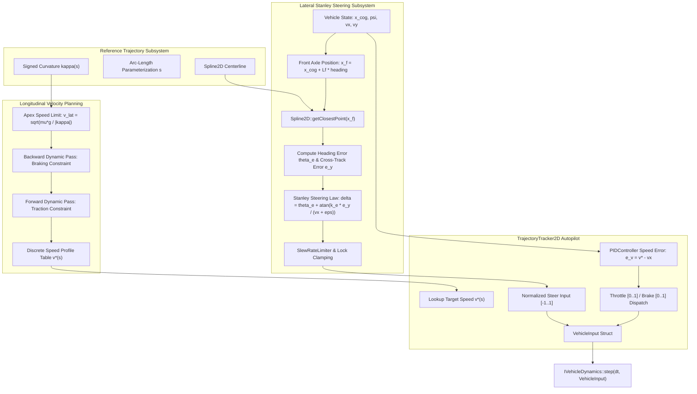

# Stanley Path Following & Curvature Speed Profiler: C++17 Implementation Plan

## 1. Executive Summary & Scope

### 1.1 Objective & Context
This specification details the mathematical foundations, system architecture, C++17 class designs, and verification plan for an autonomous trajectory-tracking subsystem composed of:
1. **Stanley Steering Controller** ([StanleyController.h](../libs/VehicleSimCore/math/StanleyController.h)): A non-linear geometric lateral path-tracking steering law evaluated at the vehicle's front axle, ensuring asymptotic cross-track error convergence along parametric [Spline2D](../libs/VehicleSimCore/math/Spline2D.h) trajectories.
2. **Curvature-Constrained Speed Profiler** ([SpeedProfiler2D](../libs/VehicleSimCore/math/SpeedProfiler2D.h)): An optimal, two-pass dynamic programming velocity profiler that determines safe entry, apex, and exit speeds along race circuits based on local curvature $\kappa(s)$, tire friction limit $\mu$, and longitudinal acceleration/braking limits.
3. **Trajectory Tracker Coordinator** ([TrajectoryTracker2D](../libs/VehicleSimCore/dynamics/TrajectoryTracker2D.h)): A unified driver autopilot coordinator pairing the Stanley steering angle with longitudinal [PIDController](../libs/VehicleSimCore/math/PIDController.h) throttle and brake demands to drive any [IVehicleDynamics](../libs/VehicleSimCore/dynamics/IVehicleDynamics.h) implementation.

Currently, `VehicleSimCore` features parametric splines ([Spline2D.h](../libs/VehicleSimCore/math/Spline2D.h)), procedural courses ([TrackGenerator.h](../libs/VehicleSimCore/terrain/TrackGenerator.h)), and low-level controllers ([PIDController.h](../libs/VehicleSimCore/math/PIDController.h), [SlewRateLimiter.h](../libs/VehicleSimCore/math/SlewRateLimiter.h)). However, automated path navigation, AI racing opponents, and vehicle autopilot testing currently require ad-hoc steering logic. 

The Stanley controller—proven on Stanford's DARPA Grand Challenge winning vehicle *Junior*—provides global asymptotic stability under non-linear kinematics, seamless handling of large initial cross-track errors, and zero steady-state error on straightaways.

---

### 1.2 Core Mathematical Principles

#### Stanley Steering Control Law
Unlike pure pursuit controllers that track a lookahead point on the rear axle, the Stanley controller references the center of the vehicle's **front axle** $\mathbf{x}_f$:
$$\mathbf{x}_f = \mathbf{x}_{\text{cog}} + L_f \begin{bmatrix} \cos(\psi) \\ \sin(\psi) \end{bmatrix}$$
where:
- $\mathbf{x}_{\text{cog}}$: Vehicle center of gravity position in world coordinates $(x, y)$.
- $L_f$: Longitudinal distance from COG to the front axle.
- $\psi$: Vehicle body heading angle relative to the global $+X$ axis.

Given the orthogonal projection of $\mathbf{x}_f$ onto the reference spline $\mathbf{P}(s)$ yielding the closest arc-length parameter $s^*$, tangent direction $\psi_{\text{path}}(s^*)$, and signed cross-track error $e_y(t)$, the commanded front wheel steering angle $\delta(t)$ is defined as:
$$\delta(t) = \theta_e(t) + \arctan\left(\frac{k_e \cdot e_y(t)}{v_x(t) + \epsilon}\right) + k_d \cdot (\dot{e}_y(t) - v_x \sin(\theta_e))$$
where:
- $\theta_e(t) = \text{deltaAngle}(\psi, \psi_{\text{path}})$: Heading orientation error in $[-\pi, \pi)$.
- $e_y(t) = (\mathbf{x}_f - \mathbf{P}(s^*)) \cdot \mathbf{N}(s^*)$: Signed lateral displacement along the curve normal.
- $k_e$: Cross-track error gain ($[\text{s}^{-1}]$).
- $v_x(t)$: Forward longitudinal velocity, regularized by small constant $\epsilon > 0$ to prevent division by zero at standstill.
- $k_d$: Differential damping gain to suppress high-speed yaw oscillations.

#### Optimal Speed Profiling
Given maximum allowable lateral acceleration $a_{y,\text{max}} = \mu_{\text{nominal}} \cdot g$:
1. **Apex Speed Constraint**:
   $$v_{\text{corner}}(s) = \sqrt{\frac{a_{y,\text{max}}}{|\kappa(s)| + \epsilon_{\kappa}}}$$
2. **Backward Deceleration Pass** (ensures vehicle can brake in time before corners):
   $$v_i \le \sqrt{v_{i+1}^2 + 2 \cdot a_{\text{brake}} \cdot \Delta s_i}$$
3. **Forward Acceleration Pass** (enforces engine traction limits coming out of corners):
   $$v_{i+1} \le \sqrt{v_i^2 + 2 \cdot a_{\text{accel}} \cdot \Delta s_i}$$

---

### 1.3 Key Requirements & Quality Attributes

1. **Zero External Dependencies**: Pure ISO C++17 utilizing internal math primitives ([Vec2.h](../libs/VehicleSimCore/math/Vec2.h), [Angle2D.h](../libs/VehicleSimCore/math/Angle2D.h), [Spline2D.h](../libs/VehicleSimCore/math/Spline2D.h)).
2. **MISRA C++:2023 & SEI CERT C++ Compliance**:
   - Zero dynamic allocations during simulation ticks.
   - Consistent brace initialization `{}` for all fields.
   - All query and calculation methods tagged with `[[nodiscard]]`.
   - Function names strictly fewer than 30 characters.
3. **IEEE 754 Determinism**: Identical steering commands and speed profiles across GCC, Clang, and MSVC.
4. **Smooth Actuator Integration**: Automatic rate limiting of steering rate ($d\delta/dt$) using [SlewRateLimiter](../libs/VehicleSimCore/math/SlewRateLimiter.h) and output clamping to physical wheel lock $[-\delta_{\text{max}}, \delta_{\text{max}}]$.
5. **Reverse Gear Stability**: Smooth handling when reversing ($v_x < 0$), inverting the heading target to maintain stable trajectory following.

---

## 2. High-Level Architecture & Subsystem Organization

### 2.1 File Layout

```
libs/VehicleSimCore/
├── math/
│   ├── StanleyController.h          [NEW] - Core front-axle Stanley steering algorithm
│   ├── StanleyController.cpp        [NEW] - Implementation and gain configurations
│   ├── SpeedProfiler2D.h            [NEW] - Curvature-limited two-pass speed profiler
│   ├── SpeedProfiler2D.cpp          [NEW] - Forward/backward dynamic programming solvers
│   ├── Spline2D.h                   [EXISTING] - Reference trajectory and Frenet frames
│   └── PIDController.h              [EXISTING] - Longitudinal throttle/braking regulation
├── dynamics/
│   ├── TrajectoryTracker2D.h        [NEW] - Autopilot coordinator bridging path & vehicle
│   └── TrajectoryTracker2D.cpp      [NEW] - Input generation dispatching to IVehicleDynamics
tests/
├── StanleyControllerTest.cpp        [NEW] - Tests for straightaway convergence, step responses
└── SpeedProfilerTest.cpp            [NEW] - Tests for braking passes, acceleration limits
```

---

### 2.2 System Architecture ASCII Diagram

```
+---------------------------------------------------------------------------------------------------+
|                                 Trajectory Tracking Architecture                                  |
+---------------------------------------------------------------------------------------------------+
|                                                                                                   |
|   [ Reference Path: Spline2D / CircuitTrack2D ]                                                  |
|       - Waypoint coordinates P(s)                                                                 |
|       - Tangent T(s), Normal N(s), Curvature kappa(s), Arc-length s                               |
|                                                                                                   |
|                   |                                                |                              |
|                   v Curvature kappa(s)                             v Tangent & Normal             |
|                                                                                                   |
|   +------------------------------------+           +------------------------------------+         |
|   |          SpeedProfiler2D           |           |         StanleyController          |         |
|   +------------------------------------+           +------------------------------------+         |
|   | 1. v_corner = sqrt(mu*g / |kappa|) |           | 1. Front Axle: x_f = x_cog + Lf*u  |         |
|   | 2. Backward Pass: Brake constraint |           | 2. Closest Point P(s*), e_y, th_e  |         |
|   | 3. Forward Pass: Accel constraint  |           | 3. delta = th_e + atan(k_e*e_y/v)  |         |
|   +------------------------------------+           +------------------------------------+         |
|                   | Target Velocity v_target(s)                    | Steer Angle delta            |
|                   v                                                v                              |
|   +-------------------------------------------------------------------------------------+         |
|   |                                 TrajectoryTracker2D                                 |         |
|   +-------------------------------------------------------------------------------------+         |
|   | - Longitudinal PIDController: error = v_target - v_current                          |         |
|   | - SlewRateLimiter on steering angle delta                                           |         |
|   | - Outputs: VehicleInput { steer: [-1..1], throttle: [0..1], brake: [0..1] }         |         |
|   +-------------------------------------------------------------------------------------+         |
|                                             |                                                     |
|                                             v Feeds Actuators                                     |
|                                                                                                   |
|   [ IVehicleDynamics (ArcadeCarDynamics / MonsterCarDynamics / EarthRoverDynamics) ]               |
|                                                                                                   |
+---------------------------------------------------------------------------------------------------+
```

---

### 2.3 System Architecture Mermaid Flowchart



---

## 3. Mathematical Formulations & Derivations

### 3.1 Stanley Steering Geometry & Lyapunov Stability Proof

```
  ASCII Diagram: Stanley Front Axle Reference Geometry

                      Vehicle Longitudinal Axis
                              ^
                             / 
                            /  Heading Angle psi
                           /  
              +-----------*-----------+  <- Front Axle (Position x_f)
              |         /   \         |
              |   theta_e    \ delta  |  <- Steering Angle delta
              |       /       \       |
              +------/---------*------+  (Steered Front Wheel)
                    /
                   /
                  * Center of Gravity (x_cog)
                 /
                / Distance Lf
               /
   Path P(s)  /          Cross-Track Vector: e_y * N(s)
  -----------*--------------------+------------------------------------> Tangent T(s)
             ^ Closest Point P(s*)
```

#### Derivation of the Control Law
Let $\mathbf{P}(s)$ be the arc-length parameterization of the path. The vehicle's front-axle position is:
$$\mathbf{x}_f = \mathbf{x}_{\text{cog}} + L_f \begin{bmatrix} \cos(\psi) \\ \sin(\psi) \end{bmatrix}$$

The closest point on the path $\mathbf{P}(s^*)$ defines the local Frenet frame:
- Unit Tangent: $\mathbf{T}(s^*) = \mathbf{P}'(s^*)$
- Unit Normal: $\mathbf{N}(s^*) = \begin{bmatrix} -T_y(s^*) \\ T_x(s^*) \end{bmatrix}$
- Path Heading: $\psi_{\text{path}} = \text{atan2}(T_y(s^*), T_x(s^*))$

The signed cross-track error $e_y$ is the directed projection from path to front axle:
$$e_y = (\mathbf{x}_f - \mathbf{P}(s^*)) \cdot \mathbf{N}(s^*)$$

Taking the time derivative of $e_y$:
$$\dot{e}_y = v_x \sin(\psi - \psi_{\text{path}} + \delta) = v_x \sin(\theta_e + \delta)$$

To ensure global asymptotic stability, we select the steering angle $\delta$ such that the error dynamics satisfy:
$$\dot{e}_y = -k_e \cdot e_y$$
For small angles, setting $\delta = -\theta_e + \arctan\left(\frac{-k_e e_y}{v_x}\right)$ results in:
$$\sin(\theta_e + \delta) = \sin\left(\arctan\left(\frac{-k_e e_y}{v_x}\right)\right) = \frac{-k_e e_y}{\sqrt{v_x^2 + (k_e e_y)^2}}$$
yielding the strictly negative-definite Lyapunov derivative:
$$\dot{V}(e_y) = e_y \dot{e}_y = -\frac{k_e v_x e_y^2}{\sqrt{v_x^2 + (k_e e_y)^2}} < 0 \quad \forall e_y \neq 0$$
which guarantees that cross-track error $e_y \to 0$ exponentially as $t \to \infty$.

---

### 3.2 Low-Speed Regularization & Reverse-Motion Handling

#### Low-Speed Regularization
As forward velocity $v_x \to 0$, the standard term $\frac{k_e e_y}{v_x}$ approaches infinity, causing aggressive wheel oscillations when starting from a stop. We introduce a soft threshold $\epsilon_v > 0$ and velocity weighting:
$$\delta_{\text{cross}} = \arctan\left(\frac{k_e \cdot e_y}{\max(|v_x|, v_{\text{min}})}\right)$$
where default $v_{\text{min}} = 1.0\,\text{m/s}$.

#### Reverse Driving
When reversing ($v_x < -0.2\,\text{m/s}$):
- The heading error reverses sign: $\theta_e = \text{deltaAngle}(\psi + \pi, \psi_{\text{path}})$.
- The cross-track correction inverts sign to steer into the path rather than diverging:
  $$\delta(t) = \theta_e(t) - \arctan\left(\frac{k_e \cdot e_y}{|v_x| + v_{\text{min}}}\right)$$

---

### 3.3 Dynamic Yaw-Rate Damping

To prevent high-speed weaving (hunting) on straightaways at velocities above $30\,\text{m/s}$ (approx. $100\,\text{km/h}$), a damping term proportional to cross-track rate $\dot{e}_y$ is applied:
$$\delta_{\text{damp}} = -k_d \cdot (\dot{\psi} - \dot{\psi}_{\text{path}})$$
where $\dot{\psi}$ is the vehicle yaw rate, and $\dot{\psi}_{\text{path}} = \kappa(s) \cdot v_x$ is the reference path curvature rate.

---

### 3.4 Curvature-Constrained Speed Profiling Algorithm

```
  ASCII Diagram: Two-Pass Speed Profile (Braking and Acceleration Limits)

   Velocity v
      ^
      |         Straightaway Top Speed (v_max)
      |         +-------------------------\                  /----------
      |        /                           \  Braking Pass  / Accel Pass
      |       /                             \              /
      |      /                               \   Corner   /
      |     /                                 \  v_apex  /
      |    /                                   \---*---/
      +---+----------------------------------------+--------------------> Arc-Length s
         Entry                                    Apex
```

Given a discrete sequence of spline samples $s_0, s_1, \dots, s_{N-1}$ spaced by $\Delta s$:
1. **Initial Pointwise Constraint**:
   $$v_i^{(0)} = \min\left(v_{\text{cruise}}, \sqrt{\frac{a_{y,\text{max}}}{|\kappa(s_i)| + \epsilon_\kappa}}\right)$$
2. **Backward Deceleration Pass** ($i = N-2 \text{ down to } 0$):
   $$v_i^{(1)} = \min\left(v_i^{(0)}, \sqrt{\left(v_{i+1}^{(1)}\right)^2 + 2 \cdot a_{\text{brake}} \cdot \Delta s}\right)$$
   For closed circuit loops, wrap-around boundary condition $v_{N-1} = v_0$ is relaxed over two consecutive passes until numerical convergence ($\Delta v < 10^{-4}\,\text{m/s}$).
3. **Forward Acceleration Pass** ($i = 0 \text{ up to } N-2$):
   $$v_{i+1}^{(2)} = \min\left(v_{i+1}^{(1)}, \sqrt{\left(v_i^{(2)}\right)^2 + 2 \cdot a_{\text{accel}} \cdot \Delta s}\right)$$

---

## 4. Interface Specifications & C++17 Header Design

### 4.1 StanleyController.h

```cpp
#pragma once

#include "Vec2.h"
#include "Spline2D.h"
#include <cstddef>

namespace vehicle_sim {

/// @brief Configuration parameters for the front-axle Stanley steering controller.
struct StanleyConfig {
    /// @brief Cross-track error gain (1/s). Higher values correct lateral offsets faster.
    double crossTrackGain{1.2};

    /// @brief Heading error damping gain for high-speed yaw stabilization.
    double dampingGain{0.1};

    /// @brief Distance from the vehicle center of gravity to the front axle in meters.
    double frontAxleOffset{1.4};

    /// @brief Minimum velocity regularization denominator in m/s to prevent low-speed singularity.
    double minVelocity{1.0};

    /// @brief Maximum absolute steering angle output in radians.
    double maxSteerAngle{0.65};
};

/// @brief Internal state and telemetry computed during a Stanley steering update.
struct StanleyState {
    /// @brief Target steering angle command in radians before rate limiting.
    double steerAngle{0.0};

    /// @brief Normalized signed cross-track displacement from front axle to path in meters.
    double crossTrackError{0.0};

    /// @brief Angular orientation discrepancy between vehicle and path in radians.
    double headingError{0.0};

    /// @brief Arc-length distance along the reference path for the closest projection.
    double pathDistance{0.0};
};

/// @brief Non-linear geometric front-axle Stanley steering controller.
/// @details Evaluates cross-track and heading error relative to a reference Spline2D
/// to produce asymptotically stable steering commands.
class StanleyController {
public:
    /// @brief Constructs a Stanley controller with default configuration.
    StanleyController() noexcept = default;

    /// @brief Constructs a Stanley controller with explicit configuration parameters.
    /// @param config Tuning parameters including gains, axle geometry, and limits.
    explicit StanleyController(const StanleyConfig& config) noexcept;

    /// @brief Sets the reference path spline to follow.
    /// @param path Pointer to the target spline (must remain valid during evaluation).
    void setPath(const Spline2D* path) noexcept;

    /// @brief Updates controller gain configuration.
    /// @param config New configuration parameters.
    void setConfig(const StanleyConfig& config) noexcept;

    /// @brief Retrieves the active configuration parameters.
    /// @return Current configuration struct.
    [[nodiscard]] const StanleyConfig& getConfig() const noexcept;

    /// @brief Computes the required steering angle command.
    /// @details Projects the front-axle position onto the reference spline,
    /// evaluates the non-linear Stanley law, and clamps to maximum steer lock.
    /// @param cogPosition Vehicle center of gravity world coordinates in meters.
    /// @param headingRad Vehicle orientation angle in radians [-pi, pi).
    /// @param forwardSpeed Forward longitudinal speed in m/s.
    /// @param yawRate Current vehicle angular velocity in rad/s.
    /// @return Computed steering command and telemetry state.
    [[nodiscard]] StanleyState computeSteer(
        const Vec2& cogPosition,
        double headingRad,
        double forwardSpeed,
        double yawRate) const noexcept;

    /// @brief Computes front axle world position from COG position and heading.
    /// @param cogPosition Vehicle center of gravity in world meters.
    /// @param headingRad Vehicle heading in radians.
    /// @return World-space coordinates of the front axle center.
    [[nodiscard]] Vec2 getFrontAxle(
        const Vec2& cogPosition,
        double headingRad) const noexcept;

private:
    StanleyConfig m_config{};
    const Spline2D* m_path{nullptr};
};

} // namespace vehicle_sim
```

---

### 4.2 SpeedProfiler2D.h

```cpp
#pragma once

#include "Spline2D.h"
#include <vector>

namespace vehicle_sim {

/// @brief Physical vehicle limits for speed profile synthesis.
struct SpeedProfileLimits {
    /// @brief Maximum cruise speed along straight sections in m/s.
    double maxCruiseSpeed{40.0};

    /// @brief Maximum lateral cornering acceleration in m/s^2 (typically mu * g).
    double maxLatAccel{9.81};

    /// @brief Maximum longitudinal acceleration traction limit in m/s^2.
    double maxLongAccel{4.5};

    /// @brief Maximum service braking deceleration in m/s^2 (positive value).
    double maxBrakingDecel{8.0};

    /// @brief Spatial sampling interval along the spline in meters.
    double sampleStep{1.0};
};

/// @brief Individual speed profile milestone point along a path.
struct SpeedMilestone {
    /// @brief Arc-length distance along the spline in meters.
    double distance{0.0};

    /// @brief World coordinates of the sample point.
    Vec2 position{};

    /// @brief Signed curvature at this milestone in 1/m.
    double curvature{0.0};

    /// @brief Optimal target velocity at this milestone in m/s.
    double targetSpeed{0.0};
};

/// @brief Two-pass optimal dynamic speed profiler for parametric splines.
/// @details Calculates cornering apex speeds based on curvature and executes
/// backward braking and forward acceleration sweeps.
class SpeedProfiler2D {
public:
    /// @brief Default constructor.
    SpeedProfiler2D() noexcept = default;

    /// @brief Constructs profiler with explicit vehicle physical limits.
    /// @param limits Longitudinal and lateral dynamics constraints.
    explicit SpeedProfiler2D(const SpeedProfileLimits& limits) noexcept;

    /// @brief Sets the kinematic and friction constraint limits.
    /// @param limits New dynamics parameters.
    void setLimits(const SpeedProfileLimits& limits) noexcept;

    /// @brief Retrieves the active limit parameters.
    /// @return Current limits struct.
    [[nodiscard]] const SpeedProfileLimits& getLimits() const noexcept;

    /// @brief Generates an optimal discrete speed profile along a spline.
    /// @param spline Target reference spline curve.
    /// @return True if generation succeeded with valid non-empty spline.
    [[nodiscard]] bool buildProfile(const Spline2D& spline) noexcept;

    /// @brief Queries target velocity for a given arc-length distance.
    /// @param distance Target distance in meters along the spline.
    /// @return Interpolated optimal target velocity in m/s.
    [[nodiscard]] double getSpeedAt(double distance) const noexcept;

    /// @brief Retrieves the full generated milestone profile array.
    /// @return Vector of generated milestones.
    [[nodiscard]] const std::vector<SpeedMilestone>& getMilestones() const noexcept;

    /// @brief Clears current profile data.
    void clear() noexcept;

private:
    SpeedProfileLimits m_limits{};
    std::vector<SpeedMilestone> m_milestones{};
    double m_totalLength{0.0};
    bool m_isClosed{false};
};

} // namespace vehicle_sim
```

---

### 4.3 TrajectoryTracker2D.h

```cpp
#pragma once

#include "StanleyController.h"
#include "SpeedProfiler2D.h"
#include "PIDController.h"
#include "SlewRateLimiter.h"

namespace vehicle_sim {

/// @brief Autopilot control commands dispatched to vehicle actuators.
struct AutopilotOutput {
    /// @brief Normalized steering demand in [-1.0, 1.0].
    double normalizedSteer{0.0};

    /// @brief Steer angle in radians.
    double steerAngleRad{0.0};

    /// @brief Throttle pedal demand in [0.0, 1.0].
    double throttle{0.0};

    /// @brief Brake pedal demand in [0.0, 1.0].
    double brake{0.0};

    /// @brief Target speed commanded by the profiler in m/s.
    double targetSpeed{0.0};

    /// @brief Cross-track error in meters.
    double crossTrackError{0.0};
};

/// @brief Integrated lateral and longitudinal autopilot coordinator.
class TrajectoryTracker2D {
public:
    /// @brief Constructs tracker with default configurations.
    TrajectoryTracker2D() noexcept;

    /// @brief Configures steering, profiling, and longitudinal PID controllers.
    /// @param stanleyConfig Stanley steering tuning settings.
    /// @param profileLimits Physical vehicle limits for speed profiler.
    /// @param speedPidConfig PID gains for velocity error tracking.
    /// @param maxSteerRate Maximum steering angular velocity in rad/s.
    void configure(
        const StanleyConfig& stanleyConfig,
        const SpeedProfileLimits& profileLimits,
        const PIDConfig& speedPidConfig,
        double maxSteerRate) noexcept;

    /// @brief Sets and analyzes a new reference trajectory.
    /// @param spline Pointer to the target spline.
    /// @return True if path was successfully built into the speed profiler.
    [[nodiscard]] bool setTrajectory(const Spline2D* spline) noexcept;

    /// @brief Resets all internal integrators, filters, and state memories.
    void reset() noexcept;

    /// @brief Steps the autopilot forward by time delta dt.
    /// @param dt Simulation time step in seconds.
    /// @param cogPosition Vehicle center of gravity in world coordinates.
    /// @param headingRad Vehicle orientation angle in radians.
    /// @param forwardSpeed Longitudinal forward speed in m/s.
    /// @param yawRate Vehicle angular velocity in rad/s.
    /// @return Actuator demands ready to dispatch to IVehicleDynamics.
    [[nodiscard]] AutopilotOutput update(
        double dt,
        const Vec2& cogPosition,
        double headingRad,
        double forwardSpeed,
        double yawRate) noexcept;

private:
    StanleyController m_stanley{};
    SpeedProfiler2D m_profiler{};
    PIDController m_speedPid{};
    SlewRateLimiter m_steerLimiter{};
    const Spline2D* m_path{nullptr};
};

} // namespace vehicle_sim
```

---

## 5. Step-by-Step Implementation Roadmap

```
+---------------------------------------------------------------------------------------------------+
|                            Stanley & Speed Profiler Implementation Phases                         |
+---------------------------------------------------------------------------------------------------+
|  Phase 1: Math Layer - Stanley Steering Controller                                                |
|    - Implement StanleyController.h and StanleyController.cpp                                      |
|    - Develop StanleyControllerTest.cpp unit test suite                                            |
|                                                                                                   |
|  Phase 2: Math Layer - Curvature Speed Profiler                                                   |
|    - Implement SpeedProfiler2D.h and SpeedProfiler2D.cpp (Gauss-Legendre curvature integration)   |
|    - Develop SpeedProfilerTest.cpp verification tests                                             |
|                                                                                                   |
|  Phase 3: Dynamics Layer - TrajectoryTracker2D Autopilot                                          |
|    - Implement TrajectoryTracker2D coordinator combining lateral & longitudinal control           |
|    - Integrate SlewRateLimiter and PIDController                                                  |
|                                                                                                   |
|  Phase 4: Vehicle Integration & Closed-Loop Simulation Test                                        |
|    - Connect TrajectoryTracker2D to ArcadeCarDynamics and MonsterCarDynamics                     |
|    - Validate complete autonomous laps around TrackGenerator circuits                             |
+---------------------------------------------------------------------------------------------------+
```

### Phase 1: Math Layer - Stanley Steering Controller
1. Create `libs/VehicleSimCore/math/StanleyController.h` and `StanleyController.cpp`.
2. Implement front axle projection math and [Spline2D::getClosestPoint()](../libs/VehicleSimCore/math/Spline2D.h).
3. Implement `computeSteer()` with low-speed velocity regularization, reverse driving handling, and steering lock saturation.
4. Add `tests/StanleyControllerTest.cpp` and register in `tests/CMakeLists.txt`.
5. Verify zero compiler warnings with `-Wall -Wextra -pedantic -Werror` and `/W4`.

### Phase 2: Math Layer - Curvature Speed Profiler
1. Create `libs/VehicleSimCore/math/SpeedProfiler2D.h` and `SpeedProfiler2D.cpp`.
2. Implement discrete milestone sampling along [Spline2D](../libs/VehicleSimCore/math/Spline2D.h) using Gauss-Legendre arc lengths.
3. Implement apex velocity clamping via analytical spline curvature $\kappa(s)$.
4. Implement backward deceleration pass and forward traction pass with closed-loop cyclic relaxation.
5. Add `tests/SpeedProfilerTest.cpp` with synthetic corner and chicane scenarios.

### Phase 3: Dynamics Layer - TrajectoryTracker2D Autopilot
1. Create `libs/VehicleSimCore/dynamics/TrajectoryTracker2D.h` and `TrajectoryTracker2D.cpp`.
2. Couple `StanleyController` with [SlewRateLimiter](../libs/VehicleSimCore/math/SlewRateLimiter.h) for physical steering actuators.
3. Connect `SpeedProfiler2D` output to [PIDController](../libs/VehicleSimCore/math/PIDController.h) for longitudinal acceleration and braking pedal dispatch.
4. Add telemetry output struct for debugging and data logging.

### Phase 4: Integration & Benchmark Validation
1. Integrate into closed-loop test harness running [ArcadeCarDynamics](../libs/VehicleSimCore/dynamics/ArcadeCarDynamics.h) and [MonsterCarDynamics](../libs/VehicleSimCore/dynamics/MonsterCarDynamics.h) over circuits generated by [TrackGenerator](../libs/VehicleSimCore/terrain/TrackGenerator.h).
2. Measure lap time determinism, maximum cross-track error $e_{y,\text{max}}$, and verify zero spinouts across all corner radii.

---

## 6. Test Strategy & Verification Matrix

| Test Suite | Scenario | Acceptance Criteria |
| :--- | :--- | :--- |
| **StanleyControllerTest** | **Straight Path Offset Convergence** | Given a straight line trajectory along $+X$ and initial vehicle lateral offset $y = 5.0\,\text{m}$, cross-track error $|e_y(t)|$ must decay below $0.05\,\text{m}$ smoothly without overshooting. |
| **StanleyControllerTest** | **Standstill & Low-Speed Stability** | At $v_x = 0.0\,\text{m/s}$ and $v_x = 0.1\,\text{m/s}$, steering output must remain bounded within $[-\delta_{\text{max}}, \delta_{\text{max}}]$ with zero NaNs, infinities, or chatter. |
| **StanleyControllerTest** | **Reverse Motion Direction** | At $v_x = -3.0\,\text{m/s}$, the controller inverts steering polarity to smoothly guide the vehicle toward the centerline in reverse. |
| **StanleyControllerTest** | **Constant Radius Circular Track** | On a circular path of radius $R = 50\,\text{m}$, the vehicle must settle into steady-state steering with $|e_y| < 0.02\,\text{m}$. |
| **SpeedProfilerTest** | **Straight Runway Cruise** | For a zero-curvature straight line, target speed must equal `maxCruiseSpeed` at all points. |
| **SpeedProfilerTest** | **Corner Apex Deceleration** | For a $90^\circ$ bend with radius $R = 20\,\text{m}$ ($\kappa = 0.05\,\text{m}^{-1}$) and $\mu = 1.0$, apex speed must be strictly clamped to $v \approx \sqrt{9.81 \cdot 20} = 14.0\,\text{m/s}$. |
| **SpeedProfilerTest** | **Braking Zone Lookahead** | Points upstream of the corner entry must show early velocity deceleration satisfying the braking deceleration limit $a_{\text{brake}}$. |
| **SpeedProfilerTest** | **Closed Loop Cyclic Continuity** | For a closed circuit, the velocity at milestone $N-1$ must match milestone $0$ within $10^{-3}\,\text{m/s}$. |
| **TrajectoryTrackerTest** | **End-to-End Lap Autonomous Run** | An [ArcadeCarDynamics](../libs/VehicleSimCore/dynamics/ArcadeCarDynamics.h) vehicle must successfully navigate a 10-turn procedural track without departing the road ribbon. |

---

## 7. Verification Checklist

- [ ] All math and physics algorithms use pure C++17 with zero third-party dependencies.
- [ ] Headers use `#pragma once` (no `#ifndef` guards).
- [ ] Headers and `.cpp` implementations are co-located in `libs/VehicleSimCore/math/` and `libs/VehicleSimCore/dynamics/`.
- [ ] All function names are strictly under 30 characters.
- [ ] All public APIs documented with full Doxygen templates (`/// @brief`, `@details`, `@param`, `@return`).
- [ ] Zero raw `new` and `delete` statements.
- [ ] Uniform brace initialization `{}` across all structs, classes, and variables.
- [ ] `[[nodiscard]]` applied to all query, state computation, and evaluation methods.
- [ ] Code builds cleanly with zero warnings under `-Wall -Wextra -pedantic -Werror` on GCC/Clang and `/W4` on MSVC.
- [ ] All relative file links verified in Markdown documentation.
