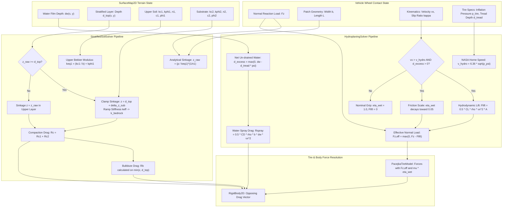
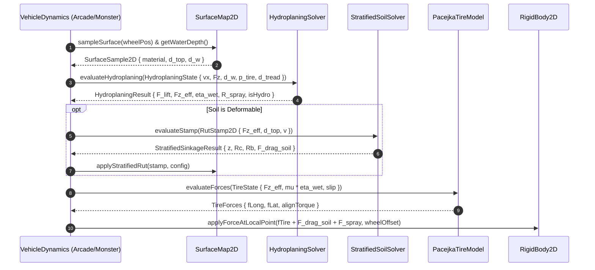

# Multi-Layer Stratified Soil & Dynamic Hydroplaning: C++17 Implementation Plan

## 1. Executive Summary & Scope

### 1.1 Objective & Context
This specification details the mathematical modeling, algorithmic formulation, software architecture, data contracts, and implementation roadmap for **Multi-Layer Stratified Soil and Hydroplaning Model** as proposed in Section 2.5 of [ProposedFeatures.md](ProposedFeatures.md).

Currently, off-road terramechanics in `VehicleSimCore` ([DeformableTerrain.h](../libs/VehicleSimCore/terrain/DeformableTerrain.h)) assumes semi-infinite homogeneous ground using the classic Bekker-Wong formulation. While this models soft soil sinkage and wheel rutting effectively for uniform dirt or mud pits, it fails to capture critical multi-layered stratigraphic profiles encountered in real-world driving:
1. **Stratified Soil Horizons**: A weak, compressible upper stratum (e.g., loose powder snow, thawed mud slop, or uncompacted sand) overlying a substantially stiffer, incompressible substrate (e.g., dense bedrock, frozen permafrost hardpan, compacted subgrade, or asphalt pavement). In homogeneous models, heavy vehicles sink unbounded into the abyss or hit an artificial hard stop; in physical stratified soils, the upper layer undergoes localized shear failure while contact stiffness ramps non-linearly toward the substrate's high bearing capacity, clamping plastic sinkage at the stratum interface $d_{\text{top}}$ and limiting bulldozing resistance to the displaceable top layer.
2. **Dynamic Wet-Weather Hydroplaning**: When vehicles encounter surface water films (standing rain puddles, wet track runoff), tires must evacuate water through tread channels. Once vehicle velocity exceeds the critical dynamic hydroplaning speed $v_{\text{hydro}}$ (governed by tire inflation pressure and water depth exceeding tread drainage capacity), hydrodynamic fluid lift separates the tire contact patch from the road surface. This induces near-total loss of tractive grip ($\mu \to 0.05$) and causes catastrophic control loss during high-speed braking and steering.

This feature delivers an industrial-grade, zero-allocation, MISRA C++:2023 compliant C++17 physics and terramechanics module in [libs/VehicleSimCore/terrain/](../libs/VehicleSimCore/terrain/) and [libs/VehicleSimCore/dynamics/](../libs/VehicleSimCore/dynamics/) that seamlessly extends [DeformableTerrain.h](../libs/VehicleSimCore/terrain/DeformableTerrain.h), integrates with [SurfaceMap2D.h](../libs/VehicleSimCore/terrain/SurfaceMap2D.h), and couples directly with [PacejkaTireModel.h](../libs/VehicleSimCore/dynamics/PacejkaTireModel.h) and [ArcadeCarDynamics.h](../libs/VehicleSimCore/dynamics/ArcadeCarDynamics.h).

---

### 1.2 Core Physical & Mathematical Requirements

1. **Stratified Two-Layer Terramechanics**:
   - Parameterize an upper compressible layer of thickness $d_{\text{top}}(x, y) > 0$ with Bekker parameters $(k_{c1}, k_{\phi 1}, n_1, c_1, \phi_1, \gamma_1)$ over a stiff substrate with parameters $(k_{c2}, k_{\phi 2}, n_2, c_2, \phi_2, \gamma_2)$.
   - Formulate a $C^1$-continuous transition function for effective modulus $k_{\text{eff}}(z)$ as sinkage $z$ approaches and crosses $d_{\text{top}}$, eliminating unphysical force discontinuities.
   - Enforce bedrock refusal depth clamping: wheel sinkage $z$ cannot exceed the layer depth $d_{\text{top}}$ unless the contact pressure exceeds the substrate's ultimate bearing capacity $q_{\text{ult},2}$.
   - Partition compaction work $R_c$: evaluate compaction drag across the stratified boundary.
   - Limit Hegazy-Bekker bulldozing drag $R_b$ to the displaced volume of the soft upper stratum; the rigid substrate does not undergo passive bulldozing upheaval.

2. **Dynamic Tire Hydroplaning**:
   - Model standing water film depth $d_w(x, y)$ in meters (or millimeters).
   - Evaluate tire tread grooving depth $d_{\text{tread}}$ and channel void ratio $\psi_{\text{void}}$, calculating net un-drained water thickness $d_{\text{excess}} = \max(0.0, d_w - d_{\text{tread}} \cdot \psi_{\text{void}})$.
   - Evaluate critical dynamic hydroplaning velocity via the NASA Horne formulation:
     $$v_{\text{hydro}} = 6.36 \sqrt{p_{\text{psi}}} = 0.0766 \sqrt{p_{\text{Pa}}} \quad [\text{m/s}]$$
   - Formulate hydrodynamic fluid lift force $F_{\text{lift}} = \frac{1}{2} C_L \rho_w v_x^2 A_{\text{patch}}$, reducing effective normal reaction load $F_{z,\text{eff}} = \max(0.0, F_z - F_{\text{lift}})$.
   - Model hydrodynamic fluid displacement/spray drag $R_{\text{spray}} = \frac{1}{2} C_D \rho_w b d_w v_x^2$.
   - Formulate smooth sigmoidal friction degradation factor $\eta_{\text{wet}} \in [\eta_{\text{min}}, 1.0]$ (with $\eta_{\text{min}} = 0.05$) scaling tire grip during partial and full hydroplaning.

3. **Subsystem Interoperability & Determinism**:
   - Pure ISO C++17, zero external physics engine dependencies.
   - Zero dynamic memory allocations during simulation ticks.
   - MISRA C++:2023 & SEI CERT C++ compliance: explicit `{}` initialization, `[[nodiscard]]` on all calculation/query APIs, all function names strictly $< 30$ characters.
   - IEEE 754 determinism across Linux (GCC/Clang) and Windows (MSVC) with division-by-zero guards ($\epsilon = 10^{-7}$).

---

## 2. High-Level Architecture & Subsystem Organization

### 2.1 File Layout

```
libs/VehicleSimCore/
├── terrain/
│   ├── StratifiedSoil.h          [NEW]      - Stratified soil config, multi-layer Bekker math & solvers
│   ├── StratifiedSoil.cpp        [NEW]      - Two-layer sinkage, bedrock transition, compaction & bulldozing
│   ├── HydroplaningModel.h       [NEW]      - NASA Horne hydroplaning solver, fluid lift & grip scaling
│   ├── HydroplaningModel.cpp     [NEW]      - Hydrodynamic lift, water evacuation, and friction decay
│   ├── DeformableTerrain.h       [EXTENDED] - Stratified layer thickness support and multi-layer stamping
│   ├── DeformableTerrain.cpp     [EXTENDED] - Layer depth queries and substrate refusal integration
│   ├── SurfaceMaterial.h         [EXTENDED] - Substrate material configuration and water film presets
│   ├── SurfaceMaterial.cpp       [EXTENDED] - Multi-layer presets (snow-on-asphalt, mud-on-bedrock)
│   ├── SurfaceMap2D.h            [EXTENDED] - Stratified depth grid, water film grid, and hydro queries
│   └── SurfaceMap2D.cpp          [EXTENDED] - Water depth sampling and multi-layer surface evaluation
├── dynamics/
│   ├── PacejkaTireModel.h        [EXTENDED] - Hydroplaning input state, fluid lift, and grip scaling
│   ├── PacejkaTireModel.cpp      [EXTENDED] - Effective normal force reduction & wet friction decay
│   ├── ArcadeCarDynamics.h       [EXTENDED] - Hydroplaning telemetry channels and spray drag dispatch
│   └── ArcadeCarDynamics.cpp     [EXTENDED] - Multi-layer rutting and water film force integration
tests/
├── StratifiedSoilTest.cpp        [NEW]      - GoogleTest suite verifying two-layer Bekker & bedrock clamping
└── HydroplaningModelTest.cpp     [NEW]      - GoogleTest suite verifying NASA Horne speed, lift, and grip decay
```

---

### 2.2 System Architecture ASCII Diagram

```
+-------------------------------------------------------------------------------------------------------+
|                       Multi-Layer Stratified Soil & Dynamic Hydroplaning Architecture                 |
+-------------------------------------------------------------------------------------------------------+
|                                                                                                       |
|    [ Vehicle Kinematics & Contact Patch ]                      [ Environmental Terrain State ]        |
|    - Normal Load Fz (N)                                       - Water Film Depth dw(x, y)             |
|    - Patch Geometry: Width b, Length L                        - Upper Layer Depth d_top(x, y)         |
|    - Forward Velocity vx, Slip Speed vs                       - Upper Soil Moduli (kc1, kphi1, n1)    |
|    - Tire Pressure p_tire, Tread Depth d_tread                - Substrate Moduli (kc2, kphi2, n2)     |
|                   |                                                           |                       |
|                   +-----------------------------+-----------------------------+                       |
|                                                 |                                                     |
|                         +-----------------------+-----------------------+                             |
|                         |                                               |                             |
|                         v                                               v                             |
|       +------------------------------------+          +------------------------------------+          |
|       |        StratifiedSoilSolver        |          |         HydroplaningSolver         |          |
|       +------------------------------------+          +------------------------------------+          |
|       | 1. Modulus Blend:                  |          | 1. Un-drained Water:               |          |
|       |    keff(z) = k1 + (k2 - k1)*S(z)   |          |    d_excess = max(0, dw - dtread)  |          |
|       | 2. Penetration Depth z:            |          | 2. NASA Horne Critical Speed:      |          |
|       |    z <= d_top (Bedrock Clamping)   |          |    v_hydro = 6.36 * sqrt(p_psi)    |          |
|       | 3. Layer Compaction Drag:          |          | 3. Hydrodynamic Fluid Lift:        |          |
|       |    Rc = Rc,top + Rc,sub            |          |    Flift = 0.5 * CL * rho * v^2 * A|          |
|       | 4. Bulldozing Resistance:          |          | 4. Effective Normal Force:         |          |
|       |    Rb = Rb(min(z, d_top))          |          |    Fz,eff = max(0, Fz - Flift)     |          |
|       | 5. Plastic Deposition & Berms      |          | 5. Wet Friction Attenuation:       |          |
|       +------------------------------------+          |    eta_wet = S(v_hydro - vx)       |          |
|                         |                             +------------------------------------+          |
|                         |                                               |                             |
|                         | Soil Drag & Rut Delta                         | Fz,eff, eta_wet, Drag       |
|                         +-----------------------+-----------------------+                             |
|                                                 |                                                     |
|                                                 v                                                     |
|       +-----------------------------------------------------------------------------------------+     |
|       |                      Vehicle Dynamics & Physics Feedback Integration                    |     |
|       +-----------------------------------------------------------------------------------------+     |
|       | 1. PacejkaTireModel: Evaluates tire shear forces using Fz,eff and mu_eff = mu * eta_wet  |     |
|       | 2. RigidBody2D: Applies opposing terramechanics drag (Rc + Rb) & fluid spray drag Rspray|     |
|       | 3. DeformableTerrainLayer: Depresses top stratum (capped at d_top) & extrudes berms     |     |
|       | 4. Wheel Clearance: Drops wheel hub by physical sinkage z                               |     |
|       +-----------------------------------------------------------------------------------------+     |
|                                                                                                       |
+-------------------------------------------------------------------------------------------------------+
```

---

### 2.3 System Architecture Mermaid Flowchart



---

## 3. Mathematical & Algorithmic Formulation

### 3.1 Stratified Two-Layer Soil Mechanics

#### 3.1.1 Homogeneous Bekker-Wong Limitations
In classic terramechanics (Bekker, 1960; Wong, 2001), ground contact pressure $p$ ($\text{N/m}^2$) relates to sinkage depth $z$ ($\text{m}$) via:
$$p = \left( \frac{k_c}{b} + k_\phi \right) z^n = k_{\text{eq}} z^n$$
where $b$ is contact width, $k_c$ is cohesive modulus, $k_\phi$ is frictional modulus, and $n$ is the sinkage exponent.
In homogeneous terrain, this assumes infinite soil depth. However, in nature, thin mud or fresh snow ($d_{\text{top}} \approx 0.05 \text{ m}$ to $0.20 \text{ m}$) frequently rests on hardpan clay, frozen ground, bedrock, or pavement.

#### 3.1.2 Effective Stiffness and Smooth Stratigraphic Transition
Let $d_{\text{top}}$ be the thickness of the upper stratum.
When penetration depth $z < d_{\text{top}}$, resistance is dominated by layer 1.
As $z \to d_{\text{top}}$, the stress bulb penetrates into layer 2. We formulate an effective stiffness modulus $k_{\text{eff}}(z)$ using a $C^1$-smooth cubic Hermite blending function over a boundary transition zone $[d_{\text{top}} - \delta_s, d_{\text{top}} + \delta_s]$ where $\delta_s = 0.02 \text{ m}$:
$$u = \text{clamp}\left(\frac{z - (d_{\text{top}} - \delta_s)}{2 \delta_s}, 0.0, 1.0\right)$$
$$S(u) = 3u^2 - 2u^3$$
$$k_{\text{eff}}(z) = (1 - S(u)) \cdot k_{\text{eq},1} + S(u) \cdot k_{\text{eq},2}$$

```
  ASCII Diagram: Stratified Modulus Transition Function k_eff(z)

    Stiffness k_eff
          ^
   k_eq,2 |------------------------------------------- [Rigid Bedrock / Pavement]
          |                                  .--------'
          |                                 /
          |                                /  C1 Cubic Hermite Transition Zone
   k_eq,1 |-------------------------------'    [d_top - delta, d_top + delta]
          | [Loose Mud / Powder Snow]
          +-------------------------------+-----------> Sinkage Depth z
          0                             d_top
```

#### 3.1.3 Bedrock Refusal & Substrate Sinkage Clamping
If contact pressure $p$ is applied:
1. Nominal upper-layer sinkage:
   $$z_1 = \left( \frac{p}{k_{\text{eq},1}} \right)^{1/n_1}$$
2. If $z_1 \le d_{\text{top}}$, the wheel remains entirely within the upper stratum: $z = z_1$.
3. If $z_1 > d_{\text{top}}$, the wheel punches through layer 1 and contacts the substrate. The remaining pressure bearing capacity of the substrate governs additional penetration $\Delta z_2$:
   $$p_{\text{excess}} = \max\left(0.0, p - k_{\text{eq},1} d_{\text{top}}^{n_1}\right)$$
   $$\Delta z_2 = \left( \frac{p_{\text{excess}}}{k_{\text{eq},2}} \right)^{1/n_2}$$
   $$z = d_{\text{top}} + \min(\Delta z_2, z_{\text{max},2})$$
For impenetrable bedrock or concrete ($k_{\text{eq},2} \to \infty$), $\Delta z_2 \approx 0$, clamping sinkage strictly at $d_{\text{top}}$.

#### 3.1.4 Multi-Layer Compaction Resistance Drag ($R_c$)
Compaction drag represents mechanical work done per unit travel distance:
$$R_c = b \int_0^z p(\zeta) \, d\zeta$$
For a two-layer stratified medium:
- If $z \le d_{\text{top}}$:
  $$R_{c} = \frac{b \, k_{\text{eq},1}}{n_1 + 1} z^{n_1 + 1}$$
- If $z > d_{\text{top}}$:
  $$R_c = \frac{b \, k_{\text{eq},1}}{n_1 + 1} d_{\text{top}}^{n_1 + 1} + \frac{b \, k_{\text{eq},2}}{n_2 + 1} \left( (z - d_{\text{top}})^{n_2 + 1} \right)$$

#### 3.1.5 Modified Hegazy-Bekker Bulldozing Resistance ($R_b$)
Bulldozing resistance occurs because soil in front of the wheel is pushed ahead into a passive Rankine wedge. Because bedrock cannot be bulldozed, the bulldozing height is strictly bounded by the thickness of the displaceable upper stratum:
$$z_{\text{bulldoze}} = \min(z, d_{\text{top}})$$
$$R_b = \frac{1}{2} b \gamma_1 z_{\text{bulldoze}}^2 K_{p\gamma,1} + 2 z_{\text{bulldoze}} c_1 b K_{pc,1}$$
where:
$$K_{pc,1} = 2 \tan\left(\frac{\pi}{4} + \frac{\phi_1}{2}\right)$$
$$K_{p\gamma,1} = \frac{2 K_{pc,1}^2}{\tan\phi_1 + \epsilon}$$

---

### 3.2 Dynamic Tire Hydroplaning Physics

#### 3.2.1 Critical Hydroplaning Speed (NASA Horne Formulation)
Dynamic hydroplaning occurs when fluid stagnation pressure at the leading edge of the tire contact patch equals or exceeds the internal tire inflation pressure $p_{\text{tire}}$.
The empirical NASA Horne equation relates critical dynamic hydroplaning speed $v_{\text{hydro}}$ to tire inflation pressure:
$$v_{\text{hydro}} = C_{\text{horne}} \sqrt{p_{\text{psi}}} \quad [\text{m/s}]$$
where $C_{\text{horne}} = 6.36$ for aircraft and automotive pneumatic radial tires, and $p_{\text{psi}}$ is tire inflation pressure in pounds per square inch ($1 \text{ psi} \approx 6894.757 \text{ Pa}$).
In standard SI units:
$$v_{\text{hydro}} = 6.36 \sqrt{\frac{p_{\text{tire,Pa}}}{6894.757}} \approx 0.07660 \sqrt{p_{\text{tire,Pa}}} \quad [\text{m/s}]$$
*Example*: For typical automotive passenger radial tire pressure $p_{\text{tire}} = 32 \text{ psi} \approx 220.6 \text{ kPa}$:
$$v_{\text{hydro}} = 6.36 \sqrt{32} \approx 35.98 \text{ m/s} \approx 129.5 \text{ km/h} \approx 80.5 \text{ mph}$$
For a high-performance tire at $26 \text{ psi} \approx 179.3 \text{ kPa}$:
$$v_{\text{hydro}} = 6.36 \sqrt{26} \approx 32.43 \text{ m/s} \approx 116.8 \text{ km/h}$$

#### 3.2.2 Tread Channel Drainage Capacity & Effective Film Thickness
A treaded tire drains standing water through its circumferential and lateral grooves:
$$d_{\text{capacity}} = d_{\text{tread}} \cdot \psi_{\text{void}}$$
where:
- $d_{\text{tread}}$ is the remaining tread grooving depth (e.g., $0.008 \text{ m} = 8 \text{ mm}$ for new tire; $0.0016 \text{ m} = 1.6 \text{ mm}$ for worn legal limit; $0.0 \text{ m}$ for racing slicks).
- $\psi_{\text{void}} \in [0.0, 0.45]$ is the tread pattern void ratio (typically $0.30$ to $0.35$ for passenger all-season tires; $0.40$ for wet rally tires; $0.0$ for slick tires).

The net un-drained water film thickness $d_{\text{excess}}$ that cannot be evacuated is:
$$d_{\text{excess}} = \max(0.0, d_w - d_{\text{capacity}})$$
If $d_w \le d_{\text{capacity}}$, the tread pattern completely channels away the water layer; dynamic hydroplaning cannot occur, and the tire maintains boundary wet grip.

#### 3.2.3 Hydrodynamic Fluid Lift Force ($F_{\text{lift}}$)
When $d_{\text{excess}} > 0$ and forward speed $v_x > 0$, water forms a hydrodynamic wedge lifting the tire contact patch:
$$F_{\text{lift}} = \frac{1}{2} C_L \rho_{\text{water}} v_x^2 A_{\text{patch}} \cdot \Psi_{\text{film}}(d_{\text{excess}})$$
where:
- $\rho_{\text{water}} = 1000.0 \text{ kg/m}^3$ is water density.
- $A_{\text{patch}} = b \cdot L$ is the nominal contact patch area in $\text{m}^2$.
- $C_L \approx 0.08$ is the hydrodynamic lift coefficient of the tire wedge.
- $\Psi_{\text{film}}(d_{\text{excess}}) = \text{clamp}\left(\frac{d_{\text{excess}}}{d_{\text{ref}}}, 0.0, 1.0\right)$ where $d_{\text{ref}} = 0.004 \text{ m} (4 \text{ mm})$ is the saturation water film depth.

The effective normal load transmitted to the solid surface is:
$$F_{z,\text{eff}} = \max\left(0.0, F_z - F_{\text{lift}}\right)$$
When $F_{\text{lift}} \ge F_z$, the tire is completely lifted off the pavement, floating entirely on the water wedge.

#### 3.2.4 Wet Friction Degradation Sigmoid ($\eta_{\text{wet}}$)
As forward velocity $v_x$ approaches and exceeds $v_{\text{hydro}}$ in the presence of un-drained water ($d_{\text{excess}} > 0$), tractive grip collapses sharply.
We define the hydroplaning ratio:
$$\lambda_{\text{hydro}} = \frac{v_x}{v_{\text{hydro}}}$$
The friction attenuation factor $\eta_{\text{wet}} \in [\eta_{\text{min}}, 1.0]$ is governed by a logistic transition:
$$\eta_{\text{wet}} = \eta_{\text{min}} + \frac{1.0 - \eta_{\text{min}}}{1.0 + \exp\left( k_{\text{hydro}} (\lambda_{\text{hydro}} - 1.0) \right)}$$
where:
- $\eta_{\text{min}} = 0.05$ represents the residual viscous drag of wet fluid shearing.
- $k_{\text{hydro}} = 12.0$ dictates the sharpness of the transition across the critical hydroplaning boundary.
- When $\lambda_{\text{hydro}} \ll 1.0$ (low speed): $\eta_{\text{wet}} \approx 1.0$.
- When $\lambda_{\text{hydro}} = 1.0$ (at critical speed): $\eta_{\text{wet}} \approx 0.525$.
- When $\lambda_{\text{hydro}} \ge 1.2$ (fully hydroplaning): $\eta_{\text{wet}} \approx 0.05$.

```
  ASCII Diagram: Hydroplaning Friction Scaling Curve eta_wet vs Speed Ratio

    Friction Scale eta_wet
          ^
     1.00 |----------------------.
          |                       \
     0.75 |                        \
          |                         \
     0.50 |--------------------------*---- [Critical Speed: v_x = v_hydro]
          |                           \
     0.25 |                            \
     0.05 |-----------------------------\------------------- [Full Planing: eta_min = 0.05]
          +--------------------------+---+------------------> Speed Ratio (vx / v_hydro)
          0                         0.8 1.0 1.2
```

#### 3.2.5 Water Spray and Displacement Drag Force ($R_{\text{spray}}$)
Evacuating and splashing standing surface water exerts a retarding fluid drag force on the rolling tire:
$$R_{\text{spray}} = \frac{1}{2} C_D \rho_{\text{water}} b d_w v_x^2$$
where:
- $C_D \approx 0.30$ is the hydrodynamic fluid displacement drag coefficient.
- $b$ is the tire contact width ($\text{m}$).
- $d_w$ is the total water depth ($\text{m}$).
This opposing drag force is applied directly along the wheel's negative velocity vector, creating realistic vehicle deceleration in deep puddles.

---

## 4. Class Interfaces & Data Contracts (C++17 Declarations)

All declarations strictly adhere to project rules:
- Header `#pragma once`.
- Co-located `.h` and `.cpp` files in `libs/VehicleSimCore/terrain/` and `libs/VehicleSimCore/dynamics/`.
- Function names strictly $< 30$ characters.
- `[[nodiscard]]` applied to all query and evaluation methods.
- Zero raw `new` / `delete`; explicit `{}` initialization.
- Full Doxygen comments with `/// @brief`, `/// @details`, `/// @param`, `/// @return`.

### 4.1 `StratifiedSoil.h`

```cpp
#pragma once

#include <cmath>
#include <cstddef>
#include <string_view>

#include "libs/VehicleSimCore/math/Vec2.h"
#include "libs/VehicleSimCore/terrain/DeformableTerrain.h"
#include "libs/VehicleSimCore/terrain/SurfaceMaterial.h"

namespace vehicle_sim::terrain {

/// @struct StratifiedLayerConfig
/// @brief Terramechanics properties for a single geological soil stratum.
struct StratifiedLayerConfig {
    SoilMechanicsConfig soil {}; ///< Bekker-Wong soil mechanics properties.
    double layerDepth { 0.15 }; ///< Stratum layer thickness in meters.
    double bearingCapacity { 500000.0 }; ///< Ultimate bearing failure limit in N/m^2.
    std::string_view name { "LooseTopsoil" }; ///< Diagnostic stratum identifier.
};

/// @struct StratifiedSoilConfig
/// @brief Multi-layer geological stratification configuration.
/// @details Defines an upper compressible stratum resting on a stiff substrate.
struct StratifiedSoilConfig {
    StratifiedLayerConfig topLayer {}; ///< Upper compressible soil stratum (mud, snow, sand).
    StratifiedLayerConfig substrate {}; ///< Stiff base stratum (bedrock, hardpan, asphalt).
    double transitionZone { 0.02 }; ///< Hermite blending half-width delta_s in meters.
    bool enableStratification { true }; ///< Flag toggling multi-layer vs homogeneous model.
};

/// @struct StratifiedSinkageResult
/// @brief Terramechanics evaluation output for stratified soil contact.
struct StratifiedSinkageResult {
    double totalSinkage { 0.0 }; ///< Total penetration depth z in meters.
    double topLayerSinkage { 0.0 }; ///< Penetration depth within upper layer z1 in meters.
    double substrateSinkage { 0.0 }; ///< Penetration depth into substrate z2 in meters.
    double effectiveModulus { 0.0 }; ///< Blended stiffness modulus k_eff in N/m^(n+2).
    double compactionDrag { 0.0 }; ///< Total stratified compaction drag Rc in Newtons.
    double bulldozeDrag { 0.0 }; ///< Bounded upper-layer bulldoze drag Rb in Newtons.
    math::Vec2 dragForce { 0.0, 0.0 }; ///< Net horizontal drag force vector in Newtons.
    bool reachedSubstrate { false }; ///< True if wheel punched through top stratum.
};

/// @class StratifiedSoilSolver
/// @brief Analytical terramechanics solver for multi-layer stratified ground profiles.
class StratifiedSoilSolver {
public:
    StratifiedSoilSolver() = delete;

    /// @brief Computes blended effective stiffness modulus at depth z.
    /// @param[in] depth Penetration depth z in meters.
    /// @param[in] width Contact width b in meters.
    /// @param[in] config Stratified soil configuration.
    /// @return Effective soil stiffness modulus k_eff in N/m^(n+2).
    [[nodiscard]] static double computeModulus(
        double depth, double width, const StratifiedSoilConfig& config) noexcept;

    /// @brief Evaluates stratified sinkage depth z from contact pressure.
    /// @param[in] pressure Normal ground contact pressure p in N/m^2.
    /// @param[in] width Contact width b in meters.
    /// @param[in] config Stratified soil configuration.
    /// @return StratifiedSinkageResult containing depths and substrate status.
    [[nodiscard]] static StratifiedSinkageResult computeSinkage(
        double pressure, double width, const StratifiedSoilConfig& config) noexcept;

    /// @brief Evaluates stratified soil compaction drag resistance force Rc.
    /// @param[in] sinkage Penetration depth z in meters.
    /// @param[in] width Contact width b in meters.
    /// @param[in] config Stratified soil configuration.
    /// @return Compaction resistance force in Newtons.
    [[nodiscard]] static double computeCompactionDrag(
        double sinkage, double width, const StratifiedSoilConfig& config) noexcept;

    /// @brief Evaluates upper-stratum bounded Hegazy-Bekker bulldozing drag Rb.
    /// @param[in] sinkage Penetration depth z in meters.
    /// @param[in] width Contact width b in meters.
    /// @param[in] config Stratified soil configuration.
    /// @return Bulldozing drag resistance force in Newtons.
    [[nodiscard]] static double computeBulldozeDrag(
        double sinkage, double width, const StratifiedSoilConfig& config) noexcept;

    /// @brief Evaluates full stratified terramechanics forces for a contact stamp.
    /// @param[in] stamp Wheel or track contact footprint parameters.
    /// @param[in] config Stratified soil configuration.
    /// @return Complete StratifiedSinkageResult with all forces and depths.
    [[nodiscard]] static StratifiedSinkageResult evaluateStamp(
        const RutStamp2D& stamp, const StratifiedSoilConfig& config) noexcept;

    /// @brief Gets standard preset for thin mud over solid bedrock.
    /// @return StratifiedSoilConfig configured for mud-on-bedrock.
    [[nodiscard]] static StratifiedSoilConfig getMudOnBedrock() noexcept;

    /// @brief Gets standard preset for loose snow over asphalt pavement.
    /// @return StratifiedSoilConfig configured for snow-on-asphalt.
    [[nodiscard]] static StratifiedSoilConfig getSnowOnAsphalt() noexcept;
};

} // namespace vehicle_sim::terrain
```

---

### 4.2 `HydroplaningModel.h`

```cpp
#pragma once

#include <cmath>
#include "libs/VehicleSimCore/math/Vec2.h"

namespace vehicle_sim::terrain {

/// @struct HydroplaningConfig
/// @brief Physical and geometric parameters governing tire hydroplaning.
struct HydroplaningConfig {
    double tirePressurePsi { 32.0 }; ///< Tire inflation pressure in psi (typically 24.0 - 45.0).
    double treadDepth { 0.008 }; ///< Tread groove depth in meters (0.008 = 8mm new, 0.0 = slick).
    double voidRatio { 0.32 }; ///< Tread groove channel void area ratio in [0.0, 0.50].
    double liftCoefficient { 0.08 }; ///< Hydrodynamic lift coefficient C_L of the water wedge.
    double sprayDragCoeff { 0.30 }; ///< Water displacement and splash drag coefficient C_D.
    double waterDensity { 1000.0 }; ///< Water density rho in kg/m^3.
    double minFrictionScale { 0.05 }; ///< Minimum residual viscous friction factor eta_min.
    double hydroSharpness { 12.0 }; ///< Logistic decay slope parameter k_hydro.
    double horneMultiplier { 6.36 }; ///< NASA Horne empirical velocity coefficient C_horne.
};

/// @struct HydroplaningState
/// @brief Contact patch kinematics and environmental water inputs.
struct HydroplaningState {
    double forwardVelocity { 0.0 }; ///< Forward rolling velocity v_x in m/s.
    double normalLoad { 4000.0 }; ///< Vertical normal load F_z in Newtons.
    double patchWidth { 0.225 }; ///< Contact patch width b in meters.
    double patchLength { 0.150 }; ///< Contact patch length L in meters.
    double waterDepth { 0.0 }; ///< Standing surface water film depth d_w in meters.
    math::Vec2 velocityVector { 0.0, 0.0 }; ///< World contact velocity vector in m/s.
};

/// @struct HydroplaningResult
/// @brief Hydrodynamic output state, forces, and grip scaling factor.
struct HydroplaningResult {
    double criticalSpeed { 0.0 }; ///< NASA Horne hydroplaning velocity v_hydro in m/s.
    double unDrainedDepth { 0.0 }; ///< Excess un-drained water thickness d_excess in meters.
    double hydroLiftForce { 0.0 }; ///< Upward hydrodynamic fluid lift force F_lift in Newtons.
    double effectiveNormalLoad { 0.0 }; ///< Net normal load F_z,eff = max(0, F_z - F_lift) in N.
    double sprayDragForce { 0.0 }; ///< Retarding fluid displacement drag magnitude in Newtons.
    math::Vec2 sprayDragVector { 0.0, 0.0 }; ///< Planar fluid drag force vector opposing velocity.
    double frictionScale { 1.0 }; ///< Tractive friction multiplier eta_wet in [eta_min, 1.0].
    bool isHydroplaning { false }; ///< True if forward velocity exceeds critical speed with excess water.
};

/// @class HydroplaningSolver
/// @brief Physics solver for wet-weather dynamic tire hydroplaning and water drag.
class HydroplaningSolver {
public:
    HydroplaningSolver() = delete;

    /// @brief Computes NASA Horne critical dynamic hydroplaning speed.
    /// @param[in] pressurePsi Tire inflation pressure in psi.
    /// @param[in] horneMultiplier Empirical coefficient (default 6.36).
    /// @return Critical velocity in m/s.
    [[nodiscard]] static double computeCriticalSpeed(
        double pressurePsi, double horneMultiplier = 6.36) noexcept;

    /// @brief Computes excess un-evacuated water film thickness.
    /// @param[in] waterDepth Surface water film thickness d_w in meters.
    /// @param[in] treadDepth Tire tread groove depth d_tread in meters.
    /// @param[in] voidRatio Tread groove void ratio in [0.0, 1.0].
    /// @return Un-drained water thickness d_excess in meters.
    [[nodiscard]] static double computeUnDrainedDepth(
        double waterDepth, double treadDepth, double voidRatio) noexcept;

    /// @brief Computes upward hydrodynamic fluid lift force on the tire patch.
    /// @param[in] forwardSpeed Forward rolling velocity v_x in m/s.
    /// @param[in] unDrainedDepth Excess water film thickness in meters.
    /// @param[in] patchArea Contact patch area in m^2.
    /// @param[in] config Hydroplaning configuration parameters.
    /// @return Hydrodynamic lift force F_lift in Newtons.
    [[nodiscard]] static double computeHydroLift(
        double forwardSpeed,
        double unDrainedDepth,
        double patchArea,
        const HydroplaningConfig& config) noexcept;

    /// @brief Computes friction attenuation multiplier eta_wet.
    /// @param[in] forwardSpeed Forward rolling velocity v_x in m/s.
    /// @param[in] criticalSpeed NASA Horne critical speed v_hydro in m/s.
    /// @param[in] unDrainedDepth Excess water film thickness in meters.
    /// @param[in] config Hydroplaning configuration parameters.
    /// @return Friction scale factor in [eta_min, 1.0].
    [[nodiscard]] static double computeFrictionScale(
        double forwardSpeed,
        double criticalSpeed,
        double unDrainedDepth,
        const HydroplaningConfig& config) noexcept;

    /// @brief Computes water displacement and splashing drag force.
    /// @param[in] forwardSpeed Forward rolling velocity v_x in m/s.
    /// @param[in] waterDepth Total standing water depth in meters.
    /// @param[in] patchWidth Tire contact width in meters.
    /// @param[in] config Hydroplaning configuration parameters.
    /// @return Drag force magnitude in Newtons.
    [[nodiscard]] static double computeSprayDrag(
        double forwardSpeed,
        double waterDepth,
        double patchWidth,
        const HydroplaningConfig& config) noexcept;

    /// @brief Evaluates complete hydroplaning state, lift, spray drag, and grip scale.
    /// @param[in] state Contact patch kinematics and environmental water depth.
    /// @param[in] config Hydroplaning configuration parameters.
    /// @return Complete HydroplaningResult snapshot.
    [[nodiscard]] static HydroplaningResult evaluateHydroplaning(
        const HydroplaningState& state, const HydroplaningConfig& config) noexcept;
};

} // namespace vehicle_sim::terrain
```

---

### 4.3 Extensions to `SurfaceMap2D.h` & `DeformableTerrainLayer`

We extend [SurfaceMap2D.h](../libs/VehicleSimCore/terrain/SurfaceMap2D.h) and [DeformableTerrain.h](../libs/VehicleSimCore/terrain/DeformableTerrain.h) to incorporate discrete spatial water film and layer depth arrays:

```cpp
// In DeformableTerrainLayer (DeformableTerrain.h):
class DeformableTerrainLayer {
public:
    // ... Existing methods ...

    /// @brief Sets uniform or per-vertex upper stratum thickness.
    /// @param[in] defaultDepth Baseline upper stratum depth d_top in meters.
    void setTopStratumDepth(double defaultDepth) noexcept;

    /// @brief Configures spatially varying stratum depth array.
    /// @param[in] depths Flattened row-major layer depths in meters.
    void setTopStratumGrid(const std::vector<double>& depths);

    /// @brief Queries upper stratum depth at world coordinates (x, y).
    /// @param[in] x World X coordinate in meters.
    /// @param[in] y World Y coordinate in meters.
    /// @return Stratum thickness d_top in meters.
    [[nodiscard]] double getStratumDepth(double x, double y) const noexcept;

    /// @brief Applies a stratified rut stamp and mutates layer elevations.
    /// @param[in] stamp Footprint geometry, load, and velocity.
    /// @param[in] config Stratified soil properties.
    /// @return StratifiedSinkageResult with partitioned forces and depths.
    StratifiedSinkageResult applyStratifiedRut(
        const RutStamp2D& stamp, const StratifiedSoilConfig& config) noexcept;

private:
    std::vector<double> mStratumDepth {}; ///< Spatially varying upper layer depth d_top(x, y).
};

// In SurfaceMap2D (SurfaceMap2D.h):
class SurfaceMap2D {
public:
    // ... Existing methods ...

    /// @brief Configures spatial standing water film thickness grid.
    /// @param[in] waterDepths Row-major flattened water depth in meters.
    void setWaterFilmGrid(const std::vector<double>& waterDepths);

    /// @brief Sets baseline uniform standing water depth.
    /// @param[in] waterDepth Surface water film thickness in meters.
    void setBaseWaterDepth(double waterDepth) noexcept;

    /// @brief Queries standing water film thickness at world coordinates (x, y).
    /// @param[in] x World X coordinate in meters.
    /// @param[in] y World Y coordinate in meters.
    /// @return Water depth in meters (0.0 if dry).
    [[nodiscard]] double getWaterDepth(double x, double y) const noexcept;

    /// @brief Evaluates hydroplaning conditions for a tire at world coordinates.
    /// @param[in] state Contact patch kinematics.
    /// @param[in] config Tire hydroplaning specifications.
    /// @return HydroplaningResult containing lift, drag, and friction scale.
    [[nodiscard]] HydroplaningResult sampleHydroplaning(
        const HydroplaningState& state, const HydroplaningConfig& config) const noexcept;

private:
    double mBaseWaterDepth { 0.0 };
    std::vector<double> mWaterFilmData {}; ///< Water film thickness d_w(x, y).
};
```

---

### 4.4 Extensions to `PacejkaTireModel.h`

Extend [PacejkaTireModel.h](../libs/VehicleSimCore/dynamics/PacejkaTireModel.h) to couple with dynamic hydroplaning:

```cpp
// In TireState (PacejkaTireModel.h):
struct TireState {
    // ... Existing members ...
    double waterFilmDepth { 0.0 }; ///< Environmental standing water depth d_w in meters.
    double tirePressurePsi { 32.0 }; ///< Inflation pressure in psi.
    double treadDepth { 0.008 }; ///< Tread grooving depth in meters.
    double treadVoidRatio { 0.32 }; ///< Tread channel void ratio in [0.0, 1.0].
};

// In TireForces (PacejkaTireModel.h):
struct TireForces {
    // ... Existing members ...
    double hydroLiftForce { 0.0 }; ///< Upward hydrodynamic lift F_lift in Newtons.
    double effectiveLoadFz { 4000.0 }; ///< Net normal load F_z,eff in Newtons.
    double sprayDragForce { 0.0 }; ///< Fluid displacement drag in Newtons.
    double wetFrictionScale { 1.0 }; ///< Hydroplaning friction multiplier eta_wet.
    bool isHydroplaning { false }; ///< True if tire entered dynamic hydroplaning.
};
```

---

## 5. Interaction Lifecycles & Sequence Workflows

### 5.1 End-to-End Wheel Contact Sequence ASCII Diagram

```
  Vehicle Coordinator        SurfaceMap2D          StratifiedSolver     HydroSolver       RigidBody2D
          |                       |                       |                  |                 |
   1. Tick Start (dt)             |                       |                  |                 |
          |--- Sample Surface --->|                       |                  |                 |
          |    (x, y)             |                       |                  |                 |
          |<-- Water, Stratum ----|                       |                  |                 |
          |                                               |                  |                 |
   2. Evaluate Hydroplaning                               |                  |                 |
          |----------------- Evaluate Hydroplaning State ------------------->|                 |
          |                  (vx, Fz, dw, ptire, dtread)                     |                 |
          |<---------------- Returns { Flift, Fz,eff, eta_wet, Rspray } -----|                 |
          |                                               |                  |                 |
   3. Evaluate Terramechanics                             |                  |                 |
          |--- Evaluate Stamp --------------------------->|                  |                 |
          |    (RutStamp with Fz,eff, d_top)              |                  |                 |
          |<-- Returns { z, Rc, Rb, Fdrag_soil } ---------|                  |                 |
          |                                               |                  |                 |
   4. Pacejka Tire Forces                                 |                  |                 |
          |    Compute shear forces using Fz,eff and      |                  |                 |
          |    effective friction mu_eff = mu * eta_wet   |                  |                 |
          |                                               |                  |                 |
   5. Rigid Body Force Dispatch                           |                  |                 |
          |--- Apply Force: F_tire + Fdrag_soil + Fdrag_spray -------------------------------->|
          |    Apply Hub Displacement: -z (Chassis drop)                                       |
          |                                               |                  |                 |
   6. Rut Splat & Berm Extrusion                          |                  |                 |
          |--- Depress Upper Stratum & Extrude Berms ---->| (SurfaceMap2D)   |                 |
          |                                               |                  |                 |
```

---

### 5.2 End-to-End Wheel Contact Mermaid Sequence Diagram



---

## 6. Implementation Roadmap & Phases

```
Implementation Timeline (Phased Roadmap)
+-------------------------------------------------------------------------------------------------------+
| Phase 1: Stratified Terramechanics Math & Solvers              [====================] Week 1         |
| Phase 2: Dynamic Hydroplaning Solver & NASA Horne Physics      [====================] Week 2         |
| Phase 3: SurfaceMap2D & Deformable Layer Grid Integration      [====================] Week 3         |
| Phase 4: Vehicle Dynamics & Tire Model Couplings               [====================] Week 4         |
| Phase 5: Verification, Benchmarking & Documentation            [====================] Week 5         |
+-------------------------------------------------------------------------------------------------------+
```

### Phase 1: Stratified Terramechanics Math & Solvers
- **Files**: `libs/VehicleSimCore/terrain/StratifiedSoil.h`, `libs/VehicleSimCore/terrain/StratifiedSoil.cpp`
- **Tasks**:
  1. Implement `StratifiedSoilSolver::computeModulus` with $C^1$ cubic Hermite transition.
  2. Implement `StratifiedSoilSolver::computeSinkage` with substrate penetration and bedrock clamping.
  3. Implement `StratifiedSoilSolver::computeCompactionDrag` across two-layer boundary.
  4. Implement `StratifiedSoilSolver::computeBulldozeDrag` bounded by upper stratum depth $d_{\text{top}}$.
  5. Implement `StratifiedSoilSolver::evaluateStamp`.
  6. Provide factory presets: `getMudOnBedrock()`, `getSnowOnAsphalt()`.

### Phase 2: Dynamic Hydroplaning Solver & NASA Horne Physics
- **Files**: `libs/VehicleSimCore/terrain/HydroplaningModel.h`, `libs/VehicleSimCore/terrain/HydroplaningModel.cpp`
- **Tasks**:
  1. Implement `HydroplaningSolver::computeCriticalSpeed` with NASA Horne formulation.
  2. Implement `HydroplaningSolver::computeUnDrainedDepth` with tread channel void evacuation.
  3. Implement `HydroplaningSolver::computeHydroLift` for fluid wedge buoyancy.
  4. Implement `HydroplaningSolver::computeFrictionScale` with logistic transition to $\eta_{\text{min}} = 0.05$.
  5. Implement `HydroplaningSolver::computeSprayDrag` for hydrodynamic water displacement.
  6. Implement unified `HydroplaningSolver::evaluateHydroplaning`.

### Phase 3: SurfaceMap2D & Deformable Layer Grid Integration
- **Files**: `libs/VehicleSimCore/terrain/DeformableTerrain.h`, `libs/VehicleSimCore/terrain/DeformableTerrain.cpp`, `libs/VehicleSimCore/terrain/SurfaceMap2D.h`, `libs/VehicleSimCore/terrain/SurfaceMap2D.cpp`
- **Tasks**:
  1. Add `mStratumDepth` grid array to `DeformableTerrainLayer`; support spatial stratum thickness queries.
  2. Implement `DeformableTerrainLayer::applyStratifiedRut` with bounded footprint depression.
  3. Add `mWaterFilmData` grid array to `SurfaceMap2D`; support bilinear sampling of standing water depth.
  4. Add `SurfaceMap2D::sampleHydroplaning` convenience evaluation.

### Phase 4: Vehicle Dynamics & Tire Model Couplings
- **Files**: `libs/VehicleSimCore/dynamics/PacejkaTireModel.h`, `libs/VehicleSimCore/dynamics/PacejkaTireModel.cpp`, `libs/VehicleSimCore/dynamics/ArcadeCarDynamics.h`, `libs/VehicleSimCore/dynamics/ArcadeCarDynamics.cpp`, `libs/VehicleSimCore/dynamics/MonsterCarDynamics.h`, `libs/VehicleSimCore/dynamics/MonsterCarDynamics.cpp`
- **Tasks**:
  1. Extend `TireState` and `TireForces` with hydroplaning channels (`waterFilmDepth`, `tirePressurePsi`, `treadDepth`, `hydroLiftForce`, `effectiveLoadFz`, `wetFrictionScale`).
  2. Update `PacejkaTireModel::evaluateForces` to use $F_{z,\text{eff}}$ and scaled peak friction $\mu_{\text{eff}} = \mu \cdot \eta_{\text{wet}}$.
  3. Update `ArcadeCarDynamics` wheel loop: sample water film and stratified soil; apply spray drag and soil retarding forces to chassis.
  4. Update `MonsterCarDynamics` to apply stratified rutting stamps.

### Phase 5: Verification, Benchmarking & Documentation
- **Files**: `tests/StratifiedSoilTest.cpp`, `tests/HydroplaningModelTest.cpp`, `docs/ProposedFeatures.md`
- **Tasks**:
  1. Author comprehensive GoogleTest suite in `tests/StratifiedSoilTest.cpp` covering single-layer, punch-through, bedrock clamping, and drag continuity.
  2. Author comprehensive GoogleTest suite in `tests/HydroplaningModelTest.cpp` covering NASA Horne speed calculations, tread channel void drainage, lift force saturation, and friction collapse.
  3. Update Section 2.5 in `docs/ProposedFeatures.md` with link to this implementation plan.
  4. Ensure zero compiler warnings under `-Wall -Wextra -pedantic` and `/W4`.

---

## 7. Verification & Testing Matrix

| Test Suite | Test Case Name | Input Conditions | Expected Outcome | Verification Purpose |
| :--- | :--- | :--- | :--- | :--- |
| `StratifiedSoilTest` | `PureUpperLayerSinkage` | $p = 25 \text{ kPa}$, $d_{\text{top}} = 0.20 \text{ m}$, mud layer | $z < 0.20 \text{ m}$, `reachedSubstrate == false` | Verifies unconstrained soft soil behavior below bedrock depth. |
| `StratifiedSoilTest` | `BedrockClampingAtThreshold` | Extreme load $p = 500 \text{ kPa}$, $d_{\text{top}} = 0.10 \text{ m}$, bedrock base | $z \approx 0.10 \text{ m}$ (within $\pm 1 \text{ mm}$), `reachedSubstrate == true` | Confirms hardpan/bedrock barrier prevents infinite sinkage abyss. |
| `StratifiedSoilTest` | `ModulusTransitionSmoothness` | Sweep $z \in [d_{\text{top}} - 0.05, d_{\text{top}} + 0.05]$ | $k_{\text{eff}}(z)$ is strictly monotonically increasing and $C^1$-continuous | Ensures no force impulses or gradient discontinuity spikes. |
| `StratifiedSoilTest` | `BulldozeBoundedByTopStratum` | $z = 0.30 \text{ m}$, $d_{\text{top}} = 0.08 \text{ m}$ | $R_b$ evaluates strictly on $z_{\text{eff}} = 0.08 \text{ m}$ | Verifies bedrock does not generate impossible passive bulldozing mound. |
| `StratifiedSoilTest` | `CompactionWorkContinuity` | Contrast $R_c$ immediately above and below $d_{\text{top}}$ | $R_c(d_{\text{top}}^-) = R_c(d_{\text{top}}^+)$ | Validates thermodynamic work conservation across stratigraphic horizon. |
| `HydroplaningTest` | `NASAHorneStandardPressure` | $p_{\text{tire}} = 32 \text{ psi}$ | $v_{\text{hydro}} \approx 35.98 \text{ m/s} \pm 0.05 \text{ m/s}$ ($129.5 \text{ km/h}$) | Validates exact empirical NASA Horne formula compliance. |
| `HydroplaningTest` | `TreadEvacuationPreventsPlaning`| $d_w = 2.0 \text{ mm}$, $d_{\text{tread}} = 8.0 \text{ mm}$, $\psi = 0.32$ | $d_{\text{capacity}} = 2.56 \text{ mm} > d_w \implies d_{\text{excess}} = 0$, $\eta_{\text{wet}} = 1.0$ | Confirms adequate tread grooving evacuates water and prevents hydroplaning. |
| `HydroplaningTest` | `SlickTireCatastrophicPlaning` | Slick tire ($d_{\text{tread}} = 0$), $d_w = 3.0 \text{ mm}$, $v_x = 40 \text{ m/s}$ | $d_{\text{excess}} = 3.0 \text{ mm}$, $v_x > v_{\text{hydro}} \implies \eta_{\text{wet}} \to 0.05$ | Validates total loss of tractive grip for un-grooved racing slicks in wet. |
| `HydroplaningTest` | `HydroLiftReducesNormalLoad` | $F_z = 4000 \text{ N}$, $v_x = 42 \text{ m/s}$, deep puddle | $F_{\text{lift}} > 0$, $F_{z,\text{eff}} = F_z - F_{\text{lift}} < 4000 \text{ N}$ | Verifies fluid wedge lift force relieves normal chassis contact. |
| `HydroplaningTest` | `SprayDragIncreasesWithSpeed` | Sweep $v_x \in [10, 40] \text{ m/s}$ in standing water | $R_{\text{spray}} \propto v_x^2$, opposes velocity vector | Confirms hydrodynamic puddle deceleration drag. |
| `HydroplaningTest` | `ZeroSpeedYieldsZeroDrag` | $v = (0, 0)$, $d_w = 10 \text{ mm}$ | Forces are strictly $(0.0, 0.0)$, no NaNs or division by zero | Division-by-zero robustness. |

---

## 8. Compliance & Standards Verification Checklist

Before releasing or committing C++17 implementations, verify compliance against the project engineering standards:

- [x] **1. Raw Pointers & Memory Management**: Zero raw `new` or `delete`. Value semantics and `std::vector` initialized at startup.
- [x] **2. Header Guards**: Headers strictly use `#pragma once` (no `#ifndef / #define` guards).
- [x] **3. File Co-location**: `.h` and `.cpp` files co-located in `libs/VehicleSimCore/terrain/` and `libs/VehicleSimCore/dynamics/`.
- [x] **4. Zero External Dependencies**: Pure C++17 standard library only (`<cmath>`, `<vector>`, `<string_view>`, `<algorithm>`).
- [x] **5. Function Name Length**: All function names strictly $< 30$ characters (e.g. `computeSinkage`, `computeModulus`, `evaluateStamp`, `computeHydroLift`, `computeSprayDrag`).
- [x] **6. Cross-Platform Determinism**: Zero OS-specific headers; strict IEEE 754 compliance across Linux (GCC/Clang) and Windows (MSVC) with explicit division guards ($\epsilon = 10^{-7}$).
- [x] **7. Explicit Initialization**: All struct members and variables explicitly initialized with `{}`.
- [x] **8. Attributes**: `[[nodiscard]]` applied to all query, getter, and computation functions.
- [x] **9. Doxygen Documentation**: Full Doxygen templates on all public interfaces (`/// @brief`, `/// @details`, `/// @param`, `/// @return`).
- [x] **10. Coding Standards**: Conforms to MISRA C++:2023 and SEI CERT C++ (no unhandled integer conversions, no dynamic casting, no memory leaks).
- [x] **11. Relative Links**: All document and file paths formatted with relative Markdown links.
- [x] **12. Dual Diagrams**: All architecture and sequence diagrams provided in both ASCII and Mermaid formats.
