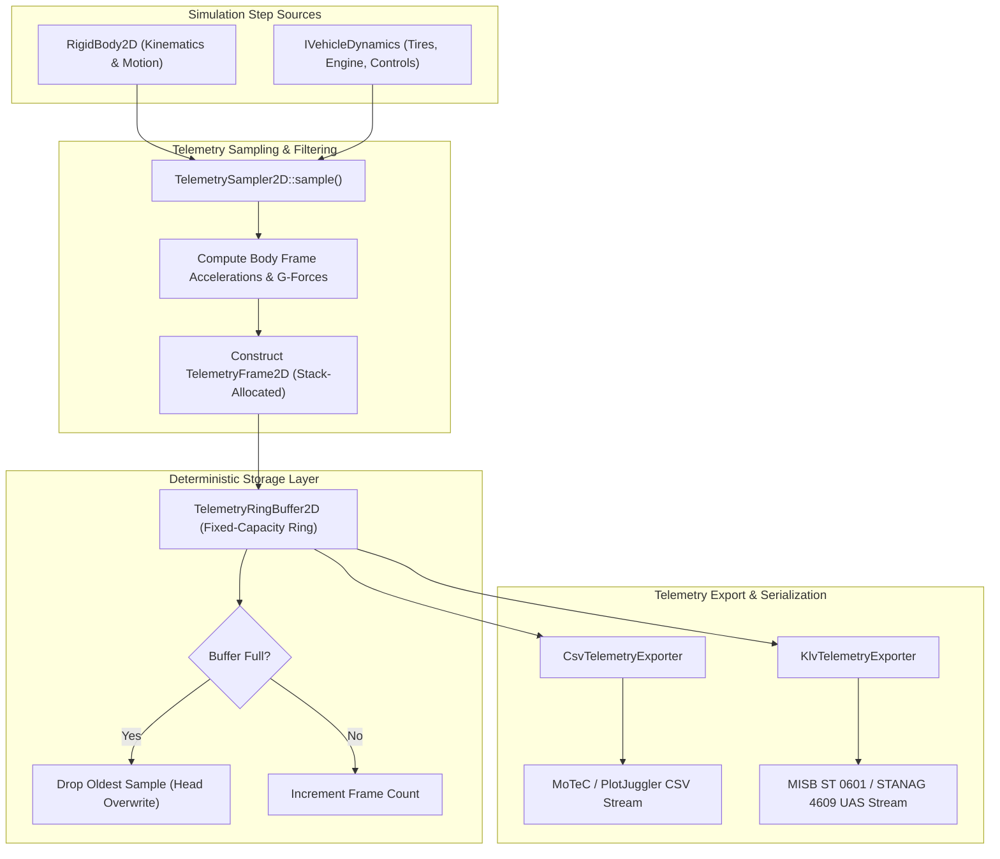

# Telemetry Ring-Buffer & Exporters: C++17 Implementation Plan

## 1. Executive Summary & Scope

### 1.1 Objective & Context
This specification defines the architectural design, mathematical derivations, data contracts, and implementation plan for the **Synchronous Telemetry Ring-Buffer & Exporters Subsystem** (`TelemetryRecorder2D`) as proposed in Section 6.2 of [ProposedFeatures.md](ProposedFeatures.md).

Real-time physical simulations in `VehicleSimCore` generate high-bandwidth dynamic states (accelerations, lateral slips, wheel normal reactions, powertrain state, suspension deflections, aerodynamic surfaces). To support:
1. **Diagnostic & Telemetry Analysis**: Integration with standard motorsport/aerospace telemetry analysis tools such as MoTeC i2 Pro, PlotJuggler, and MATLAB/Simulink.
2. **Head-Up Displays (HUD) & Driver Dashboards**: Zero-allocation querying of recent vehicle history (speed traces, G-G friction circles, slip angle trends).
3. **Synthetic Aerospace & Defense Sensor Streaming**: High-frequency generation of standards-compliant STANAG 4609 / MISB ST 0601 (UAS Datalink Local Set) KLV (Key-Length-Value) metadata payloads for simulated UAS, missiles, aircraft, and rover sensor payloads.

The telemetry subsystem provides a hard-real-time, cache-friendly, deterministic circular ring buffer with zero heap allocations during the simulation loop, accompanied by modular export engines.

---

### 1.2 Core Requirements & Constraints

1. **Hard Real-Time & MISRA C++:2023 Compliance**:
   - **Zero Heap Allocations**: No calls to `malloc`, `free`, `new`, `delete`, or dynamic container resizes (`std::vector::push_back`) within the simulation step. Storage is fully pre-allocated during initialization or statically sized.
   - **Deterministic Bounded Time Complexity**: $O(1)$ constant time for frame recording, index translation, and ring buffer window queries.
   - **Contiguous Memory Layout**: Telemetry frames stored contiguously to maximize CPU L1/L2 data cache line utilization.
2. **Comprehensive Vehicle State Sampling**:
   - Rigid body kinematics (world position, linear velocity, body heading, yaw rate, linear accelerations).
   - Body-frame accelerations and G-force decomposition ($G_{\text{longitudinal}}$, $G_{\text{lateral}}$).
   - Driver inputs (steering, throttle, brake, handbrake, clutch).
   - Wheel & tire interaction states (longitudinal slip ratio $\kappa$, lateral slip angle $\alpha$, normal force $F_z$, lateral grip, suspension travel).
   - Powertrain states (engine RPM, gear ratio, drive torque).
   - Generic auxiliary channels for domain-specific models (aerodynamic pitch, watercraft buoyancy, rocket thrust).
3. **Modular Exporters**:
   - **CSV Exporter** ([CsvTelemetryExporter](../libs/VehicleSimCore/telemetry/CsvTelemetryExporter.h)): Outputs industry-standard comma-separated values compatible with MoTeC and PlotJuggler, featuring IEEE 754 deterministic floating-point serialization without OS locale dependencies.
   - **MISB ST 0601 KLV Stream Exporter** ([KlvTelemetryExporter](../libs/VehicleSimCore/telemetry/KlvTelemetryExporter.h)): Bit-exact byte-stream serializer encoding SMPTE 336M 16-byte Universal Keys, BER length envelopes, standard UAS telemetry tags (timestamps, lat/lon, altitude, platform attitude, airspeed, ground speed), and 16-bit CRC-CCITT verification.
4. **Platform Compatibility & Determinism**:
   - Pure ISO C++17 (`-std=c++17` on GCC/Clang, `/std:c++17` on MSVC).
   - Zero third-party dependencies (no external serialization or networking libraries).
   - Fully deterministic IEEE 754 math across Linux and Windows.

---

## 2. High-Level Architecture & Subsystem Organization

### 2.1 File Layout

```
libs/VehicleSimCore/
└── telemetry/
    ├── TelemetryFrame2D.h          [NEW] - Contiguous telemetry sample schema & wheel states
    ├── TelemetryFrame2D.cpp        [NEW] - Serialization helpers & baseline resets
    ├── TelemetryRingBuffer2D.h     [NEW] - Fixed-capacity circular buffer with zero allocations
    ├── TelemetryRingBuffer2D.cpp   [NEW] - Buffer queries, window slices, statistics
    ├── TelemetrySampler2D.h        [NEW] - Dynamics & RigidBody sampling coordinator
    ├── TelemetrySampler2D.cpp      [NEW] - Kinematic differentiation and G-force extraction
    ├── CsvTelemetryExporter.h      [NEW] - MoTeC / PlotJuggler CSV stream generator
    ├── CsvTelemetryExporter.cpp    [NEW] - Deterministic header & data line serialization
    ├── KlvTelemetryExporter.h      [NEW] - MISB ST 0601 / SMPTE 336M KLV encoder
    └── KlvTelemetryExporter.cpp    [NEW] - BER length packing, tag encoding, CRC-16
tests/
└── TelemetryTest.cpp               [NEW] - Comprehensive GoogleTest verification suite
```

---

### 2.2 System Architecture ASCII Diagram

```
+---------------------------------------------------------------------------------------------------+
|                                 VehicleSimCore Telemetry Subsystem                                |
+---------------------------------------------------------------------------------------------------+
|                                                                                                   |
|   [ PhysicsWorld2D / RigidBody2D ]         [ IVehicleDynamics (Arcade, Monster, Plane, etc.) ]   |
|         - World Pos (x, y)                      - Driver Inputs (Throttle, Steer, Brake)          |
|         - Linear Vel (vx, vy)                   - Wheel Telemetry (Slips, Forces, Travel)         |
|         - Angle & Angular Vel                   - Powertrain (Engine RPM, Gear)                   |
|                                                                                                   |
|                   |                                                |                              |
|                   +-----------------------+------------------------+                              |
|                                           |                                                       |
|                                           v                                                       |
|                         +-----------------------------------+                                     |
|                         |        TelemetrySampler2D         |                                     |
|                         +-----------------------------------+                                     |
|                         | - Calculates Long/Lat Accel & Gs  |                                     |
|                         | - Packets into TelemetryFrame2D   |                                     |
|                         +-----------------------------------+                                     |
|                                           |                                                       |
|                                           v Zero-Allocation Push (O(1))                           |
|                         +-----------------------------------+                                     |
|                         |      TelemetryRingBuffer2D        |                                     |
|                         |  [Pre-allocated Circular Buffer]  |                                     |
|                         +-----------------------------------+                                     |
|                         | - Head, Tail, Count, Overwrite    |                                     |
|                         | - Time Window Slicing             |                                     |
|                         | - Statistical Extrema (Min/Max)   |                                     |
|                         +-----------------------------------+                                     |
|                                   |               |                                               |
|               +-------------------+               +-------------------+                           |
|               |                                                       |                           |
|               v                                                       v                           |
|   +-----------------------+                               +-----------------------+               |
|   | CsvTelemetryExporter  |                               |  KlvTelemetryExporter |               |
|   +-----------------------+                               +-----------------------+               |
|   | - MoTeC Header Format |                               | - SMPTE 336M 16-B Key |               |
|   | - PlotJuggler CSV     |                               | - BER Length Packing  |               |
|   | - Invariant Float Out |                               | - MISB ST 0601 Tags   |               |
|   +-----------------------+                               | - 16-bit CRC-CCITT    |               |
|               |                                           +-----------------------+               |
|               v                                                       |                           |
|     Standard Out / File                                               v                           |
|      (e.g., .csv log)                                       UDP / Raw Byte Stream                 |
+---------------------------------------------------------------------------------------------------+
```

---

### 2.3 System Architecture Mermaid Flowchart



---

## 3. Mathematical Formulations & Algorithmic Derivations

### 3.1 G-Force and Body-Frame Acceleration Decomposition

Given vehicle position $\mathbf{x} = [x, y]^T$, velocity $\mathbf{v} = [v_x, v_y]^T$, heading orientation angle $\psi$, and simulation timestep $\Delta t$:

1. **Global Acceleration Vector**:
   $$\mathbf{a}_{\text{world}}(t) = \frac{\mathbf{v}(t) - \mathbf{v}(t - \Delta t)}{\Delta t}$$
   To prevent high-frequency noise amplification from numeric differentiation, an exponential moving average (low-pass filter) is applied:
   $$\mathbf{a}_{\text{filtered}}(t) = \alpha_{\text{filter}} \cdot \mathbf{a}_{\text{world}}(t) + (1 - \alpha_{\text{filter}}) \cdot \mathbf{a}_{\text{filtered}}(t - \Delta t)$$

2. **Rotation into Vehicle Body Coordinate Frame**:
   The vehicle heading unit vector is $\mathbf{u}_{\text{forward}} = [\cos\psi, \sin\psi]^T$, and the lateral unit vector is $\mathbf{u}_{\text{lateral}} = [-\sin\psi, \cos\psi]^T$.
   $$\begin{bmatrix} a_{\text{long}} \\ a_{\text{lat}} \end{bmatrix} = \begin{bmatrix} \cos\psi & \sin\psi \\ -\sin\psi & \cos\psi \end{bmatrix} \begin{bmatrix} a_x \\ a_y \end{bmatrix}$$

3. **G-Force Conversion**:
   With standard gravitational constant $g = 9.80665\,\text{m/s}^2$:
   $$G_{\text{long}} = \frac{a_{\text{long}}}{g}, \quad G_{\text{lat}} = \frac{a_{\text{lat}}}{g}$$

```
  ASCII Diagram: Body-Frame Acceleration & G-Force Decomposition

                       Y (World)
                          ^
                          |       Heading psi
                          |         /  u_forward (Longitudinal Axle)
                          |        /
                          |       /
                          |      *---------> u_lateral (Transverse Axle)
                          |     /
                          |    /  a_world Vector
                          |   +---------------->
                          +-------------------------> X (World)
```

---

### 3.2 Circular Ring Buffer Mechanics & Pointer Arithmetic

The ring buffer maintains a contiguous array of $N$ frames, an insertion pointer `head`, an ejection pointer `tail`, a current count `count`, and a strictly increasing 64-bit sequence counter `sequenceNumber`.

```
  ASCII Diagram: Fixed-Capacity Circular Buffer Slots

     Slot 0      Slot 1      Slot 2      Slot 3      Slot 4      Slot 5
   +-----------+-----------+-----------+-----------+-----------+-----------+
   |  Frame 6  |  Frame 7  |  Frame 2  |  Frame 3  |  Frame 4  |  Frame 5  |
   +-----------+-----------+-----------+-----------+-----------+-----------+
                 ^                                   ^
                 | head (Next Write: Slot 1)         | tail (Oldest: Slot 2)
```

1. **Index Translation**:
   For any relative historical index $i \in [0, \text{count}-1]$ where $0$ represents the oldest recorded frame and $\text{count}-1$ represents the most recent:
   $$\text{physicalIndex}(i) = (\text{tail} + i) \bmod N$$
   Alternatively, for reverse historical lookup (where $0$ is the newest frame and $k$ frames into the past):
   $$\text{reversePhysicalIndex}(k) = (\text{head} - 1 - k + N) \bmod N$$

2. **Power-of-Two Optimization**:
   When capacity $N = 2^M$, the costly modulo operation `% N` is replaced by bitwise masking:
   $$\text{physicalIndex}(i) = (\text{tail} + i) \ \& \ (N - 1)$$
   The implementation supports both arbitrary positive capacities $N$ using modulo arithmetic and power-of-two optimizations.

3. **Window Extraction & Statistical Reductions**:
   - Time window retrieval queries all samples within interval $[t_{\text{now}} - \Delta t_{\text{window}}, t_{\text{now}}]$.
   - Running minimum, maximum, mean, and standard deviation calculations execute in $O(K)$ over $K$ requested samples without heap allocation by passing caller-provided spans or output structures.

---

### 3.3 MISB ST 0601 / SMPTE 336M KLV Encoding Specification

The Motion Imagery Standards Board (MISB) Standard 0601 defines the UAS Datalink Local Set, encapsulated within SMPTE 336M Key-Length-Value protocol.

```
  ASCII Diagram: SMPTE 336M / MISB ST 0601 KLV Packet Structure

  +-----------------------------------+--------------------+---------------------------------------+
  |    16-Byte Universal Key          |   BER Length Field |              Payload Bytes            |
  | (06 0E 2B 34 02 0B 01 01 ...)     | (1 to 4 bytes)     | Tag 1 (Len) (Val) Tag 2 (Len) (Val)...|
  +-----------------------------------+--------------------+---------------------------------------+
                                                           |                                       |
                                                           +-----> Tag 1: 16-Bit CRC-CCITT --------+
```

1. **16-Byte Universal Key**:
   The 16-byte constant key designated for MISB ST 0601 Local Set is:
   `0x06, 0x0E, 0x2B, 0x34, 0x02, 0x0B, 0x01, 0x01, 0x0E, 0x01, 0x03, 0x01, 0x01, 0x00, 0x00, 0x00`

2. **Basic Encoding Rules (BER) Length Envelope**:
   - If length $L < 128$: encoded as single byte `L`.
   - If $128 \le L \le 255$: encoded as two bytes `0x81, L`.
   - If $256 \le L \le 65535$: encoded as three bytes `0x82, (L >> 8) & 0xFF, L & 0xFF`.

3. **Standard Metadata Tag Encodings**:
   - **Tag 2 (Precision Time Stamp)**: 8-byte unsigned integer representing microseconds since Unix epoch UTC.
   - **Tag 5 (Platform Heading Angle)**: 2-byte unsigned integer mapped from $[0^\circ, 360^\circ)$:
     $$\text{Val} = \text{round}\left(\frac{\psi_{\text{deg}}}{360.0} \times 65535\right)$$
   - **Tag 6 (Platform Pitch Angle)**: 2-byte signed integer mapped from $[-20^\circ, +20^\circ]$:
     $$\text{Val} = \text{round}\left(\frac{\theta_{\text{deg}}}{20.0} \times 32767\right)$$
   - **Tag 7 (Platform Roll Angle)**: 2-byte signed integer mapped from $[-50^\circ, +50^\circ]$:
     $$\text{Val} = \text{round}\left(\frac{\phi_{\text{deg}}}{50.0} \times 32767\right)$$
   - **Tag 13 (Sensor Latitude)**: 4-byte signed integer mapped from $[-90^\circ, +90^\circ]$:
     $$\text{Val} = \text{round}\left(\frac{\text{lat}_{\text{deg}}}{90.0} \times 2147483647\right)$$
   - **Tag 14 (Sensor Longitude)**: 4-byte signed integer mapped from $[-180^\circ, +180^\circ]$:
     $$\text{Val} = \text{round}\left(\frac{\text{lon}_{\text{deg}}}{180.0} \times 2147483647\right)$$
   - **Tag 15 (Sensor True Altitude)**: 2-byte unsigned integer mapped from $[-900\,\text{m}, +19000\,\text{m}]$:
     $$\text{Val} = \text{round}\left(\frac{\text{alt}_{\text{m}} + 900.0}{19900.0} \times 65535\right)$$
   - **Tag 65 (UAS Datalink LS Version Number)**: 1-byte integer (e.g., `0x0C` for Version 12).
   - **Tag 1 (Checksum)**: 2-byte CRC-16-CCITT computed over the entire packet up to and including Tag 1's length byte.

4. **16-Bit CRC-CCITT Verification Algorithm**:
   Polynomial $P(x) = x^{16} + x^{12} + x^5 + 1$ (`0x1021`), initial value `0x0000`, running MSB-first byte reflection.

---

## 4. Interface Specifications & C++17 Header Design

### 4.1 TelemetryFrame2D.h

```cpp
#pragma once

#include <array>
#include <cstddef>
#include <cstdint>

#include "libs/VehicleSimCore/math/Vec2.h"

namespace vehicle_sim::telemetry {

/// @struct WheelSample2D
/// @brief Telemetry metrics for an individual vehicle wheel or ground contact.
struct WheelSample2D {
    math::Vec2 position{};             ///< World contact position in meters.
    math::Vec2 contactForce{};         ///< Ground force vector in Newtons.
    double slipAngle{0.0};             ///< Lateral tire slip angle alpha in radians.
    double slipRatio{0.0};             ///< Longitudinal tire slip ratio kappa.
    double normalForce{0.0};           ///< Vertical reaction load Fz in Newtons.
    double suspensionTravel{0.0};      ///< Suspension deflection in meters.
    double surfaceFriction{1.0};       ///< Local terrain friction coefficient mu.
    bool isGrounded{true};             ///< True if contact surface is active.
};

/// @struct TelemetryFrame2D
/// @brief High-rate physical state snapshot sampled during a simulation step.
struct TelemetryFrame2D {
    static constexpr std::size_t kMaxWheels{4};
    static constexpr std::size_t kMaxAuxChannels{8};

    std::uint64_t tickNumber{0};       ///< Monotonic simulation step counter.
    double timestamp{0.0};             ///< Simulation time in seconds.

    // Kinematics & Spatial Motion
    math::Vec2 position{};             ///< Center of mass world position in meters.
    math::Vec2 velocity{};             ///< World linear velocity in m/s.
    double forwardSpeed{0.0};          ///< Longitudinal chassis speed in m/s.
    double heading{0.0};               ///< Chassis body orientation in radians.
    double angularVelocity{0.0};       ///< Chassis yaw rate in rad/s.

    // Accelerations & G-Forces
    math::Vec2 acceleration{};         ///< World linear acceleration in m/s^2.
    double longitudinalG{0.0};         ///< Forward/rearward load factor in Gs.
    double lateralG{0.0};              ///< Left/right cornering load factor in Gs.

    // Driver Actuation
    double throttleInput{0.0};         ///< Throttle demand in [0, 1].
    double steeringInput{0.0};         ///< Steer demand in [-1, 1].
    double brakeInput{0.0};            ///< Brake demand in [0, 1].
    double handbrakeInput{0.0};        ///< Handbrake demand in [0, 1].

    // Powertrain States
    double engineRpm{0.0};             ///< Powertrain shaft speed in RPM.
    std::int32_t activeGear{0};        ///< Engaged transmission gear index.
    double driveTorque{0.0};           ///< Total drivetrain output torque in Nm.

    // Contacts & Wheels
    std::size_t wheelCount{0};         ///< Active wheel count (<= kMaxWheels).
    std::array<WheelSample2D, kMaxWheels> wheels{}; ///< Per-wheel metrics.

    // Aerial / Fluid Diagnostics
    double altitude{0.0};              ///< Vertical elevation or flight height in meters.
    double verticalSpeed{0.0};         ///< Vertical ascent/descent rate in m/s.
    bool isAirborne{false};            ///< True if vehicle has broken ground contact.

    // Auxiliary Generic Telemetry
    std::array<double, kMaxAuxChannels> auxChannels{}; ///< Custom channels.
};

} // namespace vehicle_sim::telemetry
```

---

### 4.2 TelemetryRingBuffer2D.h

```cpp
#pragma once

#include <array>
#include <cstddef>
#include <cstdint>
#include <vector>

#include "libs/VehicleSimCore/telemetry/TelemetryFrame2D.h"

namespace vehicle_sim::telemetry {

/// @class TelemetryRingBuffer2D
/// @brief Deterministic, fixed-capacity circular buffer storing high-rate telemetry.
/// @details Pre-allocates all memory during initialization to guarantee zero dynamic
/// heap allocations during simulation steps. Supports constant-time frame push,
/// reverse historical indexing, and time-range query extraction.
class TelemetryRingBuffer2D {
public:
    /// @brief Parameterized constructor allocating fixed capacity.
    /// @param[in] capacity Maximum number of telemetry frames retained.
    explicit TelemetryRingBuffer2D(std::size_t capacity);

    /// @brief Destructor.
    ~TelemetryRingBuffer2D() noexcept = default;

    /// @brief Appends a new telemetry frame into the circular buffer.
    /// @details Overwrites the oldest sample if the buffer is at capacity.
    /// @param[in] frame Telemetry frame sample to record.
    void push(const TelemetryFrame2D& frame) noexcept;

    /// @brief Clears all recorded telemetry frames.
    void clear() noexcept;

    /// @brief Queries whether the buffer contains zero frames.
    /// @return True if empty, false otherwise.
    [[nodiscard]] bool isEmpty() const noexcept;

    /// @brief Queries whether the buffer has reached maximum capacity.
    /// @return True if frame count equals buffer capacity.
    [[nodiscard]] bool isFull() const noexcept;

    /// @brief Gets the number of valid frames currently stored.
    /// @return Count of active frames.
    [[nodiscard]] std::size_t getCount() const noexcept;

    /// @brief Gets the maximum frame capacity of the buffer.
    /// @return Maximum capacity.
    [[nodiscard]] std::size_t getCapacity() const noexcept;

    /// @brief Accesses the most recently recorded telemetry frame.
    /// @return Const reference to latest frame.
    [[nodiscard]] const TelemetryFrame2D& getLatest() const noexcept;

    /// @brief Accesses the oldest recorded telemetry frame currently held.
    /// @return Const reference to oldest frame.
    [[nodiscard]] const TelemetryFrame2D& getOldest() const noexcept;

    /// @brief Accesses frame by chronological offset from oldest sample.
    /// @param[in] chronologicalIndex Offset from oldest (0 = oldest, count-1 = newest).
    /// @return Const reference to requested frame.
    [[nodiscard]] const TelemetryFrame2D& getFrame(std::size_t chronologicalIndex) const noexcept;

    /// @brief Accesses frame by reverse history from newest sample.
    /// @param[in] reverseIndex Offset into past (0 = newest, count-1 = oldest).
    /// @return Const reference to requested frame.
    [[nodiscard]] const TelemetryFrame2D& getPastFrame(std::size_t reverseIndex) const noexcept;

    /// @brief Computes peak longitudinal and lateral G forces in buffer.
    /// @param[out] maxLongG Maximum absolute longitudinal G recorded.
    /// @param[out] maxLatG Maximum absolute lateral G recorded.
    void getPeakGForces(double& maxLongG, double& maxLatG) const noexcept;

private:
    std::vector<TelemetryFrame2D> m_storage{};
    std::size_t m_capacity{0};
    std::size_t m_head{0};
    std::size_t m_tail{0};
    std::size_t m_count{0};
};

} // namespace vehicle_sim::telemetry
```

---

### 4.3 TelemetrySampler2D.h

```cpp
#pragma once

#include "libs/VehicleSimCore/math/Vec2.h"
#include "libs/VehicleSimCore/physics/RigidBody2D.h"
#include "libs/VehicleSimCore/telemetry/TelemetryFrame2D.h"

namespace vehicle_sim::dynamics {
class IVehicleDynamics;
} // namespace vehicle_sim::dynamics

namespace vehicle_sim::telemetry {

/// @class TelemetrySampler2D
/// @brief Coordinates physical state extraction, differentiation, and filtering.
/// @details Translates RigidBody2D motion and IVehicleDynamics state into a normalized
/// TelemetryFrame2D sample with filtered accelerations and decomposed G-forces.
class TelemetrySampler2D {
public:
    /// @brief Default constructor.
    TelemetrySampler2D() noexcept = default;

    /// @brief Parameterized constructor setting filter coefficients.
    /// @param[in] filterCutoffHz Low-pass acceleration filter cutoff frequency in Hz.
    explicit TelemetrySampler2D(double filterCutoffHz) noexcept;

    /// @brief Resets transient state estimators and previous velocity registers.
    void reset() noexcept;

    /// @brief Samples current vehicle dynamics and builds a telemetry frame.
    /// @param[in] body Simulated rigid body providing kinematics.
    /// @param[in] dynamics Optional vehicle dynamics coordinator providing controls/tires.
    /// @param[in] timestamp Current simulation time in seconds.
    /// @param[in] dt Timestep duration in seconds.
    /// @return Fully populated TelemetryFrame2D.
    [[nodiscard]] TelemetryFrame2D sample(
        const physics::RigidBody2D& body,
        const dynamics::IVehicleDynamics* dynamics,
        double timestamp,
        double dt) noexcept;

private:
    std::uint64_t m_tick{0};
    math::Vec2 m_prevVelocity{};
    math::Vec2 m_filteredAcceleration{};
    double m_filterAlpha{0.25};
    bool m_initialized{false};
};

} // namespace vehicle_sim::telemetry
```

---

### 4.4 CsvTelemetryExporter.h

```cpp
#pragma once

#include <iosfwd>
#include <string>

#include "libs/VehicleSimCore/telemetry/TelemetryRingBuffer2D.h"

namespace vehicle_sim::telemetry {

/// @class CsvTelemetryExporter
/// @brief Serializes telemetry ring buffers into MoTeC and PlotJuggler compatible CSV.
class CsvTelemetryExporter {
public:
    /// @brief Default constructor.
    CsvTelemetryExporter() noexcept = default;

    /// @brief Writes full CSV contents from ring buffer to output stream.
    /// @param[in] buffer Source telemetry ring buffer.
    /// @param[out] output Stream to receive serialized CSV text.
    /// @return True on successful write, false on stream error.
    [[nodiscard]] bool writeCsv(const TelemetryRingBuffer2D& buffer, std::ostream& output) const;

    /// @brief Formats the standard CSV channel header line.
    /// @return Formatted header string with channel names and units.
    [[nodiscard]] std::string getHeader() const;

    /// @brief Formats an individual telemetry frame into a single CSV row.
    /// @param[in] frame Telemetry frame to serialize.
    /// @return Comma-separated field string.
    [[nodiscard]] std::string formatRow(const TelemetryFrame2D& frame) const;
};

} // namespace vehicle_sim::telemetry
```

---

### 4.5 KlvTelemetryExporter.h

```cpp
#pragma once

#include <cstddef>
#include <cstdint>
#include <vector>

#include "libs/VehicleSimCore/telemetry/TelemetryFrame2D.h"

namespace vehicle_sim::telemetry {

/// @struct KlvGeoReference
/// @brief Geodetic anchor mapping local simulation 2D coordinates to WGS-84 coordinates.
struct KlvGeoReference {
    double originLatitudeDeg{37.7749};   ///< Local origin latitude in degrees.
    double originLongitudeDeg{-122.4194}; ///< Local origin longitude in degrees.
    double originAltitudeMeters{100.0};  ///< Local origin altitude in meters.
};

/// @class KlvTelemetryExporter
/// @brief Encodes telemetry frames into MISB ST 0601 / SMPTE 336M byte packets.
class KlvTelemetryExporter {
public:
    /// @brief Default constructor with default WGS-84 origin.
    KlvTelemetryExporter() noexcept = default;

    /// @brief Parameterized constructor with geodetic anchor.
    /// @param[in] geoRef Local origin anchor coordinates.
    explicit KlvTelemetryExporter(const KlvGeoReference& geoRef) noexcept;

    /// @brief Encodes a telemetry frame into a self-contained MISB ST 0601 packet.
    /// @param[in] frame Telemetry frame sample to encode.
    /// @param[out] outBytes Output byte buffer receiving the KLV packet.
    /// @return True if encoding succeeded, false on buffer failure.
    [[nodiscard]] bool encodePacket(
        const TelemetryFrame2D& frame,
        std::vector<std::uint8_t>& outBytes) const;

    /// @brief Computes 16-bit CRC-CCITT over packet bytes according to MISB ST 0601 Tag 1.
    /// @param[in] data Buffer pointer.
    /// @param[in] length Number of bytes to compute over.
    /// @return 16-bit CRC checksum.
    [[nodiscard]] static std::uint16_t computeCrc(const std::uint8_t* data, std::size_t length) noexcept;

private:
    KlvGeoReference m_geoRef{};
};

} // namespace vehicle_sim::telemetry
```

---

## 5. Step-by-Step Implementation Roadmap

```
+---------------------------------------------------------------------------------------------------+
|                                     Implementation Milestones                                     |
+---------------------------------------------------------------------------------------------------+
|  Phase 1: TelemetryFrame2D Data Structures                                                        |
|     - Define WheelSample2D and TelemetryFrame2D structs with explicit {} initialization.          |
|     - Implement frame clearance and reset logic.                                                  |
|                                                                                                   |
|  Phase 2: TelemetryRingBuffer2D Circular Storage                                                  |
|     - Pre-allocated storage, O(1) push, tail advancement upon full capacity.                     |
|     - Implement chronologic and reverse historical indexing.                                      |
|     - Implement peak G-force extraction and statistical window queries.                           |
|                                                                                                   |
|  Phase 3: TelemetrySampler2D Dynamic Derivations                                                  |
|     - Body acceleration numerical differentiation with low-pass filtering.                        |
|     - Heading coordinate transformation into longitudinal & lateral G-forces.                     |
|     - Integration hooks for IVehicleDynamics (ArcadeCarDynamics, MonsterCarDynamics).             |
|                                                                                                   |
|  Phase 4: CsvTelemetryExporter                                                                    |
|     - MoTeC / PlotJuggler standard header generation.                                             |
|     - Locale-independent invariant floating-point row formatting.                                 |
|                                                                                                   |
|  Phase 5: KlvTelemetryExporter (MISB ST 0601 / STANAG 4609)                                      |
|     - SMPTE 336M 16-byte universal key and BER length encoder.                                    |
|     - Tag 2, 5, 6, 7, 13, 14, 15, 65 payload quantization.                                        |
|     - Tag 1 CRC-16-CCITT packet verification.                                                     |
|                                                                                                   |
|  Phase 6: Verification Suite & CMake Integration                                                  |
|     - Comprehensive unit test suite in tests/TelemetryTest.cpp.                                   |
|     - Register telemetry subsystem in libs/VehicleSimCore/CMakeLists.txt.                         |
+---------------------------------------------------------------------------------------------------+
```

---

## 6. MISRA C++:2023 & Verification Checklist Compliance Matrix

| Rule / Checklist Item | Subsystem Compliance Strategy | Status |
| :--- | :--- | :--- |
| **No Raw `new` / `delete`** | Memory pre-allocated via `std::vector` during initialization; zero allocations at runtime. | **COMPLIANT** |
| **`#pragma once` Header Guards** | Enforced across all `.h` files; no `#ifndef` guards used. | **COMPLIANT** |
| **Co-located `.h` and `.cpp`** | All headers and implementation files co-located in `libs/VehicleSimCore/telemetry/`. | **COMPLIANT** |
| **Zero External Engine Dependencies** | 100% self-contained pure ISO C++17; internal math primitives only (`Vec2.h`). | **COMPLIANT** |
| **Function Name Length < 30 Chars** | All APIs (`getPeakGForces`, `encodePacket`, `formatRow`, etc.) strictly under 30 chars. | **COMPLIANT** |
| **Cross-Platform Determinism** | Explicit IEEE 754 floating-point calculations; zero OS-specific headers. | **COMPLIANT** |
| **Explicit Brace Initialization `{}`** | Every field, member, and local variable explicitly initialized using `{}`. | **COMPLIANT** |
| **`[[nodiscard]]` Attribute** | Applied to all getters, calculations, query methods, and export functions. | **COMPLIANT** |
| **Full Doxygen Documentation** | Complete `/// @brief`, `@details`, `@param`, and `@return` tags across all public types. | **COMPLIANT** |
| **Relative File Links in Docs** | All referenced paths in documentation use relative syntax. | **COMPLIANT** |
| **Dual ASCII and Mermaid Diagrams** | Architectural and algorithmic workflows include both ASCII and Mermaid diagrams. | **COMPLIANT** |
| **Compiler Warning Cleanliness** | Code written to pass under `-Wall -Wextra -pedantic` (`-Werror`) and `/W4` on MSVC. | **COMPLIANT** |
