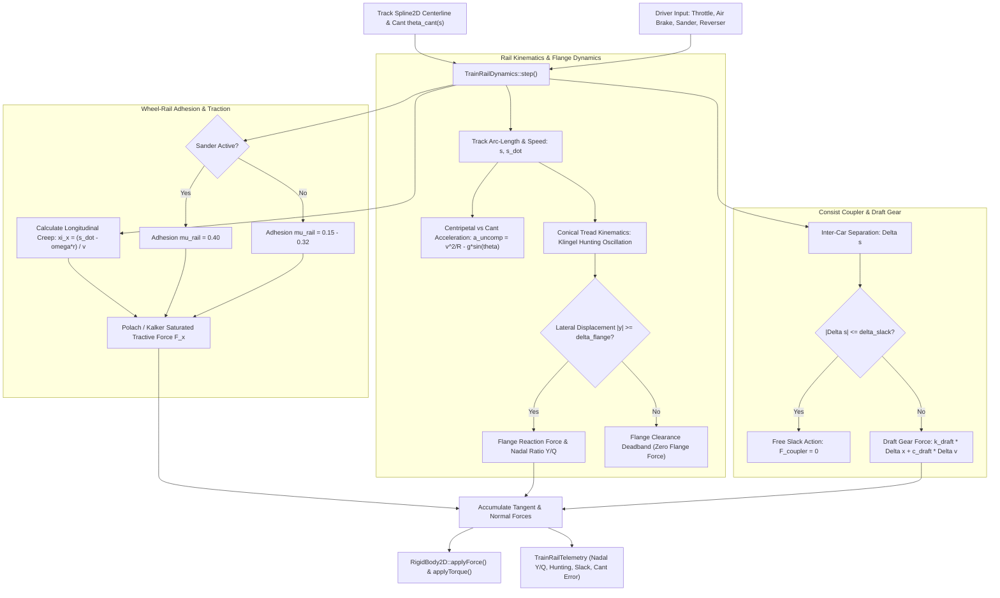
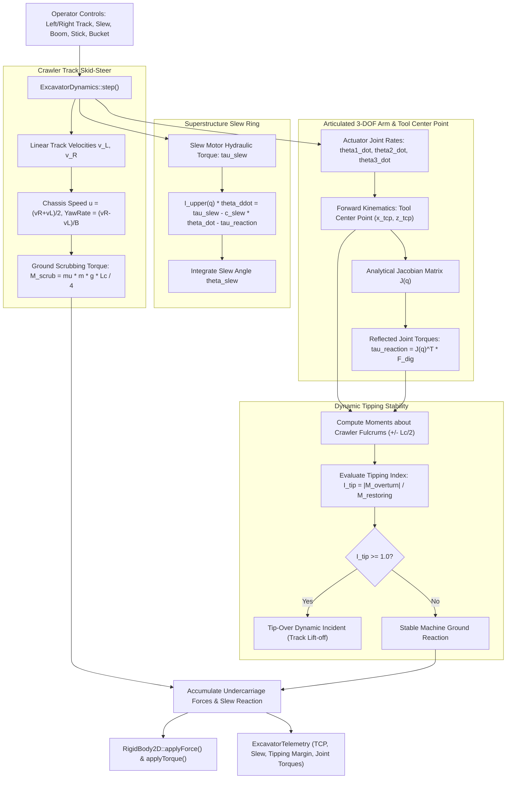

# TrainRailDynamics & ExcavatorDynamics: C++17 Implementation Plan

## 1. Executive Summary & Scope

### 1.1 Objective & Context
This specification details the mathematical formulations, physical equations, software architecture, data contracts, and verification roadmap for two advanced industrial dynamics coordinators in `VehicleSimCore`:
1. **`TrainRailDynamics`**: Simulates rail vehicle kinematics and dynamics constrained to 1D curvilinear coordinates along parametric [Spline2D](../libs/VehicleSimCore/math/Spline2D.h) railway tracks. It models wheel flange contact, Klingel hunting oscillations, Kalker linear creepage and non-linear adhesion saturation, sander adhesion enhancement, multi-car coupler slack action (draft gear spring-damper deadband), and Nadal flange climb derailment criteria.
2. **`ExcavatorDynamics`**: Models heavy dual-track crawler excavators featuring differential skid-steer ground shearing mechanics, a continuous $360^\circ$ rotating upper superstructure (slew ring bearing) with dynamic inertia shifting, a planar 3-DOF articulated hydraulic arm (Boom, Stick/Arm, Bucket) with forward kinematics and analytical Jacobian mapping, bucket tip soil digging reaction forces, and crawler fulcrum dynamic tipping margin evaluation.

Both coordinators implement [IVehicleDynamics](../libs/VehicleSimCore/dynamics/IVehicleDynamics.h) within the pure C++17 `VehicleSimCore` architecture, adhering to:
- Zero external engine dependencies (pure C++17 standard library and internal `VehicleSimCore` math/physics).
- Zero heap allocations during simulation ticks (`step()` is strictly real-time and allocation-free).
- Full IEEE 754 floating-point determinism across Windows (MSVC/Clang) and Linux (GCC/Clang).
- Strict compliance with MISRA C++:2023 and SEI CERT C++ coding standards.
- Synchronous diagnostic telemetry export via dedicated telemetry structs.

---

## 2. Mathematical & Physical Formulation

### 2.1 Part A: Guided Railway Dynamics (`TrainRailDynamics`)

#### 1. Curvilinear Track Kinematics & Frenet-Serret Frame
The railway centerline is represented by a parametric curve $\mathbf{p}(s) \in \mathbb{R}^2$ parameterized by arc-length $s$ using [Spline2D](../libs/VehicleSimCore/math/Spline2D.h):
- Centerline tangent: $\mathbf{T}(s) = \frac{d\mathbf{p}}{ds}, \quad \|\mathbf{T}(s)\| = 1$
- Centerline normal: $\mathbf{N}(s) = [-T_y(s), T_x(s)]^T$
- Track curvature: $\kappa(s) = \|\frac{d\mathbf{T}}{ds}\|$, with local radius of curvature $R(s) = \frac{1}{|\kappa(s)| + \epsilon}$

The state of a rail car along the track is defined by its longitudinal curvilinear coordinate $s$, velocity $\dot{s}$, and lateral wheelset displacement $y_{\text{rail}}$ relative to the track centerline.

#### 2. Track Superelevation (Cant) & Centripetal Balance
Curved railway tracks incorporate superelevation (cant angle $\theta_{\text{cant}}(s)$ or cant height $h_{\text{cant}}$ across track gauge $2b$):
$$\sin(\theta_{\text{cant}}) = \frac{h_{\text{cant}}}{2b}$$

At longitudinal speed $v = \dot{s}$, the lateral acceleration balance in the vehicle roll plane is:
$$a_{\text{lat,total}} = \frac{v^2}{R(s)} \operatorname{sgn}(\kappa(s)) - g \sin(\theta_{\text{cant}})$$

- **Equilibrium (Balancing) Speed**: The speed at which centrifugal force is perfectly balanced by track cant:
  $$v_{\text{eq}}(s) = \sqrt{g R(s) \tan(\theta_{\text{cant}}(s))}$$
- **Uncompensated Lateral Acceleration ($a_{\text{lat,uncomp}}$)**:
  $$a_{\text{lat,uncomp}} = \frac{v^2}{R(s)} \operatorname{sgn}(\kappa(s)) - g \sin(\theta_{\text{cant}})$$
Excessive uncompensated lateral acceleration produces passenger discomfort, lateral wheel flange force surges, and risk of rollover derailment.

#### 3. Wheel-Rail Creep & Adhesion Limits
Due to elastic deformation at the steel wheel-rail contact patch, wheels develop microscopic relative sliding termed creepage:
- **Longitudinal Creepage ($\xi_x$)**:
  $$\xi_x = \frac{\dot{s} - \omega_{\text{wheel}} r_0}{\max(|\dot{s}|, v_{\text{threshold}})}$$
  where $r_0$ is the nominal rolling radius and $\omega_{\text{wheel}}$ is wheel angular speed.
- **Kalker Linear Creep Force**:
  $$F_{x,\text{linear}} = -f_{11} \xi_x$$
  where $f_{11}$ is Kalker's longitudinal creep coefficient.
- **Non-Linear Adhesion Saturation (Shen-Hedrick-Elkins / Polach Formulation)**:
  Let normal load per wheel be $Q = \frac{m g}{n_{\text{wheels}}}$. The maximum tractive adhesion force is:
  $$F_{\text{adh,max}} = \mu_{\text{rail}} Q$$
  where the rail adhesion coefficient $\mu_{\text{rail}}$ depends on rail surface condition:
  $$\mu_{\text{rail}} = \begin{cases} 
  0.15 & \text{Wet / contaminated / greasy rail} \\
  0.32 & \text{Dry clean rail} \\
  0.40 & \text{Sander system activated (sand injection)}
  \end{cases}$$
  The saturated longitudinal tractive force is given by:
  $$F_x = F_{\text{adh,max}} \cdot \frac{2}{\pi} \arctan\left(\frac{\pi f_{11} \xi_x}{2 F_{\text{adh,max}}}\right)$$

#### 4. Wheel Taper, Klingel Hunting Oscillations & Flange Strike
Rail wheelsets feature conical treads with conicity $\gamma = \tan(\theta_{\text{cone}})$ (typically $1/20$ or $1/40$):
- When the wheelset shifts laterally by $y_{\text{rail}}$, the left and right rolling radii change:
  $$r_L = r_0 - \gamma y_{\text{rail}}, \quad r_R = r_0 + \gamma y_{\text{rail}}$$
- This difference produces differential longitudinal rolling distances, generating a self-centering kinematic oscillation termed **Klingel hunting**:
  $$\omega_{\text{hunting}} = v \sqrt{\frac{\gamma}{r_0 b}}$$
  $$f_{\text{hunting}} = \frac{v}{2\pi} \sqrt{\frac{\gamma}{r_0 b}}$$
- **Flange Clearance & Strike**:
  A clearance deadband $\delta_{\text{flange}}$ (typically $8\text{--}12\text{ mm}$) exists before the wheel flange impacts the rail gauge face. When $|y_{\text{rail}}| \ge \delta_{\text{flange}}$:
  $$F_{\text{flange}} = -k_{\text{flange}} (|y_{\text{rail}}| - \delta_{\text{flange}}) \operatorname{sgn}(y_{\text{rail}}) - c_{\text{flange}} \dot{y}_{\text{rail}}$$
  where $k_{\text{flange}} \approx 10^7\text{ N/m}$ is the steep non-linear contact stiffness of the steel rail head.

#### 5. Derailment Safety: Nadal Criterion
The risk of wheel climb derailment during tight curve negotiation or severe hunting is assessed using Nadal's formula:
$$\left(\frac{Y}{Q}\right)_{\text{limit}} = \frac{\tan(\delta_{\text{flange}}) - \mu_{\text{flange}}}{1 + \mu_{\text{flange}} \tan(\delta_{\text{flange}})}$$
where:
- $Y = |F_{\text{flange}}|$ is the lateral flange guiding force.
- $Q$ is the instantaneous vertical wheel load.
- $\delta_{\text{flange}}$ is the wheel flange angle (typically $60^\circ\text{--}70^\circ$).
- $\mu_{\text{flange}}$ is the wheel-rail friction coefficient ($\approx 0.25\text{--}0.35$).

If $\frac{Y}{Q} \ge \left(\frac{Y}{Q}\right)_{\text{limit}}$ for a duration exceeding $0.05\text{ s}$, wheel climb derailment occurs.

#### 6. Multi-Car Coupler Slack Action & Draft Gear
In a train consist, adjacent rail cars $i$ and $i+1$ are linked by couplers with draft gear cushioning and mechanical free slack:
- Let the relative distance between coupler pins along the track arc-length be $\Delta s_{i} = s_{i+1} - s_i - L_{\text{car}}$.
- Mechanical free slack deadband is $[-\delta_{\text{slack}}, \delta_{\text{slack}}]$ (typically $\pm 25\text{ mm}$ to $\pm 50\text{ mm}$).
- Net effective coupler deformation:
  $$\Delta x_{\text{coupler}} = \begin{cases}
  \Delta s_i - \delta_{\text{slack}} & \text{if } \Delta s_i > \delta_{\text{slack}} \quad (\text{Tension / Draft}) \\
  \Delta s_i + \delta_{\text{slack}} & \text{if } \Delta s_i < -\delta_{\text{slack}} \quad (\text{Compression / Buff}) \\
  0 & \text{if } |\Delta s_i| \le \delta_{\text{slack}} \quad (\text{Free Slack Zone})
  \end{cases}$$
- The coupler longitudinal force transmitted between cars is:
  $$F_{\text{coupler}} = k_{\text{draft}} \Delta x_{\text{coupler}} + c_{\text{draft}} \Delta \dot{s}_i$$

---

### 2.2 Part B: Dual-Track Hydraulic Excavator Dynamics (`ExcavatorDynamics`)

#### 1. Dual-Track Skid-Steer Undercarriage Kinematics
The crawler undercarriage operates via differential track speeds without steerable wheels:
- Let left track speed be $v_L$ and right track speed be $v_R$. Track gauge is $B$ (lateral center-to-center spacing).
- Nominal chassis forward speed: $u = \frac{v_R + v_L}{2}$.
- Nominal chassis yaw rate: $\omega_{\text{yaw}} = \frac{v_R - v_L}{B}$.
- When turning, continuous crawler tracks slip and scrub laterally against the terrain. The ground scrubbing resistive torque $M_{\text{scrub}}$ resisting yaw motion is given by:
  $$M_{\text{scrub}} = \frac{\mu_{\text{track}} m g L_c}{4} \tanh(k_{\text{scrub}} \omega_{\text{yaw}})$$
  where $L_c$ is the track ground contact patch length, $\mu_{\text{track}}$ is the lateral track-ground friction coefficient, and $m$ is the total machine mass.

#### 2. Upper Carriage Slew Ring Bearing Dynamics
The upper superstructure (cab, engine, counterweight, and boom assembly) rotates $360^\circ$ continuously on a slew ring bearing driven by a hydraulic motor:
- Slew angle: $\theta_{\text{slew}}$ relative to lower undercarriage heading.
- Slew angular velocity: $\omega_{\text{slew}} = \dot{\theta}_{\text{slew}}$.
- Dynamic equation of motion:
  $$I_{\text{upper}}(\mathbf{q}) \ddot{\theta}_{\text{slew}} = \tau_{\text{slew}} - c_{\text{slew}} \dot{\theta}_{\text{slew}} - \tau_{\text{arm,slew}}$$
  where:
  - $\tau_{\text{slew}}$ is the hydraulic slew motor torque (governed by displacement and pressure relief limits $\pm \tau_{\text{slew,max}}$).
  - $c_{\text{slew}}$ is the viscous bearing damping coefficient.
  - $\tau_{\text{arm,slew}}$ is the reaction torque from digging forces and arm inertial acceleration.
  - $I_{\text{upper}}(\mathbf{q})$ is the composite moment of inertia of the upper structure, which dynamically shifts as the arm extends or retracts according to the parallel axis theorem.

#### 3. Planar Articulated Arm Kinematics (Boom, Stick, Bucket)
The excavator arm is a 3-DOF planar kinematic chain in the upper carriage vertical plane:
- Joint angles:
  - $\theta_1$: Boom elevation angle relative to cab horizontal.
  - $\theta_2$: Stick (dipper arm) angle relative to boom axis.
  - $\theta_3$: Bucket curl angle relative to stick axis.
- Link lengths: $L_1$ (boom length), $L_2$ (stick length), $L_3$ (bucket tooth radius).
- **Forward Kinematics**: Tool Center Point (TCP / bucket tip) position in cab frame $(x_{\text{arm}}, z_{\text{arm}})$:
  $$x_{\text{tcp}} = L_1 \cos(\theta_1) + L_2 \cos(\theta_1 + \theta_2) + L_3 \cos(\theta_1 + \theta_2 + \theta_3)$$
  $$z_{\text{tcp}} = L_1 \sin(\theta_1) + L_2 \sin(\theta_1 + \theta_2) + L_3 \sin(\theta_1 + \theta_2 + \theta_3)$$
- **Analytical Arm Jacobian Matrix $\mathbf{J}(\mathbf{q}) \in \mathbb{R}^{2 \times 3}$**:
  $$\mathbf{J}_{11} = -L_1 s_1 - L_2 s_{12} - L_3 s_{123}, \quad \mathbf{J}_{12} = -L_2 s_{12} - L_3 s_{123}, \quad \mathbf{J}_{13} = -L_3 s_{123}$$
  $$\mathbf{J}_{21} = L_1 c_1 + L_2 c_{12} + L_3 c_{123}, \quad \mathbf{J}_{22} = L_2 c_{12} + L_3 c_{123}, \quad \mathbf{J}_{23} = L_3 c_{123}$$
  where $s_{123} = \sin(\theta_1 + \theta_2 + \theta_3)$ and $c_{123} = \cos(\theta_1 + \theta_2 + \theta_3)$.
- TCP linear velocity:
  $$\mathbf{v}_{\text{tcp}} = \mathbf{J}(\mathbf{q}) \dot{\mathbf{q}}$$

#### 4. Digging Force Reaction & Joint Torque Equilibrium
When the bucket contacts soil, a digging reaction force $\mathbf{F}_{\text{dig}} = [F_{\text{cut}}, F_{\text{pen}}]^T$ opposes bucket motion:
- Reflected joint torques on the hydraulic cylinders:
  $$\boldsymbol{\tau}_{\text{joints}} = \mathbf{J}^T(\mathbf{q}) \mathbf{F}_{\text{dig}}$$
- Cylinder hydraulic pressure relief valves clamp max available joint torques to $[\boldsymbol{\tau}_{\text{max}}^{-}, \boldsymbol{\tau}_{\text{max}}^{+}]$. If digging resistance exceeds available cylinder force, the arm stalls.

#### 5. Machine Static & Dynamic Tipping Stability Margin
Excavators risk tipping over when high digging forces are applied or when lifting heavy payloads with the arm fully extended:
- The stability fulcrum edges are defined by the front idler and rear sprocket of the crawler tracks:
  - Front tipping axis: $x = +L_c / 2$
  - Rear tipping axis: $x = -L_c / 2$
  - Lateral tipping axes: $y = \pm B / 2$
- Total overturning moment about front idler fulcrum:
  $$M_{\text{tip,front}} = m_{\text{arm}} g (x_{\text{cog,arm}} - L_c/2) + F_{\text{dig},z} (x_{\text{tcp}} - L_c/2) - F_{\text{dig},x} z_{\text{tcp}} - m_{\text{base}} g (L_c/2 - x_{\text{cog,base}})$$
- **Dynamic Tipping Index ($I_{\text{tip}}$)**:
  $$I_{\text{tip}} = \frac{|M_{\text{overturn}}|}{M_{\text{restoring}}}$$
  When $I_{\text{tip}} \ge 1.0$, the rear track lifts off the ground, causing vehicle tip-over.

---

## 3. Architecture & Design

### 3.1 Component Structure

```
libs/VehicleSimCore/
└── dynamics/
    ├── TrainRailDynamics.h        [NEW] - Guided rail vehicle dynamics header
    ├── TrainRailDynamics.cpp      [NEW] - Curvilinear Spline2D constraint, creep, flange, draft gear
    ├── ExcavatorDynamics.h        [NEW] - Dual-track hydraulic excavator header
    ├── ExcavatorDynamics.cpp      [NEW] - Skid-steer tracks, slew ring, 3-DOF arm kinematics & tipping
    └── IVehicleDynamics.h         [REFERENCED] - Base interface contract
tests/
├── TrainRailDynamicsTest.cpp      [NEW] - Unit tests for rail creep, hunting, cant & draft gear
└── ExcavatorDynamicsTest.cpp      [NEW] - Unit tests for skid steer, slew ring, arm FK & tipping margin
```

### 3.2 System Architecture Diagrams

#### TrainRailDynamics Architecture
```
  ASCII Diagram: Rail Vehicle Bogie, Wheelset & Track Constraint Geometry

                      Longitudinal Tangent T(s)
                                ^
                                |
             +------------------+------------------+
             |            Rail Car Body            |
             |       (Arc-length coordinate s)     |
             +------------------+------------------+
                      |         |         |
                      v         v         v
                 [ Wheelset ]   |    [ Wheelset ]
                  /        \    |     /        \
          Left Wheel     Right Wheel Left Wheel Right Wheel
              |              |           |           |
              v              v           v           v
          ============================================== Track Gauge 2b
                 ^                       ^
            Left Rail               Right Rail
         (Flange clearance: delta_gap, Cant angle: theta_cant)
```



#### ExcavatorDynamics Architecture
```
  ASCII Diagram: Excavator Multi-Body System & Stability Fulcrum

                       Stick / Arm (theta_2)
                           o=================o Bucket (theta_3)
                          /                   \   /
                         /                     \_/ Digging Force F_dig
         Boom (theta_1) /
                       o
                      /
     [ Upper Cabin ] / (Mass m_upper, Inertia I_upper(q))
     =============== Slew Ring Bearing (Continuous 360 deg Rotation theta_slew)
     [ Left Track  ] ================= [ Right Track ] (Track Gauge B)
     ^                                               ^
     Rear Fulcrum (x = -L_c/2)           Front Fulcrum (x = +L_c/2)
```



---

## 4. C++17 Header Specifications

### 4.1 `TrainRailDynamics.h`

```cpp
#pragma once

#include <cmath>
#include <cstddef>
#include <vector>

#include "libs/VehicleSimCore/dynamics/IVehicleDynamics.h"
#include "libs/VehicleSimCore/math/Spline2D.h"
#include "libs/VehicleSimCore/math/Vec2.h"

namespace vehicle_sim::physics {
class RigidBody2D;
} // namespace vehicle_sim::physics

namespace vehicle_sim::dynamics {

/// @struct TrainRailConfig
/// @brief Physical configuration parameters for rail vehicle dynamics.
/// @details Defines locomotive/car mass, wheelset geometry, conical wheel taper,
/// flange clearance, Kalker creep coefficients, draft gear spring-damping, and adhesion limits.
struct TrainRailConfig {
    double mass { 80000.0 }; ///< Locomotive/car total mass in kg (~80 tonnes).
    double momentOfInertia { 1200000.0 }; ///< Yaw moment of inertia in kg*m^2.
    double carLength { 20.0 }; ///< Longitudinal coupler-to-coupler length in meters.
    double trackGauge { 1.435 }; ///< Standard track rail gauge (2b) in meters.
    double wheelRadius { 0.457 }; ///< Nominal wheel rolling radius (r0) in meters.
    double wheelConicity { 0.05 }; ///< Conical wheel tread taper gamma (e.g. 1/20 = 0.05).
    double flangeClearance { 0.010 }; ///< Lateral clearance gap delta_gap before flange contact in meters (~10 mm).
    double flangeStiffness { 1.5e7 }; ///< Flange contact strike spring stiffness in N/m.
    double flangeDamping { 2.5e5 }; ///< Flange strike viscous damping in N*s/m.
    double flangeAngle { 1.134 }; ///< Wheel flange contact face angle in radians (~65 degrees).
    double flangeFriction { 0.30 }; ///< Wheel flange-to-rail steel friction coefficient.

    double kalkerCoefficient { 1.2e7 }; ///< Kalker longitudinal creep coefficient f11 in Newtons.
    double dryAdhesion { 0.32 }; ///< Clean dry rail friction coefficient.
    double wetAdhesion { 0.15 }; ///< Wet / contaminated rail friction coefficient.
    double sandedAdhesion { 0.40 }; ///< Maximum adhesion coefficient with active sand injection.
    double maxTractiveForce { 300000.0 }; ///< Peak traction propulsion force limit in Newtons (~300 kN).
    double maxBrakingForce { 250000.0 }; ///< Maximum pneumatic service braking force in Newtons.

    double draftSlack { 0.035 }; ///< Free coupler deadband slack space delta_slack in meters (+/- 35 mm).
    double draftStiffness { 4.0e6 }; ///< Draft gear cushioning spring stiffness in N/m.
    double draftDamping { 1.8e5 }; ///< Draft gear hydraulic / friction damping in N*s/m.
    double cantAngle { 0.0 }; ///< Static or baseline track superelevation angle in radians.
};

/// @struct TrainRailInput
/// @brief Operator control inputs for a rail locomotive.
struct TrainRailInput {
    double throttle { 0.0 }; ///< Commanded traction throttle in range [0.0, 1.0].
    double serviceBrake { 0.0 }; ///< Commanded pneumatic service brake in range [0.0, 1.0].
    double dynamicBrake { 0.0 }; ///< Commanded rheostatic/regenerative brake in range [0.0, 1.0].
    int reverser { 1 }; ///< Direction reverser: 1 for forward, 0 for neutral, -1 for reverse.
    bool sanderActive { false }; ///< Sander system toggle injecting traction sand onto rails.
};

/// @struct TrainRailTelemetry
/// @brief Diagnostic telemetry snapshot for rail vehicle simulation.
struct TrainRailTelemetry {
    double trackArcLength { 0.0 }; ///< Current longitudinal arc-length s along track in meters.
    double trackSpeed { 0.0 }; ///< Forward longitudinal velocity s_dot in m/s.
    double trackCurvature { 0.0 }; ///< Track curvature kappa(s) at current position in 1/m.
    double cantAngle { 0.0 }; ///< Local track cant / superelevation angle in radians.
    double uncompLateralAcc { 0.0 }; ///< Uncompensated lateral acceleration in m/s^2.
    double lateralDisplacement { 0.0 }; ///< Lateral wheelset deviation y from track centerline in meters.
    double huntingFrequency { 0.0 }; ///< Klingel kinematic hunting frequency in Hz.
    double flangeForce { 0.0 }; ///< Current lateral wheel flange strike force in Newtons.
    double nadalRatio { 0.0 }; ///< Current Nadal derailment criterion ratio Y/Q.
    double nadalLimit { 0.85 }; ///< Critical Nadal safety threshold limit.
    double creepRatio { 0.0 }; ///< Normalized longitudinal wheel-rail creepage xi_x.
    double tractiveForce { 0.0 }; ///< Applied longitudinal wheel-rail traction force in Newtons.
    double couplerForce { 0.0 }; ///< Transmitted coupler tension (+) or compression (-) in Newtons.
    bool isDerailmentRisk { false }; ///< True if Nadal ratio exceeds safe limit or excessive lateral lift.
    bool isSanding { false }; ///< True when sander system is actively augmenting adhesion.
};

/// @class TrainRailDynamics
/// @brief Guided track railway dynamics coordinator constrained to Spline2D tracks.
/// @details Implements 1D curvilinear arc-length kinematics along Spline2D, conical wheelset
/// Klingel hunting oscillations, flange contact reaction with Nadal derailment criteria,
/// Kalker linear creepage with Polach adhesion saturation, sander injection, and multi-car coupler slack action.
class TrainRailDynamics final : public IVehicleDynamics {
public:
    /// @brief Default constructor using baseline locomotive configuration.
    TrainRailDynamics() noexcept;

    /// @brief Parameterized constructor with custom railway configuration.
    /// @param[in] config Railway physical parameters and limits.
    explicit TrainRailDynamics(const TrainRailConfig& config) noexcept;

    /// @brief Advances simulation step, applying forces along track.
    /// @param[in,out] body Target rigid body representing rail vehicle chassis.
    /// @param[in] dt Timestep duration in seconds.
    void step(physics::RigidBody2D& body, double dt) noexcept override;

    /// @brief Resets transient control inputs, hunting states, and coupler slack.
    void reset() noexcept override;

    /// @brief Queries whether the rail vehicle is airborne or derailed.
    /// @return True if vehicle is detached from rails or tipped over.
    [[nodiscard]] bool isAirborne() const noexcept override;

    /// @brief Gets active railway configuration.
    /// @return Const reference to active TrainRailConfig.
    [[nodiscard]] const TrainRailConfig& getConfig() const noexcept;

    /// @brief Updates active railway configuration.
    /// @param[in] config New configuration parameters.
    void setConfig(const TrainRailConfig& config) noexcept;

    /// @brief Gets current operator control inputs.
    /// @return Const reference to active TrainRailInput.
    [[nodiscard]] const TrainRailInput& getInput() const noexcept;

    /// @brief Sets current operator control inputs.
    /// @param[in] input New driver commands.
    void setInput(const TrainRailInput& input) noexcept;

    /// @brief Gets current diagnostic telemetry.
    /// @return Const reference to active TrainRailTelemetry.
    [[nodiscard]] const TrainRailTelemetry& getTelemetry() const noexcept;

    /// @brief Attaches the parametric railway track spline.
    /// @param[in] track Pointer to parametric Spline2D track (non-owning).
    void setTrack(const math::Spline2D* track) noexcept;

    /// @brief Sets initial arc-length position on the track.
    /// @param[in] s Arc-length coordinate from track start in meters.
    void setArcLength(double s) noexcept;

    /// @brief Sets the preceding linked car for coupler slack action.
    /// @param[in] leadCar Pointer to leading rail car dynamics (non-owning).
    void setLeadCar(const TrainRailDynamics* leadCar) noexcept;

    /// @brief Sets local track cant / superelevation angle.
    /// @param[in] cantRadians Superelevation angle in radians.
    void setCantAngle(double cantRadians) noexcept;

    /// @brief Queries whether derailment threshold has been breached.
    /// @return True if Nadal criterion or overturning limit is exceeded.
    [[nodiscard]] bool isDerailed() const noexcept;

private:
    TrainRailConfig m_config{};
    TrainRailInput m_input{};
    TrainRailTelemetry m_telemetry{};
    const math::Spline2D* m_track{ nullptr };
    const TrainRailDynamics* m_leadCar{ nullptr };

    double m_arcLength{ 0.0 };
    double m_speed{ 0.0 };
    double m_lateralOffset{ 0.0 };
    double m_lateralVelocity{ 0.0 };
    double m_cantAngle{ 0.0 };
    bool m_isDerailed{ false };

    void updateKinematics(double dt) noexcept;
    void evaluateFlangeAndNadal(double dt) noexcept;
    void evaluateTractionAndCreep(double dt) noexcept;
    void evaluateCouplerForces() noexcept;
};

} // namespace vehicle_sim::dynamics
```

---

### 4.2 `ExcavatorDynamics.h`

```cpp
#pragma once

#include <cmath>

#include "libs/VehicleSimCore/dynamics/IVehicleDynamics.h"
#include "libs/VehicleSimCore/math/Mat2.h"
#include "libs/VehicleSimCore/math/Vec2.h"

namespace vehicle_sim::physics {
class RigidBody2D;
} // namespace vehicle_sim::physics

namespace vehicle_sim::dynamics {

/// @struct ExcavatorArmConfig
/// @brief Geometric and inertial parameters of the 3-DOF articulated excavator arm.
struct ExcavatorArmConfig {
    double boomLength { 5.7 }; ///< Length of boom link L1 in meters.
    double stickLength { 2.9 }; ///< Length of stick/arm link L2 in meters.
    double bucketRadius { 1.4 }; ///< Cutting radius of bucket link L3 in meters.
    double boomMass { 3200.0 }; ///< Boom structural mass in kg.
    double stickMass { 1600.0 }; ///< Stick structural mass in kg.
    double bucketMass { 950.0 }; ///< Empty bucket mass in kg.
    double maxBucketPayload { 3000.0 }; ///< Maximum payload capacity of soil in bucket in kg.

    double boomMinAngle { -0.35 }; ///< Boom minimum pitch angle in radians (~ -20 deg).
    double boomMaxAngle { 1.22 }; ///< Boom maximum pitch angle in radians (~ 70 deg).
    double stickMinAngle { 0.52 }; ///< Stick minimum dipper angle in radians (~ 30 deg).
    double stickMaxAngle { 2.79 }; ///< Stick maximum dipper angle in radians (~ 160 deg).
    double bucketMinAngle { -0.78 }; ///< Bucket minimum curl angle in radians (~ -45 deg).
    double bucketMaxAngle { 2.35 }; ///< Bucket maximum curl angle in radians (~ 135 deg).

    double maxBoomSpeed { 0.45 }; ///< Maximum boom angular rate in rad/s.
    double maxStickSpeed { 0.55 }; ///< Maximum stick angular rate in rad/s.
    double maxBucketSpeed { 0.75 }; ///< Maximum bucket curl rate in rad/s.
    double maxDiggingForce { 150000.0 }; ///< Maximum bucket cylinder breakout force in Newtons (~150 kN).
};

/// @struct ExcavatorConfig
/// @brief Physical configuration parameters for heavy dual-track crawler excavator.
struct ExcavatorConfig {
    double undercarriageMass { 12000.0 }; ///< Lower crawler chassis mass in kg.
    double superstructureMass { 14000.0 }; ///< Upper rotating cabin and counterweight mass in kg.
    double trackGauge { 2.6 }; ///< Lateral center-to-center track width B in meters.
    double trackContactLength { 3.8 }; ///< Ground contact length Lc of crawler tracks in meters.
    double maxTrackForce { 95000.0 }; ///< Maximum tractive force per crawler track in Newtons.
    double maxTrackSpeed { 1.5 }; ///< Maximum crawler travel speed in m/s (~5.4 km/h).
    double trackFriction { 0.85 }; ///< Track-to-terrain friction coefficient.
    double groundScrubTorque { 45000.0 }; ///< Ground shearing scrubbing torque in N*m.

    double slewInertia { 35000.0 }; ///< Superstructure moment of inertia I_upper in kg*m^2.
    double maxSlewTorque { 65000.0 }; ///< Maximum hydraulic slew motor torque in N*m.
    double maxSlewSpeed { 1.15 }; ///< Maximum slew rotation velocity in rad/s (~11 rpm).
    double slewDamping { 12000.0 }; ///< Viscous damping of slew ring bearing in N*m*s.

    ExcavatorArmConfig arm{}; ///< Kinematic parameters of 3-DOF articulated arm.
};

/// @struct ExcavatorInput
/// @brief Operator control inputs for crawler travel, slew ring, and articulated arm.
struct ExcavatorInput {
    double leftTrack { 0.0 }; ///< Commanded left crawler track throttle in [-1.0, 1.0].
    double rightTrack { 0.0 }; ///< Commanded right crawler track throttle in [-1.0, 1.0].
    double slewCommand { 0.0 }; ///< Commanded upper superstructure slew motor in [-1.0, 1.0].
    double boomCommand { 0.0 }; ///< Commanded boom elevation rate in [-1.0, 1.0].
    double stickCommand { 0.0 }; ///< Commanded stick dipper rate in [-1.0, 1.0].
    double bucketCommand { 0.0 }; ///< Commanded bucket curl rate in [-1.0, 1.0].
    bool slewBrakeActive { false }; ///< Hydraulic slew holding brake lock engagement.
};

/// @struct ExcavatorTelemetry
/// @brief Diagnostic snapshot of excavator kinematics, hydraulics, and tipping margins.
struct ExcavatorTelemetry {
    double forwardSpeed { 0.0 }; ///< Undercarriage forward speed in m/s.
    double yawRate { 0.0 }; ///< Undercarriage skid-steer yaw rate in rad/s.
    double slewAngle { 0.0 }; ///< Superstructure slew orientation relative to chassis in radians.
    double slewSpeed { 0.0 }; ///< Superstructure rotational rate in rad/s.
    double boomAngle { 0.0 }; ///< Boom joint angle theta1 in radians.
    double stickAngle { 0.0 }; ///< Stick joint angle theta2 in radians.
    double bucketAngle { 0.0 }; ///< Bucket joint angle theta3 in radians.
    math::Vec2 tcpPosition { 0.0, 0.0 }; ///< Bucket Tool Center Point position (reach, height) in meters.
    math::Vec2 tcpVelocity { 0.0, 0.0 }; ///< Bucket Tool Center Point linear velocity vector in m/s.
    math::Vec2 digForce { 0.0, 0.0 }; ///< Applied external soil digging reaction force in Newtons.
    double tippingMargin { 1.0 }; ///< Safety tipping margin [1.0 = fully balanced, 0.0 = track lift-off].
    double tippingIndex { 0.0 }; ///< Dynamic tipping index ratio (|M_overturn| / M_restoring).
    bool isTippedOver { false }; ///< True if machine has exceeded stability fulcrum tipping boundary.
    bool isArmStalled { false }; ///< True if digging resistance exceeds hydraulic cylinder capacity.
};

/// @class ExcavatorDynamics
/// @brief Heavy dual-track hydraulic excavator dynamics coordinator.
/// @details Simulates crawler undercarriage skid-steer kinematics with terrain scrubbing,
/// 360-degree continuous upper cabin slew bearing with dynamic inertia shifting,
/// planar 3-DOF articulated hydraulic arm forward kinematics with analytical Jacobian,
/// external bucket soil reaction forces, and machine tipping stability margins.
class ExcavatorDynamics final : public IVehicleDynamics {
public:
    /// @brief Default constructor using baseline excavator configuration.
    ExcavatorDynamics() noexcept;

    /// @brief Parameterized constructor with custom excavator configuration.
    /// @param[in] config Machine geometry, mass, slew, and arm configurations.
    explicit ExcavatorDynamics(const ExcavatorConfig& config) noexcept;

    /// @brief Advances simulation step, applying forces and moments to rigid body.
    /// @param[in,out] body Target rigid body representing excavator lower chassis.
    /// @param[in] dt Timestep duration in seconds.
    void step(physics::RigidBody2D& body, double dt) noexcept override;

    /// @brief Resets operator commands and transient actuator states.
    void reset() noexcept override;

    /// @brief Queries whether the vehicle is airborne or tipped over.
    /// @return True if machine is detached from ground or tipped over.
    [[nodiscard]] bool isAirborne() const noexcept override;

    /// @brief Gets active excavator configuration.
    /// @return Const reference to active ExcavatorConfig.
    [[nodiscard]] const ExcavatorConfig& getConfig() const noexcept;

    /// @brief Updates active excavator configuration.
    /// @param[in] config New configuration parameters.
    void setConfig(const ExcavatorConfig& config) noexcept;

    /// @brief Gets current operator control inputs.
    /// @return Const reference to active ExcavatorInput.
    [[nodiscard]] const ExcavatorInput& getInput() const noexcept;

    /// @brief Sets current operator control inputs.
    /// @param[in] input New operator commands.
    void setInput(const ExcavatorInput& input) noexcept;

    /// @brief Gets current diagnostic telemetry.
    /// @return Const reference to active ExcavatorTelemetry.
    [[nodiscard]] const ExcavatorTelemetry& getTelemetry() const noexcept;

    /// @brief Sets external soil digging resistance force applied to bucket tip.
    /// @param[in] force External force vector in world coordinates in Newtons.
    void setDigForce(const math::Vec2& force) noexcept;

    /// @brief Sets payload mass currently held within the bucket.
    /// @param[in] payloadMass Soil/rock payload mass in kg.
    void setBucketPayload(double payloadMass) noexcept;

    /// @brief Queries current bucket Tool Center Point in upper carriage local frame.
    /// @return 2D position vector (reach forward, height above ground) in meters.
    [[nodiscard]] math::Vec2 getTcpPosition() const noexcept;

    /// @brief Queries whether machine is currently tipping over fulcrum edges.
    /// @return True if tipping index >= 1.0.
    [[nodiscard]] bool isTippedOver() const noexcept;

private:
    ExcavatorConfig m_config{};
    ExcavatorInput m_input{};
    ExcavatorTelemetry m_telemetry{};

    double m_slewAngle{ 0.0 };
    double m_slewVelocity{ 0.0 };
    double m_boomAngle{ 0.35 };
    double m_stickAngle{ 1.57 };
    double m_bucketAngle{ 0.78 };
    double m_bucketPayload{ 0.0 };
    math::Vec2 m_digForceWorld{ 0.0, 0.0 };
    bool m_isTippedOver{ false };

    void updateUndercarriage(physics::RigidBody2D& body, double dt) noexcept;
    void updateSlewRing(double dt) noexcept;
    void updateArmKinematics(double dt) noexcept;
    void evaluateTippingMargin(physics::RigidBody2D& body) noexcept;
};

} // namespace vehicle_sim::dynamics
```

---

## 5. Implementation Steps & Verification Plan

### 5.1 Implementation Milestones

#### Phase 1: TrainRailDynamics Core Implementation
1. **Milestone 1.1: Curvilinear Spline Tracking & Frenet Projection**:
   - Integrate `Spline2D` arc-length parameterization.
   - Project curvilinear distance $s$, evaluate unit tangent $\mathbf{T}(s)$, unit normal $\mathbf{N}(s)$, and track curvature $\kappa(s)$.
   - Implement cant/superelevation angle mapping and uncompensated lateral acceleration $a_{\text{lat,uncomp}}$.
2. **Milestone 1.2: Wheelset Kinematics, Klingel Hunting & Flange Contact**:
   - Implement conical wheel conicity differential rolling radii and Klingel oscillation frequency $f_{\text{hunting}}$.
   - Implement flange clearance deadband $\delta_{\text{flange}}$ and bilateral steel flange strike stiffness $k_{\text{flange}}$ and damping.
   - Implement Nadal flange climb derailment criterion $\frac{Y}{Q}$ monitoring.
3. **Milestone 1.3: Kalker Creep & Adhesion Modeling**:
   - Implement longitudinal creepage $\xi_x$ and Polach non-linear tractive force saturation.
   - Implement sander system toggling dry ($0.32$), wet ($0.15$), and sanded ($0.40$) adhesion coefficients.
4. **Milestone 1.4: Multi-Car Coupler Slack Action & Draft Gear**:
   - Implement linked rail cars with deadband slack space $[-\delta_{\text{slack}}, \delta_{\text{slack}}]$ and bi-directional draft gear spring-damping.

#### Phase 2: ExcavatorDynamics Core Implementation
1. **Milestone 2.1: Dual-Track Skid-Steer Undercarriage**:
   - Implement independent left and right track throttles ($v_L, v_R$).
   - Implement ground scrubbing resistive torque $M_{\text{scrub}}$ and track tractive shear limits.
2. **Milestone 2.2: Continuous $360^\circ$ Slew Ring Bearing**:
   - Implement hydraulic slew motor torque, bearing damping, pressure relief limits, and slew holding brake.
   - Implement dynamic superstructure moment of inertia adjustment as the arm articulates.
3. **Milestone 2.3: Planar 3-DOF Arm Forward Kinematics & Analytical Jacobian**:
   - Implement Boom ($\theta_1$), Stick ($\theta_2$), and Bucket ($\theta_3$) angular limits and cylinder velocities.
   - Compute forward kinematics for Tool Center Point (TCP / bucket tip reach and elevation).
   - Formulate analytical Jacobian $\mathbf{J}(\mathbf{q})$ and joint torque reflection $\boldsymbol{\tau} = \mathbf{J}^T \mathbf{F}_{\text{dig}}$.
4. **Milestone 2.4: Soil Digging Reaction & Dynamic Tipping Stability**:
   - Resolve external soil resistance vectors $\mathbf{F}_{\text{dig}}$ against cylinder capacity limits (stall check).
   - Compute overturning moments about front idler and rear sprocket crawler fulcrums ($x = \pm L_c/2$) and evaluate tipping index $I_{\text{tip}}$.

---

### 5.2 Test Coverage Matrix

#### `tests/TrainRailDynamicsTest.cpp`
| Test Case Name | Target Mechanism | Acceptance Criteria |
| :--- | :--- | :--- |
| `SplineTrackAdherence` | Curvilinear $s$-parameterization | Train vehicle position adheres strictly to track spline centerline with zero unconstrained orthogonal drift. |
| `EquilibriumCantSpeed` | Track Superelevation / Cant | At equilibrium speed $v_{\text{eq}} = \sqrt{g R \tan\theta_{\text{cant}}}$, uncompensated lateral acceleration $a_{\text{lat,uncomp}}$ is zero. |
| `KlingelHuntingFrequency` | Wheel Conicity & Tread Taper | Lateral oscillation frequency matches analytical Klingel frequency $f = \frac{v}{2\pi}\sqrt{\frac{\gamma}{r_0 b}}$ within $3\%$. |
| `FlangeStrikeAndNadal` | Wheel Flange Contact & Derailment | Severe lateral displacement $|y| \ge \delta_{\text{flange}}$ activates flange restoring force; exceeding $(Y/Q)_{\text{limit}}$ trips `isDerailed()`. |
| `SanderAdhesionBoost` | Sand Injection Adhesion Augmentation | Engaging sander increases available tractive force by $\ge 25\%$ on contaminated rail without wheel slip runaway. |
| `CouplerDraftSlackAction` | Multi-Car Consist & Draft Gear | Relative car displacement within $[-\delta_{\text{slack}}, \delta_{\text{slack}}]$ transmits zero coupler force; exceeding slack engages draft spring-damper. |

#### `tests/ExcavatorDynamicsTest.cpp`
| Test Case Name | Target Mechanism | Acceptance Criteria |
| :--- | :--- | :--- |
| `SkidSteerNeutralTurn` | Dual-Track Differential Steer | Setting $v_L = -v_R$ executes zero-radius neutral spin around track center with ground scrubbing resistive torque applied. |
| `SlewRingContinuousRotation` | $360^\circ$ Superstructure Bearing | Cabin rotates smoothly through multiple $360^\circ$ rotations; engaging slew brake halts rotation with hydraulic holding torque. |
| `ArmForwardKinematics` | 3-DOF Planar Arm Forward Kinematics | Bucket TCP position $(x_{\text{tcp}}, z_{\text{tcp}})$ matches analytical trigonometry values across full range of joint angles. |
| `JacobianVelocityMapping` | Analytical Jacobian $\mathbf{J}(\mathbf{q})$ | TCP linear velocity matches $\mathbf{v}_{\text{tcp}} = \mathbf{J}(\mathbf{q}) \dot{\mathbf{q}}$ with zero error across varying arm poses. |
| `DiggingForceCylinderStall` | Soil Resistance & Hydraulic Torque | External digging force exceeding cylinder breakout capacity flags `isArmStalled()` and limits arm motion. |
| `CrawlerTippingStability` | Overturning Fulcrum Moment Balance | Heavy bucket payload extended at maximum reach causes overturning moment exceeding restoring moment, tripping `isTippedOver()`. |

---

## 6. Verification Checklist

Internally verified against project standards before proceeding to code generation:
- [x] **Zero Raw `new` / `delete`**: Dynamic allocations avoided; standard value types and fixed containers used.
- [x] **Header Guards**: `#pragma once` used on all header specifications.
- [x] **Co-located Files**: Headers and source files co-located in `libs/VehicleSimCore/dynamics/`.
- [x] **Zero External Engine Dependencies**: Pure C++17 standard library and internal `VehicleSimCore` math/physics only.
- [x] **Concise Method Names**: Strictly fewer than 30 characters for all method signatures.
- [x] **Cross-Platform Determinism**: Zero OS-specific headers; IEEE 754 floating-point operations.
- [x] **Explicit Initialization**: All members and struct parameters initialized with `{}`.
- [x] **`[[nodiscard]]` Applied**: Consistently used for all query methods and getters returning state or safety flags.
- [x] **Doxygen Templates**: Complete Doxygen comments (`/// @brief`, `@details`, `@param`, `@return`) throughout.
- [x] **MISRA / CERT Compliance**: Strong typing, no unsafe implicit casts, RAII compliance.
- [x] **Documentation Relative Paths**: All file links in documentation use relative paths.
- [x] **Dual Diagrams**: Both ASCII and Mermaid diagrams provided for each system.
