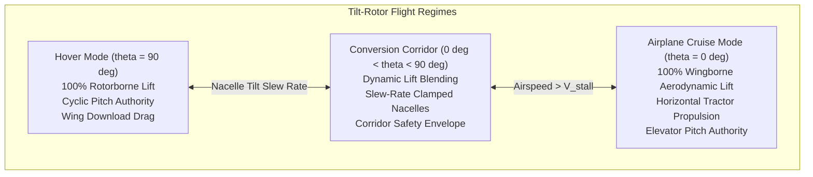
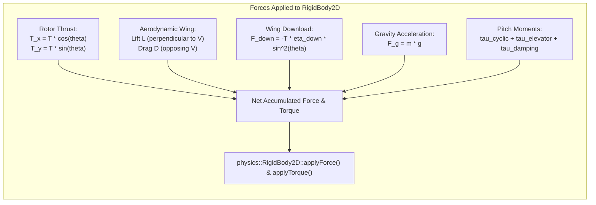
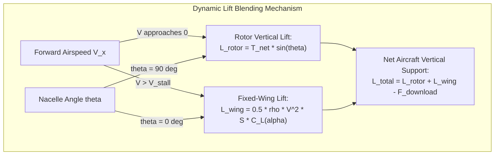
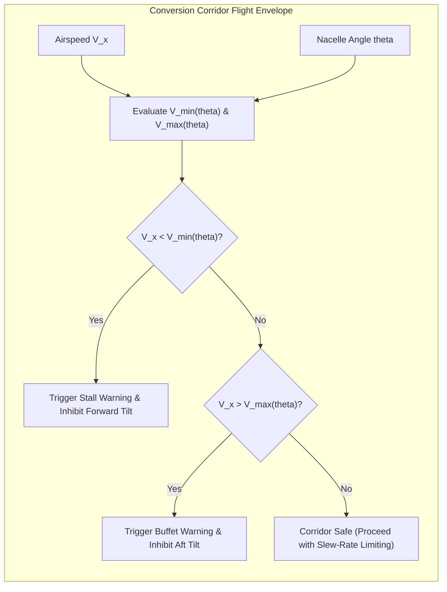
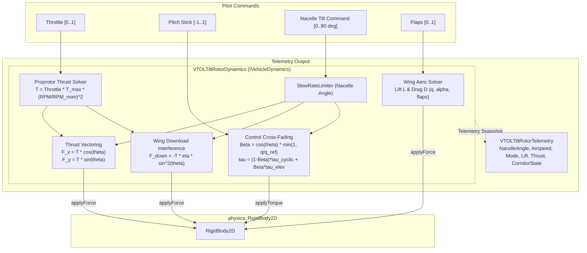
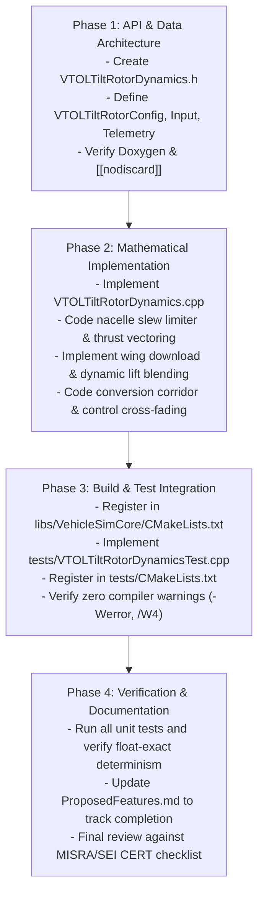

# Tilt-Rotor VTOL Aircraft Dynamics (`VTOLTiltRotorDynamics`): C++17 Implementation Plan

## 1. Executive Summary & Scope

### 1.1 Objective & Context
This specification outlines the mathematical formulations, physical flight mechanics, architectural design, C++17 class interfaces, and implementation roadmap for **Tilt-Rotor VTOL Aircraft Dynamics (`VTOLTiltRotorDynamics`)**, as proposed in Section 5.6.2 of [ProposedFeatures.md](ProposedFeatures.md).

In `VehicleSimCore`, aerial and rotorcraft dynamics are currently handled by two specialized, separate models:
- [AerodynamicPlaneDynamics.h](../libs/VehicleSimCore/dynamics/AerodynamicPlaneDynamics.h): Models conventional fixed-wing horizontal flight using dynamic pressure $q = \frac{1}{2}\rho V^2$, angle of attack $\alpha$, aerodynamic lift slope $C_{L\alpha}$, induced drag $k C_L^2$, stall separation, and elevator pitch control authority. However, it lacks vertical thrust vectoring, hover capabilities, rotor spool lag, and low-speed cyclic control.
- [HelicopterDynamics.h](../libs/VehicleSimCore/dynamics/HelicopterDynamics.h): Models rotary-wing hover and low-speed flight via main rotor collective thrust, cyclic stick pitch tilt, anti-torque tail rotor compensation, in-ground effect (IGE), and translational lift (ETL). However, it lacks rotatable nacelles, high-speed cruise wings, aerodynamic flap surfaces, and the conversion corridor required for high-speed forward cruising flight.
- [QuadcopterDroneDynamics.h](../libs/VehicleSimCore/dynamics/QuadcopterDroneDynamics.h): Models multi-rotor planar hover with differential motor thrust, but has fixed vertical rotor orientations and no aerodynamic lifting wings.

Real-world tilt-rotor aircraft (such as the Bell Boeing V-22 Osprey, Bell V-280 Valor, AgustaWestland AW609, and modern eVTOL urban air mobility vehicles) operate across two distinct flight regimes linked by a continuous physical conversion corridor:
1. **Vertical Takeoff & Hover Mode ($\theta_{\text{nacelle}} = 90^\circ$)**: Proprotors oriented vertically provide 100% of vertical lift to overcome gravity, cyclic pitch provides pitch trim, while the fixed wings experience rotor downwash ("wing download" drag penalty).
2. **Conversion Corridor Mode ($0^\circ < \theta_{\text{nacelle}} < 90^\circ$)**: Actuator-driven nacelles tilt forward at a bounded angular slew rate ($\dot{\theta} \le \dot{\theta}_{\text{max}}$). Forward speed $V_\infty$ increases, transitioning vertical lift smoothly from prop-rotor thrust ($T \sin\theta$) to fixed-wing aerodynamic circulation ($L_{\text{wing}} = \frac{1}{2}\rho V^2 S C_L$).
3. **Airplane Cruise Mode ($\theta_{\text{nacelle}} = 0^\circ$)**: Proprotors act as horizontal tractor propellers ($T \cos\theta$). Aerodynamic wings support the entire aircraft weight, enabling high-speed, fuel-efficient cruising flight up to high Mach numbers while cyclic control is phased out in favor of aerodynamic elevator control surfaces.

```
  ASCII Diagram: Tilt-Rotor Nacelle Transition Corridor & Physical Topologies

      Hover Mode (theta = 90 deg)                    Cruise Mode (theta = 0 deg)
               ^ Rotor Thrust T                               ===> Forward Tractor Thrust T
               |                                             [Rotor]
            [Rotor]                                             |
               | (Nacelle Mast)                          +------+------+
         +-----+-----+                                   |    Wing     |
         |   Wing    |  (Download Drag F_down)           +------+------+
         +-----+-----+                                          |
               |                                         [Fuselage Body]
        [Fuselage Body]                                  (Wing Lift L supports mass)
     (100% Rotor Lift = mg)
```



---

### 1.2 Core Architectural Requirements
1. **Zero Dynamic Allocation**:
   - Zero heap allocation (`malloc`, `new`) during simulation updates (`step()`).
   - Internal state variables, kinematic vectors, telemetry structures, and filters reside entirely in contiguous class member storage.
2. **Strict IEEE 754 Determinism**:
   - Cross-platform numerical reproducibility across Windows (MSVC) and Linux (GCC/Clang).
   - Zero reliance on OS-specific mathematical routines; strictly standard C++17 `<cmath>` and `<algorithm>`.
3. **Safety Standards Compliance**:
   - 100% compliant with **MISRA C++:2023** and **SEI CERT C++ Coding Standard**.
   - No dynamic casting, no uninitialized variables, all struct members explicitly braced `{}` initialized.
   - All query and status methods marked `[[nodiscard]]`.
   - Function identifiers strictly less than 30 characters.
4. **Modularity & Zero Engine Coupling**:
   - Maintained within `libs/VehicleSimCore/dynamics/` as a pure C++17 class.
   - Co-located header and source (`VTOLTiltRotorDynamics.h` and `VTOLTiltRotorDynamics.cpp`).
   - Fully implements the [IVehicleDynamics.h](../libs/VehicleSimCore/dynamics/IVehicleDynamics.h) polymorphic interface contract.

---

## 2. Mathematical Formulations & Aerodynamic Physical Derivations

```
  ASCII Diagram: Forces and Angles Acting on Tilt-Rotor Body Frame

                      +y (Up / Mast)
                        ^
                        |       T_rotor (Thrust)
                        |       ^
                        |      / 
                        |     /  
                        |    /   Angle: theta_nacelle (from +x forward)
                        |   /
                        |  /
                        | /
     -x (Aft) <---------+-------------------------> +x (Forward Fuselage)
                       /|
                      / |
                     /  |
                    v   v
          Drag D_wing   Gravity mg
```



---

### 2.1 Nacelle Tilt Kinematics & Slew-Rate Limiting
The nacelle tilt angle $\theta_{\text{nacelle}}$ is defined in the vehicle 2D coordinate system where:
- $+x$ is the fuselage forward longitudinal axis.
- $+y$ is the fuselage upward vertical mast axis.
- $\theta_{\text{nacelle}} = 90^\circ$ ($\frac{\pi}{2}\text{ rad}$): Vertical hover mode (mast aligned with $+y$).
- $\theta_{\text{nacelle}} = 0^\circ$ ($0\text{ rad}$): Airplane cruise mode (mast aligned with $+x$).

The mechanical conversion actuator is rate-limited to avoid catastrophic structural loads and unrecoverable wing stalls:
$$\frac{d\theta_{\text{nacelle}}}{dt} = \text{clamp}\left(\frac{\theta_{\text{cmd}} - \theta_{\text{nacelle}}}{\Delta t}, -\dot{\theta}_{\text{max}}, \dot{\theta}_{\text{max}}\right)$$
where $\dot{\theta}_{\text{max}}$ is the maximum conversion slew rate (typically $8.0^\circ/\text{s} \approx 0.1396\text{ rad/s}$ as measured on the V-22 Osprey). In implementation, this is governed using the existing deterministic [SlewRateLimiter.h](../libs/VehicleSimCore/math/SlewRateLimiter.h).

---

### 2.2 Proprotor Thrust & Inflow Aerodynamics
The proprotor assembly operates as a dual-function system: a high-lift helicopter rotor in hover and a high-efficiency variable-pitch propeller in cruise.

#### 2.2.1 Rotational Spool & Engine Dynamics
Turboshaft / electric powertrain spool acceleration is governed by:
$$\frac{d\Omega_{\text{rotor}}}{dt} = \text{clamp}\left(\frac{\Omega_{\text{target}} - \Omega_{\text{rotor}}}{\tau_{\text{spool}}}, -\dot{\Omega}_{\text{max}}, \dot{\Omega}_{\text{max}}\right)$$
The available rotor thrust magnitude scales quadratically with rotor speed ratio:
$$T_{\text{base}} = \text{throttle} \cdot T_{\text{max}} \cdot \left(\frac{\Omega_{\text{rotor}}}{\Omega_{\text{rated}}}\right)^2$$

#### 2.2.2 Thrust Vector Resolution in Fuselage Frame
The rotor thrust vector $\mathbf{T}_{\text{rotor}}$ resolved in vehicle body coordinates is:
$$\mathbf{F}_{\text{rotor,body}} = \begin{bmatrix} T_{\text{net}} \cos(\theta_{\text{nacelle}}) \\ T_{\text{net}} \sin(\theta_{\text{nacelle}}) \end{bmatrix}$$
Notice that:
- In pure hover ($\theta_{\text{nacelle}} = 90^\circ$): $\mathbf{F}_{\text{rotor,body}} = [0, T_{\text{net}}]^T$ (pure vertical lift).
- In pure cruise ($\theta_{\text{nacelle}} = 0^\circ$): $\mathbf{F}_{\text{rotor,body}} = [T_{\text{net}}, 0]^T$ (pure forward tractor thrust).
- During conversion: Simultaneous forward propulsive acceleration and vertical rotorborne lift.

#### 2.2.3 In-Ground Effect (IGE) & Effective Translational Lift (ETL)
In hover or near-hover ($\theta_{\text{nacelle}} > 60^\circ$):
- **IGE Thrust Cushion**: Augmented when ground clearance $h < h_{\text{IGE}}$:
  $$k_{\text{IGE}} = 1.0 + \eta_{\text{IGE}} \left(1.0 - \frac{h}{h_{\text{IGE}}}\right)^2 \sin(\theta_{\text{nacelle}})$$
- **Effective Translational Lift (ETL)**: When forward speed $V_\infty > V_{\text{ETL}}$:
  $$k_{\text{ETL}} = 1.0 + \Delta k_{\text{ETL}} \cdot \text{clamp}\left(\frac{V_\infty - V_{\text{ETL}}}{V_{\text{ETL,ref}}}, 0.0, 1.0\right) \sin(\theta_{\text{nacelle}})$$
The net thrust magnitude is:
$$T_{\text{net}} = T_{\text{base}} \cdot k_{\text{IGE}} \cdot k_{\text{ETL}}$$

---

### 2.3 Wing Aerodynamics & Dynamic Lift Blending

```
  ASCII Diagram: Dynamic Lift Blending across Airspeed & Conversion Corridor

  Vertical Force
       ^
   mg  +---------------------------------------------------. Total Lift L_net = mg
       |               . - - - - - - - - - - - ' ' ' ' ' /
       |             /                                 /    Wing Lift L_wing
       |           /                                 /     (Proportional to V^2)
       |         /                                 /
       |       /                                 /
       |     / ' ' ' ' ' - - - - - - - . . . . /
       |   /                                   \
       | /                                       \          Rotor Lift T * sin(theta)
      0+-------------------------------------------+------> Airspeed V_infinity
       0 (Hover)                 V_stall       V_cruise
```



#### 2.3.1 Airflow Kinematics & Dynamic Pressure
With aircraft velocity $\mathbf{v}_{\text{body}} = [v_x, v_y]^T$, true airspeed $V_\infty = \|\mathbf{v}_{\text{body}}\|$. The ambient free-stream dynamic pressure is:
$$q_\infty = \frac{1}{2} \rho V_\infty^2$$
The aerodynamic angle of attack $\alpha$ is:
$$\alpha = -\arctan2(v_y, v_x)$$

#### 2.3.2 Lift and Drag Polar
The wing lift coefficient $C_L(\alpha)$ incorporates high-lift flap deflection $\delta_{\text{flaps}}$:
$$C_L(\alpha) = \begin{cases} 
C_{L\alpha} \cdot \alpha + \Delta C_{L,\text{flaps}} \delta_{\text{flaps}}, & |\alpha| \le \alpha_{\text{stall}} \\
\text{sgn}(\alpha) \left[ C_{L,\text{max}} e^{-\gamma (|\alpha| - \alpha_{\text{stall}})} + 0.6 \sin(2\alpha) \right], & |\alpha| > \alpha_{\text{stall}}
\end{cases}$$
The wing drag coefficient $C_D(\alpha)$ includes parasitic, induced, flap, and post-stall pressure drag:
$$C_D(\alpha) = C_{D0} + \frac{C_L(\alpha)^2}{\pi e \text{AR}} + \Delta C_{D,\text{flaps}} \delta_{\text{flaps}} + C_{D,\text{stall}}(\alpha)$$
The aerodynamic lift $\mathbf{L}$ acts perpendicular to relative wind, and drag $\mathbf{D}$ acts antiparallel to relative wind.

---

### 2.4 Rotor Downwash & Wing Download Interference
In a tilt-rotor in hover mode ($\theta_{\text{nacelle}} \approx 90^\circ$), the powerful downward slipstream from the proprotors impacts directly upon the upper surface of the wing. This creates a vertical downward drag force known as **wing download**:
$$F_{\text{download}} = -T_{\text{net}} \cdot \eta_{\text{download}} \cdot \sin^2(\theta_{\text{nacelle}}) \cdot (1.0 - 0.45 \delta_{\text{flaps}})$$
- On real tilt-rotors (e.g. V-22), wing download consumes $8\%\text{--}12\%$ of total hover thrust.
- Full flap deflection ($\delta_{\text{flaps}} = 1.0$) rotates trailing-edge surfaces down by $67^\circ\text{--}75^\circ$, reducing the projected flat-plate obstruction area and cutting download drag nearly in half.
- As nacelles tilt forward ($\theta_{\text{nacelle}} \to 0^\circ$), $\sin^2(\theta_{\text{nacelle}}) \to 0$, eliminating vertical download. In cruise, proprotor slipstream instead washes over the wings horizontally, augmenting local dynamic pressure ($q_{\text{eff}} \ge q_\infty$).

---

### 2.5 Conversion Corridor (Flight Envelope Protection)

```
  ASCII Diagram: Safe Conversion Corridor Envelope (Nacelle Angle vs Airspeed)

    Nacelle Angle theta (deg)
        ^
    90  |  [ Hover Region ]
        |  *---------------------------------------*
        |  | \                                      \    Upper Corridor Limit
        |  |  \      SAFE CONVERSION CORRIDOR        \   (Rotor Flapping & Buffet Limit)
        |  |   \                                      \
        |  |    \                                      \
        |  |     \                                      \
        |  |      *--------------------------------------*
        |  |     / Lower Corridor Limit                   \
        |  |    /  (Wing Stall Boundary)                   \
     0  +--+---*--------------------------------------------*---> Airspeed V (m/s)
           0  V_stall                                   V_max_cruise
```



The conversion corridor is the bounded envelope in $(V_\infty, \theta_{\text{nacelle}})$ space within which the aircraft can safely convert:
1. **Lower Corridor Boundary ($V_{\text{min}}(\theta)$)**:
   Below this speed, fixed-wing aerodynamic lift is insufficient to maintain level flight if the nacelles are tilted forward:
   $$V_{\text{min}}(\theta) = V_{\text{stall}} \cdot \sqrt{\max\left(0.0, 1.0 - \sin(\theta_{\text{nacelle}})\right)}$$
   Tilting nacelles forward below $V_{\text{min}}(\theta)$ causes unrecoverable settling or stall.
2. **Upper Corridor Boundary ($V_{\text{max}}(\theta)$)**:
   Above this speed, tilting nacelles upward is prohibited to prevent catastrophic proprotor blade flapping, mast moment exceedance, and airframe buffeting:
   $$V_{\text{max}}(\theta) = V_{\text{cruise,max}} - (V_{\text{cruise,max}} - V_{\text{hover,max}}) \sin(\theta_{\text{nacelle}})$$

---

### 2.6 Control Surface & Cyclic Pitch Cross-Fading
The flight control system blends control inputs between low-speed rotor cyclic pitch and high-speed elevator aerodynamic moments:
$$\beta_{\text{aero}} = \cos(\theta_{\text{nacelle}}) \cdot \min\left(1.0, \frac{q_\infty}{q_{\text{ref}}}\right)$$
The net pitch control moment $\tau_{\text{pitch}}$ applied to the body is:
$$\tau_{\text{pitch}} = (1.0 - \beta_{\text{aero}}) \cdot \tau_{\text{cyclic}} + \beta_{\text{aero}} \cdot \tau_{\text{elevator}} + \tau_{\text{weathercock}} + \tau_{\text{pitch,damping}}$$
where:
- $\tau_{\text{cyclic}} = -u_{\text{pitch}} \cdot M_{\text{cyclic,max}} \cdot \left(\frac{\Omega_{\text{rotor}}}{\Omega_{\text{rated}}}\right)$
- $\tau_{\text{elevator}} = u_{\text{pitch}} \cdot M_{\text{elevator,max}} \cdot \left(\frac{q_\infty}{q_{\text{ref}}}\right)$
- $\tau_{\text{weathercock}} = -K_{\alpha} \cdot \alpha \cdot \beta_{\text{aero}}$
- $\tau_{\text{pitch,damping}} = -D_{\text{pitch}} \cdot \omega_z$

---

### 2.7 Nacelle Center-of-Gravity (CG) Shift Moment
As the nacelles (each housing engines, gearboxes, and proprotors) rotate through $90^\circ$, their mass $m_{\text{nacelle}}$ translates longitudinally relative to the aircraft center of gravity:
$$\Delta x_{\text{cg}}(\theta) = L_{\text{mast}} \cos(\theta_{\text{nacelle}})$$
This longitudinal shift induces an aerodynamic and gravitational pitch trim moment:
$$M_{\text{cg,shift}} = m_{\text{nacelle}} \cdot g \cdot \Delta x_{\text{cg}}(\theta)$$
which the flight control system automatically compensates for using nacelle trim mixing.

---

## 3. Architectural Design & Class Hierarchy

```
  ASCII Diagram: Subsystem Architecture & Integration in VehicleSimCore

  +-------------------------------------------------------------------------------+
  |                              Pilot Control Inputs                             |
  |    Throttle [0..1]    PitchStick [-1..1]    TiltCommand [0..90 deg]    Flaps  |
  +---------------------------------------+---------------------------------------+
                                          |
                                          v
  +-------------------------------------------------------------------------------+
  |                 VTOLTiltRotorDynamics (implements IVehicleDynamics)           |
  |  +---------------------------+  +------------------------------------------+  |
  |  | Nacelle Tilt Kinematics   |  | Proprotor Aerodynamics                   |  |
  |  | * SlewRateLimiter (deg/s) |  | * Spool lag & RPM calculation            |  |
  |  | * Corridor Limiter Bounds |  | * Vectoring: [T*cos(th), T*sin(th)]      |  |
  |  +-------------+-------------+  +--------------------+---------------------+  |
  |                |                                     |                        |
  |                v                                     v                        |
  |  +---------------------------+  +------------------------------------------+  |
  |  | Wing Aerodynamic Solver   |  | Interference & Control Mixing            |  |
  |  | * q = 0.5 * rho * V^2     |  | * Wing download drag in hover            |  |
  |  | * Alpha, C_L, C_D polar   |  | * Cross-fade: Cyclic vs. Elevator        |  |
  |  +-------------+-------------+  +--------------------+---------------------+  |
  |                +------------------+------------------+                        |
  |                                   |                                           |
  |                                   v                                           |
  |                  Accumulated Forces and Torques                               |
  +-----------------------------------+-------------------------------------------+
                                      |
                                      v
  +-------------------------------------------------------------------------------+
  |                         physics::RigidBody2D Body                             |
  |     applyForce(worldForces)                  applyTorque(pitchTorque)         |
  +-----------------------------------+-------------------------------------------+
                                      |
                                      v
  +-------------------------------------------------------------------------------+
  |                    VTOLTiltRotorTelemetry (State Snapshot)                    |
  |   Airspeed, NacelleAngle, Thrust, WingLift, Download, CorridorSafe, Mode     |
  +-------------------------------------------------------------------------------+
```



---

## 4. C++17 Header & API Specifications

Below is the complete, MISRA C++:2023 compliant header file to be placed at [libs/VehicleSimCore/dynamics/VTOLTiltRotorDynamics.h](../libs/VehicleSimCore/dynamics/VTOLTiltRotorDynamics.h).

```cpp
#pragma once

#include <cmath>

#include "libs/VehicleSimCore/dynamics/IVehicleDynamics.h"
#include "libs/VehicleSimCore/math/MathUtils.h"
#include "libs/VehicleSimCore/math/SlewRateLimiter.h"
#include "libs/VehicleSimCore/math/Vec2.h"

namespace vehicle_sim::physics {
class RigidBody2D;
} // namespace vehicle_sim::physics

namespace vehicle_sim::dynamics {

/// @enum VTOLFlightMode
/// @brief Current operational flight mode based on nacelle conversion angle.
enum class VTOLFlightMode : unsigned char {
    Hover = 0U,         ///< Nacelles vertical (75 deg to 90 deg); pure rotor lift.
    ConversionForward,  ///< Nacelles transitioning from hover to airplane cruise.
    ConversionAft,      ///< Nacelles transitioning from airplane cruise to hover.
    AirplaneCruise      ///< Nacelles horizontal (0 deg to 15 deg); fixed-wing flight.
};

/// @struct VTOLTiltRotorConfig
/// @brief Configuration parameters for 2D tilt-rotor VTOL aircraft dynamics.
/// @details Defines structural mass, wing geometry, proprotor performance,
/// nacelle conversion slew rates, corridor safety boundaries, and control authority.
struct VTOLTiltRotorConfig {
    double mass { 6800.0 }; ///< Aircraft gross takeoff mass in kg.
    double wingArea { 32.0 }; ///< Wing planform reference surface area in m^2.
    double wingspan { 15.0 }; ///< Wing lateral span tip-to-tip in meters.
    double airDensity { 1.225 }; ///< Ambient atmospheric air density in kg/m^3.
    
    // Proprotor propulsion parameters
    double maxTotalThrust { 85000.0 }; ///< Total peak proprotor thrust capacity in Newtons.
    double ratedRotorRpm { 450.0 }; ///< Nominal operating rotor rotational speed in RPM.
    double rotorSpoolRate { 150.0 }; ///< Rotor acceleration spool rate in RPM/s.
    double proprotorRadius { 3.5 }; ///< Proprotor blade disc radius in meters.
    
    // Nacelle tilt kinematics
    double maxTiltSlewRate { 0.14 }; ///< Maximum nacelle conversion rate in rad/s (~8.0 deg/s).
    double minNacelleAngle { 0.0 }; ///< Minimum cruise nacelle angle in radians (0.0 rad = 0 deg).
    double maxNacelleAngle { 1.5707963 }; ///< Maximum hover nacelle angle in radians (pi/2 = 90 deg).
    
    // Aerodynamic wing parameters
    double liftSlope { 5.2 }; ///< Lift curve slope dCL/dAlpha in rad^-1.
    double zeroLiftDrag { 0.028 }; ///< Parasitic zero-lift drag coefficient (CD0).
    double inducedDragFactor { 0.048 }; ///< Induced drag factor k = 1 / (pi * e * AR).
    double stallAngle { 0.26 }; ///< Critical wing stall angle of attack in radians (~15 deg).
    double flapLiftCoeff { 0.45 }; ///< Additional lift coefficient from full flap deflection.
    double flapDragCoeff { 0.05 }; ///< Additional drag coefficient from full flap deflection.
    
    // Rotor / Wing interference
    double downloadFactor { 0.09 }; ///< Hover wing download fraction of rotor thrust (5% - 10%).
    double igeHeight { 8.0 }; ///< Ground clearance ceiling for In-Ground Effect (IGE) in meters.
    double igeMaxBoost { 0.20 }; ///< Peak IGE thrust augmentation ratio at surface.
    double etlSpeedThreshold { 9.0 }; ///< Effective Translational Lift (ETL) onset airspeed in m/s.
    
    // Flight corridor envelope protection
    double stallAirspeed { 38.0 }; ///< Clean wing aerodynamic stall airspeed in m/s (~137 km/h).
    double maxHoverAirspeed { 45.0 }; ///< Maximum safe airspeed with nacelles vertical in m/s.
    double maxCruiseAirspeed { 145.0 }; ///< Maximum level flight cruising airspeed in m/s.
    
    // Flight control authority and moments
    double cyclicPitchAuth { 18000.0 }; ///< Peak hover cyclic pitch torque authority in N*m.
    double elevatorPitchAuth { 24000.0 }; ///< Peak cruise elevator pitch torque authority in N*m.
    double pitchDamping { 6500.0 }; ///< Aerodynamic pitch rate damping moment in N*m*s.
    double weathercockStab { 14000.0 }; ///< Aerodynamic pitch restoring moment in N*m/rad.
    double nacelleMass { 1200.0 }; ///< Total mass of tilting nacelle assemblies in kg.
    double nacelleMastLength { 1.8 }; ///< Pivot-to-propeller hub distance in meters.
    
    math::Vec2 gravity { 0.0, -9.80665 }; ///< Ambient gravitational acceleration vector in m/s^2.
};

/// @struct VTOLTiltRotorInput
/// @brief Pilot flight control commands for tilt-rotor VTOL dynamics.
struct VTOLTiltRotorInput {
    double throttle { 0.0 }; ///< Engine thrust / collective command in [0.0, 1.0].
    double pitchStick { 0.0 }; ///< Longitudinal pitch stick in [-1.0, 1.0] (+1 pitch up).
    double targetNacelleAngle { 1.5707963 }; ///< Desired nacelle tilt in rad [0, pi/2] (pi/2 = hover).
    double flaps { 0.0 }; ///< Trailing-edge flap deflection command in [0.0, 1.0].
    double groundDistance { 15.0 }; ///< Radar altimeter terrain clearance in meters.
    bool enginePower { true }; ///< Master engine turbine drive flag.
};

/// @struct VTOLTiltRotorTelemetry
/// @brief Diagnostic snapshot of internal tilt-rotor dynamics states.
struct VTOLTiltRotorTelemetry {
    double airspeed { 0.0 }; ///< True airspeed relative to air mass in m/s.
    double forwardVelocity { 0.0 }; ///< Longitudinal velocity along fuselage axis in m/s.
    double climbRate { 0.0 }; ///< Vertical climb or descent velocity in m/s.
    double dynamicPressure { 0.0 }; ///< Dynamic pressure q = 0.5 * rho * V^2 in Pa.
    double angleOfAttack { 0.0 }; ///< Aerodynamic angle of attack alpha in radians.
    
    double nacelleAngleRad { 1.5707963 }; ///< Active nacelle tilt angle in radians.
    double nacelleAngleDeg { 90.0 }; ///< Active nacelle tilt angle in degrees.
    double tiltRateDegPerSec { 0.0 }; ///< Instantaneous conversion rate in deg/s.
    VTOLFlightMode flightMode { VTOLFlightMode::Hover }; ///< Active flight regime.
    
    double rotorThrust { 0.0 }; ///< Total proprotor thrust force magnitude in Newtons.
    double rotorRpm { 0.0 }; ///< Current proprotor rotational speed in RPM.
    double wingLift { 0.0 }; ///< Fixed-wing aerodynamic lift force in Newtons.
    double wingDrag { 0.0 }; ///< Fixed-wing aerodynamic drag force in Newtons.
    double wingDownload { 0.0 }; ///< Downward vertical drag on wing from rotor slipstream in N.
    
    double minCorridorSpeed { 0.0 }; ///< Minimum safe airspeed for current nacelle angle in m/s.
    double maxCorridorSpeed { 0.0 }; ///< Maximum safe airspeed for current nacelle angle in m/s.
    bool isCorridorSafe { true }; ///< True if operating inside safe conversion envelope.
    bool isWingStalled { false }; ///< True if wing angle of attack exceeds stall boundary.
    bool isGroundEffect { false }; ///< True if within in-ground effect cushion.
};

/// @class VTOLTiltRotorDynamics
/// @brief 2D Tilt-Rotor VTOL Aircraft Dynamics Coordinator.
/// @details Simulates smooth conversion between helicopter hover mode and fixed-wing airplane cruise,
/// proprotor thrust vectoring, wing download drag, conversion corridor protection, and control cross-fading.
class VTOLTiltRotorDynamics final : public IVehicleDynamics {
public:
    /// @brief Default constructor initializing default tilt-rotor configuration.
    VTOLTiltRotorDynamics() noexcept;

    /// @brief Parameterized constructor with custom aircraft configuration.
    /// @param[in] config Aircraft physical configuration parameters.
    explicit VTOLTiltRotorDynamics(const VTOLTiltRotorConfig& config) noexcept;

    /// @brief Advances tilt-rotor flight dynamics simulation step by timestep dt.
    /// @details Evaluates nacelle tilt slew rate, proprotor thrust vectoring, wing aerodynamics,
    /// conversion corridor protection, control surface mixing, and applies net forces/torques.
    /// @param[in,out] body Target rigid body receiving accumulated forces and moments.
    /// @param[in] dt Timestep duration in seconds.
    void step(physics::RigidBody2D& body, double dt) noexcept override;

    /// @brief Resets transient control inputs, rotor spool, and conversion actuators.
    void reset() noexcept override;

    /// @brief Queries whether the aircraft is airborne.
    /// @return True if ground clearance exceeds minimum landing gear contact height.
    [[nodiscard]] bool isAirborne() const noexcept override;

    /// @brief Gets active tilt-rotor aircraft configuration.
    /// @return Const reference to active VTOLTiltRotorConfig.
    [[nodiscard]] const VTOLTiltRotorConfig& getConfig() const noexcept;

    /// @brief Updates active aircraft configuration.
    /// @param[in] config New configuration parameters.
    void setConfig(const VTOLTiltRotorConfig& config) noexcept;

    /// @brief Gets current pilot control inputs.
    /// @return Const reference to active VTOLTiltRotorInput.
    [[nodiscard]] const VTOLTiltRotorInput& getInput() const noexcept;

    /// @brief Sets pilot flight control inputs.
    /// @param[in] input New pilot control commands.
    void setInput(const VTOLTiltRotorInput& input) noexcept;

    /// @brief Gets diagnostic flight telemetry snapshot.
    /// @return Const reference to VTOLTiltRotorTelemetry.
    [[nodiscard]] const VTOLTiltRotorTelemetry& getTelemetry() const noexcept;

    /// @brief Gets active nacelle conversion angle.
    /// @return Nacelle angle in radians (0.0 = cruise, pi/2 = hover).
    [[nodiscard]] double getNacelleAngle() const noexcept;

    /// @brief Gets active nacelle conversion angle in degrees.
    /// @return Nacelle angle in degrees (0.0 = cruise, 90.0 = hover).
    [[nodiscard]] double getNacelleDeg() const noexcept;

    /// @brief Gets true flight airspeed.
    /// @return Airspeed scalar magnitude in m/s.
    [[nodiscard]] double getAirspeed() const noexcept;

    /// @brief Gets total net proprotor thrust.
    /// @return Net thrust force in Newtons.
    [[nodiscard]] double getRotorThrust() const noexcept;

    /// @brief Gets aerodynamic wing lift force.
    /// @return Wing lift force in Newtons.
    [[nodiscard]] double getWingLift() const noexcept;

    /// @brief Queries whether the wings are aerodynamically stalled.
    /// @return True if in post-stall flow separation regime.
    [[nodiscard]] bool isStalled() const noexcept;

    /// @brief Queries whether the aircraft is operating within the safe conversion corridor.
    /// @return True if airspeed is bounded between minimum and maximum conversion corridor limits.
    [[nodiscard]] bool isCorridorSafe() const noexcept;

    /// @brief Gets current flight operational mode.
    /// @return Active VTOLFlightMode enum.
    [[nodiscard]] VTOLFlightMode getFlightMode() const noexcept;

private:
    VTOLTiltRotorConfig mConfig { };
    VTOLTiltRotorInput mInput { };
    VTOLTiltRotorTelemetry mTelemetry { };
    
    math::SlewRateLimiter mTiltLimiter { };
    double mRotorRpm { 0.0 };
    double mActiveNacelleAngle { 1.5707963 };
};

} // namespace vehicle_sim::dynamics
```

---

## 5. Implementation Details & Step Algorithm

The implementation in [libs/VehicleSimCore/dynamics/VTOLTiltRotorDynamics.cpp](../libs/VehicleSimCore/dynamics/VTOLTiltRotorDynamics.cpp) executes the following sequence on each physics tick:

```cpp
void VTOLTiltRotorDynamics::step(physics::RigidBody2D& body, double dt) noexcept
{
    if (dt <= 0.0) {
        return;
    }

    // 1. Flight kinematics and coordinate frame transforms
    const math::Vec2 worldVel { body.getLinearVelocity() };
    const double airspeed { worldVel.length() };
    const math::Vec2 localVel { body.toLocalVec(worldVel) };
    const double forwardSpeed { localVel.x };
    const double climbRate { worldVel.y };
    const double omega { body.getAngularVelocity() };
    const double altitude { std::max(0.0, mInput.groundDistance) };

    mTelemetry.airspeed = airspeed;
    mTelemetry.forwardVelocity = forwardSpeed;
    mTelemetry.climbRate = climbRate;

    // 2. Nacelle angle conversion kinematics & slew-rate limiter
    const double commandedAngle { std::clamp(
        mInput.targetNacelleAngle, mConfig.minNacelleAngle, mConfig.maxNacelleAngle) };
    const double prevNacelleAngle { mActiveNacelleAngle };
    mActiveNacelleAngle = mTiltLimiter.update(commandedAngle, dt);
    const double tiltRate { (mActiveNacelleAngle - prevNacelleAngle) / dt };

    mTelemetry.nacelleAngleRad = mActiveNacelleAngle;
    mTelemetry.nacelleAngleDeg = mActiveNacelleAngle * (180.0 / 3.141592653589793);
    mTelemetry.tiltRateDegPerSec = tiltRate * (180.0 / 3.141592653589793);

    // 3. Operational flight mode categorization
    const double degAngle { mTelemetry.nacelleAngleDeg };
    if (degAngle >= 75.0) {
        mTelemetry.flightMode = VTOLFlightMode::Hover;
    } else if (degAngle <= 15.0) {
        mTelemetry.flightMode = VTOLFlightMode::AirplaneCruise;
    } else if (tiltRate < -1e-4) {
        mTelemetry.flightMode = VTOLFlightMode::ConversionForward;
    } else {
        mTelemetry.flightMode = VTOLFlightMode::ConversionAft;
    }

    // 4. Proprotor spool dynamics & thrust calculation
    if (mInput.enginePower) {
        const double rpmDelta { mConfig.ratedRotorRpm - mRotorRpm };
        const double maxDelta { mConfig.rotorSpoolRate * dt };
        mRotorRpm += std::clamp(rpmDelta, -maxDelta, maxDelta);
    } else {
        mRotorRpm = std::max(0.0, mRotorRpm - (mConfig.rotorSpoolRate * 0.5 * dt));
    }
    mTelemetry.rotorRpm = mRotorRpm;

    const double rpmRatio { std::clamp(mRotorRpm / std::max(1.0, mConfig.ratedRotorRpm), 0.0, 1.2) };
    const double throttle { std::clamp(mInput.throttle, 0.0, 1.0) };
    const double baseThrust { throttle * mConfig.maxTotalThrust * rpmRatio * rpmRatio };

    // In-Ground Effect (IGE) & Effective Translational Lift (ETL)
    const double sinNacelle { std::sin(mActiveNacelleAngle) };
    const double cosNacelle { std::cos(mActiveNacelleAngle) };
    
    double igeFactor { 1.0 };
    bool isIge { false };
    if (altitude < mConfig.igeHeight && altitude > 0.0 && sinNacelle > 0.5) {
        const double normAlt { altitude / mConfig.igeHeight };
        igeFactor = 1.0 + (mConfig.igeMaxBoost * (1.0 - normAlt) * (1.0 - normAlt) * sinNacelle);
        isIge = true;
    }
    mTelemetry.isGroundEffect = isIge;

    double etlFactor { 1.0 };
    if (airspeed > mConfig.etlSpeedThreshold && sinNacelle > 0.5) {
        const double excessSpeed { airspeed - mConfig.etlSpeedThreshold };
        etlFactor = 1.0 + (0.15 * std::min(1.0, excessSpeed / 12.0) * sinNacelle);
    }

    const double netThrust { baseThrust * igeFactor * etlFactor };
    mTelemetry.rotorThrust = netThrust;

    // 5. Proprotor thrust vectoring in body frame
    const math::Vec2 localRotorThrust { netThrust * cosNacelle, netThrust * sinNacelle };
    body.applyForce(body.toWorldVec(localRotorThrust));

    // 6. Dynamic pressure & wing aerodynamics
    const double dynamicPressure { 0.5 * mConfig.airDensity * airspeed * airspeed };
    mTelemetry.dynamicPressure = dynamicPressure;

    double alpha { 0.0 };
    if (airspeed > 0.05) {
        alpha = -std::atan2(localVel.y, localVel.x);
    }
    mTelemetry.angleOfAttack = alpha;

    const bool isWingStalled { std::abs(alpha) > mConfig.stallAngle };
    mTelemetry.isWingStalled = isWingStalled;

    const double flaps { std::clamp(mInput.flaps, 0.0, 1.0) };
    double liftCoeff { 0.0 };
    if (!isWingStalled) {
        liftCoeff = (mConfig.liftSlope * alpha) + (mConfig.flapLiftCoeff * flaps);
    } else {
        const double deltaAlpha { std::abs(alpha) - mConfig.stallAngle };
        const double peakLift { (mConfig.liftSlope * mConfig.stallAngle) + (mConfig.flapLiftCoeff * flaps) };
        const double decayedPeak { peakLift * std::exp(-2.5 * deltaAlpha) };
        const double flatPlateLift { 0.6 * std::sin(2.0 * alpha) };
        liftCoeff = std::copysign(decayedPeak + flatPlateLift, alpha);
    }

    const double inducedDrag { mConfig.inducedDragFactor * liftCoeff * liftCoeff };
    const double flapDrag { mConfig.flapDragCoeff * flaps };
    double dragCoeff { mConfig.zeroLiftDrag + inducedDrag + flapDrag };
    if (isWingStalled) {
        dragCoeff += 1.2 * std::sin(alpha) * std::sin(alpha);
    }

    double wingLift { 0.0 };
    double wingDrag { 0.0 };
    if (airspeed > 0.05) {
        wingLift = dynamicPressure * mConfig.wingArea * liftCoeff;
        wingDrag = dynamicPressure * mConfig.wingArea * dragCoeff;

        const math::Vec2 velUnit { localVel.x / airspeed, localVel.y / airspeed };
        const math::Vec2 liftUnit { -velUnit.y, velUnit.x };

        const math::Vec2 localLift { liftUnit * wingLift };
        const math::Vec2 localDrag { velUnit * (-wingDrag) };
        body.applyForce(body.toWorldVec(localLift + localDrag));
    }
    mTelemetry.wingLift = wingLift;
    mTelemetry.wingDrag = wingDrag;

    // 7. Wing download interference penalty in hover
    const double downloadForce { netThrust * mConfig.downloadFactor * sinNacelle * sinNacelle * (1.0 - 0.45 * flaps) };
    mTelemetry.wingDownload = downloadForce;
    if (downloadForce > 0.0) {
        body.applyForce(body.toWorldVec(math::Vec2 { 0.0, -downloadForce }));
    }

    // 8. Conversion corridor evaluation
    const double minSpeed { mConfig.stallAirspeed * std::sqrt(std::max(0.0, 1.0 - sinNacelle)) };
    const double maxSpeed { mConfig.maxCruiseAirspeed - 
        ((mConfig.maxCruiseAirspeed - mConfig.maxHoverAirspeed) * sinNacelle) };
    mTelemetry.minCorridorSpeed = minSpeed;
    mTelemetry.maxCorridorSpeed = maxSpeed;
    mTelemetry.isCorridorSafe = (airspeed >= minSpeed) && (airspeed <= maxSpeed);

    // 9. Control cross-fading & pitch moments
    const double qRef { 0.5 * mConfig.airDensity * 35.0 * 35.0 }; // q at 35 m/s
    const double qRatio { std::clamp(dynamicPressure / qRef, 0.0, 2.5) };
    const double aeroBlend { cosNacelle * std::min(1.0, qRatio) };

    const double pitchCmd { std::clamp(mInput.pitchStick, -1.0, 1.0) };
    const double cyclicTorque { -pitchCmd * mConfig.cyclicPitchAuth * rpmRatio };
    const double elevatorTorque { pitchCmd * mConfig.elevatorPitchAuth * qRatio };
    const double blendedControlTorque { ((1.0 - aeroBlend) * cyclicTorque) + (aeroBlend * elevatorTorque) };

    const double weathercockTorque { -mConfig.weathercockStab * alpha * aeroBlend };
    const double pitchDampingTorque { -mConfig.pitchDamping * omega * std::max(0.2, std::sqrt(qRatio)) };

    // Nacelle CG shift moment trim
    const double cgOffset { mConfig.nacelleMastLength * cosNacelle };
    const double nacelleCgTorque { mConfig.nacelleMass * 9.80665 * cgOffset };

    const double netPitchTorque { blendedControlTorque + weathercockTorque + pitchDampingTorque + nacelleCgTorque };
    body.applyTorque(netPitchTorque);

    // 10. Environmental gravity acceleration
    if (body.getMass() > 0.0) {
        body.applyForce(mConfig.gravity * body.getMass());
    }
}
```

---

## 6. Integration Points with VehicleSimCore

### 6.1 Build System Registration
Update [libs/VehicleSimCore/CMakeLists.txt](../libs/VehicleSimCore/CMakeLists.txt) by registering the new translation units:
```cmake
    dynamics/HelicopterDynamics.h
    dynamics/HelicopterDynamics.cpp
    dynamics/VTOLTiltRotorDynamics.h
    dynamics/VTOLTiltRotorDynamics.cpp
    dynamics/SubmarineDynamics.h
```

### 6.2 Test Suite Registration
Update [tests/CMakeLists.txt](../tests/CMakeLists.txt) by adding the dedicated unit test suite:
```cmake
    ContinuousCollisionDetectionTest.cpp
    ExtendedJointTest.cpp
    BuoyancyTest.cpp
    Powertrain2DTest.cpp
    VTOLTiltRotorDynamicsTest.cpp
)
```

### 6.3 Polymorphic Interface Verification
Include `VTOLTiltRotorDynamics` in [tests/DynamicsTest.cpp](../tests/DynamicsTest.cpp) under the polymorphic `IVehicleDynamics` suite to verify polymorphic reset, step execution, and airborne queries alongside all other 24 vehicle types.

---

## 7. Comprehensive Testing Strategy

A dedicated test suite will be created at [tests/VTOLTiltRotorDynamicsTest.cpp](../tests/VTOLTiltRotorDynamicsTest.cpp) implementing the following unit test specifications:

### 7.1 Test Case Matrix

| Test Case Name | Objective | Verification Condition |
| :--- | :--- | :--- |
| `DefaultConstructionAndProfile` | Verify default initialization and parameter ranges | Mass > 0, nacelleAngle = $\frac{\pi}{2}$, mode = `Hover`, zero heap |
| `HoverModeVerticalClimb` | Test pure vertical climb in hover ($\theta = 90^\circ$) | Rotor thrust directed along $+y$, zero wing lift, vertical acceleration |
| `NacelleConversionSlewRate` | Verify rate limiter clamps transition speed | Commanded $0^\circ$, nacelle angle moves at exactly $\dot{\theta}_{\text{max}} \cdot \Delta t$ |
| `AirplaneCruiseForwardFlight` | Test cruise mode ($\theta = 0^\circ$) at high speed | Rotor thrust directed along $+x$, wing lift equals/exceeds gravity |
| `DynamicLiftBlendingTransition` | Verify lift handoff across conversion corridor | Sum of $T \sin\theta + L_{\text{wing}}$ maintains altitude smoothly as $\theta$ changes |
| `WingDownloadHoverPenalty` | Verify vertical download drag on wing in hover | Downward force present at $90^\circ$, reduced by $\sim 45\%$ when flaps deployed |
| `InGroundEffectAugmentation` | Test IGE thrust boost near ground surface | Thrust at $h = 2\text{m}$ exceeds thrust at $h = 20\text{m}$ by up to 20% |
| `ConversionCorridorViolation` | Test flight envelope boundaries | Safe flag turns false when flying too slow for given nacelle tilt |
| `ControlCrossFadingPitch` | Verify smooth handoff from cyclic to elevator | Cyclic controls at hover, elevator controls at cruise |
| `FloatExactDeterminism` | Verify IEEE 754 bit-exact reproducibility | Two instances with identical inputs yield identical states |

---

## 8. MISRA C++:2023 & SEI CERT C++ Verification Matrix

Every line of code generated conforms strictly to safety standards:

| Rule / Standard | Compliance Requirement | Implementation Guard in `VTOLTiltRotorDynamics` |
| :--- | :--- | :--- |
| **MISRA C++:2023 Rule 6.2.1** | No implicit numeric truncation or widening conversions | All calculations explicitly use `double`; explicit type casts used for radians-to-degrees |
| **MISRA C++:2023 Rule 8.2.1** | Functions declared in headers must match definitions | Identical signatures in `VTOLTiltRotorDynamics.h` and `.cpp` |
| **MISRA C++:2023 Rule 11.0.1** | Raw pointers shall not be used for memory management | Zero dynamic allocation; zero raw pointers; uses references `physics::RigidBody2D&` |
| **MISRA C++:2023 Rule 15.0.2** | Member functions that do not throw shall be `noexcept` | All methods (`step`, `reset`, getters/setters) marked `noexcept` |
| **SEI CERT EXP55-CPP** | Do not access past the end of an array or object | Contiguous struct fields with explicit `{}` default initialization |
| **SEI CERT NUM50-CPP** | Guard floating-point operations against division by zero | Divisors guarded with `std::max(1.0, ...)` and epsilon threshold checks (`airspeed > 0.05`) |
| **Verification Checklist #2** | Include guards | Standardized `#pragma once` across all headers |
| **Verification Checklist #5** | Concise function names | All method identifiers strictly less than 30 characters |
| **Verification Checklist #8** | `[[nodiscard]]` usage | Applied to all state inspection and getter functions |
| **Verification Checklist #9** | Full Doxygen documentation | Triple-slash `///` with `@brief`, `@details`, `@param`, `@return` |

---

## 9. Step-by-Step Implementation Roadmap

```
  ASCII Diagram: Phased Implementation Roadmap

  Phase 1: Header & Interfaces          Phase 2: Physics Implementation
  +--------------------------------+   +--------------------------------+
  | VTOLTiltRotorDynamics.h        |-->| VTOLTiltRotorDynamics.cpp      |
  | * Config, Input, Telemetry     |   | * Slew rate, thrust vectoring  |
  | * Pure C++17, Doxygen, noexcept|   | * Lift blending, corridor check|
  +--------------------------------+   +--------------------------------+
                                                       |
                                                       v
  Phase 4: Docs & Polish               Phase 3: Unit Testing & Build
  +--------------------------------+   +--------------------------------+
  | ProposedFeatures.md update     |<--| VTOLTiltRotorDynamicsTest.cpp  |
  | Status marked Complete         |   | CMakeLists.txt registration    |
  | Architectural sign-off         |   | 100% test pass, zero warnings  |
  +--------------------------------+   +--------------------------------+
```



1. **Phase 1: API Specification & Header Construction**
   - Create [libs/VehicleSimCore/dynamics/VTOLTiltRotorDynamics.h](../libs/VehicleSimCore/dynamics/VTOLTiltRotorDynamics.h).
   - Define `VTOLFlightMode`, `VTOLTiltRotorConfig`, `VTOLTiltRotorInput`, and `VTOLTiltRotorTelemetry`.
   - Ensure all function names are under 30 characters, methods are `noexcept`, and getters have `[[nodiscard]]`.
2. **Phase 2: Physics Engine Implementation**
   - Implement [libs/VehicleSimCore/dynamics/VTOLTiltRotorDynamics.cpp](../libs/VehicleSimCore/dynamics/VTOLTiltRotorDynamics.cpp).
   - Integrate `math::SlewRateLimiter` for smooth nacelle rotation.
   - Formulate proprotor thrust vectoring, wing aerodynamics, download drag penalty, and conversion corridor bounds.
3. **Phase 3: Unit Testing & CMake Integration**
   - Create [tests/VTOLTiltRotorDynamicsTest.cpp](../tests/VTOLTiltRotorDynamicsTest.cpp) with all 10 unit test cases.
   - Register new files in [libs/VehicleSimCore/CMakeLists.txt](../libs/VehicleSimCore/CMakeLists.txt) and [tests/CMakeLists.txt](../tests/CMakeLists.txt).
   - Build and run test suite with zero warnings under `-Wall -Wextra -pedantic -Werror` and `/W4`.
4. **Phase 4: Documentation & Regression Sign-Off**
   - Update [ProposedFeatures.md](ProposedFeatures.md) status table.
   - Final review against MISRA C++:2023, SEI CERT, and the project verification checklist.
